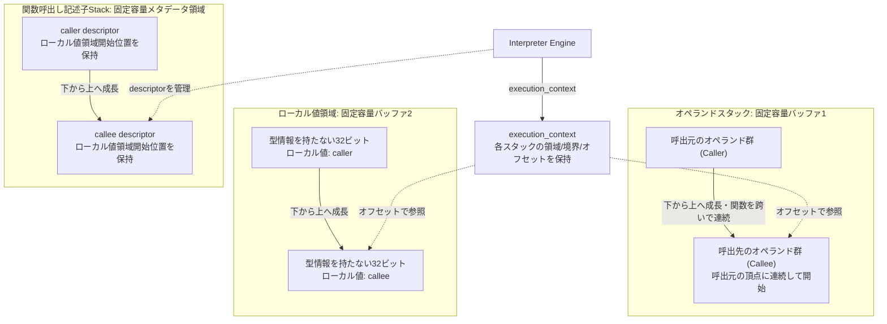
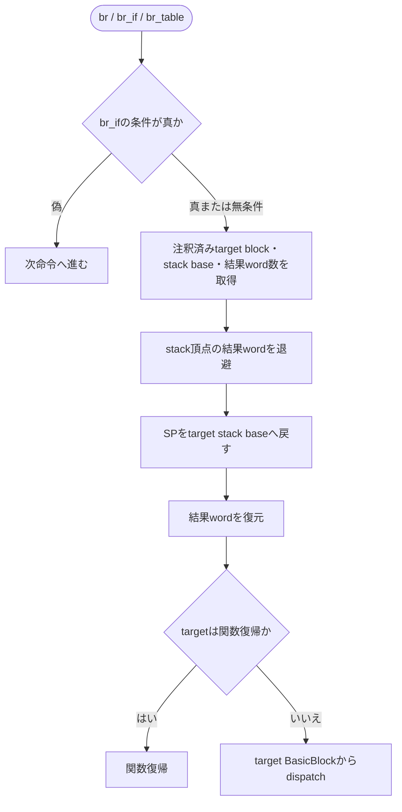
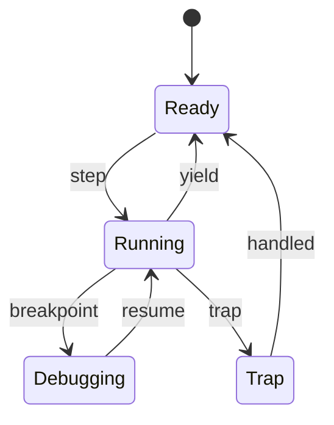
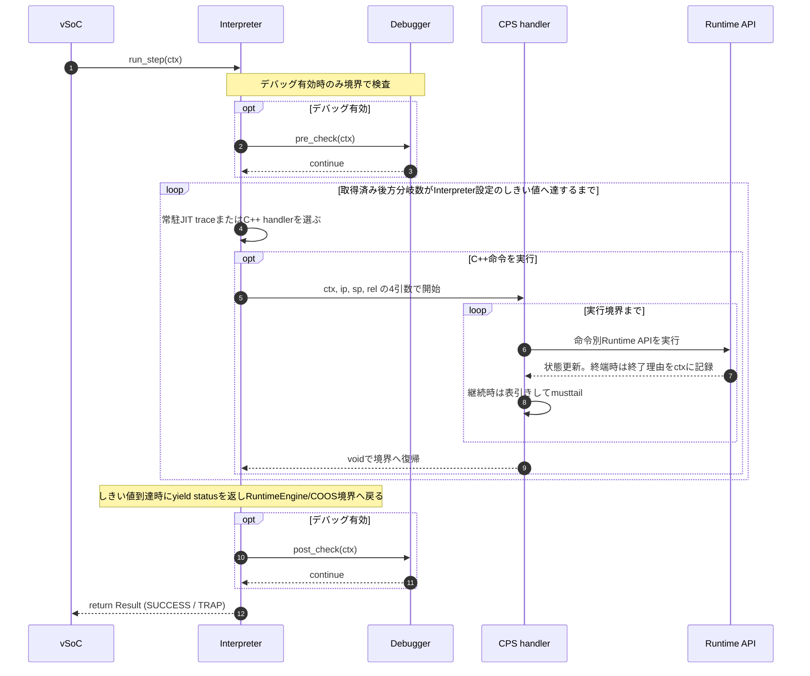
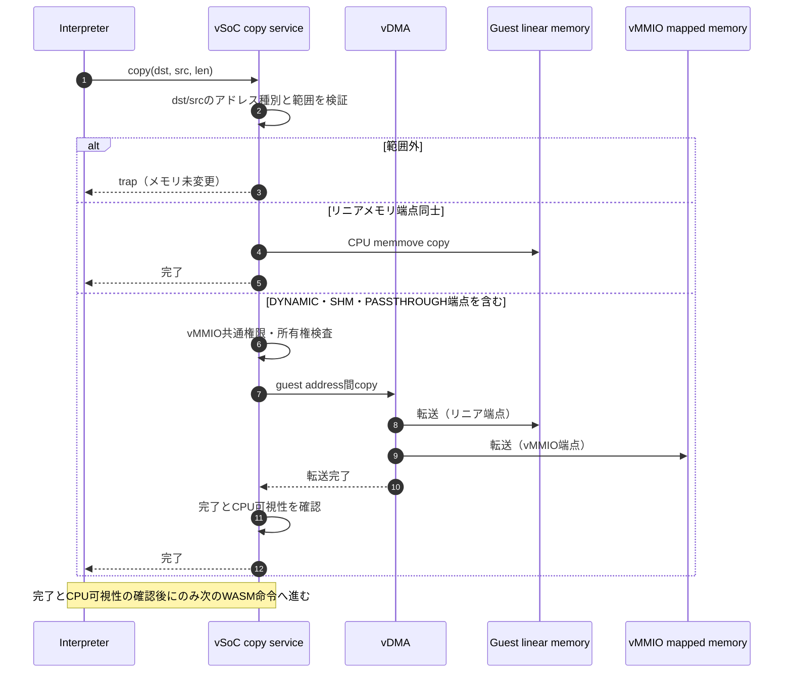
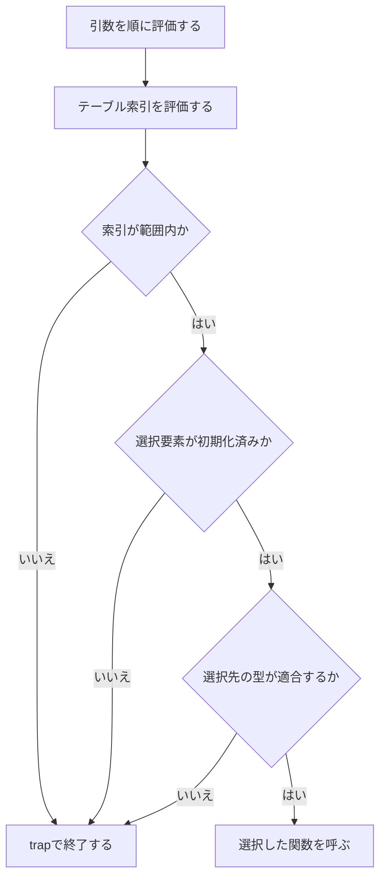

# Interpreter 実行系設計書 {VERIFY_FORMAL} {VERIFY_LLM} {VERIFY_BENCHMARK}
<!-- evidence:
     formal: formal/vsoc_state_model.py
     formal: formal/interpreter_stack_model.py
     formal: formal/interpreter_indirect_call_model.py
     formal: formal/interpreter_control_flow_model.py
     formal: ../../specs/formal/wasm_bulk_memory_model.py
     concept: concepts/interpreter_concept.py
     concept: concepts/indirect_call_concept.py
     concept: concepts/bulk_memory_concept.py
     benchmark: ../../../experiments/pysim/benchmarks/interpreter/bench_fc.py
     benchmark_record: ../../../experiments/pysim/benchmarks/BENCHMARK_REPORT.md
     test: docs/qa/tier2_runtime/interpreter_test_spec.md
     test: docs/qa/specs/wasm_instruction_set_test_spec.md
-->

## 1. コンセプト
<!-- traceability: {ThreadedInterpreter} {LowLatencyJIT} {InterpreterContextStackless} {RuntimeHotspotProfiler} {RuntimeEventSink} -->
Interpreter は、WASM命令をスレッドインタープリタ方式で実行する。低レイテンシと小フットプリントを設計目標とする。本コンポーネントは Execution Engine (`executor`) の一部として設計する。JITと実行状態を共有する。実行環境は `execution_context` の論理フィールドとして参照する。独立した `vsoc_runtime* env` 引数は設けない。

組み込み環境の極小メモリ制約（`{GLOBAL_Policy_Memory}`）を遵守する。WASM opcodeはFlashやROM上の関数コードビューから直接フェッチする。中間命令オブジェクト（`Instr`）は生成しない。opcodeから命令オブジェクトを引く表も設けない。これを {DirectBytecodeExecution} と定義する。 <!-- definition: {DirectBytecodeExecution} -->

ネイティブ経路では、Loaderが各BasicBlockのコード範囲を個別にパースし、実行時の計算に必要な導出値だけをInterpreter注釈プールへ格納する。LEB128即値はロード時に復号し、その生の値は格納しない。`local.get`、`local.set`、`local.tee`は論理local番号をフレーム語offsetと幅へ変換する。メモリ命令はalignmentを捨て、実効offsetを格納する。固定幅の`f32.const`/`f64.const`は元コードから読む。注釈はアラインメントなしの8bit列で、BasicBlockごとの開始byte offsetを記録する。`rel`はプールを指す`const uint8_t*`であり、導出値と可変命令幅を読むたびに進める。制御移動を終える命令は、次の`ip`、BasicBlock index、`rel`を確定してからCPSを終了する。Interpreter dispatcherは確定済みの状態を使い、到達先の再判定や`rel`の再計算を行わない。`block`、`loop`、`else`、`end`はCPSを終了しない構文デリミタである。`call`、`call_indirect`、関数復帰はそれぞれ制御移動を終える。

Loaderは制御命令の各遷移先、関数入口、関数復帰先について、PCに加えて自然順`module.blocks`のindexと注釈開始位置を用意する。`execution_context.current_block_index`は実行中または次に開始するBasicBlockを指す。終端命令のRuntime APIは、遷移先の`ip`、index、`rel`を実行状態へ設定して`false`を返す。Interpreter dispatcherはその状態をそのまま使って次のhandlerを呼ぶ。dispatcherはPCで到達先を再判定せず、block metadataから`rel`を再計算しない。遷移先indexとPCの一致は、遷移先を確定した側でassertする。

注釈プールはlittle-endianの導出値を格納する。local参照はu16フレーム語offsetとu8幅、global/function/type/block indexはu16、符号拡張済み`i32.const`はu32、`i64.const`はu64、メモリ実効offsetはu32である。各branch recordはu16 target block index、u8 stack base word数、u8保持結果word数を持つ。`br_table`はu16 label countとdefaultを含む4-byte record列を格納する。命令幅はLEB128即値を持つ命令だけu8で記録し、固定幅命令はopcodeから進める。`br_table`はlabel countと4-byte record列から長さを求める。PC/即値offset表は設けない。CPS handler間では命令カーソルpointer`ip`を引き回し、通常命令ごとに`execution_context.ip`をメモリへ書き戻さない。コンテキストの`ip`はtrapまたは実行境界で同期する。

Loaderは制御構造の対応終端、elseの継続先、各branch labelの遷移先とoperand stack復元値をロード時に解決する。ネイティブInterpreterは注釈プールのblock indexとstack情報を使い、実行時の制御フレーム配列、branch depthの探索、PCからのBasicBlock検索を行わない。Python参照経路も静的な分岐メタデータから同じ遷移を行う。制御ネスト上限はロード時に検査する（`{GOTCHA-INTP-05}`）。 <!-- definition: {GOTCHA-INTP-05} -->

## 2. アーキテクチャ分類

Loaderの型解析は関数ごとの最大オペランド高を32bit語単位で記録する。`i64`と`f64`は2語として数える。関数入口は引数をローカルへ移した後のSPに最大高を加え、容量を一度検査する。失敗時は`OPERAND_STACK_CAPACITY`を返し、本体の副作用を実行しない。資源不足時は、従来先に到達したWASM実行時trapより容量trapを優先する。容量が足りる場合のWASM trapの種類と順序は維持する。Python参照実装も同じ入口検査を行う。命令ごとの上限検査と関数途中のJIT trace入口の容量検査は行わず、検証済みスタック遷移を内部契約とする。制御フレーム容量検査は設けない。
<!-- traceability: {META_3TierSeparation} -->
本コンポーネントは **Tier 2 Runtime** に属する。WASM バイトコードの逐次実行とRuntimeの実行境界を担当する。Tier 3 JIT拡張は選択可能なプラグインとして接続し、固定長トレース記述子を介して共有実行コンテキスト上で協調する。

Native実装の命令意味論と固定スタック操作は`native_wasm_operations.cxx`に置く。CPSハンドラ表と実行境界のディスパッチは`native_interpreter.cxx`に置く。Tier 3のJIT Runtime API変換は`jit_runtime_apis.cxx`からTier 2の命令処理手続きを呼ぶ。ヘッダには宣言と型を置き、実装ファイルをincludeしない。両ライブラリはThinLTOで翻訳単位間の直接呼び出しを最適化する。 <!-- traceability: {META_3TierSeparation} {InterpreterContextStackless} -->

静的なopcodeハンドラ表と命令属性表は読み取り専用とする。Nativeの表は`constexpr`で構築する。Python参照実装は固定容量領域で表を構築して不変列へ凍結し、可変の構築用領域を保持しない。ポインタ表のホスト上の再配置と、対象機での物理ROM配置は別に確認する。 <!-- traceability: {GLOBAL_Policy_Memory} {DirectBytecodeExecution} -->

## 3. 静的モデル

### 3.1 データ構造
- **`Interpreter`**: WASM命令の実行、コンテキスト管理、外部環境との連携をカプセル化した主要クラスである。
- **`execution_context`**: 仮想CPUレジスタ、コードビュー、CallStackビュー、現在のローカルフレーム基点、Interpreter注釈プールカーソル、現在のBasicBlock index、スタックの基点・現在位置・上限、LOOP後方辺のyield状態、リニアメモリビューを保持する構造体である。x86-64 C ABIの実体は144バイトである。
- **`オペランドスタック`（オペランドスタック）**: WASM のオペランド値のみを保持する固定容量スタックである。コールチェーン全体を貫く1本の連続バッファとして動作する。呼び出しを跨いでもスタックは連続して配置される。
- **`ローカル値領域`（ローカル変数スタック）**: コールチェーン全体で共有する固定容量の、型情報を持たない32ビットワード領域である。型タグ、実行時オブジェクト、関数実行記述子を格納しない。各論理ローカルは必要な1または2ワードだけを占有し、同一フレーム内で幅を混在できる。Loaderは関数ごとにローカルのワードオフセットを表へ記録し、ワード幅は保持済みWASM型から導出する。サイズ表は保持しない。アクセス先は `local_base + local_offsets[local_index]` から得る。
- **関数実行記述子領域**: 関数ごとの実行メタデータを保持する独立した固定容量領域である。各記述子は`ローカル値領域`内のフレーム開始位置を保持し、`ローカル値領域`にはローカル値だけを置く。
- **Interpreter注釈プール**: LoaderがBasicBlockごとに実行時の導出値を格納する8bit列である。LEB128の復号結果は格納しない。branch recordはu16 target block index、u8 stack base word数、u8保持結果word数を持ち、`br_table`はu16 label countとdefault込みの4-byte record列を持つ。
- **BasicBlock注釈開始位置**: 各基本ブロックがInterpreter注釈プールのbyte offsetと、通常継続およびLOOP後方辺のBasicBlock indexを保持する。関数viewは入口BasicBlock indexを持ち、CallFrameは復帰BasicBlock indexを持つ。命令を含まない復帰PCはゼロ長メタデータであり、JIT候補選定から除外する。終端命令は確定した遷移先のbyte offsetを`rel`へ設定する。命令単位のoffsetは保持しない。
- **`interpreter_config`**: 2本の値スタック容量と `FB_CONF_INTERPRETER_YIELD_THRESHOLD` など、Interpreterの不変な構成情報である。LOOP後方分岐の回数しきい値はInterpreterが所有し、RuntimeEngineは変更・上書きしない。

### 3.2 内部ブロック図

2本の値領域は互いに独立した固定容量バッファであり、それぞれ自身の容量に対してオーバーフローを検知する。関数実行記述子領域は値領域とは別に容量を検査する。`オペランドスタック`は関数呼び出しを跨いで連続するため、戻り値を呼出元へコピーする必要がない。呼出先の戻り値は共有`オペランドスタック`に残り、関数復帰処理が記述子を破棄して呼出元の実行を再開する。

### 3.3 主要なクラス・構造体・配列・定数

#### インタープリタ（Interpreter）クラス
依存関係（vSoC環境等）と実行状態、命令属性情報をカプセル化する。

`Interpreter.call()` はPython参照実装の呼出状態生成、実行完了、トラップ確定、および結果検証を行う。C++インタープリタは `NativeInterpreter.call()` で単独実行できる。JIT実行ではInterpreter構成時にネイティブ実行拡張を接続し、同じ `NativeInterpreter.call()` から同じdispatcherを実行する。RuntimeEngineにJIT選択や実行APIを持たせない。

実行に必要な `memory`、host function、vMMIO 等の外部資源は呼び出し側が明示的に注入し、インタープリタがJIT専用の初期化経路を持たない（{GOTCHA-INTP-18}）。 <!-- definition: {GOTCHA-INTP-18} --> テスト専用の起動・検査APIを製品側へ追加せず、テストは製品の実行境界を通じて状態を構成する（{GOTCHA-INTP-20}）。 <!-- definition: {GOTCHA-INTP-20} -->

| 項目名 | 機能と役割 | 型分類 | サイズ・制約 |
| :--- | :--- | :--- | :--- |
| 統合コンテキスト | 実行コンテキストおよびリニアメモリ情報（ctx） | 構造体への参照 | `execution_context` (非所有) |
| Opcode属性表 | 処理区分を含む各命令の属性フラグを保持する | 固定長メタデータ | ハンドラ表とは独立して関数ポインタを保持しない |
| Opcodeハンドラ表 | opcodeから同じ関数型の命令ハンドラを選ぶ | 固定長関数ポインタ表 | `ctx`, `ip`, `sp`, `rel`の順で受け取る。主opcodeは256エントリ、`0xFC`の副opcodeは対応部分集合の固定長表。未対応スロットは境界復帰ハンドラへ割り当てる |

#### 実行コンテキスト（execution_context）
<!-- traceability: {PositionIndependentCode} {ContextPointerRegister} {MemoryBoundaryCheck} {EnvironmentPointer} {WasmCodeSectionPC} -->
WASMゲストの全実行状態を管理する。JIT/Interpreter 共通の仮想CPUレジスタ群として設計する（{GOTCHA-INTP-11}）。 <!-- definition: {GOTCHA-INTP-11} -->

**独立した固定構造体としての配置**:
`execution_context` は、単体の固定サイズ構造体（x86-64 C ABIでは144バイト）である。オペランド領域、ローカル値領域、関数呼出し記述子領域のいずれにもインライン配置されない。ハンドラは`ctx`、命令カーソルポインタ`ip`、オペランドスタック位置ポインタ`sp`、Interpreterでは注釈プール、JIT traceではtrace定数プールを指すカーソル`rel`を受け取る。`ctx`、`ip`、`sp`は実行状態を表す3論理引数である（{CPS_3Args}）。現在のローカルフレーム基点は`ctx.local_base`から取得し、スタック頂点値は共有オペランド領域から読む。物理レジスタと退避規則は対象ABIで定義する。

ハンドラ連鎖中のスタック頂点は`sp`だけで管理する。`execution_context.stack_pointer`はCPS列がtrap・yield・Runtime境界で終了するときに`sp`を保存するフィールドであり、命令ごとには更新しない。基本ブロック末尾では`ip`と`sp`を実行コンテキストへ保存する（{GOTCHA-INTP-09}）。 <!-- definition: {GOTCHA-INTP-09} -->

##### 4引数の引渡し（ディスパッチ境界）

| 項目名 | 機能と役割 | 型分類 | 物理レジスタ |
| :--- | :--- | :--- | :--- |
| 実行コンテキスト | `execution_context` 構造体自身へのポインタ | 論理引数 | 第1引数。物理レジスタは対象ABIで定義する |
| 命令カーソル (`ip`) | アクティブ関数コード内の現在命令を指すポインタ | 論理引数 | 第2引数。物理レジスタは対象ABIで定義する |
| オペランド領域の現在位置 (`sp`) | `オペランドスタック` の現在位置を指すポインタ | 論理引数 | 第3引数。物理レジスタは対象ABIで定義する |
| 相対データカーソル (`rel`) | Interpreter命令の即値・幅またはJIT traceの定数値を指すポインタ | 論理引数 | 第4引数。物理レジスタは対象ABIで定義する |

##### `execution_context` 物理メモリレイアウト（x86-64 C ABIでは144バイト）
<!-- definition: {ExecutionContext_Layout} -->

`execution_context` の固定フィールドを示す。値スタックとローカル値領域は、それぞれ基点・現在位置・上限をポインタで保持する。ハンドラ連鎖中の現在位置は`sp`引数が保持し、`execution_context.stack_pointer`は実行境界へ戻る際の保存値としてだけ使う。ローカルフレーム基点は`execution_context.local_base`に保持する。CallStack深さは `call_stack->size` から取得し、コンテキストへ複製しない。

| 項目名 | 機能と役割 | 型分類 | サイズ・オフセット |
| :--- | :--- | :--- | :--- |
| 命令カーソル (`ip`) | アクティブ関数コード内の命令オフセット | 32bit符号なし | 4バイト（`+0x00`） |
| alignment padding | `stack_base`を8-byte境界へ揃える | padding | 4バイト（`+0x04`） |
| 値スタック基点 (`stack_base`) | 値スタック配列の先頭 | ポインタ | 8バイト（`+0x08`） |
| 値スタック位置 (`stack_pointer`) | 次の空きwordを指す値スタック位置 | ポインタ | 8バイト（`+0x10`） |
| 値スタック上限 (`stack_limit`) | 値スタックの終端 | ポインタ | 8バイト（`+0x18`） |
| ローカル値領域基点 (`local_stack_base`) | ローカル値配列の先頭 | ポインタ | 8バイト（`+0x20`） |
| ローカル値領域位置 (`local_stack_pointer`) | 次の空きwordを指すローカル値領域位置 | ポインタ | 8バイト（`+0x28`） |
| ローカル値領域上限 (`local_stack_limit`) | ローカル値領域の終端 | ポインタ | 8バイト（`+0x30`） |
| 実行フラグ (`runtime_flags`) | CPSの終端理由と実行状態を表す | ビット集合 | 4バイト（`+0x38`）。CPS終端理由は実行境界内だけで使用し、ABI復帰前に消去する |
| コードサイズ (`code_size`) | 現在の関数コードの有効バイト数 | 32bit符号なし | 4バイト（`+0x3C`） |
| コード (`code`) | 現在の関数コードの非所有基点 | ポインタ | 8バイト（`+0x40`） |
| CallStack (`call_stack`) | CallFrame配列の非所有アドレス | ポインタ | 8バイト（`+0x48`） |
| CallFrame基点 (`call_frame_base`) | CallFrame配列の基点 | ポインタ | 8バイト（`+0x50`） |
| LOOP後方分岐回数 (`loop_jump_count`) | 協調yieldまでに取得した後方辺数 | 32bit符号なし | 4バイト（`+0x58`） |
| LOOP後方分岐しきい値 (`loop_jump_threshold`) | 協調yieldまでの後方辺数 | 32bit符号なし | 4バイト（`+0x5C`） |
| リニアメモリ基点 (`linear_memory_host_base`) | 実行中に借用する実体メモリの先頭 | ポインタ | 8バイト（`+0x60`） |
| リニアメモリ有効サイズ (`linear_memory_size`) | 実体メモリに対する境界検査長 | 64bit符号なし | 8バイト（`+0x68`） |
| trap (`trap_code`) | 最後に発生したtrap | 32bit符号なし | 4バイト（`+0x70`） |
| alignment padding | `local_base`を8-byte境界へ揃える | padding | 4バイト（`+0x74`） |
| ローカルフレーム基点 (`local_base`) | 現在の関数ローカル領域の先頭 | ポインタ | 8バイト（`+0x78`） |
| Interpreter注釈プール位置 (`rel`) | Runtime API境界からInterpreterを再開するときの注釈カーソル | ポインタ | 8バイト（`+0x80`） |
| 現在のBasicBlock index (`current_block_index`) | 実行中または次に開始するBasicBlockの自然順index | `block_index_t`（u16、`0xFFFF`は無効値） | 2バイト（`+0x88`、後続2byteを予約） |

構造体全体は144バイトである。コード、各値スタックの基点・位置・上限、CallStack配列とその基点、現在のローカルフレーム基点、Interpreter注釈プール位置は非所有ポインタとしてコンテキストから参照する。`ip`は関数コード内のオフセットであり、CPS handlerの`sp`と`rel`はそれぞれ共有オペランド領域と注釈領域を指す。通常命令は注釈の読出しに伴い`rel`を前進させる。制御移動を終えるRuntime APIは確定した遷移先の`ip`、BasicBlock index、`rel`を設定して`false`を返す。Interpreter dispatcherは確定済み状態を使い、到達先の再判定や`rel`の再計算をしない。スタック頂点値は共有値スタックを正本とし、ABI引数に複製しない。`current_block_index`は同じ実行コンテキストを手がかりにLoaderのBasicBlock metadataを直接参照するために使う。CallStack深さはCallStack自身から読み、重複フィールドを持たない。 `{ExecutionContext_Layout}`

Python参照実装の疎な`control_map`はロード時に確定したdelimiter、ELSE継続先、分岐先とstack復元値を保持する。ネイティブ実装は同じ導出値をInterpreter注釈プールに保持する。制御命令は実行時に制御フレームを積まず、branch時は対象stack baseへSPを戻して結果wordを復元する。

**共有オペランドスタックの不変条件 (`{GOTCHA-INTP-01}`)**: <!-- definition: {GOTCHA-INTP-01} -->
オペランドスタックをWASM値の格納先とする。`sp`はスタック頂点の次を指す。Interpreter/JIT間の遷移、Runtime API呼出し、トラップ処理は共有オペランドスタックと`execution_context`を正本にする。x64とARMv8-Mの双方でこの状態契約を使う。

**WASM Code section 相対PC (`{GOTCHA-INTP-04}`)**: <!-- definition: {GOTCHA-INTP-04} -->
WASM PCは、当該モジュールのCode section payload先頭を0とし、命令の最初のバイトまでのオフセットで表す。payload先頭はsection IDとpayload lengthのLEB128の後であり、payload内の関数数、各body size、locals宣言を含む。PCは関数body内オフセットでも、WASMファイル全体のオフセットでも、ネイティブアドレスでもない。LoaderはCode section payloadのファイル位置を保持し、命令のファイル位置からpayload先頭位置を減じてPCを得る。

この座標はDWARF for WebAssemblyが定めるCode section相対命令位置と一致する。命令アドレスは命令先頭バイトを指す。参照: [WebAssembly tool-conventions: DWARF Code Addresses](https://github.com/WebAssembly/tool-conventions/blob/main/Dwarf.md#code-addresses)、[Wasmtime: DWARF PC lookup](https://docs.wasmtime.dev/api/src/wasmtime/runtime/trap.rs.html)。

PCはモジュール内の座標であり、異なるモジュール間では同じ値を取り得る。PCをキーとしてモジュール横断の状態を保持する場合は`(module_id, pc)`を使う。モジュール内では各命令がCode section payload内の異なるバイト位置を持つため、関数を含めた命令位置を一意に識別できる。

#### 関数呼出し記述子
<!-- traceability: {PositionIndependentCode} {ContextPointerRegister} {MemoryBoundaryCheck} {EnvironmentPointer} {CPS_3Args} -->
関数実行記述子は、実行時メタデータである。
function view、ローカル・オペランド基点、復帰位置、境界停止PCを結び付ける。関数番号は共有function viewから取得する。
`ローカル値領域`のフレーム開始位置は32-bit wordポインタで保持する。
記述子はCallStackへ固定容量で積む。関数メタデータは記述子の生成時に一度取得して紐付け、命令実行中にコードや制御表を再検索しない（{GOTCHA-INTP-14}）。 <!-- definition: {GOTCHA-INTP-14} --> ローカル値は現在の空き位置から確保し、記述子に保存した開始位置から参照する。`オペランドスタック`と`ローカル値領域`は型情報を持たない32ビットワード列であり、記述子、戻りPC、型情報を格納しない。各ローカルの開始オフセットとワード数はLoaderが関数単位で前計算し、値は必要なワード数だけ連続配置する。値の有効ワードは関数シグネチャに従う。i32/f32は1ワード、i64/f64は2ワードを占有する（{GOTCHA-INTP-13}）。 <!-- definition: {GOTCHA-INTP-13} -->

`local.get`, `local.set`, `local.tee` は型を解釈しない。CallFrameの `local_offsets[local_index]` と関数viewの `local_types[local_index]` から対象ワード範囲を取得する。必要な 1 または 2 ワードをオペランドスタックとの間で生コピーする（{GOTCHA-INTP-15}）。 <!-- definition: {GOTCHA-INTP-15} --> 型付き演算や ABI 境界の読み書きのみが、既知の型に応じて値を解釈する。オペランドスタックはコール境界を跨いで連続する。`call`と`call_indirect`はC++命令ハンドラから呼ぶRuntime APIが処理し、定義済みゲスト関数ならC++ dispatcherが呼出し先へ継続する。import・host callはInterpreter/RuntimeEngine境界へ戻す。関数復帰はC++命令ハンドラから呼ぶRuntime APIが処理し、最上位の完了をRuntimeEngineへ返す。JIT traceからhost callを実行する経路は設けない。Fireball host import の `fireball_call` も実行エンジンからホストハンドラへ直接接続し、SYSCTL/vMMIO syscall vectorを経由しない（{GOTCHA-INTP-21}）。 <!-- definition: {GOTCHA-INTP-21} -->

値スタックは型タグを持たない32ビットワード列とし、型は各命令の操作側で解釈する（{GOTCHA-INTP-12}）。 <!-- definition: {GOTCHA-INTP-12} -->

**ローカルレイアウト表 (`{GOTCHA-INTP-22}`)**: <!-- definition: {GOTCHA-INTP-22} -->
Loaderは関数の全ローカルについて、引数を先頭に含むワードオフセットとワード数を一度だけ計算する。ローカルは連続配置し、i32/f32は1ワード、i64/f64は2ワードを占有する。同一フレーム内でサイズを混在できる。
オフセット表はローカルあたり16bitで保持する。幅は保持済みlocal typeから決定する。`local_slot_count` は全ローカルのワード数の合計である。
Interpreterはローカルindexから事前計算済みword offsetとlocal typeを参照し、幅を型から決定する。JITコンパイラは16ローカル以下を対象とし、`local.get`、`local.set`、`local.tee`を操作・型別のステンシルへlowerする。local indexはtrace compile時にword offsetへ解決し、命令エンコーダがそのoffsetをtrace codeへ直接書き込む。offset別のステンシルvariantやRuntime API経路は設けない。17ローカル以上のtraceはcompile refusalとなる。
**設計理由**: 32bitローカルだけのフレームの使用量を保ち、wide localがある場合も他のローカルへ余分なslotを割り当てない。RAM追加分はロード時offset表の2バイト/ローカルである。

| 項目名 | 機能と役割 | 型分類 | サイズ・制約 |
| :--- | :--- | :--- | :--- |
| 関数実行view (`function_view`) | コード、ローカル配置、型、引数・結果情報をまとめた不変メタデータ | 非所有ポインタ | 関数ロード時のviewを共有 (`+0x00`) |
| ローカル値領域基点 (`local_base`) | 当該関数のローカル値の先頭 | ポインタ | 固定長ローカル配列内の非所有位置 (`+0x08`) |
| オペランドスタック基点 (`operand_stack_base`) | 当該関数のbranch stack base | ポインタ | 8バイト (`+0x10`) |
| 復帰PC (`return_ip`) | 呼出し元で再開する関数内オフセット | 32bit符号なし | `+0x1C` |
| 復帰BasicBlock index (`return_block_index`) | 呼出し元で再開するBasicBlockの自然順index | `block_index_t`（u16、`0xFFFF`は無効値） | `+0x24` |
| JIT境界の次PC (`boundary_next_pc`) | 現在のJIT境界に対応する静的後続PC | 32bit符号なし | dispatch中のみ有効 (`+0x20`) |
| JIT境界のloop先 (`boundary_loops_to`) | 現在のJIT境界に対応するloop後方PC | 32bit符号なし | dispatch中のみ有効 (`+0x24`) |

CallFrameには呼出しごとに変わるポインタと復帰情報だけを置く。コード参照・コードサイズ・制御表・ローカル表と個数・引数数・結果アリティは`function_view`にあるため複製しない。関数番号も共有function viewに一度だけ置く。`rel`はCallFrameに保持しない。終端命令のRuntime APIが遷移先のBasicBlock metadataから注釈開始offsetを選び、`false`を返す前に`rel`へ設定する。関数復帰Runtime APIも保存した復帰indexから呼出し元BasicBlock metadataを参照し、復帰先の`ip`、index、`rel`を設定する。x86-64のCallFrameは40バイト、32枠のCallStackは1288バイトである。呼出し時は呼出し先記述子を積み、引数を含むローカル値をローカル値領域の現在位置から確保する。復帰時は記述子を取り除き、保存した復帰indexから呼出し元BasicBlock metadataを直接参照して再開し、ローカル値領域を保存位置まで一括で戻す。 `{CallFrame_Layout}` <!-- definition: {CallFrame_Layout} -->

#### 静的制御遷移メタデータ
<!-- traceability: {CPS_3Args} {ContextPointerRegister} {PositionIndependentCode} -->
制御の対応関係はLoaderで解決し、実行時ControlFrame配列を持たない。`if`の偽辺、`else`からの継続、各branch labelのtarget block、stack base、保持する結果word数を静的メタデータへ書く。Native Interpreterは注釈プールから読む。Python参照経路は同じ値を疎なloader metadataから読む。制御ネスト上限はWASM読み込み時に検査し、実行時制御フレーム容量trapは発生しない。

`br`、`br_if`、`br_table`は分岐先のstack baseまでSPを戻し、上端にある最大2結果wordを保存・復元する。LOOP分岐はloop body headへ進み、block/if分岐はmatching END直後へ進む。関数ラベルへのbranchは関数復帰を起動する。`br_if`の条件が偽ならスタック上の条件だけを消費し、分岐edgeを適用しない。`if`と`else`の遷移先もロード済みPCから決める。JIT境界では共有execution contextとWASM PCを保ち、処理済み命令を再実行しない。

結果wordは対象stack baseへの復元時に保持する。`{GOTCHA-INTP-02}` <!-- definition: {GOTCHA-INTP-02} -->

共有値領域の巻き戻しは保存位置へのSP更新で行い、要素ごとのpopを繰り返さない。`{GOTCHA-INTP-16}` <!-- definition: {GOTCHA-INTP-16} -->

`if`の偽辺は静的なelseまたはend後のtargetへ移り、実行時制御フレームを生成しない。`{GOTCHA-INTP-03}` <!-- definition: {GOTCHA-INTP-03} -->

JIT終端命令も命令ごとの注釈済みbranch edgeを使う。ブロック全体の継続先で上書きしない。`{GOTCHA-INTP-06}` <!-- definition: {GOTCHA-INTP-06} -->

Python参照経路のControlMapキャッシュは4枠の固定容量とする。PCを16、8、4、2bitずつ右シフトした値とのXORで縮約し、下位2bitを枠番号にする。各枠は元のPCを照合し、衝突時は静的表から再取得する。`{GOTCHA-INTP-19}` <!-- definition: {GOTCHA-INTP-19} -->

#### 静的branch edgeによるスタック復元
<!-- traceability: {GOTCHA-INTP-01} {GOTCHA-INTP-02} {GOTCHA-INTP-03} {GOTCHA-INTP-06} {CallFrame_Layout} -->

#### インタープリタ構成（interpreter_config）
<!-- traceability: {META_ConfigurableSystem} -->
インタープリタの動作パラメータを定義する。

| 項目名 | 機能と役割 | 型分類 | サイズ・制約 |
| :--- | :--- | :--- | :--- |
| `オペランドスタック` 容量 | `オペランドスタック` バッファの総バイト数 | バイト数 | 32bit符号なし (`FB_CONF_INTERP_OPSTACK_SIZE`) |
| `ローカル値領域` 容量 | `ローカル値領域` バッファの総バイト数 | バイト数 | 32bit符号なし (`FB_CONF_INTERP_LOCALSTACK_SIZE`) |
| Yield 閾値 | 次の yield までに実行を許可する命令（トレース）数 | 回数 | 32bit符号なし |

#### オプコードハンドラ / トレース実行（opcode_handler / exec_trace）
<!-- traceability: {JIT_RuntimeAPI} {ContextPointerRegister} {EnvironmentPointer} {JIT_RegisterMapping} {CPS_3Args} -->
命令ハンドラとJITトレースはいずれも`ctx`, `ip*`, `sp*`, `rel*`の4引数を持ち、先頭3引数が実行状態、`rel`がInterpreter注釈プールまたはJIT trace定数プールのカーソルを表す。物理レジスタと退避規則は対象ABIで定義する。opcode属性表は処理区分を含む命令属性をフラグで保持する。独立した固定長のopcodeハンドラ表は命令ハンドラの関数ポインタを保持する（{GOTCHA-INTP-07}）。 <!-- definition: {GOTCHA-INTP-07} -->

各C++命令の意味論と状態更新は命令別のRuntime APIが担当する。CPS命令ハンドラは対応するRuntime APIを呼び、正常継続ならopcodeから次のhandlerを選んで`[[clang::musttail]]`で継続する。Runtime API自身はopcodeをディスパッチしない。Tier 2のopcode handler表はInterpreter用CPS handlerだけを保持する。JIT Runtime API wrapperとopcode対応表はTier 3 JITが所有し、Interpreter handler表へ登録しない。`br`、`br_if`、`br_table`、`return`、`call`、`call_indirect`を処理するRuntime APIは遷移先の`ip`、BasicBlock index、`rel`を確定してから`false`を返す。CPS handlerは後続handlerを呼ばない。Interpreter dispatcherは確定済み状態で次のhandlerを呼び、遷移先判定と`rel`再計算をしない。`block`、`loop`、`else`、`end`の構文デリミタはCPSを終了しない。Interpreter注釈領域の`rel`は注釈値の読出しに伴って前進させる。基本ブロック内の各opcodeで属性を検査して`rel`を再同期する処理や、命令ごとのoffset表は設けない。

インタープリタハンドラは次のハンドラへ4引数`ctx`, `ip*`, `sp*`, `rel*`を末尾呼び出しで渡す（{GOTCHA-INTP-08}）。 <!-- definition: {GOTCHA-INTP-08} --> Interpreter Runtime APIとJIT Runtime APIは`bool`を返す。`true`は通常継続、`false`はtrapまたはCPS終端を`ctx`に記録して後続実行を止めることを示す。InterpreterのCPS handlerは`false`時に次のhandlerを呼ばず、JIT stencilは`false`時にabort slotへ分岐する。CPS列の終端理由は`ctx.runtime_flags`に記録する。制御移動を終えるRuntime APIは`ip`、BasicBlock index、`rel`を確定してから`false`を返す。Interpreter dispatcherは終了理由を読み、確定済みの遷移先状態をそのまま次の呼出しへ使う。終端遷移を再判定せず、`rel`を再計算しない。Interpreter handlerは`void`を返す。JIT trace entryは同じ4引数の`bool`関数である。正常完了時は未接続chain targetに到達した終端dispatcherだけがmetadata pointerを一時的に`ctx.rel`へ置き、`body_end_ip`を`ctx.ip`へ設定して`true`を返す。JIT traceはopcodeごとに次PCへ進めず、Runtime API stencilはtrap位置をAPI呼出し前に記録できる。終端dispatcherが正常完了位置を設定した後、C++ dispatcherは`ctx.ip`を上書きしない。trap/CPS exit時は`false`を返す。

命令実行中のWASMトラップは、例外を送出せず、具体的なトラップコードと終了理由を`ctx`に保持してハンドラが値を返さず戻る（{GOTCHA-INTP-10}）。 <!-- definition: {GOTCHA-INTP-10} --> トラップを受け取った実行器は全アクティブフレームを破棄して実行結果を確定する。以後の命令は実行しない。同期的な公開APIは、確定済みトラップを正常な戻り値（特に`None`）と混同せず、呼び出し側へ明示する。これはハンドラ内部の実行経路とは分離する。実装上の注意点に対応する検証条件と確認状況は [interpreter_test_spec.md](docs/qa/tier2_runtime/interpreter_test_spec.md#継続状態と資源境界の検証) を参照する。

| 項目名 | 機能と役割 | 型分類 | サイズ・制約 |
| :--- | :--- | :--- | :--- |
| 実行シグネチャ | Interpreter handlerの継続渡し関数型 | 関数ポインタ | `void (execution_context*, const uint8_t* ip, uint32_t* sp, const uint8_t* rel)`。先頭3引数は実行状態、`rel`はInterpreterでは注釈プール、JIT traceではtrace定数プールを指す。JIT trace entryは同じ4引数で`bool`を返し、正常完了時はchain終端metadataを一時的に`execution_context.rel`へ渡す。正常完了位置`body_end_ip`を`execution_context.ip`へ設定するのは終端dispatcherだけであり、Runtime API stencilはtrap位置をAPI呼出し前に記録できる。Runtime APIも別契約で`bool`を返し、`false`は後続実行を止める。物理呼出し規約は対象ABIで定義する |
| レジスタ割り当て | 対象ABIの引数レジスタマッピング | 対象ABI依存 | x64は [`jit_abi.md`](docs/components/tier2_runtime/jit_abi.md) の規約に従い、ARMv8-MはTBD |

WASM オプコードごとのスタック遷移およびハンドラ実装マトリクスは `{ThreadedInterpreter}` を参照する。

**スタック頂点値の引渡しと対称性**:
実行環境情報は `execution_context` に含め、独立した環境引数を追加しない。第3論理引数`sp`はスタック頂点の次を指すポインタであり、TOS値を別引数として渡さない。Interpreter handlerとJIT trace entryは`ctx`, `ip`, `sp`, `rel`を共有する。Interpreter handlerの`rel`は注釈プールを、JIT trace entryの`rel`はtrace定数領域を指す。物理レジスタと値の保持方法は対象ABIに従う。

x64ではトレースが共有オペランド領域へ状態を書き戻す。ARMv8-Mのレジスタ割当とトレース境界同期はTBDである。

## 4. 動的モデル

### 4.1 アルゴリズム
<!-- traceability: {ThreadedInterpreter} {JIT_RuntimeAPI} {Interpreter_LazyJITSwitch} {LowLatencyJIT} {SimpleJITArchitecture} {ContextPointerRegister} {ADR_LoopBackedgeYield} {ADR_InterruptRescheduleGeneration} {GOTCHA-INTP-06} {GOTCHA-INTP-15} -->
- **Threaded Dispatch with Continuation Passing Style**:
  - opcodeで固定長の関数ポインタ表を引き、命令に対応するハンドラへ継続する。
  - Interpreter handlerは`ctx`, `ip`, `sp`, `rel`の4引数で`void`を返す。JIT trace entryは同じ4引数で`bool`を返す。正常完了時はchain終端にある共通dispatcherだけがmetadata pointerを一時的に`execution_context.rel`へ格納し、`body_end_ip`を`execution_context.ip`へ設定する。先頭3引数は実行状態、`rel`はInterpreterでは注釈プール、JIT traceではtrace定数プールを指す。InterpreterとJITのRuntime APIも`bool`を返し、`true`なら通常継続、`false`なら`execution_context`に記録したtrapまたはCPS終端に従って後続実行を止める。InterpreterのCPS handlerは`true`のときだけ次のhandlerを表引きして末尾継続する。JIT stencilは`false`のときだけabort slotへ分岐する。制御移動を終える命令は遷移先の`ip`、BasicBlock index、`rel`を確定してから`false`を返す。Interpreter dispatcherは確定済み状態を使い、遷移先判定と`rel`再計算を行わない。Runtime API自身は次のhandler/opcodeをdispatchしない。
  - JIT trace entryは正常完了で`true`、trap/CPS exitで`false`を返す。Interpreter dispatcherは`true`の後にmetadataからstackとInterpreter `rel`を更新し、未実行の終端命令を処理して次BasicBlockを解決する。trace entryが`false`を返した場合はmetadataを読まず、`execution_context`の終了理由を判定する。
  - 実行コンテキスト、命令カーソルポインタ、オペランド領域の現在位置の物理的な保持方法は対象ABIに従う。
  - opcode属性表は各命令の処理区分と属性フラグを保持する。命令ディスパッチには独立したopcodeハンドラ表を使う。
  - LoaderはBasicBlockごとの注釈開始byte offsetを記録する。制御移動を終える命令は選んだ遷移先のoffsetを`rel`へ設定してから`false`を返す。`rel`にはframe offset、ブロック・関数・型index、符号拡張済み整数定数、メモリ実効offsetなど実行時に使う導出値だけを8bit packedで保持する。LEB128の復号結果は格納せず、固定幅float payloadは元コードに残す。可変LEB128命令だけu8命令幅を記録し、固定長命令はopcode、`br_table`はlabel countとtarget列から長さを求める。
  - CPS handlerは命令カーソルポインタ`ip`を次handlerへ渡す。Runtime APIは`rel`から命令幅recordを読み、`ip`を進める。実行中に元WASMコードのLEB128を再走査しない。`execution_context.ip`はtrapまたは実行境界で同期する。
  - 継続可能な命令ではCPS handlerが次opcodeの表引きを行い、`[[clang::musttail]]` による末尾呼び出しで`ctx, ip*, sp*, rel*`を次のhandlerへ渡す。Runtime APIは状態を更新してhandlerへ戻るだけである。push/popは共有オペランドスタックを更新し、次の命令は`sp[-1]`から頂点値を読む。
  - 関数終端は`end`、`return`、関数外への分岐のRuntime APIで確定する。命令ディスパッチごとに関数終端を判定しない。実行入口のPC範囲は`assert`で契約違反を検出する。
  - 実行拡張の有無は別々の実行入口で確定する。拡張ありの入口は関数ポインタを`assert`で検証し、命令実行中は拡張ポインタの有無を判定しない。
- **JIT コードとの完全な呼び出し規約整合 (Low-Overhead Interop)**:
  - JIT コンパイラが生成する機械語トレース（`exec_trace`）は、`ctx`, `ip*`, `sp*`にtrace定数領域カーソル`rel*`を加えた4論理引数シグネチャに従う。物理呼出し規約は対象ABIで定める。
  - **インタープリタから JIT への遷移**: Interpreterの3論理引数にtrace定数領域先頭の`rel*`を加えた4つの論理引数を対象ABIの新規入口処理へ渡す。入口処理が必要なレジスタを退避した後にJIT本体へ進む。インタープリタから直接チェイン専用の入口へ入ってはならない。
  - **JIT trace exit後のInterpreter dispatcher継続**: trace終端後、Interpreter dispatcherが共有状態を受け取り、制御終端handler、次BasicBlockのtrace、または通常handlerを選択して処理を続ける。trapやRuntime API境界では終了理由をRuntimeへ返す。JIT拡張はtrace bodyを呼び出さない。
- **WASM命令とRuntime APIの連携 (`JIT_RuntimeAPI`)**:
  - 各命令のRuntime APIはスタックボトム相対でオペランドとスタック長を更新する。正常時はRuntime APIが更新状態を継続へ渡し、終端時は実行理由をコンテキストへ記録して戻る。
  - JITは演算を直接生成するか、opcodeに対応するRuntime API stencilへlowerする。Runtime API内の数値演算loweringは対象ABIに従い、ARMv8-MのFPU構成と物理ABIはTBDとする。
- **分岐Runtime APIの処理**:
  - 深さ相対の分岐命令は、Loader注釈に記録したtarget block index、stack base word数、結果word数を読む。
  - Runtime APIは注釈値からoperand stackを復元し、対象BasicBlockへ遷移する。実行時に制御frameを探さない（`{GOTCHA-INTP-06}`）。
- **スタック Pruning (Label Arity対応)**:
  - `br` 命令等の実行時、ジャンプ先の復帰情報に記録された結果個数に基づき、スタック上のオペランドを残してスタック長を保存済みスタック長まで巻き戻す。
- **JIT実行構成**:
  - Python参照経路は `Interpreter.call()` でPythonハンドラを駆動する。
  - C++インタープリタ経路は `NativeInterpreter.call()` でC++ハンドラを駆動する。
  - C++インタープリタ＋JIT経路は、拡張を接続した `NativeInterpreter.call()` から同じC++ dispatcherを実行する。
  - RuntimeEngineはSystemから要求されたscheduler境界までInterpreterを進める。C++ Interpreter dispatcherは共有実行状態を渡して任意のネイティブ実行拡張へtrace lookupを依頼する。JIT拡張はcard-stateとBasicBlockの常駐参照からentry情報を返す。Interpreter dispatcherがentryを呼び出し、trace bodyを実行する。InterpreterはJITキャッシュ状態や操作APIを所有しない。
- **関数復帰の番兵**:
  - JITは `return` 命令や専用RETURN sentinelを生成しない。
  - JITトレースは `return` 直前で終了して共有状態を同期する。
  - インタープリタの return ハンドラが呼ぶRuntime APIが callee の `関数呼出し記述子` をポップする。
  - トップレベル復帰のみ専用の RETURN sentinel PC を生成し、RuntimeEngine が実行完了を判定する。
- **Hotspot検知と JIT候補ビットマップによるバイパス (`JIT_CandidateBitmap`)**:
  - JIT拡張有効かつホットスポット検出有効の構成では、Interpreterは解決済みblock indexとブロック開始PCをJIT拡張の観測入口へ渡す。候補性の判定はJIT拡張が所有するマスクで行う。Interpreterは関数入口・制御処理の完了でブロック開始PCを保持する。通常のメモリ操作からの復帰では新しい開始PCを設定しない。通常命令を実行したブロックだけを通知し、JIT拡張が所有する固定容量リングへ実行順に直接記録する。最初のbody命令を観測した後は通常の無観測ハンドラ列へ移る。制御命令だけの区間は通知しない。Runtime Event Sinkや時計を通さない。履歴の所有・容量・分析境界はTier 3 [`jit_runtime.md`](docs/components/tier3_plugins/jit_runtime.md) が定める。
  - 定義済みゲスト関数の呼出しではC++ dispatcherが呼出し先フレームを選び、呼出し先の適格ブロックも同じ実行区間でJIT拡張へ通知する。JIT拡張は履歴容量の超過では最古の履歴を上書きして実行を続ける。後方分岐のyield条件に達した場合はRuntime実行境界へ戻る。
  - Interpreterがyield、Runtime API境界、trap、関数完了のいずれかでRuntime実行境界へ戻るとき、JIT拡張は所有する未分析履歴を一度だけ分析する。カード更新とコンパイル要求登録はJIT拡張内部の実行境界で行う。JIT trace/chainだけを実行した区間では履歴記録・分析を行わない。
  - JIT cache・候補mask・compile queueの所有者はTier 3 JITランタイムであり、C++ Interpreter handlerやvSoCはそれらを直接参照しない。
  - 候補ビットマップで該当block先頭PCが候補外（`0`）の場合、JITランタイムは追跡登録を省略する。compile効果のないblockの追跡overheadを抑える。
- **トレース境界での協調的Yield (`ADR_LoopBackedgeYield`)**:
  - インタープリタは命令ごとの精密なカウンタ評価や中断を行わない。
  - Interpreterは `FB_CONF_INTERPRETER_YIELD_THRESHOLD` を所有する。C++ディスパッチャはその値を使って常駐JITトレースとC++ handlerを連続実行し、取得済み後方分岐数がしきい値に達した境界で状態とyield statusを返す。Tier 3 JIT拡張は同じ境界内で履歴処理を行い、RuntimeEngineは返されたstatusをvSoCへ伝える。C++ Interpreter単独とJIT拡張経路は同じInterpreter設定を使う。
  - 非対応命令、外部呼出し、トラップ、関数完了など、処理をC++内で続けられない境界では回数条件より先に制御を返す。
  - `co_yield` の発行と割り込み時の再スケジュール世代の観測はvSoCの責務である。vSoCはyield境界で世代観測を完了させてから`co_yield`を発行する。
  - インタープリタはコルーチンではなく単なる関数である。トレース境界での自然なレジスタ・スタック整合によりステート退避を極小化する。
- **VM観測フック**:
  - 関数、JIT、ホスト呼出、yield、trapなど意味上のRuntime境界で、Tier 2 [`runtime_observability.md`](docs/components/tier2_runtime/runtime_observability.md) のイベントをRuntime Event Sinkへ渡す。命令ごとのイベントは発行しない。ブレークポイントによる実行制御はDebuggerプラグインへ、コールグラフ集計と時間計算はGuest Profilerプラグインへ委譲する。

#### WASM インタープリタのコンセプトコード
実行可能な概念モデルは [`interpreter_concept.py`](docs/components/tier2_runtime/concepts/interpreter_concept.py) に分離する。本文書には実装言語のコードを埋め込まず、WASM実行契約と固定レイアウトのみを規定する。

#### 選択された`0xFC`命令 ({WasmFCSubset})
<!-- traceability: {WasmFCSubset} {MemoryBoundaryCheck} {JIT_RuntimeAPI} -->
Interpreterは`0xFC`の後続サブオペコードを符号なしLEB128で読み、対応表にある`0`〜`7`、`10`、`11`だけを実行する。その他の値はロード時に拒否する。直接実行入口へ未対応値が渡された場合もtrapで実行を停止する。飽和型数値変換は本書ではなく [`wasm_instruction_set.md`](docs/specs/wasm_instruction_set.md) の規則に従う。JITは同じ変換を直接生成しない場合、JIT Runtime API tableから対応APIを呼び、通常継続なら同じtrace内の後続operationを実行する。

`memory.copy`と`memory.fill`は全オペランドを確定した後に端点を検査し、不正ならメモリとオペランドstackを部分更新しない。リニアメモリ端点はサイズ範囲を検査する。`memory.copy`ではBit 31が`1`の端点にFC=13（DYNAMIC）、FC=14（SHM）、FC=15（PASSTHROUGH）を指定でき、vSoCの内部vDMAサービスを使う。転送完了とCPU可視性を確認した後に次命令へ進む。内部の同期・非同期はvSoCの転送対象別契約に従う。リニアメモリ端点同士はCPU memmoveで処理する。vMMIO端点はvMMIO共通のPTE・権限・所有権検査に従う。`memory.fill`はリニアメモリだけを対象とし、値の下位byteをCPUで反復書込みする。概念モデルは [`bulk_memory_concept.py`](docs/components/tier2_runtime/concepts/bulk_memory_concept.py) に分離する。

#### 統合 Tiered ランタイムエンジン・コンセプトコード
実行経路の統合検証は、本コンポーネントのテスト仕様書と [`vsoc_state_model.py`](docs/components/tier2_runtime/formal/vsoc_state_model.py) を参照する。ARMv8-Mの物理ABIとメモリ保護はTBDである。

### 4.2 状態遷移図
<!-- traceability: {ThreadedInterpreter} {JIT_RuntimeAPI} {Interpreter_LazyJITSwitch} {LowLatencyJIT} {SimpleJITArchitecture} {ADR_LoopBackedgeYield} -->

### 4.3 内部シーケンス
<!-- traceability: {ThreadedInterpreter} {JIT_RuntimeAPI} {Interpreter_LazyJITSwitch} {LowLatencyJIT} {SimpleJITArchitecture} {ADR_LoopBackedgeYield} -->
#### Interpreter 実行シーケンス

#### `memory.copy`の内部vDMA委譲
<!-- traceability: {WasmFCSubset} {VDMA} {MemoryBoundaryCheck} -->
内部の同期・非同期とCOOS待機は、[`runtime_vsoc.md`](docs/components/tier2_runtime/runtime_vsoc.md)の転送対象別契約に従う。
本図は、Interpreterが転送完了とCPU可視性の確認を待って次命令へ進む境界を示す。

## 5. インターフェース定義

### 5.1 公開API
外部から利用可能なオブジェクト指向APIを定義する。

#### 初期化（initialize）

| 項目 | 内容 |
| :--- | :--- |
| 機能概要 | 実行コンテキスト、固定容量スタック、および関数メタデータの初期状態を構築する。 |
| シグネチャ | `initialize(config: const参照) -> 結果型` |
| 引数 | `config`: インタープリタ構成 (`interpreter_config`) への読取専用参照 |
| 戻り値 | 結果型 (成功時は空、失敗時はエラー情報) |
| 事前条件 | 設定値がシステム制限（メモリサイズ等）に適合していること。 |
| 事後条件 | 初期化に成功し、WASM命令の実行を開始できる状態になる。 |
| 不変条件 | 初期化後に設定値を変更できないこと。 |
| エラー時の挙動 | メモリ確保失敗時は初期化を中断し、エラー値を返す。 |
| 補足 | デバッガは実行境界から停止・ステップを制御する。 |

#### 実行ステップ (`run_step`)

Pythonのブロック実行経路は要求されたブロック境界を検査する専用のCPSハンドラ表を選ぶ。通常の関数呼び出しは境界検査を含まない表を選ぶ。Debuggerの型引数は既存の選択軸を使い、境界検査用の型タグを加える。実行時に全命令で`kStopAtBlockBoundaryFlag`を読む分岐は通常の関数呼び出しに置かない。
<!-- traceability: {META_RecoveryStrategy} -->

| 項目 | 内容 |
| :--- | :--- |
| 機能概要 | WASM命令を1トレース分実行し、実行コンテキストを更新する。 |
| シグネチャ | `run_step(ctx: 可変参照) -> 結果型` |
| 引数 | `ctx`: 実行コンテキスト (`execution_context`) への可変参照 |
| 戻り値 | 結果型 (正常終了時は SUCCESS、トラップ発生時はリカバリー戦略カテゴリ `recovery-strategy-category` ) |
| 補足 | 必要に応じて内部的に JIT コードへのジャンプを行い、JIT/Interpreter を透過的に切り替える。 |

#### 割り込みイベント同期 (`sync_interrupts`)
<!-- traceability: {META_RecoveryStrategy} -->

| 項目 | 内容 |
| :--- | :--- |
| 機能概要 | COOS協調境界で受け取った汎用 `interrupt-event` を、実行コンテキストの保留イベント領域へ反映する。 |
| シグネチャ | `sync_interrupts(ctx: 可変参照, event: interrupt-event) -> void` |
| 引数 | `ctx`: 実行コンテキスト (`execution_context`) への可変参照 `event`: `vector_id`、`source_id`、`cause_code`、`payload0`、`payload1` の固定5ワード |
| 戻り値 | void (なし) |
| 期待する結果 | `ctx` 内の保留イベントが更新され、vSoCのCOOS協調境界で反映される。 |
| 事前条件 | `ctx` が有効な `execution_context` を指していること。 |
| 事後条件 | フラグがアトミックに書き込まれる。 |
| 不変条件 | 実行中の命令ハンドラから安全に参照可能であること。 |
| エラー時の挙動 | 未登録イベントやFIFO満杯はCOOS側でドロップされる。vSoCから渡された不正なイベントは `recovery-strategy: ignore` とし、ゲスト実行コンテキストの破壊を防ぐ。 |
| 補足 | vSoCのCOOS協調境界における配送を補助するだけで、ゲスト関数の階層ディスパッチやWASIポーリングは担当しない。 |

#### 継続渡しハンドラの実行境界
<!-- traceability: {ThreadedInterpreter} {ContextPointerRegister} -->

C++命令意味論は各命令のRuntime APIに保持し、CPS命令ハンドラはそのAPIを呼んでからopcode handler表で次のhandlerを選び、末尾継続する。handler prototypeは`ctx`, `ip`, `sp`, `rel`の4引数で揃える。`rel`は第4引数の注釈領域ポインタであり、通常命令の注釈読出しに伴って前進する。命令ディスパッチは独立したopcode handler表を引く。末尾呼び出しで次のhandlerへ移るため、命令ごとにC++コールスタックを積み増さない（{InterpreterContextStackless}）。未対応命令や不正な命令状態はtrapで実行を停止する。Runtime APIが所有する外部処理だけを明示的なRuntime API境界でRuntimeへ渡す。 <!-- definition: {InterpreterContextStackless} -->

通常のブロック内命令はCPS handlerが対応するRuntime APIを呼んで実行する。`br`、`br_if`、`br_table`、`return`、`call`、`call_indirect`は制御移動を終える命令である。各Runtime APIは次の`ip`、BasicBlock index、`rel`を確定して`false`を返す。Interpreter dispatcherは確定済み状態で次のhandlerを呼ぶ。dispatcherは先頭で遷移先を再判定せず、`rel`を再計算しない。`block`、`loop`、`else`、`end`は制御を移さない構文デリミタであり、CPSを止めない。命令表にない命令と不正な命令状態はtrapでインタープリタ実行を中断する。Runtime APIが所有する処理だけをRuntime API境界でRuntimeへ渡す。

- 制御・スタック命令: `block`、`loop`、`if`、`br`、`br_if`、`drop`、`select`、`return`。
- ローカル変数命令: `local.get/set/tee`。
- 数値命令: i32/i64の数値命令、およびf32/f64の定数・比較・算術・丸め・平方根・reinterpret/変換。

定義済みゲスト関数への`call`と`call_indirect`は、Runtime APIが呼出し先、CallFrame、復帰先を確定する。呼出し時はcalleeの入口`ip`、BasicBlock index、`rel`を設定して`false`を返す。Interpreter dispatcherは確定済みのcallee状態で継続する。calleeの関数復帰時もCallFrameの復帰`ip`、BasicBlock index、`rel`を設定して`false`を返す。dispatcherはその復帰先状態を使ってcallerを再開する。1回のゲスト関数呼出しは、呼出し時と復帰時の2つのCPS境界を持つ。遷移先indexとPCの一致は遷移先を確定した側でassertする。

`call_indirect`は実行時に選択した関数だけを期待シグネチャと照合する。
引数型列と結果型列が一致すれば、型定義の索引が異なっても適合する。
同じ型索引なら構造比較を省く。
未選択の別型要素は許可し、選択先の型不一致は本体を呼ばずtrapとする。
リンク時は関数索引の有効性を契約として確定し、テーブルを不変にする。
全命令列や各呼出しに対する全テーブル要素の型走査は行わない。
既存のLoader所有シグネチャと不変テーブルを借用し、新しい型表やRAM上の複製を加えない。
定義済み関数はC++命令意味論、importは既存のhost呼出し境界で一度だけ型を照合する。
引数とテーブル索引をWASMの順序で評価した後に、範囲・初期化・型を検査する。

import/host呼出し、グローバル、リニアメモリの各命令で外部状態を扱う場合は、共有状態を同期してInterpreter/RuntimeEngine境界へ委譲する。制御移動を終える命令の遷移先はRuntime APIが確定する。Interpreter dispatcherはその状態をそのまま使用し、到達PCを比較して次のBasicBlockを選び直さない。`stack_limit` はオペランドスタックの終端を指し、push操作は次の空き位置がその上限を越えないことをポインタ比較で確認する。

### 5.2 URI/IPCインターフェース
<!-- traceability: {META_RecoveryStrategy} -->
本コンポーネントは vSoC の内部ライブラリとして利用され、直接のIPCインターフェースは持たない。

### 5.3 関連コンポーネントとの連携
<!-- traceability: {META_RecoveryStrategy} {GOTCHA-INTP-18} {GOTCHA-INTP-20} {GOTCHA-INTP-21} -->
| コンポーネント | 連携内容 | 参照データ構造 |
| :--- | :--- | :--- |
| **WASM Loader** | WASMバイナリの索引情報（関数、命令、即値）の提供 | [`runtime_loader.md`](docs/components/tier2_runtime/runtime_loader.md#モジュールビューmodule_view) |
| **JIT Compiler** | ホットスポット情報の共有と実行エンジンの切り替え | `execution_context`, 履歴バッファ |
| **Debugger** | インタープリタ実行境界でのブレークポイント判定と実行状態の可視化 | `execution_context` |
| **vSoC** | 実行制御（step）と協調型マルチタスク（yield）の管理 | `execution_context` |
| **vSoC** | 選択`0xFC`メモリ命令の境界検査と`memory.copy`同期実行サービス | `memory.copy` / `memory.fill` |

## 6. 制約達成の方策

### 6.1 性能制約と方策
<!-- traceability: {ThreadedInterpreter} -->
- **目標**: WAMRインタープリタを上回る実行速度を達成する。
- **方策**: 直接末尾呼び出しによる分岐削減と、ホットスポット検出による JIT 移行を組み合わせる。

### 6.2 メモリ制約と方策
<!-- traceability: {ThreadedInterpreter} {GOTCHA-INTP-12} -->
- **目標**: 構成で定めるメモリ上限内で動作する。ARMv8-Mの物理容量適合性はTBDとする。
- **方策**: `execution_context` と関数呼出し記述子を最小化し、スタック領域を固定サイズ化する。

### 6.3 安全性制約と方策
<!-- traceability: {META_FaultIsolation} {MemoryBoundaryCheck} {GOTCHA-INTP-10} -->
- **目標**: ゲストの暴走を確実に隔離する。
- **方策**: `sp_boundary` と `memory_size` による境界チェックを実施する。不正な引数、未初期化状態、無効なフレーム、範囲外の内部状態は回復せず `assert` で停止する（{GOTCHA-INTP-17}）。 <!-- definition: {GOTCHA-INTP-17} --> COOS協調境界での `interrupt-event` 保留処理により安全な割り込み処理を行う。

## 7. 形式検証・テスト仕様との対応

### 7.1 形式検証 (Formal Verification)
<!-- traceability: {ThreadedInterpreter} {InterpreterContextStackless} {PositionIndependentCode} -->
本コンポーネントのスタック整合性および実行状態遷移を、Python `pyModelChecking` を用いた形式検証モデルで検証する。モデルは抽象状態の遷移だけを検査し、実装コードやWASM値型の意味論を証明するものではない。検証対象の性質と結果を以下に示す。 `{VERIFY_FORMAL}`

#### 7.1.1 スタック領域と関数復帰モデル ([`interpreter_stack_model.py`](docs/components/tier2_runtime/formal/interpreter_stack_model.py))

同モデルはオペランド値領域とローカル値領域の分離、呼出し記述子の独立性、分岐edgeによるstack復元、関数復帰後の結果保持を検査する。`guards=False`では値領域の別名化、記述子の混在、復帰値の消失、branch復元の省略を許して各性質を反証する。

同モデルの命令幅モデルは、u8幅の上限を超える入力の拒否と、固定幅命令をopcodeから進める契約を抽象化する。通常モデルでは両安全性が成立する。`guards=False`では過大幅の受理とopcodeに合わない前進を許し、両性質を反証する。具体的な255byte幅とlittle-endian導出値、u16 block index・`br_table` label countの境界はLoaderの実行テストで検査する。
2つの独立値領域（オペランド領域、ローカル値領域）の非別名性、関数呼出し記述子とローカル値の抽象的な分離、Loader注釈によるstack復元、および関数復帰後の結果値保持を抽象状態モデルで検証する。このモデルはアドレス範囲、容量、オフセット計算、実装コードの境界アクセスを検査しない。x86-64のコンテキストサイズとフィールドオフセットは `{ExecutionContext_Layout}` に従う。
- **検証特性 (CTL/LTL)**:
  - 相互独立性: オペランド領域とローカル値領域の伸長・収縮が互いの境界やオフセットを侵食しない。
  - 関数復帰: ローカル値領域を解放しても結果値がオペランド領域に残る。
- **変異検査 (`guards=False`)**: ガード条件を無効化した統合変異モデルへ、値領域の別名化、記述子とローカル値の混在、復帰値の消失、branch stack復元の省略を表す違反遷移を追加する。Kripke 構造上ですべての特性式が反証されることを確認する。

#### 7.1.2 Loader注釈による分岐モデル ([`interpreter_control_flow_model.py`](docs/components/tier2_runtime/formal/interpreter_control_flow_model.py))
<!-- traceability: {GOTCHA-INTP-03} -->
この抽象状態モデルは、Loaderが確定したblock indexをPCと照合し、branch edgeのstack baseへ復元して結果wordを保持することを検証する。loop分岐はloop body先頭へ移る。`if`の偽辺は静的なelseまたはend後のtargetを使う。実行時制御フレームを生成しない。
実命令列や値型の意味論は実行可能テストが担う。
このモデルは状態遷移の制御不変条件に限定する。
- **変異検査 (`guards=False`)**: 分岐先PCの不一致、stack復元の省略、偽条件のtarget誤りを表す遷移を加える。各性質が反証されることを確認する。

#### 7.1.3 状態遷移と実行境界モデル ([`vsoc_state_model.py`](docs/components/tier2_runtime/formal/vsoc_state_model.py))
このモデルは、JIT実行中の割り込み処理開始禁止と、取得済みLOOP後方分岐からCOOS協調境界への復帰を検証する。
- **検証特性 (CTL)**:
  - 安全性: JIT実行状態と割り込み処理状態が同時に成立しない。
  - 活性: 有限の後方分岐しきい値へ達したJIT実行は、モデル内でCOOS協調境界へ戻る。

OSRフォールバック、即時トラップと後続命令の抑止、3論理引数の境界同期は、このモデルの対象外である。
これらは[`interpreter_test_spec.md`](docs/qa/tier2_runtime/interpreter_test_spec.md)とJITの実行テストで検証する。
物理レジスタ配置は対象ABIに従い、ARMv8-Mの境界同期と実機検証はTBDである。

#### 7.1.4 間接呼出しの選択先型モデル ([`interpreter_indirect_call_model.py`](docs/components/tier2_runtime/formal/interpreter_indirect_call_model.py))

未選択の別型要素がある場合も、適合する選択先を呼べることを検証する。
型不一致、未初期化、範囲外の選択先は、本体を実行せずtrapになることを検証する。
本体への遷移には、引数・索引の評価完了と選択先の型照合が必要である。
型構造と索引の具体的な照合は[`indirect_call_concept.py`](docs/components/tier2_runtime/concepts/indirect_call_concept.py)と実行テストが担う。
`guards=False`では、別の関数を呼ぶ遷移と拒否すべき本体へ進む遷移を加える。
三つの性質がすべて反証されることを確認する。

## 8. 設計判断と参考実装

### 8.1 設計判断 (ADR)

#### ADR-INTERP-01: LOOP後方分岐回数による協調yield
<!-- traceability: {ADR_LoopBackedgeYield} -->

- **ステータス**: 承認 (Approved)
- **コンテキスト**:
  COOS協調型マルチタスク環境で、Interpreterの命令ディスパッチループがyield statusを返す条件を定める。インタープリタ自身はコルーチンにせず、Interpreterが所有する取得LOOP後方辺のしきい値まで命令handlerとディスパッチャが実行を続ける。
- **決定事項**:
  取得されたLOOP後方分岐は実行した経路が共通contextの回数を更新する。JIT生成コードと後方分岐chainにも同じ計数とyield条件を適用する。C++ dispatcherはInterpreter設定のしきい値まで常駐JIT traceまたはC++ handlerを継続実行し、到達時にyield statusを返す。RuntimeEngineはしきい値を保持せず、返されたstatusをSystemへ渡す。接続中のTier 3 JIT拡張はその実行境界で履歴とcache方針を処理し、Systemは協調境界で`co_yield`を発行する。各handler後にvSoC境界へ戻ってcacheを再判定してはならない。

#### ADR-INTERP-02: 再スケジュール世代の観測境界 (`{ADR_InterruptRescheduleGeneration}`)

- **ステータス**: 承認 (Approved)
- **決定事項**:
  インタープリタとJIT handlerはCOOSの再スケジュール世代を命令ごとに参照しない。SystemはC++ dispatcherがyield statusを返した後の協調境界で現在世代とタスクの最終観測世代を比較し、未観測なら記録して`co_yield`を発行する。
- **責務境界**:
  InterpreterはWASM命令、LOOP後方分岐しきい値、およびdispatcherの継続を所有する。C++ dispatcherはしきい値到達時にRuntimeEngineへstatusを返す。RuntimeEngineはしきい値を決めず、世代の管理、READYキューの一巡判定、および割り込みイベントの配送はCOOSとSystemの責務とする。
- **保証範囲**:
  この方式は取得後方辺しきい値に応じた協調yieldを保証する。LOOP後方辺へ到達しない命令列の強制プリエンプションや、割り込みからの実時間応答上限は保証しない。
- **根拠とトレードオフ**:
  1. **ディスパッチ性能の維持**: C++ handlerが呼ぶRuntime APIはopcode固有の状態更新だけを行い、vSoCへの復帰・イベント走査を挟まない。C++ dispatcherは後方分岐しきい値まで継続する。
  2. **レジスタ・スタック整合性の保証**: C++ handlerとJIT traceの境界で共有実行コンテキストと2本の独立値領域を同期する。
  3. **有界な協調間隔**: 取得後方分岐回数のしきい値でdispatcherがRuntimeEngineへ戻る。これは時間ベースのプリエンプションや実時間応答上限を保証しない。
  4. **責務の分離**: Runtime APIは命令意味論と取得済み後方辺回数を担当し、CPS handlerとInterpreter dispatcherは実行遷移とyield条件を担当する。JIT cacheはTier 3 JIT拡張、COOS schedulingはRuntimeEngineとSystemが担う。
- **影響範囲**:
  - `interpreter.md`, `runtime_vsoc.md`, `os_coos.md`, `jit_compiler.md`

#### ADR-INTERP-03: 制御状態の実行時配列を廃止

- **ステータス**: Superseded by loader-resolved branch annotations
- **旧決定**: 制御ブロックごとにControlFrameを専用スタックへ積み、分岐時に開始PCと保存SPを参照する。
- **置換後の決定**: Loaderがblock終端、else継続、branch target block、stack base、結果word数を事前計算する。InterpreterとJITの実行中にControlFrame配列を持たない。`if`、`else`、`br`、`br_if`、`br_table`の実行は注釈済みedgeからstackとPCを更新する。制御深さ上限はLoaderで拒否する。
- **互換性**: WASMの分岐先、結果値、trap順序を維持する。実行時制御フレーム容量trapは不要になる。
- **影響範囲**:
  - `interpreter.md`, `jit_runtime.md`, `jit_abi.md`

#### ADR-INTERP-04: オペランドスタックを ローカル値領域 から分離

- **ステータス**: 承認 (Approved)
- **コンテキスト**:
  関数呼出し記述子とローカル変数、オペランドスタックが同居している場合、関数復帰時に呼び出し先の記述子を飛び越えて戻り値をコピーする必要があった。
- **決定事項**:
  オペランドスタックを独立した固定容量バッファ（`オペランドスタック`）へ分離する。コールチェーン全体を1本の連続スタックとして貫く。
- **根拠とトレードオフ**:
  1. **戻り値コピーの完全排除**: 呼び出し先の頂点は呼び出し元の頂点の直後に位置する。関数復帰時、結果値はすでに呼び出し元が継続すべき位置に存在する。
  2. **コールフレーム構造の縮小**: オフセット計算が静的になり、フレーム構造体を縮小できる。
  3. **独立した境界検査**: 2本の値スタックが独立してオーバーフローを検知する。
  4. **メモリ予算のトレードオフ**: バッファが分かれるため個別の容量設計を要するが、安全性を優先する。
- **影響範囲**:
  - `interpreter.md`

### 8.2 Loader-resolved branch edge

制御ブロックの対応終端と分岐edgeはLoaderが一度解決する。branch recordにはtarget block index、target stack base word数、保持する結果word数を保存する。`br_table`はdefaultを含む全targetについて同じrecord形式を持つ。関数ラベルは無効block indexで表し、関数結果word数を保持する。`if`の偽辺と`else`の継続先もblock indexで記録する。

Interpreterは各block/loop/ifに実行時ControlFrameを積まない。分岐時はstack頂点の結果wordを最大2語退避し、CallFrameの`operand_stack_base`とrecordのstack baseから復元先を求め、残余stackを一度に切り詰める。JIT traceは同じInterpreter annotation recordを参照し、WASM PCとblock indexの一致を検査する。`frame_depth`はJIT連結の静的 nesting metadataとして維持し、実行時制御スタックのサイズには使わない。

制御ネストの上限、branch target、stack base、結果word数はLoaderの検証で保証する。WASM operand型検証済みの入力ではbranch recordが型と一致する。テストはblock/loop/if、else、`br`/`br_if`/`br_table`、結果値保持、関数return、call nesting、JIT連結、およびWASM trap suiteを確認する。`guards=False`の形式検証変異は不正target、stack base不整合、結果値消失を反証する。
