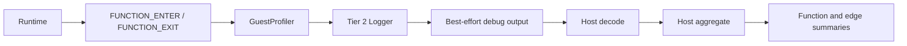

# ゲストプロファイラプラグイン設計書
<!-- evidence:
     implementation: experiments/pysim/tier3_plugins/profiler/guest_profiler.py
     formal: formal/guest_profiler_model.py
     test: docs/qa/tier3_plugins/guest_profiler_test_spec.md
-->

## 1. コンセプト
<!-- traceability: {META_3TierSeparation} {META_ContractImplSplit} {META_StaticDI} {GLOBAL_Policy_Memory} {RuntimeEventSink} -->
本コンポーネントは、Tier 2 の [`runtime_observability.md`](docs/components/tier2_runtime/runtime_observability.md) が定義する関数入退出イベントを固定辞書ログへ変換し、ホスト側の集計入力を生成する Tier 3 プラグインである。デバイス上で時間統計やコールグラフを集計しない。

プロファイラは Runtime の実行状態を変更しない。停止、再開、ステップ、メモリ書込みは Debugger プラグインの責務である。

## 2. アーキテクチャ分類
<!-- traceability: {META_3TierSeparation} {META_ContractImplSplit} -->
本コンポーネントは **Tier 3 (プラグイン・リーフコンポーネント: Plugin Leaf Component)** に属する。Runtimeイベントをログへ写す変換器と、ホスト専用集計器を含む。イベント生成とtick周波数はTier 2の [`runtime_observability.md`](docs/components/tier2_runtime/runtime_observability.md) を正本とする。ログ符号化は [`runtime_logging.md`](docs/components/tier2_runtime/runtime_logging.md) を正本とする。

## 3. 静的モデル

### 3.1 データ構造
- **`GuestProfiler`**: `LoggerPort` を借用し、関数入退出イベントをプロファイル辞書レコードへ変換する。
- **`ProfileLogRecord`**: ホスト集計用に復号したイベントID、関数ID、呼出ID、32ビットtickを保持する値である。
- **`ProfileReport`**: ホストで集計した関数別回数・包括時間・自己時間、呼出辺、対応しない退出数を返す。集計時間はログ欠落を含む可能性がある。

### 3.2 内部ブロック図

プロファイラは実行時に関数スタック、辺表、時間統計表、欠落状態を持たない。ホスト集計器はRuntime実行経路からimportしない。

## 4. 動的モデル

### 4.1 ログ変換と時間意味論
`FUNCTION_ENTER` は `0x0501`、`FUNCTION_EXIT` は `0x0502` として `log_event(DEBUG, id, function_id, call_id, tick & 0xFFFF_FFFF)` へ渡す。`TRAP` と `DEBUG_STOP` を含むその他のイベントは無視する。トラップ時の各フレーム退出はRuntimeが発行する `FUNCTION_EXIT` から記録する。

ホスト集計器は記録順に入退出スタックを処理する。退出はスタック先頭の関数IDと呼出IDが一致した場合だけ対応付ける。不一致または先頭がない退出はスタックを変更せず、対応しない退出数へ加える。推定値は作らない。

包括時間は `(exit_tick - enter_tick) & 0xFFFF_FFFF`、自己時間は包括時間から対応する子呼出しの包括時間合計を差し引く。tickは32ビット循環値である。既定の `monotonic_ns` 時計は1 GHzで、一周は4.294967296秒となる。一周以上の呼出区間の長さは復元できない。

デバッグ出力バスは到達と正しさを保証せず、ログレコードは欠落しうる。ホスト集計は欠けた区間を推定せず、結果が欠落を含む可能性を明記する。リング溢れや書込み失敗に対する追加の欠落計数はプロファイラに設けない。

### 4.2 バッチ受信
`on_runtime_batch` は `batch.records` を順に変換する。累積 `dropped_count`、イベントの推定・中断フラグを集計状態へ保存しない。バッチ順序を保つ。

## 5. インターフェース定義

### 5.1 Runtimeイベント変換
| 項目 | 内容 |
| :--- | :--- |
| 機能概要 | 関数入退出イベントを固定辞書ログへ変換する。 |
| 入力 | `RuntimeEvent` または `RuntimeEventBatch` |
| 出力 | `0x0501` / `0x0502`、引数は関数ID・呼出ID・tickの順。tickは下位32ビット。 |
| 副作用 | Tier 2 `LoggerPort.log_event` への追記要求。リング溢れ時の挙動は `runtime_logging.md` に従う。 |
| 非機能 | 関数入退出以外を無視し、Runtime状態を変更しない。 |

### 5.2 ホスト集計
| 項目 | 内容 |
| :--- | :--- |
| 入力 | 同一辞書で復号した `ProfileLogRecord` の順序列 |
| 出力 | 関数別呼出回数・包括時間・自己時間、親子関数辺の呼出回数、対応しない退出数 |
| 時間差 | `(end - start) & 0xFFFF_FFFF`。一周未満の区間のみ正確。 |
| 不一致 | 対応しない退出を数え、スタックを変更しない。推定値を付けない。 |
| 注意 | 結果はデバッグバス上で欠落した記録を含む可能性がある。 |

## 6. 制約達成の方策
<!-- traceability: {GLOBAL_Policy_Memory} {META_StaticDI} -->
- Runtime経路の `GuestProfiler` は関数入退出をログへ渡すだけである。
- 集計器はホスト専用で、Runtimeのイベント配送や実行経路からimportしない。
- 欠落は出力バスの性質として許容し、再送、推定、追加の欠落計数を導入しない。
- イベント、ログ辞書、tickの符号化の正本はTier 2仕様を参照する。

## 7. 形式検証・テスト仕様との対応

### 7.1 検証対象の不変条件
| 不変条件 | 説明 | 検証方法 |
| :--- | :--- | :--- |
| 符号化対応 | 入退出を正しい辞書IDと3引数で記録し、tickを32ビットへ丸める。 | [`guest_profiler_model.py`](docs/components/tier3_plugins/formal/guest_profiler_model.py)、TEST-PROF-01/02 |
| 順序保存 | 入力された関数入退出の順をログレコードでも保つ。 | 形式モデル、TEST-PROF-03 |
| ホスト集計 | 再帰・入れ子・tick循環の呼出数と時間を集計する。 | TEST-PROF-04/05/07 |
| 未対応退出 | スタックを変更せず件数だけ増やす。 | TEST-PROF-06 |
| 非干渉 | プロファイルログ生成はゲスト結果・メモリ・globalを変えない。 | 統合TEST-PROF-08 |

### 7.2 テスト仕様との連携
対応するテスト仕様は [`guest_profiler_test_spec.md`](docs/qa/tier3_plugins/guest_profiler_test_spec.md) である。形式モデルは正常系と `guards=False` 変異系を検証する。

## 8. 設計判断と参考実装
特記すべき独立したADRはない。採用方針は本書の各契約節に記載する。
