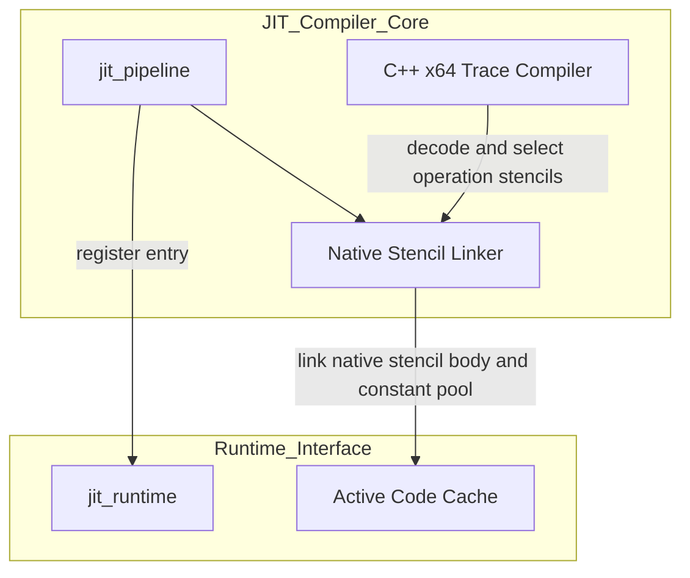
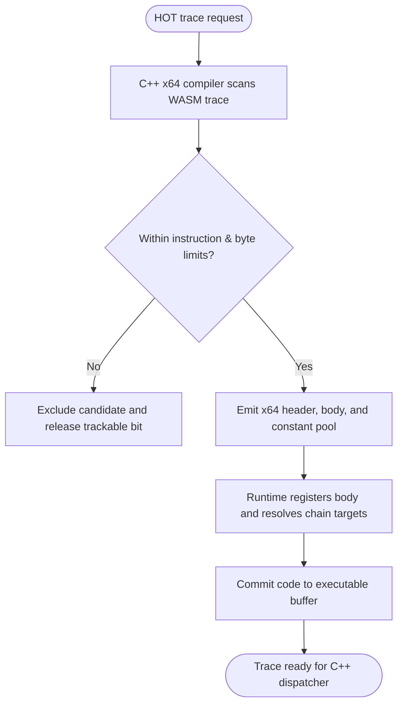
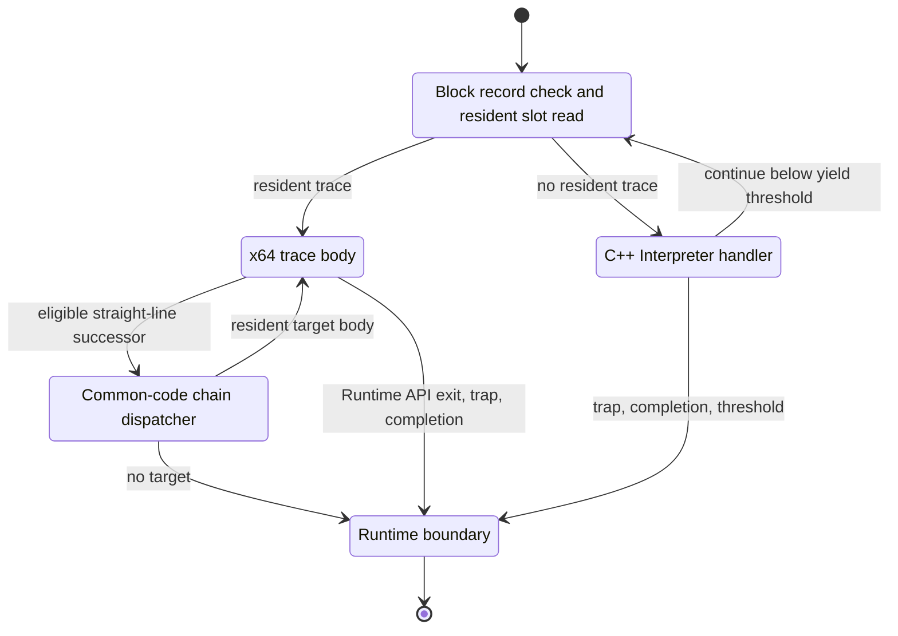
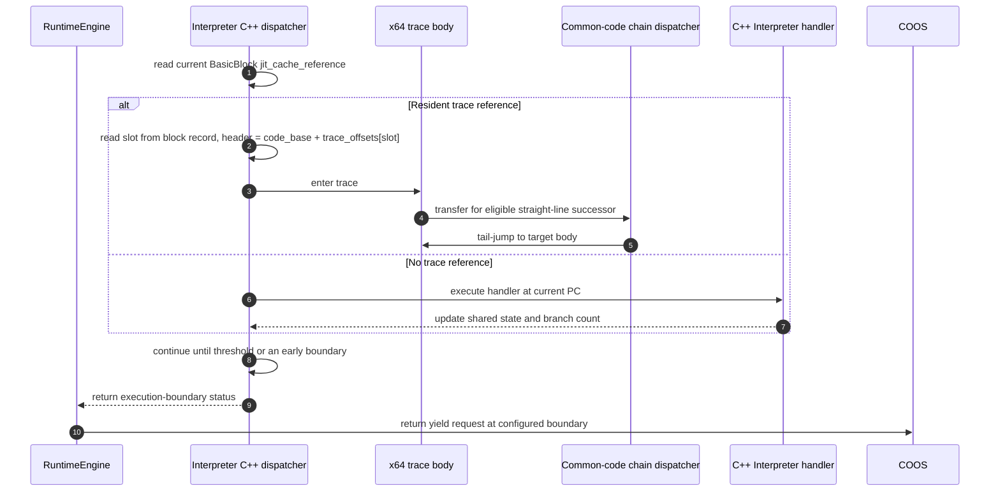

# JIT コンパイラ コンポーネント設計書 {VERIFY_FORMAL} {VERIFY_LLM} {VERIFY_BENCHMARK}
<!-- evidence:
     implementation: experiments/pysim/native/tier3_plugins/jit/trace_compiler.cxx
     formal: formal/jit_cache_model.py
     benchmark: ../../../experiments/pysim/benchmarks/jit/bench_jit.py
     test: docs/qa/tier3_plugins/jit_compiler_test_spec.md
     test: docs/qa/specs/wasm_instruction_set_test_spec.md
-->

## 1. コンセプト
<!-- traceability: {PositionIndependentCode} -->

JIT Compiler は、Tier 2 Interpreter の任意拡張として WASM 命令列をネイティブ機械語へ変換する Tier 3 コンポーネントである。

- **ビルド時ステンシル生成（`{JIT_AssemblyStencilCodegen}`）**: <!-- definition: {JIT_AssemblyStencilCodegen} --> x64 の操作・共通 trace 入口・共通 chain dispatcher を PIC アセンブリで定義し、ビルド時に `.text` の機械語バイト列と symbol・分岐メタデータを C++ 配列へ抽出する。
- **実行時トレース合成**: C++ コンパイラが WASM 命令をデコードして操作ステンシルを選び、成功接続スロットを後続ステンシル本体で置き換えて、命令間の分岐やエピローグがない flat な trace body へ連結する。
- **即値・ローカル・定数プール**: 数値即値とローカル変数のフレームオフセットは命令列へ直接埋め込む。trace 末尾の定数領域には header 相対参照と Runtime API レコード（実行後 Interpreter 注釈オフセットを含む）だけを置く。
- **Tier 2 境界の維持**: WASM 値は共有オペランドスタックに保持し、直接ステンシルを持たない有効 opcode は Runtime API ステンシルへ lower する。不正命令は Loader が拒否し、Tier 2 に JIT 専用 API を追加しない。
- **対象アーキテクチャ**: 現行実装は x64（SysV AMD64 / Windows x64）を対象とし、ARMv8-M の実装と資源予算は TBD とする。

## 2. アーキテクチャ分類
<!-- traceability: {META_3TierSeparation} -->

本コンポーネントは **Tier 3 Plugin 内の詳細リーフコンポーネント (Leaf Component)** である。ビルド時ステンシル生成とトレース単位の機械語構築を担当し、ホットスポット監視とキャッシュ管理は [`jit_runtime.md`](docs/components/tier3_plugins/jit_runtime.md) が担当する。

### 2.1 JIT サブシステムのデコンポジション
<!-- traceability: {JIT_MultiBuffer_Cache} -->

- **[jit_compiler.md](docs/components/tier3_plugins/jit_compiler.md)**: C++ のトレース構築と、ビルド済み機械語ステンシルの連結を担当する。
- **[jit_runtime.md](docs/components/tier3_plugins/jit_runtime.md)**: 実行履歴監視、ホットスポット判定、キャッシュ管理・ローテーションを担当する。

## 3. 静的モデル

### 3.1 構成要素
<!-- traceability: {JIT_MultiBuffer_Cache} {META_ContractImplSplit} -->

| 構成要素 | 役割と配置 | 正本・補足 |
| :--- | :--- | :--- |
| **トレースコンパイラ (`trace_compiler.cxx`)** | 適格な基本ブロックをデコードし、ステンシル本体と定数プールを固定長出力バッファへ合成する。 | 単体入力と状態検査は QA 専用ライブラリで扱う。 |
| **操作ステンシル (`lir/x64/operations.S`)** | 算術、ローカル操作、Runtime API 呼出しを PIC アセンブリで定義する。 | ビルド時に raw binary と再配置メタデータへ変換する。 |
| **共通コード領域 (`lir/x64/common.S`)** | 共通 trace 入口と共通 chain dispatcher、および Runtime API 関数テーブルへの借用ポインタを配置する。 | サイズとオフセットは [`jit_abi.md`](docs/components/tier2_runtime/jit_abi.md) と [`jit_runtime.md`](docs/components/tier3_plugins/jit_runtime.md) を正本とする。 |
| **JIT トレースヘッダ (`jit_trace_header`)** | 各常駐 trace 先頭に置く 32 バイトヘッダ（x64）。body は `+0x20` から開始する。 | 詳細レイアウトは [`jit_abi.md`](docs/components/tier2_runtime/jit_abi.md) を正本とする。 |
| **境界メタデータ (`jit_trace_boundary_metadata`)** | 未接続 chain 終端から Interpreter へ復帰する際に渡す 20 バイト構造体。 | `body_end_ip`、`next_pc`、`loops_to`、注釈消費量（各 u32）、`block_index`（u16）、`frame_depth`（u8）、`interpreter_terminator_pending`（u8）を保持する。 |

### 3.2 内部ブロック図

### 3.3 コンパイル対象と命令 lower 規則

#### コンパイル単位とインタープリタ協調方針
<!-- traceability: {JIT_RuntimeAPI} {PositionIndependentCode} {JIT_BackedgeYield} -->

- **基本ブロック／トレース単位**: 関数やモジュールの一括事前コンパイルは行わず、カードマーキングで HOT に達した基本ブロックのみをコンパイルする。
- **4引数実行 ABI**: Interpreter と JIT trace entry の 4 引数（`ctx`, `ip*`, `sp*`, `rel*`）およびレジスタ規約は [`jit_abi.md`](docs/components/tier2_runtime/jit_abi.md) を正本とする。
- **命令の lower 経路**:

| 命令分類 | lower 方針 | 継続・終了動作 |
| :--- | :--- | :--- |
| **構文デリミタ**（`block`, `loop`, `else`, `end`） | 機械語を生成しない（0 バイト）。 | Loader の静的メタデータで解決する。 |
| **条件分岐**（`if`, `br_if`） | trace に含めず直前で終了する。 | `exit_kind` と `interpreter_terminator_pending = 1` を設定し、Interpreter CPS ハンドラへ委譲する（直接 chain しない）。 |
| **無条件分岐**（`br`） | trace 内で静的スタック移しを行う。 | 前方 `br` は遷移先へ chain し、後方 `br` は `loop_jump_count` 閾値未満なら chain、到達時は `br` 位置で CPS exit する。 |
| **関数呼出し**（`call`, `call_indirect`） | 最後の operation として出力し、直後を終端位置に記録する。 | 共通コード領域の借用テーブル経由で Tier 2 CPS ハンドラへ tail-call する（絶対アドレスを埋め込まない、chain しない）。 |
| **直接ステンシル対象命令** | 型・操作別の PIC ステンシルを選択・連結する。 | 成功接続スロットを後続ステンシルで置換し fall-through する。 |
| **ローカル操作**（`local.get/set/tee`） | Loader 確定のワードオフセットを命令へ直接書き込む。 | バイトオフセット `127` 以下は `disp8`（4B）、`128` 以上は `disp32`（7B）のステンシルを使う（`i64`/`f64` は 2 ワード）。 |
| **`nop`** | 何も出力しない。 | スタック・ローカル・命令数を増やさず次命令へ進む。 |
| **その他の有効 opcode** | `runtime_api` ステンシルと定数プールレコードへ lower する。 | 通常継続なら次のステンシルへ進み、trap または境界 exit なら共通 abort 出口へ分岐する。 |

`0xFC` プレフィックス命令の対応サブオペコード集合は [`wasm_instruction_set.md`](docs/specs/wasm_instruction_set.md) に従う（`{WasmFCSubset}`）。

#### ABI 規約と境界チェック
<!-- traceability: {JIT_LazyChaining} {JIT_RegisterMapping} {ContextPointerRegister} {EnvironmentPointer} {PositionIndependentCode} -->

- **共有スタック同期**: すべての WASM 値は共有オペランドスタックへ命令ごとに確定し、別の値キャッシュを持たない（`{ExecutionContext_Layout}`）。
- **呼出し境界（`{GOTCHA-JITC-01}`）**: <!-- definition: {GOTCHA-JITC-01} --> Interpreter ハンドラと JIT trace entry は `ctx`, `ip`, `sp`, `rel` の 4 引数を使う。x64 アセンブリは SysV AMD64 / Windows x64 の引数レジスタに従い、ABI probe が型と構造体オフセットを照合する。
- **Runtime API テーブル**: opcode から Runtime API ラッパーへの対応表と関数ポインタ表は Tier 3 JIT が所有し、trace にはテーブル添字のみを埋め込む。共通コード領域にはテーブルへの借用ポインタだけを置き、Tier 2 ハンドラ表を複製しない。
- **スロット置換と局所分岐再配置（`{GOTCHA-JITC-05}`）**: <!-- definition: {GOTCHA-JITC-05} --> trace builder は各操作の成功 link slot を後続本体で置き換え、abort slot のみを trace 共通 abort 出口へ接続する。操作内の局所分岐は `.fb_branch_records` に基づき合成後の位置へ再配置し、各ステンシルは操作単位の `ret` やエピローグを持たない。

#### トレース境界不変条件（`{TraceBoundaryInvariant}`, `{GOTCHA-JITC-03}`）
<!-- traceability: {PositionIndependentCode} {JIT_RuntimeAPI} -->

JIT トレースとインタープリタが共有オペランド領域上で相互運用するため、以下の不変条件（`{TraceBoundaryInvariant}`）を保持し、C++ Interpreter 復帰境界で共有状態を同期する（`{GOTCHA-JITC-03}`）。 <!-- definition: {TraceBoundaryInvariant} --> <!-- definition: {GOTCHA-JITC-03} -->

1. **基本ブロック入口の共有スタック契約**: 入口 `sp` は BasicBlock 開始時の共有スタック位置を指す。コンパイラは相対 stack effect を追跡し、入口以前から存在する値を消費しても負の相対深さで拒否しない。
2. **境界での状態同期**: chain 先の trace は現在 trace が確定した共有状態を引き継ぐ。Interpreter へ戻る境界では `execution_context` と共有オペランドスタックを同期する。
3. **二重実行の防止**: 制御状態・条件値・スタック巻き戻しは処理経路側で一度だけ実行し、復帰後に制御命令を再実行しない。取得済み LOOP 後方辺は `loop_jump_count` へ一度だけ加算する。
4. **共有スタック範囲不変条件**: コンパイラはトレースが使用する最大ワード数を `stack_words` としてヘッダに記録し、予約済み関数最大高の範囲内で書き込む。

#### 容量上限とコンパイル失敗要因
<!-- traceability: {META_ZeroCostAbstraction} {Runtime_BumpAllocator} -->

- **トレース上限**: 1 トレースの上限は `FB_CONF_JIT_MAX_TRACE_INSTRUCTIONS` 命令、body＋定数プール合計 `FB_CONF_JIT_MAX_BODY_BYTES` バイト、共有スタック深さ `2 × FB_CONF_MAX_VALUE_STACK` ワードとする。
- **blob 配置**: `jit_trace_header` → trace body → 境界メタデータ（アラインメント調整含む）→ 定数プールの順に配置する。
- **一時作業領域**: C++ フロントエンドは固定長配列（操作用 `FB_CONF_JIT_MAX_TRACE_INSTRUCTIONS + 1` 件、再配置記録用 `8 × FB_CONF_JIT_MAX_TRACE_INSTRUCTIONS + 1` 件）を用いる。
- **失敗要因（表外は `assert` 対象）**:

| 要因 | 条件 | 制約対象 | 根拠 |
| :--- | :--- | :--- | :--- |
| **命令数上限** | trace 内の命令数が `FB_CONF_JIT_MAX_TRACE_INSTRUCTIONS`（64）を超える | 走査用固定作業領域 | `jit_internal.hxx` |
| **本体バイト上限** | body と定数プールの合計が `FB_CONF_JIT_MAX_BODY_BYTES`（1536）を超える | 出力バッファ容量 | `system_config.md` |

- 到達不能ブロックは観測されずキューに入らない（`TEST-JITR-106`）。命令が 0 件のブロックもキューに入らず、コンパイラ入口は命令 1 件以上（呼出し終端を除く）を `assert` する（`TEST-JITR-103`）。

#### ARMv8-M の物理仕様（TBD）
ARMv8-M 向け命令ステンシル、ABI、Trace header、共通コード領域と chain dispatcher、メモリ保護方式はすべて TBD とし、未確定項目は [`jit_stencil_catalog.md`](docs/specs/jit_stencil_catalog.md) に集約する。

## 4. 動的モデル

### 4.1 アルゴリズム
<!-- traceability: {JIT_RuntimeAPI} {JIT_MultiBuffer_Cache} {JIT_OldestExecuteOnly} {JIT_LazyChaining} -->

1. **トレース解析とコード生成**: Tier 3 JIT 拡張が渡した WASM コードとメタデータを復号し、操作ステンシル（または Runtime API ステンシル）を固定出力バッファへ連結する。
2. **キャッシュ配置と実行可能化**: `jit_runtime` がヘッダ・body・境界メタデータ・定数プールをコードキャッシュへ配置し、命令キャッシュを同期する。x64 参照構成では領域初期化時に RWX を設定し、パッチごとに権限を切り替えない。
3. **トレース・チェイニング**: 直線後続の trace が常駐する場合、共通 chain dispatcher が target ヘッダの `const_rel_offset` から `rel` を初期化し、target body へ tail-jumpする（prologue を重複実行しない）。未接続時は境界メタデータと `body_end_ip` を設定して `true` で Interpreter へ戻る。

キャッシュ検索・ホットスポット検出・3面ローテーションの詳細は [`jit_runtime.md`](docs/components/tier3_plugins/jit_runtime.md) を正本とする。

### 4.2 状態遷移図
<!-- traceability: {JIT_LazyChaining} {JIT_ReverseCompilationOrder} {GLOBAL_PeriodicTask} {GLOBAL_IdleDetection} -->

### 4.3 内部シーケンス
<!-- traceability: {JIT_LazyChaining} {JIT_RuntimeAPI} -->

## 5. インターフェース定義

### 5.1 公開API
<!-- traceability: {TraceBoundaryInvariant} {PositionIndependentCode} {ExecutionContext_Layout} {GOTCHA-JITC-03} {JIT_MultiBuffer_Cache} -->

本コンポーネントの公開境界は、Tier 3 JIT 拡張から C++ コンパイラ入口へ渡す WASM コード範囲と出力領域である。ABI は [`jit_abi.md`](docs/components/tier2_runtime/jit_abi.md) を正本とする。

| 項目 | 内容 |
| :--- | :--- |
| **機能概要** | 適格な WASM 命令列からステンシルを連結し、trace 単位のネイティブコードを生成する。 |
| **入力** | Loader 所有の WASM コード範囲と、ロード時に確定した型・フレーム情報。 |
| **出力** | 生成コードと、JIT 拡張のキャッシュ登録に必要なトレースメタデータ。 |
| **事前条件** | 入力 WASM が Loader 検証を通過済みであり、呼出し ABI と固定作業領域が有効であること。 |
| **事後条件** | 対象 ABI に従うコードと境界同期情報を返す。 |
| **エラー時の挙動** | WASM 検証違反は Loader、ABI 不整合は構成時に検出する。 |

キャッシュ管理・カード状態・コンパイル待ち列は JIT 拡張が所有し、C++ コンパイラへ管理 API は公開しない。

### 5.2 URI/IPCインターフェース
<!-- traceability: {META_ConfigurableSystem} -->

本コンポーネントは vSoC の内部ライブラリであり、直接の IPC インターフェースは持たない。

## 6. 制約達成の方策

### 6.1 性能制約と方策
<!-- traceability: {JIT_RegisterMapping} {JIT_MultiBuffer_Cache} -->

- **コンパイルレイテンシ最小化**: ビルド済み raw ステンシルを連結し、成功スロットを置換して操作間の間接ディスパッチやエピローグを排除する。
- **レジスタ規約遵守**: アセンブリ操作は対象 ABI の引数レジスタと caller-save 保存規則に従う。

### 6.2 安全性制約と方策
<!-- traceability: {PositionIndependentCode} {MemoryBoundaryCheck} {FastAddressCheck} -->

- **位置独立コード (PIC)**: プロセス絶対アドレスを命令列へ埋め込まず、任意のキャッシュバンクで再配置不要とする。
- **キャッシュ容量検査**: 生成時にキャッシュ溢れを検査し、溢れた場合は [`jit_runtime.md`](docs/components/tier3_plugins/jit_runtime.md) のローテーションで領域を回収する。
- **メモリ境界検査 (`{GOTCHA-JITC-04}`)**: <!-- definition: {GOTCHA-JITC-04} --> ゲストメモリアクセス命令は load/store 前にアクセス幅を含めて境界を検査し、範囲外は WASM trap へ変換する。アドレスのラップアラウンド継続は禁止し、拒否時はメモリと演算対象を変更しない。
- **x64 コード領域保護**: 領域確保時に RWX を設定し、パッチ区間外の書込みを API 契約で拒否する。ARMv8-M の保護機構（W^X 等）は TBD とする（形式モデル `formal/jit_cache_model.py` は抽象 W^X 遷移を検証する）。

## 7. 形式検証・テスト仕様との対応

独立コンセプト層は検証マトリクスの責務判定に従って対象外とする。生成コードの演算結果と命令列は実行テストで検証し、キャッシュ寿命やチェインの抽象不変条件は形式モデルで検証する。ARMv8-M の実機検証は TBD とする。

### 7.1 検証対象の不変条件

- **位置独立性 (PIC)**: x64 コードが任意のキャッシュバンクで再コンパイル不要で動作すること（`TEST-INT-40`, `TEST-JITC-40`）。
- **トレース境界状態**: 生存する WASM 値が共有オペランドスタックで引き継がれること（`TEST-INT-41`, `TEST-JITC-52`）。
- **x64 実行可能メモリ**: パッチ区間外の書込み拒否とコード実行が成立すること。

### 7.2 テスト仕様書との連携

単体テスト仕様は [`jit_compiler_test_spec.md`](docs/qa/tier3_plugins/jit_compiler_test_spec.md) を、キャッシュ代謝の直交表は [`jit_runtime_test_spec.md`](docs/qa/tier3_plugins/jit_runtime_test_spec.md) を正本とする。

### 7.4 既知の制限・未検証範囲

- 直線後続と前方/後方 `br` のみをネイティブ chain 対象とし、`if`/`br_if` は Interpreter CPS へ戻すため連結の列は循環しない。
- chain 更新時の body 数・スタック要件は根から終端まで辿って求め、`FB_CONF_JIT_CACHE_TOTAL_ENTRY_CAPACITY` 以下であることを `assert` する。
- 関連検証: 直線 chain・計測（`TEST-JITR-35`, `TEST-JITR-76`, `TEST-JITR-77`）、制御境界・後方辺 yield（`TEST-JITR-63`, `TEST-JITR-67`, `TEST-JITR-69`, `TEST-JITR-73`）。

## 8. 設計判断と参考実装

### 8.1 境界値返却とオフセット表現
<!-- traceability: {JIT_LazyChaining} -->

- **Trace 境界の値返却 (`{GOTCHA-JITC-07}`)**: <!-- definition: {GOTCHA-JITC-07} --> WASM 値は共有オペランドスタックに残し、trace entry の `bool` 戻り値は完了種別の通知にのみ用いる。`true` 時は終端 dispatcher が境界メタデータと `body_end_ip` を設定し、`false` 時は `execution_context` の trap/CPS exit 状態に従って Interpreter dispatcher が処理する。
- **バイト単位オフセット管理**: 生成コードは可変長であるため、キャッシュ内位置は一定アラインメントのシフト圧縮ではなくバイト単位オフセットで保持する（64KB 超の拡張や ARMv8-M の配置方式は TBD）。
- **重複要求の抑止**: 同一 PC のコンパイル要求は固定キューへ二重登録しない。キュー管理・置換・回復方策は [`jit_runtime.md`](docs/components/tier3_plugins/jit_runtime.md) に従う。
