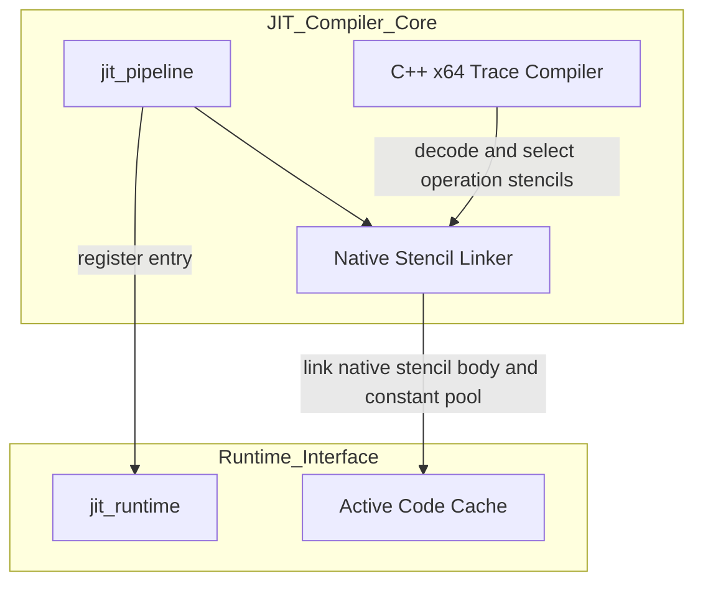
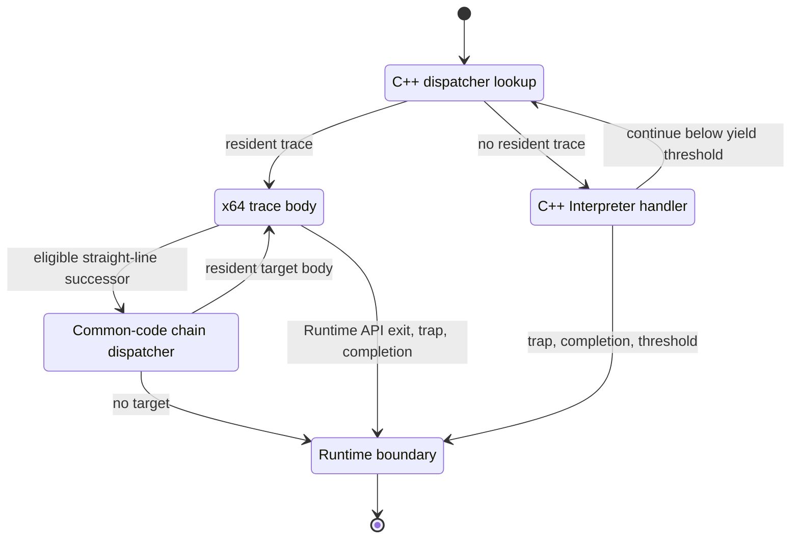
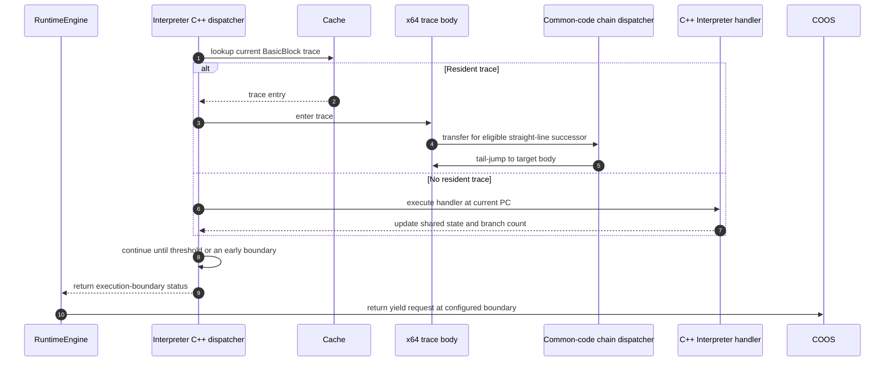

# JIT コンパイラ コンポーネント設計書 {VERIFY_FORMAL} {VERIFY_LLM} {VERIFY_BENCHMARK}
<!-- evidence:
     implementation: experiments/pysim/native/tier3_plugins/jit/trace_compiler.cxx
     formal: formal/jit_cache_model.py
     benchmark: ../../../experiments/pysim/benchmarks/jit/bench_jit.py
     benchmark: ../../../experiments/pysim/benchmarks/jit/bench_x64_stencil_instructions.py
     test: docs/qa/tier3_plugins/jit_compiler_test_spec.md
     test: docs/qa/specs/wasm_instruction_set_test_spec.md
-->

## 1. コンセプト
<!-- traceability: {LowLatencyJIT} {JIT_AssemblyStencilCodegen} {SimpleJITArchitecture} {PositionIndependentCode} -->
JIT Compilerは、Tier 2 Interpreterの任意拡張としてWASM命令列をネイティブコードへ変換するTier 3コンポーネントである。
x64の操作、trace entry/exit、共通chain dispatcherを手書きアセンブリで記述する。
Clang integrated assemblerがPIC objectを生成し、`objcopy`が`.text`をraw binaryとして抽出する。
生成器はsymbol範囲と分岐metadataを含むC++ byte array headerを出力する。

実行時のC++コンパイラはWASM命令をデコードして操作variantを選ぶ。
操作の成功接続slotを次のステンシル本体で置き換え、命令列を一つのflatなtrace bodyへ合成する。
slot命令はtraceに残らないため、操作ごとのreturn、エピローグ、call、jumpを通らず次の操作へfall-throughする。
trap経路はtrace共通のabort resultへ分岐し、state returnとexit処理はtrace単位で行う。
生成traceはopcodeや次操作を読み取らず、operation stencilを関数ポインタでdispatchしない。
Runtime API操作は共通コード領域の借用参照から読み取り専用API tableを引いてAPIを呼び、APIが通常継続を返すと合成済みtraceの後続stencilへ進む。

現行のx64 trace compilerは数値即値をtrace compile時に命令へ埋め込み、local offsetは命令エンコーダがtraceへ直接書き込む。
trace末尾の定数領域は、traceごとのheader相対参照1個、Runtime API record、各recordの実行後Interpreter annotation byte offset、終端record内のInterpreter annotation byte offsetを保持する。Runtime APIがInterpreterへyieldした場合、実行後offsetからInterpreter CPSを再開する。
即値を`rel`から読む方式はデータロードと`rel`更新を要する。
一方で、即値の幅によってはtrace codeを小さくできる候補である。
現行実装は即値をコードへ埋め込む。
別方式を採用する場合は、命令数だけで断定せず、代表traceのコードサイズと実測性能で比較する。
WASM値は共有オペランドスタックに保持する。
アセンブリ操作はSysV AMD64またはWindows x64の引数レジスタを明示し、caller-save scratch registerを使う。
`i32.const`と直後の整数演算、localアクセスと整数演算、`drop`、`i32.eqz`は一部を融合する。
Loaderが受理したopcodeに直接assembly stencilがない場合は、対応するJIT Runtime API stencilへlowerする。APIが通常継続を返す限り、後続operationも同じflat trace内で実行する。WASM命令セットの範囲外や不正な命令はLoaderが拒否する。
Tier 3のC++ JitRuntimeはコンパイラを直接呼び、生成結果を所有キャッシュへ登録する。
WASMコードと実行メタデータはLoaderからRuntime構成へ借用ビューとして渡す。
Tier 2にJIT専用APIを追加しない。
ARMv8-Mの実装と資源予算はTBDである。

## 2. アーキテクチャ分類
<!-- traceability: {META_3TierSeparation} {JIT_AssemblyStencilCodegen} -->
本コンポーネントは **Tier 3 Plugin 内の詳細リーフコンポーネント (Leaf Component)** である。Tier 2 Runtime / Interpreterへ任意接続するJIT pluginのうち、build-time stencil生成とtrace単位のネイティブコード構築を担当する。ホットスポット状態とキャッシュ管理は同じplugin内の [`jit_runtime.md`](docs/components/tier3_plugins/jit_runtime.md) が担当する。

### 2.1 JIT サブシステムのデコンポジション
<!-- traceability: {JIT_AssemblyStencilCodegen} {SimpleJITArchitecture} {JIT_MultiBuffer_Cache} -->
JITサブシステムは、以下の2つの独立した設計書に責務を分離して構成される。

- **[jit_compiler.md](docs/components/tier3_plugins/jit_compiler.md)**: C++のtrace構築と、ビルド時にアセンブルした機械語ステンシルの連結を担当する。
- **[jit_runtime.md](docs/components/tier3_plugins/jit_runtime.md)**: 実行履歴監視・ホットスポット判定、PC-アドレス変換検索、および 3面キャッシュローテーションを担当する。

## 3. 静的モデル

### 3.1 データ構造
- **`trace_compiler.cxx`**: C++フロントエンドがWASM命令をデコードし、選択したステンシル本体を接続slotで連結して固定長traceへ合成する。成功経路は命令間の転送命令なしでfall-throughする。直接stencilを持たない有効opcodeはRuntime API stencilへlowerする。定数poolはtraceごとに一つの4-byte header相対参照、実行後Interpreter annotation offsetを持つRuntime API record、終端Runtime API record内の4-byte Interpreter annotation offsetで構成する。即値は命令型に応じた幅で保持し、Interpreter注釈bytesは複製しない。WASM検証違反はLoaderが拒否し、ABI不整合は構成時に検出する。
- **`JIT_AssemblyStencilCodegen`**: アセンブリsourceから操作、trace entry/exit、terminal result、共通chain dispatcherをビルド時にraw binaryとmetadataへ変換する責務を表す。実行時trace builderは生成済みraw binaryを固定長bufferへ組み立てる。
- **共通コード領域**: x64 JIT領域には`lir/x64/common.S`から生成したchain dispatcherを配置する。配置offsetはTier 1構成から渡し、C++ ABI probeから得た構造体offsetをassembly macroへ反映する。共通chain dispatcherはopcodeを判定しない。x64の領域サイズとoffsetは [`jit_abi.md`](docs/components/tier2_runtime/jit_abi.md) および [`jit_runtime.md`](docs/components/tier3_plugins/jit_runtime.md) を正本とする。ARMv8-Mのサイズと配置はTBDである。 `{JIT_MultiBuffer_Cache}`
- **操作ステンシル (`lir/x64/operations.S`)**: 算術、local操作、融合操作、Runtime API呼出しをアセンブリで定義する。生成器はPIC raw binaryとsymbol・分岐・即値・命令slot metadataを出力する。実行時trace builderは操作コードを連結し、即値slotを埋め、local memory instructionをエンコードする。ARMv8-Mの物理仕様はTBD。
- **JIT トレースヘッダ (`jit_trace_header`)**: 各ネイティブtraceの先頭に配置する実行時ヘッダである。x64では32バイトで、chain target、chain dispatcherへの相対値、配置サイズ、stack境界値、frame depth、exit種別、u16基本ブロック番号、定数領域offsetを保持する。bodyはヘッダ直後の`+0x20`から始まる。exit種別は既存reserved byteを用いてcall CPS終端operationを識別し、そのtraceを通常のnative chainから除外する。定数領域の先頭4 byteにheader相対参照をtraceごとに一つ置き、その後にRuntime API recordを使用順に並べる。pool footerやノードごとのheader参照は置かない。chain先ではtarget headerのpool anchorからrecord先頭へ`rel`を初期化する。
- **トレース境界metadata (`jit_trace_boundary_metadata`)**: JIT exitでInterpreterへ返す20バイトrecordである。`body_end_ip`、`next_pc`、`loops_to`、注釈消費byte数をu32で保持し、offset 16にu16の次BasicBlock index、offset 18にu8の制御深度、offset 19にu8の結果word数を置く。`block_index`はLoaderから渡された`next_block_index`を格納し、Interpreterはindexと`next_pc`の一致を検証する。`boundary_next_pc`と`boundary_loops_to`は`run_step`との境界比較用にPCのまま保持する。

#### コンパイラ入口
<!-- traceability: {JIT_AssemblyStencilCodegen} {META_ContractImplSplit} -->
JitRuntimeはLoader所有のWASMコードと関数実行metadataから適格な基本ブロックを選ぶ。
C++フロントエンドは命令をデコードし、ステンシルと定数を固定長作業領域へ記録する。
trace builderは各operationの成功link slotを除去して、次の操作本体を同じ位置へ配置する。
slotはbuild artifact上の接続markerであり、実行traceには残らない。
operation本体にreturnやスタック復元を置かず、成功経路を次の操作本体へ直接fall-throughさせる。
trace entryのABI prologueとtrace単位のterminal resultだけが外部呼出し境界を持つ。
Runtime API引数は定数領域へ配置し、数値即値とlocal offsetはコードslotへ焼き込んで完成したtraceをJIT cacheへ登録する。
単体コンパイラ入力と状態検査はQA専用ライブラリで扱う。

### 3.2 内部ブロック図

### 3.3 主要なクラス・構造体・定数

#### コンパイル単位とインタープリタ協調方針
<!-- traceability: {JIT_RuntimeAPI} {LowLatencyJIT} {PositionIndependentCode} {SimpleJITArchitecture} {JIT_BackedgeYield} -->
- **関数/モジュール一括コンパイルの禁止**: 関数全体やモジュール全体の事前一括コンパイルは行わない。
 - **ベーシックブロック/トレース単位コンパイル**: カードマーキング表で HOT（`10`）に達した直線命令列（基本ブロック / トレース）のみを対象とする。スケジューラのidle時等にC++ trace builderがbuild済みstencilを組み立てる。
- **制御フロー境界**: `block`、`loop`、`else`、`end`はLoaderが静的制御フローmetadataとして解決する構文デリミタであり、trace本体に機械語操作を生成しない。`if`、`br`、`br_if`はtrace終端として残し、trace compilerはopcodeをコードまたはRuntime APIへ含めない。trace完了後にC++ Interpreter dispatcherがCPS handlerで命令を処理する。分岐先へnative traceをchainしない。Interpreterが分岐先のBasicBlockを選んだ後は通常の検索経路で後続traceを選ぶ。実行時制御フレームは保持しない。取得済みLOOP後方辺は`loop_jump_count`へ一度だけ加算し、yieldしきい値はInterpreter境界で判定する。`br_table`と`return`は各々の命令契約に従う。

`call`、`call_indirect`を含む基本ブロックはJITコンパイル対象である。trace compilerは呼出しopcodeを最後のoperationとして生成し、終端位置を呼出し命令の直後に記録する。x64 stencilは共通コード領域の借用table pointerを通じ、Runtime API function pointer tableの添字からTier 2 CPS handlerへ直接tail-callする。trace内に関数の絶対アドレスを持たない。呼出しの意味論は[`interpreter.md`](docs/components/tier2_runtime/interpreter.md)を正本とし、終端handoffのABIは[`jit_abi.md`](docs/components/tier2_runtime/jit_abi.md)に従う。
- **実行ABI**: Interpreter handlerは`ctx`, `ip*`, `sp*`, `rel*`の4引数で`void`を返す。JIT trace entryも同じ4引数で`bool`を返す。正常完了時は未接続chain targetに到達した終端dispatcherだけがmetadata pointerを一時的に`ctx.rel`へ渡し、`body_end_ip`を`ctx.ip`へ設定する。先頭3引数は実行状態、`rel`は定数領域を指す`const uint8_t*`である。JITは`ctx.rel`にpool anchorを保持し、`rel` cursorは先頭header参照の4 byte後からRuntime API recordを順次読む。各trace入口およびchain先でanchorとcursorを初期化する。ローカル基点は`ctx.local_base`から取得する。Interpreter dispatcherは`true`後にmetadataからstackとInterpreter `rel`を確定し、未実行の終端命令を処理して次のBasicBlockを解決する。`false`はtrapまたはyieldを含むCPS exitを示す。

##### 3.3.1 制御命令処理とchain dispatcher
<!-- traceability: {JIT_AssemblyStencilCodegen} {JIT_LazyChaining} {PositionIndependentCode} -->

JITの制御命令境界は、Interpreter単独実行と同じ条件値、結果値、遷移先を保つ。`if`、`br`、`br_if`はnative traceから除外し、未実行の終端opcodeとして共有状態を同期してC++ Interpreter dispatcherへ返す。Interpreter CPS handlerがそのopcodeを一度だけ実行する。

Loaderは構造化制御フローを静的metadataへ解決する。trace compilerは構文デリミタを操作列から読み飛ばし、これらのopcodeに機械語を割り当てない。

| 構文デリミタ | WASM opcode | Loader metadata | trace本体 |
| :--- | :--- | :--- | :--- |
| `block` | `0x02` | block typeと分岐先を静的に記録する | 操作なし（0 byte） |
| `loop` | `0x03` | loop typeと後方分岐先を静的に記録する | 操作なし（0 byte） |
| `else` | `0x05` | `if`のelse側の継続先を静的に記録する | 操作なし（0 byte） |
| `end` | `0x0B` | 制御構造の終了と継続先を静的に記録する | 操作なし（0 byte） |

`if`、`br`、`br_if`は構文デリミタではない。traceはそれらのopcode直前で終了し、opcodeを実行しない。C++ Interpreter dispatcherがLoader metadataと未実行opcodeからCPS handlerを選び、条件評価、stack復元、PC、block indexを更新する。分岐先traceが常駐していてもnative chainは行わない。

trace chainは、直線後続の常駐traceへ共通コード領域のchain dispatcherからtail-jumpする経路である。分岐命令はchain接続点にせず、CPS exit後にInterpreter dispatcherが処理を続ける。取得済みLOOP後方辺は共有`loop_jump_count`へ一度だけ加算し、yieldしきい値とstatusの契約は[`jit_abi.md`](docs/components/tier2_runtime/jit_abi.md)に従う。

未接続chain targetでは、終端dispatcherが境界metadataと再開PCをInterpreterへ渡す。C++ handler実行後にC++ dispatcherが次traceを検索・起動する遷移はchainではない。共通chain dispatcherは、生成コードが確定したtargetへの転送を担う。

##### 3.3.2 ARMv8-Mの物理仕様（TBD）

ARMv8-M向け命令Stencil、ABI、Trace header、共通コード領域とchain dispatcher、メモリ保護方式はすべてTBDとする。未確定項目は [`jit_stencil_catalog.md`](docs/specs/jit_stencil_catalog.md) に集約する。

##### 3.3.3 Runtime API ステンシル
<!-- traceability: {JIT_RuntimeAPI} -->

C++ trace compilerは操作を直接実行するassembly stencilか、共通コード領域の借用参照から読み取り専用Runtime API tableを呼ぶ`runtime_api` stencilへlowerする。Runtime API呼出しもJIT trace bodyの一操作であり、インタープリタへ処理を渡すフォールバックではない。

APIを呼ぶ操作では、コンパイラがopcodeに対応するu8 API table slot、u8 immediate個数、u8 immediate byte span、元の命令位置を表すu32 `code_ip_t`、型付きimmediate payloadをpoolへ出力する。header相対参照、slot/count/span、source IPの各値は固定幅である。immediate payloadは命令に応じてu8/u16/u32/u64を使い、数値即値やlocal offsetのtrace内注釈複製を作らない。終端API recordはInterpreterへ戻るための関数注釈pool byte offsetを一つ持ち、API wrapperは関数viewから注釈poolを参照する。`operations.S`の`runtime_api` stencilは共通コード領域の借用参照から読み取り専用表を引いてAPIを呼び出す。ローカル操作はRuntime APIを呼ばない。WASM型とcompact byte offsetから型・操作別の単一テンプレートを選び、x64命令エンコーダがローカルbase registerと`disp8`をtraceへ直接書く。どちらもtraceへコンパイルされ、`ctx.ip`を進めない。Runtime APIを呼ぶ操作では、APIがtrapやruntime境界を記録しなければstencilは後続の合成済みoperationへfall-throughする。APIがCPS exitを記録した場合だけtrace共通abort経路へ移り、C++ dispatcherがそのexit種別を処理する。

Interpreterでも同じRuntime APIを使う。Interpreter側のopcode handlerは統一された`(ctx, instruction_ip, sp, rel)` prototypeを持ち、テンプレート`h_runtime_api`がopcode固有のRuntime APIを呼んでからCPS継続へ渡す。JIT stencilから呼ぶAPIはCPSを実行せず、次のoperationを選択しない。

| 命令経路 | 実行方法 | 次の処理 |
| :--- | :--- | :--- |
| 直接assembly variantがある | 型・offset・融合形に対応するstencilをtraceへ合成する | 次のstencilへfall-throughする |
| ローカル操作 | 型・操作別テンプレートを合成し、x64命令エンコーダがmemory instructionと`disp8`を書き込む | 次のstencilへfall-throughする |
| 直接assembly variantがない有効opcode | `runtime_api` stencilが共通API tableから対応するAPIを呼ぶ | 通常継続なら同じJIT traceの次のstencilへ進む。trapまたは境界exitならtraceを終了する |
| `call`、`call_indirect` | 呼出しopcodeを最後のoperationとしてtraceへ含め、x64用handler slotとInterpreter annotation offsetを記録する | 共通コード領域の借用table pointerを経由し、handler slotの添字でTier 2 CPS handlerへtail-callする。traceに関数の絶対アドレスを埋め込まない |

call opcode以外の適格なopcodeは直接assembly variant、直接生成経路、またはJIT Runtime API tableのいずれかでtraceへlowerする。`call`と`call_indirect`は通常のJIT Runtime API wrapperではなく、共通関数表の専用CPS handler slotを使う。関数pointerの絶対アドレスをtraceへ埋め込まない。`0xFC`の対応サブオペコード集合は [`wasm_instruction_set.md`](docs/specs/wasm_instruction_set.md) が定め、集合外はWASM命令セットの非対応機能としてLoaderが拒否する（{WasmFCSubset}）。

**ABI 規約と境界チェック (`GOTCHA-JITC-01`, `03`, `05`)**:
- **スタック状態**: すべてのWASM値を共有オペランド領域へ命令ごとに確定する。基本ブロック終端、API境界、トラップ時に別の値キャッシュを書き戻す処理は設けない。 `{ExecutionContext_Layout}`
- **呼出し境界 ({GOTCHA-JITC-01}, `03`)**: Interpreter handlerとJIT trace entryは`ctx`, `ip`, `sp`, `rel`の4引数を受け取る。`rel`は定数プールポインタである。assembly sourceはSysV AMD64とWindows x64の引数レジスタを明示し、ABI probeが関数型と構造体offsetを照合する。ARMv8-MのABIはTBDとする。 <!-- definition: {GOTCHA-JITC-01} -->
- **Runtime API呼出し**: opcodeからJIT Runtime API wrapperへの対応表と共通function pointer tableはTier 3 JITが所有する。通常API entryはJIT Runtime APIを指し、`call`と`call_indirect`用entryはTier 2 Interpreterの既存CPS handlerを指す。handler addressは初期化時にtableへ渡し、traceには添字だけを埋め込む。JIT stencilは共通コード領域の借用table pointerを通じてentryを呼ぶ。通常APIは次のoperationを選ばない。共通コード領域にはtableへの参照とchain dispatcherを置き、CPS handler本体はTier 2 Interpreterが所有する。共通コード領域にInterpreterの全opcode handler表を複製しない。
- **継続先と境界検証 (`GOTCHA-JITC-05`)**: trace chain先はtrace headerの`chain_target_addr`で表す。trace builderは操作本体の成功link slotを後続operationのbytesで置き換える。成功経路のslot命令は完成traceから除かれ、operationごとのreturnやエピローグはない。abort slotだけをtrace共通abort resultへ接続する。trace末尾poolには操作間deltaを置かない。コンパイラは出力範囲のoffsetとサイズ、操作内分岐の再配置を検証する。ARMv8-Mの配置方式はTBDとする。

#### ABIと共有値
<!-- traceability: {JIT_RegisterMapping} {ContextPointerRegister} {EnvironmentPointer} {PositionIndependentCode} -->
Interpreter opcode handlerとJIT trace entryは`ctx`, `ip`, `sp`, `rel`の4引数を使う。先頭3引数が実行状態、`rel`が定数プールポインタである。Interpreter handlerは`void`を返し、JIT trace entryは`bool`を返す。正常完了時は未接続chain targetに到達した終端dispatcherだけがmetadata pointerを一時的に`ctx.rel`へ渡し、`body_end_ip`を`ctx.ip`へ設定する。x64の関数型と構造体配置は [`jit_abi.md`](docs/components/tier2_runtime/jit_abi.md) を正本とする。assembly sourceはSysV AMD64とWindows x64の引数レジスタへ直接合わせる。ARMv8-MのABIはTBDとする。

実行状態の3論理引数はInterpreterとJIT traceで `ctx`, `ip`, `sp` の順に共通し、各native entryの第4引数は定数領域ポインタ`rel`である。assembly sourceは対象x64 ABIの物理引数配置を明示し、callを含むRuntime API stencilは対象ABIの保存規則に従う。

| 項目名 | 機能と役割 | 型分類 | サイズ・制約 |
| :--- | :--- | :--- | :--- |
| operation symbol | trace compile時に命令の型・offset・fusion結果で選択するステンシル名 | fixed array entry | build時にraw binary化したステンシル本体をtraceへ連結する |
| trace link metadata | 各stencilの成功slot、abort slot、trace entryのstart/exit slotと局所分岐 | build artifact | 成功slotを次の操作本体で置き換え、必要な局所分岐を再配置する |
| operation source | x64操作、trace entry/exit、共通chain dispatcherのアセンブリ定義 | build-time source | 共有ライブラリへ埋め込まず、ビルド時にraw binaryへ変換する |
| 位置独立性 (PIC) | 任意アドレス・キャッシュバンクで再コンパイル不要で動作 | 設計制約 | x64ではプロセス絶対アドレスを命令列へ埋め込まず、トレースヘッダ、共通領域オフセット、基底相対アドレス、`rel32` 分岐を用いる。ARMv8-Mの方式はTBD |

##### 操作状態の受け渡し
<!-- traceability: {JIT_RegisterMapping} {CPS_3Args} -->
JIT trace entryは`ctx`, `ip`, `sp`, `rel`を受け取る。
InterpreterはWASM値を共有オペランドスタックに保持する。
各操作stencilは`ctx`, `ip`, `sp`, `rel`を対象ABIの引数レジスタから受け取り、次のstencilへ同じレジスタでstateを渡す。
アセンブリ操作はcaller-save scratch registerだけを一時値に使う。
trace builderは各成功link slotを除いて後続operationを配置するため、合成後の成功経路に操作間call/jumpはない。
生成器は各operation stencilに`ret`、スタック操作、Runtime API stencil以外のcallがないことを検査し、操作単位のエピローグ生成を拒否する。
trapを検出したoperationはabort link slotから一つのtrace共通terminal resultへ移る。
trace entry wrapperはtrace bodyの実行結果を復元する。未接続chain targetに到達した場合だけ終端dispatcherが末尾境界metadata pointerを`ctx.rel`へ置き、`body_end_ip`を`ctx.ip`に設定して`true`を返す。trap/CPS exitではtrace entryが`false`を返す。Interpreter dispatcherは正常復帰後にmetadataから実行状態を確定し、未実行の終端命令と次BasicBlockを処理する。
ARMv8-MのABIはTBDである。

#### トレース境界不変条件とスタックフレーム整合性 (Trace Boundary Invariants)
<!-- traceability: {LowLatencyJIT} {PositionIndependentCode} {JIT_RuntimeAPI} -->
JIT トレースとインタープリタが共有オペランド領域上で相互運用するため、トレース境界不変条件（`{TraceBoundaryInvariant}`）を含む以下の4つの不変条件を厳格に保持する。JITからC++ Interpreter handlerへ戻る境界では共有オペランド領域と実行コンテキストを同期する（{GOTCHA-JITC-03}）。 <!-- definition: {TraceBoundaryInvariant} --> <!-- definition: {GOTCHA-JITC-03} -->

1. **基本ブロック入口の共有スタック契約**:
   - トレース入口の`sp`はBasicBlock開始時点の共有オペランドスタック位置を指す。WASM検証で有効なBasicBlock入口値は、トレースの先行命令で生成された値と同じく有効な入力である。
   - コンパイラは相対stack effectを追跡する。入口以前から存在する値を消費する操作で相対深さが負になっても、コンパイル拒否の理由にしない。読み書き位置は入口`sp`と現在の相対深さから生成し、結果の`sp`を共有領域へ反映する。
   - 直接stencilを持たない有効opcodeはRuntime API stencilから処理する。
2. **トレース境界でのメモリ同期不変条件 (Memory Synchronization at Trace Boundary)**:
- x64では、後続traceが共通コード領域のchain dispatcher経由で実行される場合、現在traceが確定した共有状態を次traceが引き継ぐ。C++ Interpreter handlerへ戻る境界では共有オペランド領域と実行コンテキストを同期する。ARMv8-Mの値保持方法と同期手順はTBDである。
3. **制御フロー・コール境界の状態整合不変条件**:
   - 制御命令を処理する経路は、条件値の消費、結果値の保持、スタック巻き戻し、フレーム更新、遷移先決定を一度だけ行う。JIT生成コード、JIT Runtime API、Interpreter handlerの各経路に同じWASM意味論を適用する。
   - 分岐opcodeはtraceから除外する。Interpreter CPS handlerが共有状態とLoaderのblock indexを更新し、分岐先traceへの直接chainは行わない。
   - Interpreterへ戻る境界では、実行済みの処理と未実行の命令位置を区別する。復帰後に制御命令を二重実行しない。
   - 取得済みLOOP後方辺を共通`loop_jump_count`へ一度だけ加算し、Interpreter境界でしきい値を判定する。
   - 単独実行とHybrid JITは同じ `FB_CONF_INTERPRETER_YIELD_THRESHOLD` を使う。
   - 分岐は常にInterpreter CPSへ戻る。yieldしきい値到達時はyield statusをC++ dispatcherへ返す。
   - トラップ、外部呼出し、関数完了は各契約の実行境界としてRuntimeEngineへ返す。
4. **共有スタック範囲不変条件 (Shared Stack Range Invariant)**:
   - Interpreterは全WASM値を共有オペランド領域に保持する。JITは定数畳込みや隣接命令の融合で実行時に不要な中間値を除去できる。融合後も生存する値は共有オペランド領域に置く。
   - コンパイラは、トレースが実際に使用する最大スタックワード数を `stack_words` としてヘッダに記録する。Runtime API operationが要求する入力・結果の領域も含める。融合により、この値はWASM意味論上の最大スタック深さ以下になることがある。
   - 入口以前から存在する値へのアクセスはWASM検証済みのstack shapeに基づき、トレース中に追加で確保する領域は共有スタック上限内へ書き込む。

#### JIT トレース物理メモリレイアウト (`jit_trace_header`)
<!-- traceability: {JIT_LazyChaining} {SimpleJITArchitecture} {PositionIndependentCode} -->
物理配置は対象ごとのABI契約へ委譲する。Windows x64およびSystem V AMD64の16バイト配置は [`jit_abi.md`](docs/components/tier2_runtime/jit_abi.md) に定義し、ARMv8-Mの物理配置と命令列はTBDである。これらの配置を一つの共通ヘッダとして扱ってはならない。

#### ネイティブトレースコンパイラ (`trace_compiler.cxx`)
<!-- traceability: {META_ZeroCostAbstraction} {JIT_MultiBuffer_Cache} {Runtime_BumpAllocator} -->
本実装はClang 17以降でビルドするx64 trace builderである。
`generate_assembly.py`は本番C++ ABI probeから構造体offsetを得て、`operations.S`、`trace.S`、`common.S`をPIC objectへ変換する。
生成器は`objcopy`で`.text`を抽出し、GOT参照と予期しないrelocationを検査する。
実行時のC++ trace builderはraw binaryのentry/exit/resultと選択済みステンシルを固定長出力へ連結する。
operationの成功link slotを次のstencil本体で置き換え、slotの命令自体を完成traceから除く。
operation stencil内の条件分岐はdisassembly metadataを使い、合成後の位置に合わせて再配置する。
現行実装は数値即値を生成slotへtrace compile時に書き込む。
local offsetは固定長instruction slotへx64 memory instructionとしてエンコードする。
`rel` poolを使うのはtrace単位のheader相対参照とRuntime API引数recordである。終端record内のannotation offsetからInterpreter注釈を読み、trace側に注釈bytesを複製しない。
数値即値を`rel`から読む方式は現行trace compilerにない。
追加する場合は、コードサイズと実行時のロード・カーソル更新コストを代表traceで比較する。
traceは次opcodeをfetchせず、次操作を間接dispatchしない。
JIT共有ライブラリはbuild時に生成したassembly byte arrayとC++ runtimeだけで動作する。
Clang integrated assemblerはx64操作、trace entry/exit、common dispatcherのraw binary生成にbuild時だけ使う。
実行時trace compilerはWASMをdecodeしてoperation templateを選び、埋め込みraw binaryの即値slotを埋め、local instructionをエンコードして固定長traceへ組み立てる。

即値ごとに異なるx64ステンシルvariantは作らない。
即値は単一ステンシル内のpatch slotへtrace compile時に書き込むため、実行時に`rel`から読まない。
operation間に接続用jump/callは置かない。成功link slotを次のstencil bytesで置き換え、連続配置した本体へfall-throughする。
加算0、乗算1、シフト量0などの恒等演算はC++フロントエンドが除去する。
`i32.const; i32.*`融合では、演算即値を命令slotへ焼き込む。
`drop`はコードを出さず、定数`i32.eqz`はtrace生成時に評価する。

`local.get`、`local.set`、`local.tee`はoperationとWASM値型に対応するstencilへlowerする。trace compilerはLoaderが確定したcompact word offsetを命令エンコーダへ渡し、エンコーダがlocal memory instructionへ直接書き込む。offsetごとのstencil variantは作らない。
trace compilerは関数引数を含む論理ローカル数を16以下に制限する。
各ローカルは最大2 wordなので、最後のlocalの開始位置はbyte offset 120以下となり、x64 signed `disp8`に収まる。
エンコーダはWASM local indexをLoaderのcompact offsetへ変換し、offsetをlocal memory instructionへ直接書き込む。
local indexやoffsetを実行時に`rel`から読み出さず、local Runtime APIやopcode dispatchも使わない。
i64/f64は2 word幅として処理する。
`i32.const; local.set/tee`融合は、即値slotとlocal instruction slotを一度に埋める。
`local.get, local.get, i32.*`融合は2つのlocal offsetをそれぞれ命令エンコーダで焼き込む。
C++ local get/set/tee Runtime API経路は設けない。

命令列を短くする融合候補として空スタックからの`local.get, local.get, i32.*`を実装する。第1localを共有スタックへロードし、第2localを融合アセンブリstencilのmemory operandにする。機械語サイズや命令数は生成stencilごとに測定する。

`i32.const, local.set`融合（{GOTCHA-JITC-08}）は即値を命令へ埋め込み、localへ書く。融合で定数pushを除去するため、この操作は`sp`も`rel`も変更しない。`i32.const, local.tee`融合は同じ即値をlocalと共有スタックへ書く。 <!-- definition: {GOTCHA-JITC-08} -->

1トレースは `FB_CONF_JIT_MAX_TRACE_INSTRUCTIONS` WASM命令、`FB_CONF_JIT_MAX_BODY_BYTES` のbodyと末尾定数pool、共有stack深さ `2 × FB_CONF_MAX_VALUE_STACK` wordを上限とする。WASM数値即値とlocal offsetはtrace codeに直接埋め込む。定数領域は先頭のheader相対参照4 byte、Runtime API argument record、終端recordのInterpreter annotation offsetを保持する。各recordのslot、immediate count、immediate byte spanはそれぞれu8であり、API最大 `FB_CONF_JIT_RUNTIME_API_MAX_IMMEDIATES` immediateのpayloadは値の型幅で格納する。ヘッダは定数領域の先頭offsetだけを保持し、slot数fieldを持たない。C++フロントエンドのoperation用固定長配列は `FB_CONF_JIT_MAX_TRACE_INSTRUCTIONS + 1` 件、再配置record用配列は `8 × FB_CONF_JIT_MAX_TRACE_INSTRUCTIONS + 1` 件を保持する。

native trace blobはheader、trace body、境界metadata前のalignment padding、境界metadata、定数poolの順に配置する。bodyと定数poolの合計は `FB_CONF_JIT_MAX_BODY_BYTES` に収める。trace compilerはheaderとbody末尾を定数poolのalignmentにそろえる。現行x64配置ではmetadata前のpaddingは増分を持たない。最大blob容量は `FB_CONF_JIT_X64_TRACE_HEADER_BYTES + FB_CONF_JIT_MAX_BODY_BYTES + 境界metadataのサイズ` で導く。

トレースのコンパイルでは、生成コード、ローカルアクセス命令、即値、およびRuntime API用定数を有界な一時領域へ構成する。WASM入力と実行メタデータの借用期間を守り、実行コード領域とロード用領域を別々に計上する。

trace単位コード生成はx64実装に限って定義する。ARMv8-M向けLIR、ABI、trace配置、relocation形式はTBDである。

## 4. 動的モデル

### 4.1 アルゴリズム
<!-- traceability: {JIT_AssemblyStencilCodegen} {JIT_RuntimeAPI} -->
 1. **トレース解析とコード生成**: Tier 3 JIT拡張はLoader所有WASMコードと関数metadataを内部C++コンパイラへ渡す。C++コンパイラは命令列を復号し、operation LIR symbolと即値を選ぶ。Clang integrated assemblerがbuild時に生成したstencilをC++ trace builderが連結する。成功link slotを次のstencil本体に置換し、命令間に転送命令のないfall-through列を作る。
   - 関数引数を含む論理ローカル数が16以下なら、operationとWASM型に対応するローカル操作stencilを選ぶ。
   - WASM数値即値を命令へ埋め込み、local memory instructionの`disp8`へoffsetをエンコードする。
   - 直接stencilを持たない有効opcodeは対応するRuntime API stencilへlowerする。trace形成上限と定数pool容量は対応する命令列を収容する。
2. **キャッシュ配置と定数pool**: JIT runtimeがtrace header、native stencil body、trace末尾定数領域をcacheへ配置する。WASM数値即値とlocal offsetはコードへ直接埋め込み、poolにはtrace単位のheader相対参照、各Runtime APIの実行後Interpreter annotation offset、終端record内のInterpreter annotation offsetを置く。注釈bytesを複製せず、操作間継続deltaやAPI recordごとのheader参照を生成しない。chain targetだけを実行時trace targetとしてheaderへ記録する。
3. **実行可能メモリの確定**: x64の実行可能バッファは初期化時にRWXを設定する。パッチ確定時には命令キャッシュを同期し、権限は切り替えない。ARMv8-Mの権限機構、命令キャッシュ同期、バリア命令はTBDである。
4. **制御命令の処理**: `if`、`br`、`br_if`をtraceへ含めず、終端opcodeをC++ Interpreter dispatcherへ渡す。Interpreter CPS handlerが条件、stack、遷移先を確定する。分岐先traceへ直接chainしない。
5. **trace chain**: 直線後続のtraceが常駐する場合、共通chain dispatcherがtarget bodyへtail-jumpする。分岐命令を越える接続は行わない。C++ Interpreter handler後にdispatcherが別traceを選ぶ遷移はmachine-code chainではない。

#### JIT トレース検索 & 3面キャッシュ代謝オーケストレーション
<!-- traceability: {JIT_MultiBuffer_Cache} {JIT_OldestExecuteOnly} -->
3段JIT検索および連続 `FB_CONF_JIT_CACHE_SIZE` キャッシュ領域の管理は[`jit_runtime.md`](docs/components/tier3_plugins/jit_runtime.md)を正本とする。コンパイラコアは生成したトレースの登録と命令同期を同コンポーネントへ委譲する。

#### トレース・チェイニング（共通コード領域のchain dispatcher経由）
<!-- traceability: {JIT_LazyChaining} {JIT_RuntimeAPI} -->
Interpreter dispatcherは最初のJIT traceを通常の4引数C ABIで呼び出す。遷移先のtraceが常駐する場合、命令処理後の共有状態から共通chain dispatcherへ進む。dispatcherは接続済みtargetのpool anchorを`ctx.rel`へ置き、先頭4-byte header参照を飛ばした位置からtarget bodyを開始する。未接続targetでは境界metadataと再開PCをInterpreterへ渡す。Interpreter dispatcherは`false`をtrap/CPS exitとして扱い、`true`の後にmetadataから共有実行状態を確定する。

分岐opcodeのhandler実行とC++ dispatcher内で次の常駐traceを選ぶ遷移は、このmachine-code chainとは別である。共通chain dispatcherはopcodeを検査せず、命令ごとの条件評価とhandler呼出しを集約しない。chain回数を数える指標は共通chain dispatcherからtarget bodyへ移った回数とし、C++ handler後のdispatcher遷移を含めない。

#### ホットスポット検出とコンパイル待ち列
ホットスポット記録、しきい値、コンパイル待ち列、コンパイル時期、キャッシュ登録は [`jit_runtime.md`](docs/components/tier3_plugins/jit_runtime.md) が正本である。本コンポーネントは受け取った適格なtraceをx64機械語へ変換し、登録情報を返す。

#### トレース生成と登録
<!-- traceability: {GOTCHA-JITC-01} {JIT_AssemblyStencilCodegen} {JIT_LazyChaining} -->

### 4.2 状態遷移図
<!-- traceability: {JIT_LazyChaining} {JIT_ReverseCompilationOrder} {GLOBAL_PeriodicTask} {GLOBAL_IdleDetection} -->

### 4.3 内部シーケンス
<!-- traceability: {JIT_LazyChaining} {JIT_RuntimeAPI} -->
#### 現行x64参照実装のtrace実行とInterpreter復帰

## 5. インターフェース定義

### 5.1 公開API
<!-- traceability: {JIT_AssemblyStencilCodegen} {TraceBoundaryInvariant} {PositionIndependentCode} {ExecutionContext_Layout} {GOTCHA-JITC-03} {JIT_MultiBuffer_Cache} -->
本コンポーネントの公開境界は、Tier 3 JIT 拡張から既存C++コンパイラ入口へ渡すWASMコード範囲と出力領域である。ABIは [`jit_abi.md`](docs/components/tier2_runtime/jit_abi.md) を正本とする。

| 項目 | 内容 |
| :--- | :--- |
| 機能概要 | 適格なWASM命令列からraw stencilを連結し、trace単位のネイティブ命令列を生成する。 |
| 入力 | ローダ所有WASMコードのアドレス・範囲と、ロード時に確定した型・フレーム情報。 |
| 出力 | 生成コードと、JIT拡張のキャッシュ登録に必要なトレース情報。 |
| 事前条件 | 入力WASMがLoaderの検証を通過し、呼出しABIと固定作業領域が有効であること。入口stack値を消費するopcodeや直接stencilを持たない有効opcodeもAPI経路を含めてtraceへlowerする。 |
| 事後条件 | 対象ABIに従うコードと、トレース境界で共有状態を同期する情報を返す。 |
| エラー時の挙動 | WASM検証違反はLoaderが拒否する。ABI不整合は構成時に検出する。 |

キャッシュの初期化、エントリ検索、カード状態、コンパイル待ち列、およびコンパイル時期はJIT拡張が所有する。これらをC++コンパイラへ公開する管理APIは定義しない。

### 5.2 URI/IPCインターフェース
<!-- traceability: {META_ConfigurableSystem} -->
本コンポーネントは vSoC の内部ライブラリであり、直接のIPCインターフェースは持たない。

## 6. 制約達成の方策

### 6.1 性能制約と方策
<!-- traceability: {JIT_AssemblyStencilCodegen} {JIT_RegisterMapping} {JIT_MultiBuffer_Cache} -->
- **目標**: コンパイルレイテンシを最小化し、WAMRインタープリタを上回る実行速度を実現。
- **方策**:
     - **trace単位native composition**: C++はcompile時だけopcodeを復号してLIR variantを選ぶ。操作ごとのreturn/エピローグを生成せず、成功slotを後続のraw stencil本体で置換する。完成traceはoperation間call/jump、次opcode fetch、indirect dispatchを持たない。恒等演算はtrace構築前に除去する。
    - **レジスタ割り当て**: assembly sourceは対象ABIの引数レジスタを明示し、Runtime API stencilは対象ABIの呼出し保存規則を守る。
    - **実行時検索との分離**: コード生成後の検索方式とキャッシュ管理は [`jit_runtime.md`](docs/components/tier3_plugins/jit_runtime.md) に従う。

### 6.2 安全性制約と方策
<!-- traceability: {PositionIndependentCode} {MemoryBoundaryCheck} {FastAddressCheck} {SimpleJITArchitecture} -->
- **目標**: 生成コードの配置範囲と実行結果を検証する。ARMv8-Mのメモリ保護方式は対象確定後に定める。
- **方策**:
    - **位置独立コード**: 生成コードを位置独立とし、配置場所の自由度を確保。
    - `Cache Capacity Check`: コード生成時にキャッシュ溢れを厳密にチェックし、溢れた場合は 3面リングローテーションにより Oldest バンクを破棄して再利用する。これはキャッシュ容量管理であり、（ゲストメモリアクセスの隔離）とは別の関心事である。
    - **メモリ境界検査 ({GOTCHA-JITC-04})**: <!-- definition: {GOTCHA-JITC-04} --> x64の対応済みゲストメモリアクセス命令は、load/store前に幅を含めた境界を検査し、範囲外をWASM trapへ変換する。拒否時はメモリと演算対象の値を変更しない。アドレスをマスク等で巡回させて継続すると境界外アクセスを隠すため、Wrappingによる継続は禁止する。生成命令列の検証証拠はx64実装テストを参照する。ARMv8-Mの命令列と検査方式はTBDである。
    - **x64コード領域**: 領域確保または借用時にRWXを一度設定する。パッチ区間外の書込みはAPI契約で拒否する。ARMv8-Mの保護機構、属性遷移、命令キャッシュ同期はTBDである。形式モデル `formal/jit_cache_model.py` の抽象W^X状態遷移はx64実装への適合を主張しない。

## 7. 形式検証・テスト仕様との対応

独立コンセプト層は、検証因子・成果物マトリクスの責務判定に従って対象外とする。
生成x64コードの演算結果と命令列は、C++ native compilerを通す実行テストで検証する。キャッシュ状態とチェイン寿命の抽象不変条件は形式モデルで検証する。形式モデルのW^X状態はx64実装とは別の保護方策を表す。
ARMv8-Mのコンパイラと実機検証はTBDである。

### 7.1 検証対象の不変条件
- **位置独立性 (PIC)**: x64コードが任意のキャッシュバンクで再コンパイル不要で動作すること。ARMv8-Mの位置独立性と分岐範囲はTBD（`TEST-INT-40`, `TEST-JITC-40`）。
    - **トレース境界状態**: 融合後も生存するWASM値は共有オペランドスタックに保持する。x64ではchain先も同じスタック状態を引き継ぐ。ARMv8-Mのポインタ配置とスタック位置の更新はTBDである（`TEST-INT-41`, `TEST-JITC-52`）。
- **x64実行可能メモリ**: OSが公開する権限が初期化からRWXで変わらないことを確認する。パッチ区間外のAPI書込み拒否と、パッチ確定後のコード実行を別々に確認する。ARMv8-Mの物理実装と実機検証はTBDである。

### 7.2 テスト仕様書との連携
本コンポーネントの単体テストケースは [`jit_compiler_test_spec.md`](docs/qa/tier3_plugins/jit_compiler_test_spec.md) を正本として定義する。3面キャッシュの直交表は [`jit_runtime_test_spec.md`](docs/qa/tier3_plugins/jit_runtime_test_spec.md) を正本とする。

### 7.4 既知の制限・未検証範囲

現行x64参照実装は直線後続の常駐traceを直接chainする。`if`、`br`、`br_if`はtraceへ含めず、Interpreter CPS handlerへ戻す。分岐先への直接chainは行わない。`br_table`、`return`、関数境界のその他経路も各Interpreter復帰契約に従う。chain更新時のbody数とstack要件は、`FB_CONF_JIT_CACHE_TOTAL_ENTRY_CAPACITY` 件以下の常駐trace内で循環を検出し、相異なるtraceを一度ずつ集計する。

直線chainの循環集計、退役時のリンク解除、QA計測はTEST-JITR-35、76、77および循環chain試験で検証する。分岐opcodeのtrace除外、Interpreter CPS処理、LOOP後方辺のyield判定はTEST-JITR-63、67、69、73と対応するInterpreter試験で検証する。既存の形式モデルはキャッシュ寿命とyield到達時の復帰を抽象検証する。条件評価、スタック巻き戻し、関数呼出しの生成コードまでは検証しない。

## 8. 設計判断と参考実装

### 8.1 設計判断 (ADR)
<!-- traceability: {ADR_ScalableCodeOffset} {ADR_SafeQueuingOnHotMiss} {JIT_LazyChaining} -->

**Trace境界の値返却 (`{GOTCHA-JITC-07}`)**: <!-- definition: {GOTCHA-JITC-07} -->
WASM値は共有オペランドスタックに残し、JIT traceの`bool`戻り値には使わない。通常完了では未接続chain targetの終端dispatcherだけが境界metadata pointerを`ctx.rel`へ置き、`body_end_ip`を`ctx.ip`に設定して`true`を返す。trapまたはCPS exitでは`false`を返すため、Interpreter dispatcherは状態判定を先に行う。共通chain dispatcher経由では同じ共有スタックを引き継ぎ、entry保存処理を重ねない。

- **決定事項**:
  - **背景**: 現行x64参照構成のコードキャッシュは `FB_CONF_JIT_CACHE_SIZE` である。生成コードは可変長であり、すべてのtraceの開始位置が一定の命令アライメントを満たす保証はない。
  - **選択肢**:
    - 案1: バイト単位のオフセットを保持する。現行キャッシュ容量と任意のtrace開始位置を表現できる。
    - 案2: 一定アライメントを前提にシフトして圧縮する。現行の可変長配置には追加の整列が必要になる。
  - **結論**: 現行構成では案1を採用する。
  - **適用範囲**: 64KBを超えるキャッシュへの拡張表現とARMv8-Mの物理配置はTBDとする。現行構成の決定からシフト圧縮や512KB対応を保証しない。
- **決定事項**:
  - **背景**: ホットスポット検出で同一PCのコンパイル要求が重複すると、固定キューの容量を消費する。
  - **結論**: 未処理の同一PCを二重登録しない。通常は固定キューへ登録してInterpreterで実行し、コンパイル時期はJIT Runtimeの契約に従う。
  - **適用範囲**: 現行のevictionではカードを`UNEXECUTED`へ戻し、再度hot判定を得る。これは暫定方策である。未使用traceの再コンパイルを抑止する条件と回復条件は未決とする。キュー満杯時の同期処理はJIT Runtimeの待ち列契約に従う。
