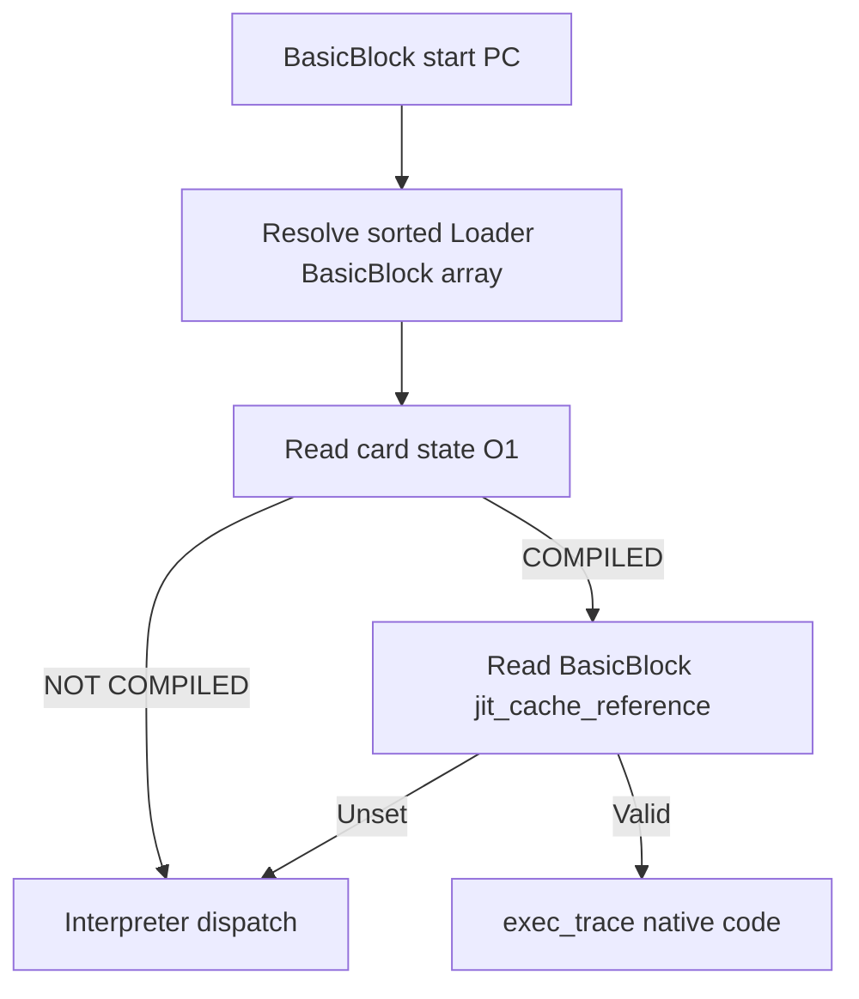
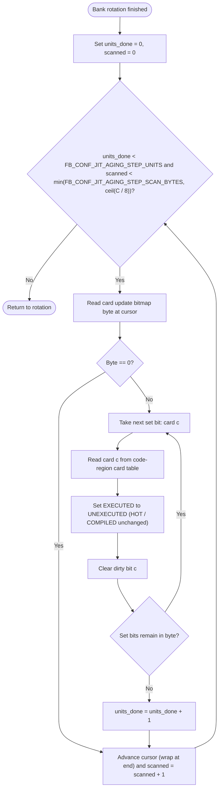
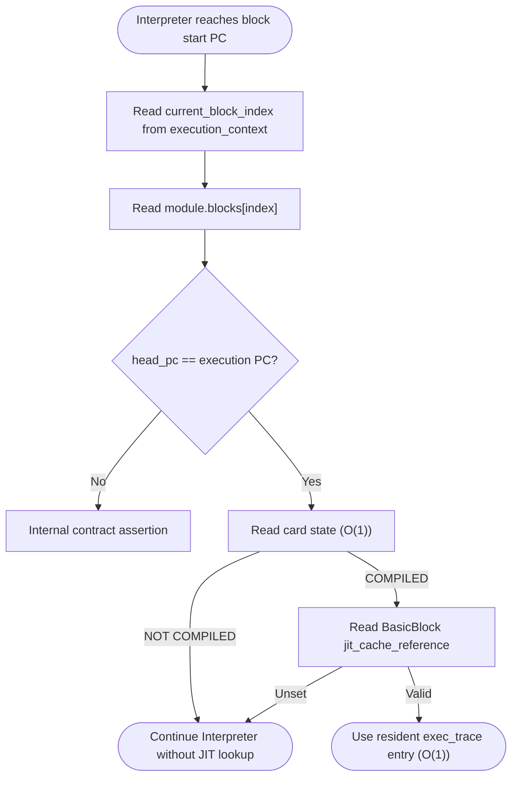
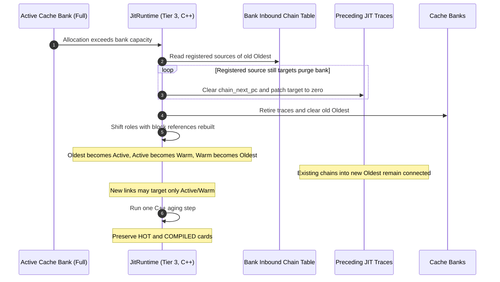
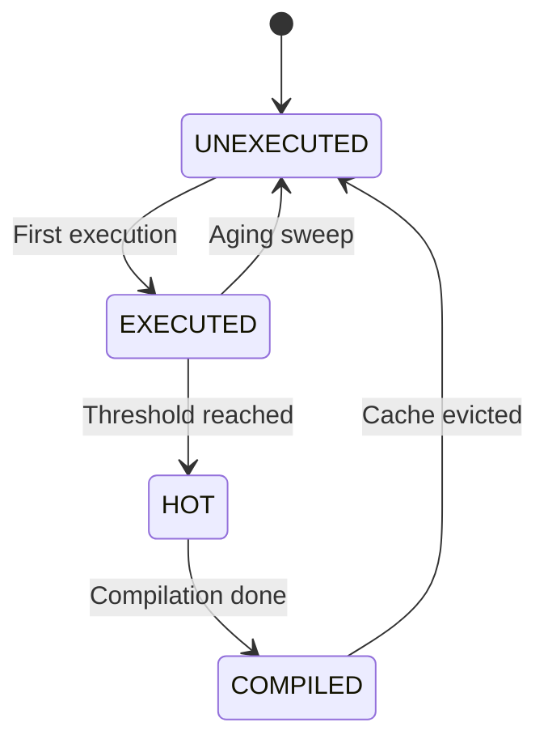
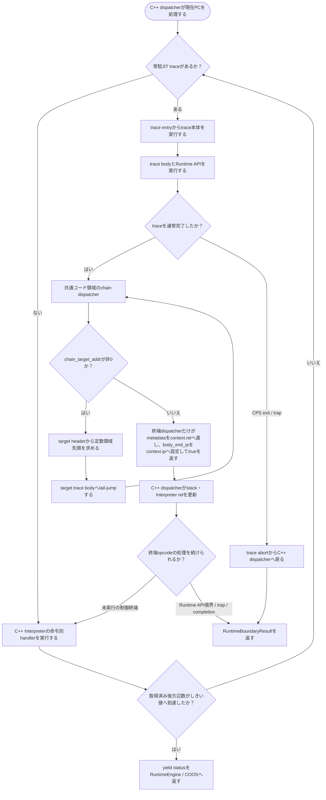

# JIT ランタイム管理 コンポーネント設計書 {VERIFY_FORMAL} {VERIFY_LLM} {VERIFY_BENCHMARK}
<!-- evidence:
     implementation: experiments/pysim/native/tier3_plugins/jit/jit_runtime.hxx
     formal: formal/jit_cache_model.py
     formal: formal/jit_loop_chain_model.py
     formal: formal/jit_hotspot_model.py
     benchmark_spec: benchmarks/jit_runtime_bench_spec.md
     benchmark: ../../../experiments/pysim/benchmarks/jit/bench_jit.py
     benchmark_record: ../../../experiments/pysim/benchmarks/BENCHMARK_REPORT.md
     test: docs/qa/tier3_plugins/jit_runtime_test_spec.md
-->

## 1. コンセプト
<!-- traceability: {SimpleJITArchitecture} {JIT_MultiBuffer_Cache} {JIT_OldestExecuteOnly} {META_AccessDictionary} {META_BinarySearch} {LowLatencyJIT} {LowOverhead} {HistoryBuffer} {RuntimeHotspotProfiler} {GLOBAL_PeriodicTask} {Runtime_BumpAllocator} -->
JIT ランタイム管理は、Tier 2 Interpreterへ任意に接続するTier 3プラグインの実行拡張である。JIT拡張がホットスポット履歴、カード状態、コンパイル要求、ネイティブコード検索、3面キャッシュをまとめて所有する。Runtime Event Sinkとは別の内部経路で履歴を記録する。

JIT拡張はInterpreterのネイティブ実行拡張として接続する。Interpreter dispatcherが共有実行状態と解決済みBasicBlockを渡し、JIT拡張がtrace entryを検索して返す。trace関数の実行、返却metadataによる実行状態の更新、未実行の終端命令のInterpreter処理、次BasicBlockの準備はTier 2 Interpreterが担当する。JIT拡張は履歴分析とコンパイル要求も処理する。RuntimeはInterpreterの実行境界だけを受け取り、JITの選択や実行を行わない。Tier 2 RuntimeやC++ InterpreterにJIT専用の状態オブジェクトや操作API群を追加しない。

JIT traceの選択は`execution_context.current_block_index`からBasicBlock metadataを直接参照して行う。現在のindexとPCはInterpreterからJIT providerへ渡し、BasicBlockの`head_pc`がPCと一致することを検証する。対象カードが`COMPILED`でなければ、JITエントリ検索を呼ばずInterpreterを実行する。`COMPILED`ならBasicBlock内の8bitキャッシュ参照を使う。未設定なら当該ブロックはcache missとする。カード状態は複数BasicBlockで共有されうるため、カードが`COMPILED`でも未常駐のブロックがある。LoaderのRadix表はロード時の構築とその他の利用に残るが、通常dispatchのブロック解決には使わない。JIT常駐索引はPC順を維持し、JITのキーは引き続き`(module_id, pc)`である。

InterpreterはLoader注釈プールの辺indexと`current_block_index`を使い、分岐先と通常継続先のBasicBlockを得る。call先と復帰先の解決は[`interpreter.md`](docs/components/tier2_runtime/interpreter.md)を正本とする。JIT境界metadataの`block_index`には次BasicBlock indexを入れる。chain link、候補受入れ、JIT trace exitはindexとPCの両方を照合する。terminal call stencilのhandler接続要件は[`jit_compiler.md`](docs/components/tier3_plugins/jit_compiler.md)と[`jit_abi.md`](docs/components/tier2_runtime/jit_abi.md)に従う。通常の製品経路では`find_cached_trace_by_pc`を呼ばない。

3面コードキャッシュはデータ用バンプアロケータとは別に管理する。x64参照構成は領域の確保または借用時にRWXを設定し、昇格やリンク更新のたびに権限を切り替えない。書込みAPIはパッチ区間外の変更を拒否する。ARMv8-Mの物理配置と保護方式はTBDである。

## 2. アーキテクチャ分類
<!-- traceability: {META_3TierSeparation} {SimpleJITArchitecture} -->
本コンポーネントは **Tier 3 Plugin** に属し、Interpreterへ任意接続するJIT pluginのBasicBlock index lookup、3面コードキャッシュ管理、局所アンリンク、ホットスポット検出を担当する。コード生成コアは同plugin内の [`jit_compiler.md`](docs/components/tier3_plugins/jit_compiler.md) が担当する。

### 2.1 JIT サブシステムのデコンポジション
<!-- traceability: {JIT_AssemblyStencilCodegen} {SimpleJITArchitecture} -->
JITサブシステムは、以下の2つの独立した設計書に責務を分離して構成される。
- **[jit_compiler.md](docs/components/tier3_plugins/jit_compiler.md)**: 命令テンプレートを用いたネイティブコード生成および静的命令エンコードを担当する。
- **[jit_runtime.md](docs/components/tier3_plugins/jit_runtime.md)**: ホットスポット履歴の記録・分析、カード更新・コンパイル要求、BasicBlock indexからのネイティブtrace参照、3面キャッシュローテーションを担当する。 `SimpleJITArchitecture` `{JIT_MultiBuffer_Cache}`

### 2.2 実装責務と依存方向
<!-- traceability: {META_ContractImplSplit} {META_StaticDI} {META_3TierSeparation} -->
Tier 2は本体実行とブロック観測の接続契約を定める。Tier 3 JITはその契約を実装する。C++ Interpreterは共有実行状態を渡して接続先を呼び出す。トレース表、候補マスク、履歴を受け取らず、キャッシュ世代、候補評価、昇格を判断しない。別の接続先も同じ契約で置換できる。

JIT RuntimeはC++から領域サイズとアラインメントを取得し、C++のRuntime構成が提供する領域を借用する。領域内の状態、カード表、履歴、コンパイル待ち列、3面キャッシュ、実行可能コードと配置はJIT Runtimeが管理する。製品ABIはC++ Runtime構成とTier 2実行契約の間に置き、内部状態の参照やQA用の明示操作を含めない。検証用の状態参照と操作はQA専用ライブラリへ置く。

Tier 3 の実装は次の責務に分ける。

| 実装 | 所有する責務 | 依存先 |
| :--- | :--- | :--- |
| Tier 3 Native JitRuntime | 候補選択、履歴リングと分析、コンパイル待ち列と抑制、カード状態遷移とエイジング、BasicBlock参照とソート済み常駐索引、3面ローテーション、被チェイン元登録と解除、本体実行とチェイン終端の構成、実行可能領域の所有 | Tier 2の共有実行状態と本体実行契約、Tier 3のコンパイラと共通コード |
| Tier 3 Native Trace Compiler | Loader所有のWASMコードを直接走査し、1回の呼出しで1 traceを生成 | Loaderの借用WASMコード、Tier 3の共通コード |
| Tier 2 Runtime / Interpreter | 現在のBasicBlock indexと注釈済み辺を管理し、接続時はTier 3拡張へ実行境界を委譲する | Tier 1、Tier 2 の実行器接続契約 |

Tier 3の`jit_runtime`はコンパイル候補の処理と常駐コード管理を結び付ける。JIT拡張は固定容量のコードキャッシュ、索引、連鎖情報、ホットスポット履歴、および候補キューを所有する。実行領域の供給と権限変更はprovider境界を通す。QA計測は製品構成から分離する。固定容量の状態は上位Runtime構成が用意した保存領域に構築し、LoaderのWASMコードと実行メタデータを登録中に借用する。

命令スコア表、Runtime API slot表と関数表はコンパイル時の不変表とする。関数表は読み取り専用領域に一つだけ保持し、共通コード領域にはその借用アドレスを一つ置く。プラグインの保存領域は、借用するJIT実行状態より長く存続する。固定幅即値の読み出しは`load_jit_immediate<Value, Index>`で値型と位置をコンパイル時に確定する。Loaderが検証済みの命令範囲をスコア評価する内部手続きは、入力破損を候補外の値へ変換せず、契約違反としてassertする。

実行境界ではC++が履歴を分析し、固定容量の待ち列が空になるまでコンパイル要求を処理する。待ち列、コンパイラ、キャッシュ配置、再配置、ヘッダpatchは同じC++プラグイン内の呼出しで完了する。履歴と待ち列の内部操作、機械語テンプレート、中間コンパイル結果はプラグイン境界へ公開しない。検証用の観測はQA側で行う。

共通機械語の生成、トレース再配置、およびヘッダpatchはJIT共通コード経路が担う。実行可能領域の確保・解放、初期権限設定、patch区間と命令キャッシュ同期は実行領域providerが担う。対象ごとのW^X権限切替もprovider境界に置く。カード操作、履歴、および待ち列の更新はホットスポット管理の責務である。

ローテーションはC++内部でカードエイジングを1ステップ実行する。明示的なflushではエイジングを実行しない。エイジング時間、操作回数、常駐状態の診断採取はQA専用の計測型とハーネスが担当する。製品構成に計測状態や取得APIを設けない。

バンクの使用バイト数と次の書込み位置を分けて保持する。削除で空いた中間領域を次の書込み位置として扱わない。次の書込み位置はバンクを消去したときに先頭へ戻す。既存PCの置換は同じ位置へ収まる場合に領域を再利用し、それ以外は未使用の末尾へ配置する。末尾にも収まらない置換は常駐状態を保って失敗を返す。

JIT拡張はInterpreterへ接続する選択可能コンポーネントである。Interpreterは共有実行状態を通じて本体実行を委譲する。Interpreterはコンパイラとキャッシュ内部を参照しない。JIT無効構成では履歴、コンパイラ、実行可能領域を合成しない。

本コンポーネントには独立した概念モデルを置かない。実行経路はネイティブランタイム、x64機械語実装、形式モデルおよび対応するテスト仕様で確認する。

## 3. 静的モデル

### 3.1 データ構造
<!-- traceability: {JIT_ReverseCompilationOrder} {WasmCodeSectionPC} {ADR_JitCompileScheduling} -->
- **WASMプログラムカウンタ (`UnifiedPC` / `wasm_pc_t`)**: 32ビットのモジュール内Code section payload相対オフセットであり、命令先頭バイトを指す。関数インデックスを上位ビットへ格納しない。Code section payload内の関数数、body size、locals宣言も座標に含む。異なるモジュール間のキーは`(module_id, pc)`とする。
- **`JitEntryIndex`**: WASMオフセットとネイティブコードの対応付けを保持する固定状態である。`FB_CONF_JIT_CACHE_TOTAL_ENTRY_CAPACITY` 件以下の`head_pc`昇順索引はキャッシュ更新とchain metadataの再計算に使う。通常のtrace lookupとchain successor解決はBasicBlock index参照を使う。PCのlower_bound lookupはmetadataを持たないQA fixtureに限る。
- **カードマーキング表 (Card Marking Table)**: モジュールのCode section payload相対PC全体を 4 バイト単位のカードで分割管理する、単一の 2 ビット状態表である。カード番号は`pc >> card_shift`で求め、全関数が同じPC座標・カード領域を共有する。関数境界をまたぐカードも同じ状態を参照する。密ビュー `fireball::bit_view<2>` として参照する。
  - `0: UNEXECUTED` (未実行)
  - `1: EXECUTED` (実行済み)
  - `2: HOT` (コンパイル要求中)
  - `3: COMPILED` (コンパイル済み / オンデマンド許可)
- **コンパイル対象可否マスク (Trackable Mask)**: Tier 3 JIT拡張がコード領域全体に対して一枚だけ持つ、カードごとの 1 ビット状態表である。Loader のブロック記述子は正確な head PC とコード範囲を保持する。静的適格性は JIT が評価する。実行時は制御処理で確定したブロック開始PCを保持し、コード領域マスクでカード単位の抑止を確認する。通常命令を実行したブロックだけを履歴へ記録する。`next_pc` を持ち、かつバイト長が `min_trace_bytes` 以上のブロックを対象とする。コンパイル失敗時はそのカードを解除し、同じカードに属する候補も外す。 `{TrackableBlockMask}` <!-- definition: {TrackableBlockMask} -->
- **カード更新表 (Card Update Bitmap)**: コード領域全体の各カードに対応する 1 ビットdirty表である。カードが `UNEXECUTED` から `EXECUTED` へ遷移した時だけ、そのカードのビットを立てる。密ビュー `fireball::bit_view<1>` として参照する。8カードを1バイトにまとめる。
- **エイジングカーソル**: カード更新表のバイト位置を保持する整数である。モジュール登録時に 0 で初期化し、表の末尾に達したら先頭へ戻る。
- **JITエントリ表と全バンク索引**: 各バンクは`head_pc`順の固定容量エントリ配列を持つ。別の固定容量参照配列を `FB_CONF_JIT_NUM_BUFFERS` 面共通で一つ持ち、常駐エントリを`head_pc`順に索引する。参照はバンク番号とエントリ位置を示す。Interpreterが現在のBasicBlock indexをJITへ渡し、その`jit_cache_reference`が有効なら索引探索を省いてエントリへ進む。未設定時はcache missとする。連結候補とtrace exitではLoaderの辺indexを使い、PCも照合する。同じPCを複数バンクへ挿入する契約違反は挿入入口でassertする。バンク配列のシフト、挿入、削除、破棄後は全BasicBlock参照を常駐エントリに合わせて更新し、退役エントリへの参照を残さない。現行設定では最大 `FB_CONF_JIT_CACHE_TOTAL_ENTRY_CAPACITY` 件であり、参照は8ビットで表現する。JITの検索キーは`(module_id, pc)`であり、indexはLoader metadataとの照合と直接参照に使う。JIT用Radix索引と製品実行時のPC→trace検索経路は設けない。QAのmetadataなしfixtureだけはPC検索経路を使う。
- **ネイティブ実行拡張の接続**: JIT拡張への本体実行と観測入口を初期化時に固定する。JIT providerは2-bit card-state表の読み取り専用ビューをdispatch期間中貸し出す。C++ Interpreter dispatcherは`execution_context.current_block_index`とPCからLoaderのBasicBlockを直接参照し、indexの`head_pc`がPCと一致することをassertする。BasicBlockから注釈開始位置を得て`rel`を初期化してからカード状態を確認し、`COMPILED`以外ではJIT entry lookupを呼ばずInterpreter実行を続ける。`COMPILED`ならblock indexとPCをJIT拡張へ渡し、BasicBlockの有効な`jit_cache_reference`を直接使う。参照が未設定ならcache missとしてInterpreterを続ける。カード単位状態と正確なPC照合は区別する。観測入口はInterpreter実行後に候補判定と履歴記録をまとめて行う。コンパイル候補の状態更新はJIT拡張が担当する。
  x64参照構成の記述枠は `FB_CONF_JIT_CACHE_BANK_ENTRY_CAPACITY` により各バンクを上限とする。全バンクの上限は `FB_CONF_JIT_CACHE_TOTAL_ENTRY_CAPACITY` である。これはRAM予算の設定値であり、既定コンストラクタ値や生成コードの平均サイズから導出しない。
  JIT entryは全バンクの固定容量上限に従う。同一PCの常駐traceを重複生成しない。WarmまたはOldestに存在するPCを新規insertすると契約違反とする。Oldestのlookup hitは所在とコードアドレスを変えず実行する。Tier 2はキャッシュの世代を扱わない。
  コード領域または固定長JIT entry表が満杯になれば、既存の3面ローテーションを行う。生成コードの長さは可変である。短いtraceでもentry表の上限を超えて挿入しない。
  ホットスポット候補の判定はJIT拡張が所有するTrackable Maskで行う。候補PC配列は確保しない。インタープリタ実行後に呼ぶ観測入口が候補性を判定し、適格な開始PCをJIT拡張の固定容量リングへ直接書き込む。
  同一カードの構造命令位置もbitが立つ。dispatcherは制御命令だけの区間で本体検索とブロック観測を呼び出さない。関数入口または制御処理の完了を、新しいブロック候補の開始トリガーとする。そこで確定したPCを保持し、通常命令のあるブロックだけを通知する。履歴の複製・転送やLoader索引の再検索を行わない。メモリ操作のruntime委譲後は同じブロックの継続として扱う。次の制御境界まで本体検索と重複した観測を行わない。外部呼出し・prefix委譲の完了は次ブロックの開始トリガーとする。単なるRuntime復帰や通常命令の出現を、新しい先頭の判定に使わない。trap・関数完了では開始待ち状態を解除する。
  通常命令の観測は候補ブロック入口の専用dispatchに限定する。最初のbody命令を観測した後は、観測処理を持たない通常dispatchへ直接末尾呼出しで移る。候補外と観測無効の経路には通常命令ごとの観測判定を追加しない。
  JIT entry表と履歴はJIT拡張の領域内に固定長で確保する。キャッシュ更新時にも同じ領域を再利用する。
- **x64参照コード領域**: JIT領域は `FB_CONF_JIT_CACHE_SIZE`、ページは `FB_CONF_JIT_CACHE_PAGE_SIZE` 単位で構成する。`FB_CONF_JIT_COMMON_CODE_SIZE` をassembly生成chain dispatcherとRuntime API表の参照用の非エビクション領域とし、残りは `FB_CONF_JIT_BANK_SIZE` のバンクを `FB_CONF_JIT_NUM_BUFFERS` 面割り当てる。共通コード領域はflushやバンクローテーションでも維持する。ARMv8-Mの領域容量、物理配置、保護方式、ヘッダ形式はTBDである。
  共通コード領域のchain dispatcherは`0x000`から配置する。固定slotは256バイトである。Tier 3 JITが所有するJIT Runtime API function pointer tableへの借用ポインタをこの固定slotの直後に置き、操作stencilからopcode対応APIを呼び出す。Interpreter opcode handler表からRuntime API関数ポインタを取得しない。`chain_target_addr`が0の場合に限り、終端dispatcherは現在trace末尾のmetadata pointerを`execution_context.rel`へ一時保存し、`body_end_ip`を`execution_context.ip`へ設定して`true`を返す。`false`はtrap/CPS exitまたはyield境界を示す。接続済みの場合はtarget headerから`const_rel_offset`を取得し、target traceへtail-jumpする。操作間の継続deltaはtrace末尾poolに保持しない。`if`、`br`、`br_if`はtraceに含めず、完了したtraceの後にC++ Interpreter dispatcherがCPS handlerで処理する。分岐先へnative chainしない。chain dispatcherはopcodeを判定しない。`native/tier3_plugins/jit/lir/x64/common.S`を対象x64 ABIでアセンブルし、raw binaryとして共通領域へ一度だけ配置する。読み取り専用のRuntime API表はキャッシュへ複製しない。表への8バイトの借用アドレスだけをdispatcher固定slotの後ろへ初期化する。未使用の共通領域を初期化時にゼロ埋めしない。ARMv8-Mの配置方式と命令列はTBDである。
- **オンデマンドコンパイルキュー (On-demand Compile Queue)**: Tier 3 JIT拡張内で`HOT`に達した基本ブロックindexを保持する固定容量LIFOキューである。Runtimeのidle hookは全タスクidle時と協調境界で拡張を呼び出す。拡張は待ち列が空になるまで候補を処理し、候補数による打ち切りを行わない。コンパイル失敗と既存trace等によるスキップも待ち列から取り除く。固定キューが満杯になると、その場で待ち列全体を処理する。固定容量は一度に処理する候補数を制限するが、実時間の上限は保証しない。先行ブロックより後続を先に常駐させ、直線後続chainを接続する。 `JIT_ReverseCompilationOrder` `{GLOBAL_Policy_Memory}`
- **被チェイン逆引きテーブル (Inbound Chain Index Table)**: 常駐traceの後続PCをキーとする `FB_CONF_JIT_INBOUND_BUCKET_COUNT` バケットの固定長ハッシュ表である。各バケットの先頭参照配列は `FB_CONF_JIT_INBOUND_BUCKET_COUNT` byte、最大常駐trace参照の次配列は `FB_CONF_JIT_CACHE_TOTAL_ENTRY_CAPACITY` byteで構成する。退役するtargetのPCから候補sourceを取り出し、後続PCと現在のtarget addressを照合してリンクを更新または解除する。エントリ索引を再構築するときに逆引き表も再構築する。
- **chainメタデータ**: `chain_next_pc`は接続先PCを保持する。x64物理ヘッダの`chain_target_addr`は共通chain dispatcherがtail-jumpする常駐targetを保持する。直線後続だけを接続し、分岐opcodeからのchain targetは登録しない。循環chainの`chain_body_count`と`chain_words`は、`FB_CONF_JIT_CACHE_TOTAL_ENTRY_CAPACITY` 件以下の常駐traceを有界に巡回し、rootから最初の再訪までのtraceを一度ずつ数えて求める。退役時は被chain逆引き表でリンクを解除する。接続条件は [`jit_compiler.md`](docs/components/tier3_plugins/jit_compiler.md) §7.4に示す。
- **実行履歴バッファ**: ホットスポット検出が有効なJIT拡張が所有する固定容量リングである。Interpreterが解決した基本ブロックindexと`UnifiedPC`を各8バイトレコードに保持する。Runtimeは単一moduleに束縛されるため、レコードへ`module_id`を複製しない。容量は`JIT_HISTORY_CAPACITY`以下で指定する。待ち列容量は`JIT_COMPILE_QUEUE_CAPACITY`以下で指定する。Interpreter実行区間の終了時だけ履歴順に分析し、JIT trace/chainだけの区間では記録も分析もしない。 `{HistoryBuffer}`

トレース実行回数と退役記録はQA専用の計測構成で採取する。計測の正本は[`jit_runtime_bench_spec.md`](docs/components/tier3_plugins/benchmarks/jit_runtime_bench_spec.md)とする。製品構成は計数状態、時計、計測用の後続走査、および退役通知を持たない。履歴分析はネイティブ実行境界で完了する。

### 3.2 内部ブロック図

### 3.3 主要なクラス・構造体・配列・定数

#### JITエントリインデックス（JitEntryIndex）構造体
| 項目名 | 機能と役割 | 型分類 | サイズ・制約 |
| :--- | :--- | :--- | :--- |
| BasicBlockのJITキャッシュ参照 | 常駐JITエントリのbank・entry位置を保持し、同じブロックのPC再検索を省く | Loader BasicBlock内の8bit値 | `0`〜`FB_CONF_JIT_CACHE_TOTAL_ENTRY_CAPACITY - 1`、未設定`0xFF` |
| 全バンク参照索引 | `FB_CONF_JIT_NUM_BUFFERS` バンクのエントリ位置を`head_pc`順に保持する。キャッシュ更新時の参照再構築とchain metadataの後方再計算に使う | 固定長配列 | `FB_CONF_JIT_CACHE_TOTAL_ENTRY_CAPACITY` 件以下、8ビット参照 |
| バンク別エントリ配列 | 各バンクの`head_pc`昇順JITエントリを保持する | 固定長ソート配列 | 各バンク最大 `FB_CONF_JIT_CACHE_BANK_ENTRY_CAPACITY` 件 |
| カードマーキング表 | カードごとの 2-bit 状態表 | 密ビュー | `fireball::bit_view<2>` |
| カード更新表 | 前回の巡回以降に `EXECUTED` へ遷移したカードの印 | 密ビュー | `fireball::bit_view<1>`、コード領域カード数ビット |
| 被チェイン逆引きテーブル | 後続PCのハッシュ値からsource参照を引き、PCとtarget addressを照合する | 固定長バケット配列と参照連結配列 | `FB_CONF_JIT_INBOUND_BUCKET_COUNT + FB_CONF_JIT_CACHE_TOTAL_ENTRY_CAPACITY` byte |
| 履歴バッファ | Interpreterが解決したindexとPCを観測通知から記録する基本ブロック履歴 | 固定容量リング | `(block_index, unified_pc)` の8バイトレコード。単一moduleに束縛されたRuntime内で使う。Runtimeと同じ寿命 `{HistoryBuffer}` |

## 4. 動的モデル

### 4.1 アルゴリズム

- **`opcode_benefit_table` (`BitView<4>`)**: ROM 上に配置される 128 バイト（256 opcode $\times$ 4-bit）の静的テーブル。インタープリタ処理命令数と JIT 処理命令数の差分（短縮機械語命令数、分岐8倍換算）をゼロ点固定線形正規化した `int4_t`（-8〜+7、1スコア＝2命令相当短縮）を保持する。 `{JIT_StaticBenefitScoring}` <!-- definition: {JIT_StaticBenefitScoring} -->
- **`jit_candidate_bitmap` (`BitView<1>`)**: モジュールロード時に各基本ブロックの命令スコア合算値が閾値（9点：コンパイルオーバーヘッド換算値6点＋デルタ3点）に達したブロックの `head_pc` が属する Card を 1bit でマーキングしたビットマップ。インタープリタ実行ループにおける `touch()` スキップに供される。 `{JIT_CandidateBitmap}` <!-- definition: {JIT_CandidateBitmap} -->

  Loaderの`byte_span`はtrace本体全体の命令範囲であり、JITは各命令を直接stencilまたはRuntime APIでlowerする。`byte_span`が0のエントリは命令本体を持たない入口であり、インタープリタの定数pool開始位置を示す。

- **JIT 拡張による基本ブロック適格性評価と候補ビットマップ生成 (`{JIT_StaticBenefitScoring}`, `{JIT_CandidateBitmap}`)**:
  WASM コードセクションを走査し、各関数の基本ブロック（`BasicBlock`）を調べる。ROM 上の `opcode_benefit_table`（`BitView<4>`、128B）から、各命令の機械語短縮スコアを取得する。スコアは `int4_t` の -8〜+7 である。1スコアは約2命令の短縮に相当し、分岐命令は8命令として換算する。各ブロックのスコアを符号付き整数（`int`）へ累積加算する。

  $$TotalScore(BB) = \sum_{op \in BB} decode\_int4(opcode\_benefit\_table[op])$$

  候補スコアはブロック全体のコンパイル優先度を決める便益評価である。Loaderが受理したopcodeは直接assembly stencilまたはJIT Runtime API経路でtraceを実行する。

  基本ブロック終端（分岐命令または `end`）到達時、累積スコア `TotalScore(BB)` を判定閾値 `S_threshold = 9` と比較する。現行trace compileはWASM decode、variant選択、raw stencilのslot展開、template分岐再配置を実行するため、閾値が損益分岐回数を保証するものではない。compile latencyは [`jit_runtime_bench_spec.md`](docs/components/tier3_plugins/benchmarks/jit_runtime_bench_spec.md) のtrace単位計測で評価する。
  `TotalScore(BB) >= 9` を満たす場合、そのブロックの `head_pc` が属するカードの `jit_candidate_bitmap` ビット（1bit/カード）を `1` にセットする。満たさない極小ブロックや呼び出し主体ブロックは `0`（インタープリタ専任）に維持される。
  **設計理由と不変条件**: JIT キャッシュ（`FB_CONF_JIT_BANK_SIZE` $\times$ `FB_CONF_JIT_NUM_BUFFERS` 面）の容量とコンパイル・トレース管理の費用には上限がある。実行時のホットスポット検出前に、投資対効果（加速利得 $\ge$ コンパイルコスト＋マージン）を満たすブロックだけを静的に選別する。
  対象外ブロックでは、インタープリタ実行ループの `HotspotBitmap.touch(pc)` と履歴記録を完全に省く。この処理は $O(1)$ で不要になる。これによりキャッシュ汚染とスラッシングを防ぐ。

##### 命令別短縮利得スコア定義台帳 (`opcode_benefit_table` / `int4_t`)
<!-- traceability: {JIT_StaticBenefitScoring} {JIT_CandidateBitmap} {WasmFCSubset} -->
ROM 上に配置される 128 バイトルックアップテーブル（256 オプコード $\times$ 4-bit 符号付き整数 `int4_t`: `-8`〜`+7`）のスコア配分表を以下に定める。スコアは命令単体の実行時間ではなく、インタープリタ経路をJIT経路へ置き換えたときの期待利得を表す。直接生成命令は高い正の値、JIT共通コード領域の借用参照から読み取り専用Runtime API tableを使う命令は呼出しコストを差し引いた正の値、実行境界へ戻る命令は負の値とする。構文デリミタは中立（0）、trapだけを起こす`unreachable`は最大ペナルティ（-8）となる。命令セット範囲外の値はLoaderが拒否し、この候補スコア表には渡さない。
`0xFC`はサブオペコードを持つprefix命令だが、本テーブルは先頭opcode byteで引く256要素のため、サポートする全サブオペコード（`0`〜`7`、`10`、`11`）へ共通のスコアを適用する。未対応サブオペコードはLoaderが先に拒否するので候補スコア表へ渡さない。

| スコア (`int4_t`) | 換算短縮命令数 | 分類と特性 | 該当 WASM 命令 |
| :---: | :---: | :--- | :--- |
| **`+7` (MAX)** | 約 +14 命令短縮 | 32bit 整数加減算・基本ビット論理・シフト（極小フットプリント・最高加速利得） | `i32.add` (`0x6A`), `i32.sub` (`0x6B`), `i32.and` (`0x71`), `i32.or` (`0x72`), `i32.xor` (`0x73`), `i32.shl` (`0x74`), `i32.shr_s` (`0x75`), `i32.shr_u` (`0x76`) |
| **`+6`** | 約 +12〜13 命令短縮 | 整数乗算・32bit 比較演算・ローカル変数/定数ロード・ビット操作のインライン展開 | `i32.mul` (`0x6C`), `i32.eqz` (`0x45`), `i32.eq` (`0x46`), `i32.ne` (`0x47`), `i32.lt_s` (`0x48`), `i32.lt_u` (`0x49`), `i32.gt_s` (`0x4A`), `i32.gt_u` (`0x4B`), `i32.le_s` (`0x4C`), `i32.le_u` (`0x4D`), `i32.ge_s` (`0x4E`), `i32.ge_u` (`0x4F`), `i32.clz` (`0x67`), `i32.ctz` (`0x68`), `i32.const` (`0x41`), `i64.const` (`0x42`), `f32.const` (`0x43`), `f64.const` (`0x44`), `local.get` (`0x20`), `local.set` (`0x21`), `local.tee` (`0x22`) |
| **`+5`** | 約 +10〜11 命令短縮 | 高頻度の境界検査付きリニアメモリアクセス・剰余/循環シフト | `i32.load` (`0x28`), `i32.load8_s` (`0x2C`), `i32.load8_u` (`0x2D`), `i32.load16_s` (`0x2E`), `i32.load16_u` (`0x2F`), `i32.store` (`0x36`), `i32.store8` (`0x3A`), `i32.store16` (`0x3B`), `i32.rotl` (`0x77`), `i32.rotr` (`0x78`), `i32.rem_s` (`0x6F`), `i32.rem_u` (`0x70`) |
| **`+4`** | 約 +8 命令短縮 | 整数除算・グローバル変数アクセス・メモリサイズ・スタック操作・復帰・ニュートラル | `i32.div_s` (`0x6D`), `i32.div_u` (`0x6E`), `global.get` (`0x23`), `global.set` (`0x24`), `memory.size` (`0x3F`), `select` (`0x1B`), `return` (`0x0F`), `drop` (`0x1A`), `nop` (`0x01`) |
| **`+3`** | 約 +6〜7 命令相当の正味利得 | 広幅・浮動小数点の直接演算stencil、およびRuntime API経路の命令。APIはopcode意味論と状態更新を行い、正常継続時はtrace内の後続operationへ戻る | 直接演算の`i64.add/sub/mul`と`f32/f64.add/sub/mul/div` (`0x7C`〜`0x7E`, `0x92`〜`0x95`, `0xA0`〜`0xA3`); Runtime API経路の`i32.popcnt` (`0x69`), `i64.eqz` / 比較 (`0x50`〜`0x5A`), `i64.clz/ctz/popcnt` (`0x79`〜`0x7B`), `i64.div/rem` / ビット演算 (`0x7F`〜`0x8A`), `f32/f64`の比較・単項演算・min/max/copysign (`0x5B`〜`0x66`, `0x8B`〜`0x91`, `0x96`〜`0x9F`, `0xA4`〜`0xA6`), 整数・浮動小数点変換 (`0xA7`〜`0xC4`), その他のRuntime API経由memory access (`0x28`〜`0x3E`のうち`+5`欄を除く) |
| **`0`** | 0 命令短縮 | 構文デリミタ（0バイト消去・トレースヘッダ埋め込みにより加点もペナルティもなし） | `block` (`0x02`), `loop` (`0x03`), `else` (`0x05`), `end` (`0x0B`) |
| **`-1`** | 約 -2 命令ペナルティ | 関数間callや動的分岐のtrace境界・dispatcher処理 | `call` (`0x10`), `call_indirect` (`0x11`), `br_table` (`0x0E`) |
| **`-2`** | 約 -4 命令ペナルティ | メモリ管理サービスや一括操作を含むRuntime API処理 | `memory.grow` (`0x40`), `i32/i64.trunc_sat_f32/f64_{s,u}` (`0xFC 0x00`〜`0x07`), `memory.copy` (`0xFC 0x0A`), `memory.fill` (`0xFC 0x0B`) |
| **`-8` (MIN)** | 最大ペナルティ | 実行すると必ずtrapする命令 | `unreachable` (`0x00`) |

1. **実行コンテキストのBasicBlock index参照 ($O(1)$)**: Loaderが関数入口と制御辺についてindexを前計算し、Interpreterは`current_block_index`へ現在indexを保持する。分岐と通常継続は注釈済みindexからBasicBlock metadataと`rel`開始位置を直接得る。呼出しと復帰のindexは[`interpreter.md`](docs/components/tier2_runtime/interpreter.md)の契約に従う。境界停止のPC比較を除き、dispatch中にPCからindexを検索しない。
2. **カード状態によるJIT検索抑止 ($O(1)$)**: BasicBlock解決後にカード状態を読む。状態が`COMPILED`でなければJIT providerを呼ばず、キャッシュ参照も変更せずInterpreter命令を実行する。状態が`COMPILED`でもカード内の別ブロックだけがコンパイル済みの場合があるため、正確なPCはBasicBlock参照またはJIT索引で照合する。
3. **BasicBlock内キャッシュ参照 ($O(1)$)**: `jit_cache_reference != 0xFF`なら、値が指す常駐エントリを使う。キャッシュ配列の並べ替え・削除・破棄時は参照をresident entryへ更新し、residentでないentryへの参照を残さない。Runtime領域の解放前にも、借用しているBasicBlockの常駐参照を無効化する。
4. **キャッシュ更新用PC索引 ($O(n \log n)$)**: キャッシュ更新時に全バンク合計 `FB_CONF_JIT_CACHE_TOTAL_ENTRY_CAPACITY` 件以下の参照を`head_pc`順に並べ、BasicBlock参照の再構築とchain metadataの後方再計算に使う。通常の実行lookupとchain successor解決では索引を検索しない。metadataを持たないQA fixtureのPC lookupだけが`lower_bound`を使う。JIT用Radix表や製品実行時のグローバルPC→trace検索経路は設けない。
5. **ホットスポット昇格判定**:
   - C++ Interpreterはブロック開始PCを保持する。通常命令を実行したブロックを実行拡張へ通知する。候補マスクの判定と開始PCの固定履歴バッファへの記録はTier 3 JIT拡張が行う。JIT拡張は境界で履歴を分析し、カード状態を更新する。JIT trace/chainだけの実行区間では記録しない。
   - 実行頻度が閾値に達したカードを`HOT`のままJIT拡張内のコンパイル待ち列へ登録する。Tier 3 JIT拡張が元のWASMコードをコンパイルし、コードcacheへの挿入まで成功した場合に`COMPILED`へ遷移する。
   - コンパイル失敗時は対象bitを解除し、そのブロックを再履歴・再コンパイル対象にしない。cache evictionまたは明示flushでは、対象bitを維持したままカードを`UNEXECUTED`へ戻し、次の閾値までhotnessを再計測する。eviction後に`EXECUTED`へ戻すと1回のtouchで再び`HOT`になり、持続的にホットでないコードでもコンパイルとevictionを繰り返すおそれがある。
6. **最小トレース長フィルタ**:
   - 推定サイズが 1 カード分未満のブロックは、履歴記録やコンパイル登録の対象外とする（TEST-JITR-06）。カードの2-bit状態は1つの追跡対象ブロックを表す。短いブロックの先頭が同じカードに入ると、互いのコンパイル状態やevictionを区別できない。
7. **3面世代交代ローテーションと局所アンリンク (`{GOTCHA-JITR-03}`, `{JIT_MultiBuffer_Cache}`, `{JIT_OldestExecuteOnly}`)**: <!-- definition: {GOTCHA-JITR-03} -->
   - Active バンク満杯時、`Oldest` バンクをパージして新 `Active` に再利用する。
   - パージ直前に、退役する各targetの後続PCバケット内のソース候補を照合する。
   - 新たにリンクするchain targetはActiveまたはWarmに限定する。ターゲットがWarmからOldestへ移っても、既存の`chain_next_pc`と`chain_target_addr`を維持する。Oldestだけに存在する後続へ新たにリンクしない。
   - 退役targetへのchainを解除し、共通dispatcherの復帰経路へ戻す。リンク照合では全件走査を行わない。
   - `rotate()` および `flush_all()` 実行時にはBasicBlockのJITキャッシュ参照をresident entryに合わせて更新または無効化し、退役バンクへの誤参照を防ぐ（`{GOTCHA-JITR-05}`）。 <!-- definition: {GOTCHA-JITR-05} -->
   - ローテーションのたびに、エイジングスイープを 1 ステップ実行する（手順10）。`flush_all()` では実行しない。
   - 参照実装のバンク破棄は、退役対象$n$件と各PCのハッシュ衝突を含む候補件数$k$件を照合する。索引の再構築では常駐エントリをソートする。固定容量により処理量は有界である。ターゲット実装はバンク破棄の方法を別途定義する。
8. **Oldestの実行と既存chainの維持 (`{GOTCHA-JITR-02}`, `{JIT_OldestExecuteOnly}`)**: <!-- definition: {GOTCHA-JITR-02} -->
   - Oldestのlookup hitはその場で実行する。コピー、索引再構築、リンク付け替えを行わない。
   - 新規chainのリンク先をActiveまたはWarmに限定する。WarmからOldestへ移った既存chainは維持する。
   - Oldestの破棄直前に逆引き表から被チェイン元を照合し、退役targetへのリンクを解除する。
9. **キュー処理時のキャッシュ再確認と二重コンパイル抑止 (`{GOTCHA-JITR-01}`)**: <!-- definition: {GOTCHA-JITR-01} -->
   - JIT拡張はコンパイル待ち列から取得したPCのカード状態を確認し、すでに`COMPILED`ならコンパイルを行わず次の要求へ進む。cacheへの手動挿入とコンパイル要求が重なる場合、同じ拡張内で常駐状態をカードへ同期する。
   - **設計理由**: 二重コンパイルによるキャッシュ容量の浪費と CPU 時間の損失を完全に防止する。
10. **エイジングスイープ (`{JIT_CardAgingSweep}`)**: <!-- definition: {JIT_CardAgingSweep} -->
   - 目的は、`EXECUTED` のまま長く残ったカードを `UNEXECUTED` へ戻すことである。時間的に離れた2回の実行が `HOT` を成立させる状況を防ぐ。
   - 契機は、3 面キャッシュのローテーション（`rotate()`）である。ローテーション 1 回につき 1 ステップを実行する。バンク満杯による自動ローテーションも含む。コンパイルの成否や `flush_all()` では実行しない。
   - ローテーションは、キャッシュ圧迫の直接の指標である。追い出しが起きない間は、エイジングも止めてよい。
   - 1 回の実行では、エイジングカーソルから 8 カード（1 バイト）単位でカード更新表を進める。
   - 値が 0 でないバイトを `FB_CONF_JIT_AGING_STEP_UNITS` 個処理した時点で、1 回の実行を終える。
   - 走査したバイトが `FB_CONF_JIT_AGING_STEP_SCAN_BYTES` 個に達した時点でも、1 回の実行を終える。値が 0 のバイトも走査数に数える。
   - 値が 0 のバイトは処理数に数えず、読み飛ばす。表を 1 周しても終了条件に達しない場合は、1 周した時点で終える。
   - 処理するバイトでは、ビットが立ったカードだけを扱う。
   - 処理するカードの状態が `EXECUTED` なら、そのカードを `UNEXECUTED` へ戻す。その後、当該dirtyビットを 0 にする。
   - `HOT` と `COMPILED` のカードには触れない。`HOT` はコンパイル待ち列と対応し、`COMPILED` は常駐トレースと対応するためである。
   - 走査後にカーソルを進める。表の末尾に達したら先頭へ戻る。
   - **ビットを立てる契機**: カードが `UNEXECUTED` から `EXECUTED` へ遷移した時点で、そのカードのdirtyビットを立てる。この遷移はカード状態の更新（touch）の中だけで起きる。
   - **設計理由**: `EXECUTED` へ遷移したカードだけを直接巡回し、コード領域全体のカード表を走査しない。
   - **上限**: コード領域のカード数を $C$、dirty表のバイト数を $D=\lceil C / 8 \rceil$ とする。1 回の実行で走査するバイトは最大 $\min(O, D)$ 個、処理するカードは最大 $8 \times U$ 個である（$U$: `FB_CONF_JIT_AGING_STEP_UNITS`、$O$: `FB_CONF_JIT_AGING_STEP_SCAN_BYTES`）。
   - **処理量**: 1 回の実行の最大処理量は $8 \times U$ 枚のカード状態確認に比例する。
   - **有限性**: dirtyビットが立ったカードは、高々 $\lceil D / O \rceil + \lceil D / U \rceil$ 回のローテーションの内に処理される。1 周に要するローテーションは、少なくとも $\lceil D / O \rceil$ 回である。
   - **保持期間**: カーソルが通過する直前に `EXECUTED` になったカードは、ほぼ直後に減衰する。1 周に要するローテーション数の下限は走査上限が決め、値が 0 でないバイトが多いほど 1 周は長くなる。減衰はコード領域カード単位で行う。`HOT` の閾値（2回の実行）はこの範囲で満たす必要がある。

#### エイジングスイープ手順（手順アクティビティ図）
<!-- traceability: {JIT_CardAgingSweep} {TrackableBlockMask} {GOTCHA-JITR-09} -->
ローテーションごとに実行する巡回手順を示す。

#### BasicBlock indexによるJIT検索手順（手順アクティビティ図）
<!-- traceability: {JIT_MultiBuffer_Cache} {LowLatencyJIT} {META_BinarySearch} -->
Interpreterが持つBasicBlock indexとPCからmetadataを直接参照し、indexのhead PCと実行PCを照合してから必要な場合だけネイティブ`exec_trace`を検索する。

#### 3面世代交代ローテーションと被チェイン局所アンリンク（責務シーケンス図）
<!-- traceability: {GOTCHA-JITR-02} {GOTCHA-JITR-03} {JIT_MultiBuffer_Cache} {JIT_LazyChaining} {JIT_CardAgingSweep} -->
Active バンク満杯時の世代交代において、局所アンリンクと再チェイニングの連携シーケンスを示す。

### 4.2 状態遷移図
<!-- traceability: {GOTCHA-JITR-09} -->

キャッシュ破棄（Eviction）時は `EXECUTED` ではなく `UNEXECUTED` へリセットする（TEST-JITR-04）。

エイジングスイープが `UNEXECUTED` へ戻せる状態は `EXECUTED` だけである。`HOT` と `COMPILED` は変更しない。

コンパイル失敗時はカードを`COMPILED`にせず、独立したTrackable Maskの対象bitを解除する。これはカード状態の遷移ではなく再試行対象の除外であり、eviction後に候補性を保ったままhotnessを取り直す動作とは異なる。

### 4.3 トレース実行時の分岐解決とインタープリタ復帰
<!-- traceability: {JIT_RuntimeAPI} {DirectBytecodeExecution} {GOTCHA-JITR-02} -->
制御フロー・コール境界の状態整合不変条件を示す。ロード時の静的解析で各基本ブロックに付帯情報を持たせる。これにより実行時の分岐解決を定数時間で行う。

| 付帯情報 | 意味 |
| :--- | :--- |
| 後続アドレス | 分岐条件が不成立だった場合に続くブロックの先頭アドレス |
| 分岐先アドレス | 分岐条件が成立した場合に実際にジャンプする先のアドレス |
| フレーム深さ | 当該ブロック到達時に積まれているべき静的制御ネストの深さ |
| 命令列長 | 当該ブロック自身が占める命令バイト数（足切り判定用） |

命令列長は、後続アドレスから自分自身の先頭アドレスを引いて求めてはならない。後方分岐ブロックでは差分が負になる。その結果「短すぎる」と誤判定される。命令列長はブロック自身の命令バイト数から直接求める。

`if`、`br`、`br_if`はJIT traceから除外し、trace完了後にC++ Interpreter dispatcherがCPS handlerで実行する。分岐先traceへnative chainしない。取得済みLOOP後方辺だけを共通contextの`loop_jump_count`で一度ずつ数える。しきい値の正本はInterpreter設定の`FB_CONF_INTERPRETER_YIELD_THRESHOLD`である。yield statusはC++ dispatcherを経てTier 2 RuntimeとSystemからCOOSへ渡る。外部呼出し、trap、関数完了は各契約の実行境界となる。

trace chainは、直線後続の常駐traceへ共通chain dispatcherからtail-jumpする経路である。分岐命令はtraceに含めず、C++ Interpreter CPS handlerが処理する。共通chain dispatcherはopcodeを判定せず、直線chainのtargetへの転送だけを担う。未接続targetは0で表す。C++ handler後にdispatcherが次traceを検索・起動する遷移はmachine-code chainではない。

常駐トレースの選択、chain接続はTier 3 JIT拡張が所有する。Interpreterは共有実行状態とroot traceのentry情報を受け取り、trace entryを実行する。chain dispatcherはtarget traceへ移る前に`rel`をtargetの定数領域先頭へ設定する。call命令の意味論は[`interpreter.md`](docs/components/tier2_runtime/interpreter.md)、terminal call stencilのhandler接続は[`jit_compiler.md`](docs/components/tier3_plugins/jit_compiler.md)と[`jit_abi.md`](docs/components/tier2_runtime/jit_abi.md)を正本とする。通常の未接続chainで終端dispatcherへ到達したときはmetadata pointerを一時的に`context.rel`へ渡し、`body_end_ip`を`context.ip`へ設定して`true`で戻る。C++ dispatcherはそのmetadataからstackとInterpreter `rel`を確定する。未実行の終端分岐命令をInterpreterへ渡した場合は、対応handlerで処理して実行を再開する。JITで処理済みの制御命令は再実行しない。trace entryの`false`はtrap/CPS exitを示す。JIT拡張はlookup時にchainを走査せず、終端情報をtrace descriptorへ組み立てない。

Interpreterは制御処理で確定した次ブロックのPCを保持する。通常命令を実行したブロックの観測を実行拡張へ通知する。候補性の判定、固定長履歴への記録、カード更新、コンパイル要求はJIT拡張内部で行う。Runtime Event Sinkはこの履歴を受け取らない。JIT無効構成は履歴、候補状態、コンパイラ、実行可能領域を持たない。デバッガ付き実行ではRuntimeがJIT拡張を迂回し、通常のInterpreter dispatcherを使う。

コンパイル待ち作業がないyield境界ではJIT拡張はコンパイル処理を起動しない。候補履歴が0件の実行区間では履歴を分析しない。これらの省略はyield理由、ゲスト状態、トレース選択を変更しない。

必要stack量、chain内のtrace body数、機械語chain target、Loader block配列のindexは、JIT拡張がtraceを作る時点またはchain更新時にheaderへ記録する。実行時はInterpreterから渡されたroot BasicBlock indexとPCを照合してtraceを選び、chain先はtrace headerのtarget addressを直接たどる。chain終端の探索と終端descriptorの構築は行わない。未接続chain targetに到達した終端dispatcherだけが終端metadata pointerを`context.rel`へ置き、`body_end_ip`を`context.ip`へ設定してtrace entryから`true`で戻る。trace中のRuntime APIが`false`を返した場合はtraceをabortする。`if`、`br`、`br_if`はRuntime APIを呼ばず、完了したtraceの次のInterpreter CPS handlerが処理する。block indexはLoader metadataの寿命内だけ有効であり、traceと同時に退役する。実行後の計測用chain再走査はQA計測構成だけに含める。

実行入口と所有者の接続は初期化時に固定する。実行境界ごとに入口を構成し直さない。Interpreter経路とJIT経路は共通の境界結果処理を使う。

#### 現行x64参照実装のInterpreter復帰手順（アクティビティ図）

- **分岐条件の扱い**: `br_if`と`if`の条件値は実行した経路が一度だけ消費する。JITで消費済みの条件値をInterpreter handlerへ再度渡さない。
- **関数終了 (`{GOTCHA-JITR-08}`)**: JIT traceは`return`を生成せず、関数復帰は[`interpreter.md`](docs/components/tier2_runtime/interpreter.md)へ委譲する。 <!-- definition: {GOTCHA-JITR-08} -->
- **分岐境界の整合 (`{GOTCHA-JITR-06}`)**: `if`、`br`、`br_if`はtraceに含めず、Interpreter CPS handlerが条件値、stack、frame、PCを一度だけ更新する。trace完了後にopcodeを処理し、実行済み命令を再実行しない。trap/CPS exitは記録済みの終了理由から処理する。 <!-- definition: {GOTCHA-JITR-06} -->
- **短小判定の符号 (`{GOTCHA-JITR-07}`)**: ブロックの足切り判定は自身の命令バイト数で行う。後続アドレスとの差分で代用すると、後方分岐ブロックで差分が負になり、高頻度ブロックが永久に除外されてしまう。 <!-- definition: {GOTCHA-JITR-07} -->
- **エイジングと常駐状態の分離 (`{GOTCHA-JITR-09}`)**: エイジングスイープは `EXECUTED` のカードだけを変更する。`COMPILED` まで戻すと、常駐トレースのカードが `UNEXECUTED` になり、lookup が常駐コードを見逃す。`HOT` まで戻すと、コンパイル待ち列の要求とカード状態が食い違う。常駐性の正本はキャッシュ、待ち列の正本は待ち列であり、スイープはどちらも書き換えない。 <!-- definition: {GOTCHA-JITR-09} -->
- **押し出し量の入口契約**: Loaderが記録する関数の最大オペランド高を関数入口で検査する。Interpreter命令列とJIT traceの双方は、この予約済み容量内で検証済みのスタック遷移を実行する。関数途中のtrace入口ではオペランド容量を再検査しない。入口予約の安全性と拒否時の本体不実行は[interpreter_stack_model.py](docs/components/tier2_runtime/formal/interpreter_stack_model.py)で検証する。`if`、`br`、`br_if`はtraceに含めず、対応するInterpreter CPS handlerへ渡す。
- **連鎖の再リンク**: ローテーションの後も、非0のchain targetは常駐トレースbodyの有効なアドレスを指す。cache metadataとネイティブtrace headerの値は一致する。後続が退避された場合は`chain_target_addr`を0にし、共通chain dispatcherから現在のtrace entryへ戻す。未接続targetへ進む場合は共有状態と未実行命令位置をInterpreterへ渡す。

## 5. インターフェース定義

### 5.1 公開API

#### Interpreter拡張境界
| 項目 | 内容 |
| :--- | :--- |
| 呼出 | Interpreter dispatcherはBasicBlock入口でJIT拡張のtrace lookupを呼び、root entry、root `rel`、root frame depth、chain全体の必要stack量とtrace body数を受け取る。trace関数は`bool`を返す。`true`の場合は終端dispatcherだけがmetadata pointerを一時的に`context.rel`へ渡し、`body_end_ip`を`context.ip`へ設定する。Interpreter dispatcherはmetadataからstackとInterpreter `rel`を更新し、未実行の終端命令の処理後に次BasicBlockを解決する。`false`ならtrap/CPS exitを処理する。`if`、`br`、`br_if`はJIT traceに含まれず、CPS handlerが一度実行する。実行時制御フレームは作らない。 |
| 内部処理 | 候補選択、trace lookup、履歴分析、キャッシュ更新、コンパイル要求はTier 3拡張内部に閉じる。個別のC++ Runtime操作APIを追加しない。 |
| 拡張なし構成 | JIT拡張を結線しないInterpreter構成では、Interpreter dispatcherがCPS handlerを実行する。 |
| 不変条件 | Tier 2 Runtimeはカード表、履歴リング、キュー、キャッシュ実装を参照しない。 |

## 6. 制約達成の方策

### 6.1 性能制約
- **方策**: `execution_context.current_block_index`とLoader注釈プールの辺indexからBasicBlock metadataを直接参照する。indexとPCの一致をassertしてからtrace候補を判定し、JIT cache keyのPCも維持する。カードが`COMPILED`でないときはJIT providerを呼ばず、JIT参照やJIT索引を検索・変更しない。コンパイル済みカードでBasicBlock参照が未設定ならcache missとする。キャッシュ更新時はBasicBlock参照を更新または無効化し、退役位置へのアクセスを防ぐ。

### 6.2 メモリ制約
<!-- traceability: {JIT_MultiBuffer_Cache} {JIT_OldestExecuteOnly} -->
  - **方策**: 各 `FB_CONF_JIT_CACHE_BANK_ENTRY_CAPACITY` 件の `FB_CONF_JIT_NUM_BUFFERS` 面循環バッファを採用する。WarmとOldestのhitは所在を変えず実行する。Oldestは次のローテーションで破棄する。新規chainのリンク先はActiveまたはWarmに限定する。

## 7. 形式検証・テスト仕様との対応

### 7.1 検証対象の不変条件
<!-- traceability: {GOTCHA-JITR-09} -->
- **3面キャッシュ代謝の有界性**: 循環ローテーションによる Oldest パージと新 Active 再利用を検証する。
- **制御命令だけの区間の検索抑止**: 制御命令だけの区間ではtrace表検索と履歴記録を行わない。通常命令を実行したブロックは保持した開始PCを記録する。記録通知がLoader索引を再検索せず、JIT拡張の単一リングへ直接書き込むことを単体テストで検証する。検索と履歴記録の保護条件を形式モデルで検証する。
- **記述枠の容量境界**: コード領域に空きがあっても、記述枠が満杯なら新しいPCを挿入せずローテーションする。有限個の枠の使用数を形式モデルで検証する。短いtraceの容量境界は単体テストで検証する。
- **局所アンリンク安全性**: 退役targetごとに、逆引き表で後続PCが同じバケットに入る候補だけを照合する。ハッシュ衝突を含む候補件数と索引再構築の処理量は固定容量により有界である。
- **カード状態の遷移規則**: 昇格は `UNEXECUTED`、`EXECUTED`、`HOT`、`COMPILED` の順だけで進む。`UNEXECUTED` へ戻す経路は、パージ時のリセットとエイジングスイープの2つに限る。
- **エイジング安全性**: エイジングスイープは `HOT` と `COMPILED` のカードを変更しない。`COMPILED` のカードは常駐トレースと対応し続ける。
- **更新表の包含性**: カード更新表のビットが 0 のカードは、`EXECUTED` 状態ではない。`EXECUTED` になる経路は `UNEXECUTED` からの遷移だけである。
- **エイジングの有限性**: カード更新表のビットが立ったカードは、有限回のローテーションの内に走査され、`EXECUTED` なら減衰するか、先行実行により `HOT` へ進む。

### 7.2 テスト仕様書との連携
本コンポーネントのテストケースは[`jit_runtime_test_spec.md`](docs/qa/tier3_plugins/jit_runtime_test_spec.md)を正本とする。キャッシュモデルは`formal/jit_cache_model.py`、履歴境界モデルは`formal/jit_hotspot_model.py`を参照する。

QA専用の実行回数・退役記録の計測契約、抽象モデル、およびTEST-JITR-76..TEST-JITR-79の対応は[`jit_runtime_bench_spec.md`](docs/components/tier3_plugins/benchmarks/jit_runtime_bench_spec.md)を正本とする。これらの検査を製品構成の計測機構の要求として扱わない。

## 8. 設計判断と参考実装

### 8.1 コンパイル時期と待ち列処理
<!-- traceability: {ADR_JitCompileScheduling} {JIT_ReverseCompilationOrder} -->

- **ステータス**: 採用。全タスクidle時と協調境界で待ち列を処理する。
- **背景**: 全タスクidle時だけのコンパイルでは、継続的に実行可能なタスクがある構成で候補処理が進まない。固定キューの満杯時にも処理を進める必要がある。
- **結論**: 協調境界でも処理する。idle hookは固定容量LIFO待ち列の全候補を処理して空にする。待ち列が満杯になった場合は、その場で全候補を処理する。
- **理由と影響**: 待ち列に入った候補を次の実行境界へ持ち越さない。固定容量は一度に処理する候補数を制限するが、コンパイル時間や実時間応答を保証しない。

### 8.2 キャッシュ代謝とスラッシング防止の未決事項
<!-- traceability: {Challenge_JITCacheEfficiency} {ADR_SafeQueuingOnHotMiss} -->

- **ステータス**: 3面ローテーションとOldestのその場実行は採用。スラッシング防止方策は未決である。
- **現行の暫定方策**: evictionでカードを`UNEXECUTED`へ戻す。再度hot判定を得たPCをコンパイル候補とする。この動作だけでスラッシングを防げるとは判定しない。
- **判断材料**: QA専用の計測構成でtraceごとの実行回数、破棄時の実行回数、未使用のままevictされたtraceを記録する。採取契約は[`jit_runtime_bench_spec.md`](docs/components/tier3_plugins/benchmarks/jit_runtime_bench_spec.md)に従う。
- **未決事項**: 未使用evictionだけを対象にするか、実行回数が少なくコンパイル費用を回収できないtraceも対象にするかを決める。再コンパイルの抑止条件、適用範囲、および再許可する回復条件を測定結果から決める。
- **責務境界**: 記録の追加はコンパイル抑止やキャッシュ方策の採用を意味しない。Guest Profilerの変更は要求しない。
