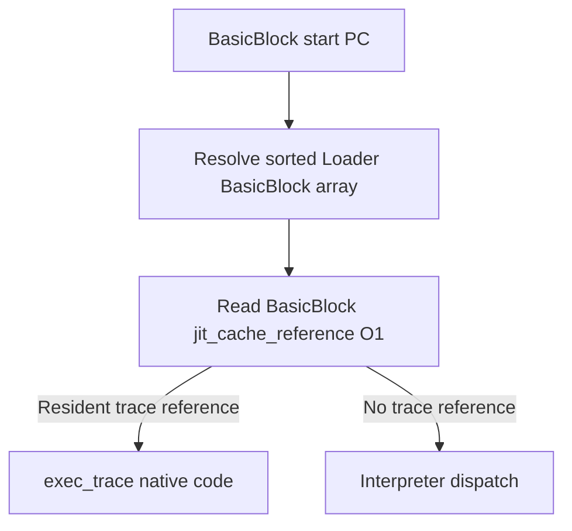
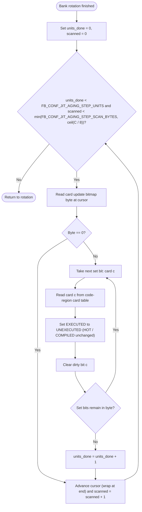
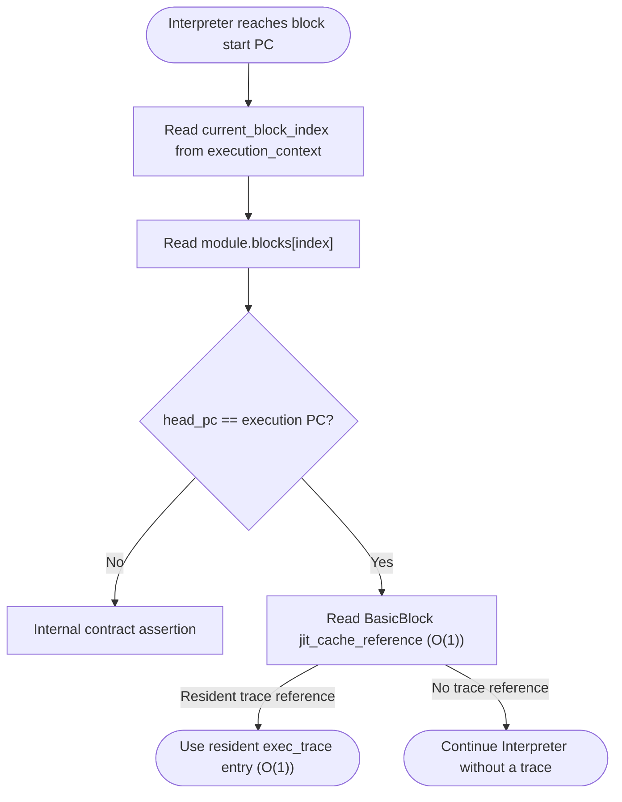
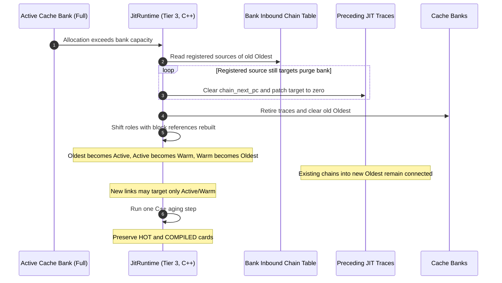
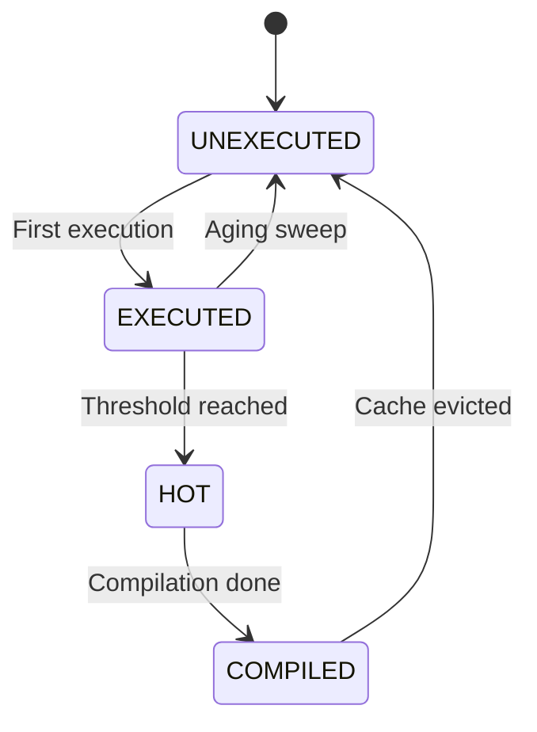
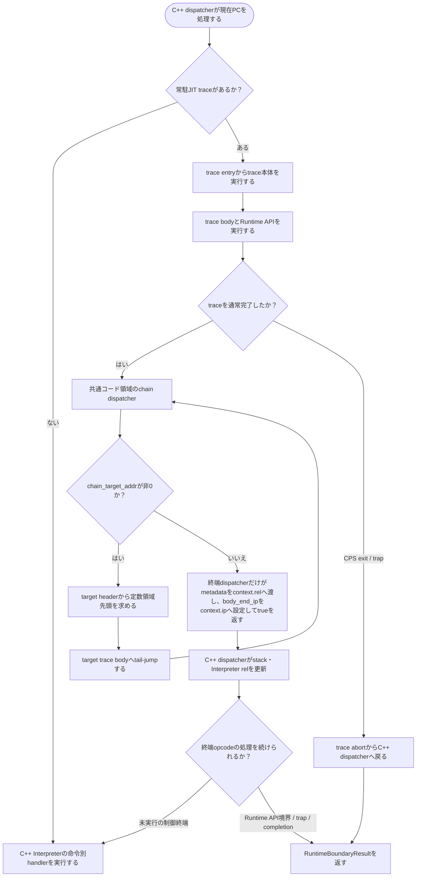

# JIT ランタイム管理 コンポーネント設計書 {VERIFY_FORMAL} {VERIFY_LLM} {VERIFY_BENCHMARK}
<!-- evidence:
     implementation: experiments/pysim/native/tier3_plugins/jit/jit_runtime.hxx
     formal: formal/jit_cache_model.py
     formal: formal/jit_loop_chain_model.py
     formal: formal/jit_hotspot_model.py
     benchmark_spec: benchmarks/jit_runtime_bench_spec.md
     benchmark: ../../../experiments/pysim/benchmarks/jit/bench_jit.py
     benchmark_record: ../../../experiments/pysim/benchmarks/BENCHMARK_REPORT.md
     test: docs/qa/tier3_plugins/jit_runtime_test_spec.md
-->

## 1. コンセプト
<!-- traceability: {JIT_MultiBuffer_Cache} {JIT_OldestExecuteOnly} {META_AccessDictionary} {META_BinarySearch} {LowOverhead} {HistoryBuffer} {RuntimeHotspotProfiler} {GLOBAL_PeriodicTask} {Runtime_BumpAllocator} -->

JIT ランタイム管理は、Tier 2 Interpreter へ任意接続する Tier 3 プラグインの実行拡張である。

- **責務の集約**: ホットスポット履歴、カード状態、コンパイル待ち列、常駐トレース索引、および 3 面コードキャッシュを Tier 3 拡張が単独で所有する（Runtime Event Sink とは別経路）。
- **BasicBlock 参照による $O(1)$ 選択**: Interpreter は `execution_context.current_block_index` から BasicBlock を引き、8bit の `jit_cache_reference`（値契約は [`jit_abi.md`](docs/components/tier2_runtime/jit_abi.md) 正本）を読む。常駐参照がないブロックでは JIT 検索を呼ばずに Interpreter を実行し、通常 dispatch で PC→trace 検索（`find_cached_trace_by_pc` や Radix 表）は使わない。
- **キャッシュと実行可能領域**: コードキャッシュはデータ用バンプアロケータと分離して管理する。x64 参照構成では確保・借用時に RWX を設定し、リンク更新ごとに権限を切り替えない（ARMv8-M は TBD）。

## 2. アーキテクチャ分類
<!-- traceability: {META_3TierSeparation} -->

本コンポーネントは **Tier 3 Plugin** に属し、BasicBlock 単位の常駐 trace 参照、3 面コードキャッシュ管理、局所アンリンク、ホットスポット検出を担当する。コード生成コアは [`jit_compiler.md`](docs/components/tier3_plugins/jit_compiler.md) が担当する。

### 2.1 JIT サブシステムのデコンポジション
<!-- traceability: {JIT_AssemblyStencilCodegen} -->

- **[jit_compiler.md](docs/components/tier3_plugins/jit_compiler.md)**: 命令テンプレートを用いたネイティブコード生成および静的命令エンコードを担当する。
- **[jit_runtime.md](docs/components/tier3_plugins/jit_runtime.md)**: ホットスポット履歴、カード更新・コンパイル要求、BasicBlock index からの trace 参照、キャッシュローテーションを担当する（`{JIT_MultiBuffer_Cache}`）。

### 2.2 実装責務と依存方向
<!-- traceability: {META_ContractImplSplit} {META_StaticDI} {META_3TierSeparation} -->

| コンポーネント | 所有する責務 | 依存先 |
| :--- | :--- | :--- |
| **Tier 3 Native JitRuntime** | 候補選択、履歴リング・分析、コンパイル待ち列、カード状態遷移・エイジング、常駐索引、3 面ローテーション、被チェイン管理、実行可能領域の所有 | Tier 2 実行状態契約、Tier 3 コンパイラと共通コード |
| **Tier 3 Native Trace Compiler** | Loader 所有の WASM コードを走査し、1 回の呼出しで 1 trace を生成 | Loader の借用 WASM コード、Tier 3 共通コード |
| **Tier 2 Runtime / Interpreter** | `current_block_index` と注釈済み辺を管理し、接続時は Tier 3 拡張へ境界を委譲 | Tier 1、Tier 2 実行契約 |

- **借用領域契約**: 上位 Runtime 構成から受け取る保存領域の先頭アラインメント違反は、失敗を返さず `assert` で停止する。
- **不変表と非公開境界**: 命令スコア表と Runtime API 関数表は不変データとし、履歴・待ち列・キャッシュ内部構造や QA 計測 API は製品 ABI へ露出しない。
- **JIT 無効構成**: JIT 無効時は履歴、コンパイラ、実行可能領域を合成しない。

## 3. 静的モデル

### 3.1 データ構造
<!-- traceability: {WasmCodeSectionPC} -->

- **WASM プログラムカウンタ (`UnifiedPC` / `wasm_pc_t`)**: モジュール内 Code section payload 相対オフセット（命令先頭バイト）。モジュール横断キーは `(module_id, pc)` とする。
- **カードマーキング表**: コード領域を `1 << FB_CONF_JIT_CARD_SHIFT` バイト単位のカードに分割し、2 bit 状態を保持する。
  - `0: UNEXECUTED`（未実行）
  - `1: EXECUTED`（実行済み）
  - `2: HOT`（コンパイル要求中）
  - `3: COMPILED`（コンパイル済み・常駐 trace 対応あり）
- **コンパイル対象可否マスク（`{TrackableBlockMask}`）**: <!-- definition: {TrackableBlockMask} --> コード領域全体に対するカード単位の 1 bit マスク。通常命令を含み `next_pc` かつ `min_trace_bytes` 以上のブロックを候補とし、コンパイル失敗時は該当カードを解除する。trackable 変化・trace 設置/破棄時は、ブロックの `jit_cache_reference` を [`jit_abi.md`](docs/components/tier2_runtime/jit_abi.md) の契約値に同期する。
- **カード更新表とエイジングカーソル**: `UNEXECUTED` から `EXECUTED` への遷移時に該当カードの dirty bit を立てる 1 bit 表（`fireball::bit_view<1>`）と、巡回位置を保持するカーソル。
- **JIT エントリ表と全バンク索引**: 各バンクが `head_pc` 昇順のエントリ配列（各最大 `FB_CONF_JIT_CACHE_BANK_ENTRY_CAPACITY` 件）を持ち、全バンク共通の参照配列（最大 `FB_CONF_JIT_CACHE_TOTAL_ENTRY_CAPACITY` 件）で索引する。Oldest バンクの常駐 trace は所在を変えずその場で実行する（`{JIT_OldestExecuteOnly}`）。 <!-- definition: {JIT_OldestExecuteOnly} -->
- **x64 参照コード領域（`{JIT_MultiBuffer_Cache}`）**: <!-- definition: {JIT_MultiBuffer_Cache} --> 総サイズ `FB_CONF_JIT_CACHE_SIZE`（ページ単位 `FB_CONF_JIT_CACHE_PAGE_SIZE`）を非エビクションの共通コード領域（`FB_CONF_JIT_COMMON_CODE_SIZE`、先頭 256B に chain dispatcher と Runtime API 表ポインタ）と `FB_CONF_JIT_NUM_BUFFERS` 面バンク（各 `FB_CONF_JIT_BANK_SIZE`）へ分割する。
- **オンデマンドコンパイルキュー（`{JIT_ReverseCompilationOrder}`）**: <!-- definition: {JIT_ReverseCompilationOrder} --> `HOT` 到達ブロックを保持する固定容量 LIFO キュー。idle hook および満杯時にキューが空になるまで処理し、後続ブロックから先に常駐させて直線 chain を張る。 `{GLOBAL_Policy_Memory}`
- **被チェイン逆引きテーブル**: 後続 PC のハッシュ（`FB_CONF_JIT_INBOUND_BUCKET_COUNT` バケット）から連結元を辿り、退役時にリンクを局所解除する。
- **chain メタデータ（`{JIT_LazyChaining}`）**: <!-- definition: {JIT_LazyChaining} --> 直線後続と前方/後方 `br` の `chain_next_pc`・`chain_target_addr` を管理する（`if`/`br_if` は対象外）。
- **実行履歴バッファ（`{RuntimeHotspotProfiler}`, `{HistoryBuffer}`）**: <!-- definition: {RuntimeHotspotProfiler} --> <!-- definition: {HistoryBuffer} --> `(block_index, unified_pc)` の 8 バイトレコードを保持する固定容量リング（容量 `JIT_HISTORY_CAPACITY`）。Interpreter 実行境界で分析し、JIT trace/chain 実行中は記録しない。

### 3.2 内部ブロック図

### 3.3 主要なデータ構造一覧

| 項目名 | 機能と役割 | 型分類 | サイズ・制約 |
| :--- | :--- | :--- | :--- |
| BasicBlock の JIT キャッシュ参照 | 常駐エントリの枠番号を保持し、PC 再検索を省く | Loader BasicBlock 内 `u8` | 常駐枠番号または未常駐マーク（[`jit_abi.md`](docs/components/tier2_runtime/jit_abi.md) 正本） |
| 全バンク参照索引 | `head_pc` 順の常駐エントリ位置を保持する | 固定長配列 | 最大 `FB_CONF_JIT_CACHE_TOTAL_ENTRY_CAPACITY` 件 |
| バンク別エントリ配列 | 各バンクの `head_pc` 昇順エントリを保持する | 固定長ソート配列 | 各バンク最大 `FB_CONF_JIT_CACHE_BANK_ENTRY_CAPACITY` 件 |
| カードマーキング表 | カードごとの 2-bit 状態表 | 密ビュー | `fireball::bit_view<2>` |
| カード更新表 | `EXECUTED` 遷移済みカードの dirty ビット表 | 密ビュー | `fireball::bit_view<1>` |
| 被チェイン逆引きテーブル | 後続 PC ハッシュから連結元を引く | 固定長バケット＋連結配列 | `FB_CONF_JIT_INBOUND_BUCKET_COUNT + FB_CONF_JIT_CACHE_TOTAL_ENTRY_CAPACITY` byte |
| 履歴バッファ | 観測済み基本ブロックの履歴リング | 固定容量リング | `(block_index, unified_pc)` の 8B レコード |

## 4. 動的モデル

### 4.1 アルゴリズム

#### 基本ブロック適格性評価（`{JIT_StaticBenefitScoring}`, `{JIT_CandidateBitmap}`）
- **`opcode_benefit_table` (`BitView<4>`)**: ROM 上の 128 バイト表に命令ごとの機械語短縮スコア（`int4_t`: `-8`〜`+7`、1 スコア≒2 命令短縮）を定義する（`{JIT_StaticBenefitScoring}`）。 <!-- definition: {JIT_StaticBenefitScoring} -->
- **`jit_candidate_bitmap` (`BitView<1>`)**: 各基本ブロックの合計スコア $\sum_{op \in BB} score(op)$ が閾値（`S_threshold = 9`）以上のカードのみ `1` に設定し、極小ブロックの履歴記録を $O(1)$ でスキップする（`{JIT_CandidateBitmap}`）。 <!-- definition: {JIT_CandidateBitmap} -->

##### 命令別短縮利得スコア定義台帳 (`opcode_benefit_table` / `int4_t`)
<!-- traceability: {JIT_StaticBenefitScoring} {JIT_CandidateBitmap} {WasmFCSubset} -->

| スコア (`int4_t`) | 換算短縮命令数 | 分類と特性 | 該当 WASM 命令 |
| :---: | :---: | :--- | :--- |
| **`+7` (MAX)** | 約 +14 命令短縮 | 32bit 整数加減算・基本ビット論理・シフト | `i32.add`, `i32.sub`, `i32.and`, `i32.or`, `i32.xor`, `i32.shl`, `i32.shr_s`, `i32.shr_u` |
| **`+6`** | 約 +12〜13 命令短縮 | 整数乗算・比較・即値・ローカル操作（`i32.clz`/`ctz` は API 経路） | `i32.mul`, `i32.eqz..ge_u`, `i32.clz/ctz`, `*.const`, `local.get/set/tee` |
| **`+5`** | 約 +10〜11 命令短縮 | 境界検査付きメモリアクセス・剰余・循環シフト | `i32.load*`, `i32.store*`, `i32.rotl/rotr`, `i32.rem_s/u` |
| **`+4`** | 約 +8 命令短縮 | 整数除算・global・メモリサイズ・スタック操作 | `i32.div_s/u`, `global.get/set`, `memory.size`, `select`, `drop`, `nop` |
| **`+3`** | 約 +6〜7 命令相当 | 64bit/浮動小数点演算・変換・その他 Runtime API 経路 | `i64.add/sub/mul`, `f32/f64.*`, `i32.popcnt`, `i64` 比較/演算, 型変換 (`0xA7..0xC4`), その他 memory access |
| **`0`** | 0 命令短縮 | 構文デリミタ | `block`, `loop`, `else`, `end` |
| **`-1`** | 約 -2 命令ペナルティ | 関数間 call 境界 | `call` |
| **`-2`** | 約 -4 命令ペナルティ | 一括メモリ操作・拡張等の重量 API | `memory.grow`, `0xFC` 飽和変換・`memory.copy/fill` |
| **`-8` (MIN)** | 最大ペナルティ | 必ず trap する命令 | `unreachable` |

#### キャッシュ参照・ホットスポット昇格・3 面ローテーション

1. **参照と検索抑止 ($O(1)$)**: Interpreter は `current_block_index` から `jit_cache_reference` を読み、常駐参照がある場合だけ trace を実行する。参照がなければ JIT 検索を呼ばない。
2. **観測と昇格**: `FB_NATIVE_JIT_NO_TRACE_OBSERVED` のブロックだけ観測入口を呼び、通常命令を含むブロックの履歴を記録する。実行頻度が閾値に達したカードは `HOT` として待ち列へ積み、コンパイル・挿入成功で `COMPILED` へ遷移する（失敗時は Trackable Mask を解除、eviction/flush 時は `UNEXECUTED` へ戻す）。
3. **二重コンパイル抑止（`{GOTCHA-JITR-01}`）**: <!-- definition: {GOTCHA-JITR-01} --> 待ち列処理時にカードが既に `COMPILED` なら再コンパイルせずスキップする。
4. **3 面ローテーションと局所アンリンク（`{GOTCHA-JITR-03}`, `{GOTCHA-JITR-05}`）**: <!-- definition: {GOTCHA-JITR-03} --> <!-- definition: {GOTCHA-JITR-05} --> Active 満杯時は Oldest を退役させる。退役前に逆引き表で被チェイン元のリンクを解除し、全ブロックの `jit_cache_reference` を更新・無効化して誤参照を防ぐ。
5. **Oldest のその場実行（`{GOTCHA-JITR-02}`）**: <!-- definition: {GOTCHA-JITR-02} --> Oldest の常駐 trace はコピーや再配置をせずそのまま実行する。Warm からの既存 chain は維持し、Oldest への新規 chain 登録は禁止する。
6. **エイジングスイープ（`{JIT_CardAgingSweep}`）**: <!-- definition: {JIT_CardAgingSweep} --> ローテーション 1 回につき 1 ステップ実行し、Card Update Bitmap のカーソルから最大 `FB_CONF_JIT_AGING_STEP_SCAN_BYTES` バイト（非ゼロ処理上限 `FB_CONF_JIT_AGING_STEP_UNITS`）を走査して、`EXECUTED` カードだけを `UNEXECUTED` へ減衰させる（`HOT` / `COMPILED` は不変）。

#### エイジングスイープ手順（手順アクティビティ図）
<!-- traceability: {JIT_CardAgingSweep} {TrackableBlockMask} {GOTCHA-JITR-09} -->

#### BasicBlock index による直接解決フロー
<!-- traceability: {GOTCHA-JITR-05} {Loader_BasicBlockIndex} -->

#### 3面世代交代ローテーションと被チェイン局所アンリンク（責務シーケンス図）
<!-- traceability: {GOTCHA-JITR-02} {GOTCHA-JITR-03} {JIT_MultiBuffer_Cache} {JIT_LazyChaining} {JIT_CardAgingSweep} -->

### 4.2 状態遷移図
<!-- traceability: {GOTCHA-JITR-09} -->

### 4.3 トレース実行時の境界整合と復帰
<!-- traceability: {JIT_RuntimeAPI} {DirectBytecodeExecution} {GOTCHA-JITR-02} -->

- **分岐と後方辺の扱い（`{GOTCHA-JITR-06}`）**: <!-- definition: {GOTCHA-JITR-06} --> `if` と `br_if` は trace に含めず、未実行の終端 opcode として Interpreter CPS ハンドラへ渡す。`br` は trace 内で実行・チェインし、後方 `br` は `loop_jump_count` 閾値（`FB_CONF_INTERPRETER_YIELD_THRESHOLD`）到達時に CPS exit する。復帰後に実行済み命令を再実行しない。
- **短小ブロック判定（`{GOTCHA-JITR-07}`）**: <!-- definition: {GOTCHA-JITR-07} --> ブロックの足切り判定は後続アドレスとの差分ではなく、自身の命令バイト数（`byte_span`）で行う（後方分岐ブロックの負差分による誤除外を防ぐ）。
- **関数復帰（`{GOTCHA-JITR-08}`）**: <!-- definition: {GOTCHA-JITR-08} --> JIT trace は native の `return` を生成せず、Interpreter と同じ Runtime API で関数復帰を実行する。
- **エイジング分離（`{GOTCHA-JITR-09}`）**: <!-- definition: {GOTCHA-JITR-09} --> エイジングは `EXECUTED` カードのみを対象とし、`HOT` と `COMPILED` は変更しない。
- **スタック入口契約**: 関数入口で Loader が記録した最大オペランド高を検査し、関数途中の trace 入口では再検査しない（`interpreter_stack_model.py` で検証）。

## 5. インターフェース定義

### 5.1 公開API

| 項目 | 内容 |
| :--- | :--- |
| **Interpreter 拡張境界** | Interpreter は判定点で `jit_cache_reference` を読み、常駐参照があれば `trace_entry_address` 経由で実行する（契約の正本は [`jit_abi.md`](docs/components/tier2_runtime/jit_abi.md)）。 |
| **内部閉鎖性** | 候補選択、履歴分析、キャッシュ更新、コンパイル要求は Tier 3 拡張内部に閉じ、Tier 2 に専用操作 API を追加しない。 |
| **拡張なし構成** | JIT 拡張未接続時は通常の Interpreter CPS ディスパッチのみを実行する。 |

## 6. 制約達成の方策

- **性能制約**: `current_block_index` と `jit_cache_reference` の直接参照により、未コンパイルブロックでの探索コストをゼロにする。
- **メモリ制約（`{JIT_MultiBuffer_Cache}`, `{JIT_OldestExecuteOnly}`）**: 各 `FB_CONF_JIT_CACHE_BANK_ENTRY_CAPACITY` 件の `FB_CONF_JIT_NUM_BUFFERS` 面循環バッファを用い、固定予算内で運用する。

## 7. 形式検証・テスト仕様との対応

### 7.1 検証対象の不変条件
<!-- traceability: {GOTCHA-JITR-09} -->

- **3 面キャッシュ代謝の有界性**: ローテーションによる Oldest 退役・アンリンク・再利用が固定容量内で完結すること。
- **非候補・制御区間の抑止**: 非対象区間で検索や履歴記録を行わないこと。
- **カード状態・エイジング安全性**: 遷移規則と `HOT`/`COMPILED` 不変性、dirty ビットの有限減衰を保証すること。

### 7.2 テスト仕様書との連携

テストケースは [`jit_runtime_test_spec.md`](docs/qa/tier3_plugins/jit_runtime_test_spec.md) を正本とし、形式モデルは `formal/jit_cache_model.py`・`formal/jit_hotspot_model.py`、QA 専用計測契約は [`jit_runtime_bench_spec.md`](docs/components/tier3_plugins/benchmarks/jit_runtime_bench_spec.md) を参照する。

## 8. 設計判断と参考実装

### 8.1 コンパイル時期と待ち列処理

- 全タスク idle 時およびキュー満杯時の協調境界で待ち列を処理し、未処理候補を持ち越さない。

### 8.2 コンパイル採否とキャッシュ代謝

- **方針**: 3 面ローテーションと Oldest のその場実行を基本とし、スラッシング抑止や再試行回復の具体的ヒューリスティックは Tier 3 内部に閉じ込める。
- **不変条件**: 採否・回復用の内部状態を Tier 2 Runtime や Guest Profiler へ露出せず、失敗・却下ブロックの無限再コンパイルを防止する。
