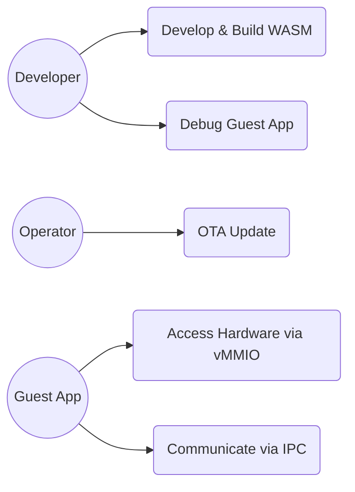

# Fireball システム要求仕様書

## 1. 概要
Fireballは、wasm32ゲストを仮想化する組み込みハイパーバイザである。制約事項に定める極小RAM/ROMプロファイル上で動作し、WAMR（WebAssembly Micro Runtime）をベンチマーク対象として、インタープリタ比較での実行速度およびフットプリントにおいてWAMRを上回ることを目標とする。

## 2. ユースケース

### 2.1 ユースケース図

### 2.2 主要シナリオ

| ステップ | アクション | 期待される応答 |
| :--- | :--- | :--- |
| 1 | 開発者がWASMバイナリをロードする | システムがバイナリを検証し、実行準備を完了する |
| 2 | システムがゲストアプリを開始する | 協調型マルチタスク下でゲストアプリが実行される |
| 3 | ゲストアプリがシステムコールを発行する | IPCルータを経由して適切なサービスにルーティングされる |
| 4 | 外部からOTA更新が要求される | ゲストアプリが安全に停止し、新しいバイナリに更新される |

## 3. 命題リスト

### 3.1 機能要求

#### 3.1.1 WASM実行 (vSoC)

| キーワード | 内容 | 優先度 | 検証方法 |
| :--- | :--- | :--- | :--- |
| `{Wasm32Only}` | wasm32の単一リニアメモリを対象とし、WASM Core 1.0 MVPを基礎に明示選択した `0xFC` 命令のみを追加する。Wasm64やマルチスレッド等の拡張は対象外とする。 | 高 | テスト <!-- definition: {Wasm32Only} --> |
| `{WasmFCSubset}` | `0xFC` 命令のうち、飽和型浮動小数点→整数変換8命令と単一メモリ向け `memory.copy` / `memory.fill` のみをサポートする。変換はNaN・無限大・範囲外値をWASM規則で飽和させ、メモリ操作は全範囲を事前検証した上でWASMのmemmove意味論を保つ。 | 高 | テスト <!-- definition: {WasmFCSubset} --> |
| `{ROMParsing}` | WASMモジュールをRAMに展開せず、ROM上のデータを直接解析・実行する（Zero Copy Loading）。 | 高 | テスト <!-- definition: {ROMParsing} --> |
| `{MultiModule_Support}` | 複数WASMモジュールのロードと、モジュール間の動的リンクをサポートする。 | 中 | テスト <!-- definition: {MultiModule_Support} --> |
| `{OneRuntimeOneGuest}` | 1つのWASMランタイムは1つのゲストインスタンスのみを担当し、マルチインスタンス実行は独立したランタイムの並行実行とIPCによってメモリ・障害を隔離する。 | 高 | レビュー <!-- definition: {OneRuntimeOneGuest} --> |
| `{NativeAPI_Export}` | ゲストからホストサービスを呼び出すための安全な境界を提供する。 | 高 | テスト <!-- definition: {NativeAPI_Export} --> |
| `{vMMIO_TrapAndEmulate}` | ゲストからの仮想デバイス空間へのアクセスを捕捉し、ホスト側の処理を呼び出す。 | 高 | テスト <!-- definition: {vMMIO_TrapAndEmulate} --> |
| `{vMMIO_Isolation}` | 認可された仮想I/O空間へのアクセスのみを許可し、不正なデバイスアクセスを遮断する。 | 高 | テスト <!-- definition: {vMMIO_Isolation} --> |
| `{MemoryBoundaryCheck}` | ゲストによるメモリアクセス時の境界チェックを強制し、黙ったラップアラウンドを防いで即座にトラップする。 | 高 | テスト <!-- definition: {MemoryBoundaryCheck} --> |
| `{WasmPageAlignment}` | ゲストのメモリ割り当てをWASM標準ページサイズ単位で管理する。 | 中 | レビュー <!-- definition: {WasmPageAlignment} --> |
| `{DynamicMmap}` | 共有メモリ等の外部バッファを、認可されたゲスト空間へ一時的にマッピングする。 | 高 | テスト <!-- definition: {DynamicMmap} --> |
| `{VDMA}` | ゲストリニアメモリと共有メモリ・仮想デバイス領域間のデータ転送を、権限・所有権検査および完了確認を伴って安全に行う。 | 中 | テスト <!-- definition: {VDMA} --> |
| `{UnifiedAccessModel}` | 物理・共有メモリへの全アクセスを統一的な権限・所有権モデルで認可し、未認可領域へのアクセスを遮断する。ゲスト専用リニアメモリに対しては低遅延で境界を検査する。 | 高 | レビュー <!-- definition: {UnifiedAccessModel} --> |

#### 3.1.2 タスク管理・通信 (COOS)

| キーワード | 内容 | 優先度 | 検証方法 |
| :--- | :--- | :--- | :--- |
| `{CooperativeMultitasking}` | 協調型マルチタスクにより複数タスクを並行実行する。 | 高 | テスト <!-- definition: {CooperativeMultitasking} --> |
| `{COOS_Deterministic}` | タスクの切り替えを明示的な協調境界に限定し、確定的な実行順序を確保する。 | 高 | テスト <!-- definition: {COOS_Deterministic} --> |
| `{IPC_ZeroCopy}` | タスク間通信時のデータコピーを排除し、ゼロコピーでメッセージを受け渡す。 | 高 | テスト <!-- definition: {IPC_ZeroCopy} --> |
| `{GLOBAL_InterruptWakeup}` | 割り込み発生時、協調境界で関連タスクを安全に起床させ、仮想割り込みをゲストへ配送する。 | 高 | テスト |
| `{GLOBAL_PeriodicTask}` | システムティックまたはアイドルループを利用した定期実行タスクをサポートする。 | 中 | テスト |
| `{GLOBAL_IdleDetection}` | システムのアイドル状態を検知し、バックグラウンド処理を実行する。 | 中 | テスト |
| `{TaskSliceDurationLog}` | OSはタスクの実行区間を計測し、閾値を超過した区間をタスク識別子と経過時間つきで診断ログに出力する。この機能は診断専用であり、スケジューリング順序や実時間性を保証しない。 | 中 | テスト <!-- definition: {TaskSliceDurationLog} --> |

#### 3.1.3 システム連携 (IPC/HAL/WIT)

| キーワード | 内容 | 優先度 | 検証方法 |
| :--- | :--- | :--- | :--- |
| `{IPCRouter}` | システムサービスおよびデバイスへのアクセスをIPCルータ経由で仲介する。 | 高 | テスト <!-- definition: {IPCRouter} --> |
| `{IPC_HandleBased}` | 名前解決後の通信はハンドルを用いて直接行い、毎回の名前解決を不要とする。 | 高 | テスト <!-- definition: {IPC_HandleBased} --> |
| `{URIAbstraction}` | コンポーネント間の依存関係を「スキーマ://ドメイン/サービス/ID」形式のURIで疎結合に識別する。 | 高 | レビュー <!-- definition: {URIAbstraction} --> |
| `{RoleBasedAccessControl}` | URIとロールに基づく静的なアクセス制御を実施する。 | 高 | テスト <!-- definition: {RoleBasedAccessControl} --> |
| `{OwnershipTransfer}` | メッセージパッシング時にデータの所有権を論理的に移動し、二重所有と不要なコピーを防ぐ。 | 高 | テスト <!-- definition: {OwnershipTransfer} --> |
| `{HAL_Interface}` | 物理デバイス操作を抽象化し、IPC経由で利用できる標準インターフェースを提供する。 | 高 | レビュー <!-- definition: {HAL_Interface} --> |
| `{Fast_Path_GPIO}` | 遅延に敏感なI/O操作（GPIO等）のために、通常経路のオーバーヘッドを省いた高速パスを提供する。 | 高 | 計測 <!-- definition: {Fast_Path_GPIO} --> |
| `{PhysicalPassthrough}` | メモリコピーを介さず、認可された物理リソースへ直接アクセスする高速パスを提供する。 | 高 | 計測 <!-- definition: {PhysicalPassthrough} --> |
| `{Asynchronous_Notification}` | ホストからの非同期イベントおよびI/O完了をゲストへ通知する。 | 中 | テスト <!-- definition: {Asynchronous_Notification} --> |
| `{WASI_Implementation}` | WASI標準APIをFireball上で利用可能とする。 | 高 | テスト <!-- definition: {WASI_Implementation} --> |

#### 3.1.4 デバッグ・運用

| キーワード | 内容 | 優先度 | 検証方法 |
| :--- | :--- | :--- | :--- |
| `{COOS_Transparent}` | スケジューラは各タスクの実行状態・待ち状態を外部から観測可能とする。 | 中 | デモ <!-- definition: {COOS_Transparent} --> |
| `{Debug_Integrated}` | プロファイラおよび診断機能をシステムに内蔵する。 | 中 | デモ <!-- definition: {Debug_Integrated} --> |
| `{Debug_Standard_Env}` | VSCode、UART、J-Linkを標準のデバッグ環境としてサポートする。 | 高 | デモ <!-- definition: {Debug_Standard_Env} --> |
| `{RSP_Transport_Selectable}` | デバッグプロトコルのトランスポート層（UART/RTT等）を選択可能とする。 | 高 | テスト <!-- definition: {RSP_Transport_Selectable} --> |
| `{BufferedLogging}` | ログ出力を一時バッファリングし、実行時負荷を抑えて物理ポートへ転送する。 | 中 | テスト <!-- definition: {BufferedLogging} --> |

### 3.2 非機能要求

#### 3.2.1 パフォーマンス・効率

| キーワード | 内容 | 優先度 | 検証方法 |
| :--- | :--- | :--- | :--- |
| `{Resource_Estimation_Model}` | 設計段階でROM/RAMフットプリントを見積もり、制約適合性を検証可能とする。 | 高 | 概算レポート <!-- definition: {Resource_Estimation_Model} --> |
| `{ConsolidatedHeap}` | 物理メモリ全体から各パーティションを切り出す際、単一の物理プールとして一括管理し、メモリ効率を最大化する。 | 高 | 計測 <!-- definition: {ConsolidatedHeap} --> |
| `{GLOBAL_StrictMemoryLimit}` | 厳格なメモリ割り当て制限を適用する（最小構成において静的合計 21KB / 物理RAM 32KB以内）。 | 高 | テスト |
| `{GLOBAL_IndependentHeap}` | 各タスクおよびセキュリティドメインに独立したメモリ領域を割り当て、障害波及を防ぐ。 | 高 | テスト |
| `{GLOBAL_Policy_Memory}` | 実行時の動的ヒープ枯渇や断片化によるシステム停止を防ぐため、ドメインごとに有界で安全なメモリ管理を行う。 | 高 | プロセス監査 |
| `{MemoryIsolation}` | ハードウェアまたは論理的な境界により、メモリ空間の安全な隔離を実現する。 | 高 | テスト <!-- definition: {MemoryIsolation} --> |
| `{LowOverhead}` | 最小限のリソース消費と低遅延なシステム実行を実現する。 | 高 | 計測 <!-- definition: {LowOverhead} --> |
| `{LowOverheadSwitch}` | タスク切り替え時のコンテキスト退避・復帰オーバーヘッドを最小化する。 | 高 | 計測 <!-- definition: {LowOverheadSwitch} --> |
| `{FaultTolerant}` | タスク障害を局所化し、他タスクおよびシステム全体への波及を防ぐ。 | 高 | レビュー <!-- definition: {FaultTolerant} --> |
| `{ServiceSelfReboot}` | 異常終了したサービスを自律的に再起動し復旧させる。 | 高 | テスト <!-- definition: {ServiceSelfReboot} --> |
| `{IPC_Resource_Isolation}` | IPC通信におけるリソースをタスク間で分離し保護する。 | 高 | テスト <!-- definition: {IPC_Resource_Isolation} --> |

#### 3.2.2 開発方針・品質
<!-- traceability: {VERIFY_LLM} -->

| キーワード | 内容 | 優先度 | 検証方法 |
| :--- | :--- | :--- | :--- |
| `{Size_20KSLOC}` | システム全域の製品ソースコードを20 KSLOC以内に収める。コメントとテストコードは計測対象外とする。 | 中 | 計測 <!-- definition: {Size_20KSLOC} --> |
| `{EliminateDataRace}` | メッセージパッシングと単一所有権によりデータ競合を原理的に排除する。 | 高 | レビュー <!-- definition: {EliminateDataRace} --> |

#### 3.2.3 移植性・互換性

| キーワード | 内容 | 優先度 | 検証方法 |
| :--- | :--- | :--- | :--- |
| `{NotRTOS}` | ハードリアルタイム性よりもメモリ効率と移植性を最優先する。 | 中 | レビュー <!-- definition: {NotRTOS} --> |

## 4. 制約事項

<!-- traceability: {Wasm32Only} {WasmFCSubset} -->

- **メモリ制約**:
  - 最小構成: Cortex-M33 / RAM 32KB / ROM 96KB
  - 想定構成: Cortex-M33 / RAM 64KB / ROM 128KB
  - ※ 評価は最小構成（32KB / 96KB）をターゲットとする。
- **パフォーマンス制約**: AOTを使用しない条件下で、WAMRインタープリタを上回る実行速度。
- **互換性**: wasm32単一メモリを対象とするWASM Core 1.0 MVPを基礎とし、追加対応は `{WasmFCSubset}` が列挙する `0xFC` の部分集合に限る。Wasm64・マルチスレッド等の非組込み拡張は対象外とする。
- **開発環境**: clang 17+ (C23, C++23, libstdc++)。
- **依存性**: 標準C/C++ライブラリ以外の外部ライブラリは用いない。
- **コード規模**: 製品ソースコードを20 KSLOC以内とする。コメントとテストコードは計測対象外とする。

## 5. 用語定義

- **COOS**: Coroutine-based Operating System. 本プロジェクト独自の協調型OS。
- **vSoC**: Virtual System on Chip. WASMランタイムおよび仮想周辺機器を含む実行環境。
- **CSP**: Communicating Sequential Processes. プロセス間通信のモデル。
- **ゲストリニアメモリ**: WASMリニアメモリ領域。
