# Spec Verification Report: Fireball Hypervisor

**Overall Status**: ❌ **VERIFICATION FAILED**

**Verifier**: `spec-integrator @ 73b572e`

## 1. Executive Summary

| Metric | Value |
| :--- | :--- |
| Total Documents | 6 |
| Total Sections | 164 |
| Total Keywords / Entities | 90 |
| Formal Models (distinct scripts) | 8 |
| Formal Models Passing Audit | 8 |
| WIT Interface Files | 6 |
| Verification Obligations Demanded | 44 |
| Verification Obligations Discharged | 19 |
| Errors | **283** |
| Warnings | 16 |

### Quality Gate Status

| Gate | Status | Issues |
| :--- | :--- | :--- |
| **Format Gate** | 🟢 PASS | 0 |
| **Traceability Gate** | 🔴 FAIL (258 errors) | 258 |
| **Hierarchy Gate** | 🟢 PASS | 0 |
| **Formal Gate** | 🟢 PASS | 0 |
| **WIT Gate** | 🟢 PASS | 0 |
| **Evidence Gate** | 🟢 PASS | 0 |
| **Obligation Gate** | 🔴 FAIL (25 errors) | 25 |
| **Consistency Gate** | 🟢 PASS | 0 |
| **SemanticTopic Gate** | 🟢 PASS | 0 |

## 2. Issues & Violations

| Severity | Gate | Location | Rule | Message |
| :--- | :--- | :--- | :--- | :--- |
| **ERROR** | Traceability | `components/tier2_runtime/interpreter.md:17` | `TRACE-UNDEFINED-KEYWORD` | Undefined keyword referenced: '{ThreadedInterpreter}'. Reason: No canonical definition declaration was found. Check the source section and its definition marker. |
| **ERROR** | Traceability | `components/tier2_runtime/interpreter.md:17` | `TRACE-UNDEFINED-KEYWORD` | Undefined keyword referenced: '{LowLatencyJIT}'. Reason: No canonical definition declaration was found. Check the source section and its definition marker. |
| **ERROR** | Traceability | `components/tier2_runtime/interpreter.md:17` | `TRACE-UNDEFINED-KEYWORD` | Undefined keyword referenced: '{RuntimeHotspotProfiler}'. Reason: No canonical definition declaration was found. Check the source section and its definition marker. |
| **ERROR** | Traceability | `components/tier2_runtime/interpreter.md:17` | `TRACE-UNDEFINED-KEYWORD` | Undefined keyword referenced: '{RuntimeEventSink}'. Reason: No canonical definition declaration was found. Check the source section and its definition marker. |
| **ERROR** | Traceability | `components/tier2_runtime/interpreter.md:17` | `TRACE-UNDEFINED-KEYWORD` | Undefined keyword referenced: '{GLOBAL_Policy_Memory}'. Reason: No canonical definition declaration was found. Check the source section and its definition marker. |
| **ERROR** | Traceability | `components/tier2_runtime/interpreter.md:31` | `TRACE-UNDEFINED-KEYWORD` | Undefined keyword referenced: '{META_3TierSeparation}'. Reason: No canonical definition declaration was found. Check the source section and its definition marker. |
| **ERROR** | Traceability | `components/tier2_runtime/interpreter.md:31` | `TRACE-UNDEFINED-KEYWORD` | Undefined keyword referenced: '{META_3TierSeparation}'. Reason: No canonical definition declaration was found. Check the source section and its definition marker. |
| **ERROR** | Traceability | `components/tier2_runtime/interpreter.md:31` | `TRACE-UNDEFINED-KEYWORD` | Undefined keyword referenced: '{GLOBAL_Policy_Memory}'. Reason: No canonical definition declaration was found. Check the source section and its definition marker. |
| **ERROR** | Traceability | `components/tier2_runtime/interpreter.md:106` | `TRACE-UNDEFINED-KEYWORD` | Undefined keyword referenced: '{PositionIndependentCode}'. Reason: No canonical definition declaration was found. Check the source section and its definition marker. |
| **ERROR** | Traceability | `components/tier2_runtime/interpreter.md:106` | `TRACE-UNDEFINED-KEYWORD` | Undefined keyword referenced: '{ContextPointerRegister}'. Reason: No canonical definition declaration was found. Check the source section and its definition marker. |
| **ERROR** | Traceability | `components/tier2_runtime/interpreter.md:106` | `TRACE-UNDEFINED-KEYWORD` | Undefined keyword referenced: '{MemoryBoundaryCheck}'. Reason: No canonical definition declaration was found. Check the source section and its definition marker. |
| **ERROR** | Traceability | `components/tier2_runtime/interpreter.md:106` | `TRACE-UNDEFINED-KEYWORD` | Undefined keyword referenced: '{EnvironmentPointer}'. Reason: No canonical definition declaration was found. Check the source section and its definition marker. |
| **ERROR** | Traceability | `components/tier2_runtime/interpreter.md:106` | `TRACE-UNDEFINED-KEYWORD` | Undefined keyword referenced: '{WasmCodeSectionPC}'. Reason: No canonical definition declaration was found. Check the source section and its definition marker. |
| **ERROR** | Traceability | `components/tier2_runtime/interpreter.md:106` | `TRACE-UNDEFINED-KEYWORD` | Undefined keyword referenced: '{CPS_3Args}'. Reason: No canonical definition declaration was found. Check the source section and its definition marker. |
| **ERROR** | Traceability | `components/tier2_runtime/interpreter.md:171` | `TRACE-UNDEFINED-KEYWORD` | Undefined keyword referenced: '{PositionIndependentCode}'. Reason: No canonical definition declaration was found. Check the source section and its definition marker. |
| **ERROR** | Traceability | `components/tier2_runtime/interpreter.md:171` | `TRACE-UNDEFINED-KEYWORD` | Undefined keyword referenced: '{ContextPointerRegister}'. Reason: No canonical definition declaration was found. Check the source section and its definition marker. |
| **ERROR** | Traceability | `components/tier2_runtime/interpreter.md:171` | `TRACE-UNDEFINED-KEYWORD` | Undefined keyword referenced: '{MemoryBoundaryCheck}'. Reason: No canonical definition declaration was found. Check the source section and its definition marker. |
| **ERROR** | Traceability | `components/tier2_runtime/interpreter.md:171` | `TRACE-UNDEFINED-KEYWORD` | Undefined keyword referenced: '{EnvironmentPointer}'. Reason: No canonical definition declaration was found. Check the source section and its definition marker. |
| **ERROR** | Traceability | `components/tier2_runtime/interpreter.md:171` | `TRACE-UNDEFINED-KEYWORD` | Undefined keyword referenced: '{CPS_3Args}'. Reason: No canonical definition declaration was found. Check the source section and its definition marker. |
| **ERROR** | Traceability | `components/tier2_runtime/interpreter.md:201` | `TRACE-UNDEFINED-KEYWORD` | Undefined keyword referenced: '{CPS_3Args}'. Reason: No canonical definition declaration was found. Check the source section and its definition marker. |
| **ERROR** | Traceability | `components/tier2_runtime/interpreter.md:201` | `TRACE-UNDEFINED-KEYWORD` | Undefined keyword referenced: '{ContextPointerRegister}'. Reason: No canonical definition declaration was found. Check the source section and its definition marker. |
| **ERROR** | Traceability | `components/tier2_runtime/interpreter.md:201` | `TRACE-UNDEFINED-KEYWORD` | Undefined keyword referenced: '{EnvironmentPointer}'. Reason: No canonical definition declaration was found. Check the source section and its definition marker. |
| **ERROR** | Traceability | `components/tier2_runtime/interpreter.md:201` | `TRACE-UNDEFINED-KEYWORD` | Undefined keyword referenced: '{MemoryBoundaryCheck}'. Reason: No canonical definition declaration was found. Check the source section and its definition marker. |
| **ERROR** | Traceability | `components/tier2_runtime/interpreter.md:201` | `TRACE-UNDEFINED-KEYWORD` | Undefined keyword referenced: '{PositionIndependentCode}'. Reason: No canonical definition declaration was found. Check the source section and its definition marker. |
| **ERROR** | Traceability | `components/tier2_runtime/interpreter.md:214` | `TRACE-UNDEFINED-KEYWORD` | Undefined keyword referenced: '{PositionIndependentCode}'. Reason: No canonical definition declaration was found. Check the source section and its definition marker. |
| **ERROR** | Traceability | `components/tier2_runtime/interpreter.md:265` | `TRACE-UNDEFINED-KEYWORD` | Undefined keyword referenced: '{META_ConfigurableSystem}'. Reason: No canonical definition declaration was found. Check the source section and its definition marker. |
| **ERROR** | Traceability | `components/tier2_runtime/interpreter.md:276` | `TRACE-UNDEFINED-KEYWORD` | Undefined keyword referenced: '{JIT_RuntimeAPI}'. Reason: No canonical definition declaration was found. Check the source section and its definition marker. |
| **ERROR** | Traceability | `components/tier2_runtime/interpreter.md:276` | `TRACE-UNDEFINED-KEYWORD` | Undefined keyword referenced: '{ContextPointerRegister}'. Reason: No canonical definition declaration was found. Check the source section and its definition marker. |
| **ERROR** | Traceability | `components/tier2_runtime/interpreter.md:276` | `TRACE-UNDEFINED-KEYWORD` | Undefined keyword referenced: '{EnvironmentPointer}'. Reason: No canonical definition declaration was found. Check the source section and its definition marker. |
| **ERROR** | Traceability | `components/tier2_runtime/interpreter.md:276` | `TRACE-UNDEFINED-KEYWORD` | Undefined keyword referenced: '{JIT_RegisterMapping}'. Reason: No canonical definition declaration was found. Check the source section and its definition marker. |
| **ERROR** | Traceability | `components/tier2_runtime/interpreter.md:276` | `TRACE-UNDEFINED-KEYWORD` | Undefined keyword referenced: '{CPS_3Args}'. Reason: No canonical definition declaration was found. Check the source section and its definition marker. |
| **ERROR** | Traceability | `components/tier2_runtime/interpreter.md:276` | `TRACE-UNDEFINED-KEYWORD` | Undefined keyword referenced: '{ThreadedInterpreter}'. Reason: No canonical definition declaration was found. Check the source section and its definition marker. |
| **ERROR** | Traceability | `components/tier2_runtime/interpreter.md:300` | `TRACE-UNDEFINED-KEYWORD` | Undefined keyword referenced: '{ThreadedInterpreter}'. Reason: No canonical definition declaration was found. Check the source section and its definition marker. |
| **ERROR** | Traceability | `components/tier2_runtime/interpreter.md:300` | `TRACE-UNDEFINED-KEYWORD` | Undefined keyword referenced: '{JIT_RuntimeAPI}'. Reason: No canonical definition declaration was found. Check the source section and its definition marker. |
| **ERROR** | Traceability | `components/tier2_runtime/interpreter.md:300` | `TRACE-UNDEFINED-KEYWORD` | Undefined keyword referenced: '{Interpreter_LazyJITSwitch}'. Reason: No canonical definition declaration was found. Check the source section and its definition marker. |
| **ERROR** | Traceability | `components/tier2_runtime/interpreter.md:300` | `TRACE-UNDEFINED-KEYWORD` | Undefined keyword referenced: '{LowLatencyJIT}'. Reason: No canonical definition declaration was found. Check the source section and its definition marker. |
| **ERROR** | Traceability | `components/tier2_runtime/interpreter.md:300` | `TRACE-UNDEFINED-KEYWORD` | Undefined keyword referenced: '{SimpleJITArchitecture}'. Reason: No canonical definition declaration was found. Check the source section and its definition marker. |
| **ERROR** | Traceability | `components/tier2_runtime/interpreter.md:300` | `TRACE-UNDEFINED-KEYWORD` | Undefined keyword referenced: '{ContextPointerRegister}'. Reason: No canonical definition declaration was found. Check the source section and its definition marker. |
| **ERROR** | Traceability | `components/tier2_runtime/interpreter.md:300` | `TRACE-UNDEFINED-KEYWORD` | Undefined keyword referenced: '{ADR_LoopBackedgeYield}'. Reason: No canonical definition declaration was found. Check the source section and its definition marker. |
| **ERROR** | Traceability | `components/tier2_runtime/interpreter.md:300` | `TRACE-UNDEFINED-KEYWORD` | Undefined keyword referenced: '{ADR_InterruptRescheduleGeneration}'. Reason: No canonical definition declaration was found. Check the source section and its definition marker. |
| **ERROR** | Traceability | `components/tier2_runtime/interpreter.md:353` | `TRACE-UNDEFINED-KEYWORD` | Undefined keyword referenced: '{WasmFCSubset}'. Reason: No canonical definition declaration was found. Check the source section and its definition marker. |
| **ERROR** | Traceability | `components/tier2_runtime/interpreter.md:353` | `TRACE-UNDEFINED-KEYWORD` | Undefined keyword referenced: '{WasmFCSubset}'. Reason: No canonical definition declaration was found. Check the source section and its definition marker. |
| **ERROR** | Traceability | `components/tier2_runtime/interpreter.md:353` | `TRACE-UNDEFINED-KEYWORD` | Undefined keyword referenced: '{MemoryBoundaryCheck}'. Reason: No canonical definition declaration was found. Check the source section and its definition marker. |
| **ERROR** | Traceability | `components/tier2_runtime/interpreter.md:353` | `TRACE-UNDEFINED-KEYWORD` | Undefined keyword referenced: '{JIT_RuntimeAPI}'. Reason: No canonical definition declaration was found. Check the source section and its definition marker. |
| **ERROR** | Traceability | `components/tier2_runtime/interpreter.md:362` | `TRACE-UNDEFINED-KEYWORD` | Undefined keyword referenced: '{ThreadedInterpreter}'. Reason: No canonical definition declaration was found. Check the source section and its definition marker. |
| **ERROR** | Traceability | `components/tier2_runtime/interpreter.md:362` | `TRACE-UNDEFINED-KEYWORD` | Undefined keyword referenced: '{JIT_RuntimeAPI}'. Reason: No canonical definition declaration was found. Check the source section and its definition marker. |
| **ERROR** | Traceability | `components/tier2_runtime/interpreter.md:362` | `TRACE-UNDEFINED-KEYWORD` | Undefined keyword referenced: '{Interpreter_LazyJITSwitch}'. Reason: No canonical definition declaration was found. Check the source section and its definition marker. |
| **ERROR** | Traceability | `components/tier2_runtime/interpreter.md:362` | `TRACE-UNDEFINED-KEYWORD` | Undefined keyword referenced: '{LowLatencyJIT}'. Reason: No canonical definition declaration was found. Check the source section and its definition marker. |
| **ERROR** | Traceability | `components/tier2_runtime/interpreter.md:362` | `TRACE-UNDEFINED-KEYWORD` | Undefined keyword referenced: '{SimpleJITArchitecture}'. Reason: No canonical definition declaration was found. Check the source section and its definition marker. |
| **ERROR** | Traceability | `components/tier2_runtime/interpreter.md:362` | `TRACE-UNDEFINED-KEYWORD` | Undefined keyword referenced: '{ADR_LoopBackedgeYield}'. Reason: No canonical definition declaration was found. Check the source section and its definition marker. |
| **ERROR** | Traceability | `components/tier2_runtime/interpreter.md:375` | `TRACE-UNDEFINED-KEYWORD` | Undefined keyword referenced: '{ThreadedInterpreter}'. Reason: No canonical definition declaration was found. Check the source section and its definition marker. |
| **ERROR** | Traceability | `components/tier2_runtime/interpreter.md:375` | `TRACE-UNDEFINED-KEYWORD` | Undefined keyword referenced: '{JIT_RuntimeAPI}'. Reason: No canonical definition declaration was found. Check the source section and its definition marker. |
| **ERROR** | Traceability | `components/tier2_runtime/interpreter.md:375` | `TRACE-UNDEFINED-KEYWORD` | Undefined keyword referenced: '{Interpreter_LazyJITSwitch}'. Reason: No canonical definition declaration was found. Check the source section and its definition marker. |
| **ERROR** | Traceability | `components/tier2_runtime/interpreter.md:375` | `TRACE-UNDEFINED-KEYWORD` | Undefined keyword referenced: '{LowLatencyJIT}'. Reason: No canonical definition declaration was found. Check the source section and its definition marker. |
| **ERROR** | Traceability | `components/tier2_runtime/interpreter.md:375` | `TRACE-UNDEFINED-KEYWORD` | Undefined keyword referenced: '{SimpleJITArchitecture}'. Reason: No canonical definition declaration was found. Check the source section and its definition marker. |
| **ERROR** | Traceability | `components/tier2_runtime/interpreter.md:375` | `TRACE-UNDEFINED-KEYWORD` | Undefined keyword referenced: '{ADR_LoopBackedgeYield}'. Reason: No canonical definition declaration was found. Check the source section and its definition marker. |
| **ERROR** | Traceability | `components/tier2_runtime/interpreter.md:413` | `TRACE-UNDEFINED-KEYWORD` | Undefined keyword referenced: '{WasmFCSubset}'. Reason: No canonical definition declaration was found. Check the source section and its definition marker. |
| **ERROR** | Traceability | `components/tier2_runtime/interpreter.md:413` | `TRACE-UNDEFINED-KEYWORD` | Undefined keyword referenced: '{VDMA}'. Reason: No canonical definition declaration was found. Check the source section and its definition marker. |
| **ERROR** | Traceability | `components/tier2_runtime/interpreter.md:413` | `TRACE-UNDEFINED-KEYWORD` | Undefined keyword referenced: '{MemoryBoundaryCheck}'. Reason: No canonical definition declaration was found. Check the source section and its definition marker. |
| **ERROR** | Traceability | `components/tier2_runtime/interpreter.md:465` | `TRACE-UNDEFINED-KEYWORD` | Undefined keyword referenced: '{META_RecoveryStrategy}'. Reason: No canonical definition declaration was found. Check the source section and its definition marker. |
| **ERROR** | Traceability | `components/tier2_runtime/interpreter.md:478` | `TRACE-UNDEFINED-KEYWORD` | Undefined keyword referenced: '{META_RecoveryStrategy}'. Reason: No canonical definition declaration was found. Check the source section and its definition marker. |
| **ERROR** | Traceability | `components/tier2_runtime/interpreter.md:494` | `TRACE-UNDEFINED-KEYWORD` | Undefined keyword referenced: '{ThreadedInterpreter}'. Reason: No canonical definition declaration was found. Check the source section and its definition marker. |
| **ERROR** | Traceability | `components/tier2_runtime/interpreter.md:494` | `TRACE-UNDEFINED-KEYWORD` | Undefined keyword referenced: '{ContextPointerRegister}'. Reason: No canonical definition declaration was found. Check the source section and its definition marker. |
| **ERROR** | Traceability | `components/tier2_runtime/interpreter.md:531` | `TRACE-UNDEFINED-KEYWORD` | Undefined keyword referenced: '{META_RecoveryStrategy}'. Reason: No canonical definition declaration was found. Check the source section and its definition marker. |
| **ERROR** | Traceability | `components/tier2_runtime/interpreter.md:535` | `TRACE-UNDEFINED-KEYWORD` | Undefined keyword referenced: '{META_RecoveryStrategy}'. Reason: No canonical definition declaration was found. Check the source section and its definition marker. |
| **ERROR** | Traceability | `components/tier2_runtime/interpreter.md:547` | `TRACE-UNDEFINED-KEYWORD` | Undefined keyword referenced: '{ThreadedInterpreter}'. Reason: No canonical definition declaration was found. Check the source section and its definition marker. |
| **ERROR** | Traceability | `components/tier2_runtime/interpreter.md:552` | `TRACE-UNDEFINED-KEYWORD` | Undefined keyword referenced: '{ThreadedInterpreter}'. Reason: No canonical definition declaration was found. Check the source section and its definition marker. |
| **ERROR** | Traceability | `components/tier2_runtime/interpreter.md:557` | `TRACE-UNDEFINED-KEYWORD` | Undefined keyword referenced: '{META_FaultIsolation}'. Reason: No canonical definition declaration was found. Check the source section and its definition marker. |
| **ERROR** | Traceability | `components/tier2_runtime/interpreter.md:557` | `TRACE-UNDEFINED-KEYWORD` | Undefined keyword referenced: '{MemoryBoundaryCheck}'. Reason: No canonical definition declaration was found. Check the source section and its definition marker. |
| **ERROR** | Traceability | `components/tier2_runtime/interpreter.md:565` | `TRACE-UNDEFINED-KEYWORD` | Undefined keyword referenced: '{ThreadedInterpreter}'. Reason: No canonical definition declaration was found. Check the source section and its definition marker. |
| **ERROR** | Traceability | `components/tier2_runtime/interpreter.md:565` | `TRACE-UNDEFINED-KEYWORD` | Undefined keyword referenced: '{PositionIndependentCode}'. Reason: No canonical definition declaration was found. Check the source section and its definition marker. |
| **ERROR** | Traceability | `components/tier2_runtime/interpreter.md:614` | `TRACE-UNDEFINED-KEYWORD` | Undefined keyword referenced: '{ADR_LoopBackedgeYield}'. Reason: No canonical definition declaration was found. Check the source section and its definition marker. |
| **ERROR** | Traceability | `components/tier2_runtime/interpreter.md:623` | `TRACE-UNDEFINED-KEYWORD` | Undefined keyword referenced: '{ADR_InterruptRescheduleGeneration}'. Reason: No canonical definition declaration was found. Check the source section and its definition marker. |
| **ERROR** | Traceability | `components/tier3_plugins/jit_runtime.md:12` | `TRACE-UNDEFINED-KEYWORD` | Undefined keyword referenced: '{SimpleJITArchitecture}'. Reason: No canonical definition declaration was found. Check the source section and its definition marker. |
| **ERROR** | Traceability | `components/tier3_plugins/jit_runtime.md:12` | `TRACE-UNDEFINED-KEYWORD` | Undefined keyword referenced: '{JIT_MultiBuffer_Cache}'. Reason: No canonical definition declaration was found. Check the source section and its definition marker. |
| **ERROR** | Traceability | `components/tier3_plugins/jit_runtime.md:12` | `TRACE-UNDEFINED-KEYWORD` | Undefined keyword referenced: '{JIT_OldestExecuteOnly}'. Reason: No canonical definition declaration was found. Check the source section and its definition marker. |
| **ERROR** | Traceability | `components/tier3_plugins/jit_runtime.md:12` | `TRACE-UNDEFINED-KEYWORD` | Undefined keyword referenced: '{META_AccessDictionary}'. Reason: No canonical definition declaration was found. Check the source section and its definition marker. |
| **ERROR** | Traceability | `components/tier3_plugins/jit_runtime.md:12` | `TRACE-UNDEFINED-KEYWORD` | Undefined keyword referenced: '{META_BinarySearch}'. Reason: No canonical definition declaration was found. Check the source section and its definition marker. |
| **ERROR** | Traceability | `components/tier3_plugins/jit_runtime.md:12` | `TRACE-UNDEFINED-KEYWORD` | Undefined keyword referenced: '{LowLatencyJIT}'. Reason: No canonical definition declaration was found. Check the source section and its definition marker. |
| **ERROR** | Traceability | `components/tier3_plugins/jit_runtime.md:12` | `TRACE-UNDEFINED-KEYWORD` | Undefined keyword referenced: '{LowOverhead}'. Reason: No canonical definition declaration was found. Check the source section and its definition marker. |
| **ERROR** | Traceability | `components/tier3_plugins/jit_runtime.md:12` | `TRACE-UNDEFINED-KEYWORD` | Undefined keyword referenced: '{HistoryBuffer}'. Reason: No canonical definition declaration was found. Check the source section and its definition marker. |
| **ERROR** | Traceability | `components/tier3_plugins/jit_runtime.md:12` | `TRACE-UNDEFINED-KEYWORD` | Undefined keyword referenced: '{RuntimeHotspotProfiler}'. Reason: No canonical definition declaration was found. Check the source section and its definition marker. |
| **ERROR** | Traceability | `components/tier3_plugins/jit_runtime.md:12` | `TRACE-UNDEFINED-KEYWORD` | Undefined keyword referenced: '{GLOBAL_PeriodicTask}'. Reason: No canonical definition declaration was found. Check the source section and its definition marker. |
| **ERROR** | Traceability | `components/tier3_plugins/jit_runtime.md:12` | `TRACE-UNDEFINED-KEYWORD` | Undefined keyword referenced: '{Runtime_BumpAllocator}'. Reason: No canonical definition declaration was found. Check the source section and its definition marker. |
| **ERROR** | Traceability | `components/tier3_plugins/jit_runtime.md:24` | `TRACE-UNDEFINED-KEYWORD` | Undefined keyword referenced: '{META_3TierSeparation}'. Reason: No canonical definition declaration was found. Check the source section and its definition marker. |
| **ERROR** | Traceability | `components/tier3_plugins/jit_runtime.md:24` | `TRACE-UNDEFINED-KEYWORD` | Undefined keyword referenced: '{SimpleJITArchitecture}'. Reason: No canonical definition declaration was found. Check the source section and its definition marker. |
| **ERROR** | Traceability | `components/tier3_plugins/jit_runtime.md:28` | `TRACE-UNDEFINED-KEYWORD` | Undefined keyword referenced: '{JIT_AssemblyStencilCodegen}'. Reason: No canonical definition declaration was found. Check the source section and its definition marker. |
| **ERROR** | Traceability | `components/tier3_plugins/jit_runtime.md:28` | `TRACE-UNDEFINED-KEYWORD` | Undefined keyword referenced: '{SimpleJITArchitecture}'. Reason: No canonical definition declaration was found. Check the source section and its definition marker. |
| **ERROR** | Traceability | `components/tier3_plugins/jit_runtime.md:28` | `TRACE-UNDEFINED-KEYWORD` | Undefined keyword referenced: '{JIT_MultiBuffer_Cache}'. Reason: No canonical definition declaration was found. Check the source section and its definition marker. |
| **ERROR** | Traceability | `components/tier3_plugins/jit_runtime.md:34` | `TRACE-UNDEFINED-KEYWORD` | Undefined keyword referenced: '{META_ContractImplSplit}'. Reason: No canonical definition declaration was found. Check the source section and its definition marker. |
| **ERROR** | Traceability | `components/tier3_plugins/jit_runtime.md:34` | `TRACE-UNDEFINED-KEYWORD` | Undefined keyword referenced: '{META_StaticDI}'. Reason: No canonical definition declaration was found. Check the source section and its definition marker. |
| **ERROR** | Traceability | `components/tier3_plugins/jit_runtime.md:34` | `TRACE-UNDEFINED-KEYWORD` | Undefined keyword referenced: '{META_3TierSeparation}'. Reason: No canonical definition declaration was found. Check the source section and its definition marker. |
| **ERROR** | Traceability | `components/tier3_plugins/jit_runtime.md:66` | `TRACE-UNDEFINED-KEYWORD` | Undefined keyword referenced: '{JIT_ReverseCompilationOrder}'. Reason: No canonical definition declaration was found. Check the source section and its definition marker. |
| **ERROR** | Traceability | `components/tier3_plugins/jit_runtime.md:66` | `TRACE-UNDEFINED-KEYWORD` | Undefined keyword referenced: '{WasmCodeSectionPC}'. Reason: No canonical definition declaration was found. Check the source section and its definition marker. |
| **ERROR** | Traceability | `components/tier3_plugins/jit_runtime.md:66` | `TRACE-UNDEFINED-KEYWORD` | Undefined keyword referenced: '{ADR_JitCompileScheduling}'. Reason: No canonical definition declaration was found. Check the source section and its definition marker. |
| **ERROR** | Traceability | `components/tier3_plugins/jit_runtime.md:66` | `TRACE-UNDEFINED-KEYWORD` | Undefined keyword referenced: '{GLOBAL_Policy_Memory}'. Reason: No canonical definition declaration was found. Check the source section and its definition marker. |
| **ERROR** | Traceability | `components/tier3_plugins/jit_runtime.md:66` | `TRACE-UNDEFINED-KEYWORD` | Undefined keyword referenced: '{HistoryBuffer}'. Reason: No canonical definition declaration was found. Check the source section and its definition marker. |
| **ERROR** | Traceability | `components/tier3_plugins/jit_runtime.md:109` | `TRACE-UNDEFINED-KEYWORD` | Undefined keyword referenced: '{HistoryBuffer}'. Reason: No canonical definition declaration was found. Check the source section and its definition marker. |
| **ERROR** | Traceability | `components/tier3_plugins/jit_runtime.md:141` | `TRACE-UNDEFINED-KEYWORD` | Undefined keyword referenced: '{WasmFCSubset}'. Reason: No canonical definition declaration was found. Check the source section and its definition marker. |
| **ERROR** | Traceability | `components/tier3_plugins/jit_runtime.md:141` | `TRACE-UNDEFINED-KEYWORD` | Undefined keyword referenced: '{JIT_MultiBuffer_Cache}'. Reason: No canonical definition declaration was found. Check the source section and its definition marker. |
| **ERROR** | Traceability | `components/tier3_plugins/jit_runtime.md:141` | `TRACE-UNDEFINED-KEYWORD` | Undefined keyword referenced: '{JIT_OldestExecuteOnly}'. Reason: No canonical definition declaration was found. Check the source section and its definition marker. |
| **ERROR** | Traceability | `components/tier3_plugins/jit_runtime.md:141` | `TRACE-UNDEFINED-KEYWORD` | Undefined keyword referenced: '{JIT_OldestExecuteOnly}'. Reason: No canonical definition declaration was found. Check the source section and its definition marker. |
| **ERROR** | Traceability | `components/tier3_plugins/jit_runtime.md:227` | `TRACE-UNDEFINED-KEYWORD` | Undefined keyword referenced: '{JIT_MultiBuffer_Cache}'. Reason: No canonical definition declaration was found. Check the source section and its definition marker. |
| **ERROR** | Traceability | `components/tier3_plugins/jit_runtime.md:227` | `TRACE-UNDEFINED-KEYWORD` | Undefined keyword referenced: '{LowLatencyJIT}'. Reason: No canonical definition declaration was found. Check the source section and its definition marker. |
| **ERROR** | Traceability | `components/tier3_plugins/jit_runtime.md:227` | `TRACE-UNDEFINED-KEYWORD` | Undefined keyword referenced: '{META_BinarySearch}'. Reason: No canonical definition declaration was found. Check the source section and its definition marker. |
| **ERROR** | Traceability | `components/tier3_plugins/jit_runtime.md:244` | `TRACE-UNDEFINED-KEYWORD` | Undefined keyword referenced: '{JIT_MultiBuffer_Cache}'. Reason: No canonical definition declaration was found. Check the source section and its definition marker. |
| **ERROR** | Traceability | `components/tier3_plugins/jit_runtime.md:244` | `TRACE-UNDEFINED-KEYWORD` | Undefined keyword referenced: '{JIT_LazyChaining}'. Reason: No canonical definition declaration was found. Check the source section and its definition marker. |
| **ERROR** | Traceability | `components/tier3_plugins/jit_runtime.md:289` | `TRACE-UNDEFINED-KEYWORD` | Undefined keyword referenced: '{JIT_RuntimeAPI}'. Reason: No canonical definition declaration was found. Check the source section and its definition marker. |
| **ERROR** | Traceability | `components/tier3_plugins/jit_runtime.md:362` | `TRACE-UNDEFINED-KEYWORD` | Undefined keyword referenced: '{JIT_MultiBuffer_Cache}'. Reason: No canonical definition declaration was found. Check the source section and its definition marker. |
| **ERROR** | Traceability | `components/tier3_plugins/jit_runtime.md:362` | `TRACE-UNDEFINED-KEYWORD` | Undefined keyword referenced: '{JIT_OldestExecuteOnly}'. Reason: No canonical definition declaration was found. Check the source section and its definition marker. |
| **ERROR** | Traceability | `components/tier3_plugins/jit_runtime.md:386` | `TRACE-UNDEFINED-KEYWORD` | Undefined keyword referenced: '{ADR_JitCompileScheduling}'. Reason: No canonical definition declaration was found. Check the source section and its definition marker. |
| **ERROR** | Traceability | `components/tier3_plugins/jit_runtime.md:386` | `TRACE-UNDEFINED-KEYWORD` | Undefined keyword referenced: '{JIT_ReverseCompilationOrder}'. Reason: No canonical definition declaration was found. Check the source section and its definition marker. |
| **ERROR** | Traceability | `components/tier3_plugins/jit_runtime.md:395` | `TRACE-UNDEFINED-KEYWORD` | Undefined keyword referenced: '{Challenge_JITCacheEfficiency}'. Reason: No canonical definition declaration was found. Check the source section and its definition marker. |
| **ERROR** | Traceability | `components/tier3_plugins/jit_runtime.md:395` | `TRACE-UNDEFINED-KEYWORD` | Undefined keyword referenced: '{ADR_SafeQueuingOnHotMiss}'. Reason: No canonical definition declaration was found. Check the source section and its definition marker. |
| **ERROR** | Traceability | `components/tier3_plugins/jit_compiler.md:11` | `TRACE-UNDEFINED-KEYWORD` | Undefined keyword referenced: '{LowLatencyJIT}'. Reason: No canonical definition declaration was found. Check the source section and its definition marker. |
| **ERROR** | Traceability | `components/tier3_plugins/jit_compiler.md:11` | `TRACE-UNDEFINED-KEYWORD` | Undefined keyword referenced: '{JIT_AssemblyStencilCodegen}'. Reason: No canonical definition declaration was found. Check the source section and its definition marker. |
| **ERROR** | Traceability | `components/tier3_plugins/jit_compiler.md:11` | `TRACE-UNDEFINED-KEYWORD` | Undefined keyword referenced: '{SimpleJITArchitecture}'. Reason: No canonical definition declaration was found. Check the source section and its definition marker. |
| **ERROR** | Traceability | `components/tier3_plugins/jit_compiler.md:11` | `TRACE-UNDEFINED-KEYWORD` | Undefined keyword referenced: '{PositionIndependentCode}'. Reason: No canonical definition declaration was found. Check the source section and its definition marker. |
| **ERROR** | Traceability | `components/tier3_plugins/jit_compiler.md:40` | `TRACE-UNDEFINED-KEYWORD` | Undefined keyword referenced: '{META_3TierSeparation}'. Reason: No canonical definition declaration was found. Check the source section and its definition marker. |
| **ERROR** | Traceability | `components/tier3_plugins/jit_compiler.md:40` | `TRACE-UNDEFINED-KEYWORD` | Undefined keyword referenced: '{JIT_AssemblyStencilCodegen}'. Reason: No canonical definition declaration was found. Check the source section and its definition marker. |
| **ERROR** | Traceability | `components/tier3_plugins/jit_compiler.md:44` | `TRACE-UNDEFINED-KEYWORD` | Undefined keyword referenced: '{JIT_AssemblyStencilCodegen}'. Reason: No canonical definition declaration was found. Check the source section and its definition marker. |
| **ERROR** | Traceability | `components/tier3_plugins/jit_compiler.md:44` | `TRACE-UNDEFINED-KEYWORD` | Undefined keyword referenced: '{SimpleJITArchitecture}'. Reason: No canonical definition declaration was found. Check the source section and its definition marker. |
| **ERROR** | Traceability | `components/tier3_plugins/jit_compiler.md:44` | `TRACE-UNDEFINED-KEYWORD` | Undefined keyword referenced: '{JIT_MultiBuffer_Cache}'. Reason: No canonical definition declaration was found. Check the source section and its definition marker. |
| **ERROR** | Traceability | `components/tier3_plugins/jit_compiler.md:53` | `TRACE-UNDEFINED-KEYWORD` | Undefined keyword referenced: '{JIT_MultiBuffer_Cache}'. Reason: No canonical definition declaration was found. Check the source section and its definition marker. |
| **ERROR** | Traceability | `components/tier3_plugins/jit_compiler.md:61` | `TRACE-UNDEFINED-KEYWORD` | Undefined keyword referenced: '{JIT_AssemblyStencilCodegen}'. Reason: No canonical definition declaration was found. Check the source section and its definition marker. |
| **ERROR** | Traceability | `components/tier3_plugins/jit_compiler.md:61` | `TRACE-UNDEFINED-KEYWORD` | Undefined keyword referenced: '{META_ContractImplSplit}'. Reason: No canonical definition declaration was found. Check the source section and its definition marker. |
| **ERROR** | Traceability | `components/tier3_plugins/jit_compiler.md:94` | `TRACE-UNDEFINED-KEYWORD` | Undefined keyword referenced: '{JIT_RuntimeAPI}'. Reason: No canonical definition declaration was found. Check the source section and its definition marker. |
| **ERROR** | Traceability | `components/tier3_plugins/jit_compiler.md:94` | `TRACE-UNDEFINED-KEYWORD` | Undefined keyword referenced: '{LowLatencyJIT}'. Reason: No canonical definition declaration was found. Check the source section and its definition marker. |
| **ERROR** | Traceability | `components/tier3_plugins/jit_compiler.md:94` | `TRACE-UNDEFINED-KEYWORD` | Undefined keyword referenced: '{PositionIndependentCode}'. Reason: No canonical definition declaration was found. Check the source section and its definition marker. |
| **ERROR** | Traceability | `components/tier3_plugins/jit_compiler.md:94` | `TRACE-UNDEFINED-KEYWORD` | Undefined keyword referenced: '{SimpleJITArchitecture}'. Reason: No canonical definition declaration was found. Check the source section and its definition marker. |
| **ERROR** | Traceability | `components/tier3_plugins/jit_compiler.md:94` | `TRACE-UNDEFINED-KEYWORD` | Undefined keyword referenced: '{JIT_BackedgeYield}'. Reason: No canonical definition declaration was found. Check the source section and its definition marker. |
| **ERROR** | Traceability | `components/tier3_plugins/jit_compiler.md:101` | `TRACE-UNDEFINED-KEYWORD` | Undefined keyword referenced: '{JIT_AssemblyStencilCodegen}'. Reason: No canonical definition declaration was found. Check the source section and its definition marker. |
| **ERROR** | Traceability | `components/tier3_plugins/jit_compiler.md:101` | `TRACE-UNDEFINED-KEYWORD` | Undefined keyword referenced: '{JIT_LazyChaining}'. Reason: No canonical definition declaration was found. Check the source section and its definition marker. |
| **ERROR** | Traceability | `components/tier3_plugins/jit_compiler.md:101` | `TRACE-UNDEFINED-KEYWORD` | Undefined keyword referenced: '{PositionIndependentCode}'. Reason: No canonical definition declaration was found. Check the source section and its definition marker. |
| **ERROR** | Traceability | `components/tier3_plugins/jit_compiler.md:114` | `TRACE-UNDEFINED-KEYWORD` | Undefined keyword referenced: '{JIT_RuntimeAPI}'. Reason: No canonical definition declaration was found. Check the source section and its definition marker. |
| **ERROR** | Traceability | `components/tier3_plugins/jit_compiler.md:114` | `TRACE-UNDEFINED-KEYWORD` | Undefined keyword referenced: '{WasmFCSubset}'. Reason: No canonical definition declaration was found. Check the source section and its definition marker. |
| **ERROR** | Traceability | `components/tier3_plugins/jit_compiler.md:137` | `TRACE-UNDEFINED-KEYWORD` | Undefined keyword referenced: '{JIT_RegisterMapping}'. Reason: No canonical definition declaration was found. Check the source section and its definition marker. |
| **ERROR** | Traceability | `components/tier3_plugins/jit_compiler.md:137` | `TRACE-UNDEFINED-KEYWORD` | Undefined keyword referenced: '{ContextPointerRegister}'. Reason: No canonical definition declaration was found. Check the source section and its definition marker. |
| **ERROR** | Traceability | `components/tier3_plugins/jit_compiler.md:137` | `TRACE-UNDEFINED-KEYWORD` | Undefined keyword referenced: '{EnvironmentPointer}'. Reason: No canonical definition declaration was found. Check the source section and its definition marker. |
| **ERROR** | Traceability | `components/tier3_plugins/jit_compiler.md:137` | `TRACE-UNDEFINED-KEYWORD` | Undefined keyword referenced: '{PositionIndependentCode}'. Reason: No canonical definition declaration was found. Check the source section and its definition marker. |
| **ERROR** | Traceability | `components/tier3_plugins/jit_compiler.md:150` | `TRACE-UNDEFINED-KEYWORD` | Undefined keyword referenced: '{JIT_RegisterMapping}'. Reason: No canonical definition declaration was found. Check the source section and its definition marker. |
| **ERROR** | Traceability | `components/tier3_plugins/jit_compiler.md:150` | `TRACE-UNDEFINED-KEYWORD` | Undefined keyword referenced: '{CPS_3Args}'. Reason: No canonical definition declaration was found. Check the source section and its definition marker. |
| **ERROR** | Traceability | `components/tier3_plugins/jit_compiler.md:162` | `TRACE-UNDEFINED-KEYWORD` | Undefined keyword referenced: '{LowLatencyJIT}'. Reason: No canonical definition declaration was found. Check the source section and its definition marker. |
| **ERROR** | Traceability | `components/tier3_plugins/jit_compiler.md:162` | `TRACE-UNDEFINED-KEYWORD` | Undefined keyword referenced: '{PositionIndependentCode}'. Reason: No canonical definition declaration was found. Check the source section and its definition marker. |
| **ERROR** | Traceability | `components/tier3_plugins/jit_compiler.md:162` | `TRACE-UNDEFINED-KEYWORD` | Undefined keyword referenced: '{JIT_RuntimeAPI}'. Reason: No canonical definition declaration was found. Check the source section and its definition marker. |
| **ERROR** | Traceability | `components/tier3_plugins/jit_compiler.md:183` | `TRACE-UNDEFINED-KEYWORD` | Undefined keyword referenced: '{JIT_LazyChaining}'. Reason: No canonical definition declaration was found. Check the source section and its definition marker. |
| **ERROR** | Traceability | `components/tier3_plugins/jit_compiler.md:183` | `TRACE-UNDEFINED-KEYWORD` | Undefined keyword referenced: '{SimpleJITArchitecture}'. Reason: No canonical definition declaration was found. Check the source section and its definition marker. |
| **ERROR** | Traceability | `components/tier3_plugins/jit_compiler.md:183` | `TRACE-UNDEFINED-KEYWORD` | Undefined keyword referenced: '{PositionIndependentCode}'. Reason: No canonical definition declaration was found. Check the source section and its definition marker. |
| **ERROR** | Traceability | `components/tier3_plugins/jit_compiler.md:187` | `TRACE-UNDEFINED-KEYWORD` | Undefined keyword referenced: '{META_ZeroCostAbstraction}'. Reason: No canonical definition declaration was found. Check the source section and its definition marker. |
| **ERROR** | Traceability | `components/tier3_plugins/jit_compiler.md:187` | `TRACE-UNDEFINED-KEYWORD` | Undefined keyword referenced: '{JIT_MultiBuffer_Cache}'. Reason: No canonical definition declaration was found. Check the source section and its definition marker. |
| **ERROR** | Traceability | `components/tier3_plugins/jit_compiler.md:187` | `TRACE-UNDEFINED-KEYWORD` | Undefined keyword referenced: '{Runtime_BumpAllocator}'. Reason: No canonical definition declaration was found. Check the source section and its definition marker. |
| **ERROR** | Traceability | `components/tier3_plugins/jit_compiler.md:237` | `TRACE-UNDEFINED-KEYWORD` | Undefined keyword referenced: '{JIT_AssemblyStencilCodegen}'. Reason: No canonical definition declaration was found. Check the source section and its definition marker. |
| **ERROR** | Traceability | `components/tier3_plugins/jit_compiler.md:237` | `TRACE-UNDEFINED-KEYWORD` | Undefined keyword referenced: '{JIT_RuntimeAPI}'. Reason: No canonical definition declaration was found. Check the source section and its definition marker. |
| **ERROR** | Traceability | `components/tier3_plugins/jit_compiler.md:248` | `TRACE-UNDEFINED-KEYWORD` | Undefined keyword referenced: '{JIT_MultiBuffer_Cache}'. Reason: No canonical definition declaration was found. Check the source section and its definition marker. |
| **ERROR** | Traceability | `components/tier3_plugins/jit_compiler.md:248` | `TRACE-UNDEFINED-KEYWORD` | Undefined keyword referenced: '{JIT_OldestExecuteOnly}'. Reason: No canonical definition declaration was found. Check the source section and its definition marker. |
| **ERROR** | Traceability | `components/tier3_plugins/jit_compiler.md:252` | `TRACE-UNDEFINED-KEYWORD` | Undefined keyword referenced: '{JIT_LazyChaining}'. Reason: No canonical definition declaration was found. Check the source section and its definition marker. |
| **ERROR** | Traceability | `components/tier3_plugins/jit_compiler.md:252` | `TRACE-UNDEFINED-KEYWORD` | Undefined keyword referenced: '{JIT_RuntimeAPI}'. Reason: No canonical definition declaration was found. Check the source section and its definition marker. |
| **ERROR** | Traceability | `components/tier3_plugins/jit_compiler.md:261` | `TRACE-UNDEFINED-KEYWORD` | Undefined keyword referenced: '{JIT_AssemblyStencilCodegen}'. Reason: No canonical definition declaration was found. Check the source section and its definition marker. |
| **ERROR** | Traceability | `components/tier3_plugins/jit_compiler.md:261` | `TRACE-UNDEFINED-KEYWORD` | Undefined keyword referenced: '{JIT_LazyChaining}'. Reason: No canonical definition declaration was found. Check the source section and its definition marker. |
| **ERROR** | Traceability | `components/tier3_plugins/jit_compiler.md:275` | `TRACE-UNDEFINED-KEYWORD` | Undefined keyword referenced: '{JIT_LazyChaining}'. Reason: No canonical definition declaration was found. Check the source section and its definition marker. |
| **ERROR** | Traceability | `components/tier3_plugins/jit_compiler.md:275` | `TRACE-UNDEFINED-KEYWORD` | Undefined keyword referenced: '{JIT_ReverseCompilationOrder}'. Reason: No canonical definition declaration was found. Check the source section and its definition marker. |
| **ERROR** | Traceability | `components/tier3_plugins/jit_compiler.md:275` | `TRACE-UNDEFINED-KEYWORD` | Undefined keyword referenced: '{GLOBAL_PeriodicTask}'. Reason: No canonical definition declaration was found. Check the source section and its definition marker. |
| **ERROR** | Traceability | `components/tier3_plugins/jit_compiler.md:275` | `TRACE-UNDEFINED-KEYWORD` | Undefined keyword referenced: '{GLOBAL_IdleDetection}'. Reason: No canonical definition declaration was found. Check the source section and its definition marker. |
| **ERROR** | Traceability | `components/tier3_plugins/jit_compiler.md:297` | `TRACE-UNDEFINED-KEYWORD` | Undefined keyword referenced: '{JIT_LazyChaining}'. Reason: No canonical definition declaration was found. Check the source section and its definition marker. |
| **ERROR** | Traceability | `components/tier3_plugins/jit_compiler.md:297` | `TRACE-UNDEFINED-KEYWORD` | Undefined keyword referenced: '{JIT_RuntimeAPI}'. Reason: No canonical definition declaration was found. Check the source section and its definition marker. |
| **ERROR** | Traceability | `components/tier3_plugins/jit_compiler.md:328` | `TRACE-UNDEFINED-KEYWORD` | Undefined keyword referenced: '{JIT_AssemblyStencilCodegen}'. Reason: No canonical definition declaration was found. Check the source section and its definition marker. |
| **ERROR** | Traceability | `components/tier3_plugins/jit_compiler.md:328` | `TRACE-UNDEFINED-KEYWORD` | Undefined keyword referenced: '{PositionIndependentCode}'. Reason: No canonical definition declaration was found. Check the source section and its definition marker. |
| **ERROR** | Traceability | `components/tier3_plugins/jit_compiler.md:328` | `TRACE-UNDEFINED-KEYWORD` | Undefined keyword referenced: '{JIT_MultiBuffer_Cache}'. Reason: No canonical definition declaration was found. Check the source section and its definition marker. |
| **ERROR** | Traceability | `components/tier3_plugins/jit_compiler.md:343` | `TRACE-UNDEFINED-KEYWORD` | Undefined keyword referenced: '{META_ConfigurableSystem}'. Reason: No canonical definition declaration was found. Check the source section and its definition marker. |
| **ERROR** | Traceability | `components/tier3_plugins/jit_compiler.md:349` | `TRACE-UNDEFINED-KEYWORD` | Undefined keyword referenced: '{JIT_AssemblyStencilCodegen}'. Reason: No canonical definition declaration was found. Check the source section and its definition marker. |
| **ERROR** | Traceability | `components/tier3_plugins/jit_compiler.md:349` | `TRACE-UNDEFINED-KEYWORD` | Undefined keyword referenced: '{JIT_RegisterMapping}'. Reason: No canonical definition declaration was found. Check the source section and its definition marker. |
| **ERROR** | Traceability | `components/tier3_plugins/jit_compiler.md:349` | `TRACE-UNDEFINED-KEYWORD` | Undefined keyword referenced: '{JIT_MultiBuffer_Cache}'. Reason: No canonical definition declaration was found. Check the source section and its definition marker. |
| **ERROR** | Traceability | `components/tier3_plugins/jit_compiler.md:357` | `TRACE-UNDEFINED-KEYWORD` | Undefined keyword referenced: '{PositionIndependentCode}'. Reason: No canonical definition declaration was found. Check the source section and its definition marker. |
| **ERROR** | Traceability | `components/tier3_plugins/jit_compiler.md:357` | `TRACE-UNDEFINED-KEYWORD` | Undefined keyword referenced: '{MemoryBoundaryCheck}'. Reason: No canonical definition declaration was found. Check the source section and its definition marker. |
| **ERROR** | Traceability | `components/tier3_plugins/jit_compiler.md:357` | `TRACE-UNDEFINED-KEYWORD` | Undefined keyword referenced: '{FastAddressCheck}'. Reason: No canonical definition declaration was found. Check the source section and its definition marker. |
| **ERROR** | Traceability | `components/tier3_plugins/jit_compiler.md:357` | `TRACE-UNDEFINED-KEYWORD` | Undefined keyword referenced: '{SimpleJITArchitecture}'. Reason: No canonical definition declaration was found. Check the source section and its definition marker. |
| **ERROR** | Traceability | `components/tier3_plugins/jit_compiler.md:389` | `TRACE-UNDEFINED-KEYWORD` | Undefined keyword referenced: '{ADR_ScalableCodeOffset}'. Reason: No canonical definition declaration was found. Check the source section and its definition marker. |
| **ERROR** | Traceability | `components/tier3_plugins/jit_compiler.md:389` | `TRACE-UNDEFINED-KEYWORD` | Undefined keyword referenced: '{ADR_SafeQueuingOnHotMiss}'. Reason: No canonical definition declaration was found. Check the source section and its definition marker. |
| **ERROR** | Traceability | `components/tier3_plugins/jit_compiler.md:389` | `TRACE-UNDEFINED-KEYWORD` | Undefined keyword referenced: '{JIT_LazyChaining}'. Reason: No canonical definition declaration was found. Check the source section and its definition marker. |
| **ERROR** | Traceability | `components/tier3_plugins/benchmarks/jit_runtime_bench_spec.md:6` | `TRACE-UNDEFINED-KEYWORD` | Undefined keyword referenced: '{JIT_AssemblyStencilCodegen}'. Reason: No canonical definition declaration was found. Check the source section and its definition marker. |
| **ERROR** | Traceability | `components/tier3_plugins/benchmarks/jit_runtime_bench_spec.md:6` | `TRACE-UNDEFINED-KEYWORD` | Undefined keyword referenced: '{LowLatencyJIT}'. Reason: No canonical definition declaration was found. Check the source section and its definition marker. |
| **ERROR** | Traceability | `components/tier3_plugins/benchmarks/jit_runtime_bench_spec.md:6` | `TRACE-UNDEFINED-KEYWORD` | Undefined keyword referenced: '{META_AccessDictionary}'. Reason: No canonical definition declaration was found. Check the source section and its definition marker. |
| **ERROR** | Traceability | `components/tier3_plugins/benchmarks/jit_runtime_bench_spec.md:6` | `TRACE-UNDEFINED-KEYWORD` | Undefined keyword referenced: '{META_BinarySearch}'. Reason: No canonical definition declaration was found. Check the source section and its definition marker. |
| **ERROR** | Traceability | `components/tier3_plugins/benchmarks/jit_runtime_bench_spec.md:6` | `TRACE-UNDEFINED-KEYWORD` | Undefined keyword referenced: '{ThreadedInterpreter}'. Reason: No canonical definition declaration was found. Check the source section and its definition marker. |
| **ERROR** | Traceability | `components/tier3_plugins/benchmarks/jit_runtime_bench_spec.md:14` | `TRACE-UNDEFINED-KEYWORD` | Undefined keyword referenced: '{META_BinarySearch}'. Reason: No canonical definition declaration was found. Check the source section and its definition marker. |
| **ERROR** | Traceability | `components/tier3_plugins/benchmarks/jit_runtime_bench_spec.md:14` | `TRACE-UNDEFINED-KEYWORD` | Undefined keyword referenced: '{JIT_AssemblyStencilCodegen}'. Reason: No canonical definition declaration was found. Check the source section and its definition marker. |
| **ERROR** | Traceability | `components/tier3_plugins/benchmarks/jit_runtime_bench_spec.md:14` | `TRACE-UNDEFINED-KEYWORD` | Undefined keyword referenced: '{LowLatencyJIT}'. Reason: No canonical definition declaration was found. Check the source section and its definition marker. |
| **ERROR** | Traceability | `components/tier3_plugins/benchmarks/jit_runtime_bench_spec.md:14` | `TRACE-UNDEFINED-KEYWORD` | Undefined keyword referenced: '{LowLatencyJIT}'. Reason: No canonical definition declaration was found. Check the source section and its definition marker. |
| **ERROR** | Traceability | `components/tier3_plugins/benchmarks/jit_runtime_bench_spec.md:14` | `TRACE-UNDEFINED-KEYWORD` | Undefined keyword referenced: '{JIT_RuntimeAPI}'. Reason: No canonical definition declaration was found. Check the source section and its definition marker. |
| **ERROR** | Traceability | `components/tier3_plugins/benchmarks/jit_runtime_bench_spec.md:14` | `TRACE-UNDEFINED-KEYWORD` | Undefined keyword referenced: '{PositionIndependentCode}'. Reason: No canonical definition declaration was found. Check the source section and its definition marker. |
| **ERROR** | Traceability | `components/tier3_plugins/benchmarks/jit_runtime_bench_spec.md:152` | `TRACE-UNDEFINED-KEYWORD` | Undefined keyword referenced: '{Challenge_JITCacheEfficiency}'. Reason: No canonical definition declaration was found. Check the source section and its definition marker. |
| **ERROR** | Traceability | `components/tier3_plugins/benchmarks/jit_runtime_bench_spec.md:152` | `TRACE-UNDEFINED-KEYWORD` | Undefined keyword referenced: '{JIT_MultiBuffer_Cache}'. Reason: No canonical definition declaration was found. Check the source section and its definition marker. |
| **ERROR** | Traceability | `components/tier3_plugins/benchmarks/jit_runtime_bench_spec.md:152` | `TRACE-UNDEFINED-KEYWORD` | Undefined keyword referenced: '{JIT_OldestExecuteOnly}'. Reason: No canonical definition declaration was found. Check the source section and its definition marker. |
| **ERROR** | Traceability | `qa/tier2_runtime/interpreter_test_spec.md:3` | `TRACE-UNDEFINED-KEYWORD` | Undefined keyword referenced: '{ThreadedInterpreter}'. Reason: No canonical definition declaration was found. Check the source section and its definition marker. |
| **ERROR** | Traceability | `qa/tier2_runtime/interpreter_test_spec.md:11` | `TRACE-UNDEFINED-KEYWORD` | Undefined keyword referenced: '{ThreadedInterpreter}'. Reason: No canonical definition declaration was found. Check the source section and its definition marker. |
| **ERROR** | Traceability | `qa/tier2_runtime/interpreter_test_spec.md:11` | `TRACE-UNDEFINED-KEYWORD` | Undefined keyword referenced: '{ContextPointerRegister}'. Reason: No canonical definition declaration was found. Check the source section and its definition marker. |
| **ERROR** | Traceability | `qa/tier2_runtime/interpreter_test_spec.md:11` | `TRACE-UNDEFINED-KEYWORD` | Undefined keyword referenced: '{CPS_3Args}'. Reason: No canonical definition declaration was found. Check the source section and its definition marker. |
| **ERROR** | Traceability | `qa/tier2_runtime/interpreter_test_spec.md:11` | `TRACE-UNDEFINED-KEYWORD` | Undefined keyword referenced: '{PositionIndependentCode}'. Reason: No canonical definition declaration was found. Check the source section and its definition marker. |
| **ERROR** | Traceability | `qa/tier2_runtime/interpreter_test_spec.md:11` | `TRACE-UNDEFINED-KEYWORD` | Undefined keyword referenced: '{JIT_LazyChaining}'. Reason: No canonical definition declaration was found. Check the source section and its definition marker. |
| **ERROR** | Traceability | `qa/tier2_runtime/interpreter_test_spec.md:11` | `TRACE-UNDEFINED-KEYWORD` | Undefined keyword referenced: '{JIT_RuntimeAPI}'. Reason: No canonical definition declaration was found. Check the source section and its definition marker. |
| **ERROR** | Traceability | `qa/tier2_runtime/interpreter_test_spec.md:11` | `TRACE-UNDEFINED-KEYWORD` | Undefined keyword referenced: '{ThreadedInterpreter}'. Reason: No canonical definition declaration was found. Check the source section and its definition marker. |
| **ERROR** | Traceability | `qa/tier2_runtime/interpreter_test_spec.md:21` | `TRACE-UNDEFINED-KEYWORD` | Undefined keyword referenced: '{ThreadedInterpreter}'. Reason: No canonical definition declaration was found. Check the source section and its definition marker. |
| **ERROR** | Traceability | `qa/tier2_runtime/interpreter_test_spec.md:21` | `TRACE-UNDEFINED-KEYWORD` | Undefined keyword referenced: '{META_RecoveryStrategy}'. Reason: No canonical definition declaration was found. Check the source section and its definition marker. |
| **ERROR** | Traceability | `qa/tier2_runtime/interpreter_test_spec.md:31` | `TRACE-UNDEFINED-KEYWORD` | Undefined keyword referenced: '{ContextPointerRegister}'. Reason: No canonical definition declaration was found. Check the source section and its definition marker. |
| **ERROR** | Traceability | `qa/tier2_runtime/interpreter_test_spec.md:73` | `TRACE-UNDEFINED-KEYWORD` | Undefined keyword referenced: '{MemoryBoundaryCheck}'. Reason: No canonical definition declaration was found. Check the source section and its definition marker. |
| **ERROR** | Traceability | `qa/tier2_runtime/interpreter_test_spec.md:89` | `TRACE-UNDEFINED-KEYWORD` | Undefined keyword referenced: '{DebuggerInterpreterComposition}'. Reason: No canonical definition declaration was found. Check the source section and its definition marker. |
| **ERROR** | Traceability | `qa/tier2_runtime/interpreter_test_spec.md:89` | `TRACE-UNDEFINED-KEYWORD` | Undefined keyword referenced: '{DebuggerInterpreterComposition}'. Reason: No canonical definition declaration was found. Check the source section and its definition marker. |
| **ERROR** | Traceability | `qa/tier2_runtime/interpreter_test_spec.md:89` | `TRACE-UNDEFINED-KEYWORD` | Undefined keyword referenced: '{DebuggerInterpreterComposition}'. Reason: No canonical definition declaration was found. Check the source section and its definition marker. |
| **ERROR** | Traceability | `qa/tier2_runtime/interpreter_test_spec.md:89` | `TRACE-UNDEFINED-KEYWORD` | Undefined keyword referenced: '{DebuggerInterpreterComposition}'. Reason: No canonical definition declaration was found. Check the source section and its definition marker. |
| **ERROR** | Traceability | `qa/tier2_runtime/interpreter_test_spec.md:89` | `TRACE-UNDEFINED-KEYWORD` | Undefined keyword referenced: '{DebuggerInterpreterComposition}'. Reason: No canonical definition declaration was found. Check the source section and its definition marker. |
| **ERROR** | Traceability | `qa/tier2_runtime/interpreter_test_spec.md:98` | `TRACE-UNDEFINED-KEYWORD` | Undefined keyword referenced: '{ADR_LoopBackedgeYield}'. Reason: No canonical definition declaration was found. Check the source section and its definition marker. |
| **ERROR** | Traceability | `qa/tier2_runtime/interpreter_test_spec.md:112` | `TRACE-UNDEFINED-KEYWORD` | Undefined keyword referenced: '{JIT_RuntimeAPI}'. Reason: No canonical definition declaration was found. Check the source section and its definition marker. |
| **ERROR** | Traceability | `qa/tier2_runtime/interpreter_test_spec.md:112` | `TRACE-UNDEFINED-KEYWORD` | Undefined keyword referenced: '{WasmCodeSectionPC}'. Reason: No canonical definition declaration was found. Check the source section and its definition marker. |
| **ERROR** | Traceability | `qa/tier2_runtime/interpreter_test_spec.md:112` | `TRACE-UNDEFINED-KEYWORD` | Undefined keyword referenced: '{CPS_3Args}'. Reason: No canonical definition declaration was found. Check the source section and its definition marker. |
| **ERROR** | Traceability | `qa/tier2_runtime/interpreter_test_spec.md:112` | `TRACE-UNDEFINED-KEYWORD` | Undefined keyword referenced: '{JIT_RuntimeAPI}'. Reason: No canonical definition declaration was found. Check the source section and its definition marker. |
| **ERROR** | Traceability | `qa/tier3_plugins/jit_runtime_test_spec.md:3` | `TRACE-UNDEFINED-KEYWORD` | Undefined keyword referenced: '{JIT_LazyChaining}'. Reason: No canonical definition declaration was found. Check the source section and its definition marker. |
| **ERROR** | Traceability | `qa/tier3_plugins/jit_runtime_test_spec.md:3` | `TRACE-UNDEFINED-KEYWORD` | Undefined keyword referenced: '{JIT_AssemblyStencilCodegen}'. Reason: No canonical definition declaration was found. Check the source section and its definition marker. |
| **ERROR** | Traceability | `qa/tier3_plugins/jit_runtime_test_spec.md:11` | `TRACE-UNDEFINED-KEYWORD` | Undefined keyword referenced: '{WasmCodeSectionPC}'. Reason: No canonical definition declaration was found. Check the source section and its definition marker. |
| **ERROR** | Traceability | `qa/tier3_plugins/jit_runtime_test_spec.md:27` | `TRACE-UNDEFINED-KEYWORD` | Undefined keyword referenced: '{JIT_ReverseCompilationOrder}'. Reason: No canonical definition declaration was found. Check the source section and its definition marker. |
| **ERROR** | Traceability | `qa/tier3_plugins/jit_runtime_test_spec.md:27` | `TRACE-UNDEFINED-KEYWORD` | Undefined keyword referenced: '{JIT_ReverseCompilationOrder}'. Reason: No canonical definition declaration was found. Check the source section and its definition marker. |
| **ERROR** | Traceability | `qa/tier3_plugins/jit_runtime_test_spec.md:27` | `TRACE-UNDEFINED-KEYWORD` | Undefined keyword referenced: '{ADR_SafeQueuingOnHotMiss}'. Reason: No canonical definition declaration was found. Check the source section and its definition marker. |
| **ERROR** | Traceability | `qa/tier3_plugins/jit_runtime_test_spec.md:42` | `TRACE-UNDEFINED-KEYWORD` | Undefined keyword referenced: '{HistoryBuffer}'. Reason: No canonical definition declaration was found. Check the source section and its definition marker. |
| **ERROR** | Traceability | `qa/tier3_plugins/jit_runtime_test_spec.md:42` | `TRACE-UNDEFINED-KEYWORD` | Undefined keyword referenced: '{RuntimeHotspotProfiler}'. Reason: No canonical definition declaration was found. Check the source section and its definition marker. |
| **ERROR** | Traceability | `qa/tier3_plugins/jit_runtime_test_spec.md:42` | `TRACE-UNDEFINED-KEYWORD` | Undefined keyword referenced: '{LowLatencyJIT}'. Reason: No canonical definition declaration was found. Check the source section and its definition marker. |
| **ERROR** | Traceability | `qa/tier3_plugins/jit_runtime_test_spec.md:61` | `TRACE-UNDEFINED-KEYWORD` | Undefined keyword referenced: '{JIT_MultiBuffer_Cache}'. Reason: No canonical definition declaration was found. Check the source section and its definition marker. |
| **ERROR** | Traceability | `qa/tier3_plugins/jit_runtime_test_spec.md:61` | `TRACE-UNDEFINED-KEYWORD` | Undefined keyword referenced: '{JIT_OldestExecuteOnly}'. Reason: No canonical definition declaration was found. Check the source section and its definition marker. |
| **ERROR** | Traceability | `qa/tier3_plugins/jit_runtime_test_spec.md:61` | `TRACE-UNDEFINED-KEYWORD` | Undefined keyword referenced: '{ADR_SafeQueuingOnHotMiss}'. Reason: No canonical definition declaration was found. Check the source section and its definition marker. |
| **ERROR** | Traceability | `qa/tier3_plugins/jit_runtime_test_spec.md:77` | `TRACE-UNDEFINED-KEYWORD` | Undefined keyword referenced: '{JIT_OldestExecuteOnly}'. Reason: No canonical definition declaration was found. Check the source section and its definition marker. |
| **ERROR** | Traceability | `qa/tier3_plugins/jit_runtime_test_spec.md:77` | `TRACE-UNDEFINED-KEYWORD` | Undefined keyword referenced: '{JIT_MultiBuffer_Cache}'. Reason: No canonical definition declaration was found. Check the source section and its definition marker. |
| **ERROR** | Traceability | `qa/tier3_plugins/jit_runtime_test_spec.md:77` | `TRACE-UNDEFINED-KEYWORD` | Undefined keyword referenced: '{JIT_MultiBuffer_Cache}'. Reason: No canonical definition declaration was found. Check the source section and its definition marker. |
| **ERROR** | Traceability | `qa/tier3_plugins/jit_runtime_test_spec.md:77` | `TRACE-UNDEFINED-KEYWORD` | Undefined keyword referenced: '{GLOBAL_Policy_Memory}'. Reason: No canonical definition declaration was found. Check the source section and its definition marker. |
| **ERROR** | Traceability | `qa/tier3_plugins/jit_runtime_test_spec.md:101` | `TRACE-UNDEFINED-KEYWORD` | Undefined keyword referenced: '{JIT_LazyChaining}'. Reason: No canonical definition declaration was found. Check the source section and its definition marker. |
| **ERROR** | Traceability | `qa/tier3_plugins/jit_runtime_test_spec.md:101` | `TRACE-UNDEFINED-KEYWORD` | Undefined keyword referenced: '{JIT_LazyChaining}'. Reason: No canonical definition declaration was found. Check the source section and its definition marker. |
| **ERROR** | Traceability | `qa/tier3_plugins/jit_runtime_test_spec.md:101` | `TRACE-UNDEFINED-KEYWORD` | Undefined keyword referenced: '{JIT_LazyChaining}'. Reason: No canonical definition declaration was found. Check the source section and its definition marker. |
| **ERROR** | Traceability | `qa/tier3_plugins/jit_runtime_test_spec.md:101` | `TRACE-UNDEFINED-KEYWORD` | Undefined keyword referenced: '{JIT_RuntimeAPI}'. Reason: No canonical definition declaration was found. Check the source section and its definition marker. |
| **ERROR** | Traceability | `qa/tier3_plugins/jit_runtime_test_spec.md:127` | `TRACE-UNDEFINED-KEYWORD` | Undefined keyword referenced: '{JIT_RuntimeAPI}'. Reason: No canonical definition declaration was found. Check the source section and its definition marker. |
| **ERROR** | Traceability | `qa/tier3_plugins/jit_runtime_test_spec.md:127` | `TRACE-UNDEFINED-KEYWORD` | Undefined keyword referenced: '{JIT_RuntimeAPI}'. Reason: No canonical definition declaration was found. Check the source section and its definition marker. |
| **ERROR** | Traceability | `qa/tier3_plugins/jit_runtime_test_spec.md:127` | `TRACE-UNDEFINED-KEYWORD` | Undefined keyword referenced: '{CPS_3Args}'. Reason: No canonical definition declaration was found. Check the source section and its definition marker. |
| **ERROR** | Traceability | `qa/tier3_plugins/jit_runtime_test_spec.md:127` | `TRACE-UNDEFINED-KEYWORD` | Undefined keyword referenced: '{JIT_RuntimeAPI}'. Reason: No canonical definition declaration was found. Check the source section and its definition marker. |
| **ERROR** | Traceability | `qa/tier3_plugins/jit_runtime_test_spec.md:127` | `TRACE-UNDEFINED-KEYWORD` | Undefined keyword referenced: '{JIT_RuntimeAPI}'. Reason: No canonical definition declaration was found. Check the source section and its definition marker. |
| **ERROR** | Traceability | `qa/tier3_plugins/jit_runtime_test_spec.md:127` | `TRACE-UNDEFINED-KEYWORD` | Undefined keyword referenced: '{JIT_AssemblyStencilCodegen}'. Reason: No canonical definition declaration was found. Check the source section and its definition marker. |
| **ERROR** | Traceability | `qa/tier3_plugins/jit_runtime_test_spec.md:127` | `TRACE-UNDEFINED-KEYWORD` | Undefined keyword referenced: '{ThreadedInterpreter}'. Reason: No canonical definition declaration was found. Check the source section and its definition marker. |
| **ERROR** | Traceability | `qa/tier3_plugins/jit_runtime_test_spec.md:127` | `TRACE-UNDEFINED-KEYWORD` | Undefined keyword referenced: '{ContextPointerRegister}'. Reason: No canonical definition declaration was found. Check the source section and its definition marker. |
| **ERROR** | Traceability | `qa/tier3_plugins/jit_runtime_test_spec.md:127` | `TRACE-UNDEFINED-KEYWORD` | Undefined keyword referenced: '{JIT_MultiBuffer_Cache}'. Reason: No canonical definition declaration was found. Check the source section and its definition marker. |
| **ERROR** | Traceability | `qa/tier3_plugins/jit_runtime_test_spec.md:127` | `TRACE-UNDEFINED-KEYWORD` | Undefined keyword referenced: '{JIT_BackedgeYield}'. Reason: No canonical definition declaration was found. Check the source section and its definition marker. |
| **ERROR** | Traceability | `qa/tier3_plugins/jit_runtime_test_spec.md:127` | `TRACE-UNDEFINED-KEYWORD` | Undefined keyword referenced: '{JIT_LazyChaining}'. Reason: No canonical definition declaration was found. Check the source section and its definition marker. |
| **ERROR** | Traceability | `qa/tier3_plugins/jit_runtime_test_spec.md:127` | `TRACE-UNDEFINED-KEYWORD` | Undefined keyword referenced: '{JIT_BackedgeYield}'. Reason: No canonical definition declaration was found. Check the source section and its definition marker. |
| **ERROR** | Traceability | `qa/tier3_plugins/jit_runtime_test_spec.md:127` | `TRACE-UNDEFINED-KEYWORD` | Undefined keyword referenced: '{RuntimeHotspotProfiler}'. Reason: No canonical definition declaration was found. Check the source section and its definition marker. |
| **ERROR** | Traceability | `qa/tier3_plugins/jit_runtime_test_spec.md:127` | `TRACE-UNDEFINED-KEYWORD` | Undefined keyword referenced: '{LowLatencyJIT}'. Reason: No canonical definition declaration was found. Check the source section and its definition marker. |
| **ERROR** | Traceability | `qa/tier3_plugins/jit_runtime_test_spec.md:127` | `TRACE-UNDEFINED-KEYWORD` | Undefined keyword referenced: '{JIT_LazyChaining}'. Reason: No canonical definition declaration was found. Check the source section and its definition marker. |
| **ERROR** | Traceability | `qa/tier3_plugins/jit_runtime_test_spec.md:127` | `TRACE-UNDEFINED-KEYWORD` | Undefined keyword referenced: '{PositionIndependentCode}'. Reason: No canonical definition declaration was found. Check the source section and its definition marker. |
| **ERROR** | Traceability | `qa/tier3_plugins/jit_runtime_test_spec.md:127` | `TRACE-UNDEFINED-KEYWORD` | Undefined keyword referenced: '{LowLatencyJIT}'. Reason: No canonical definition declaration was found. Check the source section and its definition marker. |
| **ERROR** | Traceability | `qa/tier3_plugins/jit_runtime_test_spec.md:127` | `TRACE-UNDEFINED-KEYWORD` | Undefined keyword referenced: '{RuntimeHotspotProfiler}'. Reason: No canonical definition declaration was found. Check the source section and its definition marker. |
| **ERROR** | Traceability | `qa/tier3_plugins/jit_runtime_test_spec.md:162` | `TRACE-UNDEFINED-KEYWORD` | Undefined keyword referenced: '{JIT_RuntimeAPI}'. Reason: No canonical definition declaration was found. Check the source section and its definition marker. |
| **ERROR** | Traceability | `qa/tier3_plugins/jit_runtime_test_spec.md:176` | `TRACE-UNDEFINED-KEYWORD` | Undefined keyword referenced: '{JIT_MultiBuffer_Cache}'. Reason: No canonical definition declaration was found. Check the source section and its definition marker. |
| **ERROR** | Traceability | `qa/tier3_plugins/jit_runtime_test_spec.md:176` | `TRACE-UNDEFINED-KEYWORD` | Undefined keyword referenced: '{JIT_OldestExecuteOnly}'. Reason: No canonical definition declaration was found. Check the source section and its definition marker. |
| **ERROR** | Traceability | `qa/tier3_plugins/jit_runtime_test_spec.md:176` | `TRACE-UNDEFINED-KEYWORD` | Undefined keyword referenced: '{Challenge_JITCacheEfficiency}'. Reason: No canonical definition declaration was found. Check the source section and its definition marker. |
| **ERROR** | Traceability | `qa/tier3_plugins/jit_runtime_test_spec.md:218` | `TRACE-UNDEFINED-KEYWORD` | Undefined keyword referenced: '{ADR_JitCompileScheduling}'. Reason: No canonical definition declaration was found. Check the source section and its definition marker. |
| **WARNING** | Readability | `components/tier2_runtime/interpreter.md:50` | `PROSE-REVIEW-CANDIDATE` | 文章の見直し候補。一文一義を基本とし、文長は60〜80文字を目安に、最大100文字以内で句点を打つ。 情報を削らずに分割する。 |
| **WARNING** | Readability | `components/tier3_plugins/jit_runtime.md:26` | `PROSE-REVIEW-CANDIDATE` | 文章の見直し候補。一文一義を基本とし、文長は60〜80文字を目安に、最大100文字以内で句点を打つ。 情報を削らずに分割する。 |
| **WARNING** | Readability | `components/tier3_plugins/jit_compiler.md:202` | `PROSE-REVIEW-CANDIDATE` | 文章の見直し候補。一文一義を基本とし、文長は60〜80文字を目安に、最大100文字以内で句点を打つ。 接続助詞で節を数珠つなぎにせず、1文の命題を原則1つにする。前提・動機・不変条件・例外・検証エビデンスは、後続文または箇条書きへ分ける。 情報を削らずに分割する。 |
| **WARNING** | Readability | `qa/tier3_plugins/jit_runtime_test_spec.md:6` | `PROSE-REVIEW-CANDIDATE` | 文章の見直し候補。一文一義を基本とし、文長は60〜80文字を目安に、最大100文字以内で句点を打つ。 情報を削らずに分割する。 |
| **WARNING** | Obligation | `components/tier2_runtime/interpreter.md:1` | `OBLIG-ASSESSMENT-STALE` | Document changed since it was risk-assessed. The recorded verification obligations may not describe this content — re-run 'spec-integrator risk --exhaustive'. |
| **WARNING** | Obligation | `components/tier3_plugins/jit_runtime.md:1` | `OBLIG-ASSESSMENT-STALE` | Document changed since it was risk-assessed. The recorded verification obligations may not describe this content — re-run 'spec-integrator risk --exhaustive'. |
| **WARNING** | Obligation | `components/tier3_plugins/jit_compiler.md:1` | `OBLIG-ASSESSMENT-STALE` | Document changed since it was risk-assessed. The recorded verification obligations may not describe this content — re-run 'spec-integrator risk --exhaustive'. |
| **WARNING** | Obligation | `components/tier3_plugins/benchmarks/jit_runtime_bench_spec.md:1` | `OBLIG-ASSESSMENT-STALE` | Document changed since it was risk-assessed. The recorded verification obligations may not describe this content — re-run 'spec-integrator risk --exhaustive'. |
| **WARNING** | Obligation | `qa/tier2_runtime/interpreter_test_spec.md:1` | `OBLIG-ASSESSMENT-STALE` | Document changed since it was risk-assessed. The recorded verification obligations may not describe this content — re-run 'spec-integrator risk --exhaustive'. |
| **WARNING** | Obligation | `qa/tier3_plugins/jit_runtime_test_spec.md:1` | `OBLIG-ASSESSMENT-STALE` | Document changed since it was risk-assessed. The recorded verification obligations may not describe this content — re-run 'spec-integrator risk --exhaustive'. |
| **ERROR** | Obligation | `requires/requirement_list.md:88` | `OBLIG-VERIFICATION-SKIPPED` | '{URIAbstraction}' was assessed at risk 4/5 and requires {VERIFY_LLM}, but none of its defining/referencing documents carry that tag, so the verification is never executed. Add the tag and supply the evidence, or record an explicit, justified waiver. |
| **ERROR** | Obligation | `requires/requirement_list.md:36` | `OBLIG-VERIFICATION-SKIPPED` | '{ROMParsing}' was assessed at risk 4/5 and requires {VERIFY_LLM}, but none of its defining/referencing documents carry that tag, so the verification is never executed. Add the tag and supply the evidence, or record an explicit, justified waiver. |
| **ERROR** | Obligation | `requires/requirement_list.md:147` | `OBLIG-VERIFICATION-SKIPPED` | '{Resource_Estimation_Model}' was assessed at risk 4/5 and requires {VERIFY_LLM}, but none of its defining/referencing documents carry that tag, so the verification is never executed. Add the tag and supply the evidence, or record an explicit, justified waiver. |
| **ERROR** | Obligation | `requires/requirement_list.md:88` | `OBLIG-VERIFICATION-SKIPPED` | '{Syscall_Mapping}' was assessed at risk 4/5 and requires {VERIFY_LLM}, but none of its defining/referencing documents carry that tag, so the verification is never executed. Add the tag and supply the evidence, or record an explicit, justified waiver. |
| **ERROR** | Obligation | `requires/requirement_list.md:36` | `OBLIG-VERIFICATION-SKIPPED` | '{System_Allocator}' was assessed at risk 4/5 and requires {VERIFY_LLM}, but none of its defining/referencing documents carry that tag, so the verification is never executed. Add the tag and supply the evidence, or record an explicit, justified waiver. |
| **ERROR** | Obligation | `requires/requirement_list.md:147` | `OBLIG-VERIFICATION-SKIPPED` | '{ConsolidatedHeap}' was assessed at risk 4/5 and requires {VERIFY_LLM}, but none of its defining/referencing documents carry that tag, so the verification is never executed. Add the tag and supply the evidence, or record an explicit, justified waiver. |
| **ERROR** | Obligation | `requires/requirement_list.md:36` | `OBLIG-VERIFICATION-SKIPPED` | '{Shm_Allocator}' was assessed at risk 4/5 and requires {VERIFY_LLM}, but none of its defining/referencing documents carry that tag, so the verification is never executed. Add the tag and supply the evidence, or record an explicit, justified waiver. |
| **ERROR** | Obligation | `requires/requirement_list.md:147` | `OBLIG-VERIFICATION-SKIPPED` | '{MemoryIsolation}' was assessed at risk 4/5 and requires {VERIFY_LLM}, but none of its defining/referencing documents carry that tag, so the verification is never executed. Add the tag and supply the evidence, or record an explicit, justified waiver. |
| **ERROR** | Obligation | `requires/requirement_list.md:88` | `OBLIG-VERIFICATION-SKIPPED` | '{IPCRegistry}' was assessed at risk 4/5 and requires {VERIFY_LLM}, but none of its defining/referencing documents carry that tag, so the verification is never executed. Add the tag and supply the evidence, or record an explicit, justified waiver. |
| **ERROR** | Obligation | `requires/requirement_list.md:36` | `OBLIG-VERIFICATION-SKIPPED` | '{vMMIO_TrapAndEmulate}' was assessed at risk 4/5 and requires {VERIFY_LLM}, but none of its defining/referencing documents carry that tag, so the verification is never executed. Add the tag and supply the evidence, or record an explicit, justified waiver. |
| **ERROR** | Obligation | `requires/requirement_list.md:88` | `OBLIG-VERIFICATION-SKIPPED` | '{Fast_Path_GPIO}' was assessed at risk 4/5 and requires {VERIFY_LLM}, but none of its defining/referencing documents carry that tag, so the verification is never executed. Add the tag and supply the evidence, or record an explicit, justified waiver. |
| **ERROR** | Obligation | `requires/requirement_list.md:168` | `OBLIG-VERIFICATION-SKIPPED` | '{Size_20KSLOC}' was assessed at risk 4/5 and requires {VERIFY_LLM}, but none of its defining/referencing documents carry that tag, so the verification is never executed. Add the tag and supply the evidence, or record an explicit, justified waiver. |
| **ERROR** | Obligation | `requires/requirement_list.md:36` | `OBLIG-VERIFICATION-SKIPPED` | '{UnifiedAccessModel}' was assessed at risk 4/5 and requires {VERIFY_LLM}, but none of its defining/referencing documents carry that tag, so the verification is never executed. Add the tag and supply the evidence, or record an explicit, justified waiver. |
| **ERROR** | Obligation | `architecture/document_structure.md:150` | `OBLIG-VERIFICATION-SKIPPED` | '{META_AI_Native_Dev}' was assessed at risk 4/5 and requires {VERIFY_LLM}, but none of its defining/referencing documents carry that tag, so the verification is never executed. Add the tag and supply the evidence, or record an explicit, justified waiver. |
| **ERROR** | Obligation | `architecture/document_structure.md:150` | `OBLIG-VERIFICATION-SKIPPED` | '{META_SpecificationFirst}' was assessed at risk 4/5 and requires {VERIFY_LLM}, but none of its defining/referencing documents carry that tag, so the verification is never executed. Add the tag and supply the evidence, or record an explicit, justified waiver. |
| **ERROR** | Obligation | `requires/requirement_list.md:197` | `OBLIG-VERIFICATION-SKIPPED` | '{ADR_TaskIdLifetime}' was assessed at risk 4/5 and requires {VERIFY_LLM}, but none of its defining/referencing documents carry that tag, so the verification is never executed. Add the tag and supply the evidence, or record an explicit, justified waiver. |
| **ERROR** | Obligation | `requires/requirement_list.md:197` | `OBLIG-VERIFICATION-SKIPPED` | '{ADR_MemoryManagerMinimalSurface}' was assessed at risk 4/5 and requires {VERIFY_LLM}, but none of its defining/referencing documents carry that tag, so the verification is never executed. Add the tag and supply the evidence, or record an explicit, justified waiver. |
| **ERROR** | Obligation | `requires/requirement_list.md:88` | `OBLIG-VERIFICATION-SKIPPED` | '{PhysicalPassthrough}' was assessed at risk 4/5 and requires {VERIFY_LLM}, but none of its defining/referencing documents carry that tag, so the verification is never executed. Add the tag and supply the evidence, or record an explicit, justified waiver. |
| **ERROR** | Obligation | `requires/requirement_list.md:36` | `OBLIG-VERIFICATION-SKIPPED` | '{WasmPageAlignment}' was assessed at risk 4/5 and requires {VERIFY_LLM}, but none of its defining/referencing documents carry that tag, so the verification is never executed. Add the tag and supply the evidence, or record an explicit, justified waiver. |
| **ERROR** | Obligation | `requires/requirement_list.md:36` | `OBLIG-VERIFICATION-SKIPPED` | '{DynamicMmap}' was assessed at risk 4/5 and requires {VERIFY_LLM}, but none of its defining/referencing documents carry that tag, so the verification is never executed. Add the tag and supply the evidence, or record an explicit, justified waiver. |
| **ERROR** | Obligation | `components/tier2_runtime/runtime_vsoc.md:138` | `OBLIG-VERIFICATION-SKIPPED` | '{GOTCHA-VSOC-01}' was assessed at risk 4/5 and requires {VERIFY_LLM}, but none of its defining/referencing documents carry that tag, so the verification is never executed. Add the tag and supply the evidence, or record an explicit, justified waiver. |
| **ERROR** | Obligation | `components/tier2_runtime/runtime_vsoc.md:246` | `OBLIG-VERIFICATION-SKIPPED` | '{VSOC_Lifecycle}' was assessed at risk 4/5 and requires {VERIFY_LLM}, but none of its defining/referencing documents carry that tag, so the verification is never executed. Add the tag and supply the evidence, or record an explicit, justified waiver. |
| **ERROR** | Obligation | `qa/verification_factor_matrix.md:5` | `OBLIG-VERIFICATION-SKIPPED` | '{Pairwise_Combinatorial_Testing}' was assessed at risk 4/5 and requires {VERIFY_LLM}, but none of its defining/referencing documents carry that tag, so the verification is never executed. Add the tag and supply the evidence, or record an explicit, justified waiver. |
| **ERROR** | Obligation | `requires/requirement_list.md:147` | `OBLIG-VERIFICATION-SKIPPED` | '{IPC_Resource_Isolation}' was assessed at risk 4/5 and requires {VERIFY_LLM}, but none of its defining/referencing documents carry that tag, so the verification is never executed. Add the tag and supply the evidence, or record an explicit, justified waiver. |
| **ERROR** | Obligation | `components/tier2_runtime/runtime_memory.md:152` | `OBLIG-VERIFICATION-SKIPPED` | '{ADR_PageGranularPermissionIsolation}' was assessed at risk 4/5 and requires {VERIFY_LLM}, but none of its defining/referencing documents carry that tag, so the verification is never executed. Add the tag and supply the evidence, or record an explicit, justified waiver. |
| **WARNING** | Obligation | `components/tier2_runtime/interpreter.md:1` | `OBLIG-JUDGE-STALE` | Document declares '{VERIFY_LLM}' but has changed since the LLM judge audited it. The stored verdict describes an earlier version of this text — re-run 'spec-integrator llm-judge'. |
| **WARNING** | Obligation | `components/tier3_plugins/jit_runtime.md:1` | `OBLIG-JUDGE-STALE` | Document declares '{VERIFY_LLM}' but has changed since the LLM judge audited it. The stored verdict describes an earlier version of this text — re-run 'spec-integrator llm-judge'. |
| **WARNING** | Obligation | `components/tier3_plugins/jit_compiler.md:1` | `OBLIG-JUDGE-STALE` | Document declares '{VERIFY_LLM}' but has changed since the LLM judge audited it. The stored verdict describes an earlier version of this text — re-run 'spec-integrator llm-judge'. |
| **WARNING** | Obligation | `components/tier2_runtime/interpreter.md:1` | `OBLIG-DOC-JUDGE-STALE` | Document declares '{VERIFY_LLM}' but has changed since the whole-document LLM judge audited it. The stored verdict describes an earlier version of this text — re-run 'spec-integrator llm-judge'. |
| **WARNING** | Obligation | `components/tier3_plugins/jit_runtime.md:1` | `OBLIG-DOC-JUDGE-STALE` | Document declares '{VERIFY_LLM}' but has changed since the whole-document LLM judge audited it. The stored verdict describes an earlier version of this text — re-run 'spec-integrator llm-judge'. |
| **WARNING** | Obligation | `components/tier3_plugins/jit_compiler.md:1` | `OBLIG-DOC-JUDGE-STALE` | Document declares '{VERIFY_LLM}' but has changed since the whole-document LLM judge audited it. The stored verdict describes an earlier version of this text — re-run 'spec-integrator llm-judge'. |

## 3. Formal Verification Results (pyModelChecking)

| Component | Model Script | Backs | Status | Details |
| :--- | :--- | :--- | :--- | :--- |
| `tier2_runtime` | `components/tier2_runtime/formal/interpreter_control_flow_model.py` | `components/tier2_runtime/interpreter.md` | 🟢 PASS | 5 propert(y/ies) audited; 14 states, 11 reachable, branching=4 |
| `tier2_runtime` | `components/tier2_runtime/formal/interpreter_indirect_call_model.py` | `components/tier2_runtime/interpreter.md` | 🟢 PASS | 3 propert(y/ies) audited; 10 states, 9 reachable, branching=4 |
| `tier2_runtime` | `components/tier2_runtime/formal/interpreter_stack_model.py` | `components/tier2_runtime/interpreter.md` `components/tier3_plugins/jit_runtime.md` | 🟢 PASS | 3 propert(y/ies) audited; 12 states, 9 reachable, branching=2 |
| `tier2_runtime` | `components/tier2_runtime/formal/vsoc_state_model.py` | `components/tier2_runtime/interpreter.md` | 🟢 PASS | 2 propert(y/ies) audited; 9 states, 7 reachable, branching=3 |
| `tier2_runtime` | `specs/formal/wasm_bulk_memory_model.py` | `components/tier2_runtime/interpreter.md` | 🟢 PASS | 10 propert(y/ies) audited; 26 states, 20 reachable, branching=9 |
| `tier3_plugins` | `components/tier3_plugins/formal/jit_cache_model.py` | `components/tier3_plugins/jit_runtime.md` `components/tier3_plugins/jit_compiler.md` | 🟢 PASS | 13 propert(y/ies) audited; 58 states, 45 reachable, branching=4 |
| `tier3_plugins` | `components/tier3_plugins/formal/jit_hotspot_model.py` | `components/tier3_plugins/jit_runtime.md` | 🟢 PASS | 9 propert(y/ies) audited; 24 states, 16 reachable, branching=7 |
| `tier3_plugins` | `components/tier2_runtime/formal/vsoc_cache_coherency_model.py` | `components/tier3_plugins/jit_compiler.md` | 🟢 PASS | 5 propert(y/ies) audited; 15 states, 10 reachable, branching=4 |

### 3.1 Property-level Audit

| Model | Property | Kind | Result | Detail |
| :--- | :--- | :--- | :--- | :--- |
| `components/tier2_runtime/formal/interpreter_control_flow_model.py` | loop_branch_restores_operands_and_retains_target_frame | liveness | 🟢 PASS | holds at all initial states; guard verified by mutation (violation reachable in 14 state(s) when disabled) |
| `components/tier2_runtime/formal/interpreter_control_flow_model.py` | block_branch_restores_operands_and_removes_target_frame | liveness | 🟢 PASS | holds at all initial states; guard verified by mutation (violation reachable in 14 state(s) when disabled) |
| `components/tier2_runtime/formal/interpreter_control_flow_model.py` | false_if_without_else_leaves_no_control_frame | safety | 🟢 PASS | holds at all initial states; guard verified by mutation (violation reachable in 14 state(s) when disabled) |
| `components/tier2_runtime/formal/interpreter_control_flow_model.py` | no_invalid_control_frame_state_is_reachable | safety | 🟢 PASS | holds at all initial states; guard verified by mutation (violation reachable in 1 state(s) when disabled) |
| `components/tier2_runtime/formal/interpreter_control_flow_model.py` | loader_edge_index_resolves_to_the_annotated_pc | safety | 🟢 PASS | holds at all initial states; guard verified by mutation (violation reachable in 1 state(s) when disabled) |
| `components/tier2_runtime/formal/interpreter_indirect_call_model.py` | mixed_table_calls_compatible_selected_target | liveness | 🟢 PASS | holds at all initial states; guard verified by mutation (violation reachable in 8 state(s) when disabled) |
| `components/tier2_runtime/formal/interpreter_indirect_call_model.py` | rejected_target_traps_without_entering_body | liveness | 🟢 PASS | holds at all initial states; guard verified by mutation (violation reachable in 8 state(s) when disabled) |
| `components/tier2_runtime/formal/interpreter_indirect_call_model.py` | body_entry_requires_selected_signature_and_evaluated_operands | safety | 🟢 PASS | holds at all initial states; guard verified by mutation (violation reachable in 1 state(s) when disabled) |
| `components/tier2_runtime/formal/interpreter_stack_model.py` | interpreter_stacks_remain_independent | safety | 🟢 PASS | holds at all initial states; guard verified by mutation (violation reachable in 1 state(s) when disabled) |
| `components/tier2_runtime/formal/interpreter_stack_model.py` | call_frame_metadata_is_separate_from_local_values | safety | 🟢 PASS | holds at all initial states; guard verified by mutation (violation reachable in 1 state(s) when disabled) |
| `components/tier2_runtime/formal/interpreter_stack_model.py` | call_result_reaches_operand_stack | liveness | 🟢 PASS | holds at all initial states; guard verified by mutation (violation reachable in 1 state(s) when disabled) |
| `components/tier2_runtime/formal/vsoc_state_model.py` | irq_jit_race_freedom_proof | safety | 🟢 PASS | holds at all initial states; guard verified by mutation (violation reachable in 1 state(s) when disabled) |
| `components/tier2_runtime/formal/vsoc_state_model.py` | jit_backedge_yields_to_coos | liveness | 🟢 PASS | holds at all initial states; guard verified by mutation (violation reachable in 1 state(s) when disabled) |
| `specs/formal/wasm_bulk_memory_model.py` | oob_copy_never_partially_mutates | safety | 🟢 PASS | holds at all initial states; guard verified by mutation (violation reachable in 1 state(s) when disabled) |
| `specs/formal/wasm_bulk_memory_model.py` | linear_copy_never_uses_dma | safety | 🟢 PASS | holds at all initial states; guard verified by mutation (violation reachable in 1 state(s) when disabled) |
| `specs/formal/wasm_bulk_memory_model.py` | guest_never_resumes_while_dma_pending | safety | 🟢 PASS | holds at all initial states; guard verified by mutation (violation reachable in 1 state(s) when disabled) |
| `specs/formal/wasm_bulk_memory_model.py` | guest_never_resumes_before_dma_visible | safety | 🟢 PASS | holds at all initial states; guard verified by mutation (violation reachable in 1 state(s) when disabled) |
| `specs/formal/wasm_bulk_memory_model.py` | nan_saturates_to_zero | liveness | 🟢 PASS | holds at all initial states; guard verified by mutation (violation reachable in 1 state(s) when disabled) |
| `specs/formal/wasm_bulk_memory_model.py` | positive_overflow_saturates_to_maximum | liveness | 🟢 PASS | holds at all initial states; guard verified by mutation (violation reachable in 1 state(s) when disabled) |
| `specs/formal/wasm_bulk_memory_model.py` | signed_underflow_saturates_to_minimum | liveness | 🟢 PASS | holds at all initial states; guard verified by mutation (violation reachable in 1 state(s) when disabled) |
| `specs/formal/wasm_bulk_memory_model.py` | unsigned_underflow_saturates_to_zero | liveness | 🟢 PASS | holds at all initial states; guard verified by mutation (violation reachable in 1 state(s) when disabled) |
| `specs/formal/wasm_bulk_memory_model.py` | finite_saturating_conversion_completes | liveness | 🟢 PASS | holds at all initial states; guard verified by mutation (violation reachable in 1 state(s) when disabled) |
| `specs/formal/wasm_bulk_memory_model.py` | saturating_conversion_never_traps | safety | 🟢 PASS | holds at all initial states; guard verified by mutation (violation reachable in 1 state(s) when disabled) |
| `components/tier3_plugins/formal/jit_cache_model.py` | oldest_hits_do_not_write_cache | safety | 🟢 PASS | holds at all initial states; guard verified by mutation (violation reachable in 1 state(s) when disabled) |
| `components/tier3_plugins/formal/jit_cache_model.py` | new_chains_never_target_oldest | safety | 🟢 PASS | holds at all initial states; guard verified by mutation (violation reachable in 1 state(s) when disabled) |
| `components/tier3_plugins/formal/jit_cache_model.py` | descriptor_slots_never_overflow | safety | 🟢 PASS | holds at all initial states; guard verified by mutation (violation reachable in 1 state(s) when disabled) |
| `components/tier3_plugins/formal/jit_cache_model.py` | indexed_trace_lookup_checks_the_exact_successor_pc | safety | 🟢 PASS | holds at all initial states; guard verified by mutation (violation reachable in 1 state(s) when disabled) |
| `components/tier3_plugins/formal/jit_cache_model.py` | w_xor_x_safety_proof | safety | 🟢 PASS | holds at all initial states; guard verified by mutation (violation reachable in 1 state(s) when disabled) |
| `components/tier3_plugins/formal/jit_cache_model.py` | cache_liveness | liveness | 🟢 PASS | holds at all initial states; guard verified by mutation (violation reachable in 1 state(s) when disabled) |
| `components/tier3_plugins/formal/jit_cache_model.py` | no_dangling_chain | safety | 🟢 PASS | holds at all initial states; guard verified by mutation (violation reachable in 1 state(s) when disabled) |
| `components/tier3_plugins/formal/jit_cache_model.py` | compiled_requires_hot_transit | safety | 🟢 PASS | holds at all initial states; guard verified by mutation (violation reachable in 1 state(s) when disabled) |
| `components/tier3_plugins/formal/jit_cache_model.py` | compile_failure_excludes_block_from_retries | safety | 🟢 PASS | holds at all initial states; guard verified by mutation (violation reachable in 1 state(s) when disabled) |
| `components/tier3_plugins/formal/jit_cache_model.py` | eviction_always_recompilable | liveness | 🟢 PASS | holds at all initial states; guard verified by mutation (violation reachable in 1 state(s) when disabled) |
| `components/tier3_plugins/formal/jit_cache_model.py` | aging_never_drops_compiled | safety | 🟢 PASS | holds at all initial states; guard verified by mutation (violation reachable in 1 state(s) when disabled) |
| `components/tier3_plugins/formal/jit_cache_model.py` | aging_never_drops_hot | safety | 🟢 PASS | holds at all initial states; guard verified by mutation (violation reachable in 1 state(s) when disabled) |
| `components/tier3_plugins/formal/jit_cache_model.py` | executed_card_eventually_ages_or_promotes | liveness | 🟢 PASS | holds at all initial states; guard verified by mutation (violation reachable in 1 state(s) when disabled) |
| `components/tier3_plugins/formal/jit_hotspot_model.py` | new_block_head_requires_function_or_control_entry | safety | 🟢 PASS | holds at all initial states; guard verified by mutation (violation reachable in 2 state(s) when disabled) |
| `components/tier3_plugins/formal/jit_hotspot_model.py` | memory_helper_continuation_does_not_lookup_or_record_again | safety | 🟢 PASS | holds at all initial states; guard verified by mutation (violation reachable in 2 state(s) when disabled) |
| `components/tier3_plugins/formal/jit_hotspot_model.py` | control_only_intervals_do_not_lookup_or_record | safety | 🟢 PASS | holds at all initial states; guard verified by mutation (violation reachable in 1 state(s) when disabled) |
| `components/tier3_plugins/formal/jit_hotspot_model.py` | jit_only_execution_does_not_record_or_analyze_hotspots | safety | 🟢 PASS | holds at all initial states; guard verified by mutation (violation reachable in 1 state(s) when disabled) |
| `components/tier3_plugins/formal/jit_hotspot_model.py` | hotspot_history_is_independent_from_runtime_event_sink | safety | 🟢 PASS | holds at all initial states; guard verified by mutation (violation reachable in 1 state(s) when disabled) |
| `components/tier3_plugins/formal/jit_hotspot_model.py` | pending_interpreter_history_is_analyzed_at_boundary | liveness | 🟢 PASS | holds at all initial states; guard verified by mutation (violation reachable in 1 state(s) when disabled) |
| `components/tier3_plugins/formal/jit_hotspot_model.py` | overwritten_history_is_reported_as_approximate | safety | 🟢 PASS | holds at all initial states; guard verified by mutation (violation reachable in 1 state(s) when disabled) |
| `components/tier3_plugins/formal/jit_hotspot_model.py` | disabled_jit_extension_has_no_history_storage | safety | 🟢 PASS | holds at all initial states; guard verified by mutation (violation reachable in 6 state(s) when disabled) |
| `components/tier3_plugins/formal/jit_hotspot_model.py` | runtime_destruction_releases_history_storage | safety | 🟢 PASS | holds at all initial states; guard verified by mutation (violation reachable in 6 state(s) when disabled) |
| `components/tier2_runtime/formal/vsoc_cache_coherency_model.py` | shared_memory_revoke_invalidates_stale_traces | safety | 🟢 PASS | holds at all initial states; guard verified by mutation (violation reachable in 1 state(s) when disabled) |
| `components/tier2_runtime/formal/vsoc_cache_coherency_model.py` | generation_monotonicity_across_banks | safety | 🟢 PASS | holds at all initial states; guard verified by mutation (violation reachable in 1 state(s) when disabled) |
| `components/tier2_runtime/formal/vsoc_cache_coherency_model.py` | bounded_cache_rotation_memory | safety | 🟢 PASS | holds at all initial states; guard verified by mutation (violation reachable in 1 state(s) when disabled) |
| `components/tier2_runtime/formal/vsoc_cache_coherency_model.py` | dirty_cache_eventually_flushes | liveness | 🟢 PASS | holds at all initial states; guard verified by mutation (violation reachable in 1 state(s) when disabled) |
| `components/tier2_runtime/formal/vsoc_cache_coherency_model.py` | resident_trace_duplicate_compile_suppression | safety | 🟢 PASS | holds at all initial states; guard verified by mutation (violation reachable in 1 state(s) when disabled) |

## 3.5 Verification Obligations (from Risk Assessment)

- Demanded: **44** / Discharged: **19** (43%)
- ⚠️ Stale assessments: 6 document(s)

| Keyword | File | Risk | Missing Verification |
| :--- | :--- | :---: | :--- |
| `{URIAbstraction}` | `requires/requirement_list.md` | 4/5 | `{VERIFY_LLM}` |
| `{ROMParsing}` | `requires/requirement_list.md` | 4/5 | `{VERIFY_LLM}` |
| `{Resource_Estimation_Model}` | `requires/requirement_list.md` | 4/5 | `{VERIFY_LLM}` |
| `{Syscall_Mapping}` | `requires/requirement_list.md` | 4/5 | `{VERIFY_LLM}` |
| `{System_Allocator}` | `requires/requirement_list.md` | 4/5 | `{VERIFY_LLM}` |
| `{ConsolidatedHeap}` | `requires/requirement_list.md` | 4/5 | `{VERIFY_LLM}` |
| `{Shm_Allocator}` | `requires/requirement_list.md` | 4/5 | `{VERIFY_LLM}` |
| `{MemoryIsolation}` | `requires/requirement_list.md` | 4/5 | `{VERIFY_LLM}` |
| `{IPCRegistry}` | `requires/requirement_list.md` | 4/5 | `{VERIFY_LLM}` |
| `{vMMIO_TrapAndEmulate}` | `requires/requirement_list.md` | 4/5 | `{VERIFY_LLM}` |
| `{Fast_Path_GPIO}` | `requires/requirement_list.md` | 4/5 | `{VERIFY_LLM}` |
| `{Size_20KSLOC}` | `requires/requirement_list.md` | 4/5 | `{VERIFY_LLM}` |
| `{UnifiedAccessModel}` | `requires/requirement_list.md` | 4/5 | `{VERIFY_LLM}` |
| `{META_AI_Native_Dev}` | `architecture/document_structure.md` | 4/5 | `{VERIFY_LLM}` |
| `{META_SpecificationFirst}` | `architecture/document_structure.md` | 4/5 | `{VERIFY_LLM}` |
| `{ADR_TaskIdLifetime}` | `requires/requirement_list.md` | 4/5 | `{VERIFY_LLM}` |
| `{ADR_MemoryManagerMinimalSurface}` | `requires/requirement_list.md` | 4/5 | `{VERIFY_LLM}` |
| `{PhysicalPassthrough}` | `requires/requirement_list.md` | 4/5 | `{VERIFY_LLM}` |
| `{WasmPageAlignment}` | `requires/requirement_list.md` | 4/5 | `{VERIFY_LLM}` |
| `{DynamicMmap}` | `requires/requirement_list.md` | 4/5 | `{VERIFY_LLM}` |
| `{GOTCHA-VSOC-01}` | `components/tier2_runtime/runtime_vsoc.md` | 4/5 | `{VERIFY_LLM}` |
| `{VSOC_Lifecycle}` | `components/tier2_runtime/runtime_vsoc.md` | 4/5 | `{VERIFY_LLM}` |
| `{Pairwise_Combinatorial_Testing}` | `qa/verification_factor_matrix.md` | 4/5 | `{VERIFY_LLM}` |
| `{IPC_Resource_Isolation}` | `requires/requirement_list.md` | 4/5 | `{VERIFY_LLM}` |
| `{ADR_PageGranularPermissionIsolation}` | `components/tier2_runtime/runtime_memory.md` | 4/5 | `{VERIFY_LLM}` |

### 3.5.1 Risk Assessment Detail

| Keyword | File | Tier | Complexity | Risk | Summary |
| :--- | :--- | :---: | :---: | :---: | :--- |
| `{JIT_MultiBuffer_Cache}` | `requires/requirement_list.md` | 0 | 5/5 | 4/5 | Jev structured scores: complexity 3.51/4, design risk 2.65/4. The decision backend does not provide a text rationale. |
| `{ThreadedInterpreter}` | `requires/requirement_list.md` | 0 | 5/5 | 4/5 | Jev structured scores: complexity 3.69/4, design risk 2.64/4. The decision backend does not provide a text rationale. |
| `{JIT_RuntimeAPI}` | `requires/requirement_list.md` | 0 | 5/5 | 4/5 | Jev structured scores: complexity 3.74/4, design risk 2.64/4. The decision backend does not provide a text rationale. |
| `{JIT_AssemblyStencilCodegen}` | `requires/requirement_list.md` | 0 | 5/5 | 4/5 | Jev structured scores: complexity 3.71/4, design risk 2.73/4. The decision backend does not provide a text rationale. |
| `{META_FaultIsolation}` | `architecture/document_structure.md` | meta | 5/5 | 4/5 | Jev structured scores: complexity 3.58/4, design risk 2.66/4. The decision backend does not provide a text rationale. |
| `{LowLatencyJIT}` | `requires/requirement_list.md` | 0 | 5/5 | 4/5 | Jev structured scores: complexity 3.75/4, design risk 3.15/4. The decision backend does not provide a text rationale. |
| `{JIT_LazyChaining}` | `requires/requirement_list.md` | 0 | 4/5 | 4/5 | Jev structured scores: complexity 3.34/4, design risk 2.77/4. The decision backend does not provide a text rationale. |
| `{URIAbstraction}` | `requires/requirement_list.md` | 0 | 4/5 | 4/5 | Jev structured scores: complexity 3.14/4, design risk 2.71/4. The decision backend does not provide a text rationale. |
| `{ROMParsing}` | `requires/requirement_list.md` | 0 | 4/5 | 4/5 | Jev structured scores: complexity 3.25/4, design risk 2.88/4. The decision backend does not provide a text rationale. |
| `{Resource_Estimation_Model}` | `requires/requirement_list.md` | 0 | 4/5 | 4/5 | Jev structured scores: complexity 2.93/4, design risk 3.42/4. The decision backend does not provide a text rationale. |
| `{SimpleJITArchitecture}` | `requires/requirement_list.md` | 0 | 4/5 | 4/5 | Jev structured scores: complexity 3.29/4, design risk 2.62/4. The decision backend does not provide a text rationale. |
| `{Syscall_Mapping}` | `requires/requirement_list.md` | 0 | 5/5 | 4/5 | Jev structured scores: complexity 3.50/4, design risk 2.60/4. The decision backend does not provide a text rationale. |
| `{System_Allocator}` | `requires/requirement_list.md` | 0 | 4/5 | 4/5 | Jev structured scores: complexity 2.86/4, design risk 2.70/4. The decision backend does not provide a text rationale. |
| `{ExecutionContext_Layout}` | `components/tier2_runtime/interpreter.md` | 2 | 5/5 | 4/5 | Jev structured scores: complexity 3.62/4, design risk 2.54/4. The decision backend does not provide a text rationale. |
| `{ConsolidatedHeap}` | `requires/requirement_list.md` | 0 | 4/5 | 4/5 | Jev structured scores: complexity 3.18/4, design risk 2.66/4. The decision backend does not provide a text rationale. |
| `{Shm_Allocator}` | `requires/requirement_list.md` | 0 | 4/5 | 4/5 | Jev structured scores: complexity 2.98/4, design risk 2.76/4. The decision backend does not provide a text rationale. |
| `{MemoryIsolation}` | `requires/requirement_list.md` | 0 | 4/5 | 4/5 | Jev structured scores: complexity 2.94/4, design risk 2.57/4. The decision backend does not provide a text rationale. |
| `{Interpreter_LazyJITSwitch}` | `requires/requirement_list.md` | 0 | 5/5 | 4/5 | Jev structured scores: complexity 3.57/4, design risk 2.81/4. The decision backend does not provide a text rationale. |
| `{IPCRegistry}` | `requires/requirement_list.md` | 0 | 3/5 | 4/5 | Jev structured scores: complexity 2.31/4, design risk 2.62/4. The decision backend does not provide a text rationale. |
| `{vMMIO_TrapAndEmulate}` | `requires/requirement_list.md` | 0 | 4/5 | 4/5 | Jev structured scores: complexity 3.29/4, design risk 2.57/4. The decision backend does not provide a text rationale. |
| `{Fast_Path_GPIO}` | `requires/requirement_list.md` | 0 | 4/5 | 4/5 | Jev structured scores: complexity 3.21/4, design risk 2.56/4. The decision backend does not provide a text rationale. |
| `{JIT_CardAgingSweep}` | `components/tier3_plugins/jit_runtime.md` | 3 | 4/5 | 4/5 | Jev structured scores: complexity 3.36/4, design risk 2.72/4. The decision backend does not provide a text rationale. |
| `{Size_20KSLOC}` | `requires/requirement_list.md` | 0 | 3/5 | 4/5 | Jev structured scores: complexity 1.72/4, design risk 3.38/4. The decision backend does not provide a text rationale. |
| `{TraceBoundaryInvariant}` | `components/tier3_plugins/jit_compiler.md` | 3 | 5/5 | 4/5 | Jev structured scores: complexity 3.88/4, design risk 3.11/4. The decision backend does not provide a text rationale. |
| `{UnifiedAccessModel}` | `requires/requirement_list.md` | 0 | 4/5 | 4/5 | Jev structured scores: complexity 3.42/4, design risk 2.55/4. The decision backend does not provide a text rationale. |
| `{DirectMappedJIT16}` | `components/tier3_plugins/jit_runtime.md` | 3 | 4/5 | 4/5 | Jev structured scores: complexity 3.08/4, design risk 2.53/4. The decision backend does not provide a text rationale. |
| `{ADR_JitCompileScheduling}` | `requires/requirement_list.md` | 0 | 5/5 | 4/5 | Jev structured scores: complexity 3.53/4, design risk 2.82/4. The decision backend does not provide a text rationale. |
| `{GOTCHA-JITR-02}` | `components/tier3_plugins/jit_runtime.md` | 3 | 4/5 | 4/5 | Jev structured scores: complexity 3.37/4, design risk 2.72/4. The decision backend does not provide a text rationale. |
| `{META_AI_Native_Dev}` | `architecture/document_structure.md` | meta | 2/5 | 4/5 | Jev structured scores: complexity 1.40/4, design risk 2.86/4. The decision backend does not provide a text rationale. |
| `{META_SpecificationFirst}` | `architecture/document_structure.md` | meta | 3/5 | 4/5 | Jev structured scores: complexity 2.50/4, design risk 2.81/4. The decision backend does not provide a text rationale. |
| `{ADR_TaskIdLifetime}` | `requires/requirement_list.md` | 0 | 4/5 | 4/5 | Jev structured scores: complexity 2.80/4, design risk 2.68/4. The decision backend does not provide a text rationale. |
| `{ADR_MemoryManagerMinimalSurface}` | `requires/requirement_list.md` | 0 | 4/5 | 4/5 | Jev structured scores: complexity 3.20/4, design risk 2.64/4. The decision backend does not provide a text rationale. |
| `{PhysicalPassthrough}` | `requires/requirement_list.md` | 0 | 4/5 | 4/5 | Jev structured scores: complexity 2.95/4, design risk 2.62/4. The decision backend does not provide a text rationale. |
| `{WasmPageAlignment}` | `requires/requirement_list.md` | 0 | 3/5 | 4/5 | Jev structured scores: complexity 2.44/4, design risk 3.02/4. The decision backend does not provide a text rationale. |
| `{DynamicMmap}` | `requires/requirement_list.md` | 0 | 4/5 | 4/5 | Jev structured scores: complexity 3.07/4, design risk 2.64/4. The decision backend does not provide a text rationale. |
| `{LowOverhead}` | `requires/requirement_list.md` | 0 | 3/5 | 4/5 | Jev structured scores: complexity 2.29/4, design risk 2.73/4. The decision backend does not provide a text rationale. |
| `{GOTCHA-VSOC-01}` | `components/tier2_runtime/runtime_vsoc.md` | 2 | 4/5 | 4/5 | Jev structured scores: complexity 3.23/4, design risk 2.63/4. The decision backend does not provide a text rationale. |
| `{VSOC_Lifecycle}` | `components/tier2_runtime/runtime_vsoc.md` | 2 | 5/5 | 4/5 | Jev structured scores: complexity 3.80/4, design risk 2.52/4. The decision backend does not provide a text rationale. |
| `{GOTCHA-JITC-01}` | `components/tier3_plugins/jit_compiler.md` | 3 | 4/5 | 4/5 | Jev structured scores: complexity 3.49/4, design risk 2.60/4. The decision backend does not provide a text rationale. |
| `{GOTCHA-JITC-03}` | `components/tier3_plugins/jit_compiler.md` | 3 | 5/5 | 4/5 | Jev structured scores: complexity 3.67/4, design risk 3.10/4. The decision backend does not provide a text rationale. |
| `{GOTCHA-JITR-03}` | `components/tier3_plugins/jit_runtime.md` | 3 | 4/5 | 4/5 | Jev structured scores: complexity 3.26/4, design risk 2.59/4. The decision backend does not provide a text rationale. |
| `{Pairwise_Combinatorial_Testing}` | `qa/verification_factor_matrix.md` | meta | 4/5 | 4/5 | Jev structured scores: complexity 2.55/4, design risk 2.59/4. The decision backend does not provide a text rationale. |
| `{IPC_Resource_Isolation}` | `requires/requirement_list.md` | 0 | 4/5 | 4/5 | Jev structured scores: complexity 3.21/4, design risk 2.56/4. The decision backend does not provide a text rationale. |
| `{ADR_PageGranularPermissionIsolation}` | `components/tier2_runtime/runtime_memory.md` | 2 | 4/5 | 4/5 | Jev structured scores: complexity 3.08/4, design risk 3.06/4. The decision backend does not provide a text rationale. |
| `{OwnershipTransfer}` | `requires/requirement_list.md` | 0 | 5/5 | 3/5 | Jev structured scores: complexity 3.79/4, design risk 1.83/4. The decision backend does not provide a text rationale. |
| `{META_3TierSeparation}` | `architecture/document_structure.md` | meta | 5/5 | 3/5 | Jev structured scores: complexity 3.83/4, design risk 1.99/4. The decision backend does not provide a text rationale. |
| `{META_ConfigurableSystem}` | `architecture/document_structure.md` | meta | 2/5 | 3/5 | Jev structured scores: complexity 1.25/4, design risk 2.12/4. The decision backend does not provide a text rationale. |
| `{MemoryBoundaryCheck}` | `requires/requirement_list.md` | 0 | 3/5 | 3/5 | Jev structured scores: complexity 2.39/4, design risk 2.33/4. The decision backend does not provide a text rationale. |
| `{GLOBAL_InterruptWakeup}` | `architecture/document_structure.md` | meta | 4/5 | 3/5 | Jev structured scores: complexity 3.46/4, design risk 1.68/4. The decision backend does not provide a text rationale. |
| `{GLOBAL_Policy_Memory}` | `architecture/document_structure.md` | meta | 5/5 | 3/5 | Jev structured scores: complexity 3.78/4, design risk 2.25/4. The decision backend does not provide a text rationale. |
| `{GLOBAL_StrictMemoryLimit}` | `architecture/document_structure.md` | meta | 4/5 | 3/5 | Jev structured scores: complexity 3.43/4, design risk 2.49/4. The decision backend does not provide a text rationale. |
| `{IPC_ZeroCopy}` | `requires/requirement_list.md` | 0 | 5/5 | 3/5 | Jev structured scores: complexity 3.61/4, design risk 2.22/4. The decision backend does not provide a text rationale. |
| `{PositionIndependentCode}` | `requires/requirement_list.md` | 0 | 4/5 | 3/5 | Jev structured scores: complexity 2.77/4, design risk 2.36/4. The decision backend does not provide a text rationale. |
| `{META_FlatMapIndexed}` | `architecture/document_structure.md` | meta | 4/5 | 3/5 | Jev structured scores: complexity 2.56/4, design risk 1.96/4. The decision backend does not provide a text rationale. |
| `{META_BinarySearch}` | `architecture/document_structure.md` | meta | 3/5 | 3/5 | Jev structured scores: complexity 1.90/4, design risk 1.76/4. The decision backend does not provide a text rationale. |
| `{Runtime_BumpAllocator}` | `requires/requirement_list.md` | 0 | 3/5 | 3/5 | Jev structured scores: complexity 2.25/4, design risk 2.35/4. The decision backend does not provide a text rationale. |
| `{ADR_RendezvousChannel}` | `requires/requirement_list.md` | 0 | 5/5 | 3/5 | Jev structured scores: complexity 3.64/4, design risk 2.23/4. The decision backend does not provide a text rationale. |
| `{ContextPointerRegister}` | `requires/requirement_list.md` | 0 | 4/5 | 3/5 | Jev structured scores: complexity 2.94/4, design risk 2.43/4. The decision backend does not provide a text rationale. |
| `{VDMA}` | `requires/requirement_list.md` | 0 | 5/5 | 3/5 | Jev structured scores: complexity 3.66/4, design risk 2.08/4. The decision backend does not provide a text rationale. |
| `{META_AccessDictionary}` | `architecture/document_structure.md` | meta | 4/5 | 3/5 | Jev structured scores: complexity 3.37/4, design risk 2.48/4. The decision backend does not provide a text rationale. |
| `{META_RecoveryStrategy}` | `architecture/document_structure.md` | meta | 4/5 | 3/5 | Jev structured scores: complexity 3.07/4, design risk 1.83/4. The decision backend does not provide a text rationale. |
| `{IPCRouter}` | `requires/requirement_list.md` | 0 | 5/5 | 3/5 | Jev structured scores: complexity 3.81/4, design risk 2.04/4. The decision backend does not provide a text rationale. |
| `{META_StaticDI}` | `architecture/document_structure.md` | meta | 4/5 | 3/5 | Jev structured scores: complexity 2.87/4, design risk 1.98/4. The decision backend does not provide a text rationale. |
| `{META_ContractImplSplit}` | `architecture/document_structure.md` | meta | 4/5 | 3/5 | Jev structured scores: complexity 3.02/4, design risk 1.75/4. The decision backend does not provide a text rationale. |
| `{ADR_InterruptRescheduleGeneration}` | `requires/requirement_list.md` | 0 | 5/5 | 3/5 | Jev structured scores: complexity 3.74/4, design risk 2.37/4. The decision backend does not provide a text rationale. |
| `{WasmFCSubset}` | `requires/requirement_list.md` | 0 | 4/5 | 3/5 | Jev structured scores: complexity 3.45/4, design risk 2.26/4. The decision backend does not provide a text rationale. |
| `{DebuggerInterpreterComposition}` | `requires/requirement_list.md` | 0 | 3/5 | 3/5 | Jev structured scores: complexity 2.33/4, design risk 1.88/4. The decision backend does not provide a text rationale. |
| `{CSP_Handoff}` | `requires/requirement_list.md` | 0 | 5/5 | 3/5 | Jev structured scores: complexity 3.64/4, design risk 2.06/4. The decision backend does not provide a text rationale. |
| `{CPS_3Args}` | `components/tier2_runtime/jit_abi.md` | 2 | 4/5 | 3/5 | Jev structured scores: complexity 3.38/4, design risk 2.07/4. The decision backend does not provide a text rationale. |
| `{WasmCodeSectionPC}` | `requires/requirement_list.md` | 0 | 3/5 | 3/5 | Jev structured scores: complexity 2.11/4, design risk 2.09/4. The decision backend does not provide a text rationale. |
| `{GLOBAL_IdleDetection}` | `architecture/document_structure.md` | meta | 4/5 | 3/5 | Jev structured scores: complexity 2.59/4, design risk 1.94/4. The decision backend does not provide a text rationale. |
| `{HAL_Interface}` | `requires/requirement_list.md` | 0 | 5/5 | 3/5 | Jev structured scores: complexity 3.74/4, design risk 2.16/4. The decision backend does not provide a text rationale. |
| `{META_RestrictedPhysicalAccess}` | `architecture/document_structure.md` | meta | 4/5 | 3/5 | Jev structured scores: complexity 3.15/4, design risk 1.96/4. The decision backend does not provide a text rationale. |
| `{META_Static_Resolution}` | `architecture/document_structure.md` | meta | 3/5 | 3/5 | Jev structured scores: complexity 1.92/4, design risk 2.07/4. The decision backend does not provide a text rationale. |
| `{META_ZeroCostAbstraction}` | `architecture/document_structure.md` | meta | 3/5 | 3/5 | Jev structured scores: complexity 2.40/4, design risk 2.32/4. The decision backend does not provide a text rationale. |
| `{RoleBasedAccessControl}` | `requires/requirement_list.md` | 0 | 4/5 | 3/5 | Jev structured scores: complexity 2.58/4, design risk 2.19/4. The decision backend does not provide a text rationale. |
| `{META_NoStdVector}` | `architecture/document_structure.md` | meta | 3/5 | 3/5 | Jev structured scores: complexity 2.48/4, design risk 2.02/4. The decision backend does not provide a text rationale. |
| `{FastAddressCheck}` | `requires/requirement_list.md` | 0 | 2/5 | 3/5 | Jev structured scores: complexity 1.24/4, design risk 2.34/4. The decision backend does not provide a text rationale. |
| `{WIT_First}` | `requires/requirement_list.md` | 0 | 5/5 | 3/5 | Jev structured scores: complexity 3.54/4, design risk 2.00/4. The decision backend does not provide a text rationale. |
| `{JIT_OldestOnly_Promote}` | `requires/requirement_list.md` | 0 | 4/5 | 3/5 | Jev structured scores: complexity 3.09/4, design risk 2.29/4. The decision backend does not provide a text rationale. |
| `{TypeSafeMessaging}` | `requires/requirement_list.md` | 0 | 5/5 | 3/5 | Jev structured scores: complexity 3.67/4, design risk 2.28/4. The decision backend does not provide a text rationale. |
| `{WIT_Interface_Spec}` | `requires/requirement_list.md` | 0 | 4/5 | 3/5 | Jev structured scores: complexity 2.95/4, design risk 2.28/4. The decision backend does not provide a text rationale. |
| `{CooperativeMultitasking}` | `requires/requirement_list.md` | 0 | 5/5 | 3/5 | Jev structured scores: complexity 3.63/4, design risk 2.22/4. The decision backend does not provide a text rationale. |
| `{LowLatencyLookup}` | `requires/requirement_list.md` | 0 | 2/5 | 3/5 | Jev structured scores: complexity 1.49/4, design risk 1.98/4. The decision backend does not provide a text rationale. |
| `{GLOBAL_StaticScalability}` | `architecture/document_structure.md` | meta | 3/5 | 3/5 | Jev structured scores: complexity 2.23/4, design risk 1.85/4. The decision backend does not provide a text rationale. |
| `{PackedBitView}` | `requires/requirement_list.md` | 0 | 3/5 | 3/5 | Jev structured scores: complexity 1.86/4, design risk 1.57/4. The decision backend does not provide a text rationale. |
| `{OneRuntimeOneGuest}` | `requires/requirement_list.md` | 0 | 4/5 | 3/5 | Jev structured scores: complexity 3.44/4, design risk 2.39/4. The decision backend does not provide a text rationale. |
| `{ADR_LoopBackedgeYield}` | `components/tier2_runtime/runtime_vsoc.md` | 2 | 4/5 | 3/5 | Jev structured scores: complexity 3.43/4, design risk 2.14/4. The decision backend does not provide a text rationale. |
| `{META_BumpAllocator}` | `architecture/document_structure.md` | meta | 4/5 | 3/5 | Jev structured scores: complexity 3.03/4, design risk 2.18/4. The decision backend does not provide a text rationale. |
| `{GLOBAL_IndependentHeap}` | `architecture/document_structure.md` | meta | 4/5 | 3/5 | Jev structured scores: complexity 2.96/4, design risk 1.97/4. The decision backend does not provide a text rationale. |
| `{ADR_SharedBlockRaii}` | `requires/requirement_list.md` | 0 | 4/5 | 3/5 | Jev structured scores: complexity 3.25/4, design risk 2.36/4. The decision backend does not provide a text rationale. |
| `{JIT_BackedgeYield}` | `requires/requirement_list.md` | 0 | 4/5 | 3/5 | Jev structured scores: complexity 2.93/4, design risk 2.39/4. The decision backend does not provide a text rationale. |
| `{RSPMinimalSet}` | `requires/requirement_list.md` | 0 | 4/5 | 3/5 | Jev structured scores: complexity 2.88/4, design risk 1.89/4. The decision backend does not provide a text rationale. |
| `{Asynchronous_Notification}` | `requires/requirement_list.md` | 0 | 5/5 | 3/5 | Jev structured scores: complexity 3.51/4, design risk 2.26/4. The decision backend does not provide a text rationale. |
| `{JIT_RegisterMapping}` | `requires/requirement_list.md` | 0 | 4/5 | 3/5 | Jev structured scores: complexity 3.36/4, design risk 2.28/4. The decision backend does not provide a text rationale. |
| `{MultiModule_Support}` | `requires/requirement_list.md` | 0 | 4/5 | 3/5 | Jev structured scores: complexity 2.57/4, design risk 2.26/4. The decision backend does not provide a text rationale. |
| `{GLOBAL_PeriodicTask}` | `architecture/document_structure.md` | meta | 3/5 | 3/5 | Jev structured scores: complexity 2.33/4, design risk 2.32/4. The decision backend does not provide a text rationale. |
| `{GLOBAL_UseCpp20Coroutine}` | `architecture/document_structure.md` | meta | 4/5 | 3/5 | Jev structured scores: complexity 3.26/4, design risk 2.16/4. The decision backend does not provide a text rationale. |
| `{EnvironmentPointer}` | `requires/requirement_list.md` | 0 | 4/5 | 3/5 | Jev structured scores: complexity 2.76/4, design risk 2.47/4. The decision backend does not provide a text rationale. |
| `{LightweightVerifier}` | `requires/requirement_list.md` | 0 | 2/5 | 3/5 | Jev structured scores: complexity 1.10/4, design risk 1.79/4. The decision backend does not provide a text rationale. |
| `{Wasm32Only}` | `requires/requirement_list.md` | 0 | 2/5 | 3/5 | Jev structured scores: complexity 1.48/4, design risk 2.27/4. The decision backend does not provide a text rationale. |
| `{Challenge_JITCacheEfficiency}` | `requires/requirement_list.md` | 0 | 4/5 | 3/5 | Jev structured scores: complexity 3.45/4, design risk 2.48/4. The decision backend does not provide a text rationale. |
| `{CSPCommunication}` | `components/tier1_core/os_coos.md` | 1 | 4/5 | 3/5 | Jev structured scores: complexity 3.45/4, design risk 1.89/4. The decision backend does not provide a text rationale. |
| `{Challenge_CspHandoffStarvation}` | `requires/requirement_list.md` | 0 | 4/5 | 3/5 | Jev structured scores: complexity 3.29/4, design risk 2.30/4. The decision backend does not provide a text rationale. |
| `{TaskPollInterruptEvent}` | `requires/requirement_list.md` | 0 | 5/5 | 3/5 | Jev structured scores: complexity 3.63/4, design risk 1.81/4. The decision backend does not provide a text rationale. |
| `{RuntimeEventSink}` | `requires/requirement_list.md` | 0 | 4/5 | 3/5 | Jev structured scores: complexity 3.20/4, design risk 2.23/4. The decision backend does not provide a text rationale. |
| `{ZeroCopyIndexing}` | `requires/requirement_list.md` | 0 | 4/5 | 3/5 | Jev structured scores: complexity 2.75/4, design risk 2.27/4. The decision backend does not provide a text rationale. |
| `{RSP_Transport_Selectable}` | `requires/requirement_list.md` | 0 | 3/5 | 3/5 | Jev structured scores: complexity 2.27/4, design risk 1.81/4. The decision backend does not provide a text rationale. |
| `{Errorcode_To_Strategy}` | `requires/requirement_list.md` | 0 | 4/5 | 3/5 | Jev structured scores: complexity 2.93/4, design risk 1.75/4. The decision backend does not provide a text rationale. |
| `{WASI_Implementation}` | `requires/requirement_list.md` | 0 | 5/5 | 3/5 | Jev structured scores: complexity 3.85/4, design risk 2.47/4. The decision backend does not provide a text rationale. |
| `{GOTCHA-INTP-06}` | `components/tier2_runtime/interpreter.md` | 2 | 5/5 | 3/5 | Jev structured scores: complexity 3.69/4, design risk 2.41/4. The decision backend does not provide a text rationale. |
| `{ZeroRuntimeOverhead}` | `requires/requirement_list.md` | 0 | 3/5 | 3/5 | Jev structured scores: complexity 2.22/4, design risk 1.80/4. The decision backend does not provide a text rationale. |
| `{DictionaryBasedIPC}` | `requires/requirement_list.md` | 0 | 3/5 | 3/5 | Jev structured scores: complexity 2.34/4, design risk 2.31/4. The decision backend does not provide a text rationale. |
| `{DirectBytecodeExecution}` | `components/tier2_runtime/interpreter.md` | 2 | 4/5 | 3/5 | Jev structured scores: complexity 3.31/4, design risk 2.25/4. The decision backend does not provide a text rationale. |
| `{InterpreterContextStackless}` | `components/tier2_runtime/interpreter.md` | 2 | 4/5 | 3/5 | Jev structured scores: complexity 3.40/4, design risk 2.25/4. The decision backend does not provide a text rationale. |
| `{OwnerMismatchTrap}` | `components/tier2_runtime/runtime_vmmio.md` | 2 | 4/5 | 3/5 | Jev structured scores: complexity 3.17/4, design risk 2.24/4. The decision backend does not provide a text rationale. |
| `{Trap_Interface}` | `requires/requirement_list.md` | 0 | 3/5 | 3/5 | Jev structured scores: complexity 2.20/4, design risk 2.30/4. The decision backend does not provide a text rationale. |
| `{HistoryBuffer}` | `requires/requirement_list.md` | 0 | 3/5 | 3/5 | Jev structured scores: complexity 2.13/4, design risk 2.20/4. The decision backend does not provide a text rationale. |
| `{GOTCHA-JITR-09}` | `components/tier3_plugins/jit_runtime.md` | 3 | 4/5 | 3/5 | Jev structured scores: complexity 3.21/4, design risk 1.92/4. The decision backend does not provide a text rationale. |
| `{GOTCHA-SCHED-01}` | `components/tier1_core/os_scheduler.md` | 1 | 4/5 | 3/5 | Jev structured scores: complexity 2.84/4, design risk 1.98/4. The decision backend does not provide a text rationale. |
| `{LowOverheadSwitch}` | `requires/requirement_list.md` | 0 | 4/5 | 3/5 | Jev structured scores: complexity 3.02/4, design risk 2.41/4. The decision backend does not provide a text rationale. |
| `{WIT_Common_Types}` | `requires/requirement_list.md` | 0 | 2/5 | 3/5 | Jev structured scores: complexity 1.35/4, design risk 2.33/4. The decision backend does not provide a text rationale. |
| `{Debug_Integrated}` | `requires/requirement_list.md` | 0 | 4/5 | 3/5 | Jev structured scores: complexity 2.74/4, design risk 1.74/4. The decision backend does not provide a text rationale. |
| `{IPC_HandleBased}` | `requires/requirement_list.md` | 0 | 4/5 | 3/5 | Jev structured scores: complexity 3.16/4, design risk 1.82/4. The decision backend does not provide a text rationale. |
| `{SelfReboot_via_Event}` | `requires/requirement_list.md` | 0 | 4/5 | 3/5 | Jev structured scores: complexity 2.78/4, design risk 2.26/4. The decision backend does not provide a text rationale. |
| `{RuntimeHotspotProfiler}` | `requires/requirement_list.md` | 0 | 4/5 | 3/5 | Jev structured scores: complexity 2.78/4, design risk 2.17/4. The decision backend does not provide a text rationale. |
| `{NativeAPI_Export}` | `requires/requirement_list.md` | 0 | 3/5 | 3/5 | Jev structured scores: complexity 2.49/4, design risk 2.28/4. The decision backend does not provide a text rationale. |
| `{GOTCHA-HAL-01}` | `components/tier3_platform/platform_driver.md` | 3 | 4/5 | 3/5 | Jev structured scores: complexity 2.90/4, design risk 1.53/4. The decision backend does not provide a text rationale. |
| `{JIT_ReverseCompilationOrder}` | `requires/requirement_list.md` | 0 | 5/5 | 3/5 | Jev structured scores: complexity 3.54/4, design risk 2.46/4. The decision backend does not provide a text rationale. |
| `{ADR_SafeQueuingOnHotMiss}` | `requires/requirement_list.md` | 0 | 4/5 | 3/5 | Jev structured scores: complexity 3.04/4, design risk 2.36/4. The decision backend does not provide a text rationale. |
| `{GLOBAL_UseCpp23Library}` | `architecture/document_structure.md` | meta | 3/5 | 3/5 | Jev structured scores: complexity 1.86/4, design risk 1.87/4. The decision backend does not provide a text rationale. |
| `{COOS_Transparent}` | `requires/requirement_list.md` | 0 | 2/5 | 3/5 | Jev structured scores: complexity 1.40/4, design risk 1.70/4. The decision backend does not provide a text rationale. |
| `{GOTCHA-SCHED-03}` | `components/tier1_core/os_scheduler.md` | 1 | 4/5 | 3/5 | Jev structured scores: complexity 2.62/4, design risk 1.92/4. The decision backend does not provide a text rationale. |
| `{GOTCHA-SCHED-02}` | `components/tier1_core/os_scheduler.md` | 1 | 4/5 | 3/5 | Jev structured scores: complexity 3.20/4, design risk 2.21/4. The decision backend does not provide a text rationale. |
| `{ADR_IntrusiveTcbList}` | `requires/requirement_list.md` | 0 | 3/5 | 3/5 | Jev structured scores: complexity 1.95/4, design risk 2.25/4. The decision backend does not provide a text rationale. |
| `{ADR_CoosPureRoundRobin}` | `requires/requirement_list.md` | 0 | 3/5 | 3/5 | Jev structured scores: complexity 2.04/4, design risk 2.18/4. The decision backend does not provide a text rationale. |
| `{ADR_EventDrivenWakeQueue}` | `requires/requirement_list.md` | 0 | 4/5 | 3/5 | Jev structured scores: complexity 2.86/4, design risk 2.23/4. The decision backend does not provide a text rationale. |
| `{vMMIO_Isolation}` | `requires/requirement_list.md` | 0 | 4/5 | 3/5 | Jev structured scores: complexity 3.18/4, design risk 2.42/4. The decision backend does not provide a text rationale. |
| `{GOTCHA-CONT-04}` | `components/tier1_core/system_containers.md` | 1 | 4/5 | 3/5 | Jev structured scores: complexity 2.92/4, design risk 1.74/4. The decision backend does not provide a text rationale. |
| `{GOTCHA-IPCR-02}` | `components/tier1_interface/ipc_router.md` | 1 | 4/5 | 3/5 | Jev structured scores: complexity 3.47/4, design risk 2.37/4. The decision backend does not provide a text rationale. |
| `{GOTCHA-IPCR-01}` | `components/tier1_interface/ipc_router.md` | 1 | 4/5 | 3/5 | Jev structured scores: complexity 2.93/4, design risk 2.45/4. The decision backend does not provide a text rationale. |
| `{GOTCHA-VMMIO-02}` | `components/tier2_runtime/runtime_vmmio.md` | 2 | 3/5 | 3/5 | Jev structured scores: complexity 2.19/4, design risk 1.85/4. The decision backend does not provide a text rationale. |
| `{WASI_Async_Bridge}` | `requires/requirement_list.md` | 0 | 4/5 | 3/5 | Jev structured scores: complexity 3.28/4, design risk 2.41/4. The decision backend does not provide a text rationale. |
| `{GOTCHA-INTP-03}` | `components/tier2_runtime/interpreter.md` | 2 | 4/5 | 3/5 | Jev structured scores: complexity 2.85/4, design risk 2.20/4. The decision backend does not provide a text rationale. |
| `{GOTCHA-LOAD-01}` | `components/tier2_runtime/runtime_loader.md` | 2 | 4/5 | 3/5 | Jev structured scores: complexity 3.34/4, design risk 1.97/4. The decision backend does not provide a text rationale. |
| `{PageGranularPermissionIsolation}` | `components/tier2_runtime/runtime_memory.md` | 2 | 4/5 | 3/5 | Jev structured scores: complexity 3.15/4, design risk 2.31/4. The decision backend does not provide a text rationale. |
| `{ADR_RuntimeEventRetention}` | `requires/requirement_list.md` | 0 | 3/5 | 3/5 | Jev structured scores: complexity 2.47/4, design risk 2.29/4. The decision backend does not provide a text rationale. |
| `{GOTCHA-SYS-02}` | `components/tier2_runtime/runtime_syscall.md` | 2 | 3/5 | 3/5 | Jev structured scores: complexity 2.02/4, design risk 1.68/4. The decision backend does not provide a text rationale. |
| `{UnregisteredPageTrap}` | `components/tier2_runtime/runtime_vmmio.md` | 2 | 4/5 | 3/5 | Jev structured scores: complexity 3.08/4, design risk 2.33/4. The decision backend does not provide a text rationale. |
| `{IoC}` | `requires/requirement_list.md` | 0 | 3/5 | 3/5 | Jev structured scores: complexity 2.49/4, design risk 1.70/4. The decision backend does not provide a text rationale. |
| `{META_Risk_Tiering}` | `architecture/document_structure.md` | meta | 4/5 | 3/5 | Jev structured scores: complexity 2.52/4, design risk 2.32/4. The decision backend does not provide a text rationale. |
| `{META_ZeroOverhead}` | `architecture/document_structure.md` | meta | 3/5 | 3/5 | Jev structured scores: complexity 2.30/4, design risk 1.95/4. The decision backend does not provide a text rationale. |
| `{NotRTOS}` | `requires/requirement_list.md` | 0 | 2/5 | 3/5 | Jev structured scores: complexity 1.41/4, design risk 2.32/4. The decision backend does not provide a text rationale. |
| `{DirectContextSwitch}` | `requires/requirement_list.md` | 0 | 4/5 | 3/5 | Jev structured scores: complexity 3.25/4, design risk 2.24/4. The decision backend does not provide a text rationale. |
| `{COOS_Scheduling_Refine}` | `requires/requirement_list.md` | 0 | 3/5 | 3/5 | Jev structured scores: complexity 2.16/4, design risk 2.24/4. The decision backend does not provide a text rationale. |
| `{Challenge_DebuggerResource}` | `requires/requirement_list.md` | 0 | 3/5 | 3/5 | Jev structured scores: complexity 2.34/4, design risk 2.08/4. The decision backend does not provide a text rationale. |
| `{ServiceSelfReboot}` | `requires/requirement_list.md` | 0 | 4/5 | 3/5 | Jev structured scores: complexity 2.88/4, design risk 2.47/4. The decision backend does not provide a text rationale. |
| `{GOTCHA-INTP-18}` | `components/tier2_runtime/interpreter.md` | 2 | 4/5 | 3/5 | Jev structured scores: complexity 2.82/4, design risk 2.18/4. The decision backend does not provide a text rationale. |
| `{GOTCHA-INTP-20}` | `components/tier2_runtime/interpreter.md` | 2 | 3/5 | 3/5 | Jev structured scores: complexity 2.02/4, design risk 2.08/4. The decision backend does not provide a text rationale. |
| `{GOTCHA-INTP-01}` | `components/tier2_runtime/interpreter.md` | 2 | 4/5 | 3/5 | Jev structured scores: complexity 3.45/4, design risk 2.45/4. The decision backend does not provide a text rationale. |
| `{CallFrame_Layout}` | `components/tier2_runtime/interpreter.md` | 2 | 4/5 | 3/5 | Jev structured scores: complexity 3.21/4, design risk 2.17/4. The decision backend does not provide a text rationale. |
| `{GOTCHA-INTP-12}` | `components/tier2_runtime/interpreter.md` | 2 | 3/5 | 3/5 | Jev structured scores: complexity 1.77/4, design risk 2.13/4. The decision backend does not provide a text rationale. |
| `{GOTCHA-INTP-15}` | `components/tier2_runtime/interpreter.md` | 2 | 3/5 | 3/5 | Jev structured scores: complexity 1.59/4, design risk 2.15/4. The decision backend does not provide a text rationale. |
| `{GOTCHA-INTP-21}` | `components/tier2_runtime/interpreter.md` | 2 | 3/5 | 3/5 | Jev structured scores: complexity 2.46/4, design risk 2.15/4. The decision backend does not provide a text rationale. |
| `{GOTCHA-INTP-22}` | `components/tier2_runtime/interpreter.md` | 2 | 3/5 | 3/5 | Jev structured scores: complexity 2.25/4, design risk 2.03/4. The decision backend does not provide a text rationale. |
| `{GOTCHA-INTP-02}` | `components/tier2_runtime/interpreter.md` | 2 | 5/5 | 3/5 | Jev structured scores: complexity 3.58/4, design risk 2.39/4. The decision backend does not provide a text rationale. |
| `{GOTCHA-INTP-10}` | `components/tier2_runtime/interpreter.md` | 2 | 4/5 | 3/5 | Jev structured scores: complexity 2.73/4, design risk 1.83/4. The decision backend does not provide a text rationale. |
| `{Loader_BasicBlockIndex}` | `components/tier2_runtime/runtime_loader.md` | 2 | 4/5 | 3/5 | Jev structured scores: complexity 3.07/4, design risk 1.55/4. The decision backend does not provide a text rationale. |
| `{GOTCHA-LOAD-02}` | `components/tier2_runtime/runtime_loader.md` | 2 | 4/5 | 3/5 | Jev structured scores: complexity 3.09/4, design risk 1.90/4. The decision backend does not provide a text rationale. |
| `{InterruptibleFlush}` | `components/tier2_runtime/runtime_logging.md` | 2 | 4/5 | 3/5 | Jev structured scores: complexity 2.63/4, design risk 1.92/4. The decision backend does not provide a text rationale. |
| `{VmmioShmDelegation}` | `components/tier2_runtime/runtime_vmmio.md` | 2 | 4/5 | 3/5 | Jev structured scores: complexity 3.37/4, design risk 2.26/4. The decision backend does not provide a text rationale. |
| `{GOTCHA-MEM-03}` | `components/tier2_runtime/runtime_memory.md` | 2 | 4/5 | 3/5 | Jev structured scores: complexity 3.23/4, design risk 1.59/4. The decision backend does not provide a text rationale. |
| `{WIT_Interface_Purpose}` | `requires/requirement_list.md` | 0 | 3/5 | 3/5 | Jev structured scores: complexity 1.68/4, design risk 2.25/4. The decision backend does not provide a text rationale. |
| `{GOTCHA-VMMIO-01}` | `components/tier2_runtime/runtime_vmmio.md` | 2 | 3/5 | 3/5 | Jev structured scores: complexity 2.13/4, design risk 2.06/4. The decision backend does not provide a text rationale. |
| `{GOTCHA-VMMIO-03}` | `components/tier2_runtime/runtime_vmmio.md` | 2 | 4/5 | 3/5 | Jev structured scores: complexity 3.07/4, design risk 1.99/4. The decision backend does not provide a text rationale. |
| `{GOTCHA-VSOC-02}` | `components/tier2_runtime/runtime_vsoc.md` | 2 | 4/5 | 3/5 | Jev structured scores: complexity 2.80/4, design risk 2.46/4. The decision backend does not provide a text rationale. |
| `{CleanArchitecture}` | `requires/requirement_list.md` | 0 | 4/5 | 3/5 | Jev structured scores: complexity 2.83/4, design risk 2.08/4. The decision backend does not provide a text rationale. |
| `{WASI_InMemVFS}` | `components/tier3_platform/libfireball.md` | 3 | 3/5 | 3/5 | Jev structured scores: complexity 2.13/4, design risk 2.18/4. The decision backend does not provide a text rationale. |
| `{WASI_ScatteredIO}` | `components/tier3_platform/libfireball.md` | 3 | 4/5 | 3/5 | Jev structured scores: complexity 2.59/4, design risk 2.32/4. The decision backend does not provide a text rationale. |
| `{Challenge_InterruptSafety}` | `requires/requirement_list.md` | 0 | 4/5 | 3/5 | Jev structured scores: complexity 2.98/4, design risk 1.75/4. The decision backend does not provide a text rationale. |
| `{Debug_Standard_Env}` | `requires/requirement_list.md` | 0 | 4/5 | 3/5 | Jev structured scores: complexity 2.91/4, design risk 2.28/4. The decision backend does not provide a text rationale. |
| `{GOTCHA-DBG-03}` | `components/tier3_plugins/debugger.md` | 3 | 3/5 | 3/5 | Jev structured scores: complexity 1.53/4, design risk 1.56/4. The decision backend does not provide a text rationale. |
| `{GOTCHA-JITC-08}` | `components/tier3_plugins/jit_compiler.md` | 3 | 4/5 | 3/5 | Jev structured scores: complexity 2.58/4, design risk 2.43/4. The decision backend does not provide a text rationale. |
| `{ADR_ScalableCodeOffset}` | `requires/requirement_list.md` | 0 | 4/5 | 3/5 | Jev structured scores: complexity 2.70/4, design risk 2.42/4. The decision backend does not provide a text rationale. |
| `{TrackableBlockMask}` | `components/tier3_plugins/jit_runtime.md` | 3 | 4/5 | 3/5 | Jev structured scores: complexity 3.32/4, design risk 2.36/4. The decision backend does not provide a text rationale. |
| `{JIT_CandidateBitmap}` | `components/tier3_plugins/jit_runtime.md` | 3 | 3/5 | 3/5 | Jev structured scores: complexity 2.49/4, design risk 2.14/4. The decision backend does not provide a text rationale. |
| `{JIT_StaticBenefitScoring}` | `components/tier3_plugins/jit_runtime.md` | 3 | 3/5 | 3/5 | Jev structured scores: complexity 2.45/4, design risk 2.08/4. The decision backend does not provide a text rationale. |
| `{META_ServiceIsWasmResident}` | `architecture/document_structure.md` | meta | 3/5 | 3/5 | Jev structured scores: complexity 2.03/4, design risk 1.86/4. The decision backend does not provide a text rationale. |
| `{EliminateDataRace}` | `requires/requirement_list.md` | 0 | 4/5 | 3/5 | Jev structured scores: complexity 3.05/4, design risk 2.30/4. The decision backend does not provide a text rationale. |
| `{ISR_Safety}` | `components/tier1_core/os_coos.md` | 1 | 4/5 | 3/5 | Jev structured scores: complexity 3.31/4, design risk 1.86/4. The decision backend does not provide a text rationale. |
| `{MainLoopReturnGuarantee}` | `components/tier1_core/os_coos.md` | 1 | 4/5 | 3/5 | Jev structured scores: complexity 2.67/4, design risk 1.72/4. The decision backend does not provide a text rationale. |
| `{GOTCHA-COOS-03}` | `components/tier1_core/os_coos.md` | 1 | 4/5 | 3/5 | Jev structured scores: complexity 3.25/4, design risk 1.83/4. The decision backend does not provide a text rationale. |
| `{COOS_Deterministic}` | `requires/requirement_list.md` | 0 | 4/5 | 3/5 | Jev structured scores: complexity 3.09/4, design risk 2.30/4. The decision backend does not provide a text rationale. |
| `{Challenge_CoosBlockedList}` | `requires/requirement_list.md` | 0 | 4/5 | 3/5 | Jev structured scores: complexity 2.67/4, design risk 2.41/4. The decision backend does not provide a text rationale. |
| `{IPCDI}` | `requires/requirement_list.md` | 0 | 4/5 | 3/5 | Jev structured scores: complexity 2.65/4, design risk 2.24/4. The decision backend does not provide a text rationale. |
| `{ServiceFacade}` | `requires/requirement_list.md` | 0 | 3/5 | 3/5 | Jev structured scores: complexity 1.70/4, design risk 1.85/4. The decision backend does not provide a text rationale. |
| `{FaultTolerant}` | `requires/requirement_list.md` | 0 | 4/5 | 3/5 | Jev structured scores: complexity 3.09/4, design risk 2.25/4. The decision backend does not provide a text rationale. |
| `{GOTCHA-INTP-05}` | `components/tier2_runtime/interpreter.md` | 2 | 3/5 | 3/5 | Jev structured scores: complexity 2.25/4, design risk 2.06/4. The decision backend does not provide a text rationale. |
| `{GOTCHA-INTP-09}` | `components/tier2_runtime/interpreter.md` | 2 | 3/5 | 3/5 | Jev structured scores: complexity 2.40/4, design risk 1.70/4. The decision backend does not provide a text rationale. |
| `{GOTCHA-INTP-11}` | `components/tier2_runtime/interpreter.md` | 2 | 4/5 | 3/5 | Jev structured scores: complexity 2.97/4, design risk 1.74/4. The decision backend does not provide a text rationale. |
| `{GOTCHA-INTP-04}` | `components/tier2_runtime/interpreter.md` | 2 | 4/5 | 3/5 | Jev structured scores: complexity 2.70/4, design risk 2.26/4. The decision backend does not provide a text rationale. |
| `{GOTCHA-INTP-13}` | `components/tier2_runtime/interpreter.md` | 2 | 3/5 | 3/5 | Jev structured scores: complexity 2.23/4, design risk 2.06/4. The decision backend does not provide a text rationale. |
| `{GOTCHA-INTP-14}` | `components/tier2_runtime/interpreter.md` | 2 | 4/5 | 3/5 | Jev structured scores: complexity 2.59/4, design risk 2.11/4. The decision backend does not provide a text rationale. |
| `{GOTCHA-INTP-19}` | `components/tier2_runtime/interpreter.md` | 2 | 4/5 | 3/5 | Jev structured scores: complexity 2.59/4, design risk 2.27/4. The decision backend does not provide a text rationale. |
| `{GOTCHA-INTP-16}` | `components/tier2_runtime/interpreter.md` | 2 | 4/5 | 3/5 | Jev structured scores: complexity 2.93/4, design risk 2.11/4. The decision backend does not provide a text rationale. |
| `{GOTCHA-INTP-07}` | `components/tier2_runtime/interpreter.md` | 2 | 4/5 | 3/5 | Jev structured scores: complexity 2.77/4, design risk 1.80/4. The decision backend does not provide a text rationale. |
| `{GOTCHA-INTP-08}` | `components/tier2_runtime/interpreter.md` | 2 | 4/5 | 3/5 | Jev structured scores: complexity 2.71/4, design risk 1.75/4. The decision backend does not provide a text rationale. |
| `{GOTCHA-INTP-17}` | `components/tier2_runtime/interpreter.md` | 2 | 4/5 | 3/5 | Jev structured scores: complexity 2.87/4, design risk 2.06/4. The decision backend does not provide a text rationale. |
| `{GOTCHA-LOAD-04}` | `components/tier2_runtime/runtime_loader.md` | 2 | 4/5 | 3/5 | Jev structured scores: complexity 2.98/4, design risk 1.81/4. The decision backend does not provide a text rationale. |
| `{GOTCHA-LOG-03}` | `components/tier2_runtime/runtime_logging.md` | 2 | 4/5 | 3/5 | Jev structured scores: complexity 2.73/4, design risk 1.52/4. The decision backend does not provide a text rationale. |
| `{GOTCHA-MEM-01}` | `components/tier2_runtime/runtime_memory.md` | 2 | 4/5 | 3/5 | Jev structured scores: complexity 2.92/4, design risk 2.08/4. The decision backend does not provide a text rationale. |
| `{GOTCHA-MEM-02}` | `components/tier2_runtime/runtime_memory.md` | 2 | 4/5 | 3/5 | Jev structured scores: complexity 3.19/4, design risk 1.52/4. The decision backend does not provide a text rationale. |
| `{Challenge_WasiFdWriteLoop}` | `requires/requirement_list.md` | 0 | 3/5 | 3/5 | Jev structured scores: complexity 2.13/4, design risk 2.01/4. The decision backend does not provide a text rationale. |
| `{Challenge_SyscallMemorySafety}` | `requires/requirement_list.md` | 0 | 4/5 | 3/5 | Jev structured scores: complexity 2.51/4, design risk 1.64/4. The decision backend does not provide a text rationale. |
| `{vMMIO_TLB}` | `requires/requirement_list.md` | 0 | 4/5 | 3/5 | Jev structured scores: complexity 2.82/4, design risk 2.17/4. The decision backend does not provide a text rationale. |
| `{GOTCHA-VSOC-03}` | `components/tier2_runtime/runtime_vsoc.md` | 2 | 4/5 | 3/5 | Jev structured scores: complexity 2.65/4, design risk 1.76/4. The decision backend does not provide a text rationale. |
| `{VsocRuntime_Layout}` | `components/tier2_runtime/runtime_vsoc.md` | 2 | 4/5 | 3/5 | Jev structured scores: complexity 2.82/4, design risk 1.85/4. The decision backend does not provide a text rationale. |
| `{GOTCHA-HAL-02}` | `components/tier3_platform/platform_driver.md` | 3 | 4/5 | 3/5 | Jev structured scores: complexity 2.81/4, design risk 1.88/4. The decision backend does not provide a text rationale. |
| `{GOTCHA-HAL-03}` | `components/tier3_platform/platform_driver.md` | 3 | 2/5 | 3/5 | Jev structured scores: complexity 1.22/4, design risk 1.67/4. The decision backend does not provide a text rationale. |
| `{GOTCHA-DBG-02}` | `components/tier3_plugins/debugger.md` | 3 | 3/5 | 3/5 | Jev structured scores: complexity 2.00/4, design risk 1.57/4. The decision backend does not provide a text rationale. |
| `{GOTCHA-DBG-04}` | `components/tier3_plugins/debugger.md` | 3 | 4/5 | 3/5 | Jev structured scores: complexity 2.76/4, design risk 1.86/4. The decision backend does not provide a text rationale. |
| `{GOTCHA-JITC-04}` | `components/tier3_plugins/jit_compiler.md` | 3 | 3/5 | 3/5 | Jev structured scores: complexity 2.14/4, design risk 2.08/4. The decision backend does not provide a text rationale. |
| `{GOTCHA-JITC-07}` | `components/tier3_plugins/jit_compiler.md` | 3 | 3/5 | 3/5 | Jev structured scores: complexity 2.34/4, design risk 2.28/4. The decision backend does not provide a text rationale. |
| `{GOTCHA-JITR-01}` | `components/tier3_plugins/jit_runtime.md` | 3 | 3/5 | 3/5 | Jev structured scores: complexity 2.37/4, design risk 2.46/4. The decision backend does not provide a text rationale. |
| `{GOTCHA-JITR-05}` | `components/tier3_plugins/jit_runtime.md` | 3 | 4/5 | 3/5 | Jev structured scores: complexity 3.02/4, design risk 2.43/4. The decision backend does not provide a text rationale. |
| `{GOTCHA-JITR-06}` | `components/tier3_plugins/jit_runtime.md` | 3 | 4/5 | 3/5 | Jev structured scores: complexity 3.10/4, design risk 2.12/4. The decision backend does not provide a text rationale. |
| `{GOTCHA-JITR-07}` | `components/tier3_plugins/jit_runtime.md` | 3 | 3/5 | 3/5 | Jev structured scores: complexity 1.78/4, design risk 2.27/4. The decision backend does not provide a text rationale. |
| `{GOTCHA-JITR-08}` | `components/tier3_plugins/jit_runtime.md` | 3 | 3/5 | 3/5 | Jev structured scores: complexity 2.16/4, design risk 2.24/4. The decision backend does not provide a text rationale. |
| `{ADR_FivePoolMemoryModel}` | `components/tier1_interface/system_memory.md` | 1 | 5/5 | 3/5 | Jev structured scores: complexity 3.56/4, design risk 2.22/4. The decision backend does not provide a text rationale. |
| `{ControlFrame_Layout}` | `components/tier2_runtime/interpreter.md` | 2 | 4/5 | 3/5 | Jev structured scores: complexity 2.76/4, design risk 2.18/4. The decision backend does not provide a text rationale. |
| `{BufferedLogging}` | `requires/requirement_list.md` | 0 | 4/5 | 2/5 | Jev structured scores: complexity 3.28/4, design risk 1.48/4. The decision backend does not provide a text rationale. |
| `{FlatViewNarrowing}` | `requires/requirement_list.md` | 0 | 3/5 | 2/5 | Jev structured scores: complexity 1.88/4, design risk 1.21/4. The decision backend does not provide a text rationale. |
| `{GLOBAL_ComponentHarness}` | `architecture/document_structure.md` | meta | 3/5 | 2/5 | Jev structured scores: complexity 2.47/4, design risk 1.36/4. The decision backend does not provide a text rationale. |
| `{Type_Vocabulary}` | `requires/requirement_list.md` | 0 | 2/5 | 2/5 | Jev structured scores: complexity 1.25/4, design risk 1.34/4. The decision backend does not provide a text rationale. |
| `{ConceptHarnessDI}` | `requires/requirement_list.md` | 0 | 3/5 | 2/5 | Jev structured scores: complexity 1.68/4, design risk 1.29/4. The decision backend does not provide a text rationale. |
| `{GOTCHA-SYS-03}` | `components/tier2_runtime/runtime_syscall.md` | 2 | 3/5 | 2/5 | Jev structured scores: complexity 1.91/4, design risk 1.24/4. The decision backend does not provide a text rationale. |
| `{RSPChecksumVerify}` | `specs/gdb_rsp_protocol.md` | meta | 2/5 | 2/5 | Jev structured scores: complexity 0.97/4, design risk 1.31/4. The decision backend does not provide a text rationale. |
| `{META_CompileTimeValidation}` | `architecture/document_structure.md` | meta | 2/5 | 2/5 | Jev structured scores: complexity 1.36/4, design risk 1.03/4. The decision backend does not provide a text rationale. |
| `{GOTCHA-LOG-01}` | `components/tier2_runtime/runtime_logging.md` | 2 | 3/5 | 2/5 | Jev structured scores: complexity 2.16/4, design risk 1.37/4. The decision backend does not provide a text rationale. |
| `{GOTCHA-LOG-04}` | `components/tier2_runtime/runtime_logging.md` | 2 | 3/5 | 2/5 | Jev structured scores: complexity 2.34/4, design risk 1.46/4. The decision backend does not provide a text rationale. |
| `{GOTCHA-SYS-01}` | `components/tier2_runtime/runtime_syscall.md` | 2 | 2/5 | 2/5 | Jev structured scores: complexity 0.53/4, design risk 0.61/4. The decision backend does not provide a text rationale. |
| `{GOTCHA-DBG-01}` | `components/tier3_plugins/debugger.md` | 3 | 2/5 | 2/5 | Jev structured scores: complexity 1.12/4, design risk 1.11/4. The decision backend does not provide a text rationale. |
| `{GOTCHA-COOS-01}` | `components/tier1_core/os_coos.md` | 1 | 4/5 | 2/5 | Jev structured scores: complexity 2.92/4, design risk 1.43/4. The decision backend does not provide a text rationale. |
| `{GOTCHA-COOS-02}` | `components/tier1_core/os_coos.md` | 1 | 3/5 | 2/5 | Jev structured scores: complexity 1.93/4, design risk 1.36/4. The decision backend does not provide a text rationale. |
| `{Orthogonal_Design}` | `components/tier1_core/os_coos.md` | 1 | 4/5 | 2/5 | Jev structured scores: complexity 2.90/4, design risk 1.47/4. The decision backend does not provide a text rationale. |
| `{GOTCHA-CONT-03}` | `components/tier1_core/system_containers.md` | 1 | 2/5 | 2/5 | Jev structured scores: complexity 1.01/4, design risk 1.31/4. The decision backend does not provide a text rationale. |
| `{GOTCHA-CONT-01}` | `components/tier1_core/system_containers.md` | 1 | 3/5 | 2/5 | Jev structured scores: complexity 1.70/4, design risk 1.43/4. The decision backend does not provide a text rationale. |
| `{GOTCHA-CONT-02}` | `components/tier1_core/system_containers.md` | 1 | 3/5 | 2/5 | Jev structured scores: complexity 1.62/4, design risk 1.28/4. The decision backend does not provide a text rationale. |
| `{DeterministicRingBuffer}` | `components/tier2_runtime/runtime_logging.md` | 2 | 3/5 | 2/5 | Jev structured scores: complexity 2.08/4, design risk 1.40/4. The decision backend does not provide a text rationale. |
| `{GOTCHA-LOG-02}` | `components/tier2_runtime/runtime_logging.md` | 2 | 3/5 | 2/5 | Jev structured scores: complexity 1.60/4, design risk 1.32/4. The decision backend does not provide a text rationale. |
| `{Syscall_Return_Value}` | `requires/requirement_list.md` | 0 | 2/5 | 2/5 | Jev structured scores: complexity 1.03/4, design risk 1.03/4. The decision backend does not provide a text rationale. |

### 3.5.2 LLM Judge Verdicts

| Keyword | Status | Summary |
| :--- | :---: | :--- |
| `{ADR_CoosPureRoundRobin} | DEFINITION requires/requirement_list.md :: 4. 設計課題・制約追跡 (Design Challenges & ADRs) ↔ REFERENCE components/tier1_core/os_scheduler.md :: 8.1 設計判断 (ADR)` | 🟠 WARN | Jev classified 12 typed review criteria: confirmed_violation=0, possible_violation=1, documented_open_issue=1, insufficient_context=1, improvement_suggestion=0, no_issue=9. Selections: vertical_consistency=no_issue(confidence 95%), keyword_definition_integrity=no_issue(confidence 98%), keyword_reference_traceability=no_issue(confidence 96%), numeric_agreement=insufficient_context(confidence 80%), clarity_completeness=documented_open_issue(confidence 50%), obvious_typos_omissions=no_issue(confidence 89%), readability_structure=no_issue(confidence 51%), natural_language_standards=no_issue(confidence 88%), diagram_standards=no_issue(confidence 57%), claim_substantiation=possible_violation(confidence 26%), reference_by_keyword_or_filename=no_issue(confidence 84%), redundancy_and_duplication=no_issue(confidence 71%). The decision backend does not generate explanations or citations. |
| `{ADR_EventDrivenWakeQueue} | DEFINITION requires/requirement_list.md :: 4. 設計課題・制約追跡 (Design Challenges & ADRs) ↔ REFERENCE components/tier1_core/os_scheduler.md :: 8.1 設計判断 (ADR)` | 🟠 WARN | Jev classified 12 typed review criteria: confirmed_violation=0, possible_violation=1, documented_open_issue=0, insufficient_context=1, improvement_suggestion=0, no_issue=10. Selections: vertical_consistency=no_issue(confidence 98%), keyword_definition_integrity=no_issue(confidence 95%), keyword_reference_traceability=no_issue(confidence 96%), numeric_agreement=insufficient_context(confidence 81%), clarity_completeness=no_issue(confidence 40%), obvious_typos_omissions=no_issue(confidence 88%), readability_structure=no_issue(confidence 58%), natural_language_standards=no_issue(confidence 92%), diagram_standards=no_issue(confidence 60%), claim_substantiation=possible_violation(confidence 24%), reference_by_keyword_or_filename=no_issue(confidence 77%), redundancy_and_duplication=no_issue(confidence 78%). The decision backend does not generate explanations or citations. |
| `{ADR_EventDrivenWakeQueue} | DEFINITION requires/requirement_list.md :: 4. 設計課題・制約追跡 (Design Challenges & ADRs) ↔ REFERENCE qa/tier1_core/os_scheduler_test_spec.md :: 2. テストケース一覧` | 🟠 WARN | Jev classified 12 typed review criteria: confirmed_violation=0, possible_violation=0, documented_open_issue=2, insufficient_context=2, improvement_suggestion=0, no_issue=8. Selections: vertical_consistency=no_issue(confidence 82%), keyword_definition_integrity=no_issue(confidence 86%), keyword_reference_traceability=no_issue(confidence 96%), numeric_agreement=insufficient_context(confidence 78%), clarity_completeness=documented_open_issue(confidence 45%), obvious_typos_omissions=no_issue(confidence 87%), readability_structure=no_issue(confidence 52%), natural_language_standards=no_issue(confidence 80%), diagram_standards=insufficient_context(confidence 56%), claim_substantiation=documented_open_issue(confidence 41%), reference_by_keyword_or_filename=no_issue(confidence 90%), redundancy_and_duplication=no_issue(confidence 90%). The decision backend does not generate explanations or citations. |
| `{ADR_IntrusiveTcbList} | DEFINITION requires/requirement_list.md :: 4. 設計課題・制約追跡 (Design Challenges & ADRs) ↔ REFERENCE components/tier1_core/os_scheduler.md :: 8.1 設計判断 (ADR)` | 🟠 WARN | Jev classified 12 typed review criteria: confirmed_violation=0, possible_violation=1, documented_open_issue=0, insufficient_context=1, improvement_suggestion=0, no_issue=10. Selections: vertical_consistency=no_issue(confidence 96%), keyword_definition_integrity=no_issue(confidence 99%), keyword_reference_traceability=no_issue(confidence 94%), numeric_agreement=insufficient_context(confidence 82%), clarity_completeness=no_issue(confidence 39%), obvious_typos_omissions=no_issue(confidence 84%), readability_structure=no_issue(confidence 53%), natural_language_standards=no_issue(confidence 86%), diagram_standards=no_issue(confidence 48%), claim_substantiation=possible_violation(confidence 21%), reference_by_keyword_or_filename=no_issue(confidence 80%), redundancy_and_duplication=no_issue(confidence 75%). The decision backend does not generate explanations or citations. |
| `{ADR_IntrusiveTcbList} | DEFINITION requires/requirement_list.md :: 4. 設計課題・制約追跡 (Design Challenges & ADRs) ↔ REFERENCE components/tier1_core/os_scheduler.md :: スケジューラの概念コード` | 🟠 WARN | Jev classified 12 typed review criteria: confirmed_violation=0, possible_violation=0, documented_open_issue=1, insufficient_context=1, improvement_suggestion=0, no_issue=10. Selections: vertical_consistency=no_issue(confidence 87%), keyword_definition_integrity=no_issue(confidence 94%), keyword_reference_traceability=no_issue(confidence 99%), numeric_agreement=insufficient_context(confidence 90%), clarity_completeness=no_issue(confidence 60%), obvious_typos_omissions=no_issue(confidence 87%), readability_structure=no_issue(confidence 74%), natural_language_standards=no_issue(confidence 92%), diagram_standards=no_issue(confidence 44%), claim_substantiation=documented_open_issue(confidence 32%), reference_by_keyword_or_filename=no_issue(confidence 95%), redundancy_and_duplication=no_issue(confidence 96%). The decision backend does not generate explanations or citations. |
| `{ADR_JitCompileScheduling} | DEFINITION requires/requirement_list.md :: 4. 設計課題・制約追跡 (Design Challenges & ADRs) ↔ REFERENCE components/tier3_plugins/jit_runtime.md :: 3.1 データ構造` | 🟢 PASS | Jev classified 12 typed review criteria: confirmed_violation=0, possible_violation=0, documented_open_issue=2, insufficient_context=0, improvement_suggestion=1, no_issue=9. Selections: vertical_consistency=no_issue(confidence 84%), keyword_definition_integrity=no_issue(confidence 94%), keyword_reference_traceability=no_issue(confidence 100%), numeric_agreement=no_issue(confidence 72%), clarity_completeness=documented_open_issue(confidence 52%), obvious_typos_omissions=no_issue(confidence 80%), readability_structure=improvement_suggestion(confidence 26%), natural_language_standards=no_issue(confidence 57%), diagram_standards=no_issue(confidence 54%), claim_substantiation=documented_open_issue(confidence 50%), reference_by_keyword_or_filename=no_issue(confidence 92%), redundancy_and_duplication=no_issue(confidence 75%). The decision backend does not generate explanations or citations. |
| `{ADR_JitCompileScheduling} | DEFINITION requires/requirement_list.md :: 4. 設計課題・制約追跡 (Design Challenges & ADRs) ↔ REFERENCE components/tier3_plugins/jit_runtime.md :: 8.1 コンパイル時期と候補処理予算` | 🟠 WARN | Jev classified 12 typed review criteria: confirmed_violation=0, possible_violation=0, documented_open_issue=1, insufficient_context=1, improvement_suggestion=0, no_issue=10. Selections: vertical_consistency=no_issue(confidence 99%), keyword_definition_integrity=no_issue(confidence 100%), keyword_reference_traceability=no_issue(confidence 100%), numeric_agreement=insufficient_context(confidence 42%), clarity_completeness=no_issue(confidence 54%), obvious_typos_omissions=no_issue(confidence 83%), readability_structure=no_issue(confidence 51%), natural_language_standards=no_issue(confidence 92%), diagram_standards=no_issue(confidence 70%), claim_substantiation=documented_open_issue(confidence 35%), reference_by_keyword_or_filename=no_issue(confidence 86%), redundancy_and_duplication=no_issue(confidence 81%). The decision backend does not generate explanations or citations. |
| `{ADR_JitCompileScheduling} | DEFINITION requires/requirement_list.md :: 4. 設計課題・制約追跡 (Design Challenges & ADRs) ↔ REFERENCE plans/backlog_list.md :: Phase 0: 参照実装と設計の残課題` | 🟠 WARN | Jev classified 12 typed review criteria: confirmed_violation=0, possible_violation=0, documented_open_issue=2, insufficient_context=1, improvement_suggestion=0, no_issue=9. Selections: vertical_consistency=no_issue(confidence 89%), keyword_definition_integrity=no_issue(confidence 99%), keyword_reference_traceability=no_issue(confidence 99%), numeric_agreement=insufficient_context(confidence 60%), clarity_completeness=documented_open_issue(confidence 69%), obvious_typos_omissions=no_issue(confidence 86%), readability_structure=no_issue(confidence 26%), natural_language_standards=no_issue(confidence 89%), diagram_standards=no_issue(confidence 48%), claim_substantiation=documented_open_issue(confidence 44%), reference_by_keyword_or_filename=no_issue(confidence 96%), redundancy_and_duplication=no_issue(confidence 84%). The decision backend does not generate explanations or citations. |
| `{ADR_JitCompileScheduling} | DEFINITION requires/requirement_list.md :: 4. 設計課題・制約追跡 (Design Challenges & ADRs) ↔ REFERENCE qa/tier3_plugins/jit_runtime_test_spec.md :: コンパイル候補の処理予算` | 🟢 PASS | Jev classified 12 typed review criteria: confirmed_violation=0, possible_violation=0, documented_open_issue=4, insufficient_context=0, improvement_suggestion=1, no_issue=7. Selections: vertical_consistency=documented_open_issue(confidence 27%), keyword_definition_integrity=no_issue(confidence 77%), keyword_reference_traceability=no_issue(confidence 100%), numeric_agreement=documented_open_issue(confidence 34%), clarity_completeness=documented_open_issue(confidence 33%), obvious_typos_omissions=no_issue(confidence 77%), readability_structure=improvement_suggestion(confidence 28%), natural_language_standards=no_issue(confidence 90%), diagram_standards=no_issue(confidence 50%), claim_substantiation=documented_open_issue(confidence 70%), reference_by_keyword_or_filename=no_issue(confidence 88%), redundancy_and_duplication=no_issue(confidence 64%). The decision backend does not generate explanations or citations. |
| `{ADR_LoopBackedgeYield} | DEFINITION components/tier2_runtime/runtime_vsoc.md :: 4.2 状態遷移図 (SysML SMD: vSoC Engine ライフサイクル) ↔ REFERENCE components/tier2_runtime/interpreter.md :: 4.1 アルゴリズム` | 🟠 WARN | Jev classified 12 typed review criteria: confirmed_violation=1, possible_violation=1, documented_open_issue=0, insufficient_context=1, improvement_suggestion=0, no_issue=9. Selections: vertical_consistency=no_issue(confidence 66%), keyword_definition_integrity=no_issue(confidence 93%), keyword_reference_traceability=no_issue(confidence 100%), numeric_agreement=insufficient_context(confidence 75%), clarity_completeness=possible_violation(confidence 34%), obvious_typos_omissions=confirmed_violation(confidence 50%), readability_structure=no_issue(confidence 48%), natural_language_standards=no_issue(confidence 68%), diagram_standards=no_issue(confidence 54%), claim_substantiation=no_issue(confidence 62%), reference_by_keyword_or_filename=no_issue(confidence 76%), redundancy_and_duplication=no_issue(confidence 77%). The decision backend does not generate explanations or citations. |
| `{ADR_LoopBackedgeYield} | DEFINITION components/tier2_runtime/runtime_vsoc.md :: 4.2 状態遷移図 (SysML SMD: vSoC Engine ライフサイクル) ↔ REFERENCE components/tier2_runtime/interpreter.md :: 4.2 状態遷移図` | 🟠 WARN | Jev classified 12 typed review criteria: confirmed_violation=1, possible_violation=2, documented_open_issue=0, insufficient_context=1, improvement_suggestion=0, no_issue=8. Selections: vertical_consistency=possible_violation(confidence 29%), keyword_definition_integrity=no_issue(confidence 65%), keyword_reference_traceability=no_issue(confidence 100%), numeric_agreement=insufficient_context(confidence 87%), clarity_completeness=possible_violation(confidence 35%), obvious_typos_omissions=confirmed_violation(confidence 41%), readability_structure=no_issue(confidence 58%), natural_language_standards=no_issue(confidence 78%), diagram_standards=no_issue(confidence 51%), claim_substantiation=no_issue(confidence 77%), reference_by_keyword_or_filename=no_issue(confidence 74%), redundancy_and_duplication=no_issue(confidence 76%). The decision backend does not generate explanations or citations. |
| `{ADR_LoopBackedgeYield} | DEFINITION components/tier2_runtime/runtime_vsoc.md :: 4.2 状態遷移図 (SysML SMD: vSoC Engine ライフサイクル) ↔ REFERENCE components/tier2_runtime/interpreter.md :: 4.3 内部シーケンス` | 🟠 WARN | Jev classified 12 typed review criteria: confirmed_violation=1, possible_violation=1, documented_open_issue=0, insufficient_context=2, improvement_suggestion=0, no_issue=8. Selections: vertical_consistency=insufficient_context(confidence 90%), keyword_definition_integrity=no_issue(confidence 44%), keyword_reference_traceability=no_issue(confidence 95%), numeric_agreement=insufficient_context(confidence 93%), clarity_completeness=possible_violation(confidence 30%), obvious_typos_omissions=confirmed_violation(confidence 52%), readability_structure=no_issue(confidence 69%), natural_language_standards=no_issue(confidence 81%), diagram_standards=no_issue(confidence 54%), claim_substantiation=no_issue(confidence 64%), reference_by_keyword_or_filename=no_issue(confidence 82%), redundancy_and_duplication=no_issue(confidence 48%). The decision backend does not generate explanations or citations. |
| `{ADR_LoopBackedgeYield} | DEFINITION components/tier2_runtime/runtime_vsoc.md :: 4.2 状態遷移図 (SysML SMD: vSoC Engine ライフサイクル) ↔ REFERENCE components/tier2_runtime/interpreter.md :: ADR-INTERP-01: LOOP後方分岐回数による協調yield` | 🟠 WARN | Jev classified 12 typed review criteria: confirmed_violation=0, possible_violation=0, documented_open_issue=0, insufficient_context=1, improvement_suggestion=0, no_issue=11. Selections: vertical_consistency=no_issue(confidence 86%), keyword_definition_integrity=no_issue(confidence 96%), keyword_reference_traceability=no_issue(confidence 100%), numeric_agreement=insufficient_context(confidence 77%), clarity_completeness=no_issue(confidence 33%), obvious_typos_omissions=no_issue(confidence 70%), readability_structure=no_issue(confidence 60%), natural_language_standards=no_issue(confidence 89%), diagram_standards=no_issue(confidence 62%), claim_substantiation=no_issue(confidence 82%), reference_by_keyword_or_filename=no_issue(confidence 96%), redundancy_and_duplication=no_issue(confidence 82%). The decision backend does not generate explanations or citations. |
| `{ADR_LoopBackedgeYield} | DEFINITION components/tier2_runtime/runtime_vsoc.md :: 4.2 状態遷移図 (SysML SMD: vSoC Engine ライフサイクル) ↔ REFERENCE components/tier2_runtime/runtime_vsoc.md :: C++実行dispatcherとLOOP後方分岐yield（責務シーケンス図）` | 🟠 WARN | Jev classified 12 typed review criteria: confirmed_violation=1, possible_violation=1, documented_open_issue=0, insufficient_context=1, improvement_suggestion=0, no_issue=9. Selections: vertical_consistency=no_issue(confidence 80%), keyword_definition_integrity=no_issue(confidence 94%), keyword_reference_traceability=no_issue(confidence 100%), numeric_agreement=insufficient_context(confidence 83%), clarity_completeness=possible_violation(confidence 28%), obvious_typos_omissions=confirmed_violation(confidence 32%), readability_structure=no_issue(confidence 63%), natural_language_standards=no_issue(confidence 83%), diagram_standards=no_issue(confidence 52%), claim_substantiation=no_issue(confidence 81%), reference_by_keyword_or_filename=no_issue(confidence 90%), redundancy_and_duplication=no_issue(confidence 90%). The decision backend does not generate explanations or citations. |
| `{ADR_LoopBackedgeYield} | DEFINITION components/tier2_runtime/runtime_vsoc.md :: 4.2 状態遷移図 (SysML SMD: vSoC Engine ライフサイクル) ↔ REFERENCE qa/integration_test_scenarios.md :: 1.3 仕様キーワード・不変条件カバレッジ追跡表 (Requirements Traceability Matrix: RTM)` | 🟠 WARN | Jev classified 12 typed review criteria: confirmed_violation=1, possible_violation=1, documented_open_issue=0, insufficient_context=1, improvement_suggestion=0, no_issue=9. Selections: vertical_consistency=no_issue(confidence 76%), keyword_definition_integrity=no_issue(confidence 92%), keyword_reference_traceability=no_issue(confidence 96%), numeric_agreement=insufficient_context(confidence 52%), clarity_completeness=possible_violation(confidence 27%), obvious_typos_omissions=confirmed_violation(confidence 52%), readability_structure=no_issue(confidence 57%), natural_language_standards=no_issue(confidence 75%), diagram_standards=no_issue(confidence 54%), claim_substantiation=no_issue(confidence 32%), reference_by_keyword_or_filename=no_issue(confidence 82%), redundancy_and_duplication=no_issue(confidence 84%). The decision backend does not generate explanations or citations. |
| `{ADR_LoopBackedgeYield} | DEFINITION components/tier2_runtime/runtime_vsoc.md :: 4.2 状態遷移図 (SysML SMD: vSoC Engine ライフサイクル) ↔ REFERENCE qa/tier2_runtime/runtime_vsoc_test_spec.md :: LOOP後方分岐yieldとJITキャッシュ協調` | 🟠 WARN | Jev classified 12 typed review criteria: confirmed_violation=0, possible_violation=1, documented_open_issue=0, insufficient_context=1, improvement_suggestion=0, no_issue=10. Selections: vertical_consistency=no_issue(confidence 83%), keyword_definition_integrity=no_issue(confidence 95%), keyword_reference_traceability=no_issue(confidence 95%), numeric_agreement=insufficient_context(confidence 82%), clarity_completeness=possible_violation(confidence 29%), obvious_typos_omissions=no_issue(confidence 42%), readability_structure=no_issue(confidence 56%), natural_language_standards=no_issue(confidence 81%), diagram_standards=no_issue(confidence 56%), claim_substantiation=no_issue(confidence 53%), reference_by_keyword_or_filename=no_issue(confidence 93%), redundancy_and_duplication=no_issue(confidence 83%). The decision backend does not generate explanations or citations. |
| `{ADR_LoopBackedgeYield} | DEFINITION components/tier2_runtime/runtime_vsoc.md :: 4.2 状態遷移図 (SysML SMD: vSoC Engine ライフサイクル) ↔ REFERENCE qa/tier2_runtime/runtime_vsoc_test_spec.md :: 実装上の注意点に対応する検証` | 🟢 PASS | Jev classified 12 typed review criteria: confirmed_violation=0, possible_violation=0, documented_open_issue=0, insufficient_context=0, improvement_suggestion=0, no_issue=12. Selections: vertical_consistency=no_issue(confidence 81%), keyword_definition_integrity=no_issue(confidence 96%), keyword_reference_traceability=no_issue(confidence 92%), numeric_agreement=no_issue(confidence 42%), clarity_completeness=no_issue(confidence 29%), obvious_typos_omissions=no_issue(confidence 30%), readability_structure=no_issue(confidence 69%), natural_language_standards=no_issue(confidence 72%), diagram_standards=no_issue(confidence 62%), claim_substantiation=no_issue(confidence 51%), reference_by_keyword_or_filename=no_issue(confidence 93%), redundancy_and_duplication=no_issue(confidence 87%). The decision backend does not generate explanations or citations. |
| `{ADR_MemoryManagerMinimalSurface} | DEFINITION requires/requirement_list.md :: 4. 設計課題・制約追跡 (Design Challenges & ADRs) ↔ REFERENCE components/tier1_interface/system_memory.md :: 8.1 設計判断 (ADR)` | 🟠 WARN | Jev classified 12 typed review criteria: confirmed_violation=0, possible_violation=0, documented_open_issue=2, insufficient_context=1, improvement_suggestion=0, no_issue=9. Selections: vertical_consistency=no_issue(confidence 99%), keyword_definition_integrity=no_issue(confidence 94%), keyword_reference_traceability=no_issue(confidence 100%), numeric_agreement=insufficient_context(confidence 77%), clarity_completeness=documented_open_issue(confidence 35%), obvious_typos_omissions=no_issue(confidence 83%), readability_structure=no_issue(confidence 62%), natural_language_standards=no_issue(confidence 93%), diagram_standards=no_issue(confidence 53%), claim_substantiation=documented_open_issue(confidence 42%), reference_by_keyword_or_filename=no_issue(confidence 95%), redundancy_and_duplication=no_issue(confidence 96%). The decision backend does not generate explanations or citations. |
| `{ADR_MemoryManagerMinimalSurface} | DEFINITION requires/requirement_list.md :: 4. 設計課題・制約追跡 (Design Challenges & ADRs) ↔ REFERENCE components/tier2_runtime/runtime_memory.md :: 8.1 設計判断 (ADR)` | 🟠 WARN | Jev classified 12 typed review criteria: confirmed_violation=0, possible_violation=0, documented_open_issue=2, insufficient_context=1, improvement_suggestion=0, no_issue=9. Selections: vertical_consistency=no_issue(confidence 71%), keyword_definition_integrity=no_issue(confidence 57%), keyword_reference_traceability=no_issue(confidence 82%), numeric_agreement=insufficient_context(confidence 76%), clarity_completeness=documented_open_issue(confidence 51%), obvious_typos_omissions=no_issue(confidence 88%), readability_structure=no_issue(confidence 60%), natural_language_standards=no_issue(confidence 92%), diagram_standards=no_issue(confidence 50%), claim_substantiation=documented_open_issue(confidence 40%), reference_by_keyword_or_filename=no_issue(confidence 95%), redundancy_and_duplication=no_issue(confidence 96%). The decision backend does not generate explanations or citations. |
| `{ADR_SafeQueuingOnHotMiss} | DEFINITION requires/requirement_list.md :: 4. 設計課題・制約追跡 (Design Challenges & ADRs) ↔ REFERENCE components/tier3_plugins/jit_compiler.md :: 8.1 設計判断 (ADR)` | 🟠 WARN | Jev classified 12 typed review criteria: confirmed_violation=0, possible_violation=0, documented_open_issue=2, insufficient_context=1, improvement_suggestion=1, no_issue=8. Selections: vertical_consistency=no_issue(confidence 63%), keyword_definition_integrity=no_issue(confidence 34%), keyword_reference_traceability=no_issue(confidence 99%), numeric_agreement=insufficient_context(confidence 39%), clarity_completeness=documented_open_issue(confidence 89%), obvious_typos_omissions=no_issue(confidence 81%), readability_structure=improvement_suggestion(confidence 23%), natural_language_standards=no_issue(confidence 94%), diagram_standards=no_issue(confidence 53%), claim_substantiation=documented_open_issue(confidence 60%), reference_by_keyword_or_filename=no_issue(confidence 82%), redundancy_and_duplication=no_issue(confidence 77%). The decision backend does not generate explanations or citations. |
| `{ADR_SafeQueuingOnHotMiss} | DEFINITION requires/requirement_list.md :: 4. 設計課題・制約追跡 (Design Challenges & ADRs) ↔ REFERENCE components/tier3_plugins/jit_runtime.md :: 8.2 キャッシュ代謝とスラッシング防止の未決事項` | 🟠 WARN | Jev classified 12 typed review criteria: confirmed_violation=0, possible_violation=1, documented_open_issue=4, insufficient_context=1, improvement_suggestion=0, no_issue=6. Selections: vertical_consistency=documented_open_issue(confidence 48%), keyword_definition_integrity=possible_violation(confidence 10%), keyword_reference_traceability=no_issue(confidence 95%), numeric_agreement=insufficient_context(confidence 54%), clarity_completeness=documented_open_issue(confidence 86%), obvious_typos_omissions=no_issue(confidence 74%), readability_structure=documented_open_issue(confidence 32%), natural_language_standards=no_issue(confidence 92%), diagram_standards=no_issue(confidence 40%), claim_substantiation=documented_open_issue(confidence 62%), reference_by_keyword_or_filename=no_issue(confidence 77%), redundancy_and_duplication=no_issue(confidence 68%). The decision backend does not generate explanations or citations. |
| `{ADR_SafeQueuingOnHotMiss} | DEFINITION requires/requirement_list.md :: 4. 設計課題・制約追跡 (Design Challenges & ADRs) ↔ REFERENCE qa/tier3_plugins/jit_runtime_test_spec.md :: 3段検索・3面キャッシュ 直交表マトリクス` | 🟠 WARN | Jev classified 12 typed review criteria: confirmed_violation=0, possible_violation=1, documented_open_issue=2, insufficient_context=1, improvement_suggestion=0, no_issue=8. Selections: vertical_consistency=no_issue(confidence 51%), keyword_definition_integrity=possible_violation(confidence 15%), keyword_reference_traceability=no_issue(confidence 100%), numeric_agreement=insufficient_context(confidence 83%), clarity_completeness=documented_open_issue(confidence 62%), obvious_typos_omissions=no_issue(confidence 72%), readability_structure=no_issue(confidence 28%), natural_language_standards=no_issue(confidence 90%), diagram_standards=no_issue(confidence 48%), claim_substantiation=documented_open_issue(confidence 48%), reference_by_keyword_or_filename=no_issue(confidence 92%), redundancy_and_duplication=no_issue(confidence 86%). The decision backend does not generate explanations or citations. |
| `{ADR_ScalableCodeOffset} | DEFINITION requires/requirement_list.md :: 4. 設計課題・制約追跡 (Design Challenges & ADRs) ↔ REFERENCE components/tier3_plugins/jit_compiler.md :: 8.1 設計判断 (ADR)` | 🟢 PASS | Jev classified 12 typed review criteria: confirmed_violation=0, possible_violation=0, documented_open_issue=3, insufficient_context=0, improvement_suggestion=0, no_issue=9. Selections: vertical_consistency=no_issue(confidence 71%), keyword_definition_integrity=no_issue(confidence 77%), keyword_reference_traceability=no_issue(confidence 99%), numeric_agreement=documented_open_issue(confidence 30%), clarity_completeness=documented_open_issue(confidence 83%), obvious_typos_omissions=no_issue(confidence 83%), readability_structure=no_issue(confidence 40%), natural_language_standards=no_issue(confidence 92%), diagram_standards=no_issue(confidence 45%), claim_substantiation=documented_open_issue(confidence 60%), reference_by_keyword_or_filename=no_issue(confidence 89%), redundancy_and_duplication=no_issue(confidence 64%). The decision backend does not generate explanations or citations. |
| `{ADR_ScalableCodeOffset} | DEFINITION requires/requirement_list.md :: 4. 設計課題・制約追跡 (Design Challenges & ADRs) ↔ REFERENCE qa/tier3_plugins/jit_compiler_test_spec.md :: 1. 目的と対象範囲` | 🟢 PASS | Jev classified 12 typed review criteria: confirmed_violation=0, possible_violation=0, documented_open_issue=4, insufficient_context=0, improvement_suggestion=0, no_issue=8. Selections: vertical_consistency=documented_open_issue(confidence 60%), keyword_definition_integrity=no_issue(confidence 64%), keyword_reference_traceability=no_issue(confidence 83%), numeric_agreement=documented_open_issue(confidence 38%), clarity_completeness=documented_open_issue(confidence 81%), obvious_typos_omissions=no_issue(confidence 74%), readability_structure=no_issue(confidence 39%), natural_language_standards=no_issue(confidence 92%), diagram_standards=no_issue(confidence 51%), claim_substantiation=documented_open_issue(confidence 54%), reference_by_keyword_or_filename=no_issue(confidence 95%), redundancy_and_duplication=no_issue(confidence 84%). The decision backend does not generate explanations or citations. |
| `{ADR_SharedBlockRaii} | DEFINITION requires/requirement_list.md :: 4. 設計課題・制約追跡 (Design Challenges & ADRs) ↔ REFERENCE components/tier1_core/os_coos.md :: 1. 所有権管理 `shared_block` (RAII ムーブセマンティクス)` | 🟠 WARN | Jev classified 12 typed review criteria: confirmed_violation=0, possible_violation=0, documented_open_issue=0, insufficient_context=1, improvement_suggestion=0, no_issue=11. Selections: vertical_consistency=no_issue(confidence 88%), keyword_definition_integrity=no_issue(confidence 82%), keyword_reference_traceability=no_issue(confidence 99%), numeric_agreement=insufficient_context(confidence 83%), clarity_completeness=no_issue(confidence 40%), obvious_typos_omissions=no_issue(confidence 92%), readability_structure=no_issue(confidence 66%), natural_language_standards=no_issue(confidence 59%), diagram_standards=no_issue(confidence 56%), claim_substantiation=no_issue(confidence 32%), reference_by_keyword_or_filename=no_issue(confidence 95%), redundancy_and_duplication=no_issue(confidence 98%). The decision backend does not generate explanations or citations. |
| `{ADR_SharedBlockRaii} | DEFINITION requires/requirement_list.md :: 4. 設計課題・制約追跡 (Design Challenges & ADRs) ↔ REFERENCE components/tier1_core/os_coos.md :: CSPチャネル（channel）` | 🟠 WARN | Jev classified 12 typed review criteria: confirmed_violation=0, possible_violation=0, documented_open_issue=0, insufficient_context=1, improvement_suggestion=0, no_issue=11. Selections: vertical_consistency=no_issue(confidence 92%), keyword_definition_integrity=no_issue(confidence 62%), keyword_reference_traceability=no_issue(confidence 100%), numeric_agreement=insufficient_context(confidence 87%), clarity_completeness=no_issue(confidence 39%), obvious_typos_omissions=no_issue(confidence 92%), readability_structure=no_issue(confidence 58%), natural_language_standards=no_issue(confidence 80%), diagram_standards=no_issue(confidence 46%), claim_substantiation=no_issue(confidence 30%), reference_by_keyword_or_filename=no_issue(confidence 98%), redundancy_and_duplication=no_issue(confidence 95%). The decision backend does not generate explanations or citations. |
| `{ADR_SharedBlockRaii} | DEFINITION requires/requirement_list.md :: 4. 設計課題・制約追跡 (Design Challenges & ADRs) ↔ REFERENCE components/tier1_interface/ipc_router.md :: IPCメッセージ（message）` | 🟠 WARN | Jev classified 12 typed review criteria: confirmed_violation=0, possible_violation=0, documented_open_issue=2, insufficient_context=1, improvement_suggestion=0, no_issue=9. Selections: vertical_consistency=no_issue(confidence 65%), keyword_definition_integrity=no_issue(confidence 66%), keyword_reference_traceability=no_issue(confidence 100%), numeric_agreement=insufficient_context(confidence 68%), clarity_completeness=documented_open_issue(confidence 21%), obvious_typos_omissions=no_issue(confidence 89%), readability_structure=no_issue(confidence 50%), natural_language_standards=no_issue(confidence 78%), diagram_standards=no_issue(confidence 50%), claim_substantiation=documented_open_issue(confidence 47%), reference_by_keyword_or_filename=no_issue(confidence 99%), redundancy_and_duplication=no_issue(confidence 94%). The decision backend does not generate explanations or citations. |
| `{ADR_SharedBlockRaii} | DEFINITION requires/requirement_list.md :: 4. 設計課題・制約追跡 (Design Challenges & ADRs) ↔ REFERENCE components/tier1_interface/system_memory.md :: 5.1.3 共有メモリ用ヒープ（`shared-memory-heap`）` | 🟠 WARN | Jev classified 12 typed review criteria: confirmed_violation=0, possible_violation=0, documented_open_issue=1, insufficient_context=1, improvement_suggestion=0, no_issue=10. Selections: vertical_consistency=no_issue(confidence 89%), keyword_definition_integrity=no_issue(confidence 75%), keyword_reference_traceability=no_issue(confidence 99%), numeric_agreement=insufficient_context(confidence 62%), clarity_completeness=documented_open_issue(confidence 58%), obvious_typos_omissions=no_issue(confidence 89%), readability_structure=no_issue(confidence 68%), natural_language_standards=no_issue(confidence 82%), diagram_standards=no_issue(confidence 51%), claim_substantiation=no_issue(confidence 38%), reference_by_keyword_or_filename=no_issue(confidence 95%), redundancy_and_duplication=no_issue(confidence 99%). The decision backend does not generate explanations or citations. |
| `{ADR_SharedBlockRaii} | DEFINITION requires/requirement_list.md :: 4. 設計課題・制約追跡 (Design Challenges & ADRs) ↔ REFERENCE components/tier1_interface/system_memory.md :: 8.1 設計判断 (ADR)` | 🟠 WARN | Jev classified 12 typed review criteria: confirmed_violation=0, possible_violation=0, documented_open_issue=0, insufficient_context=1, improvement_suggestion=0, no_issue=11. Selections: vertical_consistency=no_issue(confidence 99%), keyword_definition_integrity=no_issue(confidence 83%), keyword_reference_traceability=no_issue(confidence 100%), numeric_agreement=insufficient_context(confidence 81%), clarity_completeness=no_issue(confidence 57%), obvious_typos_omissions=no_issue(confidence 89%), readability_structure=no_issue(confidence 64%), natural_language_standards=no_issue(confidence 95%), diagram_standards=no_issue(confidence 63%), claim_substantiation=no_issue(confidence 36%), reference_by_keyword_or_filename=no_issue(confidence 95%), redundancy_and_duplication=no_issue(confidence 98%). The decision backend does not generate explanations or citations. |
| `{ADR_SharedBlockRaii} | DEFINITION requires/requirement_list.md :: 4. 設計課題・制約追跡 (Design Challenges & ADRs) ↔ REFERENCE components/tier2_runtime/runtime_memory.md :: 8.1 設計判断 (ADR)` | 🟠 WARN | Jev classified 12 typed review criteria: confirmed_violation=0, possible_violation=0, documented_open_issue=2, insufficient_context=1, improvement_suggestion=0, no_issue=9. Selections: vertical_consistency=no_issue(confidence 47%), keyword_definition_integrity=no_issue(confidence 26%), keyword_reference_traceability=no_issue(confidence 82%), numeric_agreement=insufficient_context(confidence 77%), clarity_completeness=documented_open_issue(confidence 46%), obvious_typos_omissions=no_issue(confidence 86%), readability_structure=no_issue(confidence 58%), natural_language_standards=no_issue(confidence 92%), diagram_standards=no_issue(confidence 40%), claim_substantiation=documented_open_issue(confidence 33%), reference_by_keyword_or_filename=no_issue(confidence 95%), redundancy_and_duplication=no_issue(confidence 94%). The decision backend does not generate explanations or citations. |
| `{ADR_SharedBlockRaii} | DEFINITION requires/requirement_list.md :: 4. 設計課題・制約追跡 (Design Challenges & ADRs) ↔ REFERENCE qa/tier1_interface/system_memory_test_spec.md :: `shared-block`ライフサイクル（契約レベル）` | 🟠 WARN | Jev classified 12 typed review criteria: confirmed_violation=0, possible_violation=0, documented_open_issue=1, insufficient_context=2, improvement_suggestion=0, no_issue=9. Selections: vertical_consistency=no_issue(confidence 88%), keyword_definition_integrity=no_issue(confidence 80%), keyword_reference_traceability=no_issue(confidence 94%), numeric_agreement=insufficient_context(confidence 77%), clarity_completeness=no_issue(confidence 34%), obvious_typos_omissions=no_issue(confidence 88%), readability_structure=no_issue(confidence 56%), natural_language_standards=no_issue(confidence 90%), diagram_standards=insufficient_context(confidence 42%), claim_substantiation=documented_open_issue(confidence 34%), reference_by_keyword_or_filename=no_issue(confidence 96%), redundancy_and_duplication=no_issue(confidence 99%). The decision backend does not generate explanations or citations. |
| `{ADR_TaskIdLifetime} | DEFINITION requires/requirement_list.md :: 4. 設計課題・制約追跡 (Design Challenges & ADRs) ↔ REFERENCE components/tier1_core/os_scheduler.md :: 8.1 設計判断 (ADR)` | 🟠 WARN | Jev classified 12 typed review criteria: confirmed_violation=0, possible_violation=1, documented_open_issue=0, insufficient_context=1, improvement_suggestion=0, no_issue=10. Selections: vertical_consistency=no_issue(confidence 96%), keyword_definition_integrity=no_issue(confidence 99%), keyword_reference_traceability=no_issue(confidence 100%), numeric_agreement=insufficient_context(confidence 81%), clarity_completeness=no_issue(confidence 57%), obvious_typos_omissions=no_issue(confidence 87%), readability_structure=no_issue(confidence 63%), natural_language_standards=no_issue(confidence 90%), diagram_standards=no_issue(confidence 52%), claim_substantiation=possible_violation(confidence 42%), reference_by_keyword_or_filename=no_issue(confidence 82%), redundancy_and_duplication=no_issue(confidence 81%). The decision backend does not generate explanations or citations. |
| `{ADR_TaskIdLifetime} | DEFINITION requires/requirement_list.md :: 4. 設計課題・制約追跡 (Design Challenges & ADRs) ↔ REFERENCE plans/backlog_list.md :: Phase 0: 参照実装と設計の残課題` | 🟠 WARN | Jev classified 12 typed review criteria: confirmed_violation=0, possible_violation=0, documented_open_issue=2, insufficient_context=1, improvement_suggestion=0, no_issue=9. Selections: vertical_consistency=no_issue(confidence 81%), keyword_definition_integrity=no_issue(confidence 96%), keyword_reference_traceability=no_issue(confidence 98%), numeric_agreement=insufficient_context(confidence 62%), clarity_completeness=documented_open_issue(confidence 71%), obvious_typos_omissions=no_issue(confidence 87%), readability_structure=no_issue(confidence 32%), natural_language_standards=no_issue(confidence 89%), diagram_standards=no_issue(confidence 46%), claim_substantiation=documented_open_issue(confidence 40%), reference_by_keyword_or_filename=no_issue(confidence 95%), redundancy_and_duplication=no_issue(confidence 86%). The decision backend does not generate explanations or citations. |
| `{Asynchronous_Notification} | DEFINITION requires/requirement_list.md :: 3.1.3 システム連携 (IPC/HAL/WIT) ↔ REFERENCE components/tier2_runtime/hal_dispatch.md :: 5.1 公開 API（WASI親和性のある契約）` | 🟠 WARN | Jev classified 12 typed review criteria: confirmed_violation=0, possible_violation=1, documented_open_issue=0, insufficient_context=1, improvement_suggestion=0, no_issue=10. Selections: vertical_consistency=no_issue(confidence 30%), keyword_definition_integrity=no_issue(confidence 35%), keyword_reference_traceability=no_issue(confidence 99%), numeric_agreement=insufficient_context(confidence 87%), clarity_completeness=possible_violation(confidence 39%), obvious_typos_omissions=no_issue(confidence 95%), readability_structure=no_issue(confidence 63%), natural_language_standards=no_issue(confidence 89%), diagram_standards=no_issue(confidence 54%), claim_substantiation=no_issue(confidence 33%), reference_by_keyword_or_filename=no_issue(confidence 71%), redundancy_and_duplication=no_issue(confidence 90%). The decision backend does not generate explanations or citations. |
| `{Asynchronous_Notification} | DEFINITION requires/requirement_list.md :: 3.1.3 システム連携 (IPC/HAL/WIT) ↔ REFERENCE components/tier2_runtime/runtime_syscall.md :: 4.2 ホストからゲストへの非同期通知メカニズム` | 🟠 WARN | Jev classified 12 typed review criteria: confirmed_violation=0, possible_violation=0, documented_open_issue=0, insufficient_context=1, improvement_suggestion=0, no_issue=11. Selections: vertical_consistency=no_issue(confidence 59%), keyword_definition_integrity=no_issue(confidence 77%), keyword_reference_traceability=no_issue(confidence 100%), numeric_agreement=insufficient_context(confidence 92%), clarity_completeness=no_issue(confidence 39%), obvious_typos_omissions=no_issue(confidence 94%), readability_structure=no_issue(confidence 68%), natural_language_standards=no_issue(confidence 92%), diagram_standards=no_issue(confidence 65%), claim_substantiation=no_issue(confidence 46%), reference_by_keyword_or_filename=no_issue(confidence 80%), redundancy_and_duplication=no_issue(confidence 95%). The decision backend does not generate explanations or citations. |
| `{Asynchronous_Notification} | DEFINITION requires/requirement_list.md :: 3.1.3 システム連携 (IPC/HAL/WIT) ↔ REFERENCE components/tier2_runtime/runtime_syscall.md :: 4.2.1 仮想割り込み` | 🟠 WARN | Jev classified 12 typed review criteria: confirmed_violation=0, possible_violation=0, documented_open_issue=0, insufficient_context=1, improvement_suggestion=0, no_issue=11. Selections: vertical_consistency=no_issue(confidence 87%), keyword_definition_integrity=no_issue(confidence 89%), keyword_reference_traceability=no_issue(confidence 100%), numeric_agreement=insufficient_context(confidence 92%), clarity_completeness=no_issue(confidence 44%), obvious_typos_omissions=no_issue(confidence 96%), readability_structure=no_issue(confidence 65%), natural_language_standards=no_issue(confidence 95%), diagram_standards=no_issue(confidence 64%), claim_substantiation=no_issue(confidence 58%), reference_by_keyword_or_filename=no_issue(confidence 86%), redundancy_and_duplication=no_issue(confidence 98%). The decision backend does not generate explanations or citations. |
| `{Asynchronous_Notification} | DEFINITION requires/requirement_list.md :: 3.1.3 システム連携 (IPC/HAL/WIT) ↔ REFERENCE components/tier2_runtime/runtime_syscall.md :: 4.2.1.1 vIRQ原因源識別子` | 🟠 WARN | Jev classified 12 typed review criteria: confirmed_violation=0, possible_violation=0, documented_open_issue=0, insufficient_context=1, improvement_suggestion=0, no_issue=11. Selections: vertical_consistency=no_issue(confidence 68%), keyword_definition_integrity=no_issue(confidence 78%), keyword_reference_traceability=no_issue(confidence 100%), numeric_agreement=insufficient_context(confidence 74%), clarity_completeness=no_issue(confidence 47%), obvious_typos_omissions=no_issue(confidence 98%), readability_structure=no_issue(confidence 81%), natural_language_standards=no_issue(confidence 93%), diagram_standards=no_issue(confidence 58%), claim_substantiation=no_issue(confidence 52%), reference_by_keyword_or_filename=no_issue(confidence 88%), redundancy_and_duplication=no_issue(confidence 98%). The decision backend does not generate explanations or citations. |
| `{Asynchronous_Notification} | DEFINITION requires/requirement_list.md :: 3.1.3 システム連携 (IPC/HAL/WIT) ↔ REFERENCE components/tier2_runtime/runtime_syscall.md :: 4.2.1.2 仮想割り込みペイロード` | 🟠 WARN | Jev classified 12 typed review criteria: confirmed_violation=0, possible_violation=0, documented_open_issue=0, insufficient_context=1, improvement_suggestion=0, no_issue=11. Selections: vertical_consistency=no_issue(confidence 76%), keyword_definition_integrity=no_issue(confidence 90%), keyword_reference_traceability=no_issue(confidence 100%), numeric_agreement=insufficient_context(confidence 76%), clarity_completeness=no_issue(confidence 45%), obvious_typos_omissions=no_issue(confidence 96%), readability_structure=no_issue(confidence 57%), natural_language_standards=no_issue(confidence 92%), diagram_standards=no_issue(confidence 59%), claim_substantiation=no_issue(confidence 50%), reference_by_keyword_or_filename=no_issue(confidence 82%), redundancy_and_duplication=no_issue(confidence 98%). The decision backend does not generate explanations or citations. |
| `{Asynchronous_Notification} | DEFINITION requires/requirement_list.md :: 3.1.3 システム連携 (IPC/HAL/WIT) ↔ REFERENCE components/tier3_platform/interface_wit.md :: 3.1.1 基礎インターフェース & IPC URI Resolver` | 🟠 WARN | Jev classified 12 typed review criteria: confirmed_violation=1, possible_violation=0, documented_open_issue=0, insufficient_context=1, improvement_suggestion=0, no_issue=10. Selections: vertical_consistency=no_issue(confidence 82%), keyword_definition_integrity=no_issue(confidence 78%), keyword_reference_traceability=no_issue(confidence 100%), numeric_agreement=insufficient_context(confidence 88%), clarity_completeness=no_issue(confidence 41%), obvious_typos_omissions=no_issue(confidence 89%), readability_structure=no_issue(confidence 60%), natural_language_standards=no_issue(confidence 88%), diagram_standards=confirmed_violation(confidence 30%), claim_substantiation=no_issue(confidence 36%), reference_by_keyword_or_filename=no_issue(confidence 58%), redundancy_and_duplication=no_issue(confidence 75%). The decision backend does not generate explanations or citations. |
| `{Asynchronous_Notification} | DEFINITION requires/requirement_list.md :: 3.1.3 システム連携 (IPC/HAL/WIT) ↔ REFERENCE components/tier3_platform/interface_wit.md :: 4.1 非同期通知メカニズム` | 🟠 WARN | Jev classified 12 typed review criteria: confirmed_violation=0, possible_violation=0, documented_open_issue=0, insufficient_context=1, improvement_suggestion=0, no_issue=11. Selections: vertical_consistency=no_issue(confidence 83%), keyword_definition_integrity=no_issue(confidence 86%), keyword_reference_traceability=no_issue(confidence 100%), numeric_agreement=insufficient_context(confidence 90%), clarity_completeness=no_issue(confidence 56%), obvious_typos_omissions=no_issue(confidence 98%), readability_structure=no_issue(confidence 57%), natural_language_standards=no_issue(confidence 96%), diagram_standards=no_issue(confidence 63%), claim_substantiation=no_issue(confidence 44%), reference_by_keyword_or_filename=no_issue(confidence 77%), redundancy_and_duplication=no_issue(confidence 89%). The decision backend does not generate explanations or citations. |
| `{Asynchronous_Notification} | DEFINITION requires/requirement_list.md :: 3.1.3 システム連携 (IPC/HAL/WIT) ↔ REFERENCE qa/tier3_platform/interface_wit_test_spec.md :: 3. テスト検証実績と網羅状況` | 🟠 WARN | Jev classified 12 typed review criteria: confirmed_violation=0, possible_violation=1, documented_open_issue=0, insufficient_context=2, improvement_suggestion=0, no_issue=9. Selections: vertical_consistency=insufficient_context(confidence 47%), keyword_definition_integrity=no_issue(confidence 34%), keyword_reference_traceability=no_issue(confidence 95%), numeric_agreement=insufficient_context(confidence 88%), clarity_completeness=no_issue(confidence 39%), obvious_typos_omissions=no_issue(confidence 89%), readability_structure=no_issue(confidence 44%), natural_language_standards=no_issue(confidence 82%), diagram_standards=no_issue(confidence 45%), claim_substantiation=possible_violation(confidence 36%), reference_by_keyword_or_filename=no_issue(confidence 72%), redundancy_and_duplication=no_issue(confidence 89%). The decision backend does not generate explanations or citations. |
| `{Asynchronous_Notification} | DEFINITION requires/requirement_list.md :: 3.1.3 システム連携 (IPC/HAL/WIT) ↔ REFERENCE qa/tier3_platform/interface_wit_test_spec.md :: HAL公開契約` | 🟠 WARN | Jev classified 12 typed review criteria: confirmed_violation=0, possible_violation=0, documented_open_issue=0, insufficient_context=1, improvement_suggestion=0, no_issue=11. Selections: vertical_consistency=no_issue(confidence 52%), keyword_definition_integrity=no_issue(confidence 56%), keyword_reference_traceability=no_issue(confidence 100%), numeric_agreement=insufficient_context(confidence 89%), clarity_completeness=no_issue(confidence 41%), obvious_typos_omissions=no_issue(confidence 95%), readability_structure=no_issue(confidence 69%), natural_language_standards=no_issue(confidence 88%), diagram_standards=no_issue(confidence 54%), claim_substantiation=no_issue(confidence 32%), reference_by_keyword_or_filename=no_issue(confidence 71%), redundancy_and_duplication=no_issue(confidence 90%). The decision backend does not generate explanations or citations. |
| `{BufferedLogging} | DEFINITION requires/requirement_list.md :: 3.1.4 デバッグ・運用 ↔ REFERENCE components/tier1_core/printk.md :: 1. コンセプト` | 🟠 WARN | Jev classified 12 typed review criteria: confirmed_violation=0, possible_violation=2, documented_open_issue=0, insufficient_context=1, improvement_suggestion=0, no_issue=9. Selections: vertical_consistency=possible_violation(confidence 38%), keyword_definition_integrity=no_issue(confidence 27%), keyword_reference_traceability=no_issue(confidence 98%), numeric_agreement=insufficient_context(confidence 92%), clarity_completeness=possible_violation(confidence 34%), obvious_typos_omissions=no_issue(confidence 98%), readability_structure=no_issue(confidence 90%), natural_language_standards=no_issue(confidence 99%), diagram_standards=no_issue(confidence 56%), claim_substantiation=no_issue(confidence 21%), reference_by_keyword_or_filename=no_issue(confidence 72%), redundancy_and_duplication=no_issue(confidence 95%). The decision backend does not generate explanations or citations. |
| `{BufferedLogging} | DEFINITION requires/requirement_list.md :: 3.1.4 デバッグ・運用 ↔ REFERENCE components/tier1_core/system_config.md :: 3.3.5 ロギング・デバッガ` | 🟠 WARN | Jev classified 12 typed review criteria: confirmed_violation=0, possible_violation=0, documented_open_issue=0, insufficient_context=1, improvement_suggestion=0, no_issue=11. Selections: vertical_consistency=no_issue(confidence 80%), keyword_definition_integrity=no_issue(confidence 83%), keyword_reference_traceability=no_issue(confidence 99%), numeric_agreement=insufficient_context(confidence 76%), clarity_completeness=no_issue(confidence 59%), obvious_typos_omissions=no_issue(confidence 93%), readability_structure=no_issue(confidence 95%), natural_language_standards=no_issue(confidence 99%), diagram_standards=no_issue(confidence 48%), claim_substantiation=no_issue(confidence 38%), reference_by_keyword_or_filename=no_issue(confidence 62%), redundancy_and_duplication=no_issue(confidence 98%). The decision backend does not generate explanations or citations. |
| `{BufferedLogging} | DEFINITION requires/requirement_list.md :: 3.1.4 デバッグ・運用 ↔ REFERENCE components/tier2_runtime/runtime_logging.md :: 1. コンセプト` | 🟠 WARN | Jev classified 12 typed review criteria: confirmed_violation=0, possible_violation=0, documented_open_issue=0, insufficient_context=1, improvement_suggestion=0, no_issue=11. Selections: vertical_consistency=no_issue(confidence 78%), keyword_definition_integrity=no_issue(confidence 90%), keyword_reference_traceability=no_issue(confidence 99%), numeric_agreement=insufficient_context(confidence 90%), clarity_completeness=no_issue(confidence 58%), obvious_typos_omissions=no_issue(confidence 98%), readability_structure=no_issue(confidence 77%), natural_language_standards=no_issue(confidence 76%), diagram_standards=no_issue(confidence 69%), claim_substantiation=no_issue(confidence 35%), reference_by_keyword_or_filename=no_issue(confidence 86%), redundancy_and_duplication=no_issue(confidence 98%). The decision backend does not generate explanations or citations. |
| `{BufferedLogging} | DEFINITION requires/requirement_list.md :: 3.1.4 デバッグ・運用 ↔ REFERENCE components/tier2_runtime/runtime_logging.md :: 4.1 アルゴリズム` | 🟠 WARN | Jev classified 12 typed review criteria: confirmed_violation=0, possible_violation=0, documented_open_issue=0, insufficient_context=1, improvement_suggestion=0, no_issue=11. Selections: vertical_consistency=no_issue(confidence 94%), keyword_definition_integrity=no_issue(confidence 98%), keyword_reference_traceability=no_issue(confidence 99%), numeric_agreement=insufficient_context(confidence 86%), clarity_completeness=no_issue(confidence 52%), obvious_typos_omissions=no_issue(confidence 93%), readability_structure=no_issue(confidence 54%), natural_language_standards=no_issue(confidence 51%), diagram_standards=no_issue(confidence 60%), claim_substantiation=no_issue(confidence 38%), reference_by_keyword_or_filename=no_issue(confidence 63%), redundancy_and_duplication=no_issue(confidence 99%). The decision backend does not generate explanations or citations. |
| `{BufferedLogging} | DEFINITION requires/requirement_list.md :: 3.1.4 デバッグ・運用 ↔ REFERENCE components/tier2_runtime/runtime_logging.md :: 4.2 辞書構造` | 🟢 PASS | Jev classified 12 typed review criteria: confirmed_violation=0, possible_violation=0, documented_open_issue=0, insufficient_context=0, improvement_suggestion=0, no_issue=12. Selections: vertical_consistency=no_issue(confidence 71%), keyword_definition_integrity=no_issue(confidence 69%), keyword_reference_traceability=no_issue(confidence 100%), numeric_agreement=no_issue(confidence 53%), clarity_completeness=no_issue(confidence 42%), obvious_typos_omissions=no_issue(confidence 95%), readability_structure=no_issue(confidence 33%), natural_language_standards=no_issue(confidence 38%), diagram_standards=no_issue(confidence 64%), claim_substantiation=no_issue(confidence 21%), reference_by_keyword_or_filename=no_issue(confidence 86%), redundancy_and_duplication=no_issue(confidence 99%). The decision backend does not generate explanations or citations. |
| `{BufferedLogging} | DEFINITION requires/requirement_list.md :: 3.1.4 デバッグ・運用 ↔ REFERENCE components/tier2_runtime/runtime_logging.md :: 4.2.1 インタープリタ診断ログイベント仕様` | 🟢 PASS | Jev classified 12 typed review criteria: confirmed_violation=0, possible_violation=0, documented_open_issue=0, insufficient_context=0, improvement_suggestion=0, no_issue=12. Selections: vertical_consistency=no_issue(confidence 26%), keyword_definition_integrity=no_issue(confidence 26%), keyword_reference_traceability=no_issue(confidence 98%), numeric_agreement=no_issue(confidence 44%), clarity_completeness=no_issue(confidence 47%), obvious_typos_omissions=no_issue(confidence 95%), readability_structure=no_issue(confidence 69%), natural_language_standards=no_issue(confidence 94%), diagram_standards=no_issue(confidence 66%), claim_substantiation=no_issue(confidence 32%), reference_by_keyword_or_filename=no_issue(confidence 88%), redundancy_and_duplication=no_issue(confidence 98%). The decision backend does not generate explanations or citations. |
| `{BufferedLogging} | DEFINITION requires/requirement_list.md :: 3.1.4 デバッグ・運用 ↔ REFERENCE components/tier2_runtime/runtime_logging.md :: 4.4 状態遷移図` | 🟠 WARN | Jev classified 12 typed review criteria: confirmed_violation=0, possible_violation=0, documented_open_issue=0, insufficient_context=1, improvement_suggestion=0, no_issue=11. Selections: vertical_consistency=no_issue(confidence 86%), keyword_definition_integrity=no_issue(confidence 98%), keyword_reference_traceability=no_issue(confidence 99%), numeric_agreement=insufficient_context(confidence 90%), clarity_completeness=no_issue(confidence 44%), obvious_typos_omissions=no_issue(confidence 96%), readability_structure=no_issue(confidence 77%), natural_language_standards=no_issue(confidence 94%), diagram_standards=no_issue(confidence 92%), claim_substantiation=no_issue(confidence 42%), reference_by_keyword_or_filename=no_issue(confidence 72%), redundancy_and_duplication=no_issue(confidence 100%). The decision backend does not generate explanations or citations. |
| `{BufferedLogging} | DEFINITION requires/requirement_list.md :: 3.1.4 デバッグ・運用 ↔ REFERENCE components/tier2_runtime/runtime_logging.md :: 4.5 内部シーケンス` | 🟠 WARN | Jev classified 12 typed review criteria: confirmed_violation=0, possible_violation=0, documented_open_issue=0, insufficient_context=3, improvement_suggestion=0, no_issue=9. Selections: vertical_consistency=insufficient_context(confidence 87%), keyword_definition_integrity=no_issue(confidence 46%), keyword_reference_traceability=no_issue(confidence 99%), numeric_agreement=insufficient_context(confidence 96%), clarity_completeness=no_issue(confidence 60%), obvious_typos_omissions=no_issue(confidence 90%), readability_structure=no_issue(confidence 70%), natural_language_standards=no_issue(confidence 99%), diagram_standards=no_issue(confidence 42%), claim_substantiation=insufficient_context(confidence 24%), reference_by_keyword_or_filename=no_issue(confidence 72%), redundancy_and_duplication=no_issue(confidence 89%). The decision backend does not generate explanations or citations. |
| `{BufferedLogging} | DEFINITION requires/requirement_list.md :: 3.1.4 デバッグ・運用 ↔ REFERENCE components/tier2_runtime/runtime_logging.md :: 6.1 性能制約と方策` | 🟠 WARN | Jev classified 12 typed review criteria: confirmed_violation=0, possible_violation=0, documented_open_issue=0, insufficient_context=1, improvement_suggestion=0, no_issue=11. Selections: vertical_consistency=no_issue(confidence 98%), keyword_definition_integrity=no_issue(confidence 100%), keyword_reference_traceability=no_issue(confidence 100%), numeric_agreement=insufficient_context(confidence 94%), clarity_completeness=no_issue(confidence 74%), obvious_typos_omissions=no_issue(confidence 98%), readability_structure=no_issue(confidence 96%), natural_language_standards=no_issue(confidence 96%), diagram_standards=no_issue(confidence 64%), claim_substantiation=no_issue(confidence 64%), reference_by_keyword_or_filename=no_issue(confidence 81%), redundancy_and_duplication=no_issue(confidence 99%). The decision backend does not generate explanations or citations. |
| `{BufferedLogging} | DEFINITION requires/requirement_list.md :: 3.1.4 デバッグ・運用 ↔ REFERENCE components/tier2_runtime/runtime_logging.md :: 6.3 安全性制約と方策` | 🟠 WARN | Jev classified 12 typed review criteria: confirmed_violation=0, possible_violation=0, documented_open_issue=0, insufficient_context=1, improvement_suggestion=0, no_issue=11. Selections: vertical_consistency=no_issue(confidence 92%), keyword_definition_integrity=no_issue(confidence 98%), keyword_reference_traceability=no_issue(confidence 100%), numeric_agreement=insufficient_context(confidence 92%), clarity_completeness=no_issue(confidence 69%), obvious_typos_omissions=no_issue(confidence 98%), readability_structure=no_issue(confidence 87%), natural_language_standards=no_issue(confidence 100%), diagram_standards=no_issue(confidence 69%), claim_substantiation=no_issue(confidence 45%), reference_by_keyword_or_filename=no_issue(confidence 76%), redundancy_and_duplication=no_issue(confidence 98%). The decision backend does not generate explanations or citations. |
| `{BufferedLogging} | DEFINITION requires/requirement_list.md :: 3.1.4 デバッグ・運用 ↔ REFERENCE components/tier2_runtime/runtime_logging.md :: ログイベント記録 (`log_event`)` | 🟠 WARN | Jev classified 12 typed review criteria: confirmed_violation=0, possible_violation=0, documented_open_issue=0, insufficient_context=1, improvement_suggestion=0, no_issue=11. Selections: vertical_consistency=no_issue(confidence 86%), keyword_definition_integrity=no_issue(confidence 84%), keyword_reference_traceability=no_issue(confidence 99%), numeric_agreement=insufficient_context(confidence 78%), clarity_completeness=no_issue(confidence 54%), obvious_typos_omissions=no_issue(confidence 96%), readability_structure=no_issue(confidence 95%), natural_language_standards=no_issue(confidence 94%), diagram_standards=no_issue(confidence 65%), claim_substantiation=no_issue(confidence 35%), reference_by_keyword_or_filename=no_issue(confidence 82%), redundancy_and_duplication=no_issue(confidence 96%). The decision backend does not generate explanations or citations. |
| `{BufferedLogging} | DEFINITION requires/requirement_list.md :: 3.1.4 デバッグ・運用 ↔ REFERENCE components/tier3_platform/platform_driver.md :: 5.1 物理実装の勘所・不変条件` | 🟠 WARN | Jev classified 12 typed review criteria: confirmed_violation=0, possible_violation=0, documented_open_issue=0, insufficient_context=1, improvement_suggestion=0, no_issue=11. Selections: vertical_consistency=no_issue(confidence 75%), keyword_definition_integrity=no_issue(confidence 77%), keyword_reference_traceability=no_issue(confidence 100%), numeric_agreement=insufficient_context(confidence 54%), clarity_completeness=no_issue(confidence 51%), obvious_typos_omissions=no_issue(confidence 98%), readability_structure=no_issue(confidence 53%), natural_language_standards=no_issue(confidence 64%), diagram_standards=no_issue(confidence 52%), claim_substantiation=no_issue(confidence 36%), reference_by_keyword_or_filename=no_issue(confidence 76%), redundancy_and_duplication=no_issue(confidence 99%). The decision backend does not generate explanations or citations. |
| `{BufferedLogging} | DEFINITION requires/requirement_list.md :: 3.1.4 デバッグ・運用 ↔ REFERENCE qa/tier2_runtime/runtime_logging_test_spec.md :: 2. テストケース一覧` | 🟠 WARN | Jev classified 12 typed review criteria: confirmed_violation=1, possible_violation=0, documented_open_issue=0, insufficient_context=0, improvement_suggestion=0, no_issue=11. Selections: vertical_consistency=no_issue(confidence 88%), keyword_definition_integrity=no_issue(confidence 98%), keyword_reference_traceability=no_issue(confidence 95%), numeric_agreement=no_issue(confidence 60%), clarity_completeness=no_issue(confidence 63%), obvious_typos_omissions=no_issue(confidence 98%), readability_structure=no_issue(confidence 88%), natural_language_standards=no_issue(confidence 66%), diagram_standards=no_issue(confidence 53%), claim_substantiation=no_issue(confidence 52%), reference_by_keyword_or_filename=confirmed_violation(confidence 53%), redundancy_and_duplication=no_issue(confidence 98%). The decision backend does not generate explanations or citations. |
| `{BufferedLogging} | DEFINITION requires/requirement_list.md :: 3.1.4 デバッグ・運用 ↔ REFERENCE qa/tier3_platform/platform_driver_test_spec.md :: 2. テストケース一覧` | 🟠 WARN | Jev classified 12 typed review criteria: confirmed_violation=0, possible_violation=0, documented_open_issue=0, insufficient_context=2, improvement_suggestion=0, no_issue=10. Selections: vertical_consistency=no_issue(confidence 35%), keyword_definition_integrity=no_issue(confidence 54%), keyword_reference_traceability=no_issue(confidence 95%), numeric_agreement=insufficient_context(confidence 87%), clarity_completeness=no_issue(confidence 50%), obvious_typos_omissions=no_issue(confidence 98%), readability_structure=no_issue(confidence 87%), natural_language_standards=no_issue(confidence 63%), diagram_standards=insufficient_context(confidence 45%), claim_substantiation=no_issue(confidence 26%), reference_by_keyword_or_filename=no_issue(confidence 75%), redundancy_and_duplication=no_issue(confidence 96%). The decision backend does not generate explanations or citations. |
| `{CSPCommunication} | DEFINITION components/tier1_core/os_coos.md :: CSPチャネル（channel） ↔ REFERENCE components/tier1_core/os_coos.md :: 1. コンセプト` | 🟠 WARN | Jev classified 12 typed review criteria: confirmed_violation=0, possible_violation=0, documented_open_issue=0, insufficient_context=1, improvement_suggestion=0, no_issue=11. Selections: vertical_consistency=no_issue(confidence 94%), keyword_definition_integrity=no_issue(confidence 96%), keyword_reference_traceability=no_issue(confidence 100%), numeric_agreement=insufficient_context(confidence 89%), clarity_completeness=no_issue(confidence 57%), obvious_typos_omissions=no_issue(confidence 94%), readability_structure=no_issue(confidence 34%), natural_language_standards=no_issue(confidence 78%), diagram_standards=no_issue(confidence 68%), claim_substantiation=no_issue(confidence 56%), reference_by_keyword_or_filename=no_issue(confidence 89%), redundancy_and_duplication=no_issue(confidence 99%). The decision backend does not generate explanations or citations. |
| `{CSPCommunication} | DEFINITION components/tier1_core/os_coos.md :: CSPチャネル（channel） ↔ REFERENCE components/tier1_core/os_coos.md :: CSP送受信とスケジューラ復帰の参考実装` | 🟠 WARN | Jev classified 12 typed review criteria: confirmed_violation=0, possible_violation=0, documented_open_issue=0, insufficient_context=2, improvement_suggestion=0, no_issue=10. Selections: vertical_consistency=insufficient_context(confidence 63%), keyword_definition_integrity=no_issue(confidence 59%), keyword_reference_traceability=no_issue(confidence 99%), numeric_agreement=insufficient_context(confidence 93%), clarity_completeness=no_issue(confidence 57%), obvious_typos_omissions=no_issue(confidence 90%), readability_structure=no_issue(confidence 38%), natural_language_standards=no_issue(confidence 82%), diagram_standards=no_issue(confidence 63%), claim_substantiation=no_issue(confidence 46%), reference_by_keyword_or_filename=no_issue(confidence 94%), redundancy_and_duplication=no_issue(confidence 99%). The decision backend does not generate explanations or citations. |
| `{CSPCommunication} | DEFINITION components/tier1_core/os_coos.md :: CSPチャネル（channel） ↔ REFERENCE components/tier1_core/os_coos.md :: コンセプトコード参照 (Reference Concept Implementation)` | 🟠 WARN | Jev classified 12 typed review criteria: confirmed_violation=0, possible_violation=0, documented_open_issue=0, insufficient_context=2, improvement_suggestion=0, no_issue=10. Selections: vertical_consistency=insufficient_context(confidence 58%), keyword_definition_integrity=no_issue(confidence 62%), keyword_reference_traceability=no_issue(confidence 99%), numeric_agreement=insufficient_context(confidence 94%), clarity_completeness=no_issue(confidence 57%), obvious_typos_omissions=no_issue(confidence 89%), readability_structure=no_issue(confidence 34%), natural_language_standards=no_issue(confidence 87%), diagram_standards=no_issue(confidence 63%), claim_substantiation=no_issue(confidence 32%), reference_by_keyword_or_filename=no_issue(confidence 95%), redundancy_and_duplication=no_issue(confidence 98%). The decision backend does not generate explanations or citations. |
| `{CSPCommunication} | DEFINITION components/tier1_core/os_coos.md :: CSPチャネル（channel） ↔ REFERENCE components/tier1_core/os_coos.md :: チャネル送受信動作の挙動定義` | 🟠 WARN | Jev classified 12 typed review criteria: confirmed_violation=0, possible_violation=0, documented_open_issue=1, insufficient_context=1, improvement_suggestion=1, no_issue=9. Selections: vertical_consistency=no_issue(confidence 78%), keyword_definition_integrity=no_issue(confidence 96%), keyword_reference_traceability=no_issue(confidence 100%), numeric_agreement=insufficient_context(confidence 84%), clarity_completeness=no_issue(confidence 41%), obvious_typos_omissions=no_issue(confidence 94%), readability_structure=improvement_suggestion(confidence 29%), natural_language_standards=no_issue(confidence 75%), diagram_standards=no_issue(confidence 66%), claim_substantiation=documented_open_issue(confidence 22%), reference_by_keyword_or_filename=no_issue(confidence 96%), redundancy_and_duplication=no_issue(confidence 99%). The decision backend does not generate explanations or citations. |
| `{CSPCommunication} | DEFINITION components/tier1_core/os_coos.md :: CSPチャネル（channel） ↔ REFERENCE components/tier1_core/os_scheduler.md :: 1. コンセプト` | 🟠 WARN | Jev classified 12 typed review criteria: confirmed_violation=0, possible_violation=0, documented_open_issue=0, insufficient_context=1, improvement_suggestion=0, no_issue=11. Selections: vertical_consistency=no_issue(confidence 92%), keyword_definition_integrity=no_issue(confidence 98%), keyword_reference_traceability=no_issue(confidence 100%), numeric_agreement=insufficient_context(confidence 92%), clarity_completeness=no_issue(confidence 60%), obvious_typos_omissions=no_issue(confidence 95%), readability_structure=no_issue(confidence 38%), natural_language_standards=no_issue(confidence 83%), diagram_standards=no_issue(confidence 66%), claim_substantiation=no_issue(confidence 40%), reference_by_keyword_or_filename=no_issue(confidence 66%), redundancy_and_duplication=no_issue(confidence 100%). The decision backend does not generate explanations or citations. |
| `{CSPCommunication} | DEFINITION components/tier1_core/os_coos.md :: CSPチャネル（channel） ↔ REFERENCE components/tier2_runtime/runtime_syscall.md :: 5.3.1 カテゴリ一覧` | 🟠 WARN | Jev classified 12 typed review criteria: confirmed_violation=0, possible_violation=0, documented_open_issue=0, insufficient_context=1, improvement_suggestion=0, no_issue=11. Selections: vertical_consistency=no_issue(confidence 75%), keyword_definition_integrity=no_issue(confidence 88%), keyword_reference_traceability=no_issue(confidence 99%), numeric_agreement=insufficient_context(confidence 83%), clarity_completeness=no_issue(confidence 58%), obvious_typos_omissions=no_issue(confidence 94%), readability_structure=no_issue(confidence 39%), natural_language_standards=no_issue(confidence 71%), diagram_standards=no_issue(confidence 70%), claim_substantiation=no_issue(confidence 60%), reference_by_keyword_or_filename=no_issue(confidence 86%), redundancy_and_duplication=no_issue(confidence 100%). The decision backend does not generate explanations or citations. |
| `{CSPCommunication} | DEFINITION components/tier1_core/os_coos.md :: CSPチャネル（channel） ↔ REFERENCE components/tier2_runtime/runtime_syscall.md :: 5.3.5 IPC (`0x40`-`0x4F`)` | 🟠 WARN | Jev classified 12 typed review criteria: confirmed_violation=0, possible_violation=1, documented_open_issue=0, insufficient_context=0, improvement_suggestion=1, no_issue=10. Selections: vertical_consistency=no_issue(confidence 33%), keyword_definition_integrity=no_issue(confidence 70%), keyword_reference_traceability=no_issue(confidence 100%), numeric_agreement=no_issue(confidence 52%), clarity_completeness=possible_violation(confidence 32%), obvious_typos_omissions=no_issue(confidence 92%), readability_structure=improvement_suggestion(confidence 30%), natural_language_standards=no_issue(confidence 77%), diagram_standards=no_issue(confidence 56%), claim_substantiation=no_issue(confidence 59%), reference_by_keyword_or_filename=no_issue(confidence 81%), redundancy_and_duplication=no_issue(confidence 88%). The decision backend does not generate explanations or citations. |
| `{CallFrame_Layout} | DEFINITION components/tier2_runtime/interpreter.md :: 関数呼出し記述子 ↔ REFERENCE components/tier2_runtime/interpreter.md :: 分岐脱出時のフレームプルーニングと結果値の復元手順（手順アクティビティ図）` | 🟢 PASS | Jev classified 12 typed review criteria: confirmed_violation=0, possible_violation=0, documented_open_issue=0, insufficient_context=0, improvement_suggestion=1, no_issue=11. Selections: vertical_consistency=no_issue(confidence 71%), keyword_definition_integrity=no_issue(confidence 90%), keyword_reference_traceability=no_issue(confidence 100%), numeric_agreement=no_issue(confidence 53%), clarity_completeness=no_issue(confidence 39%), obvious_typos_omissions=no_issue(confidence 72%), readability_structure=improvement_suggestion(confidence 28%), natural_language_standards=no_issue(confidence 77%), diagram_standards=no_issue(confidence 84%), claim_substantiation=no_issue(confidence 60%), reference_by_keyword_or_filename=no_issue(confidence 98%), redundancy_and_duplication=no_issue(confidence 98%). The decision backend does not generate explanations or citations. |
| `{CallFrame_Layout} | DEFINITION components/tier2_runtime/interpreter.md :: 関数呼出し記述子 ↔ REFERENCE qa/tier2_runtime/interpreter_test_spec.md :: ROM/Flash バイトコード直接フェッチと即値プール (DirectBytecodeExecution)` | 🟢 PASS | Jev classified 12 typed review criteria: confirmed_violation=0, possible_violation=0, documented_open_issue=0, insufficient_context=0, improvement_suggestion=1, no_issue=11. Selections: vertical_consistency=no_issue(confidence 88%), keyword_definition_integrity=no_issue(confidence 98%), keyword_reference_traceability=no_issue(confidence 96%), numeric_agreement=no_issue(confidence 57%), clarity_completeness=no_issue(confidence 36%), obvious_typos_omissions=no_issue(confidence 72%), readability_structure=improvement_suggestion(confidence 32%), natural_language_standards=no_issue(confidence 75%), diagram_standards=no_issue(confidence 64%), claim_substantiation=no_issue(confidence 47%), reference_by_keyword_or_filename=no_issue(confidence 96%), redundancy_and_duplication=no_issue(confidence 76%). The decision backend does not generate explanations or citations. |
| `{Challenge_CspHandoffStarvation} | DEFINITION requires/requirement_list.md :: 4. 設計課題・制約追跡 (Design Challenges & ADRs) ↔ REFERENCE components/tier1_core/os_coos.md :: 7.1 検証対象の不変条件` | 🟠 WARN | Jev classified 12 typed review criteria: confirmed_violation=0, possible_violation=0, documented_open_issue=2, insufficient_context=2, improvement_suggestion=0, no_issue=8. Selections: vertical_consistency=no_issue(confidence 44%), keyword_definition_integrity=no_issue(confidence 69%), keyword_reference_traceability=no_issue(confidence 100%), numeric_agreement=insufficient_context(confidence 75%), clarity_completeness=documented_open_issue(confidence 71%), obvious_typos_omissions=no_issue(confidence 92%), readability_structure=no_issue(confidence 34%), natural_language_standards=no_issue(confidence 93%), diagram_standards=insufficient_context(confidence 48%), claim_substantiation=documented_open_issue(confidence 45%), reference_by_keyword_or_filename=no_issue(confidence 86%), redundancy_and_duplication=no_issue(confidence 95%). The decision backend does not generate explanations or citations. |
| `{Challenge_CspHandoffStarvation} | DEFINITION requires/requirement_list.md :: 4. 設計課題・制約追跡 (Design Challenges & ADRs) ↔ REFERENCE components/tier1_core/os_scheduler.md :: 4.1 アルゴリズム` | 🟠 WARN | Jev classified 12 typed review criteria: confirmed_violation=0, possible_violation=0, documented_open_issue=2, insufficient_context=2, improvement_suggestion=1, no_issue=7. Selections: vertical_consistency=no_issue(confidence 75%), keyword_definition_integrity=no_issue(confidence 80%), keyword_reference_traceability=no_issue(confidence 100%), numeric_agreement=insufficient_context(confidence 42%), clarity_completeness=documented_open_issue(confidence 59%), obvious_typos_omissions=no_issue(confidence 89%), readability_structure=improvement_suggestion(confidence 34%), natural_language_standards=no_issue(confidence 83%), diagram_standards=insufficient_context(confidence 41%), claim_substantiation=documented_open_issue(confidence 39%), reference_by_keyword_or_filename=no_issue(confidence 84%), redundancy_and_duplication=no_issue(confidence 89%). The decision backend does not generate explanations or citations. |
| `{Challenge_CspHandoffStarvation} | DEFINITION requires/requirement_list.md :: 4. 設計課題・制約追跡 (Design Challenges & ADRs) ↔ REFERENCE components/tier1_core/os_scheduler.md :: 連続直接ハンドオフ上限判定とメインループ復帰手順（手順アクティビティ図）` | 🟢 PASS | Jev classified 12 typed review criteria: confirmed_violation=0, possible_violation=0, documented_open_issue=2, insufficient_context=0, improvement_suggestion=0, no_issue=10. Selections: vertical_consistency=no_issue(confidence 58%), keyword_definition_integrity=no_issue(confidence 75%), keyword_reference_traceability=no_issue(confidence 100%), numeric_agreement=no_issue(confidence 36%), clarity_completeness=documented_open_issue(confidence 34%), obvious_typos_omissions=no_issue(confidence 92%), readability_structure=no_issue(confidence 46%), natural_language_standards=no_issue(confidence 95%), diagram_standards=no_issue(confidence 80%), claim_substantiation=documented_open_issue(confidence 48%), reference_by_keyword_or_filename=no_issue(confidence 95%), redundancy_and_duplication=no_issue(confidence 95%). The decision backend does not generate explanations or citations. |
| `{Challenge_CspHandoffStarvation} | DEFINITION requires/requirement_list.md :: 4. 設計課題・制約追跡 (Design Challenges & ADRs) ↔ REFERENCE components/tier1_core/system_config.md :: 3.3.2 IPCルータ` | 🟢 PASS | Jev classified 12 typed review criteria: confirmed_violation=0, possible_violation=0, documented_open_issue=2, insufficient_context=0, improvement_suggestion=0, no_issue=10. Selections: vertical_consistency=no_issue(confidence 62%), keyword_definition_integrity=no_issue(confidence 78%), keyword_reference_traceability=no_issue(confidence 100%), numeric_agreement=no_issue(confidence 44%), clarity_completeness=documented_open_issue(confidence 69%), obvious_typos_omissions=no_issue(confidence 90%), readability_structure=no_issue(confidence 48%), natural_language_standards=no_issue(confidence 92%), diagram_standards=no_issue(confidence 52%), claim_substantiation=documented_open_issue(confidence 51%), reference_by_keyword_or_filename=no_issue(confidence 53%), redundancy_and_duplication=no_issue(confidence 92%). The decision backend does not generate explanations or citations. |
| `{Challenge_CspHandoffStarvation} | DEFINITION requires/requirement_list.md :: 4. 設計課題・制約追跡 (Design Challenges & ADRs) ↔ REFERENCE components/tier1_interface/ipc_router.md :: 4.3.2 CSP Handoff の協調復帰条件` | 🟠 WARN | Jev classified 12 typed review criteria: confirmed_violation=0, possible_violation=0, documented_open_issue=2, insufficient_context=1, improvement_suggestion=0, no_issue=9. Selections: vertical_consistency=no_issue(confidence 80%), keyword_definition_integrity=no_issue(confidence 78%), keyword_reference_traceability=no_issue(confidence 100%), numeric_agreement=insufficient_context(confidence 70%), clarity_completeness=documented_open_issue(confidence 54%), obvious_typos_omissions=no_issue(confidence 89%), readability_structure=no_issue(confidence 66%), natural_language_standards=no_issue(confidence 94%), diagram_standards=no_issue(confidence 57%), claim_substantiation=documented_open_issue(confidence 52%), reference_by_keyword_or_filename=no_issue(confidence 89%), redundancy_and_duplication=no_issue(confidence 92%). The decision backend does not generate explanations or citations. |
| `{Challenge_CspHandoffStarvation} | DEFINITION requires/requirement_list.md :: 4. 設計課題・制約追跡 (Design Challenges & ADRs) ↔ REFERENCE qa/tier1_core/os_coos_test_spec.md :: 2.2 テストケース詳細一覧` | 🟠 WARN | Jev classified 12 typed review criteria: confirmed_violation=0, possible_violation=0, documented_open_issue=2, insufficient_context=2, improvement_suggestion=0, no_issue=8. Selections: vertical_consistency=no_issue(confidence 45%), keyword_definition_integrity=no_issue(confidence 70%), keyword_reference_traceability=no_issue(confidence 92%), numeric_agreement=insufficient_context(confidence 63%), clarity_completeness=documented_open_issue(confidence 71%), obvious_typos_omissions=no_issue(confidence 90%), readability_structure=no_issue(confidence 34%), natural_language_standards=no_issue(confidence 89%), diagram_standards=insufficient_context(confidence 44%), claim_substantiation=documented_open_issue(confidence 59%), reference_by_keyword_or_filename=no_issue(confidence 48%), redundancy_and_duplication=no_issue(confidence 90%). The decision backend does not generate explanations or citations. |
| `{Challenge_JITCacheEfficiency} | DEFINITION requires/requirement_list.md :: 4. 設計課題・制約追跡 (Design Challenges & ADRs) ↔ REFERENCE components/tier2_runtime/runtime_vsoc.md :: 4.2.1 LOOP後方分岐とJIT chain` | 🟠 WARN | Jev classified 12 typed review criteria: confirmed_violation=0, possible_violation=0, documented_open_issue=3, insufficient_context=1, improvement_suggestion=1, no_issue=7. Selections: vertical_consistency=documented_open_issue(confidence 51%), keyword_definition_integrity=no_issue(confidence 39%), keyword_reference_traceability=no_issue(confidence 100%), numeric_agreement=insufficient_context(confidence 77%), clarity_completeness=documented_open_issue(confidence 89%), obvious_typos_omissions=no_issue(confidence 84%), readability_structure=improvement_suggestion(confidence 20%), natural_language_standards=no_issue(confidence 80%), diagram_standards=no_issue(confidence 42%), claim_substantiation=documented_open_issue(confidence 76%), reference_by_keyword_or_filename=no_issue(confidence 72%), redundancy_and_duplication=no_issue(confidence 92%). The decision backend does not generate explanations or citations. |
| `{Challenge_JITCacheEfficiency} | DEFINITION requires/requirement_list.md :: 4. 設計課題・制約追跡 (Design Challenges & ADRs) ↔ REFERENCE components/tier2_runtime/runtime_vsoc.md :: 7.1 検証対象の不変条件` | 🟠 WARN | Jev classified 12 typed review criteria: confirmed_violation=0, possible_violation=0, documented_open_issue=3, insufficient_context=2, improvement_suggestion=1, no_issue=6. Selections: vertical_consistency=documented_open_issue(confidence 41%), keyword_definition_integrity=no_issue(confidence 60%), keyword_reference_traceability=no_issue(confidence 99%), numeric_agreement=insufficient_context(confidence 71%), clarity_completeness=documented_open_issue(confidence 88%), obvious_typos_omissions=no_issue(confidence 80%), readability_structure=improvement_suggestion(confidence 18%), natural_language_standards=no_issue(confidence 83%), diagram_standards=insufficient_context(confidence 53%), claim_substantiation=documented_open_issue(confidence 62%), reference_by_keyword_or_filename=no_issue(confidence 87%), redundancy_and_duplication=no_issue(confidence 92%). The decision backend does not generate explanations or citations. |
| `{Challenge_JITCacheEfficiency} | DEFINITION requires/requirement_list.md :: 4. 設計課題・制約追跡 (Design Challenges & ADRs) ↔ REFERENCE components/tier2_runtime/runtime_vsoc.md :: JITキャッシュ管理への委譲` | 🟠 WARN | Jev classified 12 typed review criteria: confirmed_violation=0, possible_violation=0, documented_open_issue=4, insufficient_context=2, improvement_suggestion=0, no_issue=6. Selections: vertical_consistency=documented_open_issue(confidence 34%), keyword_definition_integrity=no_issue(confidence 53%), keyword_reference_traceability=no_issue(confidence 100%), numeric_agreement=insufficient_context(confidence 72%), clarity_completeness=documented_open_issue(confidence 83%), obvious_typos_omissions=no_issue(confidence 83%), readability_structure=documented_open_issue(confidence 20%), natural_language_standards=no_issue(confidence 92%), diagram_standards=insufficient_context(confidence 40%), claim_substantiation=documented_open_issue(confidence 75%), reference_by_keyword_or_filename=no_issue(confidence 98%), redundancy_and_duplication=no_issue(confidence 94%). The decision backend does not generate explanations or citations. |
| `{Challenge_JITCacheEfficiency} | DEFINITION requires/requirement_list.md :: 4. 設計課題・制約追跡 (Design Challenges & ADRs) ↔ REFERENCE components/tier2_runtime/runtime_vsoc.md :: WASM実行およびJIT遷移シーケンス` | 🟠 WARN | Jev classified 12 typed review criteria: confirmed_violation=0, possible_violation=0, documented_open_issue=4, insufficient_context=1, improvement_suggestion=0, no_issue=7. Selections: vertical_consistency=documented_open_issue(confidence 35%), keyword_definition_integrity=no_issue(confidence 35%), keyword_reference_traceability=no_issue(confidence 99%), numeric_agreement=insufficient_context(confidence 77%), clarity_completeness=documented_open_issue(confidence 87%), obvious_typos_omissions=no_issue(confidence 72%), readability_structure=documented_open_issue(confidence 16%), natural_language_standards=no_issue(confidence 90%), diagram_standards=no_issue(confidence 54%), claim_substantiation=documented_open_issue(confidence 82%), reference_by_keyword_or_filename=no_issue(confidence 90%), redundancy_and_duplication=no_issue(confidence 89%). The decision backend does not generate explanations or citations. |
| `{Challenge_JITCacheEfficiency} | DEFINITION requires/requirement_list.md :: 4. 設計課題・制約追跡 (Design Challenges & ADRs) ↔ REFERENCE components/tier3_plugins/benchmarks/jit_runtime_bench_spec.md :: 3.3 QA専用のトレース実行回数と退役記録` | 🟠 WARN | Jev classified 12 typed review criteria: confirmed_violation=0, possible_violation=0, documented_open_issue=2, insufficient_context=1, improvement_suggestion=1, no_issue=8. Selections: vertical_consistency=no_issue(confidence 46%), keyword_definition_integrity=no_issue(confidence 77%), keyword_reference_traceability=no_issue(confidence 100%), numeric_agreement=insufficient_context(confidence 57%), clarity_completeness=documented_open_issue(confidence 84%), obvious_typos_omissions=no_issue(confidence 88%), readability_structure=improvement_suggestion(confidence 29%), natural_language_standards=no_issue(confidence 58%), diagram_standards=no_issue(confidence 47%), claim_substantiation=documented_open_issue(confidence 75%), reference_by_keyword_or_filename=no_issue(confidence 86%), redundancy_and_duplication=no_issue(confidence 93%). The decision backend does not generate explanations or citations. |
| `{Challenge_JITCacheEfficiency} | DEFINITION requires/requirement_list.md :: 4. 設計課題・制約追跡 (Design Challenges & ADRs) ↔ REFERENCE components/tier3_plugins/jit_runtime.md :: 8.2 キャッシュ代謝とスラッシング防止の未決事項` | 🟠 WARN | Jev classified 12 typed review criteria: confirmed_violation=0, possible_violation=0, documented_open_issue=4, insufficient_context=1, improvement_suggestion=0, no_issue=7. Selections: vertical_consistency=documented_open_issue(confidence 46%), keyword_definition_integrity=no_issue(confidence 62%), keyword_reference_traceability=no_issue(confidence 99%), numeric_agreement=insufficient_context(confidence 53%), clarity_completeness=documented_open_issue(confidence 92%), obvious_typos_omissions=no_issue(confidence 82%), readability_structure=documented_open_issue(confidence 28%), natural_language_standards=no_issue(confidence 92%), diagram_standards=no_issue(confidence 38%), claim_substantiation=documented_open_issue(confidence 68%), reference_by_keyword_or_filename=no_issue(confidence 72%), redundancy_and_duplication=no_issue(confidence 66%). The decision backend does not generate explanations or citations. |
| `{Challenge_JITCacheEfficiency} | DEFINITION requires/requirement_list.md :: 4. 設計課題・制約追跡 (Design Challenges & ADRs) ↔ REFERENCE plans/backlog_list.md :: Phase 0: 参照実装と設計の残課題` | 🟠 WARN | Jev classified 12 typed review criteria: confirmed_violation=0, possible_violation=0, documented_open_issue=3, insufficient_context=1, improvement_suggestion=0, no_issue=8. Selections: vertical_consistency=no_issue(confidence 53%), keyword_definition_integrity=no_issue(confidence 63%), keyword_reference_traceability=no_issue(confidence 99%), numeric_agreement=insufficient_context(confidence 58%), clarity_completeness=documented_open_issue(confidence 88%), obvious_typos_omissions=no_issue(confidence 82%), readability_structure=documented_open_issue(confidence 16%), natural_language_standards=no_issue(confidence 87%), diagram_standards=no_issue(confidence 40%), claim_substantiation=documented_open_issue(confidence 66%), reference_by_keyword_or_filename=no_issue(confidence 95%), redundancy_and_duplication=no_issue(confidence 83%). The decision backend does not generate explanations or citations. |
| `{Challenge_JITCacheEfficiency} | DEFINITION requires/requirement_list.md :: 4. 設計課題・制約追跡 (Design Challenges & ADRs) ↔ REFERENCE qa/tier3_plugins/jit_runtime_test_spec.md :: QA専用計測構成のトレース実行回数` | 🟠 WARN | Jev classified 12 typed review criteria: confirmed_violation=0, possible_violation=0, documented_open_issue=2, insufficient_context=2, improvement_suggestion=0, no_issue=8. Selections: vertical_consistency=no_issue(confidence 33%), keyword_definition_integrity=no_issue(confidence 71%), keyword_reference_traceability=no_issue(confidence 100%), numeric_agreement=insufficient_context(confidence 58%), clarity_completeness=documented_open_issue(confidence 87%), obvious_typos_omissions=no_issue(confidence 80%), readability_structure=no_issue(confidence 26%), natural_language_standards=no_issue(confidence 84%), diagram_standards=insufficient_context(confidence 45%), claim_substantiation=documented_open_issue(confidence 76%), reference_by_keyword_or_filename=no_issue(confidence 94%), redundancy_and_duplication=no_issue(confidence 90%). The decision backend does not generate explanations or citations. |
| `{CleanArchitecture} | DEFINITION requires/requirement_list.md :: 3.2.2 開発方針・品質 ↔ REFERENCE components/tier3_platform/interface_wit.md :: 2.1 アーキテクチャ原則` | 🟠 WARN | Jev classified 12 typed review criteria: confirmed_violation=0, possible_violation=0, documented_open_issue=0, insufficient_context=3, improvement_suggestion=0, no_issue=9. Selections: vertical_consistency=insufficient_context(confidence 36%), keyword_definition_integrity=no_issue(confidence 36%), keyword_reference_traceability=no_issue(confidence 96%), numeric_agreement=insufficient_context(confidence 92%), clarity_completeness=no_issue(confidence 70%), obvious_typos_omissions=no_issue(confidence 95%), readability_structure=no_issue(confidence 82%), natural_language_standards=no_issue(confidence 93%), diagram_standards=insufficient_context(confidence 40%), claim_substantiation=no_issue(confidence 33%), reference_by_keyword_or_filename=no_issue(confidence 54%), redundancy_and_duplication=no_issue(confidence 99%). The decision backend does not generate explanations or citations. |
| `{CleanArchitecture} | DEFINITION requires/requirement_list.md :: 3.2.2 開発方針・品質 ↔ REFERENCE qa/tier1_interface/system_service_test_spec.md :: 2. テストケース一覧` | 🟠 WARN | Jev classified 12 typed review criteria: confirmed_violation=0, possible_violation=0, documented_open_issue=0, insufficient_context=2, improvement_suggestion=0, no_issue=10. Selections: vertical_consistency=no_issue(confidence 84%), keyword_definition_integrity=no_issue(confidence 96%), keyword_reference_traceability=no_issue(confidence 86%), numeric_agreement=insufficient_context(confidence 86%), clarity_completeness=no_issue(confidence 69%), obvious_typos_omissions=no_issue(confidence 95%), readability_structure=no_issue(confidence 86%), natural_language_standards=no_issue(confidence 90%), diagram_standards=insufficient_context(confidence 59%), claim_substantiation=no_issue(confidence 35%), reference_by_keyword_or_filename=no_issue(confidence 89%), redundancy_and_duplication=no_issue(confidence 98%). The decision backend does not generate explanations or citations. |
| `{ConceptHarnessDI} | DEFINITION requires/requirement_list.md :: 3.1.5 共通基盤・実装パターン ↔ REFERENCE components/tier1_core/os_scheduler.md :: 初期化 (`init-scheduler`)` | 🟠 WARN | Jev classified 12 typed review criteria: confirmed_violation=0, possible_violation=0, documented_open_issue=0, insufficient_context=1, improvement_suggestion=0, no_issue=11. Selections: vertical_consistency=no_issue(confidence 98%), keyword_definition_integrity=no_issue(confidence 93%), keyword_reference_traceability=no_issue(confidence 100%), numeric_agreement=insufficient_context(confidence 89%), clarity_completeness=no_issue(confidence 82%), obvious_typos_omissions=no_issue(confidence 98%), readability_structure=no_issue(confidence 89%), natural_language_standards=no_issue(confidence 88%), diagram_standards=no_issue(confidence 66%), claim_substantiation=no_issue(confidence 64%), reference_by_keyword_or_filename=no_issue(confidence 90%), redundancy_and_duplication=no_issue(confidence 98%). The decision backend does not generate explanations or citations. |
| `{ConceptHarnessDI} | DEFINITION requires/requirement_list.md :: 3.1.5 共通基盤・実装パターン ↔ REFERENCE components/tier2_runtime/runtime_observability.md :: 3.1 責務とデータの流れ` | 🟠 WARN | Jev classified 12 typed review criteria: confirmed_violation=1, possible_violation=0, documented_open_issue=0, insufficient_context=1, improvement_suggestion=0, no_issue=10. Selections: vertical_consistency=no_issue(confidence 46%), keyword_definition_integrity=no_issue(confidence 40%), keyword_reference_traceability=no_issue(confidence 99%), numeric_agreement=insufficient_context(confidence 83%), clarity_completeness=no_issue(confidence 60%), obvious_typos_omissions=no_issue(confidence 96%), readability_structure=no_issue(confidence 69%), natural_language_standards=no_issue(confidence 81%), diagram_standards=confirmed_violation(confidence 35%), claim_substantiation=no_issue(confidence 40%), reference_by_keyword_or_filename=no_issue(confidence 77%), redundancy_and_duplication=no_issue(confidence 90%). The decision backend does not generate explanations or citations. |
| `{ConceptHarnessDI} | DEFINITION requires/requirement_list.md :: 3.1.5 共通基盤・実装パターン ↔ REFERENCE components/tier2_runtime/runtime_observability.md :: 4.1 構成の選択` | 🟠 WARN | Jev classified 12 typed review criteria: confirmed_violation=0, possible_violation=0, documented_open_issue=0, insufficient_context=1, improvement_suggestion=0, no_issue=11. Selections: vertical_consistency=no_issue(confidence 42%), keyword_definition_integrity=no_issue(confidence 45%), keyword_reference_traceability=no_issue(confidence 99%), numeric_agreement=insufficient_context(confidence 87%), clarity_completeness=no_issue(confidence 58%), obvious_typos_omissions=no_issue(confidence 95%), readability_structure=no_issue(confidence 80%), natural_language_standards=no_issue(confidence 80%), diagram_standards=no_issue(confidence 69%), claim_substantiation=no_issue(confidence 53%), reference_by_keyword_or_filename=no_issue(confidence 80%), redundancy_and_duplication=no_issue(confidence 96%). The decision backend does not generate explanations or citations. |
| `{ConsolidatedHeap} | DEFINITION requires/requirement_list.md :: 3.2.1 パフォーマンス・効率 ↔ REFERENCE architecture/resource_budget_estimation.md :: 1. 目的と評価範囲` | 🟢 PASS | Jev classified 12 typed review criteria: confirmed_violation=0, possible_violation=0, documented_open_issue=2, insufficient_context=0, improvement_suggestion=0, no_issue=10. Selections: vertical_consistency=no_issue(confidence 44%), keyword_definition_integrity=no_issue(confidence 64%), keyword_reference_traceability=no_issue(confidence 100%), numeric_agreement=no_issue(confidence 54%), clarity_completeness=documented_open_issue(confidence 33%), obvious_typos_omissions=no_issue(confidence 93%), readability_structure=no_issue(confidence 41%), natural_language_standards=no_issue(confidence 76%), diagram_standards=no_issue(confidence 40%), claim_substantiation=documented_open_issue(confidence 44%), reference_by_keyword_or_filename=no_issue(confidence 64%), redundancy_and_duplication=no_issue(confidence 84%). The decision backend does not generate explanations or citations. |
| `{ConsolidatedHeap} | DEFINITION requires/requirement_list.md :: 3.2.1 パフォーマンス・効率 ↔ REFERENCE architecture/resource_budget_estimation.md :: 4. 対象実装の配置で確定する領域` | 🟠 WARN | Jev classified 12 typed review criteria: confirmed_violation=0, possible_violation=0, documented_open_issue=1, insufficient_context=2, improvement_suggestion=0, no_issue=9. Selections: vertical_consistency=no_issue(confidence 48%), keyword_definition_integrity=no_issue(confidence 76%), keyword_reference_traceability=no_issue(confidence 99%), numeric_agreement=insufficient_context(confidence 39%), clarity_completeness=documented_open_issue(confidence 39%), obvious_typos_omissions=no_issue(confidence 92%), readability_structure=no_issue(confidence 63%), natural_language_standards=no_issue(confidence 90%), diagram_standards=insufficient_context(confidence 46%), claim_substantiation=no_issue(confidence 35%), reference_by_keyword_or_filename=no_issue(confidence 75%), redundancy_and_duplication=no_issue(confidence 94%). The decision backend does not generate explanations or citations. |
| `{ConsolidatedHeap} | DEFINITION requires/requirement_list.md :: 3.2.1 パフォーマンス・効率 ↔ REFERENCE components/tier1_core/system_config.md :: 1. コンセプト` | 🟠 WARN | Jev classified 12 typed review criteria: confirmed_violation=0, possible_violation=0, documented_open_issue=0, insufficient_context=1, improvement_suggestion=0, no_issue=11. Selections: vertical_consistency=no_issue(confidence 60%), keyword_definition_integrity=no_issue(confidence 62%), keyword_reference_traceability=no_issue(confidence 100%), numeric_agreement=insufficient_context(confidence 62%), clarity_completeness=no_issue(confidence 32%), obvious_typos_omissions=no_issue(confidence 94%), readability_structure=no_issue(confidence 88%), natural_language_standards=no_issue(confidence 83%), diagram_standards=no_issue(confidence 66%), claim_substantiation=no_issue(confidence 47%), reference_by_keyword_or_filename=no_issue(confidence 76%), redundancy_and_duplication=no_issue(confidence 96%). The decision backend does not generate explanations or citations. |
| `{ConsolidatedHeap} | DEFINITION requires/requirement_list.md :: 3.2.1 パフォーマンス・効率 ↔ REFERENCE components/tier1_core/system_config.md :: 3.3.1 メモリ管理` | 🟠 WARN | Jev classified 12 typed review criteria: confirmed_violation=0, possible_violation=0, documented_open_issue=1, insufficient_context=1, improvement_suggestion=0, no_issue=10. Selections: vertical_consistency=no_issue(confidence 38%), keyword_definition_integrity=no_issue(confidence 62%), keyword_reference_traceability=no_issue(confidence 99%), numeric_agreement=insufficient_context(confidence 66%), clarity_completeness=documented_open_issue(confidence 33%), obvious_typos_omissions=no_issue(confidence 92%), readability_structure=no_issue(confidence 82%), natural_language_standards=no_issue(confidence 87%), diagram_standards=no_issue(confidence 47%), claim_substantiation=no_issue(confidence 35%), reference_by_keyword_or_filename=no_issue(confidence 62%), redundancy_and_duplication=no_issue(confidence 95%). The decision backend does not generate explanations or citations. |
| `{ConsolidatedHeap} | DEFINITION requires/requirement_list.md :: 3.2.1 パフォーマンス・効率 ↔ REFERENCE components/tier1_interface/system_memory.md :: 1. コンセプト` | 🟠 WARN | Jev classified 12 typed review criteria: confirmed_violation=0, possible_violation=0, documented_open_issue=1, insufficient_context=1, improvement_suggestion=0, no_issue=10. Selections: vertical_consistency=no_issue(confidence 88%), keyword_definition_integrity=no_issue(confidence 94%), keyword_reference_traceability=no_issue(confidence 100%), numeric_agreement=insufficient_context(confidence 59%), clarity_completeness=documented_open_issue(confidence 26%), obvious_typos_omissions=no_issue(confidence 92%), readability_structure=no_issue(confidence 87%), natural_language_standards=no_issue(confidence 83%), diagram_standards=no_issue(confidence 62%), claim_substantiation=no_issue(confidence 50%), reference_by_keyword_or_filename=no_issue(confidence 78%), redundancy_and_duplication=no_issue(confidence 98%). The decision backend does not generate explanations or citations. |
| `{ConsolidatedHeap} | DEFINITION requires/requirement_list.md :: 3.2.1 パフォーマンス・効率 ↔ REFERENCE components/tier1_interface/system_service.md :: 6.2 メモリ制約と方策` | 🟠 WARN | Jev classified 12 typed review criteria: confirmed_violation=0, possible_violation=0, documented_open_issue=0, insufficient_context=1, improvement_suggestion=0, no_issue=11. Selections: vertical_consistency=no_issue(confidence 88%), keyword_definition_integrity=no_issue(confidence 98%), keyword_reference_traceability=no_issue(confidence 100%), numeric_agreement=insufficient_context(confidence 51%), clarity_completeness=no_issue(confidence 39%), obvious_typos_omissions=no_issue(confidence 94%), readability_structure=no_issue(confidence 92%), natural_language_standards=no_issue(confidence 87%), diagram_standards=no_issue(confidence 62%), claim_substantiation=no_issue(confidence 52%), reference_by_keyword_or_filename=no_issue(confidence 84%), redundancy_and_duplication=no_issue(confidence 98%). The decision backend does not generate explanations or citations. |
| `{ConsolidatedHeap} | DEFINITION requires/requirement_list.md :: 3.2.1 パフォーマンス・効率 ↔ REFERENCE components/tier2_runtime/runtime_memory.md :: 1. コンセプト` | 🟠 WARN | Jev classified 12 typed review criteria: confirmed_violation=0, possible_violation=2, documented_open_issue=1, insufficient_context=1, improvement_suggestion=0, no_issue=8. Selections: vertical_consistency=possible_violation(confidence 32%), keyword_definition_integrity=possible_violation(confidence 26%), keyword_reference_traceability=no_issue(confidence 98%), numeric_agreement=insufficient_context(confidence 57%), clarity_completeness=documented_open_issue(confidence 39%), obvious_typos_omissions=no_issue(confidence 89%), readability_structure=no_issue(confidence 78%), natural_language_standards=no_issue(confidence 88%), diagram_standards=no_issue(confidence 59%), claim_substantiation=no_issue(confidence 48%), reference_by_keyword_or_filename=no_issue(confidence 86%), redundancy_and_duplication=no_issue(confidence 92%). The decision backend does not generate explanations or citations. |
| `{Debug_Integrated} | DEFINITION requires/requirement_list.md :: 3.1.4 デバッグ・運用 ↔ REFERENCE components/tier1_core/system_config.md :: 3.3.5 ロギング・デバッガ` | 🟠 WARN | Jev classified 12 typed review criteria: confirmed_violation=0, possible_violation=1, documented_open_issue=0, insufficient_context=1, improvement_suggestion=0, no_issue=10. Selections: vertical_consistency=no_issue(confidence 64%), keyword_definition_integrity=no_issue(confidence 77%), keyword_reference_traceability=no_issue(confidence 94%), numeric_agreement=insufficient_context(confidence 77%), clarity_completeness=no_issue(confidence 41%), obvious_typos_omissions=no_issue(confidence 94%), readability_structure=no_issue(confidence 92%), natural_language_standards=no_issue(confidence 96%), diagram_standards=no_issue(confidence 52%), claim_substantiation=possible_violation(confidence 24%), reference_by_keyword_or_filename=no_issue(confidence 62%), redundancy_and_duplication=no_issue(confidence 96%). The decision backend does not generate explanations or citations. |
| `{Debug_Integrated} | DEFINITION requires/requirement_list.md :: 3.1.4 デバッグ・運用 ↔ REFERENCE components/tier2_runtime/runtime_vsoc.md :: Debugger と JIT の構成排他` | 🟠 WARN | Jev classified 12 typed review criteria: confirmed_violation=0, possible_violation=0, documented_open_issue=0, insufficient_context=1, improvement_suggestion=0, no_issue=11. Selections: vertical_consistency=no_issue(confidence 39%), keyword_definition_integrity=no_issue(confidence 57%), keyword_reference_traceability=no_issue(confidence 99%), numeric_agreement=insufficient_context(confidence 95%), clarity_completeness=no_issue(confidence 32%), obvious_typos_omissions=no_issue(confidence 98%), readability_structure=no_issue(confidence 80%), natural_language_standards=no_issue(confidence 78%), diagram_standards=no_issue(confidence 51%), claim_substantiation=no_issue(confidence 21%), reference_by_keyword_or_filename=no_issue(confidence 88%), redundancy_and_duplication=no_issue(confidence 96%). The decision backend does not generate explanations or citations. |
| `{Debug_Integrated} | DEFINITION requires/requirement_list.md :: 3.1.4 デバッグ・運用 ↔ REFERENCE specs/gdb_rsp_protocol.md :: 1. 概要と基本思想` | 🟠 WARN | Jev classified 12 typed review criteria: confirmed_violation=0, possible_violation=1, documented_open_issue=0, insufficient_context=1, improvement_suggestion=0, no_issue=10. Selections: vertical_consistency=no_issue(confidence 63%), keyword_definition_integrity=no_issue(confidence 50%), keyword_reference_traceability=no_issue(confidence 98%), numeric_agreement=insufficient_context(confidence 92%), clarity_completeness=no_issue(confidence 51%), obvious_typos_omissions=no_issue(confidence 95%), readability_structure=no_issue(confidence 84%), natural_language_standards=no_issue(confidence 92%), diagram_standards=no_issue(confidence 64%), claim_substantiation=possible_violation(confidence 24%), reference_by_keyword_or_filename=no_issue(confidence 68%), redundancy_and_duplication=no_issue(confidence 88%). The decision backend does not generate explanations or citations. |
| `{DeterministicRingBuffer} | DEFINITION components/tier2_runtime/runtime_logging.md :: 4.1 アルゴリズム ↔ REFERENCE qa/tier2_runtime/runtime_logging_test_spec.md :: 実装上の注意点に対応する検証` | 🟠 WARN | Jev classified 12 typed review criteria: confirmed_violation=0, possible_violation=0, documented_open_issue=0, insufficient_context=1, improvement_suggestion=0, no_issue=11. Selections: vertical_consistency=no_issue(confidence 93%), keyword_definition_integrity=no_issue(confidence 87%), keyword_reference_traceability=no_issue(confidence 78%), numeric_agreement=insufficient_context(confidence 74%), clarity_completeness=no_issue(confidence 48%), obvious_typos_omissions=no_issue(confidence 84%), readability_structure=no_issue(confidence 35%), natural_language_standards=no_issue(confidence 74%), diagram_standards=no_issue(confidence 63%), claim_substantiation=no_issue(confidence 58%), reference_by_keyword_or_filename=no_issue(confidence 45%), redundancy_and_duplication=no_issue(confidence 92%). The decision backend does not generate explanations or citations. |
| `{DictionaryBasedIPC} | DEFINITION requires/requirement_list.md :: 3.1.3 システム連携 (IPC/HAL/WIT) ↔ REFERENCE components/tier1_interface/ipc_router.md :: Key-Valueペア（kv_pair）` | 🟠 WARN | Jev classified 12 typed review criteria: confirmed_violation=0, possible_violation=0, documented_open_issue=0, insufficient_context=1, improvement_suggestion=0, no_issue=11. Selections: vertical_consistency=no_issue(confidence 89%), keyword_definition_integrity=no_issue(confidence 87%), keyword_reference_traceability=no_issue(confidence 100%), numeric_agreement=insufficient_context(confidence 57%), clarity_completeness=no_issue(confidence 59%), obvious_typos_omissions=no_issue(confidence 98%), readability_structure=no_issue(confidence 89%), natural_language_standards=no_issue(confidence 86%), diagram_standards=no_issue(confidence 57%), claim_substantiation=no_issue(confidence 39%), reference_by_keyword_or_filename=no_issue(confidence 83%), redundancy_and_duplication=no_issue(confidence 99%). The decision backend does not generate explanations or citations. |
| `{DictionaryBasedIPC} | DEFINITION requires/requirement_list.md :: 3.1.3 システム連携 (IPC/HAL/WIT) ↔ REFERENCE components/tier1_interface/ipc_router.md :: スコープ定義` | 🟠 WARN | Jev classified 12 typed review criteria: confirmed_violation=0, possible_violation=0, documented_open_issue=0, insufficient_context=1, improvement_suggestion=0, no_issue=11. Selections: vertical_consistency=no_issue(confidence 94%), keyword_definition_integrity=no_issue(confidence 89%), keyword_reference_traceability=no_issue(confidence 100%), numeric_agreement=insufficient_context(confidence 81%), clarity_completeness=no_issue(confidence 62%), obvious_typos_omissions=no_issue(confidence 96%), readability_structure=no_issue(confidence 83%), natural_language_standards=no_issue(confidence 82%), diagram_standards=no_issue(confidence 53%), claim_substantiation=no_issue(confidence 34%), reference_by_keyword_or_filename=no_issue(confidence 80%), redundancy_and_duplication=no_issue(confidence 90%). The decision backend does not generate explanations or citations. |
| `{DictionaryBasedIPC} | DEFINITION requires/requirement_list.md :: 3.1.3 システム連携 (IPC/HAL/WIT) ↔ REFERENCE components/tier1_interface/ipc_router.md :: レジストリエントリ（registry_entry）` | 🟠 WARN | Jev classified 12 typed review criteria: confirmed_violation=0, possible_violation=0, documented_open_issue=0, insufficient_context=1, improvement_suggestion=0, no_issue=11. Selections: vertical_consistency=no_issue(confidence 38%), keyword_definition_integrity=no_issue(confidence 50%), keyword_reference_traceability=no_issue(confidence 99%), numeric_agreement=insufficient_context(confidence 83%), clarity_completeness=no_issue(confidence 51%), obvious_typos_omissions=no_issue(confidence 95%), readability_structure=no_issue(confidence 74%), natural_language_standards=no_issue(confidence 86%), diagram_standards=no_issue(confidence 57%), claim_substantiation=no_issue(confidence 29%), reference_by_keyword_or_filename=no_issue(confidence 83%), redundancy_and_duplication=no_issue(confidence 94%). The decision backend does not generate explanations or citations. |
| `{DictionaryBasedIPC} | DEFINITION requires/requirement_list.md :: 3.1.3 システム連携 (IPC/HAL/WIT) ↔ REFERENCE components/tier3_platform/interface_wit.md :: 5.2 `console-output` の位置づけ` | 🟠 WARN | Jev classified 12 typed review criteria: confirmed_violation=0, possible_violation=0, documented_open_issue=0, insufficient_context=1, improvement_suggestion=0, no_issue=11. Selections: vertical_consistency=no_issue(confidence 36%), keyword_definition_integrity=no_issue(confidence 54%), keyword_reference_traceability=no_issue(confidence 99%), numeric_agreement=insufficient_context(confidence 90%), clarity_completeness=no_issue(confidence 33%), obvious_typos_omissions=no_issue(confidence 98%), readability_structure=no_issue(confidence 30%), natural_language_standards=no_issue(confidence 87%), diagram_standards=no_issue(confidence 70%), claim_substantiation=no_issue(confidence 48%), reference_by_keyword_or_filename=no_issue(confidence 94%), redundancy_and_duplication=no_issue(confidence 95%). The decision backend does not generate explanations or citations. |
| `{DirectBytecodeExecution} | DEFINITION components/tier2_runtime/interpreter.md :: 1. コンセプト ↔ REFERENCE components/tier2_runtime/concepts/README.md :: Tier 2 Runtime — Interpreter concepts` | 🟠 WARN | Jev classified 12 typed review criteria: confirmed_violation=1, possible_violation=0, documented_open_issue=0, insufficient_context=1, improvement_suggestion=0, no_issue=10. Selections: vertical_consistency=no_issue(confidence 50%), keyword_definition_integrity=no_issue(confidence 58%), keyword_reference_traceability=no_issue(confidence 100%), numeric_agreement=insufficient_context(confidence 75%), clarity_completeness=no_issue(confidence 54%), obvious_typos_omissions=no_issue(confidence 62%), readability_structure=no_issue(confidence 44%), natural_language_standards=confirmed_violation(confidence 38%), diagram_standards=no_issue(confidence 81%), claim_substantiation=no_issue(confidence 63%), reference_by_keyword_or_filename=no_issue(confidence 89%), redundancy_and_duplication=no_issue(confidence 95%). The decision backend does not generate explanations or citations. |
| `{DirectBytecodeExecution} | DEFINITION components/tier2_runtime/interpreter.md :: 1. コンセプト ↔ REFERENCE components/tier3_plugins/jit_runtime.md :: 4.3 トレース実行時の分岐解決とインタープリタ復帰` | 🟠 WARN | Jev classified 12 typed review criteria: confirmed_violation=0, possible_violation=0, documented_open_issue=0, insufficient_context=1, improvement_suggestion=1, no_issue=10. Selections: vertical_consistency=no_issue(confidence 69%), keyword_definition_integrity=no_issue(confidence 86%), keyword_reference_traceability=no_issue(confidence 100%), numeric_agreement=insufficient_context(confidence 41%), clarity_completeness=no_issue(confidence 48%), obvious_typos_omissions=no_issue(confidence 69%), readability_structure=improvement_suggestion(confidence 26%), natural_language_standards=no_issue(confidence 36%), diagram_standards=no_issue(confidence 62%), claim_substantiation=no_issue(confidence 63%), reference_by_keyword_or_filename=no_issue(confidence 75%), redundancy_and_duplication=no_issue(confidence 83%). The decision backend does not generate explanations or citations. |
| `{DirectBytecodeExecution} | DEFINITION components/tier2_runtime/interpreter.md :: 1. コンセプト ↔ REFERENCE qa/tier2_runtime/interpreter_test_spec.md :: ROM/Flash バイトコード直接フェッチと即値プール (DirectBytecodeExecution)` | 🟢 PASS | Jev classified 12 typed review criteria: confirmed_violation=0, possible_violation=0, documented_open_issue=0, insufficient_context=0, improvement_suggestion=0, no_issue=12. Selections: vertical_consistency=no_issue(confidence 90%), keyword_definition_integrity=no_issue(confidence 94%), keyword_reference_traceability=no_issue(confidence 94%), numeric_agreement=no_issue(confidence 56%), clarity_completeness=no_issue(confidence 54%), obvious_typos_omissions=no_issue(confidence 62%), readability_structure=no_issue(confidence 38%), natural_language_standards=no_issue(confidence 34%), diagram_standards=no_issue(confidence 64%), claim_substantiation=no_issue(confidence 68%), reference_by_keyword_or_filename=no_issue(confidence 98%), redundancy_and_duplication=no_issue(confidence 68%). The decision backend does not generate explanations or citations. |
| `{DirectBytecodeExecution} | DEFINITION components/tier2_runtime/interpreter.md :: 1. コンセプト ↔ REFERENCE qa/tier2_runtime/interpreter_test_spec.md :: 命令実行とロード済みモジュール` | 🟠 WARN | Jev classified 12 typed review criteria: confirmed_violation=1, possible_violation=0, documented_open_issue=0, insufficient_context=0, improvement_suggestion=0, no_issue=11. Selections: vertical_consistency=no_issue(confidence 92%), keyword_definition_integrity=no_issue(confidence 92%), keyword_reference_traceability=no_issue(confidence 96%), numeric_agreement=no_issue(confidence 45%), clarity_completeness=no_issue(confidence 44%), obvious_typos_omissions=no_issue(confidence 53%), readability_structure=no_issue(confidence 30%), natural_language_standards=confirmed_violation(confidence 26%), diagram_standards=no_issue(confidence 74%), claim_substantiation=no_issue(confidence 57%), reference_by_keyword_or_filename=no_issue(confidence 93%), redundancy_and_duplication=no_issue(confidence 52%). The decision backend does not generate explanations or citations. |
| `{DirectMappedJIT16} | DEFINITION components/tier3_plugins/jit_runtime.md :: JITエントリインデックス（JitEntryIndex）クラス ↔ REFERENCE components/tier3_plugins/jit_runtime.md :: 1. コンセプト` | 🟢 PASS | Jev classified 12 typed review criteria: confirmed_violation=0, possible_violation=0, documented_open_issue=0, insufficient_context=0, improvement_suggestion=0, no_issue=12. Selections: vertical_consistency=no_issue(confidence 92%), keyword_definition_integrity=no_issue(confidence 88%), keyword_reference_traceability=no_issue(confidence 100%), numeric_agreement=no_issue(confidence 78%), clarity_completeness=no_issue(confidence 38%), obvious_typos_omissions=no_issue(confidence 76%), readability_structure=no_issue(confidence 87%), natural_language_standards=no_issue(confidence 92%), diagram_standards=no_issue(confidence 71%), claim_substantiation=no_issue(confidence 42%), reference_by_keyword_or_filename=no_issue(confidence 96%), redundancy_and_duplication=no_issue(confidence 83%). The decision backend does not generate explanations or citations. |
| `{DirectMappedJIT16} | DEFINITION components/tier3_plugins/jit_runtime.md :: JITエントリインデックス（JitEntryIndex）クラス ↔ REFERENCE components/tier3_plugins/jit_runtime.md :: 3段高速検索パイプライン手順（手順アクティビティ図）` | 🟢 PASS | Jev classified 12 typed review criteria: confirmed_violation=0, possible_violation=0, documented_open_issue=0, insufficient_context=0, improvement_suggestion=0, no_issue=12. Selections: vertical_consistency=no_issue(confidence 92%), keyword_definition_integrity=no_issue(confidence 96%), keyword_reference_traceability=no_issue(confidence 100%), numeric_agreement=no_issue(confidence 77%), clarity_completeness=no_issue(confidence 66%), obvious_typos_omissions=no_issue(confidence 84%), readability_structure=no_issue(confidence 90%), natural_language_standards=no_issue(confidence 92%), diagram_standards=no_issue(confidence 88%), claim_substantiation=no_issue(confidence 76%), reference_by_keyword_or_filename=no_issue(confidence 98%), redundancy_and_duplication=no_issue(confidence 94%). The decision backend does not generate explanations or citations. |
| `{DirectMappedJIT16} | DEFINITION components/tier3_plugins/jit_runtime.md :: JITエントリインデックス（JitEntryIndex）クラス ↔ REFERENCE components/tier3_plugins/jit_runtime.md :: 命令別短縮利得スコア定義台帳 (`opcode_benefit_table` / `int4_t`)` | 🟠 WARN | Jev classified 12 typed review criteria: confirmed_violation=0, possible_violation=1, documented_open_issue=0, insufficient_context=0, improvement_suggestion=1, no_issue=10. Selections: vertical_consistency=no_issue(confidence 82%), keyword_definition_integrity=no_issue(confidence 94%), keyword_reference_traceability=no_issue(confidence 87%), numeric_agreement=no_issue(confidence 48%), clarity_completeness=possible_violation(confidence 29%), obvious_typos_omissions=no_issue(confidence 69%), readability_structure=improvement_suggestion(confidence 39%), natural_language_standards=no_issue(confidence 77%), diagram_standards=no_issue(confidence 57%), claim_substantiation=no_issue(confidence 29%), reference_by_keyword_or_filename=no_issue(confidence 99%), redundancy_and_duplication=no_issue(confidence 88%). The decision backend does not generate explanations or citations. |
| `{DynamicMmap} | DEFINITION requires/requirement_list.md :: 3.1.1 WASM実行 (vSoC) ↔ REFERENCE components/tier2_runtime/benchmarks/vmmio_bench_spec.md :: 1. 目的と対象範囲` | 🟠 WARN | Jev classified 12 typed review criteria: confirmed_violation=0, possible_violation=0, documented_open_issue=0, insufficient_context=1, improvement_suggestion=0, no_issue=11. Selections: vertical_consistency=no_issue(confidence 51%), keyword_definition_integrity=no_issue(confidence 63%), keyword_reference_traceability=no_issue(confidence 100%), numeric_agreement=insufficient_context(confidence 48%), clarity_completeness=no_issue(confidence 38%), obvious_typos_omissions=no_issue(confidence 84%), readability_structure=no_issue(confidence 60%), natural_language_standards=no_issue(confidence 44%), diagram_standards=no_issue(confidence 59%), claim_substantiation=no_issue(confidence 34%), reference_by_keyword_or_filename=no_issue(confidence 66%), redundancy_and_duplication=no_issue(confidence 95%). The decision backend does not generate explanations or citations. |
| `{DynamicMmap} | DEFINITION requires/requirement_list.md :: 3.1.1 WASM実行 (vSoC) ↔ REFERENCE components/tier2_runtime/runtime_vmmio.md :: 1. コンセプト` | 🟢 PASS | Jev classified 12 typed review criteria: confirmed_violation=0, possible_violation=0, documented_open_issue=1, insufficient_context=0, improvement_suggestion=0, no_issue=11. Selections: vertical_consistency=no_issue(confidence 64%), keyword_definition_integrity=no_issue(confidence 62%), keyword_reference_traceability=no_issue(confidence 99%), numeric_agreement=no_issue(confidence 53%), clarity_completeness=documented_open_issue(confidence 26%), obvious_typos_omissions=no_issue(confidence 65%), readability_structure=no_issue(confidence 32%), natural_language_standards=no_issue(confidence 41%), diagram_standards=no_issue(confidence 58%), claim_substantiation=no_issue(confidence 35%), reference_by_keyword_or_filename=no_issue(confidence 65%), redundancy_and_duplication=no_issue(confidence 77%). The decision backend does not generate explanations or citations. |
| `{EnvironmentPointer} | DEFINITION requires/requirement_list.md :: 3.1.1 WASM実行 (vSoC) ↔ REFERENCE components/tier2_runtime/interpreter.md :: オプコードハンドラ / トレース実行（opcode_handler / exec_trace）` | 🟠 WARN | Jev classified 12 typed review criteria: confirmed_violation=0, possible_violation=0, documented_open_issue=1, insufficient_context=1, improvement_suggestion=1, no_issue=9. Selections: vertical_consistency=no_issue(confidence 64%), keyword_definition_integrity=no_issue(confidence 80%), keyword_reference_traceability=no_issue(confidence 93%), numeric_agreement=insufficient_context(confidence 44%), clarity_completeness=documented_open_issue(confidence 18%), obvious_typos_omissions=no_issue(confidence 72%), readability_structure=improvement_suggestion(confidence 22%), natural_language_standards=no_issue(confidence 53%), diagram_standards=no_issue(confidence 48%), claim_substantiation=no_issue(confidence 29%), reference_by_keyword_or_filename=no_issue(confidence 83%), redundancy_and_duplication=no_issue(confidence 94%). The decision backend does not generate explanations or citations. |
| `{EnvironmentPointer} | DEFINITION requires/requirement_list.md :: 3.1.1 WASM実行 (vSoC) ↔ REFERENCE components/tier2_runtime/interpreter.md :: 制御ブロック復帰情報` | 🟢 PASS | Jev classified 12 typed review criteria: confirmed_violation=0, possible_violation=0, documented_open_issue=0, insufficient_context=0, improvement_suggestion=0, no_issue=12. Selections: vertical_consistency=no_issue(confidence 50%), keyword_definition_integrity=no_issue(confidence 51%), keyword_reference_traceability=no_issue(confidence 98%), numeric_agreement=no_issue(confidence 50%), clarity_completeness=no_issue(confidence 36%), obvious_typos_omissions=no_issue(confidence 82%), readability_structure=no_issue(confidence 50%), natural_language_standards=no_issue(confidence 57%), diagram_standards=no_issue(confidence 56%), claim_substantiation=no_issue(confidence 46%), reference_by_keyword_or_filename=no_issue(confidence 82%), redundancy_and_duplication=no_issue(confidence 98%). The decision backend does not generate explanations or citations. |
| `{EnvironmentPointer} | DEFINITION requires/requirement_list.md :: 3.1.1 WASM実行 (vSoC) ↔ REFERENCE components/tier2_runtime/interpreter.md :: 実行コンテキスト（execution_context）` | 🟠 WARN | Jev classified 12 typed review criteria: confirmed_violation=0, possible_violation=1, documented_open_issue=0, insufficient_context=1, improvement_suggestion=0, no_issue=10. Selections: vertical_consistency=no_issue(confidence 26%), keyword_definition_integrity=no_issue(confidence 23%), keyword_reference_traceability=no_issue(confidence 95%), numeric_agreement=insufficient_context(confidence 54%), clarity_completeness=no_issue(confidence 38%), obvious_typos_omissions=no_issue(confidence 76%), readability_structure=no_issue(confidence 47%), natural_language_standards=no_issue(confidence 41%), diagram_standards=no_issue(confidence 54%), claim_substantiation=possible_violation(confidence 23%), reference_by_keyword_or_filename=no_issue(confidence 88%), redundancy_and_duplication=no_issue(confidence 96%). The decision backend does not generate explanations or citations. |
| `{EnvironmentPointer} | DEFINITION requires/requirement_list.md :: 3.1.1 WASM実行 (vSoC) ↔ REFERENCE components/tier2_runtime/interpreter.md :: 関数呼出し記述子` | 🟢 PASS | Jev classified 12 typed review criteria: confirmed_violation=0, possible_violation=0, documented_open_issue=0, insufficient_context=0, improvement_suggestion=0, no_issue=12. Selections: vertical_consistency=no_issue(confidence 42%), keyword_definition_integrity=no_issue(confidence 42%), keyword_reference_traceability=no_issue(confidence 96%), numeric_agreement=no_issue(confidence 46%), clarity_completeness=no_issue(confidence 40%), obvious_typos_omissions=no_issue(confidence 80%), readability_structure=no_issue(confidence 29%), natural_language_standards=no_issue(confidence 52%), diagram_standards=no_issue(confidence 44%), claim_substantiation=no_issue(confidence 44%), reference_by_keyword_or_filename=no_issue(confidence 83%), redundancy_and_duplication=no_issue(confidence 94%). The decision backend does not generate explanations or citations. |
| `{EnvironmentPointer} | DEFINITION requires/requirement_list.md :: 3.1.1 WASM実行 (vSoC) ↔ REFERENCE components/tier2_runtime/runtime_vsoc.md :: 1. コンセプト` | 🟢 PASS | Jev classified 12 typed review criteria: confirmed_violation=0, possible_violation=0, documented_open_issue=1, insufficient_context=0, improvement_suggestion=0, no_issue=11. Selections: vertical_consistency=no_issue(confidence 65%), keyword_definition_integrity=no_issue(confidence 81%), keyword_reference_traceability=no_issue(confidence 96%), numeric_agreement=no_issue(confidence 36%), clarity_completeness=documented_open_issue(confidence 18%), obvious_typos_omissions=no_issue(confidence 70%), readability_structure=no_issue(confidence 39%), natural_language_standards=no_issue(confidence 51%), diagram_standards=no_issue(confidence 50%), claim_substantiation=no_issue(confidence 30%), reference_by_keyword_or_filename=no_issue(confidence 88%), redundancy_and_duplication=no_issue(confidence 89%). The decision backend does not generate explanations or citations. |
| `{EnvironmentPointer} | DEFINITION requires/requirement_list.md :: 3.1.1 WASM実行 (vSoC) ↔ REFERENCE components/tier2_runtime/runtime_vsoc.md :: vSoCランタイム環境` | 🟢 PASS | Jev classified 12 typed review criteria: confirmed_violation=0, possible_violation=0, documented_open_issue=0, insufficient_context=0, improvement_suggestion=0, no_issue=12. Selections: vertical_consistency=no_issue(confidence 81%), keyword_definition_integrity=no_issue(confidence 77%), keyword_reference_traceability=no_issue(confidence 96%), numeric_agreement=no_issue(confidence 47%), clarity_completeness=no_issue(confidence 33%), obvious_typos_omissions=no_issue(confidence 76%), readability_structure=no_issue(confidence 45%), natural_language_standards=no_issue(confidence 41%), diagram_standards=no_issue(confidence 45%), claim_substantiation=no_issue(confidence 34%), reference_by_keyword_or_filename=no_issue(confidence 90%), redundancy_and_duplication=no_issue(confidence 84%). The decision backend does not generate explanations or citations. |
| `{EnvironmentPointer} | DEFINITION requires/requirement_list.md :: 3.1.1 WASM実行 (vSoC) ↔ REFERENCE components/tier3_plugins/jit_compiler.md :: ABIと共有値` | 🟢 PASS | Jev classified 12 typed review criteria: confirmed_violation=0, possible_violation=0, documented_open_issue=1, insufficient_context=0, improvement_suggestion=0, no_issue=11. Selections: vertical_consistency=no_issue(confidence 65%), keyword_definition_integrity=no_issue(confidence 64%), keyword_reference_traceability=no_issue(confidence 98%), numeric_agreement=no_issue(confidence 41%), clarity_completeness=documented_open_issue(confidence 32%), obvious_typos_omissions=no_issue(confidence 75%), readability_structure=no_issue(confidence 46%), natural_language_standards=no_issue(confidence 52%), diagram_standards=no_issue(confidence 48%), claim_substantiation=no_issue(confidence 41%), reference_by_keyword_or_filename=no_issue(confidence 87%), redundancy_and_duplication=no_issue(confidence 84%). The decision backend does not generate explanations or citations. |
| `{EnvironmentPointer} | DEFINITION requires/requirement_list.md :: 3.1.1 WASM実行 (vSoC) ↔ REFERENCE qa/tier2_runtime/runtime_vsoc_test_spec.md :: 実装上の注意点に対応する検証` | 🟠 WARN | Jev classified 12 typed review criteria: confirmed_violation=0, possible_violation=1, documented_open_issue=0, insufficient_context=1, improvement_suggestion=0, no_issue=10. Selections: vertical_consistency=no_issue(confidence 46%), keyword_definition_integrity=no_issue(confidence 78%), keyword_reference_traceability=no_issue(confidence 92%), numeric_agreement=no_issue(confidence 30%), clarity_completeness=possible_violation(confidence 30%), obvious_typos_omissions=no_issue(confidence 80%), readability_structure=no_issue(confidence 29%), natural_language_standards=no_issue(confidence 46%), diagram_standards=insufficient_context(confidence 40%), claim_substantiation=no_issue(confidence 28%), reference_by_keyword_or_filename=no_issue(confidence 95%), redundancy_and_duplication=no_issue(confidence 77%). The decision backend does not generate explanations or citations. |
| `{Errorcode_To_Strategy} | DEFINITION requires/requirement_list.md :: 3.1.3 システム連携 (IPC/HAL/WIT) ↔ REFERENCE components/tier1_core/system_config.md :: 3.3.8 リカバリー戦略` | 🟠 WARN | Jev classified 12 typed review criteria: confirmed_violation=0, possible_violation=0, documented_open_issue=0, insufficient_context=1, improvement_suggestion=0, no_issue=11. Selections: vertical_consistency=no_issue(confidence 30%), keyword_definition_integrity=no_issue(confidence 50%), keyword_reference_traceability=no_issue(confidence 98%), numeric_agreement=insufficient_context(confidence 81%), clarity_completeness=no_issue(confidence 29%), obvious_typos_omissions=no_issue(confidence 93%), readability_structure=no_issue(confidence 80%), natural_language_standards=no_issue(confidence 87%), diagram_standards=no_issue(confidence 65%), claim_substantiation=no_issue(confidence 39%), reference_by_keyword_or_filename=no_issue(confidence 76%), redundancy_and_duplication=no_issue(confidence 95%). The decision backend does not generate explanations or citations. |
| `{Errorcode_To_Strategy} | DEFINITION requires/requirement_list.md :: 3.1.3 システム連携 (IPC/HAL/WIT) ↔ REFERENCE components/tier2_runtime/runtime_syscall.md :: 5.2.2 戻り値` | 🟠 WARN | Jev classified 12 typed review criteria: confirmed_violation=0, possible_violation=0, documented_open_issue=0, insufficient_context=1, improvement_suggestion=0, no_issue=11. Selections: vertical_consistency=no_issue(confidence 40%), keyword_definition_integrity=no_issue(confidence 45%), keyword_reference_traceability=no_issue(confidence 96%), numeric_agreement=insufficient_context(confidence 88%), clarity_completeness=no_issue(confidence 35%), obvious_typos_omissions=no_issue(confidence 98%), readability_structure=no_issue(confidence 57%), natural_language_standards=no_issue(confidence 92%), diagram_standards=no_issue(confidence 56%), claim_substantiation=no_issue(confidence 39%), reference_by_keyword_or_filename=no_issue(confidence 84%), redundancy_and_duplication=no_issue(confidence 94%). The decision backend does not generate explanations or citations. |
| `{Errorcode_To_Strategy} | DEFINITION requires/requirement_list.md :: 3.1.3 システム連携 (IPC/HAL/WIT) ↔ REFERENCE components/tier3_platform/interface_wit.md :: 3.1.2 リカバリー戦略とエラーハンドリング` | 🟠 WARN | Jev classified 12 typed review criteria: confirmed_violation=0, possible_violation=0, documented_open_issue=0, insufficient_context=1, improvement_suggestion=0, no_issue=11. Selections: vertical_consistency=no_issue(confidence 90%), keyword_definition_integrity=no_issue(confidence 95%), keyword_reference_traceability=no_issue(confidence 100%), numeric_agreement=insufficient_context(confidence 93%), clarity_completeness=no_issue(confidence 60%), obvious_typos_omissions=no_issue(confidence 83%), readability_structure=no_issue(confidence 74%), natural_language_standards=no_issue(confidence 94%), diagram_standards=no_issue(confidence 53%), claim_substantiation=no_issue(confidence 51%), reference_by_keyword_or_filename=no_issue(confidence 78%), redundancy_and_duplication=no_issue(confidence 96%). The decision backend does not generate explanations or citations. |
| `{Errorcode_To_Strategy} | DEFINITION requires/requirement_list.md :: 3.1.3 システム連携 (IPC/HAL/WIT) ↔ REFERENCE components/tier3_platform/interface_wit.md :: リカバリー戦略の事前・事後条件と不変条件` | 🟠 WARN | Jev classified 12 typed review criteria: confirmed_violation=0, possible_violation=0, documented_open_issue=0, insufficient_context=1, improvement_suggestion=0, no_issue=11. Selections: vertical_consistency=no_issue(confidence 76%), keyword_definition_integrity=no_issue(confidence 87%), keyword_reference_traceability=no_issue(confidence 99%), numeric_agreement=insufficient_context(confidence 78%), clarity_completeness=no_issue(confidence 42%), obvious_typos_omissions=no_issue(confidence 98%), readability_structure=no_issue(confidence 88%), natural_language_standards=no_issue(confidence 89%), diagram_standards=no_issue(confidence 59%), claim_substantiation=no_issue(confidence 47%), reference_by_keyword_or_filename=no_issue(confidence 84%), redundancy_and_duplication=no_issue(confidence 98%). The decision backend does not generate explanations or citations. |
| `{Errorcode_To_Strategy} | DEFINITION requires/requirement_list.md :: 3.1.3 システム連携 (IPC/HAL/WIT) ↔ REFERENCE components/tier3_platform/interface_wit.md :: 設計判断` | 🟠 WARN | Jev classified 12 typed review criteria: confirmed_violation=0, possible_violation=0, documented_open_issue=0, insufficient_context=1, improvement_suggestion=0, no_issue=11. Selections: vertical_consistency=no_issue(confidence 77%), keyword_definition_integrity=no_issue(confidence 80%), keyword_reference_traceability=no_issue(confidence 100%), numeric_agreement=insufficient_context(confidence 80%), clarity_completeness=no_issue(confidence 51%), obvious_typos_omissions=no_issue(confidence 98%), readability_structure=no_issue(confidence 56%), natural_language_standards=no_issue(confidence 84%), diagram_standards=no_issue(confidence 54%), claim_substantiation=no_issue(confidence 40%), reference_by_keyword_or_filename=no_issue(confidence 87%), redundancy_and_duplication=no_issue(confidence 98%). The decision backend does not generate explanations or citations. |
| `{Errorcode_To_Strategy} | DEFINITION requires/requirement_list.md :: 3.1.3 システム連携 (IPC/HAL/WIT) ↔ REFERENCE qa/tier3_platform/interface_wit_test_spec.md :: リカバリー戦略` | 🟠 WARN | Jev classified 12 typed review criteria: confirmed_violation=0, possible_violation=0, documented_open_issue=0, insufficient_context=1, improvement_suggestion=0, no_issue=11. Selections: vertical_consistency=no_issue(confidence 83%), keyword_definition_integrity=no_issue(confidence 86%), keyword_reference_traceability=no_issue(confidence 99%), numeric_agreement=insufficient_context(confidence 72%), clarity_completeness=no_issue(confidence 44%), obvious_typos_omissions=no_issue(confidence 98%), readability_structure=no_issue(confidence 74%), natural_language_standards=no_issue(confidence 83%), diagram_standards=no_issue(confidence 58%), claim_substantiation=no_issue(confidence 36%), reference_by_keyword_or_filename=no_issue(confidence 89%), redundancy_and_duplication=no_issue(confidence 96%). The decision backend does not generate explanations or citations. |
| `{ExecutionContext_Layout} | DEFINITION components/tier2_runtime/interpreter.md :: `execution_context` 物理メモリレイアウト（x86-64では160バイト） ↔ REFERENCE components/tier2_runtime/runtime_vsoc.md :: vSoCランタイム環境` | 🟠 WARN | Jev classified 12 typed review criteria: confirmed_violation=0, possible_violation=1, documented_open_issue=0, insufficient_context=0, improvement_suggestion=0, no_issue=11. Selections: vertical_consistency=no_issue(confidence 94%), keyword_definition_integrity=no_issue(confidence 95%), keyword_reference_traceability=no_issue(confidence 87%), numeric_agreement=no_issue(confidence 68%), clarity_completeness=no_issue(confidence 40%), obvious_typos_omissions=no_issue(confidence 86%), readability_structure=no_issue(confidence 46%), natural_language_standards=no_issue(confidence 88%), diagram_standards=no_issue(confidence 60%), claim_substantiation=possible_violation(confidence 35%), reference_by_keyword_or_filename=no_issue(confidence 96%), redundancy_and_duplication=no_issue(confidence 86%). The decision backend does not generate explanations or citations. |
| `{ExecutionContext_Layout} | DEFINITION components/tier2_runtime/interpreter.md :: `execution_context` 物理メモリレイアウト（x86-64では160バイト） ↔ REFERENCE components/tier3_plugins/jit_compiler.md :: 5.1 公開API` | 🟢 PASS | Jev classified 12 typed review criteria: confirmed_violation=0, possible_violation=0, documented_open_issue=0, insufficient_context=0, improvement_suggestion=0, no_issue=12. Selections: vertical_consistency=no_issue(confidence 41%), keyword_definition_integrity=no_issue(confidence 65%), keyword_reference_traceability=no_issue(confidence 99%), numeric_agreement=no_issue(confidence 46%), clarity_completeness=no_issue(confidence 29%), obvious_typos_omissions=no_issue(confidence 88%), readability_structure=no_issue(confidence 48%), natural_language_standards=no_issue(confidence 83%), diagram_standards=no_issue(confidence 66%), claim_substantiation=no_issue(confidence 50%), reference_by_keyword_or_filename=no_issue(confidence 93%), redundancy_and_duplication=no_issue(confidence 100%). The decision backend does not generate explanations or citations. |
| `{ExecutionContext_Layout} | DEFINITION components/tier2_runtime/interpreter.md :: `execution_context` 物理メモリレイアウト（x86-64では160バイト） ↔ REFERENCE qa/tier2_runtime/runtime_vsoc_test_spec.md :: 実装上の注意点に対応する検証` | 🟠 WARN | Jev classified 12 typed review criteria: confirmed_violation=0, possible_violation=1, documented_open_issue=0, insufficient_context=0, improvement_suggestion=0, no_issue=11. Selections: vertical_consistency=no_issue(confidence 54%), keyword_definition_integrity=no_issue(confidence 88%), keyword_reference_traceability=no_issue(confidence 90%), numeric_agreement=no_issue(confidence 72%), clarity_completeness=no_issue(confidence 36%), obvious_typos_omissions=no_issue(confidence 92%), readability_structure=no_issue(confidence 41%), natural_language_standards=no_issue(confidence 90%), diagram_standards=no_issue(confidence 56%), claim_substantiation=possible_violation(confidence 29%), reference_by_keyword_or_filename=no_issue(confidence 98%), redundancy_and_duplication=no_issue(confidence 68%). The decision backend does not generate explanations or citations. |
| `{Fast_Path_GPIO} | DEFINITION requires/requirement_list.md :: 3.1.3 システム連携 (IPC/HAL/WIT) ↔ REFERENCE components/tier2_runtime/runtime_syscall.md :: 5.3.3 vMMIO Generic (`0x10`-`0x1F`)` | 🟠 WARN | Jev classified 12 typed review criteria: confirmed_violation=0, possible_violation=2, documented_open_issue=0, insufficient_context=1, improvement_suggestion=1, no_issue=8. Selections: vertical_consistency=possible_violation(confidence 40%), keyword_definition_integrity=no_issue(confidence 32%), keyword_reference_traceability=no_issue(confidence 98%), numeric_agreement=insufficient_context(confidence 69%), clarity_completeness=possible_violation(confidence 46%), obvious_typos_omissions=no_issue(confidence 92%), readability_structure=improvement_suggestion(confidence 21%), natural_language_standards=no_issue(confidence 83%), diagram_standards=no_issue(confidence 52%), claim_substantiation=no_issue(confidence 23%), reference_by_keyword_or_filename=no_issue(confidence 74%), redundancy_and_duplication=no_issue(confidence 90%). The decision backend does not generate explanations or citations. |
| `{Fast_Path_GPIO} | DEFINITION requires/requirement_list.md :: 3.1.3 システム連携 (IPC/HAL/WIT) ↔ REFERENCE components/tier2_runtime/runtime_syscall.md :: 5.3.6 WASI (`0x80`-`0xBF`)` | 🟠 WARN | Jev classified 12 typed review criteria: confirmed_violation=0, possible_violation=2, documented_open_issue=0, insufficient_context=1, improvement_suggestion=0, no_issue=9. Selections: vertical_consistency=possible_violation(confidence 26%), keyword_definition_integrity=no_issue(confidence 33%), keyword_reference_traceability=no_issue(confidence 95%), numeric_agreement=insufficient_context(confidence 84%), clarity_completeness=possible_violation(confidence 34%), obvious_typos_omissions=no_issue(confidence 92%), readability_structure=no_issue(confidence 30%), natural_language_standards=no_issue(confidence 78%), diagram_standards=no_issue(confidence 56%), claim_substantiation=no_issue(confidence 24%), reference_by_keyword_or_filename=no_issue(confidence 77%), redundancy_and_duplication=no_issue(confidence 84%). The decision backend does not generate explanations or citations. |
| `{Fast_Path_GPIO} | DEFINITION requires/requirement_list.md :: 3.1.3 システム連携 (IPC/HAL/WIT) ↔ REFERENCE components/tier2_runtime/runtime_vmmio.md :: 1. コンセプト` | 🟠 WARN | Jev classified 12 typed review criteria: confirmed_violation=0, possible_violation=1, documented_open_issue=0, insufficient_context=1, improvement_suggestion=0, no_issue=10. Selections: vertical_consistency=no_issue(confidence 58%), keyword_definition_integrity=no_issue(confidence 74%), keyword_reference_traceability=no_issue(confidence 100%), numeric_agreement=insufficient_context(confidence 42%), clarity_completeness=possible_violation(confidence 16%), obvious_typos_omissions=no_issue(confidence 77%), readability_structure=no_issue(confidence 32%), natural_language_standards=no_issue(confidence 39%), diagram_standards=no_issue(confidence 58%), claim_substantiation=no_issue(confidence 34%), reference_by_keyword_or_filename=no_issue(confidence 76%), redundancy_and_duplication=no_issue(confidence 89%). The decision backend does not generate explanations or citations. |
| `{Fast_Path_GPIO} | DEFINITION requires/requirement_list.md :: 3.1.3 システム連携 (IPC/HAL/WIT) ↔ REFERENCE components/tier3_platform/platform_driver.md :: 1. コンセプト` | 🟠 WARN | Jev classified 12 typed review criteria: confirmed_violation=0, possible_violation=0, documented_open_issue=0, insufficient_context=1, improvement_suggestion=0, no_issue=11. Selections: vertical_consistency=no_issue(confidence 35%), keyword_definition_integrity=no_issue(confidence 50%), keyword_reference_traceability=no_issue(confidence 100%), numeric_agreement=insufficient_context(confidence 87%), clarity_completeness=no_issue(confidence 52%), obvious_typos_omissions=no_issue(confidence 98%), readability_structure=no_issue(confidence 77%), natural_language_standards=no_issue(confidence 86%), diagram_standards=no_issue(confidence 59%), claim_substantiation=no_issue(confidence 34%), reference_by_keyword_or_filename=no_issue(confidence 76%), redundancy_and_duplication=no_issue(confidence 98%). The decision backend does not generate explanations or citations. |
| `{Fast_Path_GPIO} | DEFINITION requires/requirement_list.md :: 3.1.3 システム連携 (IPC/HAL/WIT) ↔ REFERENCE qa/tier2_runtime/hal_dispatch_test_spec.md :: 2. テストケース一覧` | 🟠 WARN | Jev classified 12 typed review criteria: confirmed_violation=0, possible_violation=0, documented_open_issue=0, insufficient_context=2, improvement_suggestion=0, no_issue=10. Selections: vertical_consistency=no_issue(confidence 52%), keyword_definition_integrity=no_issue(confidence 82%), keyword_reference_traceability=no_issue(confidence 95%), numeric_agreement=insufficient_context(confidence 75%), clarity_completeness=no_issue(confidence 45%), obvious_typos_omissions=no_issue(confidence 94%), readability_structure=no_issue(confidence 71%), natural_language_standards=no_issue(confidence 82%), diagram_standards=insufficient_context(confidence 45%), claim_substantiation=no_issue(confidence 23%), reference_by_keyword_or_filename=no_issue(confidence 82%), redundancy_and_duplication=no_issue(confidence 94%). The decision backend does not generate explanations or citations. |
| `{Fast_Path_GPIO} | DEFINITION requires/requirement_list.md :: 3.1.3 システム連携 (IPC/HAL/WIT) ↔ REFERENCE qa/tier3_platform/platform_driver_test_spec.md :: 2. テストケース一覧` | 🟠 WARN | Jev classified 12 typed review criteria: confirmed_violation=0, possible_violation=2, documented_open_issue=0, insufficient_context=2, improvement_suggestion=0, no_issue=8. Selections: vertical_consistency=possible_violation(confidence 29%), keyword_definition_integrity=no_issue(confidence 26%), keyword_reference_traceability=no_issue(confidence 98%), numeric_agreement=insufficient_context(confidence 84%), clarity_completeness=possible_violation(confidence 30%), obvious_typos_omissions=no_issue(confidence 95%), readability_structure=no_issue(confidence 71%), natural_language_standards=no_issue(confidence 72%), diagram_standards=insufficient_context(confidence 46%), claim_substantiation=no_issue(confidence 29%), reference_by_keyword_or_filename=no_issue(confidence 84%), redundancy_and_duplication=no_issue(confidence 90%). The decision backend does not generate explanations or citations. |
| `{FlatViewNarrowing} | DEFINITION requires/requirement_list.md :: 3.1.5 共通基盤・実装パターン ↔ REFERENCE components/tier1_core/system_containers.md :: 1. コンセプト` | 🟠 WARN | Jev classified 12 typed review criteria: confirmed_violation=0, possible_violation=0, documented_open_issue=0, insufficient_context=1, improvement_suggestion=0, no_issue=11. Selections: vertical_consistency=no_issue(confidence 93%), keyword_definition_integrity=no_issue(confidence 94%), keyword_reference_traceability=no_issue(confidence 99%), numeric_agreement=insufficient_context(confidence 66%), clarity_completeness=no_issue(confidence 77%), obvious_typos_omissions=no_issue(confidence 98%), readability_structure=no_issue(confidence 80%), natural_language_standards=no_issue(confidence 80%), diagram_standards=no_issue(confidence 72%), claim_substantiation=no_issue(confidence 66%), reference_by_keyword_or_filename=no_issue(confidence 57%), redundancy_and_duplication=no_issue(confidence 93%). The decision backend does not generate explanations or citations. |
| `{FlatViewNarrowing} | DEFINITION requires/requirement_list.md :: 3.1.5 共通基盤・実装パターン ↔ REFERENCE components/tier1_core/system_containers.md :: 3.1 データ構造` | 🟠 WARN | Jev classified 12 typed review criteria: confirmed_violation=0, possible_violation=0, documented_open_issue=0, insufficient_context=1, improvement_suggestion=0, no_issue=11. Selections: vertical_consistency=no_issue(confidence 93%), keyword_definition_integrity=no_issue(confidence 93%), keyword_reference_traceability=no_issue(confidence 100%), numeric_agreement=insufficient_context(confidence 54%), clarity_completeness=no_issue(confidence 77%), obvious_typos_omissions=no_issue(confidence 98%), readability_structure=no_issue(confidence 83%), natural_language_standards=no_issue(confidence 68%), diagram_standards=no_issue(confidence 69%), claim_substantiation=no_issue(confidence 68%), reference_by_keyword_or_filename=no_issue(confidence 65%), redundancy_and_duplication=no_issue(confidence 92%). The decision backend does not generate explanations or citations. |
| `{FlatViewNarrowing} | DEFINITION requires/requirement_list.md :: 3.1.5 共通基盤・実装パターン ↔ REFERENCE components/tier1_core/system_containers.md :: 3.2 内部ブロック図` | 🟠 WARN | Jev classified 12 typed review criteria: confirmed_violation=0, possible_violation=0, documented_open_issue=0, insufficient_context=1, improvement_suggestion=0, no_issue=11. Selections: vertical_consistency=no_issue(confidence 96%), keyword_definition_integrity=no_issue(confidence 96%), keyword_reference_traceability=no_issue(confidence 100%), numeric_agreement=insufficient_context(confidence 70%), clarity_completeness=no_issue(confidence 75%), obvious_typos_omissions=no_issue(confidence 98%), readability_structure=no_issue(confidence 86%), natural_language_standards=no_issue(confidence 81%), diagram_standards=no_issue(confidence 26%), claim_substantiation=no_issue(confidence 74%), reference_by_keyword_or_filename=no_issue(confidence 66%), redundancy_and_duplication=no_issue(confidence 95%). The decision backend does not generate explanations or citations. |
| `{FlatViewNarrowing} | DEFINITION requires/requirement_list.md :: 3.1.5 共通基盤・実装パターン ↔ REFERENCE components/tier1_core/system_containers.md :: 4.1 アルゴリズム` | 🟠 WARN | Jev classified 12 typed review criteria: confirmed_violation=0, possible_violation=0, documented_open_issue=0, insufficient_context=1, improvement_suggestion=0, no_issue=11. Selections: vertical_consistency=no_issue(confidence 92%), keyword_definition_integrity=no_issue(confidence 94%), keyword_reference_traceability=no_issue(confidence 100%), numeric_agreement=insufficient_context(confidence 46%), clarity_completeness=no_issue(confidence 59%), obvious_typos_omissions=no_issue(confidence 98%), readability_structure=no_issue(confidence 77%), natural_language_standards=no_issue(confidence 80%), diagram_standards=no_issue(confidence 71%), claim_substantiation=no_issue(confidence 34%), reference_by_keyword_or_filename=no_issue(confidence 52%), redundancy_and_duplication=no_issue(confidence 94%). The decision backend does not generate explanations or citations. |
| `{FlatViewNarrowing} | DEFINITION requires/requirement_list.md :: 3.1.5 共通基盤・実装パターン ↔ REFERENCE components/tier1_core/system_containers.md :: 4.3 内部シーケンス` | 🟠 WARN | Jev classified 12 typed review criteria: confirmed_violation=0, possible_violation=0, documented_open_issue=0, insufficient_context=1, improvement_suggestion=0, no_issue=11. Selections: vertical_consistency=no_issue(confidence 98%), keyword_definition_integrity=no_issue(confidence 99%), keyword_reference_traceability=no_issue(confidence 99%), numeric_agreement=insufficient_context(confidence 75%), clarity_completeness=no_issue(confidence 83%), obvious_typos_omissions=no_issue(confidence 98%), readability_structure=no_issue(confidence 90%), natural_language_standards=no_issue(confidence 86%), diagram_standards=no_issue(confidence 69%), claim_substantiation=no_issue(confidence 81%), reference_by_keyword_or_filename=no_issue(confidence 77%), redundancy_and_duplication=no_issue(confidence 98%). The decision backend does not generate explanations or citations. |
| `{FlatViewNarrowing} | DEFINITION requires/requirement_list.md :: 3.1.5 共通基盤・実装パターン ↔ REFERENCE components/tier1_core/system_containers.md :: 6.1 性能制約と方策` | 🟠 WARN | Jev classified 12 typed review criteria: confirmed_violation=0, possible_violation=0, documented_open_issue=0, insufficient_context=1, improvement_suggestion=0, no_issue=11. Selections: vertical_consistency=no_issue(confidence 80%), keyword_definition_integrity=no_issue(confidence 82%), keyword_reference_traceability=no_issue(confidence 99%), numeric_agreement=insufficient_context(confidence 70%), clarity_completeness=no_issue(confidence 72%), obvious_typos_omissions=no_issue(confidence 98%), readability_structure=no_issue(confidence 82%), natural_language_standards=no_issue(confidence 76%), diagram_standards=no_issue(confidence 63%), claim_substantiation=no_issue(confidence 76%), reference_by_keyword_or_filename=no_issue(confidence 72%), redundancy_and_duplication=no_issue(confidence 96%). The decision backend does not generate explanations or citations. |
| `{FlatViewNarrowing} | DEFINITION requires/requirement_list.md :: 3.1.5 共通基盤・実装パターン ↔ REFERENCE components/tier1_core/system_containers.md :: キー範囲による絞り込み（narrow）` | 🟠 WARN | Jev classified 12 typed review criteria: confirmed_violation=0, possible_violation=0, documented_open_issue=0, insufficient_context=1, improvement_suggestion=0, no_issue=11. Selections: vertical_consistency=no_issue(confidence 82%), keyword_definition_integrity=no_issue(confidence 83%), keyword_reference_traceability=no_issue(confidence 99%), numeric_agreement=insufficient_context(confidence 70%), clarity_completeness=no_issue(confidence 65%), obvious_typos_omissions=no_issue(confidence 96%), readability_structure=no_issue(confidence 82%), natural_language_standards=no_issue(confidence 78%), diagram_standards=no_issue(confidence 66%), claim_substantiation=no_issue(confidence 71%), reference_by_keyword_or_filename=no_issue(confidence 86%), redundancy_and_duplication=no_issue(confidence 95%). The decision backend does not generate explanations or citations. |
| `{FlatViewNarrowing} | DEFINITION requires/requirement_list.md :: 3.1.5 共通基盤・実装パターン ↔ REFERENCE components/tier1_core/system_containers.md :: 添字区間による絞り込み（slice）` | 🟠 WARN | Jev classified 12 typed review criteria: confirmed_violation=0, possible_violation=0, documented_open_issue=0, insufficient_context=1, improvement_suggestion=0, no_issue=11. Selections: vertical_consistency=no_issue(confidence 83%), keyword_definition_integrity=no_issue(confidence 88%), keyword_reference_traceability=no_issue(confidence 99%), numeric_agreement=insufficient_context(confidence 65%), clarity_completeness=no_issue(confidence 51%), obvious_typos_omissions=no_issue(confidence 98%), readability_structure=no_issue(confidence 41%), natural_language_standards=no_issue(confidence 82%), diagram_standards=no_issue(confidence 64%), claim_substantiation=no_issue(confidence 70%), reference_by_keyword_or_filename=no_issue(confidence 87%), redundancy_and_duplication=no_issue(confidence 96%). The decision backend does not generate explanations or citations. |
| `{FlatViewNarrowing} | DEFINITION requires/requirement_list.md :: 3.1.5 共通基盤・実装パターン ↔ REFERENCE components/tier1_core/system_containers.md :: 疎マップビュー（flat_map_view）` | 🟠 WARN | Jev classified 12 typed review criteria: confirmed_violation=0, possible_violation=0, documented_open_issue=0, insufficient_context=1, improvement_suggestion=0, no_issue=11. Selections: vertical_consistency=no_issue(confidence 93%), keyword_definition_integrity=no_issue(confidence 92%), keyword_reference_traceability=no_issue(confidence 100%), numeric_agreement=insufficient_context(confidence 68%), clarity_completeness=no_issue(confidence 74%), obvious_typos_omissions=no_issue(confidence 96%), readability_structure=no_issue(confidence 90%), natural_language_standards=no_issue(confidence 64%), diagram_standards=no_issue(confidence 70%), claim_substantiation=no_issue(confidence 69%), reference_by_keyword_or_filename=no_issue(confidence 80%), redundancy_and_duplication=no_issue(confidence 93%). The decision backend does not generate explanations or citations. |
| `{FlatViewNarrowing} | DEFINITION requires/requirement_list.md :: 3.1.5 共通基盤・実装パターン ↔ REFERENCE components/tier1_core/system_containers.md :: 疎集合ビュー（flat_set_view）` | 🟠 WARN | Jev classified 12 typed review criteria: confirmed_violation=0, possible_violation=0, documented_open_issue=0, insufficient_context=1, improvement_suggestion=0, no_issue=11. Selections: vertical_consistency=no_issue(confidence 90%), keyword_definition_integrity=no_issue(confidence 90%), keyword_reference_traceability=no_issue(confidence 100%), numeric_agreement=insufficient_context(confidence 65%), clarity_completeness=no_issue(confidence 36%), obvious_typos_omissions=no_issue(confidence 92%), readability_structure=no_issue(confidence 68%), natural_language_standards=no_issue(confidence 81%), diagram_standards=no_issue(confidence 70%), claim_substantiation=no_issue(confidence 53%), reference_by_keyword_or_filename=no_issue(confidence 81%), redundancy_and_duplication=no_issue(confidence 99%). The decision backend does not generate explanations or citations. |
| `{FlatViewNarrowing} | DEFINITION requires/requirement_list.md :: 3.1.5 共通基盤・実装パターン ↔ REFERENCE components/tier3_plugins/debugger.md :: デバッガ（Debugger）クラス` | 🟠 WARN | Jev classified 12 typed review criteria: confirmed_violation=0, possible_violation=0, documented_open_issue=0, insufficient_context=1, improvement_suggestion=0, no_issue=11. Selections: vertical_consistency=no_issue(confidence 93%), keyword_definition_integrity=no_issue(confidence 95%), keyword_reference_traceability=no_issue(confidence 96%), numeric_agreement=insufficient_context(confidence 78%), clarity_completeness=no_issue(confidence 81%), obvious_typos_omissions=no_issue(confidence 95%), readability_structure=no_issue(confidence 86%), natural_language_standards=no_issue(confidence 82%), diagram_standards=no_issue(confidence 58%), claim_substantiation=no_issue(confidence 72%), reference_by_keyword_or_filename=no_issue(confidence 89%), redundancy_and_duplication=no_issue(confidence 99%). The decision backend does not generate explanations or citations. |
| `{FlatViewNarrowing} | DEFINITION requires/requirement_list.md :: 3.1.5 共通基盤・実装パターン ↔ REFERENCE qa/tier1_core/system_containers_test_spec.md :: 2. テストケース一覧` | 🟠 WARN | Jev classified 12 typed review criteria: confirmed_violation=0, possible_violation=0, documented_open_issue=0, insufficient_context=1, improvement_suggestion=0, no_issue=11. Selections: vertical_consistency=no_issue(confidence 92%), keyword_definition_integrity=no_issue(confidence 98%), keyword_reference_traceability=no_issue(confidence 96%), numeric_agreement=insufficient_context(confidence 68%), clarity_completeness=no_issue(confidence 75%), obvious_typos_omissions=no_issue(confidence 96%), readability_structure=no_issue(confidence 72%), natural_language_standards=no_issue(confidence 64%), diagram_standards=no_issue(confidence 62%), claim_substantiation=no_issue(confidence 68%), reference_by_keyword_or_filename=no_issue(confidence 65%), redundancy_and_duplication=no_issue(confidence 93%). The decision backend does not generate explanations or citations. |
| `{GLOBAL_ComponentHarness} | DEFINITION architecture/document_structure.md :: 4.3 グローバルキーワード（広域仕様・横断ポリシー）の定義 ↔ REFERENCE architecture/dependency_resolution.md :: Fireball コンポーネント依存性解決方針` | 🟠 WARN | Jev classified 12 typed review criteria: confirmed_violation=0, possible_violation=0, documented_open_issue=0, insufficient_context=1, improvement_suggestion=0, no_issue=11. Selections: vertical_consistency=no_issue(confidence 82%), keyword_definition_integrity=no_issue(confidence 94%), keyword_reference_traceability=no_issue(confidence 100%), numeric_agreement=insufficient_context(confidence 94%), clarity_completeness=no_issue(confidence 80%), obvious_typos_omissions=no_issue(confidence 94%), readability_structure=no_issue(confidence 96%), natural_language_standards=no_issue(confidence 98%), diagram_standards=no_issue(confidence 60%), claim_substantiation=no_issue(confidence 81%), reference_by_keyword_or_filename=no_issue(confidence 94%), redundancy_and_duplication=no_issue(confidence 98%). The decision backend does not generate explanations or citations. |
| `{GLOBAL_ComponentHarness} | DEFINITION architecture/document_structure.md :: 4.3 グローバルキーワード（広域仕様・横断ポリシー）の定義 ↔ REFERENCE components/tier1_core/os_coos.md :: 2. アーキテクチャ分類` | 🟠 WARN | Jev classified 12 typed review criteria: confirmed_violation=0, possible_violation=0, documented_open_issue=0, insufficient_context=1, improvement_suggestion=0, no_issue=11. Selections: vertical_consistency=no_issue(confidence 47%), keyword_definition_integrity=no_issue(confidence 80%), keyword_reference_traceability=no_issue(confidence 100%), numeric_agreement=insufficient_context(confidence 94%), clarity_completeness=no_issue(confidence 87%), obvious_typos_omissions=no_issue(confidence 94%), readability_structure=no_issue(confidence 96%), natural_language_standards=no_issue(confidence 96%), diagram_standards=no_issue(confidence 65%), claim_substantiation=no_issue(confidence 78%), reference_by_keyword_or_filename=no_issue(confidence 88%), redundancy_and_duplication=no_issue(confidence 99%). The decision backend does not generate explanations or citations. |
| `{GLOBAL_ComponentHarness} | DEFINITION architecture/document_structure.md :: 4.3 グローバルキーワード（広域仕様・横断ポリシー）の定義 ↔ REFERENCE components/tier1_core/os_coos.md :: 2.1 構成要素` | 🟠 WARN | Jev classified 12 typed review criteria: confirmed_violation=0, possible_violation=0, documented_open_issue=0, insufficient_context=1, improvement_suggestion=0, no_issue=11. Selections: vertical_consistency=no_issue(confidence 59%), keyword_definition_integrity=no_issue(confidence 78%), keyword_reference_traceability=no_issue(confidence 100%), numeric_agreement=insufficient_context(confidence 94%), clarity_completeness=no_issue(confidence 83%), obvious_typos_omissions=no_issue(confidence 98%), readability_structure=no_issue(confidence 96%), natural_language_standards=no_issue(confidence 96%), diagram_standards=no_issue(confidence 71%), claim_substantiation=no_issue(confidence 78%), reference_by_keyword_or_filename=no_issue(confidence 94%), redundancy_and_duplication=no_issue(confidence 100%). The decision backend does not generate explanations or citations. |
| `{GLOBAL_ComponentHarness} | DEFINITION architecture/document_structure.md :: 4.3 グローバルキーワード（広域仕様・横断ポリシー）の定義 ↔ REFERENCE components/tier1_core/os_coos.md :: 5.1.1 `coos_harness` (システムハーネス)` | 🟠 WARN | Jev classified 12 typed review criteria: confirmed_violation=0, possible_violation=0, documented_open_issue=0, insufficient_context=1, improvement_suggestion=0, no_issue=11. Selections: vertical_consistency=no_issue(confidence 96%), keyword_definition_integrity=no_issue(confidence 98%), keyword_reference_traceability=no_issue(confidence 99%), numeric_agreement=insufficient_context(confidence 93%), clarity_completeness=no_issue(confidence 88%), obvious_typos_omissions=no_issue(confidence 90%), readability_structure=no_issue(confidence 99%), natural_language_standards=no_issue(confidence 98%), diagram_standards=no_issue(confidence 68%), claim_substantiation=no_issue(confidence 84%), reference_by_keyword_or_filename=no_issue(confidence 88%), redundancy_and_duplication=no_issue(confidence 100%). The decision backend does not generate explanations or citations. |
| `{GLOBAL_ComponentHarness} | DEFINITION architecture/document_structure.md :: 4.3 グローバルキーワード（広域仕様・横断ポリシー）の定義 ↔ REFERENCE components/tier1_core/os_coos.md :: ハーネスによる依存性注入パターン` | 🟠 WARN | Jev classified 12 typed review criteria: confirmed_violation=0, possible_violation=0, documented_open_issue=0, insufficient_context=1, improvement_suggestion=0, no_issue=11. Selections: vertical_consistency=no_issue(confidence 100%), keyword_definition_integrity=no_issue(confidence 99%), keyword_reference_traceability=no_issue(confidence 100%), numeric_agreement=insufficient_context(confidence 92%), clarity_completeness=no_issue(confidence 92%), obvious_typos_omissions=no_issue(confidence 92%), readability_structure=no_issue(confidence 95%), natural_language_standards=no_issue(confidence 94%), diagram_standards=no_issue(confidence 70%), claim_substantiation=no_issue(confidence 83%), reference_by_keyword_or_filename=no_issue(confidence 95%), redundancy_and_duplication=no_issue(confidence 98%). The decision backend does not generate explanations or citations. |
| `{GLOBAL_ComponentHarness} | DEFINITION architecture/document_structure.md :: 4.3 グローバルキーワード（広域仕様・横断ポリシー）の定義 ↔ REFERENCE components/tier2_runtime/runtime_observability.md :: 3.1 責務とデータの流れ` | 🟠 WARN | Jev classified 12 typed review criteria: confirmed_violation=1, possible_violation=0, documented_open_issue=0, insufficient_context=1, improvement_suggestion=0, no_issue=10. Selections: vertical_consistency=no_issue(confidence 57%), keyword_definition_integrity=no_issue(confidence 58%), keyword_reference_traceability=no_issue(confidence 100%), numeric_agreement=insufficient_context(confidence 93%), clarity_completeness=no_issue(confidence 83%), obvious_typos_omissions=no_issue(confidence 95%), readability_structure=no_issue(confidence 96%), natural_language_standards=no_issue(confidence 92%), diagram_standards=confirmed_violation(confidence 29%), claim_substantiation=no_issue(confidence 75%), reference_by_keyword_or_filename=no_issue(confidence 87%), redundancy_and_duplication=no_issue(confidence 99%). The decision backend does not generate explanations or citations. |
| `{GLOBAL_ComponentHarness} | DEFINITION architecture/document_structure.md :: 4.3 グローバルキーワード（広域仕様・横断ポリシー）の定義 ↔ REFERENCE components/tier2_runtime/runtime_observability.md :: 4.1 構成の選択` | 🟠 WARN | Jev classified 12 typed review criteria: confirmed_violation=0, possible_violation=0, documented_open_issue=0, insufficient_context=1, improvement_suggestion=0, no_issue=11. Selections: vertical_consistency=no_issue(confidence 56%), keyword_definition_integrity=no_issue(confidence 68%), keyword_reference_traceability=no_issue(confidence 98%), numeric_agreement=insufficient_context(confidence 95%), clarity_completeness=no_issue(confidence 78%), obvious_typos_omissions=no_issue(confidence 92%), readability_structure=no_issue(confidence 89%), natural_language_standards=no_issue(confidence 96%), diagram_standards=no_issue(confidence 65%), claim_substantiation=no_issue(confidence 74%), reference_by_keyword_or_filename=no_issue(confidence 94%), redundancy_and_duplication=no_issue(confidence 98%). The decision backend does not generate explanations or citations. |
| `{GLOBAL_ComponentHarness} | DEFINITION architecture/document_structure.md :: 4.3 グローバルキーワード（広域仕様・横断ポリシー）の定義 ↔ REFERENCE components/tier2_runtime/runtime_plugin_architecture.md :: 1. コンセプト` | 🟠 WARN | Jev classified 12 typed review criteria: confirmed_violation=0, possible_violation=0, documented_open_issue=0, insufficient_context=1, improvement_suggestion=0, no_issue=11. Selections: vertical_consistency=no_issue(confidence 81%), keyword_definition_integrity=no_issue(confidence 62%), keyword_reference_traceability=no_issue(confidence 100%), numeric_agreement=insufficient_context(confidence 95%), clarity_completeness=no_issue(confidence 78%), obvious_typos_omissions=no_issue(confidence 98%), readability_structure=no_issue(confidence 95%), natural_language_standards=no_issue(confidence 98%), diagram_standards=no_issue(confidence 62%), claim_substantiation=no_issue(confidence 75%), reference_by_keyword_or_filename=no_issue(confidence 82%), redundancy_and_duplication=no_issue(confidence 98%). The decision backend does not generate explanations or citations. |
| `{GLOBAL_ComponentHarness} | DEFINITION architecture/document_structure.md :: 4.3 グローバルキーワード（広域仕様・横断ポリシー）の定義 ↔ REFERENCE components/tier2_runtime/runtime_plugin_architecture.md :: 3.1 構成要素` | 🟠 WARN | Jev classified 12 typed review criteria: confirmed_violation=0, possible_violation=0, documented_open_issue=0, insufficient_context=1, improvement_suggestion=0, no_issue=11. Selections: vertical_consistency=no_issue(confidence 96%), keyword_definition_integrity=no_issue(confidence 95%), keyword_reference_traceability=no_issue(confidence 100%), numeric_agreement=insufficient_context(confidence 94%), clarity_completeness=no_issue(confidence 82%), obvious_typos_omissions=no_issue(confidence 93%), readability_structure=no_issue(confidence 99%), natural_language_standards=no_issue(confidence 98%), diagram_standards=no_issue(confidence 63%), claim_substantiation=no_issue(confidence 84%), reference_by_keyword_or_filename=no_issue(confidence 83%), redundancy_and_duplication=no_issue(confidence 98%). The decision backend does not generate explanations or citations. |
| `{GLOBAL_ComponentHarness} | DEFINITION architecture/document_structure.md :: 4.3 グローバルキーワード（広域仕様・横断ポリシー）の定義 ↔ REFERENCE components/tier2_runtime/runtime_vsoc.md :: 2. アーキテクチャ分類` | 🟠 WARN | Jev classified 12 typed review criteria: confirmed_violation=0, possible_violation=0, documented_open_issue=0, insufficient_context=1, improvement_suggestion=0, no_issue=11. Selections: vertical_consistency=no_issue(confidence 99%), keyword_definition_integrity=no_issue(confidence 99%), keyword_reference_traceability=no_issue(confidence 100%), numeric_agreement=insufficient_context(confidence 95%), clarity_completeness=no_issue(confidence 86%), obvious_typos_omissions=no_issue(confidence 95%), readability_structure=no_issue(confidence 96%), natural_language_standards=no_issue(confidence 96%), diagram_standards=no_issue(confidence 59%), claim_substantiation=no_issue(confidence 82%), reference_by_keyword_or_filename=no_issue(confidence 87%), redundancy_and_duplication=no_issue(confidence 90%). The decision backend does not generate explanations or citations. |
| `{GLOBAL_IdleDetection} | DEFINITION architecture/document_structure.md :: 4.3 グローバルキーワード（広域仕様・横断ポリシー）の定義 ↔ REFERENCE components/tier1_core/os_coos.md :: 1. コンセプト` | 🟠 WARN | Jev classified 12 typed review criteria: confirmed_violation=0, possible_violation=0, documented_open_issue=0, insufficient_context=1, improvement_suggestion=0, no_issue=11. Selections: vertical_consistency=no_issue(confidence 58%), keyword_definition_integrity=no_issue(confidence 57%), keyword_reference_traceability=no_issue(confidence 100%), numeric_agreement=insufficient_context(confidence 93%), clarity_completeness=no_issue(confidence 78%), obvious_typos_omissions=no_issue(confidence 95%), readability_structure=no_issue(confidence 94%), natural_language_standards=no_issue(confidence 82%), diagram_standards=no_issue(confidence 66%), claim_substantiation=no_issue(confidence 77%), reference_by_keyword_or_filename=no_issue(confidence 86%), redundancy_and_duplication=no_issue(confidence 98%). The decision backend does not generate explanations or citations. |
| `{GLOBAL_IdleDetection} | DEFINITION architecture/document_structure.md :: 4.3 グローバルキーワード（広域仕様・横断ポリシー）の定義 ↔ REFERENCE components/tier1_core/os_coos.md :: 2.1 構成要素` | 🟠 WARN | Jev classified 12 typed review criteria: confirmed_violation=0, possible_violation=0, documented_open_issue=0, insufficient_context=1, improvement_suggestion=0, no_issue=11. Selections: vertical_consistency=no_issue(confidence 51%), keyword_definition_integrity=no_issue(confidence 69%), keyword_reference_traceability=no_issue(confidence 98%), numeric_agreement=insufficient_context(confidence 94%), clarity_completeness=no_issue(confidence 65%), obvious_typos_omissions=no_issue(confidence 94%), readability_structure=no_issue(confidence 92%), natural_language_standards=no_issue(confidence 98%), diagram_standards=no_issue(confidence 65%), claim_substantiation=no_issue(confidence 76%), reference_by_keyword_or_filename=no_issue(confidence 83%), redundancy_and_duplication=no_issue(confidence 99%). The decision backend does not generate explanations or citations. |
| `{GLOBAL_IdleDetection} | DEFINITION architecture/document_structure.md :: 4.3 グローバルキーワード（広域仕様・横断ポリシー）の定義 ↔ REFERENCE components/tier1_core/os_coos.md :: 4.1 アルゴリズム` | 🟠 WARN | Jev classified 12 typed review criteria: confirmed_violation=0, possible_violation=0, documented_open_issue=0, insufficient_context=1, improvement_suggestion=0, no_issue=11. Selections: vertical_consistency=no_issue(confidence 71%), keyword_definition_integrity=no_issue(confidence 72%), keyword_reference_traceability=no_issue(confidence 99%), numeric_agreement=insufficient_context(confidence 83%), clarity_completeness=no_issue(confidence 50%), obvious_typos_omissions=no_issue(confidence 92%), readability_structure=no_issue(confidence 65%), natural_language_standards=no_issue(confidence 75%), diagram_standards=no_issue(confidence 59%), claim_substantiation=no_issue(confidence 54%), reference_by_keyword_or_filename=no_issue(confidence 84%), redundancy_and_duplication=no_issue(confidence 96%). The decision backend does not generate explanations or citations. |
| `{GLOBAL_IdleDetection} | DEFINITION architecture/document_structure.md :: 4.3 グローバルキーワード（広域仕様・横断ポリシー）の定義 ↔ REFERENCE components/tier1_core/os_coos.md :: 4.2 状態遷移図 (SMD: COOS システムレベル)` | 🟠 WARN | Jev classified 12 typed review criteria: confirmed_violation=0, possible_violation=0, documented_open_issue=0, insufficient_context=1, improvement_suggestion=0, no_issue=11. Selections: vertical_consistency=no_issue(confidence 52%), keyword_definition_integrity=no_issue(confidence 56%), keyword_reference_traceability=no_issue(confidence 98%), numeric_agreement=insufficient_context(confidence 94%), clarity_completeness=no_issue(confidence 53%), obvious_typos_omissions=no_issue(confidence 84%), readability_structure=no_issue(confidence 89%), natural_language_standards=no_issue(confidence 95%), diagram_standards=no_issue(confidence 64%), claim_substantiation=no_issue(confidence 78%), reference_by_keyword_or_filename=no_issue(confidence 87%), redundancy_and_duplication=no_issue(confidence 98%). The decision backend does not generate explanations or citations. |
| `{GLOBAL_IdleDetection} | DEFINITION architecture/document_structure.md :: 4.3 グローバルキーワード（広域仕様・横断ポリシー）の定義 ↔ REFERENCE components/tier1_core/os_scheduler.md :: 4.1 アルゴリズム` | 🟠 WARN | Jev classified 12 typed review criteria: confirmed_violation=0, possible_violation=0, documented_open_issue=0, insufficient_context=1, improvement_suggestion=0, no_issue=11. Selections: vertical_consistency=no_issue(confidence 89%), keyword_definition_integrity=no_issue(confidence 82%), keyword_reference_traceability=no_issue(confidence 96%), numeric_agreement=insufficient_context(confidence 80%), clarity_completeness=no_issue(confidence 63%), obvious_typos_omissions=no_issue(confidence 89%), readability_structure=no_issue(confidence 38%), natural_language_standards=no_issue(confidence 81%), diagram_standards=no_issue(confidence 56%), claim_substantiation=no_issue(confidence 68%), reference_by_keyword_or_filename=no_issue(confidence 84%), redundancy_and_duplication=no_issue(confidence 96%). The decision backend does not generate explanations or citations. |
| `{GLOBAL_IdleDetection} | DEFINITION architecture/document_structure.md :: 4.3 グローバルキーワード（広域仕様・横断ポリシー）の定義 ↔ REFERENCE components/tier1_core/os_scheduler.md :: 4.2 状態遷移図 (SysML SMD: Scheduler 視点)` | 🟠 WARN | Jev classified 12 typed review criteria: confirmed_violation=0, possible_violation=0, documented_open_issue=0, insufficient_context=1, improvement_suggestion=0, no_issue=11. Selections: vertical_consistency=no_issue(confidence 32%), keyword_definition_integrity=no_issue(confidence 40%), keyword_reference_traceability=no_issue(confidence 99%), numeric_agreement=insufficient_context(confidence 93%), clarity_completeness=no_issue(confidence 65%), obvious_typos_omissions=no_issue(confidence 87%), readability_structure=no_issue(confidence 77%), natural_language_standards=no_issue(confidence 59%), diagram_standards=no_issue(confidence 83%), claim_substantiation=no_issue(confidence 41%), reference_by_keyword_or_filename=no_issue(confidence 86%), redundancy_and_duplication=no_issue(confidence 96%). The decision backend does not generate explanations or citations. |
| `{GLOBAL_IdleDetection} | DEFINITION architecture/document_structure.md :: 4.3 グローバルキーワード（広域仕様・横断ポリシー）の定義 ↔ REFERENCE components/tier1_core/os_scheduler.md :: 時刻待機（wait_until、内部契約）` | 🟠 WARN | Jev classified 12 typed review criteria: confirmed_violation=0, possible_violation=0, documented_open_issue=0, insufficient_context=1, improvement_suggestion=0, no_issue=11. Selections: vertical_consistency=no_issue(confidence 60%), keyword_definition_integrity=no_issue(confidence 68%), keyword_reference_traceability=no_issue(confidence 99%), numeric_agreement=insufficient_context(confidence 83%), clarity_completeness=no_issue(confidence 57%), obvious_typos_omissions=no_issue(confidence 89%), readability_structure=no_issue(confidence 83%), natural_language_standards=no_issue(confidence 96%), diagram_standards=no_issue(confidence 60%), claim_substantiation=no_issue(confidence 77%), reference_by_keyword_or_filename=no_issue(confidence 94%), redundancy_and_duplication=no_issue(confidence 100%). The decision backend does not generate explanations or citations. |
| `{GLOBAL_IdleDetection} | DEFINITION architecture/document_structure.md :: 4.3 グローバルキーワード（広域仕様・横断ポリシー）の定義 ↔ REFERENCE components/tier2_runtime/runtime_logging.md :: 1. コンセプト` | 🟠 WARN | Jev classified 12 typed review criteria: confirmed_violation=0, possible_violation=0, documented_open_issue=0, insufficient_context=1, improvement_suggestion=0, no_issue=11. Selections: vertical_consistency=no_issue(confidence 75%), keyword_definition_integrity=no_issue(confidence 72%), keyword_reference_traceability=no_issue(confidence 96%), numeric_agreement=insufficient_context(confidence 93%), clarity_completeness=no_issue(confidence 68%), obvious_typos_omissions=no_issue(confidence 93%), readability_structure=no_issue(confidence 90%), natural_language_standards=no_issue(confidence 92%), diagram_standards=no_issue(confidence 63%), claim_substantiation=no_issue(confidence 76%), reference_by_keyword_or_filename=no_issue(confidence 89%), redundancy_and_duplication=no_issue(confidence 98%). The decision backend does not generate explanations or citations. |
| `{GLOBAL_IdleDetection} | DEFINITION architecture/document_structure.md :: 4.3 グローバルキーワード（広域仕様・横断ポリシー）の定義 ↔ REFERENCE components/tier2_runtime/runtime_logging.md :: 4.3 COOS Idle Hook 連携 (Flush Protocol)` | 🟠 WARN | Jev classified 12 typed review criteria: confirmed_violation=0, possible_violation=0, documented_open_issue=0, insufficient_context=1, improvement_suggestion=0, no_issue=11. Selections: vertical_consistency=no_issue(confidence 90%), keyword_definition_integrity=no_issue(confidence 89%), keyword_reference_traceability=no_issue(confidence 100%), numeric_agreement=insufficient_context(confidence 88%), clarity_completeness=no_issue(confidence 57%), obvious_typos_omissions=no_issue(confidence 92%), readability_structure=no_issue(confidence 88%), natural_language_standards=no_issue(confidence 95%), diagram_standards=no_issue(confidence 74%), claim_substantiation=no_issue(confidence 81%), reference_by_keyword_or_filename=no_issue(confidence 92%), redundancy_and_duplication=no_issue(confidence 100%). The decision backend does not generate explanations or citations. |
| `{GLOBAL_IdleDetection} | DEFINITION architecture/document_structure.md :: 4.3 グローバルキーワード（広域仕様・横断ポリシー）の定義 ↔ REFERENCE components/tier2_runtime/runtime_logging.md :: 4.4 状態遷移図` | 🟠 WARN | Jev classified 12 typed review criteria: confirmed_violation=0, possible_violation=0, documented_open_issue=0, insufficient_context=1, improvement_suggestion=0, no_issue=11. Selections: vertical_consistency=no_issue(confidence 88%), keyword_definition_integrity=no_issue(confidence 87%), keyword_reference_traceability=no_issue(confidence 100%), numeric_agreement=insufficient_context(confidence 92%), clarity_completeness=no_issue(confidence 59%), obvious_typos_omissions=no_issue(confidence 94%), readability_structure=no_issue(confidence 70%), natural_language_standards=no_issue(confidence 96%), diagram_standards=no_issue(confidence 94%), claim_substantiation=no_issue(confidence 75%), reference_by_keyword_or_filename=no_issue(confidence 93%), redundancy_and_duplication=no_issue(confidence 99%). The decision backend does not generate explanations or citations. |
| `{GLOBAL_IdleDetection} | DEFINITION architecture/document_structure.md :: 4.3 グローバルキーワード（広域仕様・横断ポリシー）の定義 ↔ REFERENCE components/tier2_runtime/runtime_logging.md :: 4.5 内部シーケンス` | 🟠 WARN | Jev classified 12 typed review criteria: confirmed_violation=0, possible_violation=0, documented_open_issue=0, insufficient_context=2, improvement_suggestion=0, no_issue=10. Selections: vertical_consistency=insufficient_context(confidence 69%), keyword_definition_integrity=no_issue(confidence 68%), keyword_reference_traceability=no_issue(confidence 99%), numeric_agreement=insufficient_context(confidence 95%), clarity_completeness=no_issue(confidence 72%), obvious_typos_omissions=no_issue(confidence 92%), readability_structure=no_issue(confidence 86%), natural_language_standards=no_issue(confidence 98%), diagram_standards=no_issue(confidence 50%), claim_substantiation=no_issue(confidence 63%), reference_by_keyword_or_filename=no_issue(confidence 96%), redundancy_and_duplication=no_issue(confidence 95%). The decision backend does not generate explanations or citations. |
| `{GLOBAL_IdleDetection} | DEFINITION architecture/document_structure.md :: 4.3 グローバルキーワード（広域仕様・横断ポリシー）の定義 ↔ REFERENCE components/tier3_plugins/jit_compiler.md :: 4.2 状態遷移図` | 🟠 WARN | Jev classified 12 typed review criteria: confirmed_violation=0, possible_violation=0, documented_open_issue=0, insufficient_context=2, improvement_suggestion=0, no_issue=10. Selections: vertical_consistency=insufficient_context(confidence 44%), keyword_definition_integrity=no_issue(confidence 62%), keyword_reference_traceability=no_issue(confidence 100%), numeric_agreement=insufficient_context(confidence 95%), clarity_completeness=no_issue(confidence 80%), obvious_typos_omissions=no_issue(confidence 92%), readability_structure=no_issue(confidence 93%), natural_language_standards=no_issue(confidence 100%), diagram_standards=no_issue(confidence 95%), claim_substantiation=no_issue(confidence 72%), reference_by_keyword_or_filename=no_issue(confidence 86%), redundancy_and_duplication=no_issue(confidence 98%). The decision backend does not generate explanations or citations. |
| `{GLOBAL_IdleDetection} | DEFINITION architecture/document_structure.md :: 4.3 グローバルキーワード（広域仕様・横断ポリシー）の定義 ↔ REFERENCE qa/tier1_core/os_scheduler_test_spec.md :: 2. テストケース一覧` | 🟠 WARN | Jev classified 12 typed review criteria: confirmed_violation=0, possible_violation=0, documented_open_issue=0, insufficient_context=2, improvement_suggestion=0, no_issue=10. Selections: vertical_consistency=no_issue(confidence 89%), keyword_definition_integrity=no_issue(confidence 88%), keyword_reference_traceability=no_issue(confidence 78%), numeric_agreement=insufficient_context(confidence 81%), clarity_completeness=no_issue(confidence 75%), obvious_typos_omissions=no_issue(confidence 92%), readability_structure=no_issue(confidence 89%), natural_language_standards=no_issue(confidence 71%), diagram_standards=insufficient_context(confidence 40%), claim_substantiation=no_issue(confidence 83%), reference_by_keyword_or_filename=no_issue(confidence 95%), redundancy_and_duplication=no_issue(confidence 95%). The decision backend does not generate explanations or citations. |
| `{GLOBAL_IndependentHeap} | DEFINITION architecture/document_structure.md :: 4.3 グローバルキーワード（広域仕様・横断ポリシー）の定義 ↔ REFERENCE components/tier1_core/os_coos.md :: 4.1 アルゴリズム` | 🟠 WARN | Jev classified 12 typed review criteria: confirmed_violation=0, possible_violation=0, documented_open_issue=0, insufficient_context=1, improvement_suggestion=0, no_issue=11. Selections: vertical_consistency=no_issue(confidence 83%), keyword_definition_integrity=no_issue(confidence 83%), keyword_reference_traceability=no_issue(confidence 96%), numeric_agreement=insufficient_context(confidence 81%), clarity_completeness=no_issue(confidence 63%), obvious_typos_omissions=no_issue(confidence 92%), readability_structure=no_issue(confidence 62%), natural_language_standards=no_issue(confidence 62%), diagram_standards=no_issue(confidence 59%), claim_substantiation=no_issue(confidence 36%), reference_by_keyword_or_filename=no_issue(confidence 86%), redundancy_and_duplication=no_issue(confidence 90%). The decision backend does not generate explanations or citations. |
| `{GLOBAL_IndependentHeap} | DEFINITION architecture/document_structure.md :: 4.3 グローバルキーワード（広域仕様・横断ポリシー）の定義 ↔ REFERENCE components/tier1_core/os_coos.md :: 4.2 状態遷移図 (SMD: COOS システムレベル)` | 🟠 WARN | Jev classified 12 typed review criteria: confirmed_violation=0, possible_violation=0, documented_open_issue=0, insufficient_context=1, improvement_suggestion=0, no_issue=11. Selections: vertical_consistency=no_issue(confidence 94%), keyword_definition_integrity=no_issue(confidence 95%), keyword_reference_traceability=no_issue(confidence 93%), numeric_agreement=insufficient_context(confidence 93%), clarity_completeness=no_issue(confidence 62%), obvious_typos_omissions=no_issue(confidence 92%), readability_structure=no_issue(confidence 80%), natural_language_standards=no_issue(confidence 96%), diagram_standards=no_issue(confidence 64%), claim_substantiation=no_issue(confidence 81%), reference_by_keyword_or_filename=no_issue(confidence 87%), redundancy_and_duplication=no_issue(confidence 98%). The decision backend does not generate explanations or citations. |
| `{GLOBAL_IndependentHeap} | DEFINITION architecture/document_structure.md :: 4.3 グローバルキーワード（広域仕様・横断ポリシー）の定義 ↔ REFERENCE components/tier1_core/system_config.md :: 1. コンセプト` | 🟠 WARN | Jev classified 12 typed review criteria: confirmed_violation=0, possible_violation=0, documented_open_issue=0, insufficient_context=1, improvement_suggestion=0, no_issue=11. Selections: vertical_consistency=no_issue(confidence 45%), keyword_definition_integrity=no_issue(confidence 40%), keyword_reference_traceability=no_issue(confidence 99%), numeric_agreement=insufficient_context(confidence 95%), clarity_completeness=no_issue(confidence 80%), obvious_typos_omissions=no_issue(confidence 94%), readability_structure=no_issue(confidence 96%), natural_language_standards=no_issue(confidence 96%), diagram_standards=no_issue(confidence 62%), claim_substantiation=no_issue(confidence 75%), reference_by_keyword_or_filename=no_issue(confidence 86%), redundancy_and_duplication=no_issue(confidence 98%). The decision backend does not generate explanations or citations. |
| `{GLOBAL_IndependentHeap} | DEFINITION architecture/document_structure.md :: 4.3 グローバルキーワード（広域仕様・横断ポリシー）の定義 ↔ REFERENCE components/tier1_core/system_config.md :: 3.3.1 メモリ管理` | 🟠 WARN | Jev classified 12 typed review criteria: confirmed_violation=0, possible_violation=0, documented_open_issue=0, insufficient_context=1, improvement_suggestion=0, no_issue=11. Selections: vertical_consistency=no_issue(confidence 58%), keyword_definition_integrity=no_issue(confidence 72%), keyword_reference_traceability=no_issue(confidence 100%), numeric_agreement=insufficient_context(confidence 75%), clarity_completeness=no_issue(confidence 34%), obvious_typos_omissions=no_issue(confidence 88%), readability_structure=no_issue(confidence 92%), natural_language_standards=no_issue(confidence 95%), diagram_standards=no_issue(confidence 59%), claim_substantiation=no_issue(confidence 52%), reference_by_keyword_or_filename=no_issue(confidence 80%), redundancy_and_duplication=no_issue(confidence 99%). The decision backend does not generate explanations or citations. |
| `{GLOBAL_IndependentHeap} | DEFINITION architecture/document_structure.md :: 4.3 グローバルキーワード（広域仕様・横断ポリシー）の定義 ↔ REFERENCE components/tier1_interface/system_memory.md :: 1. コンセプト` | 🟠 WARN | Jev classified 12 typed review criteria: confirmed_violation=0, possible_violation=1, documented_open_issue=0, insufficient_context=1, improvement_suggestion=0, no_issue=10. Selections: vertical_consistency=no_issue(confidence 30%), keyword_definition_integrity=no_issue(confidence 26%), keyword_reference_traceability=no_issue(confidence 96%), numeric_agreement=insufficient_context(confidence 87%), clarity_completeness=possible_violation(confidence 33%), obvious_typos_omissions=no_issue(confidence 92%), readability_structure=no_issue(confidence 94%), natural_language_standards=no_issue(confidence 93%), diagram_standards=no_issue(confidence 65%), claim_substantiation=no_issue(confidence 78%), reference_by_keyword_or_filename=no_issue(confidence 83%), redundancy_and_duplication=no_issue(confidence 95%). The decision backend does not generate explanations or citations. |
| `{GLOBAL_IndependentHeap} | DEFINITION architecture/document_structure.md :: 4.3 グローバルキーワード（広域仕様・横断ポリシー）の定義 ↔ REFERENCE components/tier1_interface/system_memory.md :: 6. 制約達成の方策` | 🟠 WARN | Jev classified 12 typed review criteria: confirmed_violation=0, possible_violation=0, documented_open_issue=0, insufficient_context=2, improvement_suggestion=0, no_issue=10. Selections: vertical_consistency=insufficient_context(confidence 74%), keyword_definition_integrity=no_issue(confidence 63%), keyword_reference_traceability=no_issue(confidence 98%), numeric_agreement=insufficient_context(confidence 96%), clarity_completeness=no_issue(confidence 74%), obvious_typos_omissions=no_issue(confidence 76%), readability_structure=no_issue(confidence 84%), natural_language_standards=no_issue(confidence 98%), diagram_standards=no_issue(confidence 60%), claim_substantiation=no_issue(confidence 52%), reference_by_keyword_or_filename=no_issue(confidence 94%), redundancy_and_duplication=no_issue(confidence 94%). The decision backend does not generate explanations or citations. |
| `{GLOBAL_IndependentHeap} | DEFINITION architecture/document_structure.md :: 4.3 グローバルキーワード（広域仕様・横断ポリシー）の定義 ↔ REFERENCE components/tier1_interface/system_memory.md :: 6.2 メモリ制約と方策` | 🟠 WARN | Jev classified 12 typed review criteria: confirmed_violation=0, possible_violation=0, documented_open_issue=0, insufficient_context=1, improvement_suggestion=0, no_issue=11. Selections: vertical_consistency=no_issue(confidence 89%), keyword_definition_integrity=no_issue(confidence 94%), keyword_reference_traceability=no_issue(confidence 100%), numeric_agreement=insufficient_context(confidence 86%), clarity_completeness=no_issue(confidence 64%), obvious_typos_omissions=no_issue(confidence 83%), readability_structure=no_issue(confidence 90%), natural_language_standards=no_issue(confidence 98%), diagram_standards=no_issue(confidence 65%), claim_substantiation=no_issue(confidence 88%), reference_by_keyword_or_filename=no_issue(confidence 92%), redundancy_and_duplication=no_issue(confidence 99%). The decision backend does not generate explanations or citations. |
| `{GLOBAL_IndependentHeap} | DEFINITION architecture/document_structure.md :: 4.3 グローバルキーワード（広域仕様・横断ポリシー）の定義 ↔ REFERENCE components/tier2_runtime/runtime_memory.md :: 6.2 メモリ制約と方策` | 🟠 WARN | Jev classified 12 typed review criteria: confirmed_violation=0, possible_violation=0, documented_open_issue=0, insufficient_context=1, improvement_suggestion=0, no_issue=11. Selections: vertical_consistency=no_issue(confidence 87%), keyword_definition_integrity=no_issue(confidence 94%), keyword_reference_traceability=no_issue(confidence 100%), numeric_agreement=insufficient_context(confidence 87%), clarity_completeness=no_issue(confidence 58%), obvious_typos_omissions=no_issue(confidence 84%), readability_structure=no_issue(confidence 94%), natural_language_standards=no_issue(confidence 94%), diagram_standards=no_issue(confidence 62%), claim_substantiation=no_issue(confidence 90%), reference_by_keyword_or_filename=no_issue(confidence 88%), redundancy_and_duplication=no_issue(confidence 99%). The decision backend does not generate explanations or citations. |
| `{GLOBAL_IndependentHeap} | DEFINITION architecture/document_structure.md :: 4.3 グローバルキーワード（広域仕様・横断ポリシー）の定義 ↔ REFERENCE components/tier2_runtime/runtime_vsoc.md :: 6.2 メモリ制約と方策` | 🟠 WARN | Jev classified 12 typed review criteria: confirmed_violation=0, possible_violation=0, documented_open_issue=2, insufficient_context=1, improvement_suggestion=0, no_issue=9. Selections: vertical_consistency=no_issue(confidence 27%), keyword_definition_integrity=no_issue(confidence 59%), keyword_reference_traceability=no_issue(confidence 99%), numeric_agreement=insufficient_context(confidence 75%), clarity_completeness=documented_open_issue(confidence 62%), obvious_typos_omissions=no_issue(confidence 80%), readability_structure=no_issue(confidence 68%), natural_language_standards=no_issue(confidence 92%), diagram_standards=no_issue(confidence 62%), claim_substantiation=documented_open_issue(confidence 70%), reference_by_keyword_or_filename=no_issue(confidence 88%), redundancy_and_duplication=no_issue(confidence 96%). The decision backend does not generate explanations or citations. |
| `{GLOBAL_PeriodicTask} | DEFINITION architecture/document_structure.md :: 4.3 グローバルキーワード（広域仕様・横断ポリシー）の定義 ↔ REFERENCE components/tier1_core/os_coos.md :: 1. コンセプト` | 🟠 WARN | Jev classified 12 typed review criteria: confirmed_violation=0, possible_violation=0, documented_open_issue=0, insufficient_context=1, improvement_suggestion=0, no_issue=11. Selections: vertical_consistency=no_issue(confidence 64%), keyword_definition_integrity=no_issue(confidence 58%), keyword_reference_traceability=no_issue(confidence 100%), numeric_agreement=insufficient_context(confidence 94%), clarity_completeness=no_issue(confidence 77%), obvious_typos_omissions=no_issue(confidence 95%), readability_structure=no_issue(confidence 96%), natural_language_standards=no_issue(confidence 88%), diagram_standards=no_issue(confidence 68%), claim_substantiation=no_issue(confidence 80%), reference_by_keyword_or_filename=no_issue(confidence 83%), redundancy_and_duplication=no_issue(confidence 98%). The decision backend does not generate explanations or citations. |
| `{GLOBAL_PeriodicTask} | DEFINITION architecture/document_structure.md :: 4.3 グローバルキーワード（広域仕様・横断ポリシー）の定義 ↔ REFERENCE components/tier1_core/os_scheduler.md :: 4.1 アルゴリズム` | 🟠 WARN | Jev classified 12 typed review criteria: confirmed_violation=0, possible_violation=0, documented_open_issue=0, insufficient_context=1, improvement_suggestion=0, no_issue=11. Selections: vertical_consistency=no_issue(confidence 82%), keyword_definition_integrity=no_issue(confidence 68%), keyword_reference_traceability=no_issue(confidence 96%), numeric_agreement=insufficient_context(confidence 81%), clarity_completeness=no_issue(confidence 62%), obvious_typos_omissions=no_issue(confidence 93%), readability_structure=no_issue(confidence 39%), natural_language_standards=no_issue(confidence 72%), diagram_standards=no_issue(confidence 47%), claim_substantiation=no_issue(confidence 62%), reference_by_keyword_or_filename=no_issue(confidence 84%), redundancy_and_duplication=no_issue(confidence 96%). The decision backend does not generate explanations or citations. |
| `{GLOBAL_PeriodicTask} | DEFINITION architecture/document_structure.md :: 4.3 グローバルキーワード（広域仕様・横断ポリシー）の定義 ↔ REFERENCE components/tier1_core/os_scheduler.md :: 4.2 状態遷移図 (SysML SMD: Scheduler 視点)` | 🟠 WARN | Jev classified 12 typed review criteria: confirmed_violation=0, possible_violation=0, documented_open_issue=0, insufficient_context=1, improvement_suggestion=0, no_issue=11. Selections: vertical_consistency=no_issue(confidence 82%), keyword_definition_integrity=no_issue(confidence 75%), keyword_reference_traceability=no_issue(confidence 99%), numeric_agreement=insufficient_context(confidence 92%), clarity_completeness=no_issue(confidence 68%), obvious_typos_omissions=no_issue(confidence 89%), readability_structure=no_issue(confidence 76%), natural_language_standards=no_issue(confidence 63%), diagram_standards=no_issue(confidence 86%), claim_substantiation=no_issue(confidence 41%), reference_by_keyword_or_filename=no_issue(confidence 92%), redundancy_and_duplication=no_issue(confidence 99%). The decision backend does not generate explanations or citations. |
| `{GLOBAL_PeriodicTask} | DEFINITION architecture/document_structure.md :: 4.3 グローバルキーワード（広域仕様・横断ポリシー）の定義 ↔ REFERENCE components/tier1_core/os_scheduler.md :: 時刻待機（wait_until、内部契約）` | 🟠 WARN | Jev classified 12 typed review criteria: confirmed_violation=0, possible_violation=0, documented_open_issue=0, insufficient_context=1, improvement_suggestion=0, no_issue=11. Selections: vertical_consistency=no_issue(confidence 76%), keyword_definition_integrity=no_issue(confidence 59%), keyword_reference_traceability=no_issue(confidence 98%), numeric_agreement=insufficient_context(confidence 86%), clarity_completeness=no_issue(confidence 59%), obvious_typos_omissions=no_issue(confidence 89%), readability_structure=no_issue(confidence 78%), natural_language_standards=no_issue(confidence 96%), diagram_standards=no_issue(confidence 64%), claim_substantiation=no_issue(confidence 77%), reference_by_keyword_or_filename=no_issue(confidence 88%), redundancy_and_duplication=no_issue(confidence 100%). The decision backend does not generate explanations or citations. |
| `{GLOBAL_PeriodicTask} | DEFINITION architecture/document_structure.md :: 4.3 グローバルキーワード（広域仕様・横断ポリシー）の定義 ↔ REFERENCE components/tier3_plugins/jit_compiler.md :: 4.2 状態遷移図` | 🟠 WARN | Jev classified 12 typed review criteria: confirmed_violation=0, possible_violation=0, documented_open_issue=0, insufficient_context=2, improvement_suggestion=0, no_issue=10. Selections: vertical_consistency=insufficient_context(confidence 41%), keyword_definition_integrity=no_issue(confidence 65%), keyword_reference_traceability=no_issue(confidence 100%), numeric_agreement=insufficient_context(confidence 95%), clarity_completeness=no_issue(confidence 78%), obvious_typos_omissions=no_issue(confidence 94%), readability_structure=no_issue(confidence 93%), natural_language_standards=no_issue(confidence 99%), diagram_standards=no_issue(confidence 95%), claim_substantiation=no_issue(confidence 72%), reference_by_keyword_or_filename=no_issue(confidence 93%), redundancy_and_duplication=no_issue(confidence 96%). The decision backend does not generate explanations or citations. |
| `{GLOBAL_PeriodicTask} | DEFINITION architecture/document_structure.md :: 4.3 グローバルキーワード（広域仕様・横断ポリシー）の定義 ↔ REFERENCE components/tier3_plugins/jit_runtime.md :: 1. コンセプト` | 🟠 WARN | Jev classified 12 typed review criteria: confirmed_violation=0, possible_violation=0, documented_open_issue=2, insufficient_context=2, improvement_suggestion=0, no_issue=8. Selections: vertical_consistency=insufficient_context(confidence 51%), keyword_definition_integrity=no_issue(confidence 26%), keyword_reference_traceability=no_issue(confidence 100%), numeric_agreement=insufficient_context(confidence 90%), clarity_completeness=documented_open_issue(confidence 39%), obvious_typos_omissions=no_issue(confidence 80%), readability_structure=no_issue(confidence 88%), natural_language_standards=no_issue(confidence 78%), diagram_standards=no_issue(confidence 68%), claim_substantiation=documented_open_issue(confidence 33%), reference_by_keyword_or_filename=no_issue(confidence 88%), redundancy_and_duplication=no_issue(confidence 96%). The decision backend does not generate explanations or citations. |
| `{GLOBAL_PeriodicTask} | DEFINITION architecture/document_structure.md :: 4.3 グローバルキーワード（広域仕様・横断ポリシー）の定義 ↔ REFERENCE specs/wasi_preview1_abi.md :: 3.2 システム時刻 & クロック API (Clocks & Timers)` | 🟠 WARN | Jev classified 12 typed review criteria: confirmed_violation=0, possible_violation=0, documented_open_issue=0, insufficient_context=2, improvement_suggestion=0, no_issue=10. Selections: vertical_consistency=insufficient_context(confidence 39%), keyword_definition_integrity=no_issue(confidence 40%), keyword_reference_traceability=no_issue(confidence 100%), numeric_agreement=insufficient_context(confidence 93%), clarity_completeness=no_issue(confidence 54%), obvious_typos_omissions=no_issue(confidence 86%), readability_structure=no_issue(confidence 93%), natural_language_standards=no_issue(confidence 94%), diagram_standards=no_issue(confidence 58%), claim_substantiation=no_issue(confidence 62%), reference_by_keyword_or_filename=no_issue(confidence 84%), redundancy_and_duplication=no_issue(confidence 98%). The decision backend does not generate explanations or citations. |
| `{GLOBAL_StaticScalability} | DEFINITION architecture/document_structure.md :: 4.3 グローバルキーワード（広域仕様・横断ポリシー）の定義 ↔ REFERENCE components/tier1_core/system_config.md :: 1. コンセプト` | 🟠 WARN | Jev classified 12 typed review criteria: confirmed_violation=0, possible_violation=0, documented_open_issue=0, insufficient_context=1, improvement_suggestion=0, no_issue=11. Selections: vertical_consistency=no_issue(confidence 77%), keyword_definition_integrity=no_issue(confidence 34%), keyword_reference_traceability=no_issue(confidence 99%), numeric_agreement=insufficient_context(confidence 93%), clarity_completeness=no_issue(confidence 60%), obvious_typos_omissions=no_issue(confidence 95%), readability_structure=no_issue(confidence 96%), natural_language_standards=no_issue(confidence 95%), diagram_standards=no_issue(confidence 63%), claim_substantiation=no_issue(confidence 71%), reference_by_keyword_or_filename=no_issue(confidence 77%), redundancy_and_duplication=no_issue(confidence 94%). The decision backend does not generate explanations or citations. |
| `{GLOBAL_StaticScalability} | DEFINITION architecture/document_structure.md :: 4.3 グローバルキーワード（広域仕様・横断ポリシー）の定義 ↔ REFERENCE components/tier1_core/system_config.md :: 3.3.1 メモリ管理` | 🟠 WARN | Jev classified 12 typed review criteria: confirmed_violation=0, possible_violation=0, documented_open_issue=0, insufficient_context=2, improvement_suggestion=0, no_issue=10. Selections: vertical_consistency=no_issue(confidence 32%), keyword_definition_integrity=insufficient_context(confidence 23%), keyword_reference_traceability=no_issue(confidence 96%), numeric_agreement=insufficient_context(confidence 81%), clarity_completeness=no_issue(confidence 29%), obvious_typos_omissions=no_issue(confidence 90%), readability_structure=no_issue(confidence 89%), natural_language_standards=no_issue(confidence 95%), diagram_standards=no_issue(confidence 62%), claim_substantiation=no_issue(confidence 47%), reference_by_keyword_or_filename=no_issue(confidence 60%), redundancy_and_duplication=no_issue(confidence 96%). The decision backend does not generate explanations or citations. |
| `{GLOBAL_StaticScalability} | DEFINITION architecture/document_structure.md :: 4.3 グローバルキーワード（広域仕様・横断ポリシー）の定義 ↔ REFERENCE components/tier1_core/system_config.md :: 3.3.4 vSoC / vMMIO` | 🟠 WARN | Jev classified 12 typed review criteria: confirmed_violation=0, possible_violation=0, documented_open_issue=0, insufficient_context=3, improvement_suggestion=0, no_issue=9. Selections: vertical_consistency=insufficient_context(confidence 40%), keyword_definition_integrity=insufficient_context(confidence 23%), keyword_reference_traceability=no_issue(confidence 99%), numeric_agreement=insufficient_context(confidence 58%), clarity_completeness=no_issue(confidence 48%), obvious_typos_omissions=no_issue(confidence 93%), readability_structure=no_issue(confidence 77%), natural_language_standards=no_issue(confidence 87%), diagram_standards=no_issue(confidence 56%), claim_substantiation=no_issue(confidence 63%), reference_by_keyword_or_filename=no_issue(confidence 82%), redundancy_and_duplication=no_issue(confidence 94%). The decision backend does not generate explanations or citations. |
| `{GLOBAL_StaticScalability} | DEFINITION architecture/document_structure.md :: 4.3 グローバルキーワード（広域仕様・横断ポリシー）の定義 ↔ REFERENCE components/tier1_core/system_config.md :: 3.3.6 タスクID型・予約値` | 🟠 WARN | Jev classified 12 typed review criteria: confirmed_violation=0, possible_violation=0, documented_open_issue=0, insufficient_context=2, improvement_suggestion=0, no_issue=10. Selections: vertical_consistency=insufficient_context(confidence 54%), keyword_definition_integrity=no_issue(confidence 33%), keyword_reference_traceability=no_issue(confidence 98%), numeric_agreement=insufficient_context(confidence 77%), clarity_completeness=no_issue(confidence 48%), obvious_typos_omissions=no_issue(confidence 93%), readability_structure=no_issue(confidence 93%), natural_language_standards=no_issue(confidence 98%), diagram_standards=no_issue(confidence 62%), claim_substantiation=no_issue(confidence 62%), reference_by_keyword_or_filename=no_issue(confidence 84%), redundancy_and_duplication=no_issue(confidence 98%). The decision backend does not generate explanations or citations. |
| `{GLOBAL_StaticScalability} | DEFINITION architecture/document_structure.md :: 4.3 グローバルキーワード（広域仕様・横断ポリシー）の定義 ↔ REFERENCE components/tier1_core/system_config.md :: 6.1 性能・メモリ制約と方策` | 🟠 WARN | Jev classified 12 typed review criteria: confirmed_violation=0, possible_violation=0, documented_open_issue=0, insufficient_context=1, improvement_suggestion=0, no_issue=11. Selections: vertical_consistency=no_issue(confidence 83%), keyword_definition_integrity=no_issue(confidence 36%), keyword_reference_traceability=no_issue(confidence 100%), numeric_agreement=insufficient_context(confidence 92%), clarity_completeness=no_issue(confidence 58%), obvious_typos_omissions=no_issue(confidence 92%), readability_structure=no_issue(confidence 98%), natural_language_standards=no_issue(confidence 86%), diagram_standards=no_issue(confidence 62%), claim_substantiation=no_issue(confidence 77%), reference_by_keyword_or_filename=no_issue(confidence 88%), redundancy_and_duplication=no_issue(confidence 98%). The decision backend does not generate explanations or citations. |
| `{GLOBAL_StaticScalability} | DEFINITION architecture/document_structure.md :: 4.3 グローバルキーワード（広域仕様・横断ポリシー）の定義 ↔ REFERENCE components/tier1_core/system_containers.md :: 1. コンセプト` | 🟠 WARN | Jev classified 12 typed review criteria: confirmed_violation=0, possible_violation=0, documented_open_issue=0, insufficient_context=3, improvement_suggestion=0, no_issue=9. Selections: vertical_consistency=insufficient_context(confidence 56%), keyword_definition_integrity=insufficient_context(confidence 24%), keyword_reference_traceability=no_issue(confidence 95%), numeric_agreement=insufficient_context(confidence 87%), clarity_completeness=no_issue(confidence 45%), obvious_typos_omissions=no_issue(confidence 93%), readability_structure=no_issue(confidence 90%), natural_language_standards=no_issue(confidence 89%), diagram_standards=no_issue(confidence 64%), claim_substantiation=no_issue(confidence 65%), reference_by_keyword_or_filename=no_issue(confidence 80%), redundancy_and_duplication=no_issue(confidence 96%). The decision backend does not generate explanations or citations. |
| `{GLOBAL_StaticScalability} | DEFINITION architecture/document_structure.md :: 4.3 グローバルキーワード（広域仕様・横断ポリシー）の定義 ↔ REFERENCE components/tier1_core/system_containers.md :: 3.1 データ構造` | 🟠 WARN | Jev classified 12 typed review criteria: confirmed_violation=0, possible_violation=0, documented_open_issue=0, insufficient_context=2, improvement_suggestion=0, no_issue=10. Selections: vertical_consistency=insufficient_context(confidence 47%), keyword_definition_integrity=no_issue(confidence 18%), keyword_reference_traceability=no_issue(confidence 96%), numeric_agreement=insufficient_context(confidence 83%), clarity_completeness=no_issue(confidence 45%), obvious_typos_omissions=no_issue(confidence 92%), readability_structure=no_issue(confidence 94%), natural_language_standards=no_issue(confidence 45%), diagram_standards=no_issue(confidence 63%), claim_substantiation=no_issue(confidence 64%), reference_by_keyword_or_filename=no_issue(confidence 81%), redundancy_and_duplication=no_issue(confidence 94%). The decision backend does not generate explanations or citations. |
| `{GLOBAL_StaticScalability} | DEFINITION architecture/document_structure.md :: 4.3 グローバルキーワード（広域仕様・横断ポリシー）の定義 ↔ REFERENCE components/tier1_core/system_containers.md :: 6.2 メモリ制約と方策` | 🟠 WARN | Jev classified 12 typed review criteria: confirmed_violation=0, possible_violation=0, documented_open_issue=0, insufficient_context=1, improvement_suggestion=0, no_issue=11. Selections: vertical_consistency=no_issue(confidence 47%), keyword_definition_integrity=no_issue(confidence 30%), keyword_reference_traceability=no_issue(confidence 96%), numeric_agreement=insufficient_context(confidence 86%), clarity_completeness=no_issue(confidence 45%), obvious_typos_omissions=no_issue(confidence 90%), readability_structure=no_issue(confidence 93%), natural_language_standards=no_issue(confidence 92%), diagram_standards=no_issue(confidence 54%), claim_substantiation=no_issue(confidence 76%), reference_by_keyword_or_filename=no_issue(confidence 82%), redundancy_and_duplication=no_issue(confidence 98%). The decision backend does not generate explanations or citations. |
| `{GLOBAL_StaticScalability} | DEFINITION architecture/document_structure.md :: 4.3 グローバルキーワード（広域仕様・横断ポリシー）の定義 ↔ REFERENCE components/tier1_core/system_containers.md :: 非所有ビューと実体ストレージの体系化マトリクス (Storage & View Matrix)` | 🟠 WARN | Jev classified 12 typed review criteria: confirmed_violation=0, possible_violation=0, documented_open_issue=0, insufficient_context=1, improvement_suggestion=0, no_issue=11. Selections: vertical_consistency=no_issue(confidence 50%), keyword_definition_integrity=no_issue(confidence 22%), keyword_reference_traceability=no_issue(confidence 100%), numeric_agreement=insufficient_context(confidence 83%), clarity_completeness=no_issue(confidence 50%), obvious_typos_omissions=no_issue(confidence 89%), readability_structure=no_issue(confidence 54%), natural_language_standards=no_issue(confidence 51%), diagram_standards=no_issue(confidence 68%), claim_substantiation=no_issue(confidence 74%), reference_by_keyword_or_filename=no_issue(confidence 83%), redundancy_and_duplication=no_issue(confidence 98%). The decision backend does not generate explanations or citations. |
| `{GLOBAL_StaticScalability} | DEFINITION architecture/document_structure.md :: 4.3 グローバルキーワード（広域仕様・横断ポリシー）の定義 ↔ REFERENCE components/tier1_interface/ipc_router.md :: 6.2 メモリ制約と方策` | 🟠 WARN | Jev classified 12 typed review criteria: confirmed_violation=0, possible_violation=0, documented_open_issue=0, insufficient_context=1, improvement_suggestion=0, no_issue=11. Selections: vertical_consistency=no_issue(confidence 77%), keyword_definition_integrity=no_issue(confidence 48%), keyword_reference_traceability=no_issue(confidence 99%), numeric_agreement=insufficient_context(confidence 93%), clarity_completeness=no_issue(confidence 54%), obvious_typos_omissions=no_issue(confidence 90%), readability_structure=no_issue(confidence 95%), natural_language_standards=no_issue(confidence 99%), diagram_standards=no_issue(confidence 60%), claim_substantiation=no_issue(confidence 80%), reference_by_keyword_or_filename=no_issue(confidence 88%), redundancy_and_duplication=no_issue(confidence 96%). The decision backend does not generate explanations or citations. |
| `{GLOBAL_UseCpp20Coroutine} | DEFINITION architecture/document_structure.md :: 4.3 グローバルキーワード（広域仕様・横断ポリシー）の定義 ↔ REFERENCE components/tier1_core/os_coos.md :: 1. コンセプト` | 🟠 WARN | Jev classified 12 typed review criteria: confirmed_violation=0, possible_violation=1, documented_open_issue=0, insufficient_context=1, improvement_suggestion=0, no_issue=10. Selections: vertical_consistency=no_issue(confidence 71%), keyword_definition_integrity=possible_violation(confidence 17%), keyword_reference_traceability=no_issue(confidence 95%), numeric_agreement=insufficient_context(confidence 93%), clarity_completeness=no_issue(confidence 45%), obvious_typos_omissions=no_issue(confidence 93%), readability_structure=no_issue(confidence 96%), natural_language_standards=no_issue(confidence 83%), diagram_standards=no_issue(confidence 62%), claim_substantiation=no_issue(confidence 77%), reference_by_keyword_or_filename=no_issue(confidence 86%), redundancy_and_duplication=no_issue(confidence 95%). The decision backend does not generate explanations or citations. |
| `{GLOBAL_UseCpp20Coroutine} | DEFINITION architecture/document_structure.md :: 4.3 グローバルキーワード（広域仕様・横断ポリシー）の定義 ↔ REFERENCE components/tier1_core/os_coos.md :: 7.1 検証対象の不変条件` | 🟠 WARN | Jev classified 12 typed review criteria: confirmed_violation=0, possible_violation=0, documented_open_issue=0, insufficient_context=3, improvement_suggestion=0, no_issue=9. Selections: vertical_consistency=insufficient_context(confidence 68%), keyword_definition_integrity=insufficient_context(confidence 22%), keyword_reference_traceability=no_issue(confidence 100%), numeric_agreement=insufficient_context(confidence 96%), clarity_completeness=no_issue(confidence 45%), obvious_typos_omissions=no_issue(confidence 95%), readability_structure=no_issue(confidence 89%), natural_language_standards=no_issue(confidence 93%), diagram_standards=no_issue(confidence 40%), claim_substantiation=no_issue(confidence 44%), reference_by_keyword_or_filename=no_issue(confidence 88%), redundancy_and_duplication=no_issue(confidence 96%). The decision backend does not generate explanations or citations. |
| `{GLOBAL_UseCpp20Coroutine} | DEFINITION architecture/document_structure.md :: 4.3 グローバルキーワード（広域仕様・横断ポリシー）の定義 ↔ REFERENCE components/tier1_core/os_scheduler.md :: 1. コンセプト` | 🟠 WARN | Jev classified 12 typed review criteria: confirmed_violation=0, possible_violation=1, documented_open_issue=0, insufficient_context=1, improvement_suggestion=0, no_issue=10. Selections: vertical_consistency=no_issue(confidence 60%), keyword_definition_integrity=possible_violation(confidence 11%), keyword_reference_traceability=no_issue(confidence 98%), numeric_agreement=insufficient_context(confidence 95%), clarity_completeness=no_issue(confidence 40%), obvious_typos_omissions=no_issue(confidence 92%), readability_structure=no_issue(confidence 94%), natural_language_standards=no_issue(confidence 75%), diagram_standards=no_issue(confidence 64%), claim_substantiation=no_issue(confidence 66%), reference_by_keyword_or_filename=no_issue(confidence 83%), redundancy_and_duplication=no_issue(confidence 95%). The decision backend does not generate explanations or citations. |
| `{GLOBAL_UseCpp20Coroutine} | DEFINITION architecture/document_structure.md :: 4.3 グローバルキーワード（広域仕様・横断ポリシー）の定義 ↔ REFERENCE components/tier1_core/os_scheduler.md :: タスク生成（spawn_task - ネイティブタスク用）` | 🟠 WARN | Jev classified 12 typed review criteria: confirmed_violation=0, possible_violation=0, documented_open_issue=0, insufficient_context=2, improvement_suggestion=0, no_issue=10. Selections: vertical_consistency=no_issue(confidence 44%), keyword_definition_integrity=insufficient_context(confidence 12%), keyword_reference_traceability=no_issue(confidence 99%), numeric_agreement=insufficient_context(confidence 90%), clarity_completeness=no_issue(confidence 40%), obvious_typos_omissions=no_issue(confidence 88%), readability_structure=no_issue(confidence 71%), natural_language_standards=no_issue(confidence 62%), diagram_standards=no_issue(confidence 60%), claim_substantiation=no_issue(confidence 71%), reference_by_keyword_or_filename=no_issue(confidence 57%), redundancy_and_duplication=no_issue(confidence 99%). The decision backend does not generate explanations or citations. |
| `{GLOBAL_UseCpp20Coroutine} | DEFINITION architecture/document_structure.md :: 4.3 グローバルキーワード（広域仕様・横断ポリシー）の定義 ↔ REFERENCE components/tier1_interface/system_memory.md :: 型付きプールスロットの貸与・返却（`acquire-slot` / `release-slot`）` | 🟠 WARN | Jev classified 12 typed review criteria: confirmed_violation=0, possible_violation=0, documented_open_issue=0, insufficient_context=1, improvement_suggestion=0, no_issue=11. Selections: vertical_consistency=no_issue(confidence 81%), keyword_definition_integrity=no_issue(confidence 12%), keyword_reference_traceability=no_issue(confidence 99%), numeric_agreement=insufficient_context(confidence 94%), clarity_completeness=no_issue(confidence 58%), obvious_typos_omissions=no_issue(confidence 93%), readability_structure=no_issue(confidence 77%), natural_language_standards=no_issue(confidence 80%), diagram_standards=no_issue(confidence 62%), claim_substantiation=no_issue(confidence 74%), reference_by_keyword_or_filename=no_issue(confidence 93%), redundancy_and_duplication=no_issue(confidence 99%). The decision backend does not generate explanations or citations. |
| `{GLOBAL_UseCpp20Coroutine} | DEFINITION architecture/document_structure.md :: 4.3 グローバルキーワード（広域仕様・横断ポリシー）の定義 ↔ REFERENCE plans/backlog_list.md :: Phase 2以降` | 🟠 WARN | Jev classified 12 typed review criteria: confirmed_violation=0, possible_violation=1, documented_open_issue=0, insufficient_context=2, improvement_suggestion=0, no_issue=9. Selections: vertical_consistency=insufficient_context(confidence 68%), keyword_definition_integrity=possible_violation(confidence 11%), keyword_reference_traceability=no_issue(confidence 99%), numeric_agreement=insufficient_context(confidence 94%), clarity_completeness=no_issue(confidence 42%), obvious_typos_omissions=no_issue(confidence 93%), readability_structure=no_issue(confidence 87%), natural_language_standards=no_issue(confidence 95%), diagram_standards=no_issue(confidence 53%), claim_substantiation=no_issue(confidence 58%), reference_by_keyword_or_filename=no_issue(confidence 96%), redundancy_and_duplication=no_issue(confidence 96%). The decision backend does not generate explanations or citations. |
| `{GLOBAL_UseCpp20Coroutine} | DEFINITION architecture/document_structure.md :: 4.3 グローバルキーワード（広域仕様・横断ポリシー）の定義 ↔ REFERENCE plans/roadmap_phase.md :: Phase 2: Integration（周辺サブシステム統合 / 約4ヶ月）` | 🟠 WARN | Jev classified 12 typed review criteria: confirmed_violation=0, possible_violation=0, documented_open_issue=0, insufficient_context=1, improvement_suggestion=0, no_issue=11. Selections: vertical_consistency=no_issue(confidence 74%), keyword_definition_integrity=no_issue(confidence 28%), keyword_reference_traceability=no_issue(confidence 99%), numeric_agreement=insufficient_context(confidence 92%), clarity_completeness=no_issue(confidence 47%), obvious_typos_omissions=no_issue(confidence 92%), readability_structure=no_issue(confidence 94%), natural_language_standards=no_issue(confidence 93%), diagram_standards=no_issue(confidence 60%), claim_substantiation=no_issue(confidence 80%), reference_by_keyword_or_filename=no_issue(confidence 98%), redundancy_and_duplication=no_issue(confidence 96%). The decision backend does not generate explanations or citations. |
| `{GLOBAL_UseCpp23Library} | DEFINITION architecture/document_structure.md :: 4.3 グローバルキーワード（広域仕様・横断ポリシー）の定義 ↔ REFERENCE components/tier1_core/os_coos.md :: 1. コンセプト` | 🟠 WARN | Jev classified 12 typed review criteria: confirmed_violation=0, possible_violation=0, documented_open_issue=0, insufficient_context=1, improvement_suggestion=0, no_issue=11. Selections: vertical_consistency=no_issue(confidence 76%), keyword_definition_integrity=no_issue(confidence 44%), keyword_reference_traceability=no_issue(confidence 98%), numeric_agreement=insufficient_context(confidence 94%), clarity_completeness=no_issue(confidence 56%), obvious_typos_omissions=no_issue(confidence 96%), readability_structure=no_issue(confidence 95%), natural_language_standards=no_issue(confidence 74%), diagram_standards=no_issue(confidence 58%), claim_substantiation=no_issue(confidence 74%), reference_by_keyword_or_filename=no_issue(confidence 84%), redundancy_and_duplication=no_issue(confidence 96%). The decision backend does not generate explanations or citations. |
| `{GLOBAL_UseCpp23Library} | DEFINITION architecture/document_structure.md :: 4.3 グローバルキーワード（広域仕様・横断ポリシー）の定義 ↔ REFERENCE components/tier1_core/os_scheduler.md :: 1. コンセプト` | 🟠 WARN | Jev classified 12 typed review criteria: confirmed_violation=0, possible_violation=0, documented_open_issue=0, insufficient_context=2, improvement_suggestion=0, no_issue=10. Selections: vertical_consistency=insufficient_context(confidence 44%), keyword_definition_integrity=no_issue(confidence 29%), keyword_reference_traceability=no_issue(confidence 100%), numeric_agreement=insufficient_context(confidence 95%), clarity_completeness=no_issue(confidence 57%), obvious_typos_omissions=no_issue(confidence 95%), readability_structure=no_issue(confidence 93%), natural_language_standards=no_issue(confidence 82%), diagram_standards=no_issue(confidence 54%), claim_substantiation=no_issue(confidence 68%), reference_by_keyword_or_filename=no_issue(confidence 86%), redundancy_and_duplication=no_issue(confidence 98%). The decision backend does not generate explanations or citations. |
| `{GOTCHA-CONT-01} | DEFINITION components/tier1_core/system_containers.md :: ビット詰めビュー（bit_view） ↔ REFERENCE qa/tier1_core/system_containers_test_spec.md :: 実装上の注意点に対応する検証` | 🟢 PASS | Jev classified 12 typed review criteria: confirmed_violation=0, possible_violation=0, documented_open_issue=0, insufficient_context=0, improvement_suggestion=0, no_issue=12. Selections: vertical_consistency=no_issue(confidence 96%), keyword_definition_integrity=no_issue(confidence 98%), keyword_reference_traceability=no_issue(confidence 96%), numeric_agreement=no_issue(confidence 72%), clarity_completeness=no_issue(confidence 64%), obvious_typos_omissions=no_issue(confidence 88%), readability_structure=no_issue(confidence 44%), natural_language_standards=no_issue(confidence 70%), diagram_standards=no_issue(confidence 71%), claim_substantiation=no_issue(confidence 52%), reference_by_keyword_or_filename=no_issue(confidence 96%), redundancy_and_duplication=no_issue(confidence 93%). The decision backend does not generate explanations or citations. |
| `{GOTCHA-CONT-02} | DEFINITION components/tier1_core/system_containers.md :: 添字区間による絞り込み（slice） ↔ REFERENCE qa/tier1_core/system_containers_test_spec.md :: 実装上の注意点に対応する検証` | 🟠 WARN | Jev classified 12 typed review criteria: confirmed_violation=0, possible_violation=0, documented_open_issue=0, insufficient_context=1, improvement_suggestion=0, no_issue=11. Selections: vertical_consistency=no_issue(confidence 96%), keyword_definition_integrity=no_issue(confidence 98%), keyword_reference_traceability=no_issue(confidence 96%), numeric_agreement=insufficient_context(confidence 54%), clarity_completeness=no_issue(confidence 51%), obvious_typos_omissions=no_issue(confidence 89%), readability_structure=no_issue(confidence 32%), natural_language_standards=no_issue(confidence 94%), diagram_standards=no_issue(confidence 66%), claim_substantiation=no_issue(confidence 70%), reference_by_keyword_or_filename=no_issue(confidence 96%), redundancy_and_duplication=no_issue(confidence 66%). The decision backend does not generate explanations or citations. |
| `{GOTCHA-CONT-03} | DEFINITION components/tier1_core/system_containers.md :: 疎集合ビュー（flat_set_view） ↔ REFERENCE qa/tier1_core/system_containers_test_spec.md :: 実装上の注意点に対応する検証` | 🟢 PASS | Jev classified 12 typed review criteria: confirmed_violation=0, possible_violation=0, documented_open_issue=1, insufficient_context=0, improvement_suggestion=0, no_issue=11. Selections: vertical_consistency=no_issue(confidence 74%), keyword_definition_integrity=no_issue(confidence 86%), keyword_reference_traceability=no_issue(confidence 94%), numeric_agreement=no_issue(confidence 81%), clarity_completeness=documented_open_issue(confidence 64%), obvious_typos_omissions=no_issue(confidence 64%), readability_structure=no_issue(confidence 64%), natural_language_standards=no_issue(confidence 75%), diagram_standards=no_issue(confidence 68%), claim_substantiation=no_issue(confidence 33%), reference_by_keyword_or_filename=no_issue(confidence 89%), redundancy_and_duplication=no_issue(confidence 64%). The decision backend does not generate explanations or citations. |
| `{GOTCHA-CONT-04} | DEFINITION components/tier1_core/system_containers.md :: 非所有ビューと実体ストレージの体系化マトリクス (Storage & View Matrix) ↔ REFERENCE qa/tier1_core/system_containers_test_spec.md :: 2. テストケース一覧` | 🟠 WARN | Jev classified 12 typed review criteria: confirmed_violation=0, possible_violation=0, documented_open_issue=0, insufficient_context=1, improvement_suggestion=1, no_issue=10. Selections: vertical_consistency=no_issue(confidence 81%), keyword_definition_integrity=no_issue(confidence 94%), keyword_reference_traceability=no_issue(confidence 96%), numeric_agreement=insufficient_context(confidence 51%), clarity_completeness=no_issue(confidence 27%), obvious_typos_omissions=no_issue(confidence 86%), readability_structure=improvement_suggestion(confidence 36%), natural_language_standards=no_issue(confidence 40%), diagram_standards=no_issue(confidence 63%), claim_substantiation=no_issue(confidence 60%), reference_by_keyword_or_filename=no_issue(confidence 89%), redundancy_and_duplication=no_issue(confidence 68%). The decision backend does not generate explanations or citations. |
| `{GOTCHA-CONT-04} | DEFINITION components/tier1_core/system_containers.md :: 非所有ビューと実体ストレージの体系化マトリクス (Storage & View Matrix) ↔ REFERENCE qa/tier1_core/system_containers_test_spec.md :: 実装上の注意点に対応する検証` | 🟠 WARN | Jev classified 12 typed review criteria: confirmed_violation=0, possible_violation=0, documented_open_issue=0, insufficient_context=1, improvement_suggestion=1, no_issue=10. Selections: vertical_consistency=no_issue(confidence 99%), keyword_definition_integrity=no_issue(confidence 98%), keyword_reference_traceability=no_issue(confidence 95%), numeric_agreement=insufficient_context(confidence 57%), clarity_completeness=no_issue(confidence 46%), obvious_typos_omissions=no_issue(confidence 87%), readability_structure=improvement_suggestion(confidence 35%), natural_language_standards=no_issue(confidence 53%), diagram_standards=no_issue(confidence 63%), claim_substantiation=no_issue(confidence 72%), reference_by_keyword_or_filename=no_issue(confidence 94%), redundancy_and_duplication=no_issue(confidence 84%). The decision backend does not generate explanations or citations. |
| `{GOTCHA-COOS-01} | DEFINITION components/tier1_core/os_coos.md :: CSPチャネル（channel） ↔ REFERENCE qa/tier1_core/os_coos_test_spec.md :: 実装上の注意点に対応する検証` | 🟠 WARN | Jev classified 12 typed review criteria: confirmed_violation=0, possible_violation=0, documented_open_issue=0, insufficient_context=1, improvement_suggestion=0, no_issue=11. Selections: vertical_consistency=no_issue(confidence 98%), keyword_definition_integrity=no_issue(confidence 100%), keyword_reference_traceability=no_issue(confidence 98%), numeric_agreement=insufficient_context(confidence 88%), clarity_completeness=no_issue(confidence 70%), obvious_typos_omissions=no_issue(confidence 94%), readability_structure=no_issue(confidence 48%), natural_language_standards=no_issue(confidence 87%), diagram_standards=no_issue(confidence 41%), claim_substantiation=no_issue(confidence 72%), reference_by_keyword_or_filename=no_issue(confidence 95%), redundancy_and_duplication=no_issue(confidence 90%). The decision backend does not generate explanations or citations. |
| `{GOTCHA-COOS-02} | DEFINITION components/tier1_core/os_coos.md :: CSPチャネル（channel） ↔ REFERENCE qa/tier1_core/os_coos_test_spec.md :: 実装上の注意点に対応する検証` | 🟠 WARN | Jev classified 12 typed review criteria: confirmed_violation=0, possible_violation=0, documented_open_issue=0, insufficient_context=1, improvement_suggestion=0, no_issue=11. Selections: vertical_consistency=no_issue(confidence 95%), keyword_definition_integrity=no_issue(confidence 100%), keyword_reference_traceability=no_issue(confidence 99%), numeric_agreement=insufficient_context(confidence 87%), clarity_completeness=no_issue(confidence 66%), obvious_typos_omissions=no_issue(confidence 94%), readability_structure=no_issue(confidence 48%), natural_language_standards=no_issue(confidence 89%), diagram_standards=no_issue(confidence 41%), claim_substantiation=no_issue(confidence 75%), reference_by_keyword_or_filename=no_issue(confidence 98%), redundancy_and_duplication=no_issue(confidence 95%). The decision backend does not generate explanations or citations. |
| `{GOTCHA-COOS-03} | DEFINITION components/tier1_core/os_coos.md :: 4.1 アルゴリズム ↔ REFERENCE qa/tier1_core/os_coos_test_spec.md :: 実装上の注意点に対応する検証` | 🟠 WARN | Jev classified 12 typed review criteria: confirmed_violation=0, possible_violation=1, documented_open_issue=0, insufficient_context=1, improvement_suggestion=1, no_issue=9. Selections: vertical_consistency=no_issue(confidence 96%), keyword_definition_integrity=no_issue(confidence 96%), keyword_reference_traceability=no_issue(confidence 95%), numeric_agreement=insufficient_context(confidence 71%), clarity_completeness=no_issue(confidence 53%), obvious_typos_omissions=no_issue(confidence 76%), readability_structure=improvement_suggestion(confidence 36%), natural_language_standards=no_issue(confidence 75%), diagram_standards=no_issue(confidence 63%), claim_substantiation=possible_violation(confidence 40%), reference_by_keyword_or_filename=no_issue(confidence 94%), redundancy_and_duplication=no_issue(confidence 87%). The decision backend does not generate explanations or citations. |
| `{GOTCHA-DBG-01} | DEFINITION components/tier3_plugins/debugger.md :: 7.1 デバッガとJITの同時構成拒否 ↔ REFERENCE qa/tier3_plugins/debugger_test_spec.md :: 3. テスト検証実績と網羅状況` | 🟢 PASS | Jev classified 12 typed review criteria: confirmed_violation=0, possible_violation=0, documented_open_issue=0, insufficient_context=0, improvement_suggestion=0, no_issue=12. Selections: vertical_consistency=no_issue(confidence 96%), keyword_definition_integrity=no_issue(confidence 99%), keyword_reference_traceability=no_issue(confidence 98%), numeric_agreement=no_issue(confidence 36%), clarity_completeness=no_issue(confidence 80%), obvious_typos_omissions=no_issue(confidence 89%), readability_structure=no_issue(confidence 29%), natural_language_standards=no_issue(confidence 74%), diagram_standards=no_issue(confidence 60%), claim_substantiation=no_issue(confidence 38%), reference_by_keyword_or_filename=no_issue(confidence 88%), redundancy_and_duplication=no_issue(confidence 94%). The decision backend does not generate explanations or citations. |
| `{GOTCHA-DBG-01} | DEFINITION components/tier3_plugins/debugger.md :: 7.1 デバッガとJITの同時構成拒否 ↔ REFERENCE qa/tier3_plugins/debugger_test_spec.md :: 実装上の注意点に対応する検証` | 🟠 WARN | Jev classified 12 typed review criteria: confirmed_violation=0, possible_violation=0, documented_open_issue=0, insufficient_context=1, improvement_suggestion=0, no_issue=11. Selections: vertical_consistency=no_issue(confidence 70%), keyword_definition_integrity=no_issue(confidence 62%), keyword_reference_traceability=no_issue(confidence 94%), numeric_agreement=insufficient_context(confidence 88%), clarity_completeness=no_issue(confidence 41%), obvious_typos_omissions=no_issue(confidence 89%), readability_structure=no_issue(confidence 46%), natural_language_standards=no_issue(confidence 96%), diagram_standards=no_issue(confidence 68%), claim_substantiation=no_issue(confidence 65%), reference_by_keyword_or_filename=no_issue(confidence 94%), redundancy_and_duplication=no_issue(confidence 88%). The decision backend does not generate explanations or citations. |
| `{GOTCHA-DBG-02} | DEFINITION components/tier3_plugins/debugger.md :: 4.1 アルゴリズム ↔ REFERENCE qa/tier3_plugins/debugger_test_spec.md :: 実装上の注意点に対応する検証` | 🟠 WARN | Jev classified 12 typed review criteria: confirmed_violation=0, possible_violation=0, documented_open_issue=0, insufficient_context=1, improvement_suggestion=0, no_issue=11. Selections: vertical_consistency=no_issue(confidence 99%), keyword_definition_integrity=no_issue(confidence 98%), keyword_reference_traceability=no_issue(confidence 44%), numeric_agreement=insufficient_context(confidence 82%), clarity_completeness=no_issue(confidence 76%), obvious_typos_omissions=no_issue(confidence 83%), readability_structure=no_issue(confidence 65%), natural_language_standards=no_issue(confidence 99%), diagram_standards=no_issue(confidence 58%), claim_substantiation=no_issue(confidence 77%), reference_by_keyword_or_filename=no_issue(confidence 92%), redundancy_and_duplication=no_issue(confidence 84%). The decision backend does not generate explanations or citations. |
| `{GOTCHA-DBG-03} | DEFINITION components/tier3_plugins/debugger.md :: 4.1 アルゴリズム ↔ REFERENCE components/tier3_plugins/debugger.md :: GDB メモリ書き換え（責務シーケンス図）` | 🟠 WARN | Jev classified 12 typed review criteria: confirmed_violation=0, possible_violation=0, documented_open_issue=0, insufficient_context=1, improvement_suggestion=0, no_issue=11. Selections: vertical_consistency=no_issue(confidence 84%), keyword_definition_integrity=no_issue(confidence 98%), keyword_reference_traceability=no_issue(confidence 96%), numeric_agreement=insufficient_context(confidence 56%), clarity_completeness=no_issue(confidence 68%), obvious_typos_omissions=no_issue(confidence 84%), readability_structure=no_issue(confidence 41%), natural_language_standards=no_issue(confidence 99%), diagram_standards=no_issue(confidence 60%), claim_substantiation=no_issue(confidence 76%), reference_by_keyword_or_filename=no_issue(confidence 90%), redundancy_and_duplication=no_issue(confidence 71%). The decision backend does not generate explanations or citations. |
| `{GOTCHA-DBG-03} | DEFINITION components/tier3_plugins/debugger.md :: 4.1 アルゴリズム ↔ REFERENCE qa/tier3_plugins/debugger_test_spec.md :: 実装上の注意点に対応する検証` | 🟠 WARN | Jev classified 12 typed review criteria: confirmed_violation=0, possible_violation=0, documented_open_issue=0, insufficient_context=1, improvement_suggestion=0, no_issue=11. Selections: vertical_consistency=no_issue(confidence 100%), keyword_definition_integrity=no_issue(confidence 100%), keyword_reference_traceability=no_issue(confidence 53%), numeric_agreement=insufficient_context(confidence 81%), clarity_completeness=no_issue(confidence 83%), obvious_typos_omissions=no_issue(confidence 92%), readability_structure=no_issue(confidence 54%), natural_language_standards=no_issue(confidence 99%), diagram_standards=no_issue(confidence 65%), claim_substantiation=no_issue(confidence 80%), reference_by_keyword_or_filename=no_issue(confidence 95%), redundancy_and_duplication=no_issue(confidence 84%). The decision backend does not generate explanations or citations. |
| `{GOTCHA-DBG-04} | DEFINITION components/tier3_plugins/debugger.md :: 4.1 アルゴリズム ↔ REFERENCE qa/tier3_plugins/debugger_test_spec.md :: 実装上の注意点に対応する検証` | 🟠 WARN | Jev classified 12 typed review criteria: confirmed_violation=0, possible_violation=0, documented_open_issue=0, insufficient_context=1, improvement_suggestion=0, no_issue=11. Selections: vertical_consistency=no_issue(confidence 100%), keyword_definition_integrity=no_issue(confidence 92%), keyword_reference_traceability=no_issue(confidence 92%), numeric_agreement=insufficient_context(confidence 82%), clarity_completeness=no_issue(confidence 76%), obvious_typos_omissions=no_issue(confidence 78%), readability_structure=no_issue(confidence 41%), natural_language_standards=no_issue(confidence 98%), diagram_standards=no_issue(confidence 62%), claim_substantiation=no_issue(confidence 82%), reference_by_keyword_or_filename=no_issue(confidence 90%), redundancy_and_duplication=no_issue(confidence 87%). The decision backend does not generate explanations or citations. |
| `{GOTCHA-HAL-01} | DEFINITION components/tier3_platform/platform_driver.md :: 5.1 物理実装の勘所・不変条件 ↔ REFERENCE components/tier3_platform/platform_driver.md :: HalBufferPool 固定スロット・境界検査手順（手順アクティビティ図）` | 🟢 PASS | Jev classified 12 typed review criteria: confirmed_violation=0, possible_violation=0, documented_open_issue=0, insufficient_context=0, improvement_suggestion=1, no_issue=11. Selections: vertical_consistency=no_issue(confidence 86%), keyword_definition_integrity=no_issue(confidence 96%), keyword_reference_traceability=no_issue(confidence 100%), numeric_agreement=no_issue(confidence 87%), clarity_completeness=no_issue(confidence 52%), obvious_typos_omissions=no_issue(confidence 92%), readability_structure=improvement_suggestion(confidence 44%), natural_language_standards=no_issue(confidence 80%), diagram_standards=no_issue(confidence 53%), claim_substantiation=no_issue(confidence 62%), reference_by_keyword_or_filename=no_issue(confidence 99%), redundancy_and_duplication=no_issue(confidence 60%). The decision backend does not generate explanations or citations. |
| `{GOTCHA-HAL-01} | DEFINITION components/tier3_platform/platform_driver.md :: 5.1 物理実装の勘所・不変条件 ↔ REFERENCE qa/tier3_platform/platform_driver_test_spec.md :: 2. テストケース一覧` | 🟢 PASS | Jev classified 12 typed review criteria: confirmed_violation=0, possible_violation=0, documented_open_issue=0, insufficient_context=0, improvement_suggestion=0, no_issue=12. Selections: vertical_consistency=no_issue(confidence 94%), keyword_definition_integrity=no_issue(confidence 98%), keyword_reference_traceability=no_issue(confidence 95%), numeric_agreement=no_issue(confidence 56%), clarity_completeness=no_issue(confidence 53%), obvious_typos_omissions=no_issue(confidence 92%), readability_structure=no_issue(confidence 35%), natural_language_standards=no_issue(confidence 74%), diagram_standards=no_issue(confidence 54%), claim_substantiation=no_issue(confidence 57%), reference_by_keyword_or_filename=no_issue(confidence 88%), redundancy_and_duplication=no_issue(confidence 78%). The decision backend does not generate explanations or citations. |
| `{GOTCHA-HAL-01} | DEFINITION components/tier3_platform/platform_driver.md :: 5.1 物理実装の勘所・不変条件 ↔ REFERENCE qa/tier3_platform/platform_driver_test_spec.md :: pysimの固定スロットとstdoutの観測` | 🟢 PASS | Jev classified 12 typed review criteria: confirmed_violation=0, possible_violation=0, documented_open_issue=0, insufficient_context=0, improvement_suggestion=1, no_issue=11. Selections: vertical_consistency=no_issue(confidence 89%), keyword_definition_integrity=no_issue(confidence 98%), keyword_reference_traceability=no_issue(confidence 100%), numeric_agreement=no_issue(confidence 59%), clarity_completeness=no_issue(confidence 56%), obvious_typos_omissions=no_issue(confidence 94%), readability_structure=improvement_suggestion(confidence 34%), natural_language_standards=no_issue(confidence 80%), diagram_standards=no_issue(confidence 63%), claim_substantiation=no_issue(confidence 47%), reference_by_keyword_or_filename=no_issue(confidence 99%), redundancy_and_duplication=no_issue(confidence 92%). The decision backend does not generate explanations or citations. |
| `{GOTCHA-HAL-01} | DEFINITION components/tier3_platform/platform_driver.md :: 5.1 物理実装の勘所・不変条件 ↔ REFERENCE qa/tier3_platform/platform_driver_test_spec.md :: 実装上の注意点に対応する検証` | 🟢 PASS | Jev classified 12 typed review criteria: confirmed_violation=0, possible_violation=0, documented_open_issue=0, insufficient_context=0, improvement_suggestion=0, no_issue=12. Selections: vertical_consistency=no_issue(confidence 70%), keyword_definition_integrity=no_issue(confidence 87%), keyword_reference_traceability=no_issue(confidence 96%), numeric_agreement=no_issue(confidence 83%), clarity_completeness=no_issue(confidence 38%), obvious_typos_omissions=no_issue(confidence 89%), readability_structure=no_issue(confidence 45%), natural_language_standards=no_issue(confidence 80%), diagram_standards=no_issue(confidence 65%), claim_substantiation=no_issue(confidence 50%), reference_by_keyword_or_filename=no_issue(confidence 96%), redundancy_and_duplication=no_issue(confidence 77%). The decision backend does not generate explanations or citations. |
| `{GOTCHA-HAL-02} | DEFINITION components/tier3_platform/platform_driver.md :: 5.1 物理実装の勘所・不変条件 ↔ REFERENCE qa/tier3_platform/platform_driver_test_spec.md :: 実装上の注意点に対応する検証` | 🟢 PASS | Jev classified 12 typed review criteria: confirmed_violation=0, possible_violation=0, documented_open_issue=0, insufficient_context=0, improvement_suggestion=0, no_issue=12. Selections: vertical_consistency=no_issue(confidence 54%), keyword_definition_integrity=no_issue(confidence 68%), keyword_reference_traceability=no_issue(confidence 96%), numeric_agreement=no_issue(confidence 82%), clarity_completeness=no_issue(confidence 36%), obvious_typos_omissions=no_issue(confidence 86%), readability_structure=no_issue(confidence 46%), natural_language_standards=no_issue(confidence 84%), diagram_standards=no_issue(confidence 60%), claim_substantiation=no_issue(confidence 50%), reference_by_keyword_or_filename=no_issue(confidence 95%), redundancy_and_duplication=no_issue(confidence 86%). The decision backend does not generate explanations or citations. |
| `{GOTCHA-HAL-03} | DEFINITION components/tier3_platform/platform_driver.md :: 5.1 物理実装の勘所・不変条件 ↔ REFERENCE qa/tier3_platform/platform_driver_test_spec.md :: 実装上の注意点に対応する検証` | 🟢 PASS | Jev classified 12 typed review criteria: confirmed_violation=0, possible_violation=0, documented_open_issue=0, insufficient_context=0, improvement_suggestion=0, no_issue=12. Selections: vertical_consistency=no_issue(confidence 89%), keyword_definition_integrity=no_issue(confidence 98%), keyword_reference_traceability=no_issue(confidence 96%), numeric_agreement=no_issue(confidence 82%), clarity_completeness=no_issue(confidence 62%), obvious_typos_omissions=no_issue(confidence 88%), readability_structure=no_issue(confidence 54%), natural_language_standards=no_issue(confidence 80%), diagram_standards=no_issue(confidence 64%), claim_substantiation=no_issue(confidence 60%), reference_by_keyword_or_filename=no_issue(confidence 95%), redundancy_and_duplication=no_issue(confidence 84%). The decision backend does not generate explanations or citations. |
| `{GOTCHA-INTP-01} | DEFINITION components/tier2_runtime/interpreter.md :: `execution_context` 物理メモリレイアウト（x86-64では160バイト） ↔ REFERENCE components/tier2_runtime/interpreter.md :: 分岐脱出時のフレームプルーニングと結果値の復元手順（手順アクティビティ図）` | 🟠 WARN | Jev classified 12 typed review criteria: confirmed_violation=0, possible_violation=1, documented_open_issue=0, insufficient_context=0, improvement_suggestion=0, no_issue=11. Selections: vertical_consistency=no_issue(confidence 76%), keyword_definition_integrity=no_issue(confidence 94%), keyword_reference_traceability=no_issue(confidence 95%), numeric_agreement=no_issue(confidence 53%), clarity_completeness=possible_violation(confidence 29%), obvious_typos_omissions=no_issue(confidence 90%), readability_structure=no_issue(confidence 50%), natural_language_standards=no_issue(confidence 75%), diagram_standards=no_issue(confidence 90%), claim_substantiation=no_issue(confidence 53%), reference_by_keyword_or_filename=no_issue(confidence 98%), redundancy_and_duplication=no_issue(confidence 95%). The decision backend does not generate explanations or citations. |
| `{GOTCHA-INTP-01} | DEFINITION components/tier2_runtime/interpreter.md :: `execution_context` 物理メモリレイアウト（x86-64では160バイト） ↔ REFERENCE qa/tier2_runtime/interpreter_test_spec.md :: 実装上の注意点に対応する検証` | 🟢 PASS | Jev classified 12 typed review criteria: confirmed_violation=0, possible_violation=0, documented_open_issue=0, insufficient_context=0, improvement_suggestion=0, no_issue=12. Selections: vertical_consistency=no_issue(confidence 88%), keyword_definition_integrity=no_issue(confidence 96%), keyword_reference_traceability=no_issue(confidence 93%), numeric_agreement=no_issue(confidence 53%), clarity_completeness=no_issue(confidence 39%), obvious_typos_omissions=no_issue(confidence 90%), readability_structure=no_issue(confidence 52%), natural_language_standards=no_issue(confidence 87%), diagram_standards=no_issue(confidence 53%), claim_substantiation=no_issue(confidence 59%), reference_by_keyword_or_filename=no_issue(confidence 94%), redundancy_and_duplication=no_issue(confidence 94%). The decision backend does not generate explanations or citations. |
| `{GOTCHA-INTP-02} | DEFINITION components/tier2_runtime/interpreter.md :: 制御フレーム整合性とリーク防止不変条件 (Control Frame Integrity Invariant) ↔ REFERENCE components/tier2_runtime/interpreter.md :: 分岐脱出時のフレームプルーニングと結果値の復元手順（手順アクティビティ図）` | 🟠 WARN | Jev classified 12 typed review criteria: confirmed_violation=0, possible_violation=1, documented_open_issue=0, insufficient_context=1, improvement_suggestion=1, no_issue=9. Selections: vertical_consistency=no_issue(confidence 54%), keyword_definition_integrity=no_issue(confidence 87%), keyword_reference_traceability=no_issue(confidence 96%), numeric_agreement=insufficient_context(confidence 68%), clarity_completeness=possible_violation(confidence 36%), obvious_typos_omissions=no_issue(confidence 71%), readability_structure=improvement_suggestion(confidence 38%), natural_language_standards=no_issue(confidence 71%), diagram_standards=no_issue(confidence 87%), claim_substantiation=no_issue(confidence 72%), reference_by_keyword_or_filename=no_issue(confidence 96%), redundancy_and_duplication=no_issue(confidence 41%). The decision backend does not generate explanations or citations. |
| `{GOTCHA-INTP-02} | DEFINITION components/tier2_runtime/interpreter.md :: 制御フレーム整合性とリーク防止不変条件 (Control Frame Integrity Invariant) ↔ REFERENCE qa/tier2_runtime/interpreter_test_spec.md :: 実装上の注意点に対応する検証` | 🟠 WARN | Jev classified 12 typed review criteria: confirmed_violation=0, possible_violation=1, documented_open_issue=0, insufficient_context=1, improvement_suggestion=1, no_issue=9. Selections: vertical_consistency=no_issue(confidence 77%), keyword_definition_integrity=no_issue(confidence 92%), keyword_reference_traceability=no_issue(confidence 87%), numeric_agreement=insufficient_context(confidence 65%), clarity_completeness=possible_violation(confidence 47%), obvious_typos_omissions=no_issue(confidence 72%), readability_structure=improvement_suggestion(confidence 36%), natural_language_standards=no_issue(confidence 76%), diagram_standards=no_issue(confidence 45%), claim_substantiation=no_issue(confidence 68%), reference_by_keyword_or_filename=no_issue(confidence 93%), redundancy_and_duplication=no_issue(confidence 81%). The decision backend does not generate explanations or citations. |
| `{GOTCHA-INTP-03} | DEFINITION components/tier2_runtime/interpreter.md :: 制御フレーム整合性とリーク防止不変条件 (Control Frame Integrity Invariant) ↔ REFERENCE components/tier2_runtime/interpreter.md :: 7.1.2 分岐時の制御フレーム復元モデル ([`interpreter_control_flow_model.py`](docs/components/tier2_runtime/formal/interpreter_control_flow_model.py))` | 🟠 WARN | Jev classified 12 typed review criteria: confirmed_violation=0, possible_violation=1, documented_open_issue=0, insufficient_context=1, improvement_suggestion=1, no_issue=9. Selections: vertical_consistency=no_issue(confidence 93%), keyword_definition_integrity=no_issue(confidence 98%), keyword_reference_traceability=no_issue(confidence 100%), numeric_agreement=insufficient_context(confidence 71%), clarity_completeness=possible_violation(confidence 35%), obvious_typos_omissions=no_issue(confidence 78%), readability_structure=improvement_suggestion(confidence 32%), natural_language_standards=no_issue(confidence 66%), diagram_standards=no_issue(confidence 48%), claim_substantiation=no_issue(confidence 23%), reference_by_keyword_or_filename=no_issue(confidence 77%), redundancy_and_duplication=no_issue(confidence 86%). The decision backend does not generate explanations or citations. |
| `{GOTCHA-INTP-03} | DEFINITION components/tier2_runtime/interpreter.md :: 制御フレーム整合性とリーク防止不変条件 (Control Frame Integrity Invariant) ↔ REFERENCE components/tier2_runtime/interpreter.md :: 分岐脱出時のフレームプルーニングと結果値の復元手順（手順アクティビティ図）` | 🟠 WARN | Jev classified 12 typed review criteria: confirmed_violation=0, possible_violation=1, documented_open_issue=0, insufficient_context=1, improvement_suggestion=1, no_issue=9. Selections: vertical_consistency=no_issue(confidence 52%), keyword_definition_integrity=no_issue(confidence 56%), keyword_reference_traceability=no_issue(confidence 77%), numeric_agreement=insufficient_context(confidence 71%), clarity_completeness=possible_violation(confidence 38%), obvious_typos_omissions=no_issue(confidence 75%), readability_structure=improvement_suggestion(confidence 35%), natural_language_standards=no_issue(confidence 71%), diagram_standards=no_issue(confidence 84%), claim_substantiation=no_issue(confidence 75%), reference_by_keyword_or_filename=no_issue(confidence 94%), redundancy_and_duplication=no_issue(confidence 47%). The decision backend does not generate explanations or citations. |
| `{GOTCHA-INTP-03} | DEFINITION components/tier2_runtime/interpreter.md :: 制御フレーム整合性とリーク防止不変条件 (Control Frame Integrity Invariant) ↔ REFERENCE qa/tier2_runtime/interpreter_test_spec.md :: 実装上の注意点に対応する検証` | 🟠 WARN | Jev classified 12 typed review criteria: confirmed_violation=0, possible_violation=1, documented_open_issue=0, insufficient_context=1, improvement_suggestion=1, no_issue=9. Selections: vertical_consistency=no_issue(confidence 70%), keyword_definition_integrity=no_issue(confidence 92%), keyword_reference_traceability=no_issue(confidence 82%), numeric_agreement=insufficient_context(confidence 66%), clarity_completeness=possible_violation(confidence 36%), obvious_typos_omissions=no_issue(confidence 87%), readability_structure=improvement_suggestion(confidence 34%), natural_language_standards=no_issue(confidence 77%), diagram_standards=no_issue(confidence 58%), claim_substantiation=no_issue(confidence 71%), reference_by_keyword_or_filename=no_issue(confidence 94%), redundancy_and_duplication=no_issue(confidence 83%). The decision backend does not generate explanations or citations. |
| `{GOTCHA-INTP-04} | DEFINITION components/tier2_runtime/interpreter.md :: `execution_context` 物理メモリレイアウト（x86-64では160バイト） ↔ REFERENCE qa/tier2_runtime/interpreter_test_spec.md :: 実装上の注意点に対応する検証` | 🟢 PASS | Jev classified 12 typed review criteria: confirmed_violation=0, possible_violation=0, documented_open_issue=0, insufficient_context=0, improvement_suggestion=0, no_issue=12. Selections: vertical_consistency=no_issue(confidence 95%), keyword_definition_integrity=no_issue(confidence 100%), keyword_reference_traceability=no_issue(confidence 94%), numeric_agreement=no_issue(confidence 63%), clarity_completeness=no_issue(confidence 54%), obvious_typos_omissions=no_issue(confidence 89%), readability_structure=no_issue(confidence 47%), natural_language_standards=no_issue(confidence 89%), diagram_standards=no_issue(confidence 56%), claim_substantiation=no_issue(confidence 65%), reference_by_keyword_or_filename=no_issue(confidence 98%), redundancy_and_duplication=no_issue(confidence 92%). The decision backend does not generate explanations or citations. |
| `{GOTCHA-INTP-05} | DEFINITION components/tier2_runtime/interpreter.md :: 1. コンセプト ↔ REFERENCE qa/tier2_runtime/interpreter_test_spec.md :: 実装上の注意点に対応する検証` | 🟠 WARN | Jev classified 12 typed review criteria: confirmed_violation=0, possible_violation=0, documented_open_issue=0, insufficient_context=1, improvement_suggestion=0, no_issue=11. Selections: vertical_consistency=no_issue(confidence 46%), keyword_definition_integrity=no_issue(confidence 36%), keyword_reference_traceability=no_issue(confidence 82%), numeric_agreement=insufficient_context(confidence 54%), clarity_completeness=no_issue(confidence 32%), obvious_typos_omissions=no_issue(confidence 68%), readability_structure=no_issue(confidence 44%), natural_language_standards=no_issue(confidence 24%), diagram_standards=no_issue(confidence 59%), claim_substantiation=no_issue(confidence 38%), reference_by_keyword_or_filename=no_issue(confidence 96%), redundancy_and_duplication=no_issue(confidence 60%). The decision backend does not generate explanations or citations. |
| `{GOTCHA-INTP-06} | DEFINITION components/tier2_runtime/interpreter.md :: 制御フレーム整合性とリーク防止不変条件 (Control Frame Integrity Invariant) ↔ REFERENCE components/tier2_runtime/interpreter.md :: 4.1 アルゴリズム` | 🟠 WARN | Jev classified 12 typed review criteria: confirmed_violation=0, possible_violation=1, documented_open_issue=0, insufficient_context=1, improvement_suggestion=1, no_issue=9. Selections: vertical_consistency=no_issue(confidence 59%), keyword_definition_integrity=no_issue(confidence 82%), keyword_reference_traceability=no_issue(confidence 63%), numeric_agreement=insufficient_context(confidence 72%), clarity_completeness=possible_violation(confidence 44%), obvious_typos_omissions=no_issue(confidence 70%), readability_structure=improvement_suggestion(confidence 29%), natural_language_standards=no_issue(confidence 74%), diagram_standards=no_issue(confidence 47%), claim_substantiation=no_issue(confidence 47%), reference_by_keyword_or_filename=no_issue(confidence 81%), redundancy_and_duplication=no_issue(confidence 69%). The decision backend does not generate explanations or citations. |
| `{GOTCHA-INTP-06} | DEFINITION components/tier2_runtime/interpreter.md :: 制御フレーム整合性とリーク防止不変条件 (Control Frame Integrity Invariant) ↔ REFERENCE components/tier2_runtime/interpreter.md :: 分岐脱出時のフレームプルーニングと結果値の復元手順（手順アクティビティ図）` | 🟠 WARN | Jev classified 12 typed review criteria: confirmed_violation=0, possible_violation=1, documented_open_issue=0, insufficient_context=1, improvement_suggestion=1, no_issue=9. Selections: vertical_consistency=no_issue(confidence 53%), keyword_definition_integrity=no_issue(confidence 83%), keyword_reference_traceability=no_issue(confidence 84%), numeric_agreement=insufficient_context(confidence 71%), clarity_completeness=possible_violation(confidence 42%), obvious_typos_omissions=no_issue(confidence 74%), readability_structure=improvement_suggestion(confidence 33%), natural_language_standards=no_issue(confidence 72%), diagram_standards=no_issue(confidence 89%), claim_substantiation=no_issue(confidence 65%), reference_by_keyword_or_filename=no_issue(confidence 94%), redundancy_and_duplication=no_issue(confidence 44%). The decision backend does not generate explanations or citations. |
| `{GOTCHA-INTP-06} | DEFINITION components/tier2_runtime/interpreter.md :: 制御フレーム整合性とリーク防止不変条件 (Control Frame Integrity Invariant) ↔ REFERENCE qa/tier2_runtime/interpreter_test_spec.md :: 実装上の注意点に対応する検証` | 🟠 WARN | Jev classified 12 typed review criteria: confirmed_violation=0, possible_violation=1, documented_open_issue=0, insufficient_context=1, improvement_suggestion=1, no_issue=9. Selections: vertical_consistency=no_issue(confidence 86%), keyword_definition_integrity=no_issue(confidence 95%), keyword_reference_traceability=no_issue(confidence 94%), numeric_agreement=insufficient_context(confidence 74%), clarity_completeness=possible_violation(confidence 39%), obvious_typos_omissions=no_issue(confidence 74%), readability_structure=improvement_suggestion(confidence 30%), natural_language_standards=no_issue(confidence 77%), diagram_standards=no_issue(confidence 59%), claim_substantiation=no_issue(confidence 66%), reference_by_keyword_or_filename=no_issue(confidence 95%), redundancy_and_duplication=no_issue(confidence 81%). The decision backend does not generate explanations or citations. |
| `{GOTCHA-INTP-06} | DEFINITION components/tier2_runtime/interpreter.md :: 制御フレーム整合性とリーク防止不変条件 (Control Frame Integrity Invariant) ↔ REFERENCE qa/tier3_plugins/jit_runtime_test_spec.md :: トレース・チェイニング` | 🟠 WARN | Jev classified 12 typed review criteria: confirmed_violation=0, possible_violation=1, documented_open_issue=0, insufficient_context=1, improvement_suggestion=1, no_issue=9. Selections: vertical_consistency=no_issue(confidence 86%), keyword_definition_integrity=no_issue(confidence 96%), keyword_reference_traceability=no_issue(confidence 95%), numeric_agreement=insufficient_context(confidence 76%), clarity_completeness=possible_violation(confidence 42%), obvious_typos_omissions=no_issue(confidence 76%), readability_structure=improvement_suggestion(confidence 34%), natural_language_standards=no_issue(confidence 81%), diagram_standards=no_issue(confidence 59%), claim_substantiation=no_issue(confidence 59%), reference_by_keyword_or_filename=no_issue(confidence 94%), redundancy_and_duplication=no_issue(confidence 77%). The decision backend does not generate explanations or citations. |
| `{GOTCHA-INTP-06} | DEFINITION components/tier2_runtime/interpreter.md :: 制御フレーム整合性とリーク防止不変条件 (Control Frame Integrity Invariant) ↔ REFERENCE qa/tier3_plugins/jit_runtime_test_spec.md :: 実装上の注意点に対応する検証` | 🟠 WARN | Jev classified 12 typed review criteria: confirmed_violation=0, possible_violation=1, documented_open_issue=0, insufficient_context=1, improvement_suggestion=1, no_issue=9. Selections: vertical_consistency=no_issue(confidence 93%), keyword_definition_integrity=no_issue(confidence 98%), keyword_reference_traceability=no_issue(confidence 95%), numeric_agreement=insufficient_context(confidence 81%), clarity_completeness=possible_violation(confidence 34%), obvious_typos_omissions=no_issue(confidence 78%), readability_structure=improvement_suggestion(confidence 32%), natural_language_standards=no_issue(confidence 81%), diagram_standards=no_issue(confidence 58%), claim_substantiation=no_issue(confidence 58%), reference_by_keyword_or_filename=no_issue(confidence 95%), redundancy_and_duplication=no_issue(confidence 90%). The decision backend does not generate explanations or citations. |
| `{GOTCHA-INTP-06} | DEFINITION components/tier2_runtime/interpreter.md :: 制御フレーム整合性とリーク防止不変条件 (Control Frame Integrity Invariant) ↔ REFERENCE qa/tier3_plugins/jit_runtime_test_spec.md :: 関数戻り値とInterpreter境界` | 🟠 WARN | Jev classified 12 typed review criteria: confirmed_violation=1, possible_violation=0, documented_open_issue=1, insufficient_context=2, improvement_suggestion=1, no_issue=7. Selections: vertical_consistency=no_issue(confidence 59%), keyword_definition_integrity=no_issue(confidence 81%), keyword_reference_traceability=no_issue(confidence 95%), numeric_agreement=insufficient_context(confidence 77%), clarity_completeness=documented_open_issue(confidence 21%), obvious_typos_omissions=confirmed_violation(confidence 51%), readability_structure=improvement_suggestion(confidence 27%), natural_language_standards=no_issue(confidence 70%), diagram_standards=insufficient_context(confidence 40%), claim_substantiation=no_issue(confidence 20%), reference_by_keyword_or_filename=no_issue(confidence 84%), redundancy_and_duplication=no_issue(confidence 83%). The decision backend does not generate explanations or citations. |
| `{GOTCHA-INTP-07} | DEFINITION components/tier2_runtime/interpreter.md :: オプコードハンドラ / トレース実行（opcode_handler / exec_trace） ↔ REFERENCE qa/tier2_runtime/interpreter_test_spec.md :: 継続状態と資源境界の検証` | 🟠 WARN | Jev classified 12 typed review criteria: confirmed_violation=0, possible_violation=0, documented_open_issue=1, insufficient_context=1, improvement_suggestion=1, no_issue=9. Selections: vertical_consistency=no_issue(confidence 44%), keyword_definition_integrity=no_issue(confidence 42%), keyword_reference_traceability=no_issue(confidence 95%), numeric_agreement=insufficient_context(confidence 60%), clarity_completeness=documented_open_issue(confidence 17%), obvious_typos_omissions=no_issue(confidence 75%), readability_structure=improvement_suggestion(confidence 39%), natural_language_standards=no_issue(confidence 83%), diagram_standards=no_issue(confidence 54%), claim_substantiation=no_issue(confidence 24%), reference_by_keyword_or_filename=no_issue(confidence 93%), redundancy_and_duplication=no_issue(confidence 58%). The decision backend does not generate explanations or citations. |
| `{GOTCHA-INTP-08} | DEFINITION components/tier2_runtime/interpreter.md :: オプコードハンドラ / トレース実行（opcode_handler / exec_trace） ↔ REFERENCE qa/tier2_runtime/interpreter_test_spec.md :: 継続状態と資源境界の検証` | 🟠 WARN | Jev classified 12 typed review criteria: confirmed_violation=0, possible_violation=0, documented_open_issue=1, insufficient_context=1, improvement_suggestion=1, no_issue=9. Selections: vertical_consistency=no_issue(confidence 68%), keyword_definition_integrity=no_issue(confidence 54%), keyword_reference_traceability=no_issue(confidence 94%), numeric_agreement=insufficient_context(confidence 59%), clarity_completeness=documented_open_issue(confidence 23%), obvious_typos_omissions=no_issue(confidence 78%), readability_structure=improvement_suggestion(confidence 39%), natural_language_standards=no_issue(confidence 86%), diagram_standards=no_issue(confidence 60%), claim_substantiation=no_issue(confidence 39%), reference_by_keyword_or_filename=no_issue(confidence 88%), redundancy_and_duplication=no_issue(confidence 65%). The decision backend does not generate explanations or citations. |
| `{GOTCHA-INTP-09} | DEFINITION components/tier2_runtime/interpreter.md :: 実行コンテキスト（execution_context） ↔ REFERENCE qa/tier2_runtime/interpreter_test_spec.md :: 継続状態と資源境界の検証` | 🟠 WARN | Jev classified 12 typed review criteria: confirmed_violation=0, possible_violation=1, documented_open_issue=0, insufficient_context=1, improvement_suggestion=0, no_issue=10. Selections: vertical_consistency=no_issue(confidence 89%), keyword_definition_integrity=no_issue(confidence 94%), keyword_reference_traceability=no_issue(confidence 90%), numeric_agreement=insufficient_context(confidence 68%), clarity_completeness=no_issue(confidence 44%), obvious_typos_omissions=no_issue(confidence 75%), readability_structure=no_issue(confidence 50%), natural_language_standards=no_issue(confidence 88%), diagram_standards=no_issue(confidence 63%), claim_substantiation=possible_violation(confidence 41%), reference_by_keyword_or_filename=no_issue(confidence 96%), redundancy_and_duplication=no_issue(confidence 88%). The decision backend does not generate explanations or citations. |
| `{GOTCHA-INTP-10} | DEFINITION components/tier2_runtime/interpreter.md :: オプコードハンドラ / トレース実行（opcode_handler / exec_trace） ↔ REFERENCE components/tier2_runtime/interpreter.md :: 6.3 安全性制約と方策` | 🟠 WARN | Jev classified 12 typed review criteria: confirmed_violation=0, possible_violation=0, documented_open_issue=1, insufficient_context=1, improvement_suggestion=1, no_issue=9. Selections: vertical_consistency=no_issue(confidence 66%), keyword_definition_integrity=no_issue(confidence 58%), keyword_reference_traceability=no_issue(confidence 98%), numeric_agreement=insufficient_context(confidence 87%), clarity_completeness=documented_open_issue(confidence 34%), obvious_typos_omissions=no_issue(confidence 80%), readability_structure=improvement_suggestion(confidence 36%), natural_language_standards=no_issue(confidence 84%), diagram_standards=no_issue(confidence 68%), claim_substantiation=no_issue(confidence 34%), reference_by_keyword_or_filename=no_issue(confidence 95%), redundancy_and_duplication=no_issue(confidence 96%). The decision backend does not generate explanations or citations. |
| `{GOTCHA-INTP-10} | DEFINITION components/tier2_runtime/interpreter.md :: オプコードハンドラ / トレース実行（opcode_handler / exec_trace） ↔ REFERENCE qa/tier2_runtime/interpreter_test_spec.md :: 継続状態と資源境界の検証` | 🟠 WARN | Jev classified 12 typed review criteria: confirmed_violation=0, possible_violation=1, documented_open_issue=1, insufficient_context=1, improvement_suggestion=1, no_issue=8. Selections: vertical_consistency=no_issue(confidence 60%), keyword_definition_integrity=no_issue(confidence 92%), keyword_reference_traceability=no_issue(confidence 96%), numeric_agreement=insufficient_context(confidence 66%), clarity_completeness=documented_open_issue(confidence 23%), obvious_typos_omissions=no_issue(confidence 81%), readability_structure=improvement_suggestion(confidence 39%), natural_language_standards=no_issue(confidence 82%), diagram_standards=no_issue(confidence 60%), claim_substantiation=possible_violation(confidence 24%), reference_by_keyword_or_filename=no_issue(confidence 90%), redundancy_and_duplication=no_issue(confidence 69%). The decision backend does not generate explanations or citations. |
| `{GOTCHA-INTP-11} | DEFINITION components/tier2_runtime/interpreter.md :: 実行コンテキスト（execution_context） ↔ REFERENCE qa/tier2_runtime/interpreter_test_spec.md :: 継続状態と資源境界の検証` | 🟠 WARN | Jev classified 12 typed review criteria: confirmed_violation=0, possible_violation=1, documented_open_issue=0, insufficient_context=1, improvement_suggestion=0, no_issue=10. Selections: vertical_consistency=no_issue(confidence 86%), keyword_definition_integrity=no_issue(confidence 81%), keyword_reference_traceability=no_issue(confidence 89%), numeric_agreement=insufficient_context(confidence 66%), clarity_completeness=no_issue(confidence 53%), obvious_typos_omissions=no_issue(confidence 71%), readability_structure=no_issue(confidence 47%), natural_language_standards=no_issue(confidence 88%), diagram_standards=no_issue(confidence 54%), claim_substantiation=possible_violation(confidence 40%), reference_by_keyword_or_filename=no_issue(confidence 96%), redundancy_and_duplication=no_issue(confidence 90%). The decision backend does not generate explanations or citations. |
| `{GOTCHA-INTP-12} | DEFINITION components/tier2_runtime/interpreter.md :: 関数呼出し記述子 ↔ REFERENCE components/tier2_runtime/interpreter.md :: 6.2 メモリ制約と方策` | 🟢 PASS | Jev classified 12 typed review criteria: confirmed_violation=0, possible_violation=0, documented_open_issue=1, insufficient_context=0, improvement_suggestion=1, no_issue=10. Selections: vertical_consistency=no_issue(confidence 76%), keyword_definition_integrity=no_issue(confidence 69%), keyword_reference_traceability=no_issue(confidence 98%), numeric_agreement=no_issue(confidence 33%), clarity_completeness=no_issue(confidence 30%), obvious_typos_omissions=no_issue(confidence 65%), readability_structure=improvement_suggestion(confidence 22%), natural_language_standards=no_issue(confidence 72%), diagram_standards=no_issue(confidence 72%), claim_substantiation=documented_open_issue(confidence 57%), reference_by_keyword_or_filename=no_issue(confidence 86%), redundancy_and_duplication=no_issue(confidence 98%). The decision backend does not generate explanations or citations. |
| `{GOTCHA-INTP-12} | DEFINITION components/tier2_runtime/interpreter.md :: 関数呼出し記述子 ↔ REFERENCE qa/tier2_runtime/interpreter_test_spec.md :: 継続状態と資源境界の検証` | 🟢 PASS | Jev classified 12 typed review criteria: confirmed_violation=0, possible_violation=0, documented_open_issue=1, insufficient_context=0, improvement_suggestion=1, no_issue=10. Selections: vertical_consistency=no_issue(confidence 83%), keyword_definition_integrity=no_issue(confidence 95%), keyword_reference_traceability=no_issue(confidence 72%), numeric_agreement=no_issue(confidence 56%), clarity_completeness=no_issue(confidence 30%), obvious_typos_omissions=no_issue(confidence 80%), readability_structure=improvement_suggestion(confidence 38%), natural_language_standards=no_issue(confidence 76%), diagram_standards=no_issue(confidence 53%), claim_substantiation=documented_open_issue(confidence 33%), reference_by_keyword_or_filename=no_issue(confidence 96%), redundancy_and_duplication=no_issue(confidence 78%). The decision backend does not generate explanations or citations. |
| `{GOTCHA-INTP-13} | DEFINITION components/tier2_runtime/interpreter.md :: 関数呼出し記述子 ↔ REFERENCE qa/tier2_runtime/interpreter_test_spec.md :: 継続状態と資源境界の検証` | 🟢 PASS | Jev classified 12 typed review criteria: confirmed_violation=0, possible_violation=0, documented_open_issue=0, insufficient_context=0, improvement_suggestion=1, no_issue=11. Selections: vertical_consistency=no_issue(confidence 89%), keyword_definition_integrity=no_issue(confidence 95%), keyword_reference_traceability=no_issue(confidence 82%), numeric_agreement=no_issue(confidence 65%), clarity_completeness=no_issue(confidence 38%), obvious_typos_omissions=no_issue(confidence 83%), readability_structure=improvement_suggestion(confidence 36%), natural_language_standards=no_issue(confidence 76%), diagram_standards=no_issue(confidence 56%), claim_substantiation=no_issue(confidence 21%), reference_by_keyword_or_filename=no_issue(confidence 95%), redundancy_and_duplication=no_issue(confidence 80%). The decision backend does not generate explanations or citations. |
| `{GOTCHA-INTP-14} | DEFINITION components/tier2_runtime/interpreter.md :: 関数呼出し記述子 ↔ REFERENCE qa/tier2_runtime/interpreter_test_spec.md :: 継続状態と資源境界の検証` | 🟢 PASS | Jev classified 12 typed review criteria: confirmed_violation=0, possible_violation=0, documented_open_issue=1, insufficient_context=0, improvement_suggestion=1, no_issue=10. Selections: vertical_consistency=no_issue(confidence 88%), keyword_definition_integrity=no_issue(confidence 96%), keyword_reference_traceability=no_issue(confidence 96%), numeric_agreement=no_issue(confidence 59%), clarity_completeness=no_issue(confidence 38%), obvious_typos_omissions=no_issue(confidence 77%), readability_structure=improvement_suggestion(confidence 34%), natural_language_standards=no_issue(confidence 72%), diagram_standards=no_issue(confidence 54%), claim_substantiation=documented_open_issue(confidence 39%), reference_by_keyword_or_filename=no_issue(confidence 96%), redundancy_and_duplication=no_issue(confidence 80%). The decision backend does not generate explanations or citations. |
| `{GOTCHA-INTP-15} | DEFINITION components/tier2_runtime/interpreter.md :: 関数呼出し記述子 ↔ REFERENCE components/tier2_runtime/interpreter.md :: 4.1 アルゴリズム` | 🟢 PASS | Jev classified 12 typed review criteria: confirmed_violation=0, possible_violation=0, documented_open_issue=0, insufficient_context=0, improvement_suggestion=1, no_issue=11. Selections: vertical_consistency=no_issue(confidence 78%), keyword_definition_integrity=no_issue(confidence 81%), keyword_reference_traceability=no_issue(confidence 94%), numeric_agreement=no_issue(confidence 54%), clarity_completeness=no_issue(confidence 47%), obvious_typos_omissions=no_issue(confidence 80%), readability_structure=improvement_suggestion(confidence 28%), natural_language_standards=no_issue(confidence 71%), diagram_standards=no_issue(confidence 69%), claim_substantiation=no_issue(confidence 54%), reference_by_keyword_or_filename=no_issue(confidence 82%), redundancy_and_duplication=no_issue(confidence 72%). The decision backend does not generate explanations or citations. |
| `{GOTCHA-INTP-15} | DEFINITION components/tier2_runtime/interpreter.md :: 関数呼出し記述子 ↔ REFERENCE qa/tier2_runtime/interpreter_test_spec.md :: 継続状態と資源境界の検証` | 🟢 PASS | Jev classified 12 typed review criteria: confirmed_violation=0, possible_violation=0, documented_open_issue=1, insufficient_context=0, improvement_suggestion=1, no_issue=10. Selections: vertical_consistency=no_issue(confidence 82%), keyword_definition_integrity=no_issue(confidence 95%), keyword_reference_traceability=no_issue(confidence 89%), numeric_agreement=no_issue(confidence 57%), clarity_completeness=no_issue(confidence 38%), obvious_typos_omissions=no_issue(confidence 78%), readability_structure=improvement_suggestion(confidence 39%), natural_language_standards=no_issue(confidence 74%), diagram_standards=no_issue(confidence 59%), claim_substantiation=documented_open_issue(confidence 53%), reference_by_keyword_or_filename=no_issue(confidence 96%), redundancy_and_duplication=no_issue(confidence 80%). The decision backend does not generate explanations or citations. |
| `{GOTCHA-INTP-16} | DEFINITION components/tier2_runtime/interpreter.md :: 分岐脱出時のフレームプルーニングと結果値の復元手順（手順アクティビティ図） ↔ REFERENCE qa/tier2_runtime/interpreter_test_spec.md :: 継続状態と資源境界の検証` | 🟠 WARN | Jev classified 12 typed review criteria: confirmed_violation=0, possible_violation=0, documented_open_issue=0, insufficient_context=1, improvement_suggestion=0, no_issue=11. Selections: vertical_consistency=no_issue(confidence 94%), keyword_definition_integrity=no_issue(confidence 96%), keyword_reference_traceability=no_issue(confidence 96%), numeric_agreement=insufficient_context(confidence 71%), clarity_completeness=no_issue(confidence 46%), obvious_typos_omissions=no_issue(confidence 77%), readability_structure=no_issue(confidence 50%), natural_language_standards=no_issue(confidence 89%), diagram_standards=no_issue(confidence 89%), claim_substantiation=no_issue(confidence 29%), reference_by_keyword_or_filename=no_issue(confidence 98%), redundancy_and_duplication=no_issue(confidence 83%). The decision backend does not generate explanations or citations. |
| `{GOTCHA-INTP-17} | DEFINITION components/tier2_runtime/interpreter.md :: 6.3 安全性制約と方策 ↔ REFERENCE qa/tier2_runtime/interpreter_test_spec.md :: 継続状態と資源境界の検証` | 🟠 WARN | Jev classified 12 typed review criteria: confirmed_violation=0, possible_violation=0, documented_open_issue=1, insufficient_context=1, improvement_suggestion=0, no_issue=10. Selections: vertical_consistency=no_issue(confidence 90%), keyword_definition_integrity=no_issue(confidence 88%), keyword_reference_traceability=no_issue(confidence 95%), numeric_agreement=insufficient_context(confidence 87%), clarity_completeness=no_issue(confidence 56%), obvious_typos_omissions=no_issue(confidence 70%), readability_structure=no_issue(confidence 42%), natural_language_standards=no_issue(confidence 96%), diagram_standards=no_issue(confidence 65%), claim_substantiation=documented_open_issue(confidence 46%), reference_by_keyword_or_filename=no_issue(confidence 92%), redundancy_and_duplication=no_issue(confidence 88%). The decision backend does not generate explanations or citations. |
| `{GOTCHA-INTP-18} | DEFINITION components/tier2_runtime/interpreter.md :: インタープリタ（Interpreter）クラス ↔ REFERENCE components/tier2_runtime/interpreter.md :: 5.3 関連コンポーネントとの連携` | 🟠 WARN | Jev classified 12 typed review criteria: confirmed_violation=0, possible_violation=0, documented_open_issue=0, insufficient_context=1, improvement_suggestion=1, no_issue=10. Selections: vertical_consistency=no_issue(confidence 86%), keyword_definition_integrity=no_issue(confidence 78%), keyword_reference_traceability=no_issue(confidence 100%), numeric_agreement=insufficient_context(confidence 82%), clarity_completeness=no_issue(confidence 52%), obvious_typos_omissions=no_issue(confidence 93%), readability_structure=improvement_suggestion(confidence 26%), natural_language_standards=no_issue(confidence 88%), diagram_standards=no_issue(confidence 59%), claim_substantiation=no_issue(confidence 65%), reference_by_keyword_or_filename=no_issue(confidence 96%), redundancy_and_duplication=no_issue(confidence 98%). The decision backend does not generate explanations or citations. |
| `{GOTCHA-INTP-18} | DEFINITION components/tier2_runtime/interpreter.md :: インタープリタ（Interpreter）クラス ↔ REFERENCE qa/tier2_runtime/interpreter_test_spec.md :: 継続状態と資源境界の検証` | 🟠 WARN | Jev classified 12 typed review criteria: confirmed_violation=0, possible_violation=0, documented_open_issue=1, insufficient_context=1, improvement_suggestion=1, no_issue=9. Selections: vertical_consistency=no_issue(confidence 82%), keyword_definition_integrity=no_issue(confidence 94%), keyword_reference_traceability=no_issue(confidence 98%), numeric_agreement=insufficient_context(confidence 80%), clarity_completeness=no_issue(confidence 53%), obvious_typos_omissions=no_issue(confidence 90%), readability_structure=improvement_suggestion(confidence 32%), natural_language_standards=no_issue(confidence 90%), diagram_standards=no_issue(confidence 58%), claim_substantiation=documented_open_issue(confidence 52%), reference_by_keyword_or_filename=no_issue(confidence 96%), redundancy_and_duplication=no_issue(confidence 87%). The decision backend does not generate explanations or citations. |
| `{GOTCHA-INTP-19} | DEFINITION components/tier2_runtime/interpreter.md :: 制御ブロック復帰情報 ↔ REFERENCE qa/tier2_runtime/interpreter_test_spec.md :: 継続状態と資源境界の検証` | 🟠 WARN | Jev classified 12 typed review criteria: confirmed_violation=0, possible_violation=1, documented_open_issue=0, insufficient_context=0, improvement_suggestion=0, no_issue=11. Selections: vertical_consistency=no_issue(confidence 92%), keyword_definition_integrity=no_issue(confidence 92%), keyword_reference_traceability=no_issue(confidence 96%), numeric_agreement=no_issue(confidence 66%), clarity_completeness=no_issue(confidence 38%), obvious_typos_omissions=no_issue(confidence 74%), readability_structure=no_issue(confidence 38%), natural_language_standards=no_issue(confidence 77%), diagram_standards=no_issue(confidence 66%), claim_substantiation=possible_violation(confidence 22%), reference_by_keyword_or_filename=no_issue(confidence 96%), redundancy_and_duplication=no_issue(confidence 83%). The decision backend does not generate explanations or citations. |
| `{GOTCHA-INTP-20} | DEFINITION components/tier2_runtime/interpreter.md :: インタープリタ（Interpreter）クラス ↔ REFERENCE components/tier2_runtime/interpreter.md :: 5.3 関連コンポーネントとの連携` | 🟠 WARN | Jev classified 12 typed review criteria: confirmed_violation=0, possible_violation=0, documented_open_issue=0, insufficient_context=1, improvement_suggestion=0, no_issue=11. Selections: vertical_consistency=no_issue(confidence 86%), keyword_definition_integrity=no_issue(confidence 72%), keyword_reference_traceability=no_issue(confidence 100%), numeric_agreement=insufficient_context(confidence 80%), clarity_completeness=no_issue(confidence 51%), obvious_typos_omissions=no_issue(confidence 88%), readability_structure=no_issue(confidence 29%), natural_language_standards=no_issue(confidence 88%), diagram_standards=no_issue(confidence 60%), claim_substantiation=no_issue(confidence 65%), reference_by_keyword_or_filename=no_issue(confidence 95%), redundancy_and_duplication=no_issue(confidence 99%). The decision backend does not generate explanations or citations. |
| `{GOTCHA-INTP-20} | DEFINITION components/tier2_runtime/interpreter.md :: インタープリタ（Interpreter）クラス ↔ REFERENCE qa/tier2_runtime/interpreter_test_spec.md :: 継続状態と資源境界の検証` | 🟠 WARN | Jev classified 12 typed review criteria: confirmed_violation=0, possible_violation=0, documented_open_issue=1, insufficient_context=1, improvement_suggestion=0, no_issue=10. Selections: vertical_consistency=no_issue(confidence 86%), keyword_definition_integrity=no_issue(confidence 94%), keyword_reference_traceability=no_issue(confidence 100%), numeric_agreement=insufficient_context(confidence 76%), clarity_completeness=no_issue(confidence 59%), obvious_typos_omissions=no_issue(confidence 84%), readability_structure=no_issue(confidence 30%), natural_language_standards=no_issue(confidence 90%), diagram_standards=no_issue(confidence 60%), claim_substantiation=documented_open_issue(confidence 56%), reference_by_keyword_or_filename=no_issue(confidence 96%), redundancy_and_duplication=no_issue(confidence 87%). The decision backend does not generate explanations or citations. |
| `{GOTCHA-INTP-21} | DEFINITION components/tier2_runtime/interpreter.md :: 関数呼出し記述子 ↔ REFERENCE components/tier2_runtime/interpreter.md :: 5.3 関連コンポーネントとの連携` | 🟠 WARN | Jev classified 12 typed review criteria: confirmed_violation=0, possible_violation=0, documented_open_issue=0, insufficient_context=1, improvement_suggestion=1, no_issue=10. Selections: vertical_consistency=insufficient_context(confidence 34%), keyword_definition_integrity=no_issue(confidence 45%), keyword_reference_traceability=no_issue(confidence 93%), numeric_agreement=no_issue(confidence 51%), clarity_completeness=no_issue(confidence 53%), obvious_typos_omissions=no_issue(confidence 82%), readability_structure=improvement_suggestion(confidence 21%), natural_language_standards=no_issue(confidence 76%), diagram_standards=no_issue(confidence 65%), claim_substantiation=no_issue(confidence 62%), reference_by_keyword_or_filename=no_issue(confidence 96%), redundancy_and_duplication=no_issue(confidence 94%). The decision backend does not generate explanations or citations. |
| `{GOTCHA-INTP-21} | DEFINITION components/tier2_runtime/interpreter.md :: 関数呼出し記述子 ↔ REFERENCE qa/tier2_runtime/interpreter_test_spec.md :: 継続状態と資源境界の検証` | 🟢 PASS | Jev classified 12 typed review criteria: confirmed_violation=0, possible_violation=0, documented_open_issue=1, insufficient_context=0, improvement_suggestion=1, no_issue=10. Selections: vertical_consistency=no_issue(confidence 71%), keyword_definition_integrity=no_issue(confidence 94%), keyword_reference_traceability=no_issue(confidence 76%), numeric_agreement=no_issue(confidence 56%), clarity_completeness=no_issue(confidence 44%), obvious_typos_omissions=no_issue(confidence 77%), readability_structure=improvement_suggestion(confidence 35%), natural_language_standards=no_issue(confidence 72%), diagram_standards=no_issue(confidence 63%), claim_substantiation=documented_open_issue(confidence 40%), reference_by_keyword_or_filename=no_issue(confidence 96%), redundancy_and_duplication=no_issue(confidence 80%). The decision backend does not generate explanations or citations. |
| `{GOTCHA-INTP-22} | DEFINITION components/tier2_runtime/interpreter.md :: 関数呼出し記述子 ↔ REFERENCE qa/tier2_runtime/interpreter_test_spec.md :: ROM/Flash バイトコード直接フェッチと即値プール (DirectBytecodeExecution)` | 🟢 PASS | Jev classified 12 typed review criteria: confirmed_violation=0, possible_violation=0, documented_open_issue=0, insufficient_context=0, improvement_suggestion=1, no_issue=11. Selections: vertical_consistency=no_issue(confidence 77%), keyword_definition_integrity=no_issue(confidence 94%), keyword_reference_traceability=no_issue(confidence 96%), numeric_agreement=no_issue(confidence 59%), clarity_completeness=no_issue(confidence 35%), obvious_typos_omissions=no_issue(confidence 72%), readability_structure=improvement_suggestion(confidence 29%), natural_language_standards=no_issue(confidence 76%), diagram_standards=no_issue(confidence 57%), claim_substantiation=no_issue(confidence 45%), reference_by_keyword_or_filename=no_issue(confidence 96%), redundancy_and_duplication=no_issue(confidence 80%). The decision backend does not generate explanations or citations. |
| `{GOTCHA-INTP-22} | DEFINITION components/tier2_runtime/interpreter.md :: 関数呼出し記述子 ↔ REFERENCE qa/tier2_runtime/interpreter_test_spec.md :: 継続状態と資源境界の検証` | 🟢 PASS | Jev classified 12 typed review criteria: confirmed_violation=0, possible_violation=0, documented_open_issue=0, insufficient_context=0, improvement_suggestion=1, no_issue=11. Selections: vertical_consistency=no_issue(confidence 88%), keyword_definition_integrity=no_issue(confidence 96%), keyword_reference_traceability=no_issue(confidence 95%), numeric_agreement=no_issue(confidence 57%), clarity_completeness=no_issue(confidence 33%), obvious_typos_omissions=no_issue(confidence 74%), readability_structure=improvement_suggestion(confidence 34%), natural_language_standards=no_issue(confidence 70%), diagram_standards=no_issue(confidence 62%), claim_substantiation=no_issue(confidence 28%), reference_by_keyword_or_filename=no_issue(confidence 96%), redundancy_and_duplication=no_issue(confidence 86%). The decision backend does not generate explanations or citations. |
| `{GOTCHA-IPCR-01} | DEFINITION components/tier1_interface/ipc_router.md :: 7.1 検証対象の不変条件 ↔ REFERENCE components/tier1_interface/ipc_router.md :: IPC 要求・応答ルーティング & 所有権移譲プロトコル（責務シーケンス図）` | 🟠 WARN | Jev classified 12 typed review criteria: confirmed_violation=0, possible_violation=1, documented_open_issue=0, insufficient_context=1, improvement_suggestion=0, no_issue=10. Selections: vertical_consistency=no_issue(confidence 63%), keyword_definition_integrity=no_issue(confidence 70%), keyword_reference_traceability=no_issue(confidence 99%), numeric_agreement=insufficient_context(confidence 90%), clarity_completeness=no_issue(confidence 32%), obvious_typos_omissions=no_issue(confidence 89%), readability_structure=no_issue(confidence 34%), natural_language_standards=no_issue(confidence 90%), diagram_standards=no_issue(confidence 48%), claim_substantiation=possible_violation(confidence 33%), reference_by_keyword_or_filename=no_issue(confidence 82%), redundancy_and_duplication=no_issue(confidence 96%). The decision backend does not generate explanations or citations. |
| `{GOTCHA-IPCR-01} | DEFINITION components/tier1_interface/ipc_router.md :: 7.1 検証対象の不変条件 ↔ REFERENCE qa/tier1_interface/ipc_router_test_spec.md :: 3.1 契約と実行ケースの対応` | 🟠 WARN | Jev classified 12 typed review criteria: confirmed_violation=0, possible_violation=1, documented_open_issue=1, insufficient_context=2, improvement_suggestion=0, no_issue=8. Selections: vertical_consistency=no_issue(confidence 27%), keyword_definition_integrity=no_issue(confidence 83%), keyword_reference_traceability=no_issue(confidence 89%), numeric_agreement=insufficient_context(confidence 78%), clarity_completeness=documented_open_issue(confidence 48%), obvious_typos_omissions=no_issue(confidence 78%), readability_structure=no_issue(confidence 38%), natural_language_standards=no_issue(confidence 82%), diagram_standards=insufficient_context(confidence 40%), claim_substantiation=possible_violation(confidence 16%), reference_by_keyword_or_filename=no_issue(confidence 81%), redundancy_and_duplication=no_issue(confidence 87%). The decision backend does not generate explanations or citations. |
| `{GOTCHA-IPCR-01} | DEFINITION components/tier1_interface/ipc_router.md :: 7.1 検証対象の不変条件 ↔ REFERENCE qa/tier1_interface/ipc_router_test_spec.md :: 実装上の注意点に対応する検証` | 🟠 WARN | Jev classified 12 typed review criteria: confirmed_violation=0, possible_violation=1, documented_open_issue=0, insufficient_context=2, improvement_suggestion=0, no_issue=9. Selections: vertical_consistency=no_issue(confidence 81%), keyword_definition_integrity=no_issue(confidence 86%), keyword_reference_traceability=no_issue(confidence 96%), numeric_agreement=insufficient_context(confidence 88%), clarity_completeness=no_issue(confidence 39%), obvious_typos_omissions=no_issue(confidence 84%), readability_structure=no_issue(confidence 62%), natural_language_standards=no_issue(confidence 90%), diagram_standards=insufficient_context(confidence 48%), claim_substantiation=possible_violation(confidence 28%), reference_by_keyword_or_filename=no_issue(confidence 89%), redundancy_and_duplication=no_issue(confidence 88%). The decision backend does not generate explanations or citations. |
| `{GOTCHA-IPCR-02} | DEFINITION components/tier1_interface/ipc_router.md :: 4.1 アルゴリズム ↔ REFERENCE components/tier1_interface/ipc_router.md :: IPC 要求・応答ルーティング & 所有権移譲プロトコル（責務シーケンス図）` | 🟠 WARN | Jev classified 12 typed review criteria: confirmed_violation=0, possible_violation=0, documented_open_issue=0, insufficient_context=1, improvement_suggestion=1, no_issue=10. Selections: vertical_consistency=no_issue(confidence 56%), keyword_definition_integrity=no_issue(confidence 71%), keyword_reference_traceability=no_issue(confidence 94%), numeric_agreement=insufficient_context(confidence 83%), clarity_completeness=no_issue(confidence 40%), obvious_typos_omissions=no_issue(confidence 78%), readability_structure=improvement_suggestion(confidence 41%), natural_language_standards=no_issue(confidence 96%), diagram_standards=no_issue(confidence 65%), claim_substantiation=no_issue(confidence 64%), reference_by_keyword_or_filename=no_issue(confidence 94%), redundancy_and_duplication=no_issue(confidence 60%). The decision backend does not generate explanations or citations. |
| `{GOTCHA-IPCR-02} | DEFINITION components/tier1_interface/ipc_router.md :: 4.1 アルゴリズム ↔ REFERENCE qa/tier1_interface/ipc_router_test_spec.md :: 3.1 契約と実行ケースの対応` | 🟠 WARN | Jev classified 12 typed review criteria: confirmed_violation=0, possible_violation=0, documented_open_issue=2, insufficient_context=1, improvement_suggestion=1, no_issue=8. Selections: vertical_consistency=no_issue(confidence 28%), keyword_definition_integrity=no_issue(confidence 76%), keyword_reference_traceability=no_issue(confidence 62%), numeric_agreement=insufficient_context(confidence 78%), clarity_completeness=documented_open_issue(confidence 30%), obvious_typos_omissions=no_issue(confidence 72%), readability_structure=improvement_suggestion(confidence 38%), natural_language_standards=no_issue(confidence 92%), diagram_standards=no_issue(confidence 57%), claim_substantiation=documented_open_issue(confidence 46%), reference_by_keyword_or_filename=no_issue(confidence 82%), redundancy_and_duplication=no_issue(confidence 83%). The decision backend does not generate explanations or citations. |
| `{GOTCHA-IPCR-02} | DEFINITION components/tier1_interface/ipc_router.md :: 4.1 アルゴリズム ↔ REFERENCE qa/tier1_interface/ipc_router_test_spec.md :: 実装上の注意点に対応する検証` | 🟠 WARN | Jev classified 12 typed review criteria: confirmed_violation=0, possible_violation=0, documented_open_issue=0, insufficient_context=1, improvement_suggestion=0, no_issue=11. Selections: vertical_consistency=no_issue(confidence 98%), keyword_definition_integrity=no_issue(confidence 98%), keyword_reference_traceability=no_issue(confidence 95%), numeric_agreement=insufficient_context(confidence 80%), clarity_completeness=no_issue(confidence 64%), obvious_typos_omissions=no_issue(confidence 87%), readability_structure=no_issue(confidence 34%), natural_language_standards=no_issue(confidence 94%), diagram_standards=no_issue(confidence 54%), claim_substantiation=no_issue(confidence 72%), reference_by_keyword_or_filename=no_issue(confidence 93%), redundancy_and_duplication=no_issue(confidence 88%). The decision backend does not generate explanations or citations. |
| `{GOTCHA-JITC-01} | DEFINITION components/tier3_plugins/jit_compiler.md :: 3.3.3 Runtime API ステンシル ↔ REFERENCE components/tier3_plugins/jit_compiler.md :: トレース生成と登録` | 🟠 WARN | Jev classified 12 typed review criteria: confirmed_violation=0, possible_violation=0, documented_open_issue=2, insufficient_context=1, improvement_suggestion=1, no_issue=8. Selections: vertical_consistency=no_issue(confidence 71%), keyword_definition_integrity=no_issue(confidence 58%), keyword_reference_traceability=no_issue(confidence 100%), numeric_agreement=insufficient_context(confidence 83%), clarity_completeness=documented_open_issue(confidence 66%), obvious_typos_omissions=no_issue(confidence 71%), readability_structure=improvement_suggestion(confidence 30%), natural_language_standards=no_issue(confidence 83%), diagram_standards=no_issue(confidence 89%), claim_substantiation=documented_open_issue(confidence 33%), reference_by_keyword_or_filename=no_issue(confidence 94%), redundancy_and_duplication=no_issue(confidence 98%). The decision backend does not generate explanations or citations. |
| `{GOTCHA-JITC-01} | DEFINITION components/tier3_plugins/jit_compiler.md :: 3.3.3 Runtime API ステンシル ↔ REFERENCE qa/tier3_plugins/jit_compiler_test_spec.md :: 実装上の注意点に対応する検証` | 🟠 WARN | Jev classified 12 typed review criteria: confirmed_violation=0, possible_violation=0, documented_open_issue=2, insufficient_context=1, improvement_suggestion=1, no_issue=8. Selections: vertical_consistency=no_issue(confidence 76%), keyword_definition_integrity=no_issue(confidence 78%), keyword_reference_traceability=no_issue(confidence 93%), numeric_agreement=insufficient_context(confidence 66%), clarity_completeness=documented_open_issue(confidence 68%), obvious_typos_omissions=no_issue(confidence 76%), readability_structure=improvement_suggestion(confidence 41%), natural_language_standards=no_issue(confidence 83%), diagram_standards=no_issue(confidence 50%), claim_substantiation=documented_open_issue(confidence 27%), reference_by_keyword_or_filename=no_issue(confidence 83%), redundancy_and_duplication=no_issue(confidence 60%). The decision backend does not generate explanations or citations. |
| `{GOTCHA-JITC-03} | DEFINITION components/tier3_plugins/jit_compiler.md :: トレース境界不変条件とスタックフレーム整合性 (Trace Boundary Invariants) ↔ REFERENCE components/tier3_plugins/jit_compiler.md :: 5.1 公開API` | 🟠 WARN | Jev classified 12 typed review criteria: confirmed_violation=0, possible_violation=1, documented_open_issue=3, insufficient_context=1, improvement_suggestion=0, no_issue=7. Selections: vertical_consistency=no_issue(confidence 66%), keyword_definition_integrity=no_issue(confidence 59%), keyword_reference_traceability=no_issue(confidence 100%), numeric_agreement=insufficient_context(confidence 75%), clarity_completeness=documented_open_issue(confidence 92%), obvious_typos_omissions=documented_open_issue(confidence 53%), readability_structure=possible_violation(confidence 23%), natural_language_standards=no_issue(confidence 86%), diagram_standards=no_issue(confidence 60%), claim_substantiation=documented_open_issue(confidence 70%), reference_by_keyword_or_filename=no_issue(confidence 88%), redundancy_and_duplication=no_issue(confidence 88%). The decision backend does not generate explanations or citations. |
| `{GOTCHA-JITC-03} | DEFINITION components/tier3_plugins/jit_compiler.md :: トレース境界不変条件とスタックフレーム整合性 (Trace Boundary Invariants) ↔ REFERENCE qa/tier3_plugins/jit_compiler_test_spec.md :: 実装上の注意点に対応する検証` | 🟠 WARN | Jev classified 12 typed review criteria: confirmed_violation=0, possible_violation=0, documented_open_issue=3, insufficient_context=1, improvement_suggestion=1, no_issue=7. Selections: vertical_consistency=no_issue(confidence 47%), keyword_definition_integrity=no_issue(confidence 74%), keyword_reference_traceability=no_issue(confidence 71%), numeric_agreement=insufficient_context(confidence 65%), clarity_completeness=documented_open_issue(confidence 92%), obvious_typos_omissions=documented_open_issue(confidence 48%), readability_structure=improvement_suggestion(confidence 32%), natural_language_standards=no_issue(confidence 89%), diagram_standards=no_issue(confidence 51%), claim_substantiation=documented_open_issue(confidence 65%), reference_by_keyword_or_filename=no_issue(confidence 93%), redundancy_and_duplication=no_issue(confidence 81%). The decision backend does not generate explanations or citations. |
| `{GOTCHA-JITC-04} | DEFINITION components/tier3_plugins/jit_compiler.md :: 6.2 安全性制約と方策 ↔ REFERENCE qa/tier3_plugins/jit_compiler_test_spec.md :: 実装上の注意点に対応する検証` | 🟠 WARN | Jev classified 12 typed review criteria: confirmed_violation=0, possible_violation=0, documented_open_issue=2, insufficient_context=1, improvement_suggestion=1, no_issue=8. Selections: vertical_consistency=no_issue(confidence 84%), keyword_definition_integrity=no_issue(confidence 92%), keyword_reference_traceability=no_issue(confidence 94%), numeric_agreement=insufficient_context(confidence 65%), clarity_completeness=documented_open_issue(confidence 68%), obvious_typos_omissions=no_issue(confidence 42%), readability_structure=improvement_suggestion(confidence 38%), natural_language_standards=no_issue(confidence 81%), diagram_standards=no_issue(confidence 40%), claim_substantiation=documented_open_issue(confidence 28%), reference_by_keyword_or_filename=no_issue(confidence 88%), redundancy_and_duplication=no_issue(confidence 78%). The decision backend does not generate explanations or citations. |
| `{GOTCHA-JITC-07} | DEFINITION components/tier3_plugins/jit_compiler.md :: 8.1 設計判断 (ADR) ↔ REFERENCE qa/tier3_plugins/jit_compiler_test_spec.md :: 実装上の注意点に対応する検証` | 🟠 WARN | Jev classified 12 typed review criteria: confirmed_violation=0, possible_violation=0, documented_open_issue=2, insufficient_context=1, improvement_suggestion=0, no_issue=9. Selections: vertical_consistency=no_issue(confidence 81%), keyword_definition_integrity=no_issue(confidence 87%), keyword_reference_traceability=no_issue(confidence 90%), numeric_agreement=insufficient_context(confidence 42%), clarity_completeness=documented_open_issue(confidence 86%), obvious_typos_omissions=no_issue(confidence 75%), readability_structure=no_issue(confidence 27%), natural_language_standards=no_issue(confidence 92%), diagram_standards=no_issue(confidence 57%), claim_substantiation=documented_open_issue(confidence 40%), reference_by_keyword_or_filename=no_issue(confidence 94%), redundancy_and_duplication=no_issue(confidence 54%). The decision backend does not generate explanations or citations. |
| `{GOTCHA-JITC-08} | DEFINITION components/tier3_plugins/jit_compiler.md :: ネイティブトレースコンパイラ (`trace_compiler.cxx`) ↔ REFERENCE qa/tier3_plugins/jit_compiler_test_spec.md :: 実装上の注意点に対応する検証` | 🟠 WARN | Jev classified 12 typed review criteria: confirmed_violation=0, possible_violation=1, documented_open_issue=0, insufficient_context=0, improvement_suggestion=0, no_issue=11. Selections: vertical_consistency=no_issue(confidence 90%), keyword_definition_integrity=no_issue(confidence 89%), keyword_reference_traceability=no_issue(confidence 96%), numeric_agreement=no_issue(confidence 58%), clarity_completeness=no_issue(confidence 41%), obvious_typos_omissions=no_issue(confidence 81%), readability_structure=possible_violation(confidence 29%), natural_language_standards=no_issue(confidence 54%), diagram_standards=no_issue(confidence 46%), claim_substantiation=no_issue(confidence 36%), reference_by_keyword_or_filename=no_issue(confidence 96%), redundancy_and_duplication=no_issue(confidence 83%). The decision backend does not generate explanations or citations. |
| `{GOTCHA-JITR-01} | DEFINITION components/tier3_plugins/jit_runtime.md :: 命令別短縮利得スコア定義台帳 (`opcode_benefit_table` / `int4_t`) ↔ REFERENCE qa/tier3_plugins/jit_runtime_test_spec.md :: 実装上の注意点に対応する検証` | 🟠 WARN | Jev classified 12 typed review criteria: confirmed_violation=0, possible_violation=1, documented_open_issue=0, insufficient_context=0, improvement_suggestion=1, no_issue=10. Selections: vertical_consistency=no_issue(confidence 90%), keyword_definition_integrity=no_issue(confidence 98%), keyword_reference_traceability=no_issue(confidence 94%), numeric_agreement=no_issue(confidence 41%), clarity_completeness=possible_violation(confidence 27%), obvious_typos_omissions=no_issue(confidence 56%), readability_structure=improvement_suggestion(confidence 41%), natural_language_standards=no_issue(confidence 71%), diagram_standards=no_issue(confidence 51%), claim_substantiation=no_issue(confidence 35%), reference_by_keyword_or_filename=no_issue(confidence 86%), redundancy_and_duplication=no_issue(confidence 94%). The decision backend does not generate explanations or citations. |
| `{GOTCHA-JITR-02} | DEFINITION components/tier3_plugins/jit_runtime.md :: 命令別短縮利得スコア定義台帳 (`opcode_benefit_table` / `int4_t`) ↔ REFERENCE components/tier3_plugins/jit_runtime.md :: 3面世代交代ローテーションと被チェイン局所アンリンク（責務シーケンス図）` | 🟠 WARN | Jev classified 12 typed review criteria: confirmed_violation=1, possible_violation=3, documented_open_issue=0, insufficient_context=0, improvement_suggestion=0, no_issue=8. Selections: vertical_consistency=confirmed_violation(confidence 26%), keyword_definition_integrity=no_issue(confidence 38%), keyword_reference_traceability=no_issue(confidence 92%), numeric_agreement=no_issue(confidence 32%), clarity_completeness=possible_violation(confidence 33%), obvious_typos_omissions=no_issue(confidence 56%), readability_structure=possible_violation(confidence 29%), natural_language_standards=no_issue(confidence 71%), diagram_standards=no_issue(confidence 51%), claim_substantiation=possible_violation(confidence 29%), reference_by_keyword_or_filename=no_issue(confidence 95%), redundancy_and_duplication=no_issue(confidence 86%). The decision backend does not generate explanations or citations. |
| `{GOTCHA-JITR-02} | DEFINITION components/tier3_plugins/jit_runtime.md :: 命令別短縮利得スコア定義台帳 (`opcode_benefit_table` / `int4_t`) ↔ REFERENCE components/tier3_plugins/jit_runtime.md :: 4.3 トレース実行時の分岐解決とインタープリタ復帰` | 🟠 WARN | Jev classified 12 typed review criteria: confirmed_violation=0, possible_violation=1, documented_open_issue=0, insufficient_context=0, improvement_suggestion=1, no_issue=10. Selections: vertical_consistency=no_issue(confidence 70%), keyword_definition_integrity=no_issue(confidence 77%), keyword_reference_traceability=no_issue(confidence 100%), numeric_agreement=no_issue(confidence 32%), clarity_completeness=possible_violation(confidence 28%), obvious_typos_omissions=no_issue(confidence 52%), readability_structure=improvement_suggestion(confidence 30%), natural_language_standards=no_issue(confidence 71%), diagram_standards=no_issue(confidence 57%), claim_substantiation=no_issue(confidence 26%), reference_by_keyword_or_filename=no_issue(confidence 88%), redundancy_and_duplication=no_issue(confidence 90%). The decision backend does not generate explanations or citations. |
| `{GOTCHA-JITR-02} | DEFINITION components/tier3_plugins/jit_runtime.md :: 命令別短縮利得スコア定義台帳 (`opcode_benefit_table` / `int4_t`) ↔ REFERENCE qa/tier3_plugins/jit_runtime_test_spec.md :: 実装上の注意点に対応する検証` | 🟠 WARN | Jev classified 12 typed review criteria: confirmed_violation=0, possible_violation=1, documented_open_issue=0, insufficient_context=0, improvement_suggestion=1, no_issue=10. Selections: vertical_consistency=no_issue(confidence 71%), keyword_definition_integrity=no_issue(confidence 84%), keyword_reference_traceability=no_issue(confidence 82%), numeric_agreement=no_issue(confidence 36%), clarity_completeness=possible_violation(confidence 30%), obvious_typos_omissions=no_issue(confidence 60%), readability_structure=improvement_suggestion(confidence 38%), natural_language_standards=no_issue(confidence 76%), diagram_standards=no_issue(confidence 57%), claim_substantiation=no_issue(confidence 39%), reference_by_keyword_or_filename=no_issue(confidence 86%), redundancy_and_duplication=no_issue(confidence 93%). The decision backend does not generate explanations or citations. |
| `{GOTCHA-JITR-02} | DEFINITION components/tier3_plugins/jit_runtime.md :: 命令別短縮利得スコア定義台帳 (`opcode_benefit_table` / `int4_t`) ↔ REFERENCE qa/tier3_plugins/jit_runtime_test_spec.md :: 関数戻り値とInterpreter境界` | 🟠 WARN | Jev classified 12 typed review criteria: confirmed_violation=1, possible_violation=2, documented_open_issue=0, insufficient_context=1, improvement_suggestion=1, no_issue=7. Selections: vertical_consistency=no_issue(confidence 62%), keyword_definition_integrity=no_issue(confidence 83%), keyword_reference_traceability=no_issue(confidence 96%), numeric_agreement=insufficient_context(confidence 44%), clarity_completeness=possible_violation(confidence 20%), obvious_typos_omissions=confirmed_violation(confidence 58%), readability_structure=improvement_suggestion(confidence 28%), natural_language_standards=no_issue(confidence 64%), diagram_standards=no_issue(confidence 56%), claim_substantiation=possible_violation(confidence 23%), reference_by_keyword_or_filename=no_issue(confidence 92%), redundancy_and_duplication=no_issue(confidence 88%). The decision backend does not generate explanations or citations. |
| `{GOTCHA-JITR-03} | DEFINITION components/tier3_plugins/jit_runtime.md :: 命令別短縮利得スコア定義台帳 (`opcode_benefit_table` / `int4_t`) ↔ REFERENCE components/tier3_plugins/jit_runtime.md :: 3面世代交代ローテーションと被チェイン局所アンリンク（責務シーケンス図）` | 🟠 WARN | Jev classified 12 typed review criteria: confirmed_violation=0, possible_violation=2, documented_open_issue=0, insufficient_context=0, improvement_suggestion=1, no_issue=9. Selections: vertical_consistency=no_issue(confidence 60%), keyword_definition_integrity=no_issue(confidence 83%), keyword_reference_traceability=no_issue(confidence 95%), numeric_agreement=no_issue(confidence 41%), clarity_completeness=possible_violation(confidence 32%), obvious_typos_omissions=no_issue(confidence 64%), readability_structure=improvement_suggestion(confidence 36%), natural_language_standards=no_issue(confidence 72%), diagram_standards=no_issue(confidence 65%), claim_substantiation=possible_violation(confidence 24%), reference_by_keyword_or_filename=no_issue(confidence 96%), redundancy_and_duplication=no_issue(confidence 92%). The decision backend does not generate explanations or citations. |
| `{GOTCHA-JITR-03} | DEFINITION components/tier3_plugins/jit_runtime.md :: 命令別短縮利得スコア定義台帳 (`opcode_benefit_table` / `int4_t`) ↔ REFERENCE qa/tier3_plugins/jit_runtime_test_spec.md :: 実装上の注意点に対応する検証` | 🟠 WARN | Jev classified 12 typed review criteria: confirmed_violation=0, possible_violation=1, documented_open_issue=0, insufficient_context=0, improvement_suggestion=1, no_issue=10. Selections: vertical_consistency=no_issue(confidence 81%), keyword_definition_integrity=no_issue(confidence 89%), keyword_reference_traceability=no_issue(confidence 92%), numeric_agreement=no_issue(confidence 38%), clarity_completeness=possible_violation(confidence 33%), obvious_typos_omissions=no_issue(confidence 59%), readability_structure=improvement_suggestion(confidence 34%), natural_language_standards=no_issue(confidence 69%), diagram_standards=no_issue(confidence 54%), claim_substantiation=no_issue(confidence 33%), reference_by_keyword_or_filename=no_issue(confidence 93%), redundancy_and_duplication=no_issue(confidence 93%). The decision backend does not generate explanations or citations. |
| `{GOTCHA-JITR-05} | DEFINITION components/tier3_plugins/jit_runtime.md :: 命令別短縮利得スコア定義台帳 (`opcode_benefit_table` / `int4_t`) ↔ REFERENCE qa/tier3_plugins/jit_runtime_test_spec.md :: 実装上の注意点に対応する検証` | 🟠 WARN | Jev classified 12 typed review criteria: confirmed_violation=0, possible_violation=1, documented_open_issue=0, insufficient_context=0, improvement_suggestion=1, no_issue=10. Selections: vertical_consistency=no_issue(confidence 68%), keyword_definition_integrity=no_issue(confidence 86%), keyword_reference_traceability=no_issue(confidence 92%), numeric_agreement=no_issue(confidence 41%), clarity_completeness=possible_violation(confidence 33%), obvious_typos_omissions=no_issue(confidence 58%), readability_structure=improvement_suggestion(confidence 33%), natural_language_standards=no_issue(confidence 72%), diagram_standards=no_issue(confidence 56%), claim_substantiation=no_issue(confidence 34%), reference_by_keyword_or_filename=no_issue(confidence 90%), redundancy_and_duplication=no_issue(confidence 93%). The decision backend does not generate explanations or citations. |
| `{GOTCHA-JITR-06} | DEFINITION components/tier3_plugins/jit_runtime.md :: コンパイル済みトレース実行後の遷移手順（アクティビティ図） ↔ REFERENCE qa/tier3_plugins/jit_runtime_test_spec.md :: 実装上の注意点に対応する検証` | 🟠 WARN | Jev classified 12 typed review criteria: confirmed_violation=0, possible_violation=0, documented_open_issue=0, insufficient_context=1, improvement_suggestion=1, no_issue=10. Selections: vertical_consistency=no_issue(confidence 99%), keyword_definition_integrity=no_issue(confidence 98%), keyword_reference_traceability=no_issue(confidence 96%), numeric_agreement=insufficient_context(confidence 72%), clarity_completeness=no_issue(confidence 62%), obvious_typos_omissions=no_issue(confidence 93%), readability_structure=improvement_suggestion(confidence 40%), natural_language_standards=no_issue(confidence 92%), diagram_standards=no_issue(confidence 86%), claim_substantiation=no_issue(confidence 62%), reference_by_keyword_or_filename=no_issue(confidence 92%), redundancy_and_duplication=no_issue(confidence 88%). The decision backend does not generate explanations or citations. |
| `{GOTCHA-JITR-07} | DEFINITION components/tier3_plugins/jit_runtime.md :: コンパイル済みトレース実行後の遷移手順（アクティビティ図） ↔ REFERENCE qa/tier3_plugins/jit_runtime_test_spec.md :: 実装上の注意点に対応する検証` | 🟠 WARN | Jev classified 12 typed review criteria: confirmed_violation=0, possible_violation=0, documented_open_issue=0, insufficient_context=1, improvement_suggestion=1, no_issue=10. Selections: vertical_consistency=no_issue(confidence 96%), keyword_definition_integrity=no_issue(confidence 98%), keyword_reference_traceability=no_issue(confidence 96%), numeric_agreement=insufficient_context(confidence 52%), clarity_completeness=no_issue(confidence 68%), obvious_typos_omissions=no_issue(confidence 93%), readability_structure=improvement_suggestion(confidence 40%), natural_language_standards=no_issue(confidence 92%), diagram_standards=no_issue(confidence 86%), claim_substantiation=no_issue(confidence 60%), reference_by_keyword_or_filename=no_issue(confidence 90%), redundancy_and_duplication=no_issue(confidence 84%). The decision backend does not generate explanations or citations. |
| `{GOTCHA-JITR-08} | DEFINITION components/tier3_plugins/jit_runtime.md :: コンパイル済みトレース実行後の遷移手順（アクティビティ図） ↔ REFERENCE qa/tier3_plugins/jit_runtime_test_spec.md :: 実装上の注意点に対応する検証` | 🟠 WARN | Jev classified 12 typed review criteria: confirmed_violation=0, possible_violation=0, documented_open_issue=0, insufficient_context=1, improvement_suggestion=1, no_issue=10. Selections: vertical_consistency=no_issue(confidence 84%), keyword_definition_integrity=no_issue(confidence 88%), keyword_reference_traceability=no_issue(confidence 96%), numeric_agreement=insufficient_context(confidence 66%), clarity_completeness=no_issue(confidence 58%), obvious_typos_omissions=no_issue(confidence 94%), readability_structure=improvement_suggestion(confidence 42%), natural_language_standards=no_issue(confidence 92%), diagram_standards=no_issue(confidence 84%), claim_substantiation=no_issue(confidence 62%), reference_by_keyword_or_filename=no_issue(confidence 93%), redundancy_and_duplication=no_issue(confidence 86%). The decision backend does not generate explanations or citations. |
| `{GOTCHA-JITR-09} | DEFINITION components/tier3_plugins/jit_runtime.md :: コンパイル済みトレース実行後の遷移手順（アクティビティ図） ↔ REFERENCE components/tier3_plugins/jit_runtime.md :: 4.2 状態遷移図` | 🟠 WARN | Jev classified 12 typed review criteria: confirmed_violation=0, possible_violation=0, documented_open_issue=0, insufficient_context=1, improvement_suggestion=1, no_issue=10. Selections: vertical_consistency=no_issue(confidence 94%), keyword_definition_integrity=no_issue(confidence 94%), keyword_reference_traceability=no_issue(confidence 100%), numeric_agreement=insufficient_context(confidence 69%), clarity_completeness=no_issue(confidence 72%), obvious_typos_omissions=no_issue(confidence 92%), readability_structure=improvement_suggestion(confidence 45%), natural_language_standards=no_issue(confidence 92%), diagram_standards=no_issue(confidence 84%), claim_substantiation=no_issue(confidence 53%), reference_by_keyword_or_filename=no_issue(confidence 87%), redundancy_and_duplication=no_issue(confidence 90%). The decision backend does not generate explanations or citations. |
| `{GOTCHA-JITR-09} | DEFINITION components/tier3_plugins/jit_runtime.md :: コンパイル済みトレース実行後の遷移手順（アクティビティ図） ↔ REFERENCE components/tier3_plugins/jit_runtime.md :: 7.1 検証対象の不変条件` | 🟠 WARN | Jev classified 12 typed review criteria: confirmed_violation=0, possible_violation=0, documented_open_issue=0, insufficient_context=1, improvement_suggestion=1, no_issue=10. Selections: vertical_consistency=no_issue(confidence 80%), keyword_definition_integrity=no_issue(confidence 86%), keyword_reference_traceability=no_issue(confidence 100%), numeric_agreement=insufficient_context(confidence 77%), clarity_completeness=no_issue(confidence 51%), obvious_typos_omissions=no_issue(confidence 92%), readability_structure=improvement_suggestion(confidence 42%), natural_language_standards=no_issue(confidence 90%), diagram_standards=no_issue(confidence 86%), claim_substantiation=no_issue(confidence 26%), reference_by_keyword_or_filename=no_issue(confidence 94%), redundancy_and_duplication=no_issue(confidence 88%). The decision backend does not generate explanations or citations. |
| `{GOTCHA-JITR-09} | DEFINITION components/tier3_plugins/jit_runtime.md :: コンパイル済みトレース実行後の遷移手順（アクティビティ図） ↔ REFERENCE components/tier3_plugins/jit_runtime.md :: エイジングスイープ手順（手順アクティビティ図）` | 🟠 WARN | Jev classified 12 typed review criteria: confirmed_violation=0, possible_violation=0, documented_open_issue=0, insufficient_context=1, improvement_suggestion=1, no_issue=10. Selections: vertical_consistency=no_issue(confidence 82%), keyword_definition_integrity=no_issue(confidence 82%), keyword_reference_traceability=no_issue(confidence 100%), numeric_agreement=insufficient_context(confidence 60%), clarity_completeness=no_issue(confidence 60%), obvious_typos_omissions=no_issue(confidence 90%), readability_structure=improvement_suggestion(confidence 41%), natural_language_standards=no_issue(confidence 92%), diagram_standards=no_issue(confidence 92%), claim_substantiation=no_issue(confidence 68%), reference_by_keyword_or_filename=no_issue(confidence 99%), redundancy_and_duplication=no_issue(confidence 93%). The decision backend does not generate explanations or citations. |
| `{GOTCHA-JITR-09} | DEFINITION components/tier3_plugins/jit_runtime.md :: コンパイル済みトレース実行後の遷移手順（アクティビティ図） ↔ REFERENCE qa/tier3_plugins/jit_runtime_test_spec.md :: ホットスポット判定 (yield時) と バッチコンパイル` | 🟠 WARN | Jev classified 12 typed review criteria: confirmed_violation=0, possible_violation=0, documented_open_issue=0, insufficient_context=1, improvement_suggestion=1, no_issue=10. Selections: vertical_consistency=no_issue(confidence 96%), keyword_definition_integrity=no_issue(confidence 98%), keyword_reference_traceability=no_issue(confidence 100%), numeric_agreement=insufficient_context(confidence 63%), clarity_completeness=no_issue(confidence 63%), obvious_typos_omissions=no_issue(confidence 93%), readability_structure=improvement_suggestion(confidence 39%), natural_language_standards=no_issue(confidence 95%), diagram_standards=no_issue(confidence 86%), claim_substantiation=no_issue(confidence 60%), reference_by_keyword_or_filename=no_issue(confidence 96%), redundancy_and_duplication=no_issue(confidence 90%). The decision backend does not generate explanations or citations. |
| `{GOTCHA-JITR-09} | DEFINITION components/tier3_plugins/jit_runtime.md :: コンパイル済みトレース実行後の遷移手順（アクティビティ図） ↔ REFERENCE qa/tier3_plugins/jit_runtime_test_spec.md :: 実装上の注意点に対応する検証` | 🟠 WARN | Jev classified 12 typed review criteria: confirmed_violation=0, possible_violation=0, documented_open_issue=0, insufficient_context=1, improvement_suggestion=1, no_issue=10. Selections: vertical_consistency=no_issue(confidence 99%), keyword_definition_integrity=no_issue(confidence 98%), keyword_reference_traceability=no_issue(confidence 98%), numeric_agreement=insufficient_context(confidence 66%), clarity_completeness=no_issue(confidence 70%), obvious_typos_omissions=no_issue(confidence 90%), readability_structure=improvement_suggestion(confidence 38%), natural_language_standards=no_issue(confidence 94%), diagram_standards=no_issue(confidence 88%), claim_substantiation=no_issue(confidence 66%), reference_by_keyword_or_filename=no_issue(confidence 93%), redundancy_and_duplication=no_issue(confidence 86%). The decision backend does not generate explanations or citations. |
| `{GOTCHA-LOAD-01} | DEFINITION components/tier2_runtime/runtime_loader.md :: 4.1 アルゴリズム ↔ REFERENCE components/tier2_runtime/runtime_loader.md :: FNV-1a シンボル検索 & 生文字列完全一致照合（手順アクティビティ図）` | 🟠 WARN | Jev classified 12 typed review criteria: confirmed_violation=0, possible_violation=0, documented_open_issue=0, insufficient_context=1, improvement_suggestion=0, no_issue=11. Selections: vertical_consistency=no_issue(confidence 86%), keyword_definition_integrity=no_issue(confidence 95%), keyword_reference_traceability=no_issue(confidence 100%), numeric_agreement=insufficient_context(confidence 45%), clarity_completeness=no_issue(confidence 35%), obvious_typos_omissions=no_issue(confidence 58%), readability_structure=no_issue(confidence 42%), natural_language_standards=no_issue(confidence 87%), diagram_standards=no_issue(confidence 86%), claim_substantiation=no_issue(confidence 46%), reference_by_keyword_or_filename=no_issue(confidence 95%), redundancy_and_duplication=no_issue(confidence 64%). The decision backend does not generate explanations or citations. |
| `{GOTCHA-LOAD-01} | DEFINITION components/tier2_runtime/runtime_loader.md :: 4.1 アルゴリズム ↔ REFERENCE qa/tier2_runtime/runtime_loader_test_spec.md :: ファイル内データ位置 & シンボルハッシュ RadixBinaryTreeView 索引 ({META_BinarySearch})` | 🟠 WARN | Jev classified 12 typed review criteria: confirmed_violation=0, possible_violation=0, documented_open_issue=1, insufficient_context=1, improvement_suggestion=1, no_issue=9. Selections: vertical_consistency=no_issue(confidence 90%), keyword_definition_integrity=no_issue(confidence 98%), keyword_reference_traceability=no_issue(confidence 84%), numeric_agreement=insufficient_context(confidence 40%), clarity_completeness=documented_open_issue(confidence 23%), obvious_typos_omissions=no_issue(confidence 50%), readability_structure=improvement_suggestion(confidence 35%), natural_language_standards=no_issue(confidence 81%), diagram_standards=no_issue(confidence 62%), claim_substantiation=no_issue(confidence 28%), reference_by_keyword_or_filename=no_issue(confidence 89%), redundancy_and_duplication=no_issue(confidence 75%). The decision backend does not generate explanations or citations. |
| `{GOTCHA-LOAD-01} | DEFINITION components/tier2_runtime/runtime_loader.md :: 4.1 アルゴリズム ↔ REFERENCE qa/tier2_runtime/runtime_loader_test_spec.md :: 実装上の注意点に対応する検証` | 🟠 WARN | Jev classified 12 typed review criteria: confirmed_violation=0, possible_violation=0, documented_open_issue=1, insufficient_context=1, improvement_suggestion=0, no_issue=10. Selections: vertical_consistency=no_issue(confidence 98%), keyword_definition_integrity=no_issue(confidence 98%), keyword_reference_traceability=no_issue(confidence 95%), numeric_agreement=insufficient_context(confidence 57%), clarity_completeness=documented_open_issue(confidence 33%), obvious_typos_omissions=no_issue(confidence 46%), readability_structure=no_issue(confidence 34%), natural_language_standards=no_issue(confidence 83%), diagram_standards=no_issue(confidence 59%), claim_substantiation=no_issue(confidence 53%), reference_by_keyword_or_filename=no_issue(confidence 93%), redundancy_and_duplication=no_issue(confidence 88%). The decision backend does not generate explanations or citations. |
| `{GOTCHA-LOAD-02} | DEFINITION components/tier2_runtime/runtime_loader.md :: 4.1 アルゴリズム ↔ REFERENCE components/tier2_runtime/runtime_loader.md :: トランザクション的パース & ロールバック手順（手順アクティビティ図）` | 🟠 WARN | Jev classified 12 typed review criteria: confirmed_violation=0, possible_violation=1, documented_open_issue=0, insufficient_context=1, improvement_suggestion=1, no_issue=9. Selections: vertical_consistency=no_issue(confidence 63%), keyword_definition_integrity=no_issue(confidence 80%), keyword_reference_traceability=no_issue(confidence 96%), numeric_agreement=insufficient_context(confidence 46%), clarity_completeness=possible_violation(confidence 24%), obvious_typos_omissions=no_issue(confidence 52%), readability_structure=improvement_suggestion(confidence 32%), natural_language_standards=no_issue(confidence 80%), diagram_standards=no_issue(confidence 87%), claim_substantiation=no_issue(confidence 24%), reference_by_keyword_or_filename=no_issue(confidence 92%), redundancy_and_duplication=no_issue(confidence 69%). The decision backend does not generate explanations or citations. |
| `{GOTCHA-LOAD-02} | DEFINITION components/tier2_runtime/runtime_loader.md :: 4.1 アルゴリズム ↔ REFERENCE qa/tier2_runtime/runtime_loader_test_spec.md :: 実装上の注意点に対応する検証` | 🟠 WARN | Jev classified 12 typed review criteria: confirmed_violation=0, possible_violation=0, documented_open_issue=1, insufficient_context=1, improvement_suggestion=1, no_issue=9. Selections: vertical_consistency=no_issue(confidence 94%), keyword_definition_integrity=no_issue(confidence 94%), keyword_reference_traceability=no_issue(confidence 93%), numeric_agreement=insufficient_context(confidence 51%), clarity_completeness=documented_open_issue(confidence 27%), obvious_typos_omissions=no_issue(confidence 53%), readability_structure=improvement_suggestion(confidence 35%), natural_language_standards=no_issue(confidence 83%), diagram_standards=no_issue(confidence 63%), claim_substantiation=no_issue(confidence 51%), reference_by_keyword_or_filename=no_issue(confidence 94%), redundancy_and_duplication=no_issue(confidence 86%). The decision backend does not generate explanations or citations. |
| `{GOTCHA-LOAD-04} | DEFINITION components/tier2_runtime/runtime_loader.md :: 3.1 データ構造 ↔ REFERENCE qa/tier2_runtime/runtime_loader_test_spec.md :: 実装上の注意点に対応する検証` | 🟠 WARN | Jev classified 12 typed review criteria: confirmed_violation=0, possible_violation=0, documented_open_issue=0, insufficient_context=1, improvement_suggestion=0, no_issue=11. Selections: vertical_consistency=no_issue(confidence 96%), keyword_definition_integrity=no_issue(confidence 70%), keyword_reference_traceability=no_issue(confidence 92%), numeric_agreement=insufficient_context(confidence 71%), clarity_completeness=no_issue(confidence 64%), obvious_typos_omissions=no_issue(confidence 71%), readability_structure=no_issue(confidence 66%), natural_language_standards=no_issue(confidence 89%), diagram_standards=no_issue(confidence 68%), claim_substantiation=no_issue(confidence 66%), reference_by_keyword_or_filename=no_issue(confidence 95%), redundancy_and_duplication=no_issue(confidence 92%). The decision backend does not generate explanations or citations. |
| `{GOTCHA-LOG-01} | DEFINITION components/tier2_runtime/runtime_logging.md :: 4.1 アルゴリズム ↔ REFERENCE qa/tier2_runtime/runtime_logging_test_spec.md :: 2. テストケース一覧` | 🟠 WARN | Jev classified 12 typed review criteria: confirmed_violation=1, possible_violation=0, documented_open_issue=0, insufficient_context=0, improvement_suggestion=0, no_issue=11. Selections: vertical_consistency=no_issue(confidence 74%), keyword_definition_integrity=no_issue(confidence 78%), keyword_reference_traceability=no_issue(confidence 90%), numeric_agreement=no_issue(confidence 53%), clarity_completeness=no_issue(confidence 41%), obvious_typos_omissions=no_issue(confidence 77%), readability_structure=no_issue(confidence 41%), natural_language_standards=no_issue(confidence 66%), diagram_standards=no_issue(confidence 52%), claim_substantiation=no_issue(confidence 42%), reference_by_keyword_or_filename=confirmed_violation(confidence 56%), redundancy_and_duplication=no_issue(confidence 87%). The decision backend does not generate explanations or citations. |
| `{GOTCHA-LOG-01} | DEFINITION components/tier2_runtime/runtime_logging.md :: 4.1 アルゴリズム ↔ REFERENCE qa/tier2_runtime/runtime_logging_test_spec.md :: 実装上の注意点に対応する検証` | 🟠 WARN | Jev classified 12 typed review criteria: confirmed_violation=0, possible_violation=0, documented_open_issue=0, insufficient_context=1, improvement_suggestion=0, no_issue=11. Selections: vertical_consistency=no_issue(confidence 87%), keyword_definition_integrity=no_issue(confidence 95%), keyword_reference_traceability=no_issue(confidence 74%), numeric_agreement=insufficient_context(confidence 66%), clarity_completeness=no_issue(confidence 47%), obvious_typos_omissions=no_issue(confidence 77%), readability_structure=no_issue(confidence 42%), natural_language_standards=no_issue(confidence 71%), diagram_standards=no_issue(confidence 60%), claim_substantiation=no_issue(confidence 57%), reference_by_keyword_or_filename=no_issue(confidence 46%), redundancy_and_duplication=no_issue(confidence 90%). The decision backend does not generate explanations or citations. |
| `{GOTCHA-LOG-02} | DEFINITION components/tier2_runtime/runtime_logging.md :: 4.1 アルゴリズム ↔ REFERENCE qa/tier2_runtime/runtime_logging_test_spec.md :: 実装上の注意点に対応する検証` | 🟠 WARN | Jev classified 12 typed review criteria: confirmed_violation=0, possible_violation=0, documented_open_issue=0, insufficient_context=1, improvement_suggestion=0, no_issue=11. Selections: vertical_consistency=no_issue(confidence 92%), keyword_definition_integrity=no_issue(confidence 96%), keyword_reference_traceability=no_issue(confidence 76%), numeric_agreement=insufficient_context(confidence 69%), clarity_completeness=no_issue(confidence 53%), obvious_typos_omissions=no_issue(confidence 81%), readability_structure=no_issue(confidence 41%), natural_language_standards=no_issue(confidence 76%), diagram_standards=no_issue(confidence 54%), claim_substantiation=no_issue(confidence 52%), reference_by_keyword_or_filename=no_issue(confidence 48%), redundancy_and_duplication=no_issue(confidence 93%). The decision backend does not generate explanations or citations. |
| `{GOTCHA-LOG-03} | DEFINITION components/tier2_runtime/runtime_logging.md :: 4.1 アルゴリズム ↔ REFERENCE qa/tier2_runtime/runtime_logging_test_spec.md :: 実装上の注意点に対応する検証` | 🟠 WARN | Jev classified 12 typed review criteria: confirmed_violation=0, possible_violation=0, documented_open_issue=0, insufficient_context=1, improvement_suggestion=0, no_issue=11. Selections: vertical_consistency=no_issue(confidence 92%), keyword_definition_integrity=no_issue(confidence 98%), keyword_reference_traceability=no_issue(confidence 75%), numeric_agreement=insufficient_context(confidence 69%), clarity_completeness=no_issue(confidence 44%), obvious_typos_omissions=no_issue(confidence 81%), readability_structure=no_issue(confidence 44%), natural_language_standards=no_issue(confidence 81%), diagram_standards=no_issue(confidence 58%), claim_substantiation=no_issue(confidence 53%), reference_by_keyword_or_filename=no_issue(confidence 48%), redundancy_and_duplication=no_issue(confidence 90%). The decision backend does not generate explanations or citations. |
| `{GOTCHA-LOG-04} | DEFINITION components/tier2_runtime/runtime_logging.md :: 4.1 アルゴリズム ↔ REFERENCE qa/tier2_runtime/runtime_logging_test_spec.md :: 2. テストケース一覧` | 🟠 WARN | Jev classified 12 typed review criteria: confirmed_violation=1, possible_violation=0, documented_open_issue=0, insufficient_context=0, improvement_suggestion=0, no_issue=11. Selections: vertical_consistency=no_issue(confidence 87%), keyword_definition_integrity=no_issue(confidence 96%), keyword_reference_traceability=no_issue(confidence 88%), numeric_agreement=no_issue(confidence 45%), clarity_completeness=no_issue(confidence 51%), obvious_typos_omissions=no_issue(confidence 84%), readability_structure=no_issue(confidence 47%), natural_language_standards=no_issue(confidence 68%), diagram_standards=no_issue(confidence 59%), claim_substantiation=no_issue(confidence 48%), reference_by_keyword_or_filename=confirmed_violation(confidence 68%), redundancy_and_duplication=no_issue(confidence 90%). The decision backend does not generate explanations or citations. |
| `{GOTCHA-LOG-04} | DEFINITION components/tier2_runtime/runtime_logging.md :: 4.1 アルゴリズム ↔ REFERENCE qa/tier2_runtime/runtime_logging_test_spec.md :: 実装上の注意点に対応する検証` | 🟠 WARN | Jev classified 12 typed review criteria: confirmed_violation=0, possible_violation=0, documented_open_issue=0, insufficient_context=1, improvement_suggestion=0, no_issue=11. Selections: vertical_consistency=no_issue(confidence 95%), keyword_definition_integrity=no_issue(confidence 99%), keyword_reference_traceability=no_issue(confidence 77%), numeric_agreement=insufficient_context(confidence 75%), clarity_completeness=no_issue(confidence 63%), obvious_typos_omissions=no_issue(confidence 84%), readability_structure=no_issue(confidence 53%), natural_language_standards=no_issue(confidence 77%), diagram_standards=no_issue(confidence 66%), claim_substantiation=no_issue(confidence 66%), reference_by_keyword_or_filename=no_issue(confidence 42%), redundancy_and_duplication=no_issue(confidence 93%). The decision backend does not generate explanations or citations. |
| `{GOTCHA-MEM-01} | DEFINITION components/tier2_runtime/runtime_memory.md :: 4.1.3 ページ単位権限分離仕様（Page-Granular Permission Isolation） ↔ REFERENCE qa/tier2_runtime/runtime_memory_test_spec.md :: 実装上の注意点に対応する検証` | 🟢 PASS | Jev classified 12 typed review criteria: confirmed_violation=0, possible_violation=0, documented_open_issue=1, insufficient_context=0, improvement_suggestion=0, no_issue=11. Selections: vertical_consistency=no_issue(confidence 88%), keyword_definition_integrity=no_issue(confidence 96%), keyword_reference_traceability=no_issue(confidence 92%), numeric_agreement=no_issue(confidence 88%), clarity_completeness=documented_open_issue(confidence 22%), obvious_typos_omissions=no_issue(confidence 75%), readability_structure=no_issue(confidence 34%), natural_language_standards=no_issue(confidence 93%), diagram_standards=no_issue(confidence 64%), claim_substantiation=no_issue(confidence 52%), reference_by_keyword_or_filename=no_issue(confidence 95%), redundancy_and_duplication=no_issue(confidence 74%). The decision backend does not generate explanations or citations. |
| `{GOTCHA-MEM-02} | DEFINITION components/tier2_runtime/runtime_memory.md :: 4.1.4 共有メモリライフサイクルと権限遷移プロトコル（物理実装） ↔ REFERENCE qa/tier2_runtime/runtime_memory_test_spec.md :: 実装上の注意点に対応する検証` | 🟠 WARN | Jev classified 12 typed review criteria: confirmed_violation=0, possible_violation=0, documented_open_issue=0, insufficient_context=1, improvement_suggestion=0, no_issue=11. Selections: vertical_consistency=no_issue(confidence 84%), keyword_definition_integrity=no_issue(confidence 98%), keyword_reference_traceability=no_issue(confidence 89%), numeric_agreement=insufficient_context(confidence 70%), clarity_completeness=no_issue(confidence 40%), obvious_typos_omissions=no_issue(confidence 80%), readability_structure=no_issue(confidence 38%), natural_language_standards=no_issue(confidence 96%), diagram_standards=no_issue(confidence 53%), claim_substantiation=no_issue(confidence 52%), reference_by_keyword_or_filename=no_issue(confidence 96%), redundancy_and_duplication=no_issue(confidence 87%). The decision backend does not generate explanations or citations. |
| `{GOTCHA-MEM-03} | DEFINITION components/tier2_runtime/runtime_memory.md :: 4.1.4 共有メモリライフサイクルと権限遷移プロトコル（物理実装） ↔ REFERENCE components/tier2_runtime/runtime_vmmio.md :: 共有メモリ権限剥奪と TLB 即時無効化（責務シーケンス図）` | 🟠 WARN | Jev classified 12 typed review criteria: confirmed_violation=0, possible_violation=0, documented_open_issue=0, insufficient_context=1, improvement_suggestion=0, no_issue=11. Selections: vertical_consistency=no_issue(confidence 92%), keyword_definition_integrity=no_issue(confidence 96%), keyword_reference_traceability=no_issue(confidence 99%), numeric_agreement=insufficient_context(confidence 80%), clarity_completeness=no_issue(confidence 52%), obvious_typos_omissions=no_issue(confidence 87%), readability_structure=no_issue(confidence 39%), natural_language_standards=no_issue(confidence 99%), diagram_standards=no_issue(confidence 75%), claim_substantiation=no_issue(confidence 58%), reference_by_keyword_or_filename=no_issue(confidence 95%), redundancy_and_duplication=no_issue(confidence 94%). The decision backend does not generate explanations or citations. |
| `{GOTCHA-MEM-03} | DEFINITION components/tier2_runtime/runtime_memory.md :: 4.1.4 共有メモリライフサイクルと権限遷移プロトコル（物理実装） ↔ REFERENCE qa/tier2_runtime/runtime_memory_test_spec.md :: 実装上の注意点に対応する検証` | 🟠 WARN | Jev classified 12 typed review criteria: confirmed_violation=0, possible_violation=0, documented_open_issue=0, insufficient_context=1, improvement_suggestion=0, no_issue=11. Selections: vertical_consistency=no_issue(confidence 80%), keyword_definition_integrity=no_issue(confidence 90%), keyword_reference_traceability=no_issue(confidence 92%), numeric_agreement=insufficient_context(confidence 70%), clarity_completeness=no_issue(confidence 29%), obvious_typos_omissions=no_issue(confidence 80%), readability_structure=no_issue(confidence 39%), natural_language_standards=no_issue(confidence 96%), diagram_standards=no_issue(confidence 48%), claim_substantiation=no_issue(confidence 48%), reference_by_keyword_or_filename=no_issue(confidence 96%), redundancy_and_duplication=no_issue(confidence 86%). The decision backend does not generate explanations or citations. |
| `{GOTCHA-SCHED-01} | DEFINITION components/tier1_core/os_scheduler.md :: 4.1 アルゴリズム ↔ REFERENCE components/tier1_core/os_coos.md :: CSP送受信とスケジューラ復帰の参考実装` | 🟠 WARN | Jev classified 12 typed review criteria: confirmed_violation=0, possible_violation=0, documented_open_issue=0, insufficient_context=1, improvement_suggestion=1, no_issue=10. Selections: vertical_consistency=no_issue(confidence 78%), keyword_definition_integrity=no_issue(confidence 94%), keyword_reference_traceability=no_issue(confidence 98%), numeric_agreement=insufficient_context(confidence 57%), clarity_completeness=no_issue(confidence 60%), obvious_typos_omissions=no_issue(confidence 84%), readability_structure=improvement_suggestion(confidence 40%), natural_language_standards=no_issue(confidence 89%), diagram_standards=no_issue(confidence 68%), claim_substantiation=no_issue(confidence 34%), reference_by_keyword_or_filename=no_issue(confidence 94%), redundancy_and_duplication=no_issue(confidence 100%). The decision backend does not generate explanations or citations. |
| `{GOTCHA-SCHED-01} | DEFINITION components/tier1_core/os_scheduler.md :: 4.1 アルゴリズム ↔ REFERENCE components/tier1_core/os_scheduler.md :: 連続直接ハンドオフ上限判定とメインループ復帰手順（手順アクティビティ図）` | 🟠 WARN | Jev classified 12 typed review criteria: confirmed_violation=0, possible_violation=1, documented_open_issue=0, insufficient_context=0, improvement_suggestion=1, no_issue=10. Selections: vertical_consistency=no_issue(confidence 90%), keyword_definition_integrity=no_issue(confidence 98%), keyword_reference_traceability=no_issue(confidence 96%), numeric_agreement=no_issue(confidence 89%), clarity_completeness=no_issue(confidence 53%), obvious_typos_omissions=no_issue(confidence 87%), readability_structure=improvement_suggestion(confidence 45%), natural_language_standards=no_issue(confidence 93%), diagram_standards=no_issue(confidence 80%), claim_substantiation=possible_violation(confidence 29%), reference_by_keyword_or_filename=no_issue(confidence 95%), redundancy_and_duplication=no_issue(confidence 53%). The decision backend does not generate explanations or citations. |
| `{GOTCHA-SCHED-01} | DEFINITION components/tier1_core/os_scheduler.md :: 4.1 アルゴリズム ↔ REFERENCE qa/tier1_core/os_coos_test_spec.md :: 2.2 テストケース詳細一覧` | 🟢 PASS | Jev classified 12 typed review criteria: confirmed_violation=0, possible_violation=0, documented_open_issue=0, insufficient_context=0, improvement_suggestion=1, no_issue=11. Selections: vertical_consistency=no_issue(confidence 56%), keyword_definition_integrity=no_issue(confidence 90%), keyword_reference_traceability=no_issue(confidence 84%), numeric_agreement=no_issue(confidence 39%), clarity_completeness=no_issue(confidence 34%), obvious_typos_omissions=no_issue(confidence 82%), readability_structure=improvement_suggestion(confidence 41%), natural_language_standards=no_issue(confidence 87%), diagram_standards=no_issue(confidence 44%), claim_substantiation=no_issue(confidence 33%), reference_by_keyword_or_filename=no_issue(confidence 36%), redundancy_and_duplication=no_issue(confidence 78%). The decision backend does not generate explanations or citations. |
| `{GOTCHA-SCHED-01} | DEFINITION components/tier1_core/os_scheduler.md :: 4.1 アルゴリズム ↔ REFERENCE qa/tier1_core/os_scheduler_test_spec.md :: 実装上の注意点に対応する検証` | 🟢 PASS | Jev classified 12 typed review criteria: confirmed_violation=0, possible_violation=0, documented_open_issue=0, insufficient_context=0, improvement_suggestion=1, no_issue=11. Selections: vertical_consistency=no_issue(confidence 82%), keyword_definition_integrity=no_issue(confidence 96%), keyword_reference_traceability=no_issue(confidence 89%), numeric_agreement=no_issue(confidence 52%), clarity_completeness=no_issue(confidence 53%), obvious_typos_omissions=no_issue(confidence 80%), readability_structure=improvement_suggestion(confidence 38%), natural_language_standards=no_issue(confidence 88%), diagram_standards=no_issue(confidence 51%), claim_substantiation=no_issue(confidence 39%), reference_by_keyword_or_filename=no_issue(confidence 89%), redundancy_and_duplication=no_issue(confidence 80%). The decision backend does not generate explanations or citations. |
| `{GOTCHA-SCHED-02} | DEFINITION components/tier1_core/os_scheduler.md :: 8.1 設計判断 (ADR) ↔ REFERENCE components/tier1_core/os_scheduler.md :: 割り込み要求世代の一巡手順（手順アクティビティ図）` | 🟠 WARN | Jev classified 12 typed review criteria: confirmed_violation=0, possible_violation=1, documented_open_issue=0, insufficient_context=1, improvement_suggestion=0, no_issue=10. Selections: vertical_consistency=no_issue(confidence 82%), keyword_definition_integrity=no_issue(confidence 87%), keyword_reference_traceability=no_issue(confidence 100%), numeric_agreement=insufficient_context(confidence 89%), clarity_completeness=no_issue(confidence 33%), obvious_typos_omissions=no_issue(confidence 87%), readability_structure=no_issue(confidence 44%), natural_language_standards=no_issue(confidence 92%), diagram_standards=no_issue(confidence 82%), claim_substantiation=possible_violation(confidence 42%), reference_by_keyword_or_filename=no_issue(confidence 95%), redundancy_and_duplication=no_issue(confidence 96%). The decision backend does not generate explanations or citations. |
| `{GOTCHA-SCHED-02} | DEFINITION components/tier1_core/os_scheduler.md :: 8.1 設計判断 (ADR) ↔ REFERENCE qa/tier1_core/os_coos_test_spec.md :: 2.2 テストケース詳細一覧` | 🟠 WARN | Jev classified 12 typed review criteria: confirmed_violation=0, possible_violation=1, documented_open_issue=0, insufficient_context=1, improvement_suggestion=0, no_issue=10. Selections: vertical_consistency=no_issue(confidence 95%), keyword_definition_integrity=no_issue(confidence 88%), keyword_reference_traceability=no_issue(confidence 92%), numeric_agreement=insufficient_context(confidence 80%), clarity_completeness=no_issue(confidence 42%), obvious_typos_omissions=no_issue(confidence 88%), readability_structure=no_issue(confidence 45%), natural_language_standards=no_issue(confidence 83%), diagram_standards=no_issue(confidence 52%), claim_substantiation=possible_violation(confidence 53%), reference_by_keyword_or_filename=no_issue(confidence 69%), redundancy_and_duplication=no_issue(confidence 83%). The decision backend does not generate explanations or citations. |
| `{GOTCHA-SCHED-02} | DEFINITION components/tier1_core/os_scheduler.md :: 8.1 設計判断 (ADR) ↔ REFERENCE qa/tier1_core/os_scheduler_test_spec.md :: 実装上の注意点に対応する検証` | 🟠 WARN | Jev classified 12 typed review criteria: confirmed_violation=0, possible_violation=1, documented_open_issue=0, insufficient_context=1, improvement_suggestion=0, no_issue=10. Selections: vertical_consistency=no_issue(confidence 98%), keyword_definition_integrity=no_issue(confidence 84%), keyword_reference_traceability=no_issue(confidence 95%), numeric_agreement=insufficient_context(confidence 88%), clarity_completeness=no_issue(confidence 56%), obvious_typos_omissions=no_issue(confidence 89%), readability_structure=no_issue(confidence 51%), natural_language_standards=no_issue(confidence 92%), diagram_standards=no_issue(confidence 47%), claim_substantiation=possible_violation(confidence 45%), reference_by_keyword_or_filename=no_issue(confidence 96%), redundancy_and_duplication=no_issue(confidence 94%). The decision backend does not generate explanations or citations. |
| `{GOTCHA-SCHED-03} | DEFINITION components/tier1_core/os_scheduler.md :: 4.1 アルゴリズム ↔ REFERENCE qa/tier1_core/os_scheduler_test_spec.md :: 2. テストケース一覧` | 🟠 WARN | Jev classified 12 typed review criteria: confirmed_violation=0, possible_violation=0, documented_open_issue=0, insufficient_context=2, improvement_suggestion=1, no_issue=9. Selections: vertical_consistency=no_issue(confidence 95%), keyword_definition_integrity=no_issue(confidence 96%), keyword_reference_traceability=no_issue(confidence 95%), numeric_agreement=insufficient_context(confidence 41%), clarity_completeness=no_issue(confidence 47%), obvious_typos_omissions=no_issue(confidence 77%), readability_structure=improvement_suggestion(confidence 35%), natural_language_standards=no_issue(confidence 78%), diagram_standards=insufficient_context(confidence 46%), claim_substantiation=no_issue(confidence 44%), reference_by_keyword_or_filename=no_issue(confidence 70%), redundancy_and_duplication=no_issue(confidence 87%). The decision backend does not generate explanations or citations. |
| `{GOTCHA-SCHED-03} | DEFINITION components/tier1_core/os_scheduler.md :: 4.1 アルゴリズム ↔ REFERENCE qa/tier1_core/os_scheduler_test_spec.md :: 実装上の注意点に対応する検証` | 🟠 WARN | Jev classified 12 typed review criteria: confirmed_violation=0, possible_violation=0, documented_open_issue=0, insufficient_context=1, improvement_suggestion=1, no_issue=10. Selections: vertical_consistency=no_issue(confidence 95%), keyword_definition_integrity=no_issue(confidence 98%), keyword_reference_traceability=no_issue(confidence 71%), numeric_agreement=insufficient_context(confidence 46%), clarity_completeness=no_issue(confidence 57%), obvious_typos_omissions=no_issue(confidence 81%), readability_structure=improvement_suggestion(confidence 33%), natural_language_standards=no_issue(confidence 90%), diagram_standards=no_issue(confidence 53%), claim_substantiation=no_issue(confidence 50%), reference_by_keyword_or_filename=no_issue(confidence 89%), redundancy_and_duplication=no_issue(confidence 80%). The decision backend does not generate explanations or citations. |
| `{GOTCHA-VMMIO-01} | DEFINITION components/tier2_runtime/runtime_vmmio.md :: 4.8 ソフトウェアTLB ↔ REFERENCE components/tier2_runtime/runtime_vmmio.md :: 多段アドレスデコード & TLB ルックアップ（手順アクティビティ図）` | 🟠 WARN | Jev classified 12 typed review criteria: confirmed_violation=0, possible_violation=1, documented_open_issue=0, insufficient_context=0, improvement_suggestion=0, no_issue=11. Selections: vertical_consistency=no_issue(confidence 81%), keyword_definition_integrity=no_issue(confidence 94%), keyword_reference_traceability=no_issue(confidence 96%), numeric_agreement=no_issue(confidence 82%), clarity_completeness=no_issue(confidence 51%), obvious_typos_omissions=no_issue(confidence 92%), readability_structure=no_issue(confidence 47%), natural_language_standards=no_issue(confidence 90%), diagram_standards=no_issue(confidence 76%), claim_substantiation=possible_violation(confidence 45%), reference_by_keyword_or_filename=no_issue(confidence 89%), redundancy_and_duplication=no_issue(confidence 52%). The decision backend does not generate explanations or citations. |
| `{GOTCHA-VMMIO-01} | DEFINITION components/tier2_runtime/runtime_vmmio.md :: 4.8 ソフトウェアTLB ↔ REFERENCE qa/tier2_runtime/runtime_vmmio_test_spec.md :: 実装上の注意点に対応する検証` | 🟠 WARN | Jev classified 12 typed review criteria: confirmed_violation=0, possible_violation=1, documented_open_issue=0, insufficient_context=0, improvement_suggestion=0, no_issue=11. Selections: vertical_consistency=no_issue(confidence 80%), keyword_definition_integrity=no_issue(confidence 94%), keyword_reference_traceability=no_issue(confidence 92%), numeric_agreement=no_issue(confidence 87%), clarity_completeness=no_issue(confidence 47%), obvious_typos_omissions=no_issue(confidence 87%), readability_structure=no_issue(confidence 57%), natural_language_standards=no_issue(confidence 81%), diagram_standards=no_issue(confidence 70%), claim_substantiation=possible_violation(confidence 28%), reference_by_keyword_or_filename=no_issue(confidence 87%), redundancy_and_duplication=no_issue(confidence 60%). The decision backend does not generate explanations or citations. |
| `{GOTCHA-VMMIO-02} | DEFINITION components/tier2_runtime/runtime_vmmio.md :: 4.8 ソフトウェアTLB ↔ REFERENCE components/tier2_runtime/benchmarks/vmmio_bench_spec.md :: 2. ベンチマーク測定項目一覧` | 🟢 PASS | Jev classified 12 typed review criteria: confirmed_violation=0, possible_violation=0, documented_open_issue=0, insufficient_context=0, improvement_suggestion=0, no_issue=12. Selections: vertical_consistency=no_issue(confidence 95%), keyword_definition_integrity=no_issue(confidence 98%), keyword_reference_traceability=no_issue(confidence 89%), numeric_agreement=no_issue(confidence 76%), clarity_completeness=no_issue(confidence 60%), obvious_typos_omissions=no_issue(confidence 89%), readability_structure=no_issue(confidence 47%), natural_language_standards=no_issue(confidence 81%), diagram_standards=no_issue(confidence 74%), claim_substantiation=no_issue(confidence 47%), reference_by_keyword_or_filename=no_issue(confidence 86%), redundancy_and_duplication=no_issue(confidence 95%). The decision backend does not generate explanations or citations. |
| `{GOTCHA-VMMIO-02} | DEFINITION components/tier2_runtime/runtime_vmmio.md :: 4.8 ソフトウェアTLB ↔ REFERENCE components/tier2_runtime/runtime_vmmio.md :: 多段アドレスデコード & TLB ルックアップ（手順アクティビティ図）` | 🟠 WARN | Jev classified 12 typed review criteria: confirmed_violation=0, possible_violation=1, documented_open_issue=0, insufficient_context=0, improvement_suggestion=0, no_issue=11. Selections: vertical_consistency=no_issue(confidence 87%), keyword_definition_integrity=no_issue(confidence 96%), keyword_reference_traceability=no_issue(confidence 96%), numeric_agreement=no_issue(confidence 86%), clarity_completeness=no_issue(confidence 57%), obvious_typos_omissions=no_issue(confidence 89%), readability_structure=no_issue(confidence 39%), natural_language_standards=no_issue(confidence 87%), diagram_standards=no_issue(confidence 65%), claim_substantiation=possible_violation(confidence 35%), reference_by_keyword_or_filename=no_issue(confidence 87%), redundancy_and_duplication=no_issue(confidence 53%). The decision backend does not generate explanations or citations. |
| `{GOTCHA-VMMIO-02} | DEFINITION components/tier2_runtime/runtime_vmmio.md :: 4.8 ソフトウェアTLB ↔ REFERENCE qa/tier2_runtime/runtime_vmmio_test_spec.md :: 実装上の注意点に対応する検証` | 🟢 PASS | Jev classified 12 typed review criteria: confirmed_violation=0, possible_violation=0, documented_open_issue=0, insufficient_context=0, improvement_suggestion=0, no_issue=12. Selections: vertical_consistency=no_issue(confidence 88%), keyword_definition_integrity=no_issue(confidence 96%), keyword_reference_traceability=no_issue(confidence 90%), numeric_agreement=no_issue(confidence 92%), clarity_completeness=no_issue(confidence 51%), obvious_typos_omissions=no_issue(confidence 86%), readability_structure=no_issue(confidence 53%), natural_language_standards=no_issue(confidence 84%), diagram_standards=no_issue(confidence 70%), claim_substantiation=no_issue(confidence 41%), reference_by_keyword_or_filename=no_issue(confidence 89%), redundancy_and_duplication=no_issue(confidence 52%). The decision backend does not generate explanations or citations. |
| `{GOTCHA-VMMIO-03} | DEFINITION components/tier2_runtime/runtime_vmmio.md :: 4.8 ソフトウェアTLB ↔ REFERENCE components/tier2_runtime/runtime_vmmio.md :: 共有メモリ権限剥奪と TLB 即時無効化（責務シーケンス図）` | 🟠 WARN | Jev classified 12 typed review criteria: confirmed_violation=0, possible_violation=1, documented_open_issue=0, insufficient_context=0, improvement_suggestion=0, no_issue=11. Selections: vertical_consistency=no_issue(confidence 84%), keyword_definition_integrity=no_issue(confidence 95%), keyword_reference_traceability=no_issue(confidence 94%), numeric_agreement=no_issue(confidence 50%), clarity_completeness=no_issue(confidence 66%), obvious_typos_omissions=no_issue(confidence 86%), readability_structure=no_issue(confidence 46%), natural_language_standards=no_issue(confidence 87%), diagram_standards=no_issue(confidence 69%), claim_substantiation=possible_violation(confidence 40%), reference_by_keyword_or_filename=no_issue(confidence 94%), redundancy_and_duplication=no_issue(confidence 93%). The decision backend does not generate explanations or citations. |
| `{GOTCHA-VMMIO-03} | DEFINITION components/tier2_runtime/runtime_vmmio.md :: 4.8 ソフトウェアTLB ↔ REFERENCE qa/tier2_runtime/runtime_vmmio_test_spec.md :: 実装上の注意点に対応する検証` | 🟢 PASS | Jev classified 12 typed review criteria: confirmed_violation=0, possible_violation=0, documented_open_issue=0, insufficient_context=0, improvement_suggestion=0, no_issue=12. Selections: vertical_consistency=no_issue(confidence 56%), keyword_definition_integrity=no_issue(confidence 81%), keyword_reference_traceability=no_issue(confidence 87%), numeric_agreement=no_issue(confidence 82%), clarity_completeness=no_issue(confidence 34%), obvious_typos_omissions=no_issue(confidence 87%), readability_structure=no_issue(confidence 51%), natural_language_standards=no_issue(confidence 83%), diagram_standards=no_issue(confidence 74%), claim_substantiation=no_issue(confidence 32%), reference_by_keyword_or_filename=no_issue(confidence 87%), redundancy_and_duplication=no_issue(confidence 53%). The decision backend does not generate explanations or citations. |
| `{GOTCHA-VSOC-01} | DEFINITION components/tier2_runtime/runtime_vsoc.md :: 4.1 アルゴリズム ↔ REFERENCE components/tier2_runtime/runtime_vsoc.md :: C++実行dispatcherとLOOP後方分岐yield（責務シーケンス図）` | 🟠 WARN | Jev classified 12 typed review criteria: confirmed_violation=0, possible_violation=0, documented_open_issue=2, insufficient_context=1, improvement_suggestion=0, no_issue=9. Selections: vertical_consistency=no_issue(confidence 72%), keyword_definition_integrity=no_issue(confidence 82%), keyword_reference_traceability=no_issue(confidence 96%), numeric_agreement=insufficient_context(confidence 77%), clarity_completeness=documented_open_issue(confidence 34%), obvious_typos_omissions=no_issue(confidence 54%), readability_structure=no_issue(confidence 33%), natural_language_standards=no_issue(confidence 84%), diagram_standards=no_issue(confidence 46%), claim_substantiation=documented_open_issue(confidence 18%), reference_by_keyword_or_filename=no_issue(confidence 94%), redundancy_and_duplication=no_issue(confidence 82%). The decision backend does not generate explanations or citations. |
| `{GOTCHA-VSOC-01} | DEFINITION components/tier2_runtime/runtime_vsoc.md :: 4.1 アルゴリズム ↔ REFERENCE qa/tier2_runtime/runtime_vsoc_test_spec.md :: 実装上の注意点に対応する検証` | 🟢 PASS | Jev classified 12 typed review criteria: confirmed_violation=0, possible_violation=0, documented_open_issue=1, insufficient_context=0, improvement_suggestion=0, no_issue=11. Selections: vertical_consistency=no_issue(confidence 86%), keyword_definition_integrity=no_issue(confidence 89%), keyword_reference_traceability=no_issue(confidence 92%), numeric_agreement=no_issue(confidence 54%), clarity_completeness=documented_open_issue(confidence 48%), obvious_typos_omissions=no_issue(confidence 47%), readability_structure=no_issue(confidence 38%), natural_language_standards=no_issue(confidence 84%), diagram_standards=no_issue(confidence 60%), claim_substantiation=no_issue(confidence 29%), reference_by_keyword_or_filename=no_issue(confidence 94%), redundancy_and_duplication=no_issue(confidence 62%). The decision backend does not generate explanations or citations. |
| `{GOTCHA-VSOC-02} | DEFINITION components/tier2_runtime/runtime_vsoc.md :: 4.1 アルゴリズム ↔ REFERENCE components/tier2_runtime/runtime_vsoc.md :: C++実行dispatcherとLOOP後方分岐yield（責務シーケンス図）` | 🟠 WARN | Jev classified 12 typed review criteria: confirmed_violation=0, possible_violation=0, documented_open_issue=2, insufficient_context=1, improvement_suggestion=0, no_issue=9. Selections: vertical_consistency=no_issue(confidence 53%), keyword_definition_integrity=no_issue(confidence 75%), keyword_reference_traceability=no_issue(confidence 90%), numeric_agreement=insufficient_context(confidence 80%), clarity_completeness=documented_open_issue(confidence 32%), obvious_typos_omissions=no_issue(confidence 58%), readability_structure=no_issue(confidence 29%), natural_language_standards=no_issue(confidence 86%), diagram_standards=no_issue(confidence 48%), claim_substantiation=documented_open_issue(confidence 26%), reference_by_keyword_or_filename=no_issue(confidence 93%), redundancy_and_duplication=no_issue(confidence 87%). The decision backend does not generate explanations or citations. |
| `{GOTCHA-VSOC-02} | DEFINITION components/tier2_runtime/runtime_vsoc.md :: 4.1 アルゴリズム ↔ REFERENCE qa/tier2_runtime/runtime_vsoc_test_spec.md :: 実装上の注意点に対応する検証` | 🟢 PASS | Jev classified 12 typed review criteria: confirmed_violation=0, possible_violation=0, documented_open_issue=1, insufficient_context=0, improvement_suggestion=0, no_issue=11. Selections: vertical_consistency=no_issue(confidence 92%), keyword_definition_integrity=no_issue(confidence 95%), keyword_reference_traceability=no_issue(confidence 87%), numeric_agreement=no_issue(confidence 60%), clarity_completeness=documented_open_issue(confidence 58%), obvious_typos_omissions=no_issue(confidence 51%), readability_structure=no_issue(confidence 45%), natural_language_standards=no_issue(confidence 84%), diagram_standards=no_issue(confidence 59%), claim_substantiation=no_issue(confidence 39%), reference_by_keyword_or_filename=no_issue(confidence 96%), redundancy_and_duplication=no_issue(confidence 75%). The decision backend does not generate explanations or citations. |
| `{GOTCHA-VSOC-03} | DEFINITION components/tier2_runtime/runtime_vsoc.md :: vSoCランタイム環境 ↔ REFERENCE qa/tier2_runtime/runtime_vsoc_test_spec.md :: 実装上の注意点に対応する検証` | 🟠 WARN | Jev classified 12 typed review criteria: confirmed_violation=0, possible_violation=1, documented_open_issue=0, insufficient_context=0, improvement_suggestion=0, no_issue=11. Selections: vertical_consistency=no_issue(confidence 46%), keyword_definition_integrity=no_issue(confidence 76%), keyword_reference_traceability=no_issue(confidence 94%), numeric_agreement=no_issue(confidence 81%), clarity_completeness=no_issue(confidence 32%), obvious_typos_omissions=no_issue(confidence 84%), readability_structure=no_issue(confidence 42%), natural_language_standards=no_issue(confidence 95%), diagram_standards=no_issue(confidence 60%), claim_substantiation=possible_violation(confidence 40%), reference_by_keyword_or_filename=no_issue(confidence 93%), redundancy_and_duplication=no_issue(confidence 38%). The decision backend does not generate explanations or citations. |
| `{HistoryBuffer} | DEFINITION requires/requirement_list.md :: 3.1.5 共通基盤・実装パターン ↔ REFERENCE components/tier3_plugins/benchmarks/jit_cache_metabolism_bench_spec.md :: 1. 目的と対象範囲` | 🟠 WARN | Jev classified 12 typed review criteria: confirmed_violation=0, possible_violation=0, documented_open_issue=0, insufficient_context=2, improvement_suggestion=0, no_issue=10. Selections: vertical_consistency=insufficient_context(confidence 33%), keyword_definition_integrity=no_issue(confidence 45%), keyword_reference_traceability=no_issue(confidence 99%), numeric_agreement=insufficient_context(confidence 93%), clarity_completeness=no_issue(confidence 64%), obvious_typos_omissions=no_issue(confidence 89%), readability_structure=no_issue(confidence 83%), natural_language_standards=no_issue(confidence 69%), diagram_standards=no_issue(confidence 62%), claim_substantiation=no_issue(confidence 48%), reference_by_keyword_or_filename=no_issue(confidence 69%), redundancy_and_duplication=no_issue(confidence 94%). The decision backend does not generate explanations or citations. |
| `{HistoryBuffer} | DEFINITION requires/requirement_list.md :: 3.1.5 共通基盤・実装パターン ↔ REFERENCE components/tier3_plugins/jit_runtime.md :: 1. コンセプト` | 🟠 WARN | Jev classified 12 typed review criteria: confirmed_violation=0, possible_violation=0, documented_open_issue=1, insufficient_context=1, improvement_suggestion=0, no_issue=10. Selections: vertical_consistency=no_issue(confidence 56%), keyword_definition_integrity=no_issue(confidence 68%), keyword_reference_traceability=no_issue(confidence 96%), numeric_agreement=insufficient_context(confidence 76%), clarity_completeness=documented_open_issue(confidence 26%), obvious_typos_omissions=no_issue(confidence 75%), readability_structure=no_issue(confidence 57%), natural_language_standards=no_issue(confidence 78%), diagram_standards=no_issue(confidence 62%), claim_substantiation=no_issue(confidence 33%), reference_by_keyword_or_filename=no_issue(confidence 75%), redundancy_and_duplication=no_issue(confidence 86%). The decision backend does not generate explanations or citations. |
| `{HistoryBuffer} | DEFINITION requires/requirement_list.md :: 3.1.5 共通基盤・実装パターン ↔ REFERENCE qa/tier3_plugins/jit_runtime_test_spec.md :: JIT拡張ホットスポット履歴` | 🟠 WARN | Jev classified 12 typed review criteria: confirmed_violation=0, possible_violation=0, documented_open_issue=0, insufficient_context=1, improvement_suggestion=0, no_issue=11. Selections: vertical_consistency=no_issue(confidence 88%), keyword_definition_integrity=no_issue(confidence 94%), keyword_reference_traceability=no_issue(confidence 95%), numeric_agreement=insufficient_context(confidence 74%), clarity_completeness=no_issue(confidence 50%), obvious_typos_omissions=no_issue(confidence 88%), readability_structure=no_issue(confidence 47%), natural_language_standards=no_issue(confidence 74%), diagram_standards=no_issue(confidence 59%), claim_substantiation=no_issue(confidence 57%), reference_by_keyword_or_filename=no_issue(confidence 76%), redundancy_and_duplication=no_issue(confidence 95%). The decision backend does not generate explanations or citations. |
| `{IPCRegistry} | DEFINITION requires/requirement_list.md :: 3.1.3 システム連携 (IPC/HAL/WIT) ↔ REFERENCE components/tier1_interface/ipc_router.md :: 3.1 データ構造` | 🟠 WARN | Jev classified 12 typed review criteria: confirmed_violation=0, possible_violation=0, documented_open_issue=0, insufficient_context=1, improvement_suggestion=0, no_issue=11. Selections: vertical_consistency=no_issue(confidence 83%), keyword_definition_integrity=no_issue(confidence 92%), keyword_reference_traceability=no_issue(confidence 100%), numeric_agreement=insufficient_context(confidence 81%), clarity_completeness=no_issue(confidence 68%), obvious_typos_omissions=no_issue(confidence 98%), readability_structure=no_issue(confidence 80%), natural_language_standards=no_issue(confidence 62%), diagram_standards=no_issue(confidence 65%), claim_substantiation=no_issue(confidence 33%), reference_by_keyword_or_filename=no_issue(confidence 76%), redundancy_and_duplication=no_issue(confidence 83%). The decision backend does not generate explanations or citations. |
| `{IPCRegistry} | DEFINITION requires/requirement_list.md :: 3.1.3 システム連携 (IPC/HAL/WIT) ↔ REFERENCE components/tier1_interface/ipc_router.md :: 3.2 内部ブロック図` | 🟠 WARN | Jev classified 12 typed review criteria: confirmed_violation=1, possible_violation=0, documented_open_issue=0, insufficient_context=1, improvement_suggestion=0, no_issue=10. Selections: vertical_consistency=no_issue(confidence 86%), keyword_definition_integrity=no_issue(confidence 92%), keyword_reference_traceability=no_issue(confidence 100%), numeric_agreement=insufficient_context(confidence 75%), clarity_completeness=no_issue(confidence 68%), obvious_typos_omissions=no_issue(confidence 95%), readability_structure=no_issue(confidence 77%), natural_language_standards=no_issue(confidence 71%), diagram_standards=confirmed_violation(confidence 42%), claim_substantiation=no_issue(confidence 32%), reference_by_keyword_or_filename=no_issue(confidence 71%), redundancy_and_duplication=no_issue(confidence 96%). The decision backend does not generate explanations or citations. |
| `{IPCRegistry} | DEFINITION requires/requirement_list.md :: 3.1.3 システム連携 (IPC/HAL/WIT) ↔ REFERENCE components/tier1_interface/ipc_router.md :: 3.3 主要なクラス・構造体・配列・定数` | 🟠 WARN | Jev classified 12 typed review criteria: confirmed_violation=0, possible_violation=0, documented_open_issue=0, insufficient_context=2, improvement_suggestion=0, no_issue=10. Selections: vertical_consistency=insufficient_context(confidence 56%), keyword_definition_integrity=no_issue(confidence 33%), keyword_reference_traceability=no_issue(confidence 100%), numeric_agreement=insufficient_context(confidence 94%), clarity_completeness=no_issue(confidence 70%), obvious_typos_omissions=no_issue(confidence 92%), readability_structure=no_issue(confidence 77%), natural_language_standards=no_issue(confidence 68%), diagram_standards=no_issue(confidence 64%), claim_substantiation=no_issue(confidence 24%), reference_by_keyword_or_filename=no_issue(confidence 77%), redundancy_and_duplication=no_issue(confidence 89%). The decision backend does not generate explanations or citations. |
| `{IPCRegistry} | DEFINITION requires/requirement_list.md :: 3.1.3 システム連携 (IPC/HAL/WIT) ↔ REFERENCE components/tier1_interface/ipc_router.md :: IPCルータの概念コード` | 🟠 WARN | Jev classified 12 typed review criteria: confirmed_violation=0, possible_violation=0, documented_open_issue=2, insufficient_context=1, improvement_suggestion=0, no_issue=9. Selections: vertical_consistency=no_issue(confidence 32%), keyword_definition_integrity=no_issue(confidence 69%), keyword_reference_traceability=no_issue(confidence 99%), numeric_agreement=insufficient_context(confidence 92%), clarity_completeness=documented_open_issue(confidence 36%), obvious_typos_omissions=no_issue(confidence 95%), readability_structure=no_issue(confidence 46%), natural_language_standards=no_issue(confidence 62%), diagram_standards=no_issue(confidence 46%), claim_substantiation=documented_open_issue(confidence 26%), reference_by_keyword_or_filename=no_issue(confidence 75%), redundancy_and_duplication=no_issue(confidence 96%). The decision backend does not generate explanations or citations. |
| `{IPCRegistry} | DEFINITION requires/requirement_list.md :: 3.1.3 システム連携 (IPC/HAL/WIT) ↔ REFERENCE qa/tier1_interface/ipc_router_test_spec.md :: 2. テストケース一覧` | 🟠 WARN | Jev classified 12 typed review criteria: confirmed_violation=0, possible_violation=0, documented_open_issue=0, insufficient_context=1, improvement_suggestion=0, no_issue=11. Selections: vertical_consistency=no_issue(confidence 44%), keyword_definition_integrity=no_issue(confidence 92%), keyword_reference_traceability=no_issue(confidence 96%), numeric_agreement=insufficient_context(confidence 86%), clarity_completeness=no_issue(confidence 69%), obvious_typos_omissions=no_issue(confidence 96%), readability_structure=no_issue(confidence 78%), natural_language_standards=no_issue(confidence 58%), diagram_standards=no_issue(confidence 51%), claim_substantiation=no_issue(confidence 34%), reference_by_keyword_or_filename=no_issue(confidence 84%), redundancy_and_duplication=no_issue(confidence 96%). The decision backend does not generate explanations or citations. |
| `{IPC_HandleBased} | DEFINITION requires/requirement_list.md :: 3.1.3 システム連携 (IPC/HAL/WIT) ↔ REFERENCE components/tier1_interface/ipc_router.md :: サービス検索（lookup_service）` | 🟠 WARN | Jev classified 12 typed review criteria: confirmed_violation=0, possible_violation=0, documented_open_issue=0, insufficient_context=1, improvement_suggestion=0, no_issue=11. Selections: vertical_consistency=no_issue(confidence 71%), keyword_definition_integrity=no_issue(confidence 86%), keyword_reference_traceability=no_issue(confidence 100%), numeric_agreement=insufficient_context(confidence 87%), clarity_completeness=no_issue(confidence 50%), obvious_typos_omissions=no_issue(confidence 96%), readability_structure=no_issue(confidence 72%), natural_language_standards=no_issue(confidence 88%), diagram_standards=no_issue(confidence 66%), claim_substantiation=no_issue(confidence 33%), reference_by_keyword_or_filename=no_issue(confidence 92%), redundancy_and_duplication=no_issue(confidence 96%). The decision backend does not generate explanations or citations. |
| `{IPC_HandleBased} | DEFINITION requires/requirement_list.md :: 3.1.3 システム連携 (IPC/HAL/WIT) ↔ REFERENCE components/tier2_runtime/runtime_syscall.md :: 5.3.1 カテゴリ一覧` | 🟠 WARN | Jev classified 12 typed review criteria: confirmed_violation=0, possible_violation=0, documented_open_issue=0, insufficient_context=1, improvement_suggestion=0, no_issue=11. Selections: vertical_consistency=no_issue(confidence 74%), keyword_definition_integrity=no_issue(confidence 83%), keyword_reference_traceability=no_issue(confidence 99%), numeric_agreement=insufficient_context(confidence 74%), clarity_completeness=no_issue(confidence 64%), obvious_typos_omissions=no_issue(confidence 98%), readability_structure=no_issue(confidence 77%), natural_language_standards=no_issue(confidence 83%), diagram_standards=no_issue(confidence 58%), claim_substantiation=no_issue(confidence 35%), reference_by_keyword_or_filename=no_issue(confidence 80%), redundancy_and_duplication=no_issue(confidence 96%). The decision backend does not generate explanations or citations. |
| `{IPC_HandleBased} | DEFINITION requires/requirement_list.md :: 3.1.3 システム連携 (IPC/HAL/WIT) ↔ REFERENCE components/tier2_runtime/runtime_syscall.md :: 5.3.5 IPC (`0x40`-`0x4F`)` | 🟢 PASS | Jev classified 12 typed review criteria: confirmed_violation=0, possible_violation=0, documented_open_issue=0, insufficient_context=0, improvement_suggestion=0, no_issue=12. Selections: vertical_consistency=no_issue(confidence 77%), keyword_definition_integrity=no_issue(confidence 96%), keyword_reference_traceability=no_issue(confidence 99%), numeric_agreement=no_issue(confidence 58%), clarity_completeness=no_issue(confidence 41%), obvious_typos_omissions=no_issue(confidence 64%), readability_structure=no_issue(confidence 53%), natural_language_standards=no_issue(confidence 63%), diagram_standards=no_issue(confidence 58%), claim_substantiation=no_issue(confidence 33%), reference_by_keyword_or_filename=no_issue(confidence 72%), redundancy_and_duplication=no_issue(confidence 94%). The decision backend does not generate explanations or citations. |
| `{IPC_HandleBased} | DEFINITION requires/requirement_list.md :: 3.1.3 システム連携 (IPC/HAL/WIT) ↔ REFERENCE qa/tier2_runtime/runtime_syscall_test_spec.md :: IPC (`0x40`-`0x4F`)` | 🟠 WARN | Jev classified 12 typed review criteria: confirmed_violation=0, possible_violation=0, documented_open_issue=0, insufficient_context=1, improvement_suggestion=0, no_issue=11. Selections: vertical_consistency=no_issue(confidence 75%), keyword_definition_integrity=no_issue(confidence 89%), keyword_reference_traceability=no_issue(confidence 99%), numeric_agreement=insufficient_context(confidence 53%), clarity_completeness=no_issue(confidence 51%), obvious_typos_omissions=no_issue(confidence 93%), readability_structure=no_issue(confidence 47%), natural_language_standards=no_issue(confidence 70%), diagram_standards=no_issue(confidence 50%), claim_substantiation=no_issue(confidence 26%), reference_by_keyword_or_filename=no_issue(confidence 84%), redundancy_and_duplication=no_issue(confidence 94%). The decision backend does not generate explanations or citations. |
| `{ISR_Safety} | DEFINITION components/tier1_core/os_coos.md :: ISR 遅延起床アルゴリズム（手順アクティビティ図） ↔ REFERENCE qa/tier1_core/os_coos_test_spec.md :: 実装上の注意点に対応する検証` | 🟠 WARN | Jev classified 12 typed review criteria: confirmed_violation=0, possible_violation=0, documented_open_issue=0, insufficient_context=1, improvement_suggestion=0, no_issue=11. Selections: vertical_consistency=no_issue(confidence 83%), keyword_definition_integrity=no_issue(confidence 94%), keyword_reference_traceability=no_issue(confidence 98%), numeric_agreement=insufficient_context(confidence 93%), clarity_completeness=no_issue(confidence 53%), obvious_typos_omissions=no_issue(confidence 95%), readability_structure=no_issue(confidence 83%), natural_language_standards=no_issue(confidence 96%), diagram_standards=no_issue(confidence 63%), claim_substantiation=no_issue(confidence 52%), reference_by_keyword_or_filename=no_issue(confidence 98%), redundancy_and_duplication=no_issue(confidence 96%). The decision backend does not generate explanations or citations. |
| `{InterpreterContextStackless} | DEFINITION components/tier2_runtime/interpreter.md :: 継続渡しハンドラの実行境界 ↔ REFERENCE components/tier2_runtime/interpreter.md :: 1. コンセプト` | 🟠 WARN | Jev classified 12 typed review criteria: confirmed_violation=0, possible_violation=1, documented_open_issue=0, insufficient_context=1, improvement_suggestion=0, no_issue=10. Selections: vertical_consistency=no_issue(confidence 54%), keyword_definition_integrity=no_issue(confidence 72%), keyword_reference_traceability=no_issue(confidence 95%), numeric_agreement=insufficient_context(confidence 74%), clarity_completeness=no_issue(confidence 44%), obvious_typos_omissions=no_issue(confidence 93%), readability_structure=possible_violation(confidence 33%), natural_language_standards=no_issue(confidence 54%), diagram_standards=no_issue(confidence 71%), claim_substantiation=no_issue(confidence 54%), reference_by_keyword_or_filename=no_issue(confidence 84%), redundancy_and_duplication=no_issue(confidence 71%). The decision backend does not generate explanations or citations. |
| `{InterpreterContextStackless} | DEFINITION components/tier2_runtime/interpreter.md :: 継続渡しハンドラの実行境界 ↔ REFERENCE components/tier2_runtime/interpreter.md :: 7.1 形式検証 (Formal Verification)` | 🟠 WARN | Jev classified 12 typed review criteria: confirmed_violation=0, possible_violation=2, documented_open_issue=0, insufficient_context=1, improvement_suggestion=0, no_issue=9. Selections: vertical_consistency=no_issue(confidence 34%), keyword_definition_integrity=no_issue(confidence 69%), keyword_reference_traceability=no_issue(confidence 99%), numeric_agreement=insufficient_context(confidence 92%), clarity_completeness=no_issue(confidence 47%), obvious_typos_omissions=no_issue(confidence 46%), readability_structure=possible_violation(confidence 32%), natural_language_standards=no_issue(confidence 68%), diagram_standards=no_issue(confidence 62%), claim_substantiation=possible_violation(confidence 22%), reference_by_keyword_or_filename=no_issue(confidence 86%), redundancy_and_duplication=no_issue(confidence 95%). The decision backend does not generate explanations or citations. |
| `{InterpreterContextStackless} | DEFINITION components/tier2_runtime/interpreter.md :: 継続渡しハンドラの実行境界 ↔ REFERENCE components/tier2_runtime/interpreter.md :: 制御フレーム整合性とリーク防止不変条件 (Control Frame Integrity Invariant)` | 🟠 WARN | Jev classified 12 typed review criteria: confirmed_violation=0, possible_violation=1, documented_open_issue=0, insufficient_context=1, improvement_suggestion=1, no_issue=9. Selections: vertical_consistency=no_issue(confidence 62%), keyword_definition_integrity=no_issue(confidence 81%), keyword_reference_traceability=no_issue(confidence 94%), numeric_agreement=insufficient_context(confidence 86%), clarity_completeness=possible_violation(confidence 36%), obvious_typos_omissions=no_issue(confidence 89%), readability_structure=improvement_suggestion(confidence 29%), natural_language_standards=no_issue(confidence 75%), diagram_standards=no_issue(confidence 60%), claim_substantiation=no_issue(confidence 66%), reference_by_keyword_or_filename=no_issue(confidence 99%), redundancy_and_duplication=no_issue(confidence 77%). The decision backend does not generate explanations or citations. |
| `{InterpreterContextStackless} | DEFINITION components/tier2_runtime/interpreter.md :: 継続渡しハンドラの実行境界 ↔ REFERENCE qa/tier2_runtime/interpreter_test_spec.md :: 2. テストケース一覧` | 🟠 WARN | Jev classified 12 typed review criteria: confirmed_violation=0, possible_violation=1, documented_open_issue=0, insufficient_context=2, improvement_suggestion=0, no_issue=9. Selections: vertical_consistency=insufficient_context(confidence 82%), keyword_definition_integrity=no_issue(confidence 46%), keyword_reference_traceability=no_issue(confidence 96%), numeric_agreement=insufficient_context(confidence 92%), clarity_completeness=no_issue(confidence 53%), obvious_typos_omissions=no_issue(confidence 60%), readability_structure=possible_violation(confidence 30%), natural_language_standards=no_issue(confidence 70%), diagram_standards=no_issue(confidence 75%), claim_substantiation=no_issue(confidence 36%), reference_by_keyword_or_filename=no_issue(confidence 88%), redundancy_and_duplication=no_issue(confidence 82%). The decision backend does not generate explanations or citations. |
| `{InterpreterContextStackless} | DEFINITION components/tier2_runtime/interpreter.md :: 継続渡しハンドラの実行境界 ↔ REFERENCE qa/tier2_runtime/interpreter_test_spec.md :: 実装上の注意点に対応する検証` | 🟠 WARN | Jev classified 12 typed review criteria: confirmed_violation=0, possible_violation=0, documented_open_issue=0, insufficient_context=1, improvement_suggestion=1, no_issue=10. Selections: vertical_consistency=no_issue(confidence 36%), keyword_definition_integrity=no_issue(confidence 82%), keyword_reference_traceability=no_issue(confidence 76%), numeric_agreement=insufficient_context(confidence 77%), clarity_completeness=no_issue(confidence 44%), obvious_typos_omissions=no_issue(confidence 93%), readability_structure=improvement_suggestion(confidence 33%), natural_language_standards=no_issue(confidence 80%), diagram_standards=no_issue(confidence 50%), claim_substantiation=no_issue(confidence 54%), reference_by_keyword_or_filename=no_issue(confidence 96%), redundancy_and_duplication=no_issue(confidence 82%). The decision backend does not generate explanations or citations. |
| `{Interpreter_LazyJITSwitch} | DEFINITION requires/requirement_list.md :: 3.1.1 WASM実行 (vSoC) ↔ REFERENCE components/tier2_runtime/interpreter.md :: 4.1 アルゴリズム` | 🟠 WARN | Jev classified 12 typed review criteria: confirmed_violation=0, possible_violation=1, documented_open_issue=0, insufficient_context=0, improvement_suggestion=1, no_issue=10. Selections: vertical_consistency=no_issue(confidence 60%), keyword_definition_integrity=no_issue(confidence 87%), keyword_reference_traceability=no_issue(confidence 100%), numeric_agreement=no_issue(confidence 45%), clarity_completeness=possible_violation(confidence 33%), obvious_typos_omissions=no_issue(confidence 74%), readability_structure=improvement_suggestion(confidence 26%), natural_language_standards=no_issue(confidence 53%), diagram_standards=no_issue(confidence 48%), claim_substantiation=no_issue(confidence 33%), reference_by_keyword_or_filename=no_issue(confidence 60%), redundancy_and_duplication=no_issue(confidence 83%). The decision backend does not generate explanations or citations. |
| `{Interpreter_LazyJITSwitch} | DEFINITION requires/requirement_list.md :: 3.1.1 WASM実行 (vSoC) ↔ REFERENCE components/tier2_runtime/interpreter.md :: 4.2 状態遷移図` | 🟠 WARN | Jev classified 12 typed review criteria: confirmed_violation=0, possible_violation=1, documented_open_issue=0, insufficient_context=2, improvement_suggestion=0, no_issue=9. Selections: vertical_consistency=insufficient_context(confidence 35%), keyword_definition_integrity=no_issue(confidence 46%), keyword_reference_traceability=no_issue(confidence 100%), numeric_agreement=insufficient_context(confidence 72%), clarity_completeness=possible_violation(confidence 42%), obvious_typos_omissions=no_issue(confidence 80%), readability_structure=no_issue(confidence 34%), natural_language_standards=no_issue(confidence 46%), diagram_standards=no_issue(confidence 92%), claim_substantiation=no_issue(confidence 45%), reference_by_keyword_or_filename=no_issue(confidence 68%), redundancy_and_duplication=no_issue(confidence 98%). The decision backend does not generate explanations or citations. |
| `{Interpreter_LazyJITSwitch} | DEFINITION requires/requirement_list.md :: 3.1.1 WASM実行 (vSoC) ↔ REFERENCE components/tier2_runtime/interpreter.md :: 4.3 内部シーケンス` | 🟠 WARN | Jev classified 12 typed review criteria: confirmed_violation=0, possible_violation=1, documented_open_issue=0, insufficient_context=2, improvement_suggestion=0, no_issue=9. Selections: vertical_consistency=insufficient_context(confidence 93%), keyword_definition_integrity=no_issue(confidence 34%), keyword_reference_traceability=no_issue(confidence 100%), numeric_agreement=insufficient_context(confidence 72%), clarity_completeness=possible_violation(confidence 34%), obvious_typos_omissions=no_issue(confidence 80%), readability_structure=no_issue(confidence 35%), natural_language_standards=no_issue(confidence 48%), diagram_standards=no_issue(confidence 53%), claim_substantiation=no_issue(confidence 36%), reference_by_keyword_or_filename=no_issue(confidence 68%), redundancy_and_duplication=no_issue(confidence 83%). The decision backend does not generate explanations or citations. |
| `{Interpreter_LazyJITSwitch} | DEFINITION requires/requirement_list.md :: 3.1.1 WASM実行 (vSoC) ↔ REFERENCE components/tier2_runtime/runtime_vsoc.md :: WASM実行およびJIT遷移シーケンス` | 🟠 WARN | Jev classified 12 typed review criteria: confirmed_violation=0, possible_violation=1, documented_open_issue=0, insufficient_context=1, improvement_suggestion=0, no_issue=10. Selections: vertical_consistency=no_issue(confidence 60%), keyword_definition_integrity=no_issue(confidence 80%), keyword_reference_traceability=no_issue(confidence 99%), numeric_agreement=insufficient_context(confidence 54%), clarity_completeness=possible_violation(confidence 44%), obvious_typos_omissions=no_issue(confidence 76%), readability_structure=no_issue(confidence 30%), natural_language_standards=no_issue(confidence 45%), diagram_standards=no_issue(confidence 60%), claim_substantiation=no_issue(confidence 51%), reference_by_keyword_or_filename=no_issue(confidence 77%), redundancy_and_duplication=no_issue(confidence 96%). The decision backend does not generate explanations or citations. |
| `{Interpreter_LazyJITSwitch} | DEFINITION requires/requirement_list.md :: 3.1.1 WASM実行 (vSoC) ↔ REFERENCE plans/backlog_list.md :: Phase 1: C++23によるvSoC実装` | 🟠 WARN | Jev classified 12 typed review criteria: confirmed_violation=0, possible_violation=2, documented_open_issue=0, insufficient_context=0, improvement_suggestion=0, no_issue=10. Selections: vertical_consistency=possible_violation(confidence 35%), keyword_definition_integrity=no_issue(confidence 86%), keyword_reference_traceability=no_issue(confidence 100%), numeric_agreement=no_issue(confidence 38%), clarity_completeness=possible_violation(confidence 44%), obvious_typos_omissions=no_issue(confidence 77%), readability_structure=no_issue(confidence 32%), natural_language_standards=no_issue(confidence 47%), diagram_standards=no_issue(confidence 59%), claim_substantiation=no_issue(confidence 48%), reference_by_keyword_or_filename=no_issue(confidence 83%), redundancy_and_duplication=no_issue(confidence 96%). The decision backend does not generate explanations or citations. |
| `{Interpreter_LazyJITSwitch} | DEFINITION requires/requirement_list.md :: 3.1.1 WASM実行 (vSoC) ↔ REFERENCE plans/roadmap_phase.md :: Phase 1: vSoC First（C++23 実装 / 約3ヶ月）【待機中 / オーナー GO 待ち】` | 🟠 WARN | Jev classified 12 typed review criteria: confirmed_violation=0, possible_violation=2, documented_open_issue=0, insufficient_context=1, improvement_suggestion=1, no_issue=8. Selections: vertical_consistency=possible_violation(confidence 28%), keyword_definition_integrity=no_issue(confidence 68%), keyword_reference_traceability=no_issue(confidence 99%), numeric_agreement=insufficient_context(confidence 47%), clarity_completeness=possible_violation(confidence 23%), obvious_typos_omissions=no_issue(confidence 71%), readability_structure=improvement_suggestion(confidence 14%), natural_language_standards=no_issue(confidence 52%), diagram_standards=no_issue(confidence 50%), claim_substantiation=no_issue(confidence 33%), reference_by_keyword_or_filename=no_issue(confidence 82%), redundancy_and_duplication=no_issue(confidence 84%). The decision backend does not generate explanations or citations. |
| `{Interpreter_LazyJITSwitch} | DEFINITION requires/requirement_list.md :: 3.1.1 WASM実行 (vSoC) ↔ REFERENCE qa/tier2_runtime/runtime_vsoc_test_spec.md :: 実装上の注意点に対応する検証` | 🟠 WARN | Jev classified 12 typed review criteria: confirmed_violation=0, possible_violation=1, documented_open_issue=0, insufficient_context=1, improvement_suggestion=0, no_issue=10. Selections: vertical_consistency=no_issue(confidence 40%), keyword_definition_integrity=no_issue(confidence 81%), keyword_reference_traceability=no_issue(confidence 98%), numeric_agreement=no_issue(confidence 26%), clarity_completeness=possible_violation(confidence 39%), obvious_typos_omissions=no_issue(confidence 83%), readability_structure=no_issue(confidence 22%), natural_language_standards=no_issue(confidence 52%), diagram_standards=insufficient_context(confidence 42%), claim_substantiation=no_issue(confidence 23%), reference_by_keyword_or_filename=no_issue(confidence 92%), redundancy_and_duplication=no_issue(confidence 84%). The decision backend does not generate explanations or citations. |
| `{InterruptibleFlush} | DEFINITION components/tier2_runtime/runtime_logging.md :: バッファリング出力 (`flush`) ↔ REFERENCE qa/tier2_runtime/runtime_logging_test_spec.md :: 実装上の注意点に対応する検証` | 🟠 WARN | Jev classified 12 typed review criteria: confirmed_violation=0, possible_violation=0, documented_open_issue=0, insufficient_context=1, improvement_suggestion=0, no_issue=11. Selections: vertical_consistency=no_issue(confidence 95%), keyword_definition_integrity=no_issue(confidence 98%), keyword_reference_traceability=no_issue(confidence 94%), numeric_agreement=insufficient_context(confidence 71%), clarity_completeness=no_issue(confidence 44%), obvious_typos_omissions=no_issue(confidence 93%), readability_structure=no_issue(confidence 54%), natural_language_standards=no_issue(confidence 96%), diagram_standards=no_issue(confidence 75%), claim_substantiation=no_issue(confidence 35%), reference_by_keyword_or_filename=no_issue(confidence 35%), redundancy_and_duplication=no_issue(confidence 86%). The decision backend does not generate explanations or citations. |
| `{IoC} | DEFINITION requires/requirement_list.md :: 3.2.2 開発方針・品質 ↔ REFERENCE architecture/dependency_resolution.md :: Fireball コンポーネント依存性解決方針` | 🟠 WARN | Jev classified 12 typed review criteria: confirmed_violation=0, possible_violation=0, documented_open_issue=0, insufficient_context=1, improvement_suggestion=0, no_issue=11. Selections: vertical_consistency=no_issue(confidence 45%), keyword_definition_integrity=no_issue(confidence 45%), keyword_reference_traceability=no_issue(confidence 99%), numeric_agreement=insufficient_context(confidence 90%), clarity_completeness=no_issue(confidence 56%), obvious_typos_omissions=no_issue(confidence 95%), readability_structure=no_issue(confidence 84%), natural_language_standards=no_issue(confidence 96%), diagram_standards=no_issue(confidence 50%), claim_substantiation=no_issue(confidence 45%), reference_by_keyword_or_filename=no_issue(confidence 78%), redundancy_and_duplication=no_issue(confidence 96%). The decision backend does not generate explanations or citations. |
| `{IoC} | DEFINITION requires/requirement_list.md :: 3.2.2 開発方針・品質 ↔ REFERENCE components/tier1_interface/ipc_router.md :: 5.3 サービスファサード` | 🟠 WARN | Jev classified 12 typed review criteria: confirmed_violation=0, possible_violation=0, documented_open_issue=0, insufficient_context=1, improvement_suggestion=0, no_issue=11. Selections: vertical_consistency=no_issue(confidence 96%), keyword_definition_integrity=no_issue(confidence 99%), keyword_reference_traceability=no_issue(confidence 96%), numeric_agreement=insufficient_context(confidence 90%), clarity_completeness=no_issue(confidence 86%), obvious_typos_omissions=no_issue(confidence 96%), readability_structure=no_issue(confidence 93%), natural_language_standards=no_issue(confidence 98%), diagram_standards=no_issue(confidence 52%), claim_substantiation=no_issue(confidence 34%), reference_by_keyword_or_filename=no_issue(confidence 71%), redundancy_and_duplication=no_issue(confidence 99%). The decision backend does not generate explanations or citations. |
| `{JIT_BackedgeYield} | DEFINITION requires/requirement_list.md :: 3.1.5 共通基盤・実装パターン ↔ REFERENCE components/tier2_runtime/runtime_vsoc.md :: 4.1 アルゴリズム` | 🟠 WARN | Jev classified 12 typed review criteria: confirmed_violation=0, possible_violation=0, documented_open_issue=0, insufficient_context=1, improvement_suggestion=1, no_issue=10. Selections: vertical_consistency=no_issue(confidence 70%), keyword_definition_integrity=no_issue(confidence 83%), keyword_reference_traceability=no_issue(confidence 96%), numeric_agreement=insufficient_context(confidence 74%), clarity_completeness=no_issue(confidence 30%), obvious_typos_omissions=no_issue(confidence 87%), readability_structure=improvement_suggestion(confidence 30%), natural_language_standards=no_issue(confidence 74%), diagram_standards=no_issue(confidence 63%), claim_substantiation=no_issue(confidence 56%), reference_by_keyword_or_filename=no_issue(confidence 62%), redundancy_and_duplication=no_issue(confidence 68%). The decision backend does not generate explanations or citations. |
| `{JIT_BackedgeYield} | DEFINITION requires/requirement_list.md :: 3.1.5 共通基盤・実装パターン ↔ REFERENCE components/tier2_runtime/runtime_vsoc.md :: 4.2 状態遷移図 (SysML SMD: vSoC Engine ライフサイクル)` | 🟠 WARN | Jev classified 12 typed review criteria: confirmed_violation=0, possible_violation=0, documented_open_issue=0, insufficient_context=1, improvement_suggestion=0, no_issue=11. Selections: vertical_consistency=no_issue(confidence 80%), keyword_definition_integrity=no_issue(confidence 80%), keyword_reference_traceability=no_issue(confidence 100%), numeric_agreement=insufficient_context(confidence 59%), clarity_completeness=no_issue(confidence 32%), obvious_typos_omissions=no_issue(confidence 95%), readability_structure=no_issue(confidence 45%), natural_language_standards=no_issue(confidence 75%), diagram_standards=no_issue(confidence 78%), claim_substantiation=no_issue(confidence 69%), reference_by_keyword_or_filename=no_issue(confidence 63%), redundancy_and_duplication=no_issue(confidence 66%). The decision backend does not generate explanations or citations. |
| `{JIT_BackedgeYield} | DEFINITION requires/requirement_list.md :: 3.1.5 共通基盤・実装パターン ↔ REFERENCE components/tier2_runtime/runtime_vsoc.md :: 4.2.1 LOOP後方分岐とJIT chain` | 🟠 WARN | Jev classified 12 typed review criteria: confirmed_violation=0, possible_violation=1, documented_open_issue=1, insufficient_context=1, improvement_suggestion=1, no_issue=8. Selections: vertical_consistency=no_issue(confidence 38%), keyword_definition_integrity=no_issue(confidence 57%), keyword_reference_traceability=no_issue(confidence 100%), numeric_agreement=insufficient_context(confidence 86%), clarity_completeness=possible_violation(confidence 22%), obvious_typos_omissions=no_issue(confidence 82%), readability_structure=improvement_suggestion(confidence 29%), natural_language_standards=no_issue(confidence 70%), diagram_standards=no_issue(confidence 48%), claim_substantiation=documented_open_issue(confidence 33%), reference_by_keyword_or_filename=no_issue(confidence 70%), redundancy_and_duplication=no_issue(confidence 83%). The decision backend does not generate explanations or citations. |
| `{JIT_BackedgeYield} | DEFINITION requires/requirement_list.md :: 3.1.5 共通基盤・実装パターン ↔ REFERENCE components/tier2_runtime/runtime_vsoc.md :: 4.3 内部シーケンス` | 🟠 WARN | Jev classified 12 typed review criteria: confirmed_violation=0, possible_violation=0, documented_open_issue=0, insufficient_context=2, improvement_suggestion=0, no_issue=10. Selections: vertical_consistency=insufficient_context(confidence 93%), keyword_definition_integrity=no_issue(confidence 38%), keyword_reference_traceability=no_issue(confidence 100%), numeric_agreement=insufficient_context(confidence 95%), clarity_completeness=no_issue(confidence 36%), obvious_typos_omissions=no_issue(confidence 95%), readability_structure=no_issue(confidence 46%), natural_language_standards=no_issue(confidence 68%), diagram_standards=no_issue(confidence 65%), claim_substantiation=no_issue(confidence 42%), reference_by_keyword_or_filename=no_issue(confidence 63%), redundancy_and_duplication=no_issue(confidence 88%). The decision backend does not generate explanations or citations. |
| `{JIT_BackedgeYield} | DEFINITION requires/requirement_list.md :: 3.1.5 共通基盤・実装パターン ↔ REFERENCE components/tier2_runtime/runtime_vsoc.md :: 7.1 検証対象の不変条件` | 🟠 WARN | Jev classified 12 typed review criteria: confirmed_violation=0, possible_violation=1, documented_open_issue=0, insufficient_context=1, improvement_suggestion=0, no_issue=10. Selections: vertical_consistency=no_issue(confidence 56%), keyword_definition_integrity=no_issue(confidence 88%), keyword_reference_traceability=no_issue(confidence 100%), numeric_agreement=insufficient_context(confidence 90%), clarity_completeness=possible_violation(confidence 38%), obvious_typos_omissions=no_issue(confidence 98%), readability_structure=no_issue(confidence 42%), natural_language_standards=no_issue(confidence 71%), diagram_standards=no_issue(confidence 44%), claim_substantiation=no_issue(confidence 51%), reference_by_keyword_or_filename=no_issue(confidence 74%), redundancy_and_duplication=no_issue(confidence 99%). The decision backend does not generate explanations or citations. |
| `{JIT_BackedgeYield} | DEFINITION requires/requirement_list.md :: 3.1.5 共通基盤・実装パターン ↔ REFERENCE qa/tier2_runtime/runtime_vsoc_test_spec.md :: LOOP後方分岐yieldとJITキャッシュ協調` | 🟠 WARN | Jev classified 12 typed review criteria: confirmed_violation=0, possible_violation=0, documented_open_issue=0, insufficient_context=1, improvement_suggestion=0, no_issue=11. Selections: vertical_consistency=no_issue(confidence 82%), keyword_definition_integrity=no_issue(confidence 96%), keyword_reference_traceability=no_issue(confidence 100%), numeric_agreement=insufficient_context(confidence 84%), clarity_completeness=no_issue(confidence 39%), obvious_typos_omissions=no_issue(confidence 98%), readability_structure=no_issue(confidence 45%), natural_language_standards=no_issue(confidence 72%), diagram_standards=no_issue(confidence 46%), claim_substantiation=no_issue(confidence 60%), reference_by_keyword_or_filename=no_issue(confidence 89%), redundancy_and_duplication=no_issue(confidence 98%). The decision backend does not generate explanations or citations. |
| `{JIT_CandidateBitmap} | DEFINITION components/tier3_plugins/jit_runtime.md :: 4.1 アルゴリズム ↔ REFERENCE components/tier3_plugins/jit_runtime.md :: 命令別短縮利得スコア定義台帳 (`opcode_benefit_table` / `int4_t`)` | 🟠 WARN | Jev classified 12 typed review criteria: confirmed_violation=0, possible_violation=1, documented_open_issue=0, insufficient_context=0, improvement_suggestion=1, no_issue=10. Selections: vertical_consistency=no_issue(confidence 46%), keyword_definition_integrity=no_issue(confidence 89%), keyword_reference_traceability=no_issue(confidence 86%), numeric_agreement=no_issue(confidence 58%), clarity_completeness=possible_violation(confidence 40%), obvious_typos_omissions=no_issue(confidence 58%), readability_structure=improvement_suggestion(confidence 41%), natural_language_standards=no_issue(confidence 74%), diagram_standards=no_issue(confidence 72%), claim_substantiation=no_issue(confidence 38%), reference_by_keyword_or_filename=no_issue(confidence 88%), redundancy_and_duplication=no_issue(confidence 59%). The decision backend does not generate explanations or citations. |
| `{JIT_CardAgingSweep} | DEFINITION components/tier3_plugins/jit_runtime.md :: 命令別短縮利得スコア定義台帳 (`opcode_benefit_table` / `int4_t`) ↔ REFERENCE components/tier3_plugins/benchmarks/jit_aging_bench_spec.md :: 1. 目的と対象範囲` | 🟠 WARN | Jev classified 12 typed review criteria: confirmed_violation=0, possible_violation=1, documented_open_issue=0, insufficient_context=0, improvement_suggestion=1, no_issue=10. Selections: vertical_consistency=no_issue(confidence 92%), keyword_definition_integrity=no_issue(confidence 98%), keyword_reference_traceability=no_issue(confidence 99%), numeric_agreement=no_issue(confidence 44%), clarity_completeness=possible_violation(confidence 36%), obvious_typos_omissions=no_issue(confidence 63%), readability_structure=improvement_suggestion(confidence 40%), natural_language_standards=no_issue(confidence 77%), diagram_standards=no_issue(confidence 71%), claim_substantiation=no_issue(confidence 47%), reference_by_keyword_or_filename=no_issue(confidence 96%), redundancy_and_duplication=no_issue(confidence 99%). The decision backend does not generate explanations or citations. |
| `{JIT_CardAgingSweep} | DEFINITION components/tier3_plugins/jit_runtime.md :: 命令別短縮利得スコア定義台帳 (`opcode_benefit_table` / `int4_t`) ↔ REFERENCE components/tier3_plugins/benchmarks/jit_aging_bench_spec.md :: 2. 測定項目一覧` | 🟠 WARN | Jev classified 12 typed review criteria: confirmed_violation=0, possible_violation=1, documented_open_issue=0, insufficient_context=0, improvement_suggestion=1, no_issue=10. Selections: vertical_consistency=no_issue(confidence 81%), keyword_definition_integrity=no_issue(confidence 98%), keyword_reference_traceability=no_issue(confidence 96%), numeric_agreement=no_issue(confidence 45%), clarity_completeness=possible_violation(confidence 40%), obvious_typos_omissions=no_issue(confidence 56%), readability_structure=improvement_suggestion(confidence 45%), natural_language_standards=no_issue(confidence 74%), diagram_standards=no_issue(confidence 70%), claim_substantiation=no_issue(confidence 54%), reference_by_keyword_or_filename=no_issue(confidence 82%), redundancy_and_duplication=no_issue(confidence 96%). The decision backend does not generate explanations or citations. |
| `{JIT_CardAgingSweep} | DEFINITION components/tier3_plugins/jit_runtime.md :: 命令別短縮利得スコア定義台帳 (`opcode_benefit_table` / `int4_t`) ↔ REFERENCE components/tier3_plugins/jit_runtime.md :: 3面世代交代ローテーションと被チェイン局所アンリンク（責務シーケンス図）` | 🟠 WARN | Jev classified 12 typed review criteria: confirmed_violation=0, possible_violation=1, documented_open_issue=0, insufficient_context=0, improvement_suggestion=1, no_issue=10. Selections: vertical_consistency=no_issue(confidence 56%), keyword_definition_integrity=no_issue(confidence 93%), keyword_reference_traceability=no_issue(confidence 96%), numeric_agreement=no_issue(confidence 50%), clarity_completeness=possible_violation(confidence 39%), obvious_typos_omissions=no_issue(confidence 58%), readability_structure=improvement_suggestion(confidence 44%), natural_language_standards=no_issue(confidence 76%), diagram_standards=no_issue(confidence 60%), claim_substantiation=no_issue(confidence 36%), reference_by_keyword_or_filename=no_issue(confidence 96%), redundancy_and_duplication=no_issue(confidence 94%). The decision backend does not generate explanations or citations. |
| `{JIT_CardAgingSweep} | DEFINITION components/tier3_plugins/jit_runtime.md :: 命令別短縮利得スコア定義台帳 (`opcode_benefit_table` / `int4_t`) ↔ REFERENCE components/tier3_plugins/jit_runtime.md :: エイジングスイープ手順（手順アクティビティ図）` | 🟠 WARN | Jev classified 12 typed review criteria: confirmed_violation=0, possible_violation=1, documented_open_issue=0, insufficient_context=0, improvement_suggestion=1, no_issue=10. Selections: vertical_consistency=no_issue(confidence 76%), keyword_definition_integrity=no_issue(confidence 96%), keyword_reference_traceability=no_issue(confidence 100%), numeric_agreement=no_issue(confidence 62%), clarity_completeness=possible_violation(confidence 28%), obvious_typos_omissions=no_issue(confidence 65%), readability_structure=improvement_suggestion(confidence 38%), natural_language_standards=no_issue(confidence 77%), diagram_standards=no_issue(confidence 76%), claim_substantiation=no_issue(confidence 47%), reference_by_keyword_or_filename=no_issue(confidence 95%), redundancy_and_duplication=no_issue(confidence 66%). The decision backend does not generate explanations or citations. |
| `{JIT_CardAgingSweep} | DEFINITION components/tier3_plugins/jit_runtime.md :: 命令別短縮利得スコア定義台帳 (`opcode_benefit_table` / `int4_t`) ↔ REFERENCE plans/backlog_list.md :: Phase 0: 参照実装と設計の残課題` | 🟠 WARN | Jev classified 12 typed review criteria: confirmed_violation=0, possible_violation=1, documented_open_issue=0, insufficient_context=0, improvement_suggestion=1, no_issue=10. Selections: vertical_consistency=no_issue(confidence 26%), keyword_definition_integrity=no_issue(confidence 76%), keyword_reference_traceability=no_issue(confidence 99%), numeric_agreement=no_issue(confidence 38%), clarity_completeness=possible_violation(confidence 32%), obvious_typos_omissions=no_issue(confidence 60%), readability_structure=improvement_suggestion(confidence 40%), natural_language_standards=no_issue(confidence 72%), diagram_standards=no_issue(confidence 66%), claim_substantiation=no_issue(confidence 23%), reference_by_keyword_or_filename=no_issue(confidence 96%), redundancy_and_duplication=no_issue(confidence 96%). The decision backend does not generate explanations or citations. |
| `{JIT_CardAgingSweep} | DEFINITION components/tier3_plugins/jit_runtime.md :: 命令別短縮利得スコア定義台帳 (`opcode_benefit_table` / `int4_t`) ↔ REFERENCE qa/tier3_plugins/jit_runtime_test_spec.md :: ホットスポット判定 (yield時) と バッチコンパイル` | 🟠 WARN | Jev classified 12 typed review criteria: confirmed_violation=0, possible_violation=1, documented_open_issue=0, insufficient_context=0, improvement_suggestion=1, no_issue=10. Selections: vertical_consistency=no_issue(confidence 83%), keyword_definition_integrity=no_issue(confidence 96%), keyword_reference_traceability=no_issue(confidence 98%), numeric_agreement=no_issue(confidence 47%), clarity_completeness=possible_violation(confidence 34%), obvious_typos_omissions=no_issue(confidence 59%), readability_structure=improvement_suggestion(confidence 41%), natural_language_standards=no_issue(confidence 71%), diagram_standards=no_issue(confidence 62%), claim_substantiation=no_issue(confidence 32%), reference_by_keyword_or_filename=no_issue(confidence 90%), redundancy_and_duplication=no_issue(confidence 80%). The decision backend does not generate explanations or citations. |
| `{JIT_RegisterMapping} | DEFINITION requires/requirement_list.md :: 3.2.1 パフォーマンス・効率 ↔ REFERENCE components/tier2_runtime/interpreter.md :: オプコードハンドラ / トレース実行（opcode_handler / exec_trace）` | 🟠 WARN | Jev classified 12 typed review criteria: confirmed_violation=0, possible_violation=0, documented_open_issue=1, insufficient_context=1, improvement_suggestion=1, no_issue=9. Selections: vertical_consistency=no_issue(confidence 65%), keyword_definition_integrity=no_issue(confidence 74%), keyword_reference_traceability=no_issue(confidence 100%), numeric_agreement=insufficient_context(confidence 54%), clarity_completeness=documented_open_issue(confidence 52%), obvious_typos_omissions=no_issue(confidence 86%), readability_structure=improvement_suggestion(confidence 26%), natural_language_standards=no_issue(confidence 74%), diagram_standards=no_issue(confidence 47%), claim_substantiation=no_issue(confidence 52%), reference_by_keyword_or_filename=no_issue(confidence 80%), redundancy_and_duplication=no_issue(confidence 32%). The decision backend does not generate explanations or citations. |
| `{JIT_RegisterMapping} | DEFINITION requires/requirement_list.md :: 3.2.1 パフォーマンス・効率 ↔ REFERENCE components/tier2_runtime/jit_abi.md :: JIT 実行コンテキスト ABI 契約` | 🟠 WARN | Jev classified 12 typed review criteria: confirmed_violation=0, possible_violation=0, documented_open_issue=1, insufficient_context=3, improvement_suggestion=0, no_issue=8. Selections: vertical_consistency=insufficient_context(confidence 86%), keyword_definition_integrity=insufficient_context(confidence 27%), keyword_reference_traceability=no_issue(confidence 100%), numeric_agreement=insufficient_context(confidence 75%), clarity_completeness=documented_open_issue(confidence 50%), obvious_typos_omissions=no_issue(confidence 81%), readability_structure=no_issue(confidence 65%), natural_language_standards=no_issue(confidence 89%), diagram_standards=no_issue(confidence 62%), claim_substantiation=no_issue(confidence 41%), reference_by_keyword_or_filename=no_issue(confidence 83%), redundancy_and_duplication=no_issue(confidence 52%). The decision backend does not generate explanations or citations. |
| `{JIT_RegisterMapping} | DEFINITION requires/requirement_list.md :: 3.2.1 パフォーマンス・効率 ↔ REFERENCE components/tier2_runtime/jit_abi.md :: x64 継続引数と assembly ABI` | 🟠 WARN | Jev classified 12 typed review criteria: confirmed_violation=0, possible_violation=0, documented_open_issue=1, insufficient_context=1, improvement_suggestion=0, no_issue=10. Selections: vertical_consistency=no_issue(confidence 89%), keyword_definition_integrity=no_issue(confidence 92%), keyword_reference_traceability=no_issue(confidence 100%), numeric_agreement=insufficient_context(confidence 47%), clarity_completeness=documented_open_issue(confidence 32%), obvious_typos_omissions=no_issue(confidence 92%), readability_structure=no_issue(confidence 33%), natural_language_standards=no_issue(confidence 62%), diagram_standards=no_issue(confidence 58%), claim_substantiation=no_issue(confidence 57%), reference_by_keyword_or_filename=no_issue(confidence 76%), redundancy_and_duplication=no_issue(confidence 33%). The decision backend does not generate explanations or citations. |
| `{JIT_RegisterMapping} | DEFINITION requires/requirement_list.md :: 3.2.1 パフォーマンス・効率 ↔ REFERENCE components/tier3_plugins/jit_compiler.md :: 6.1 性能制約と方策` | 🟠 WARN | Jev classified 12 typed review criteria: confirmed_violation=0, possible_violation=0, documented_open_issue=1, insufficient_context=1, improvement_suggestion=0, no_issue=10. Selections: vertical_consistency=no_issue(confidence 60%), keyword_definition_integrity=no_issue(confidence 71%), keyword_reference_traceability=no_issue(confidence 100%), numeric_agreement=insufficient_context(confidence 72%), clarity_completeness=documented_open_issue(confidence 42%), obvious_typos_omissions=no_issue(confidence 88%), readability_structure=no_issue(confidence 62%), natural_language_standards=no_issue(confidence 64%), diagram_standards=no_issue(confidence 51%), claim_substantiation=no_issue(confidence 42%), reference_by_keyword_or_filename=no_issue(confidence 75%), redundancy_and_duplication=no_issue(confidence 78%). The decision backend does not generate explanations or citations. |
| `{JIT_RegisterMapping} | DEFINITION requires/requirement_list.md :: 3.2.1 パフォーマンス・効率 ↔ REFERENCE components/tier3_plugins/jit_compiler.md :: ABIと共有値` | 🟠 WARN | Jev classified 12 typed review criteria: confirmed_violation=0, possible_violation=1, documented_open_issue=1, insufficient_context=1, improvement_suggestion=0, no_issue=9. Selections: vertical_consistency=no_issue(confidence 71%), keyword_definition_integrity=no_issue(confidence 76%), keyword_reference_traceability=no_issue(confidence 100%), numeric_agreement=insufficient_context(confidence 56%), clarity_completeness=documented_open_issue(confidence 56%), obvious_typos_omissions=no_issue(confidence 87%), readability_structure=no_issue(confidence 63%), natural_language_standards=no_issue(confidence 94%), diagram_standards=no_issue(confidence 52%), claim_substantiation=no_issue(confidence 62%), reference_by_keyword_or_filename=no_issue(confidence 90%), redundancy_and_duplication=possible_violation(confidence 30%). The decision backend does not generate explanations or citations. |
| `{JIT_RegisterMapping} | DEFINITION requires/requirement_list.md :: 3.2.1 パフォーマンス・効率 ↔ REFERENCE components/tier3_plugins/jit_compiler.md :: 操作状態の受け渡し` | 🟠 WARN | Jev classified 12 typed review criteria: confirmed_violation=0, possible_violation=0, documented_open_issue=1, insufficient_context=1, improvement_suggestion=0, no_issue=10. Selections: vertical_consistency=no_issue(confidence 86%), keyword_definition_integrity=no_issue(confidence 93%), keyword_reference_traceability=no_issue(confidence 99%), numeric_agreement=insufficient_context(confidence 71%), clarity_completeness=documented_open_issue(confidence 53%), obvious_typos_omissions=no_issue(confidence 84%), readability_structure=no_issue(confidence 45%), natural_language_standards=no_issue(confidence 92%), diagram_standards=no_issue(confidence 53%), claim_substantiation=no_issue(confidence 44%), reference_by_keyword_or_filename=no_issue(confidence 83%), redundancy_and_duplication=no_issue(confidence 54%). The decision backend does not generate explanations or citations. |
| `{JIT_RegisterMapping} | DEFINITION requires/requirement_list.md :: 3.2.1 パフォーマンス・効率 ↔ REFERENCE qa/tier3_plugins/jit_compiler_test_spec.md :: JITトレースヘッダ` | 🟢 PASS | Jev classified 12 typed review criteria: confirmed_violation=0, possible_violation=0, documented_open_issue=1, insufficient_context=0, improvement_suggestion=0, no_issue=11. Selections: vertical_consistency=no_issue(confidence 54%), keyword_definition_integrity=no_issue(confidence 74%), keyword_reference_traceability=no_issue(confidence 100%), numeric_agreement=no_issue(confidence 52%), clarity_completeness=documented_open_issue(confidence 42%), obvious_typos_omissions=no_issue(confidence 83%), readability_structure=no_issue(confidence 51%), natural_language_standards=no_issue(confidence 84%), diagram_standards=no_issue(confidence 51%), claim_substantiation=no_issue(confidence 42%), reference_by_keyword_or_filename=no_issue(confidence 87%), redundancy_and_duplication=no_issue(confidence 63%). The decision backend does not generate explanations or citations. |
| `{JIT_RegisterMapping} | DEFINITION requires/requirement_list.md :: 3.2.1 パフォーマンス・効率 ↔ REFERENCE specs/jit_stencil_catalog.md :: JIT ステンシル仕様（ARMv8-M: TBD） {VERIFY_LLM}` | 🟠 WARN | Jev classified 12 typed review criteria: confirmed_violation=0, possible_violation=0, documented_open_issue=3, insufficient_context=1, improvement_suggestion=0, no_issue=8. Selections: vertical_consistency=documented_open_issue(confidence 45%), keyword_definition_integrity=no_issue(confidence 38%), keyword_reference_traceability=no_issue(confidence 98%), numeric_agreement=insufficient_context(confidence 76%), clarity_completeness=documented_open_issue(confidence 80%), obvious_typos_omissions=no_issue(confidence 36%), readability_structure=no_issue(confidence 52%), natural_language_standards=no_issue(confidence 75%), diagram_standards=no_issue(confidence 54%), claim_substantiation=documented_open_issue(confidence 58%), reference_by_keyword_or_filename=no_issue(confidence 81%), redundancy_and_duplication=no_issue(confidence 59%). The decision backend does not generate explanations or citations. |
| `{JIT_ReverseCompilationOrder} | DEFINITION requires/requirement_list.md :: 3.1.1 WASM実行 (vSoC) ↔ REFERENCE components/tier3_plugins/jit_compiler.md :: 4.2 状態遷移図` | 🟠 WARN | Jev classified 12 typed review criteria: confirmed_violation=0, possible_violation=0, documented_open_issue=0, insufficient_context=2, improvement_suggestion=0, no_issue=10. Selections: vertical_consistency=insufficient_context(confidence 50%), keyword_definition_integrity=no_issue(confidence 35%), keyword_reference_traceability=no_issue(confidence 96%), numeric_agreement=insufficient_context(confidence 52%), clarity_completeness=no_issue(confidence 50%), obvious_typos_omissions=no_issue(confidence 84%), readability_structure=no_issue(confidence 74%), natural_language_standards=no_issue(confidence 57%), diagram_standards=no_issue(confidence 92%), claim_substantiation=no_issue(confidence 41%), reference_by_keyword_or_filename=no_issue(confidence 63%), redundancy_and_duplication=no_issue(confidence 98%). The decision backend does not generate explanations or citations. |
| `{JIT_ReverseCompilationOrder} | DEFINITION requires/requirement_list.md :: 3.1.1 WASM実行 (vSoC) ↔ REFERENCE components/tier3_plugins/jit_runtime.md :: 3.1 データ構造` | 🟢 PASS | Jev classified 12 typed review criteria: confirmed_violation=0, possible_violation=0, documented_open_issue=0, insufficient_context=0, improvement_suggestion=0, no_issue=12. Selections: vertical_consistency=no_issue(confidence 89%), keyword_definition_integrity=no_issue(confidence 94%), keyword_reference_traceability=no_issue(confidence 98%), numeric_agreement=no_issue(confidence 69%), clarity_completeness=no_issue(confidence 30%), obvious_typos_omissions=no_issue(confidence 71%), readability_structure=no_issue(confidence 35%), natural_language_standards=no_issue(confidence 45%), diagram_standards=no_issue(confidence 57%), claim_substantiation=no_issue(confidence 39%), reference_by_keyword_or_filename=no_issue(confidence 64%), redundancy_and_duplication=no_issue(confidence 77%). The decision backend does not generate explanations or citations. |
| `{JIT_ReverseCompilationOrder} | DEFINITION requires/requirement_list.md :: 3.1.1 WASM実行 (vSoC) ↔ REFERENCE components/tier3_plugins/jit_runtime.md :: 8.1 コンパイル時期と候補処理予算` | 🟠 WARN | Jev classified 12 typed review criteria: confirmed_violation=0, possible_violation=0, documented_open_issue=0, insufficient_context=1, improvement_suggestion=0, no_issue=11. Selections: vertical_consistency=no_issue(confidence 47%), keyword_definition_integrity=no_issue(confidence 65%), keyword_reference_traceability=no_issue(confidence 99%), numeric_agreement=insufficient_context(confidence 48%), clarity_completeness=no_issue(confidence 39%), obvious_typos_omissions=no_issue(confidence 89%), readability_structure=no_issue(confidence 59%), natural_language_standards=no_issue(confidence 53%), diagram_standards=no_issue(confidence 57%), claim_substantiation=no_issue(confidence 53%), reference_by_keyword_or_filename=no_issue(confidence 70%), redundancy_and_duplication=no_issue(confidence 95%). The decision backend does not generate explanations or citations. |
| `{JIT_StaticBenefitScoring} | DEFINITION components/tier3_plugins/jit_runtime.md :: 4.1 アルゴリズム ↔ REFERENCE components/tier3_plugins/jit_runtime.md :: 命令別短縮利得スコア定義台帳 (`opcode_benefit_table` / `int4_t`)` | 🟠 WARN | Jev classified 12 typed review criteria: confirmed_violation=0, possible_violation=1, documented_open_issue=0, insufficient_context=0, improvement_suggestion=1, no_issue=10. Selections: vertical_consistency=no_issue(confidence 53%), keyword_definition_integrity=no_issue(confidence 90%), keyword_reference_traceability=no_issue(confidence 96%), numeric_agreement=no_issue(confidence 57%), clarity_completeness=possible_violation(confidence 38%), obvious_typos_omissions=no_issue(confidence 63%), readability_structure=improvement_suggestion(confidence 40%), natural_language_standards=no_issue(confidence 69%), diagram_standards=no_issue(confidence 64%), claim_substantiation=no_issue(confidence 33%), reference_by_keyword_or_filename=no_issue(confidence 90%), redundancy_and_duplication=no_issue(confidence 66%). The decision backend does not generate explanations or citations. |
| `{LightweightVerifier} | DEFINITION requires/requirement_list.md :: 3.1.5 共通基盤・実装パターン ↔ REFERENCE components/tier2_runtime/runtime_loader.md :: 4.4 状態遷移図` | 🟠 WARN | Jev classified 12 typed review criteria: confirmed_violation=0, possible_violation=0, documented_open_issue=0, insufficient_context=1, improvement_suggestion=0, no_issue=11. Selections: vertical_consistency=no_issue(confidence 80%), keyword_definition_integrity=no_issue(confidence 83%), keyword_reference_traceability=no_issue(confidence 98%), numeric_agreement=insufficient_context(confidence 83%), clarity_completeness=no_issue(confidence 70%), obvious_typos_omissions=no_issue(confidence 98%), readability_structure=no_issue(confidence 86%), natural_language_standards=no_issue(confidence 81%), diagram_standards=no_issue(confidence 92%), claim_substantiation=no_issue(confidence 66%), reference_by_keyword_or_filename=no_issue(confidence 56%), redundancy_and_duplication=no_issue(confidence 98%). The decision backend does not generate explanations or citations. |
| `{LightweightVerifier} | DEFINITION requires/requirement_list.md :: 3.1.5 共通基盤・実装パターン ↔ REFERENCE components/tier2_runtime/runtime_loader.md :: 4.5 内部シーケンス` | 🟠 WARN | Jev classified 12 typed review criteria: confirmed_violation=0, possible_violation=0, documented_open_issue=0, insufficient_context=2, improvement_suggestion=0, no_issue=10. Selections: vertical_consistency=insufficient_context(confidence 69%), keyword_definition_integrity=no_issue(confidence 59%), keyword_reference_traceability=no_issue(confidence 100%), numeric_agreement=insufficient_context(confidence 89%), clarity_completeness=no_issue(confidence 72%), obvious_typos_omissions=no_issue(confidence 98%), readability_structure=no_issue(confidence 92%), natural_language_standards=no_issue(confidence 87%), diagram_standards=no_issue(confidence 50%), claim_substantiation=no_issue(confidence 50%), reference_by_keyword_or_filename=no_issue(confidence 66%), redundancy_and_duplication=no_issue(confidence 92%). The decision backend does not generate explanations or citations. |
| `{LightweightVerifier} | DEFINITION requires/requirement_list.md :: 3.1.5 共通基盤・実装パターン ↔ REFERENCE components/tier2_runtime/runtime_loader.md :: 6.3 安全性制約と方策` | 🟠 WARN | Jev classified 12 typed review criteria: confirmed_violation=0, possible_violation=0, documented_open_issue=0, insufficient_context=1, improvement_suggestion=0, no_issue=11. Selections: vertical_consistency=no_issue(confidence 77%), keyword_definition_integrity=no_issue(confidence 78%), keyword_reference_traceability=no_issue(confidence 100%), numeric_agreement=insufficient_context(confidence 77%), clarity_completeness=no_issue(confidence 66%), obvious_typos_omissions=no_issue(confidence 98%), readability_structure=no_issue(confidence 94%), natural_language_standards=no_issue(confidence 87%), diagram_standards=no_issue(confidence 70%), claim_substantiation=no_issue(confidence 69%), reference_by_keyword_or_filename=no_issue(confidence 66%), redundancy_and_duplication=no_issue(confidence 84%). The decision backend does not generate explanations or citations. |
| `{LightweightVerifier} | DEFINITION requires/requirement_list.md :: 3.1.5 共通基盤・実装パターン ↔ REFERENCE components/tier2_runtime/runtime_loader.md :: トランザクション的パース & ロールバック手順（手順アクティビティ図）` | 🟠 WARN | Jev classified 12 typed review criteria: confirmed_violation=0, possible_violation=0, documented_open_issue=0, insufficient_context=1, improvement_suggestion=0, no_issue=11. Selections: vertical_consistency=no_issue(confidence 90%), keyword_definition_integrity=no_issue(confidence 92%), keyword_reference_traceability=no_issue(confidence 100%), numeric_agreement=insufficient_context(confidence 81%), clarity_completeness=no_issue(confidence 76%), obvious_typos_omissions=no_issue(confidence 98%), readability_structure=no_issue(confidence 86%), natural_language_standards=no_issue(confidence 82%), diagram_standards=no_issue(confidence 92%), claim_substantiation=no_issue(confidence 69%), reference_by_keyword_or_filename=no_issue(confidence 77%), redundancy_and_duplication=no_issue(confidence 93%). The decision backend does not generate explanations or citations. |
| `{LightweightVerifier} | DEFINITION requires/requirement_list.md :: 3.1.5 共通基盤・実装パターン ↔ REFERENCE components/tier2_runtime/runtime_loader.md :: 検証結果（verification_result）` | 🟠 WARN | Jev classified 12 typed review criteria: confirmed_violation=0, possible_violation=0, documented_open_issue=0, insufficient_context=2, improvement_suggestion=0, no_issue=10. Selections: vertical_consistency=no_issue(confidence 32%), keyword_definition_integrity=no_issue(confidence 47%), keyword_reference_traceability=no_issue(confidence 99%), numeric_agreement=insufficient_context(confidence 92%), clarity_completeness=no_issue(confidence 48%), obvious_typos_omissions=no_issue(confidence 95%), readability_structure=no_issue(confidence 94%), natural_language_standards=no_issue(confidence 87%), diagram_standards=no_issue(confidence 68%), claim_substantiation=insufficient_context(confidence 24%), reference_by_keyword_or_filename=no_issue(confidence 80%), redundancy_and_duplication=no_issue(confidence 98%). The decision backend does not generate explanations or citations. |
| `{LightweightVerifier} | DEFINITION requires/requirement_list.md :: 3.1.5 共通基盤・実装パターン ↔ REFERENCE plans/backlog_list.md :: Phase 1: C++23によるvSoC実装` | 🟠 WARN | Jev classified 12 typed review criteria: confirmed_violation=0, possible_violation=0, documented_open_issue=0, insufficient_context=1, improvement_suggestion=0, no_issue=11. Selections: vertical_consistency=no_issue(confidence 76%), keyword_definition_integrity=no_issue(confidence 77%), keyword_reference_traceability=no_issue(confidence 99%), numeric_agreement=insufficient_context(confidence 80%), clarity_completeness=no_issue(confidence 69%), obvious_typos_omissions=no_issue(confidence 96%), readability_structure=no_issue(confidence 66%), natural_language_standards=no_issue(confidence 72%), diagram_standards=no_issue(confidence 65%), claim_substantiation=no_issue(confidence 59%), reference_by_keyword_or_filename=no_issue(confidence 83%), redundancy_and_duplication=no_issue(confidence 98%). The decision backend does not generate explanations or citations. |
| `{LightweightVerifier} | DEFINITION requires/requirement_list.md :: 3.1.5 共通基盤・実装パターン ↔ REFERENCE plans/roadmap_phase.md :: Phase 1: vSoC First（C++23 実装 / 約3ヶ月）【待機中 / オーナー GO 待ち】` | 🟠 WARN | Jev classified 12 typed review criteria: confirmed_violation=0, possible_violation=0, documented_open_issue=0, insufficient_context=1, improvement_suggestion=0, no_issue=11. Selections: vertical_consistency=no_issue(confidence 64%), keyword_definition_integrity=no_issue(confidence 59%), keyword_reference_traceability=no_issue(confidence 100%), numeric_agreement=insufficient_context(confidence 87%), clarity_completeness=no_issue(confidence 36%), obvious_typos_omissions=no_issue(confidence 94%), readability_structure=no_issue(confidence 56%), natural_language_standards=no_issue(confidence 76%), diagram_standards=no_issue(confidence 59%), claim_substantiation=no_issue(confidence 45%), reference_by_keyword_or_filename=no_issue(confidence 74%), redundancy_and_duplication=no_issue(confidence 96%). The decision backend does not generate explanations or citations. |
| `{LightweightVerifier} | DEFINITION requires/requirement_list.md :: 3.1.5 共通基盤・実装パターン ↔ REFERENCE qa/wasm_core_mvp_test_results.md :: WebAssembly MVP適合テスト結果` | 🟠 WARN | Jev classified 12 typed review criteria: confirmed_violation=0, possible_violation=0, documented_open_issue=0, insufficient_context=3, improvement_suggestion=0, no_issue=9. Selections: vertical_consistency=insufficient_context(confidence 63%), keyword_definition_integrity=no_issue(confidence 66%), keyword_reference_traceability=no_issue(confidence 100%), numeric_agreement=insufficient_context(confidence 93%), clarity_completeness=no_issue(confidence 71%), obvious_typos_omissions=no_issue(confidence 96%), readability_structure=no_issue(confidence 94%), natural_language_standards=no_issue(confidence 78%), diagram_standards=no_issue(confidence 63%), claim_substantiation=insufficient_context(confidence 36%), reference_by_keyword_or_filename=no_issue(confidence 87%), redundancy_and_duplication=no_issue(confidence 92%). The decision backend does not generate explanations or citations. |
| `{Loader_BasicBlockIndex} | DEFINITION components/tier2_runtime/runtime_loader.md :: 3.1 データ構造 ↔ REFERENCE qa/tier2_runtime/runtime_loader_test_spec.md :: 実装上の注意点に対応する検証` | 🟠 WARN | Jev classified 12 typed review criteria: confirmed_violation=0, possible_violation=0, documented_open_issue=0, insufficient_context=1, improvement_suggestion=0, no_issue=11. Selections: vertical_consistency=no_issue(confidence 93%), keyword_definition_integrity=no_issue(confidence 83%), keyword_reference_traceability=no_issue(confidence 95%), numeric_agreement=insufficient_context(confidence 77%), clarity_completeness=no_issue(confidence 60%), obvious_typos_omissions=no_issue(confidence 84%), readability_structure=no_issue(confidence 64%), natural_language_standards=no_issue(confidence 92%), diagram_standards=no_issue(confidence 63%), claim_substantiation=no_issue(confidence 56%), reference_by_keyword_or_filename=no_issue(confidence 95%), redundancy_and_duplication=no_issue(confidence 95%). The decision backend does not generate explanations or citations. |
| `{LowLatencyLookup} | DEFINITION requires/requirement_list.md :: 3.1.3 システム連携 (IPC/HAL/WIT) ↔ REFERENCE components/tier1_core/system_containers.md :: 4.1 アルゴリズム` | 🟢 PASS | Jev classified 12 typed review criteria: confirmed_violation=0, possible_violation=0, documented_open_issue=0, insufficient_context=0, improvement_suggestion=0, no_issue=12. Selections: vertical_consistency=no_issue(confidence 93%), keyword_definition_integrity=no_issue(confidence 89%), keyword_reference_traceability=no_issue(confidence 100%), numeric_agreement=no_issue(confidence 57%), clarity_completeness=no_issue(confidence 77%), obvious_typos_omissions=no_issue(confidence 98%), readability_structure=no_issue(confidence 81%), natural_language_standards=no_issue(confidence 65%), diagram_standards=no_issue(confidence 63%), claim_substantiation=no_issue(confidence 33%), reference_by_keyword_or_filename=no_issue(confidence 68%), redundancy_and_duplication=no_issue(confidence 89%). The decision backend does not generate explanations or citations. |
| `{LowLatencyLookup} | DEFINITION requires/requirement_list.md :: 3.1.3 システム連携 (IPC/HAL/WIT) ↔ REFERENCE components/tier1_core/system_containers.md :: 6.1 性能制約と方策` | 🟠 WARN | Jev classified 12 typed review criteria: confirmed_violation=0, possible_violation=0, documented_open_issue=0, insufficient_context=1, improvement_suggestion=0, no_issue=11. Selections: vertical_consistency=no_issue(confidence 75%), keyword_definition_integrity=no_issue(confidence 60%), keyword_reference_traceability=no_issue(confidence 98%), numeric_agreement=insufficient_context(confidence 78%), clarity_completeness=no_issue(confidence 69%), obvious_typos_omissions=no_issue(confidence 98%), readability_structure=no_issue(confidence 84%), natural_language_standards=no_issue(confidence 88%), diagram_standards=no_issue(confidence 64%), claim_substantiation=no_issue(confidence 32%), reference_by_keyword_or_filename=no_issue(confidence 82%), redundancy_and_duplication=no_issue(confidence 81%). The decision backend does not generate explanations or citations. |
| `{LowLatencyLookup} | DEFINITION requires/requirement_list.md :: 3.1.3 システム連携 (IPC/HAL/WIT) ↔ REFERENCE components/tier1_core/system_containers.md :: 区間内探索（find）` | 🟢 PASS | Jev classified 12 typed review criteria: confirmed_violation=0, possible_violation=0, documented_open_issue=0, insufficient_context=0, improvement_suggestion=0, no_issue=12. Selections: vertical_consistency=no_issue(confidence 90%), keyword_definition_integrity=no_issue(confidence 93%), keyword_reference_traceability=no_issue(confidence 99%), numeric_agreement=no_issue(confidence 64%), clarity_completeness=no_issue(confidence 80%), obvious_typos_omissions=no_issue(confidence 98%), readability_structure=no_issue(confidence 92%), natural_language_standards=no_issue(confidence 94%), diagram_standards=no_issue(confidence 66%), claim_substantiation=no_issue(confidence 47%), reference_by_keyword_or_filename=no_issue(confidence 84%), redundancy_and_duplication=no_issue(confidence 94%). The decision backend does not generate explanations or citations. |
| `{LowLatencyLookup} | DEFINITION requires/requirement_list.md :: 3.1.3 システム連携 (IPC/HAL/WIT) ↔ REFERENCE components/tier1_core/system_containers.md :: 所属判定（contains）` | 🟢 PASS | Jev classified 12 typed review criteria: confirmed_violation=0, possible_violation=0, documented_open_issue=0, insufficient_context=0, improvement_suggestion=0, no_issue=12. Selections: vertical_consistency=no_issue(confidence 82%), keyword_definition_integrity=no_issue(confidence 72%), keyword_reference_traceability=no_issue(confidence 98%), numeric_agreement=no_issue(confidence 60%), clarity_completeness=no_issue(confidence 76%), obvious_typos_omissions=no_issue(confidence 98%), readability_structure=no_issue(confidence 93%), natural_language_standards=no_issue(confidence 89%), diagram_standards=no_issue(confidence 63%), claim_substantiation=no_issue(confidence 45%), reference_by_keyword_or_filename=no_issue(confidence 89%), redundancy_and_duplication=no_issue(confidence 93%). The decision backend does not generate explanations or citations. |
| `{LowLatencyLookup} | DEFINITION requires/requirement_list.md :: 3.1.3 システム連携 (IPC/HAL/WIT) ↔ REFERENCE components/tier1_interface/ipc_router.md :: 4.1 アルゴリズム` | 🟠 WARN | Jev classified 12 typed review criteria: confirmed_violation=0, possible_violation=0, documented_open_issue=0, insufficient_context=1, improvement_suggestion=0, no_issue=11. Selections: vertical_consistency=no_issue(confidence 62%), keyword_definition_integrity=no_issue(confidence 60%), keyword_reference_traceability=no_issue(confidence 100%), numeric_agreement=insufficient_context(confidence 60%), clarity_completeness=no_issue(confidence 48%), obvious_typos_omissions=no_issue(confidence 96%), readability_structure=no_issue(confidence 46%), natural_language_standards=no_issue(confidence 83%), diagram_standards=no_issue(confidence 58%), claim_substantiation=no_issue(confidence 35%), reference_by_keyword_or_filename=no_issue(confidence 72%), redundancy_and_duplication=no_issue(confidence 87%). The decision backend does not generate explanations or citations. |
| `{LowLatencyLookup} | DEFINITION requires/requirement_list.md :: 3.1.3 システム連携 (IPC/HAL/WIT) ↔ REFERENCE components/tier1_interface/ipc_router.md :: 4.1.1 名前解決パイプラインとアクセス制御フロー` | 🟢 PASS | Jev classified 12 typed review criteria: confirmed_violation=0, possible_violation=0, documented_open_issue=0, insufficient_context=0, improvement_suggestion=0, no_issue=12. Selections: vertical_consistency=no_issue(confidence 83%), keyword_definition_integrity=no_issue(confidence 92%), keyword_reference_traceability=no_issue(confidence 100%), numeric_agreement=no_issue(confidence 59%), clarity_completeness=no_issue(confidence 60%), obvious_typos_omissions=no_issue(confidence 95%), readability_structure=no_issue(confidence 81%), natural_language_standards=no_issue(confidence 92%), diagram_standards=no_issue(confidence 68%), claim_substantiation=no_issue(confidence 44%), reference_by_keyword_or_filename=no_issue(confidence 75%), redundancy_and_duplication=no_issue(confidence 87%). The decision backend does not generate explanations or citations. |
| `{LowLatencyLookup} | DEFINITION requires/requirement_list.md :: 3.1.3 システム連携 (IPC/HAL/WIT) ↔ REFERENCE components/tier1_interface/ipc_router.md :: 4.2 状態遷移図 (SysML SMD: IPC Router ルーティングフロー)` | 🟠 WARN | Jev classified 12 typed review criteria: confirmed_violation=0, possible_violation=0, documented_open_issue=0, insufficient_context=1, improvement_suggestion=0, no_issue=11. Selections: vertical_consistency=no_issue(confidence 83%), keyword_definition_integrity=no_issue(confidence 87%), keyword_reference_traceability=no_issue(confidence 100%), numeric_agreement=insufficient_context(confidence 58%), clarity_completeness=no_issue(confidence 59%), obvious_typos_omissions=no_issue(confidence 98%), readability_structure=no_issue(confidence 74%), natural_language_standards=no_issue(confidence 87%), diagram_standards=no_issue(confidence 83%), claim_substantiation=no_issue(confidence 35%), reference_by_keyword_or_filename=no_issue(confidence 77%), redundancy_and_duplication=no_issue(confidence 89%). The decision backend does not generate explanations or citations. |
| `{LowLatencyLookup} | DEFINITION requires/requirement_list.md :: 3.1.3 システム連携 (IPC/HAL/WIT) ↔ REFERENCE components/tier1_interface/ipc_router.md :: 4.3.1 二分探索による O(log N) 低遅延ルックアップ` | 🟢 PASS | Jev classified 12 typed review criteria: confirmed_violation=0, possible_violation=0, documented_open_issue=0, insufficient_context=0, improvement_suggestion=0, no_issue=12. Selections: vertical_consistency=no_issue(confidence 99%), keyword_definition_integrity=no_issue(confidence 100%), keyword_reference_traceability=no_issue(confidence 99%), numeric_agreement=no_issue(confidence 65%), clarity_completeness=no_issue(confidence 92%), obvious_typos_omissions=no_issue(confidence 98%), readability_structure=no_issue(confidence 88%), natural_language_standards=no_issue(confidence 88%), diagram_standards=no_issue(confidence 68%), claim_substantiation=no_issue(confidence 28%), reference_by_keyword_or_filename=no_issue(confidence 80%), redundancy_and_duplication=no_issue(confidence 89%). The decision backend does not generate explanations or citations. |
| `{LowLatencyLookup} | DEFINITION requires/requirement_list.md :: 3.1.3 システム連携 (IPC/HAL/WIT) ↔ REFERENCE components/tier1_interface/ipc_router.md :: 4.4 内部シーケンス図` | 🟠 WARN | Jev classified 12 typed review criteria: confirmed_violation=0, possible_violation=0, documented_open_issue=0, insufficient_context=3, improvement_suggestion=0, no_issue=9. Selections: vertical_consistency=insufficient_context(confidence 69%), keyword_definition_integrity=no_issue(confidence 64%), keyword_reference_traceability=no_issue(confidence 100%), numeric_agreement=insufficient_context(confidence 90%), clarity_completeness=no_issue(confidence 80%), obvious_typos_omissions=no_issue(confidence 98%), readability_structure=no_issue(confidence 84%), natural_language_standards=no_issue(confidence 89%), diagram_standards=insufficient_context(confidence 64%), claim_substantiation=no_issue(confidence 38%), reference_by_keyword_or_filename=no_issue(confidence 71%), redundancy_and_duplication=no_issue(confidence 90%). The decision backend does not generate explanations or citations. |
| `{LowLatencyLookup} | DEFINITION requires/requirement_list.md :: 3.1.3 システム連携 (IPC/HAL/WIT) ↔ REFERENCE components/tier1_interface/ipc_router.md :: 6.1 性能制約と方策` | 🟠 WARN | Jev classified 12 typed review criteria: confirmed_violation=0, possible_violation=0, documented_open_issue=0, insufficient_context=1, improvement_suggestion=0, no_issue=11. Selections: vertical_consistency=no_issue(confidence 99%), keyword_definition_integrity=no_issue(confidence 100%), keyword_reference_traceability=no_issue(confidence 100%), numeric_agreement=insufficient_context(confidence 48%), clarity_completeness=no_issue(confidence 93%), obvious_typos_omissions=no_issue(confidence 98%), readability_structure=no_issue(confidence 95%), natural_language_standards=no_issue(confidence 94%), diagram_standards=no_issue(confidence 70%), claim_substantiation=no_issue(confidence 60%), reference_by_keyword_or_filename=no_issue(confidence 87%), redundancy_and_duplication=no_issue(confidence 87%). The decision backend does not generate explanations or citations. |
| `{LowLatencyLookup} | DEFINITION requires/requirement_list.md :: 3.1.3 システム連携 (IPC/HAL/WIT) ↔ REFERENCE components/tier1_interface/ipc_router.md :: サービス検索と接続フロー` | 🟠 WARN | Jev classified 12 typed review criteria: confirmed_violation=0, possible_violation=0, documented_open_issue=0, insufficient_context=1, improvement_suggestion=0, no_issue=11. Selections: vertical_consistency=no_issue(confidence 36%), keyword_definition_integrity=no_issue(confidence 65%), keyword_reference_traceability=no_issue(confidence 100%), numeric_agreement=insufficient_context(confidence 84%), clarity_completeness=no_issue(confidence 74%), obvious_typos_omissions=no_issue(confidence 98%), readability_structure=no_issue(confidence 80%), natural_language_standards=no_issue(confidence 88%), diagram_standards=no_issue(confidence 92%), claim_substantiation=no_issue(confidence 39%), reference_by_keyword_or_filename=no_issue(confidence 84%), redundancy_and_duplication=no_issue(confidence 95%). The decision backend does not generate explanations or citations. |
| `{LowOverhead} | DEFINITION requires/requirement_list.md :: 3.2.1 パフォーマンス・効率 ↔ REFERENCE components/tier2_runtime/runtime_observability.md :: 6. 制約達成の方策` | 🟠 WARN | Jev classified 12 typed review criteria: confirmed_violation=0, possible_violation=0, documented_open_issue=1, insufficient_context=2, improvement_suggestion=0, no_issue=9. Selections: vertical_consistency=insufficient_context(confidence 87%), keyword_definition_integrity=no_issue(confidence 54%), keyword_reference_traceability=no_issue(confidence 99%), numeric_agreement=insufficient_context(confidence 78%), clarity_completeness=documented_open_issue(confidence 48%), obvious_typos_omissions=no_issue(confidence 78%), readability_structure=no_issue(confidence 66%), natural_language_standards=no_issue(confidence 81%), diagram_standards=no_issue(confidence 47%), claim_substantiation=no_issue(confidence 32%), reference_by_keyword_or_filename=no_issue(confidence 75%), redundancy_and_duplication=no_issue(confidence 92%). The decision backend does not generate explanations or citations. |
| `{LowOverhead} | DEFINITION requires/requirement_list.md :: 3.2.1 パフォーマンス・効率 ↔ REFERENCE components/tier3_plugins/jit_runtime.md :: 1. コンセプト` | 🟠 WARN | Jev classified 12 typed review criteria: confirmed_violation=0, possible_violation=0, documented_open_issue=1, insufficient_context=1, improvement_suggestion=0, no_issue=10. Selections: vertical_consistency=no_issue(confidence 63%), keyword_definition_integrity=no_issue(confidence 72%), keyword_reference_traceability=no_issue(confidence 99%), numeric_agreement=insufficient_context(confidence 56%), clarity_completeness=documented_open_issue(confidence 60%), obvious_typos_omissions=no_issue(confidence 88%), readability_structure=no_issue(confidence 64%), natural_language_standards=no_issue(confidence 77%), diagram_standards=no_issue(confidence 65%), claim_substantiation=no_issue(confidence 38%), reference_by_keyword_or_filename=no_issue(confidence 70%), redundancy_and_duplication=no_issue(confidence 96%). The decision backend does not generate explanations or citations. |
| `{META_BinarySearch} | DEFINITION architecture/document_structure.md :: 4.2 メタキーワード（共通非機能要件・設計方針）の定義 ↔ REFERENCE components/tier1_core/system_containers.md :: 1. コンセプト` | 🟠 WARN | Jev classified 12 typed review criteria: confirmed_violation=0, possible_violation=0, documented_open_issue=0, insufficient_context=1, improvement_suggestion=0, no_issue=11. Selections: vertical_consistency=no_issue(confidence 95%), keyword_definition_integrity=no_issue(confidence 95%), keyword_reference_traceability=no_issue(confidence 98%), numeric_agreement=insufficient_context(confidence 69%), clarity_completeness=no_issue(confidence 86%), obvious_typos_omissions=no_issue(confidence 94%), readability_structure=no_issue(confidence 94%), natural_language_standards=no_issue(confidence 94%), diagram_standards=no_issue(confidence 63%), claim_substantiation=no_issue(confidence 84%), reference_by_keyword_or_filename=no_issue(confidence 76%), redundancy_and_duplication=no_issue(confidence 98%). The decision backend does not generate explanations or citations. |
| `{META_BinarySearch} | DEFINITION architecture/document_structure.md :: 4.2 メタキーワード（共通非機能要件・設計方針）の定義 ↔ REFERENCE components/tier1_core/system_containers.md :: 3.1 データ構造` | 🟠 WARN | Jev classified 12 typed review criteria: confirmed_violation=0, possible_violation=0, documented_open_issue=0, insufficient_context=1, improvement_suggestion=0, no_issue=11. Selections: vertical_consistency=no_issue(confidence 95%), keyword_definition_integrity=no_issue(confidence 92%), keyword_reference_traceability=no_issue(confidence 100%), numeric_agreement=insufficient_context(confidence 60%), clarity_completeness=no_issue(confidence 83%), obvious_typos_omissions=no_issue(confidence 95%), readability_structure=no_issue(confidence 98%), natural_language_standards=no_issue(confidence 76%), diagram_standards=no_issue(confidence 64%), claim_substantiation=no_issue(confidence 82%), reference_by_keyword_or_filename=no_issue(confidence 81%), redundancy_and_duplication=no_issue(confidence 96%). The decision backend does not generate explanations or citations. |
| `{META_BinarySearch} | DEFINITION architecture/document_structure.md :: 4.2 メタキーワード（共通非機能要件・設計方針）の定義 ↔ REFERENCE components/tier1_core/system_containers.md :: 3.2 内部ブロック図` | 🟠 WARN | Jev classified 12 typed review criteria: confirmed_violation=1, possible_violation=0, documented_open_issue=0, insufficient_context=1, improvement_suggestion=0, no_issue=10. Selections: vertical_consistency=no_issue(confidence 94%), keyword_definition_integrity=no_issue(confidence 94%), keyword_reference_traceability=no_issue(confidence 100%), numeric_agreement=insufficient_context(confidence 84%), clarity_completeness=no_issue(confidence 86%), obvious_typos_omissions=no_issue(confidence 95%), readability_structure=no_issue(confidence 98%), natural_language_standards=no_issue(confidence 90%), diagram_standards=confirmed_violation(confidence 22%), claim_substantiation=no_issue(confidence 77%), reference_by_keyword_or_filename=no_issue(confidence 84%), redundancy_and_duplication=no_issue(confidence 95%). The decision backend does not generate explanations or citations. |
| `{META_BinarySearch} | DEFINITION architecture/document_structure.md :: 4.2 メタキーワード（共通非機能要件・設計方針）の定義 ↔ REFERENCE components/tier1_core/system_containers.md :: 4.1 アルゴリズム` | 🟠 WARN | Jev classified 12 typed review criteria: confirmed_violation=0, possible_violation=0, documented_open_issue=0, insufficient_context=1, improvement_suggestion=0, no_issue=11. Selections: vertical_consistency=no_issue(confidence 96%), keyword_definition_integrity=no_issue(confidence 96%), keyword_reference_traceability=no_issue(confidence 100%), numeric_agreement=insufficient_context(confidence 44%), clarity_completeness=no_issue(confidence 82%), obvious_typos_omissions=no_issue(confidence 96%), readability_structure=no_issue(confidence 84%), natural_language_standards=no_issue(confidence 82%), diagram_standards=no_issue(confidence 52%), claim_substantiation=no_issue(confidence 48%), reference_by_keyword_or_filename=no_issue(confidence 83%), redundancy_and_duplication=no_issue(confidence 99%). The decision backend does not generate explanations or citations. |
| `{META_BinarySearch} | DEFINITION architecture/document_structure.md :: 4.2 メタキーワード（共通非機能要件・設計方針）の定義 ↔ REFERENCE components/tier1_core/system_containers.md :: 4.3 内部シーケンス` | 🟠 WARN | Jev classified 12 typed review criteria: confirmed_violation=0, possible_violation=0, documented_open_issue=0, insufficient_context=1, improvement_suggestion=0, no_issue=11. Selections: vertical_consistency=no_issue(confidence 98%), keyword_definition_integrity=no_issue(confidence 94%), keyword_reference_traceability=no_issue(confidence 99%), numeric_agreement=insufficient_context(confidence 83%), clarity_completeness=no_issue(confidence 90%), obvious_typos_omissions=no_issue(confidence 95%), readability_structure=no_issue(confidence 98%), natural_language_standards=no_issue(confidence 92%), diagram_standards=no_issue(confidence 81%), claim_substantiation=no_issue(confidence 86%), reference_by_keyword_or_filename=no_issue(confidence 89%), redundancy_and_duplication=no_issue(confidence 99%). The decision backend does not generate explanations or citations. |
| `{META_BinarySearch} | DEFINITION architecture/document_structure.md :: 4.2 メタキーワード（共通非機能要件・設計方針）の定義 ↔ REFERENCE components/tier1_core/system_containers.md :: 6.1 性能制約と方策` | 🟠 WARN | Jev classified 12 typed review criteria: confirmed_violation=0, possible_violation=0, documented_open_issue=0, insufficient_context=1, improvement_suggestion=0, no_issue=11. Selections: vertical_consistency=no_issue(confidence 92%), keyword_definition_integrity=no_issue(confidence 93%), keyword_reference_traceability=no_issue(confidence 100%), numeric_agreement=insufficient_context(confidence 87%), clarity_completeness=no_issue(confidence 87%), obvious_typos_omissions=no_issue(confidence 95%), readability_structure=no_issue(confidence 96%), natural_language_standards=no_issue(confidence 92%), diagram_standards=no_issue(confidence 50%), claim_substantiation=no_issue(confidence 87%), reference_by_keyword_or_filename=no_issue(confidence 84%), redundancy_and_duplication=no_issue(confidence 99%). The decision backend does not generate explanations or citations. |
| `{META_BinarySearch} | DEFINITION architecture/document_structure.md :: 4.2 メタキーワード（共通非機能要件・設計方針）の定義 ↔ REFERENCE components/tier1_core/system_containers.md :: キー範囲による絞り込み（narrow）` | 🟠 WARN | Jev classified 12 typed review criteria: confirmed_violation=0, possible_violation=0, documented_open_issue=0, insufficient_context=1, improvement_suggestion=0, no_issue=11. Selections: vertical_consistency=no_issue(confidence 80%), keyword_definition_integrity=no_issue(confidence 77%), keyword_reference_traceability=no_issue(confidence 99%), numeric_agreement=insufficient_context(confidence 84%), clarity_completeness=no_issue(confidence 74%), obvious_typos_omissions=no_issue(confidence 95%), readability_structure=no_issue(confidence 90%), natural_language_standards=no_issue(confidence 94%), diagram_standards=no_issue(confidence 60%), claim_substantiation=no_issue(confidence 75%), reference_by_keyword_or_filename=no_issue(confidence 96%), redundancy_and_duplication=no_issue(confidence 98%). The decision backend does not generate explanations or citations. |
| `{META_BinarySearch} | DEFINITION architecture/document_structure.md :: 4.2 メタキーワード（共通非機能要件・設計方針）の定義 ↔ REFERENCE components/tier1_core/system_containers.md :: 区間内探索（find）` | 🟢 PASS | Jev classified 12 typed review criteria: confirmed_violation=0, possible_violation=0, documented_open_issue=0, insufficient_context=0, improvement_suggestion=0, no_issue=12. Selections: vertical_consistency=no_issue(confidence 96%), keyword_definition_integrity=no_issue(confidence 94%), keyword_reference_traceability=no_issue(confidence 99%), numeric_agreement=no_issue(confidence 56%), clarity_completeness=no_issue(confidence 86%), obvious_typos_omissions=no_issue(confidence 95%), readability_structure=no_issue(confidence 93%), natural_language_standards=no_issue(confidence 94%), diagram_standards=no_issue(confidence 69%), claim_substantiation=no_issue(confidence 83%), reference_by_keyword_or_filename=no_issue(confidence 89%), redundancy_and_duplication=no_issue(confidence 99%). The decision backend does not generate explanations or citations. |
| `{META_BinarySearch} | DEFINITION architecture/document_structure.md :: 4.2 メタキーワード（共通非機能要件・設計方針）の定義 ↔ REFERENCE components/tier1_core/system_containers.md :: 所属判定（contains）` | 🟢 PASS | Jev classified 12 typed review criteria: confirmed_violation=0, possible_violation=0, documented_open_issue=0, insufficient_context=0, improvement_suggestion=0, no_issue=12. Selections: vertical_consistency=no_issue(confidence 98%), keyword_definition_integrity=no_issue(confidence 95%), keyword_reference_traceability=no_issue(confidence 99%), numeric_agreement=no_issue(confidence 52%), clarity_completeness=no_issue(confidence 89%), obvious_typos_omissions=no_issue(confidence 95%), readability_structure=no_issue(confidence 95%), natural_language_standards=no_issue(confidence 95%), diagram_standards=no_issue(confidence 63%), claim_substantiation=no_issue(confidence 82%), reference_by_keyword_or_filename=no_issue(confidence 95%), redundancy_and_duplication=no_issue(confidence 99%). The decision backend does not generate explanations or citations. |
| `{META_BinarySearch} | DEFINITION architecture/document_structure.md :: 4.2 メタキーワード（共通非機能要件・設計方針）の定義 ↔ REFERENCE components/tier1_core/system_containers.md :: 疎マップビュー（flat_map_view）` | 🟠 WARN | Jev classified 12 typed review criteria: confirmed_violation=0, possible_violation=0, documented_open_issue=0, insufficient_context=1, improvement_suggestion=0, no_issue=11. Selections: vertical_consistency=no_issue(confidence 98%), keyword_definition_integrity=no_issue(confidence 90%), keyword_reference_traceability=no_issue(confidence 100%), numeric_agreement=insufficient_context(confidence 62%), clarity_completeness=no_issue(confidence 92%), obvious_typos_omissions=no_issue(confidence 95%), readability_structure=no_issue(confidence 98%), natural_language_standards=no_issue(confidence 68%), diagram_standards=no_issue(confidence 69%), claim_substantiation=no_issue(confidence 80%), reference_by_keyword_or_filename=no_issue(confidence 94%), redundancy_and_duplication=no_issue(confidence 99%). The decision backend does not generate explanations or citations. |
| `{META_BinarySearch} | DEFINITION architecture/document_structure.md :: 4.2 メタキーワード（共通非機能要件・設計方針）の定義 ↔ REFERENCE components/tier1_core/system_containers.md :: 疎集合ビュー（flat_set_view）` | 🟠 WARN | Jev classified 12 typed review criteria: confirmed_violation=0, possible_violation=0, documented_open_issue=1, insufficient_context=1, improvement_suggestion=0, no_issue=10. Selections: vertical_consistency=no_issue(confidence 84%), keyword_definition_integrity=no_issue(confidence 88%), keyword_reference_traceability=no_issue(confidence 100%), numeric_agreement=insufficient_context(confidence 66%), clarity_completeness=documented_open_issue(confidence 50%), obvious_typos_omissions=no_issue(confidence 89%), readability_structure=no_issue(confidence 84%), natural_language_standards=no_issue(confidence 86%), diagram_standards=no_issue(confidence 58%), claim_substantiation=no_issue(confidence 45%), reference_by_keyword_or_filename=no_issue(confidence 95%), redundancy_and_duplication=no_issue(confidence 98%). The decision backend does not generate explanations or citations. |
| `{META_BinarySearch} | DEFINITION architecture/document_structure.md :: 4.2 メタキーワード（共通非機能要件・設計方針）の定義 ↔ REFERENCE components/tier2_runtime/runtime_loader.md :: 1. コンセプト` | 🟠 WARN | Jev classified 12 typed review criteria: confirmed_violation=0, possible_violation=0, documented_open_issue=0, insufficient_context=1, improvement_suggestion=0, no_issue=11. Selections: vertical_consistency=no_issue(confidence 76%), keyword_definition_integrity=no_issue(confidence 72%), keyword_reference_traceability=no_issue(confidence 96%), numeric_agreement=insufficient_context(confidence 58%), clarity_completeness=no_issue(confidence 64%), obvious_typos_omissions=no_issue(confidence 95%), readability_structure=no_issue(confidence 88%), natural_language_standards=no_issue(confidence 87%), diagram_standards=no_issue(confidence 62%), claim_substantiation=no_issue(confidence 28%), reference_by_keyword_or_filename=no_issue(confidence 80%), redundancy_and_duplication=no_issue(confidence 96%). The decision backend does not generate explanations or citations. |
| `{META_BinarySearch} | DEFINITION architecture/document_structure.md :: 4.2 メタキーワード（共通非機能要件・設計方針）の定義 ↔ REFERENCE components/tier2_runtime/runtime_loader.md :: 4.1 アルゴリズム` | 🟠 WARN | Jev classified 12 typed review criteria: confirmed_violation=0, possible_violation=0, documented_open_issue=0, insufficient_context=1, improvement_suggestion=0, no_issue=11. Selections: vertical_consistency=no_issue(confidence 89%), keyword_definition_integrity=no_issue(confidence 82%), keyword_reference_traceability=no_issue(confidence 89%), numeric_agreement=insufficient_context(confidence 59%), clarity_completeness=no_issue(confidence 45%), obvious_typos_omissions=no_issue(confidence 86%), readability_structure=no_issue(confidence 41%), natural_language_standards=no_issue(confidence 80%), diagram_standards=no_issue(confidence 54%), claim_substantiation=no_issue(confidence 50%), reference_by_keyword_or_filename=no_issue(confidence 69%), redundancy_and_duplication=no_issue(confidence 96%). The decision backend does not generate explanations or citations. |
| `{META_BinarySearch} | DEFINITION architecture/document_structure.md :: 4.2 メタキーワード（共通非機能要件・設計方針）の定義 ↔ REFERENCE components/tier2_runtime/runtime_loader.md :: FNV-1a シンボル検索 & 生文字列完全一致照合（手順アクティビティ図）` | 🟠 WARN | Jev classified 12 typed review criteria: confirmed_violation=0, possible_violation=0, documented_open_issue=0, insufficient_context=1, improvement_suggestion=0, no_issue=11. Selections: vertical_consistency=no_issue(confidence 86%), keyword_definition_integrity=no_issue(confidence 89%), keyword_reference_traceability=no_issue(confidence 100%), numeric_agreement=insufficient_context(confidence 74%), clarity_completeness=no_issue(confidence 66%), obvious_typos_omissions=no_issue(confidence 95%), readability_structure=no_issue(confidence 90%), natural_language_standards=no_issue(confidence 95%), diagram_standards=no_issue(confidence 90%), claim_substantiation=no_issue(confidence 64%), reference_by_keyword_or_filename=no_issue(confidence 94%), redundancy_and_duplication=no_issue(confidence 98%). The decision backend does not generate explanations or citations. |
| `{META_BinarySearch} | DEFINITION architecture/document_structure.md :: 4.2 メタキーワード（共通非機能要件・設計方針）の定義 ↔ REFERENCE components/tier2_runtime/runtime_loader.md :: `lookup-by-file-offset`` | 🟠 WARN | Jev classified 12 typed review criteria: confirmed_violation=0, possible_violation=0, documented_open_issue=0, insufficient_context=1, improvement_suggestion=0, no_issue=11. Selections: vertical_consistency=no_issue(confidence 83%), keyword_definition_integrity=no_issue(confidence 78%), keyword_reference_traceability=no_issue(confidence 100%), numeric_agreement=insufficient_context(confidence 65%), clarity_completeness=no_issue(confidence 68%), obvious_typos_omissions=no_issue(confidence 94%), readability_structure=no_issue(confidence 95%), natural_language_standards=no_issue(confidence 90%), diagram_standards=no_issue(confidence 69%), claim_substantiation=no_issue(confidence 82%), reference_by_keyword_or_filename=no_issue(confidence 96%), redundancy_and_duplication=no_issue(confidence 100%). The decision backend does not generate explanations or citations. |
| `{META_BinarySearch} | DEFINITION architecture/document_structure.md :: 4.2 メタキーワード（共通非機能要件・設計方針）の定義 ↔ REFERENCE components/tier3_plugins/benchmarks/jit_runtime_bench_spec.md :: 1. 目的と対象範囲` | 🟠 WARN | Jev classified 12 typed review criteria: confirmed_violation=0, possible_violation=0, documented_open_issue=0, insufficient_context=1, improvement_suggestion=0, no_issue=11. Selections: vertical_consistency=no_issue(confidence 94%), keyword_definition_integrity=no_issue(confidence 96%), keyword_reference_traceability=no_issue(confidence 100%), numeric_agreement=insufficient_context(confidence 81%), clarity_completeness=no_issue(confidence 92%), obvious_typos_omissions=no_issue(confidence 95%), readability_structure=no_issue(confidence 89%), natural_language_standards=no_issue(confidence 65%), diagram_standards=no_issue(confidence 50%), claim_substantiation=no_issue(confidence 48%), reference_by_keyword_or_filename=no_issue(confidence 81%), redundancy_and_duplication=no_issue(confidence 98%). The decision backend does not generate explanations or citations. |
| `{META_BinarySearch} | DEFINITION architecture/document_structure.md :: 4.2 メタキーワード（共通非機能要件・設計方針）の定義 ↔ REFERENCE components/tier3_plugins/benchmarks/jit_runtime_bench_spec.md :: 2. ベンチマーク測定項目一覧` | 🟠 WARN | Jev classified 12 typed review criteria: confirmed_violation=0, possible_violation=0, documented_open_issue=0, insufficient_context=1, improvement_suggestion=0, no_issue=11. Selections: vertical_consistency=no_issue(confidence 94%), keyword_definition_integrity=no_issue(confidence 98%), keyword_reference_traceability=no_issue(confidence 96%), numeric_agreement=insufficient_context(confidence 81%), clarity_completeness=no_issue(confidence 81%), obvious_typos_omissions=no_issue(confidence 89%), readability_structure=no_issue(confidence 95%), natural_language_standards=no_issue(confidence 92%), diagram_standards=no_issue(confidence 59%), claim_substantiation=no_issue(confidence 80%), reference_by_keyword_or_filename=no_issue(confidence 89%), redundancy_and_duplication=no_issue(confidence 98%). The decision backend does not generate explanations or citations. |
| `{META_BinarySearch} | DEFINITION architecture/document_structure.md :: 4.2 メタキーワード（共通非機能要件・設計方針）の定義 ↔ REFERENCE components/tier3_plugins/jit_runtime.md :: 1. コンセプト` | 🟠 WARN | Jev classified 12 typed review criteria: confirmed_violation=0, possible_violation=0, documented_open_issue=1, insufficient_context=1, improvement_suggestion=0, no_issue=10. Selections: vertical_consistency=no_issue(confidence 89%), keyword_definition_integrity=no_issue(confidence 94%), keyword_reference_traceability=no_issue(confidence 100%), numeric_agreement=insufficient_context(confidence 76%), clarity_completeness=documented_open_issue(confidence 53%), obvious_typos_omissions=no_issue(confidence 86%), readability_structure=no_issue(confidence 90%), natural_language_standards=no_issue(confidence 90%), diagram_standards=no_issue(confidence 53%), claim_substantiation=no_issue(confidence 47%), reference_by_keyword_or_filename=no_issue(confidence 77%), redundancy_and_duplication=no_issue(confidence 96%). The decision backend does not generate explanations or citations. |
| `{META_BinarySearch} | DEFINITION architecture/document_structure.md :: 4.2 メタキーワード（共通非機能要件・設計方針）の定義 ↔ REFERENCE components/tier3_plugins/jit_runtime.md :: 3段高速検索パイプライン手順（手順アクティビティ図）` | 🟠 WARN | Jev classified 12 typed review criteria: confirmed_violation=0, possible_violation=0, documented_open_issue=0, insufficient_context=1, improvement_suggestion=0, no_issue=11. Selections: vertical_consistency=no_issue(confidence 96%), keyword_definition_integrity=no_issue(confidence 98%), keyword_reference_traceability=no_issue(confidence 100%), numeric_agreement=insufficient_context(confidence 57%), clarity_completeness=no_issue(confidence 81%), obvious_typos_omissions=no_issue(confidence 95%), readability_structure=no_issue(confidence 90%), natural_language_standards=no_issue(confidence 94%), diagram_standards=no_issue(confidence 88%), claim_substantiation=no_issue(confidence 83%), reference_by_keyword_or_filename=no_issue(confidence 90%), redundancy_and_duplication=no_issue(confidence 98%). The decision backend does not generate explanations or citations. |
| `{META_BinarySearch} | DEFINITION architecture/document_structure.md :: 4.2 メタキーワード（共通非機能要件・設計方針）の定義 ↔ REFERENCE qa/tier1_core/system_containers_test_spec.md :: 2. テストケース一覧` | 🟠 WARN | Jev classified 12 typed review criteria: confirmed_violation=0, possible_violation=0, documented_open_issue=0, insufficient_context=1, improvement_suggestion=0, no_issue=11. Selections: vertical_consistency=no_issue(confidence 93%), keyword_definition_integrity=no_issue(confidence 96%), keyword_reference_traceability=no_issue(confidence 87%), numeric_agreement=insufficient_context(confidence 63%), clarity_completeness=no_issue(confidence 80%), obvious_typos_omissions=no_issue(confidence 95%), readability_structure=no_issue(confidence 93%), natural_language_standards=no_issue(confidence 88%), diagram_standards=no_issue(confidence 46%), claim_substantiation=no_issue(confidence 74%), reference_by_keyword_or_filename=no_issue(confidence 88%), redundancy_and_duplication=no_issue(confidence 95%). The decision backend does not generate explanations or citations. |
| `{META_BinarySearch} | DEFINITION architecture/document_structure.md :: 4.2 メタキーワード（共通非機能要件・設計方針）の定義 ↔ REFERENCE qa/tier2_runtime/runtime_loader_test_spec.md :: ゼロコピー索引化` | 🟠 WARN | Jev classified 12 typed review criteria: confirmed_violation=0, possible_violation=0, documented_open_issue=0, insufficient_context=1, improvement_suggestion=0, no_issue=11. Selections: vertical_consistency=no_issue(confidence 76%), keyword_definition_integrity=no_issue(confidence 82%), keyword_reference_traceability=no_issue(confidence 94%), numeric_agreement=insufficient_context(confidence 86%), clarity_completeness=no_issue(confidence 74%), obvious_typos_omissions=no_issue(confidence 94%), readability_structure=no_issue(confidence 87%), natural_language_standards=no_issue(confidence 92%), diagram_standards=no_issue(confidence 45%), claim_substantiation=no_issue(confidence 66%), reference_by_keyword_or_filename=no_issue(confidence 90%), redundancy_and_duplication=no_issue(confidence 98%). The decision backend does not generate explanations or citations. |
| `{META_BumpAllocator} | DEFINITION architecture/document_structure.md :: 4.2 メタキーワード（共通非機能要件・設計方針）の定義 ↔ REFERENCE architecture/resource_budget_estimation.md :: 2. 計測方法と計上範囲` | 🟠 WARN | Jev classified 12 typed review criteria: confirmed_violation=0, possible_violation=0, documented_open_issue=1, insufficient_context=1, improvement_suggestion=0, no_issue=10. Selections: vertical_consistency=no_issue(confidence 69%), keyword_definition_integrity=no_issue(confidence 83%), keyword_reference_traceability=no_issue(confidence 96%), numeric_agreement=insufficient_context(confidence 57%), clarity_completeness=no_issue(confidence 36%), obvious_typos_omissions=no_issue(confidence 94%), readability_structure=no_issue(confidence 28%), natural_language_standards=no_issue(confidence 87%), diagram_standards=no_issue(confidence 54%), claim_substantiation=documented_open_issue(confidence 26%), reference_by_keyword_or_filename=no_issue(confidence 84%), redundancy_and_duplication=no_issue(confidence 98%). The decision backend does not generate explanations or citations. |
| `{META_BumpAllocator} | DEFINITION architecture/document_structure.md :: 4.2 メタキーワード（共通非機能要件・設計方針）の定義 ↔ REFERENCE components/tier1_interface/ipc_router.md :: 6.2 メモリ制約と方策` | 🟠 WARN | Jev classified 12 typed review criteria: confirmed_violation=0, possible_violation=0, documented_open_issue=0, insufficient_context=1, improvement_suggestion=0, no_issue=11. Selections: vertical_consistency=no_issue(confidence 81%), keyword_definition_integrity=no_issue(confidence 90%), keyword_reference_traceability=no_issue(confidence 99%), numeric_agreement=insufficient_context(confidence 92%), clarity_completeness=no_issue(confidence 56%), obvious_typos_omissions=no_issue(confidence 95%), readability_structure=no_issue(confidence 98%), natural_language_standards=no_issue(confidence 96%), diagram_standards=no_issue(confidence 53%), claim_substantiation=no_issue(confidence 87%), reference_by_keyword_or_filename=no_issue(confidence 89%), redundancy_and_duplication=no_issue(confidence 98%). The decision backend does not generate explanations or citations. |
| `{META_BumpAllocator} | DEFINITION architecture/document_structure.md :: 4.2 メタキーワード（共通非機能要件・設計方針）の定義 ↔ REFERENCE components/tier2_runtime/runtime_loader.md :: 1. コンセプト` | 🟠 WARN | Jev classified 12 typed review criteria: confirmed_violation=0, possible_violation=0, documented_open_issue=0, insufficient_context=1, improvement_suggestion=0, no_issue=11. Selections: vertical_consistency=no_issue(confidence 69%), keyword_definition_integrity=no_issue(confidence 76%), keyword_reference_traceability=no_issue(confidence 93%), numeric_agreement=insufficient_context(confidence 84%), clarity_completeness=no_issue(confidence 54%), obvious_typos_omissions=no_issue(confidence 95%), readability_structure=no_issue(confidence 78%), natural_language_standards=no_issue(confidence 82%), diagram_standards=no_issue(confidence 63%), claim_substantiation=no_issue(confidence 26%), reference_by_keyword_or_filename=no_issue(confidence 75%), redundancy_and_duplication=no_issue(confidence 96%). The decision backend does not generate explanations or citations. |
| `{META_BumpAllocator} | DEFINITION architecture/document_structure.md :: 4.2 メタキーワード（共通非機能要件・設計方針）の定義 ↔ REFERENCE components/tier2_runtime/runtime_loader.md :: 3.1 データ構造` | 🟠 WARN | Jev classified 12 typed review criteria: confirmed_violation=0, possible_violation=0, documented_open_issue=0, insufficient_context=1, improvement_suggestion=0, no_issue=11. Selections: vertical_consistency=no_issue(confidence 71%), keyword_definition_integrity=no_issue(confidence 69%), keyword_reference_traceability=no_issue(confidence 81%), numeric_agreement=insufficient_context(confidence 88%), clarity_completeness=no_issue(confidence 59%), obvious_typos_omissions=no_issue(confidence 93%), readability_structure=no_issue(confidence 92%), natural_language_standards=no_issue(confidence 76%), diagram_standards=no_issue(confidence 47%), claim_substantiation=no_issue(confidence 70%), reference_by_keyword_or_filename=no_issue(confidence 77%), redundancy_and_duplication=no_issue(confidence 98%). The decision backend does not generate explanations or citations. |
| `{META_BumpAllocator} | DEFINITION architecture/document_structure.md :: 4.2 メタキーワード（共通非機能要件・設計方針）の定義 ↔ REFERENCE components/tier2_runtime/runtime_loader.md :: 3.2 内部ブロック図` | 🟠 WARN | Jev classified 12 typed review criteria: confirmed_violation=0, possible_violation=0, documented_open_issue=0, insufficient_context=1, improvement_suggestion=0, no_issue=11. Selections: vertical_consistency=no_issue(confidence 84%), keyword_definition_integrity=no_issue(confidence 89%), keyword_reference_traceability=no_issue(confidence 100%), numeric_agreement=insufficient_context(confidence 96%), clarity_completeness=no_issue(confidence 66%), obvious_typos_omissions=no_issue(confidence 93%), readability_structure=no_issue(confidence 98%), natural_language_standards=no_issue(confidence 96%), diagram_standards=no_issue(confidence 24%), claim_substantiation=no_issue(confidence 77%), reference_by_keyword_or_filename=no_issue(confidence 74%), redundancy_and_duplication=no_issue(confidence 98%). The decision backend does not generate explanations or citations. |
| `{META_BumpAllocator} | DEFINITION architecture/document_structure.md :: 4.2 メタキーワード（共通非機能要件・設計方針）の定義 ↔ REFERENCE components/tier2_runtime/runtime_loader.md :: 4.1 アルゴリズム` | 🟠 WARN | Jev classified 12 typed review criteria: confirmed_violation=0, possible_violation=0, documented_open_issue=0, insufficient_context=1, improvement_suggestion=0, no_issue=11. Selections: vertical_consistency=no_issue(confidence 72%), keyword_definition_integrity=no_issue(confidence 76%), keyword_reference_traceability=no_issue(confidence 90%), numeric_agreement=insufficient_context(confidence 76%), clarity_completeness=no_issue(confidence 24%), obvious_typos_omissions=no_issue(confidence 83%), readability_structure=no_issue(confidence 44%), natural_language_standards=no_issue(confidence 80%), diagram_standards=no_issue(confidence 54%), claim_substantiation=no_issue(confidence 50%), reference_by_keyword_or_filename=no_issue(confidence 69%), redundancy_and_duplication=no_issue(confidence 98%). The decision backend does not generate explanations or citations. |
| `{META_BumpAllocator} | DEFINITION architecture/document_structure.md :: 4.2 メタキーワード（共通非機能要件・設計方針）の定義 ↔ REFERENCE components/tier2_runtime/runtime_loader.md :: 6.2 メモリ制約と方策` | 🟠 WARN | Jev classified 12 typed review criteria: confirmed_violation=0, possible_violation=0, documented_open_issue=0, insufficient_context=1, improvement_suggestion=0, no_issue=11. Selections: vertical_consistency=no_issue(confidence 96%), keyword_definition_integrity=no_issue(confidence 96%), keyword_reference_traceability=no_issue(confidence 100%), numeric_agreement=insufficient_context(confidence 94%), clarity_completeness=no_issue(confidence 76%), obvious_typos_omissions=no_issue(confidence 94%), readability_structure=no_issue(confidence 99%), natural_language_standards=no_issue(confidence 95%), diagram_standards=no_issue(confidence 50%), claim_substantiation=no_issue(confidence 84%), reference_by_keyword_or_filename=no_issue(confidence 84%), redundancy_and_duplication=no_issue(confidence 98%). The decision backend does not generate explanations or citations. |
| `{META_BumpAllocator} | DEFINITION architecture/document_structure.md :: 4.2 メタキーワード（共通非機能要件・設計方針）の定義 ↔ REFERENCE components/tier2_runtime/runtime_loader.md :: トランザクション的パース & ロールバック手順（手順アクティビティ図）` | 🟠 WARN | Jev classified 12 typed review criteria: confirmed_violation=0, possible_violation=0, documented_open_issue=0, insufficient_context=1, improvement_suggestion=0, no_issue=11. Selections: vertical_consistency=no_issue(confidence 93%), keyword_definition_integrity=no_issue(confidence 95%), keyword_reference_traceability=no_issue(confidence 100%), numeric_agreement=insufficient_context(confidence 90%), clarity_completeness=no_issue(confidence 77%), obvious_typos_omissions=no_issue(confidence 92%), readability_structure=no_issue(confidence 84%), natural_language_standards=no_issue(confidence 96%), diagram_standards=no_issue(confidence 92%), claim_substantiation=no_issue(confidence 77%), reference_by_keyword_or_filename=no_issue(confidence 82%), redundancy_and_duplication=no_issue(confidence 100%). The decision backend does not generate explanations or citations. |
| `{META_BumpAllocator} | DEFINITION architecture/document_structure.md :: 4.2 メタキーワード（共通非機能要件・設計方針）の定義 ↔ REFERENCE components/tier2_runtime/runtime_memory.md :: 6. 制約達成の方策` | 🟠 WARN | Jev classified 12 typed review criteria: confirmed_violation=0, possible_violation=0, documented_open_issue=0, insufficient_context=2, improvement_suggestion=0, no_issue=10. Selections: vertical_consistency=insufficient_context(confidence 60%), keyword_definition_integrity=no_issue(confidence 44%), keyword_reference_traceability=no_issue(confidence 100%), numeric_agreement=insufficient_context(confidence 95%), clarity_completeness=no_issue(confidence 59%), obvious_typos_omissions=no_issue(confidence 89%), readability_structure=no_issue(confidence 92%), natural_language_standards=no_issue(confidence 95%), diagram_standards=no_issue(confidence 63%), claim_substantiation=no_issue(confidence 57%), reference_by_keyword_or_filename=no_issue(confidence 78%), redundancy_and_duplication=no_issue(confidence 94%). The decision backend does not generate explanations or citations. |
| `{META_BumpAllocator} | DEFINITION architecture/document_structure.md :: 4.2 メタキーワード（共通非機能要件・設計方針）の定義 ↔ REFERENCE components/tier2_runtime/runtime_memory.md :: 6.1 性能制約と不変条件` | 🟠 WARN | Jev classified 12 typed review criteria: confirmed_violation=0, possible_violation=0, documented_open_issue=2, insufficient_context=1, improvement_suggestion=0, no_issue=9. Selections: vertical_consistency=no_issue(confidence 77%), keyword_definition_integrity=no_issue(confidence 82%), keyword_reference_traceability=no_issue(confidence 99%), numeric_agreement=insufficient_context(confidence 88%), clarity_completeness=documented_open_issue(confidence 75%), obvious_typos_omissions=no_issue(confidence 84%), readability_structure=no_issue(confidence 76%), natural_language_standards=no_issue(confidence 86%), diagram_standards=no_issue(confidence 57%), claim_substantiation=documented_open_issue(confidence 40%), reference_by_keyword_or_filename=no_issue(confidence 82%), redundancy_and_duplication=no_issue(confidence 98%). The decision backend does not generate explanations or citations. |
| `{META_FaultIsolation} | DEFINITION architecture/document_structure.md :: 4.2 メタキーワード（共通非機能要件・設計方針）の定義 ↔ REFERENCE components/tier1_interface/system_memory.md :: 4.1 所有権追跡と共有メモリライフサイクル` | 🟠 WARN | Jev classified 12 typed review criteria: confirmed_violation=0, possible_violation=0, documented_open_issue=0, insufficient_context=2, improvement_suggestion=0, no_issue=10. Selections: vertical_consistency=insufficient_context(confidence 82%), keyword_definition_integrity=no_issue(confidence 41%), keyword_reference_traceability=no_issue(confidence 100%), numeric_agreement=insufficient_context(confidence 96%), clarity_completeness=no_issue(confidence 56%), obvious_typos_omissions=no_issue(confidence 74%), readability_structure=no_issue(confidence 90%), natural_language_standards=no_issue(confidence 92%), diagram_standards=no_issue(confidence 58%), claim_substantiation=no_issue(confidence 51%), reference_by_keyword_or_filename=no_issue(confidence 86%), redundancy_and_duplication=no_issue(confidence 93%). The decision backend does not generate explanations or citations. |
| `{META_FaultIsolation} | DEFINITION architecture/document_structure.md :: 4.2 メタキーワード（共通非機能要件・設計方針）の定義 ↔ REFERENCE components/tier1_interface/system_memory.md :: 4.1.2 共有メモリライフサイクルと所有権遷移（契約レベル）` | 🟠 WARN | Jev classified 12 typed review criteria: confirmed_violation=0, possible_violation=0, documented_open_issue=3, insufficient_context=1, improvement_suggestion=0, no_issue=8. Selections: vertical_consistency=documented_open_issue(confidence 34%), keyword_definition_integrity=no_issue(confidence 66%), keyword_reference_traceability=no_issue(confidence 100%), numeric_agreement=insufficient_context(confidence 89%), clarity_completeness=documented_open_issue(confidence 52%), obvious_typos_omissions=no_issue(confidence 90%), readability_structure=no_issue(confidence 80%), natural_language_standards=no_issue(confidence 94%), diagram_standards=no_issue(confidence 56%), claim_substantiation=documented_open_issue(confidence 29%), reference_by_keyword_or_filename=no_issue(confidence 77%), redundancy_and_duplication=no_issue(confidence 88%). The decision backend does not generate explanations or citations. |
| `{META_FaultIsolation} | DEFINITION architecture/document_structure.md :: 4.2 メタキーワード（共通非機能要件・設計方針）の定義 ↔ REFERENCE components/tier1_interface/system_memory.md :: 4.1.3 共有ページマッピング・所有権変更通知フック` | 🟠 WARN | Jev classified 12 typed review criteria: confirmed_violation=0, possible_violation=0, documented_open_issue=0, insufficient_context=1, improvement_suggestion=0, no_issue=11. Selections: vertical_consistency=no_issue(confidence 76%), keyword_definition_integrity=no_issue(confidence 77%), keyword_reference_traceability=no_issue(confidence 99%), numeric_agreement=insufficient_context(confidence 87%), clarity_completeness=no_issue(confidence 62%), obvious_typos_omissions=no_issue(confidence 93%), readability_structure=no_issue(confidence 82%), natural_language_standards=no_issue(confidence 90%), diagram_standards=no_issue(confidence 50%), claim_substantiation=no_issue(confidence 70%), reference_by_keyword_or_filename=no_issue(confidence 81%), redundancy_and_duplication=no_issue(confidence 100%). The decision backend does not generate explanations or citations. |
| `{META_FaultIsolation} | DEFINITION architecture/document_structure.md :: 4.2 メタキーワード（共通非機能要件・設計方針）の定義 ↔ REFERENCE components/tier1_interface/system_service.md :: 1. コンセプト` | 🟠 WARN | Jev classified 12 typed review criteria: confirmed_violation=0, possible_violation=0, documented_open_issue=0, insufficient_context=1, improvement_suggestion=0, no_issue=11. Selections: vertical_consistency=no_issue(confidence 70%), keyword_definition_integrity=no_issue(confidence 68%), keyword_reference_traceability=no_issue(confidence 100%), numeric_agreement=insufficient_context(confidence 93%), clarity_completeness=no_issue(confidence 51%), obvious_typos_omissions=no_issue(confidence 92%), readability_structure=no_issue(confidence 98%), natural_language_standards=no_issue(confidence 95%), diagram_standards=no_issue(confidence 59%), claim_substantiation=no_issue(confidence 75%), reference_by_keyword_or_filename=no_issue(confidence 94%), redundancy_and_duplication=no_issue(confidence 92%). The decision backend does not generate explanations or citations. |
| `{META_FaultIsolation} | DEFINITION architecture/document_structure.md :: 4.2 メタキーワード（共通非機能要件・設計方針）の定義 ↔ REFERENCE components/tier1_interface/system_service.md :: 4.1 アルゴリズム` | 🟠 WARN | Jev classified 12 typed review criteria: confirmed_violation=0, possible_violation=0, documented_open_issue=0, insufficient_context=1, improvement_suggestion=0, no_issue=11. Selections: vertical_consistency=no_issue(confidence 66%), keyword_definition_integrity=no_issue(confidence 62%), keyword_reference_traceability=no_issue(confidence 100%), numeric_agreement=insufficient_context(confidence 94%), clarity_completeness=no_issue(confidence 62%), obvious_typos_omissions=no_issue(confidence 94%), readability_structure=no_issue(confidence 95%), natural_language_standards=no_issue(confidence 93%), diagram_standards=no_issue(confidence 58%), claim_substantiation=no_issue(confidence 71%), reference_by_keyword_or_filename=no_issue(confidence 87%), redundancy_and_duplication=no_issue(confidence 98%). The decision backend does not generate explanations or citations. |
| `{META_FaultIsolation} | DEFINITION architecture/document_structure.md :: 4.2 メタキーワード（共通非機能要件・設計方針）の定義 ↔ REFERENCE components/tier1_interface/system_service.md :: 4.2 状態遷移図` | 🟠 WARN | Jev classified 12 typed review criteria: confirmed_violation=0, possible_violation=0, documented_open_issue=0, insufficient_context=1, improvement_suggestion=0, no_issue=11. Selections: vertical_consistency=no_issue(confidence 96%), keyword_definition_integrity=no_issue(confidence 98%), keyword_reference_traceability=no_issue(confidence 100%), numeric_agreement=insufficient_context(confidence 94%), clarity_completeness=no_issue(confidence 64%), obvious_typos_omissions=no_issue(confidence 95%), readability_structure=no_issue(confidence 66%), natural_language_standards=no_issue(confidence 90%), diagram_standards=no_issue(confidence 77%), claim_substantiation=no_issue(confidence 54%), reference_by_keyword_or_filename=no_issue(confidence 90%), redundancy_and_duplication=no_issue(confidence 99%). The decision backend does not generate explanations or citations. |
| `{META_FaultIsolation} | DEFINITION architecture/document_structure.md :: 4.2 メタキーワード（共通非機能要件・設計方針）の定義 ↔ REFERENCE components/tier1_interface/system_service.md :: 4.3 内部シーケンス` | 🟠 WARN | Jev classified 12 typed review criteria: confirmed_violation=0, possible_violation=0, documented_open_issue=0, insufficient_context=2, improvement_suggestion=0, no_issue=10. Selections: vertical_consistency=insufficient_context(confidence 78%), keyword_definition_integrity=no_issue(confidence 74%), keyword_reference_traceability=no_issue(confidence 100%), numeric_agreement=insufficient_context(confidence 96%), clarity_completeness=no_issue(confidence 72%), obvious_typos_omissions=no_issue(confidence 89%), readability_structure=no_issue(confidence 86%), natural_language_standards=no_issue(confidence 94%), diagram_standards=no_issue(confidence 52%), claim_substantiation=no_issue(confidence 51%), reference_by_keyword_or_filename=no_issue(confidence 96%), redundancy_and_duplication=no_issue(confidence 95%). The decision backend does not generate explanations or citations. |
| `{META_FaultIsolation} | DEFINITION architecture/document_structure.md :: 4.2 メタキーワード（共通非機能要件・設計方針）の定義 ↔ REFERENCE components/tier1_interface/system_service.md :: 4.4 WASI API と HAL IF の境界` | 🟠 WARN | Jev classified 12 typed review criteria: confirmed_violation=0, possible_violation=0, documented_open_issue=0, insufficient_context=1, improvement_suggestion=0, no_issue=11. Selections: vertical_consistency=no_issue(confidence 78%), keyword_definition_integrity=no_issue(confidence 83%), keyword_reference_traceability=no_issue(confidence 100%), numeric_agreement=insufficient_context(confidence 95%), clarity_completeness=no_issue(confidence 54%), obvious_typos_omissions=no_issue(confidence 92%), readability_structure=no_issue(confidence 88%), natural_language_standards=no_issue(confidence 94%), diagram_standards=no_issue(confidence 45%), claim_substantiation=no_issue(confidence 64%), reference_by_keyword_or_filename=no_issue(confidence 89%), redundancy_and_duplication=no_issue(confidence 99%). The decision backend does not generate explanations or citations. |
| `{META_FaultIsolation} | DEFINITION architecture/document_structure.md :: 4.2 メタキーワード（共通非機能要件・設計方針）の定義 ↔ REFERENCE components/tier1_interface/system_service.md :: 6.3 安全性制約と方策` | 🟠 WARN | Jev classified 12 typed review criteria: confirmed_violation=0, possible_violation=0, documented_open_issue=0, insufficient_context=1, improvement_suggestion=0, no_issue=11. Selections: vertical_consistency=no_issue(confidence 92%), keyword_definition_integrity=no_issue(confidence 94%), keyword_reference_traceability=no_issue(confidence 100%), numeric_agreement=insufficient_context(confidence 95%), clarity_completeness=no_issue(confidence 75%), obvious_typos_omissions=no_issue(confidence 94%), readability_structure=no_issue(confidence 98%), natural_language_standards=no_issue(confidence 95%), diagram_standards=no_issue(confidence 59%), claim_substantiation=no_issue(confidence 88%), reference_by_keyword_or_filename=no_issue(confidence 84%), redundancy_and_duplication=no_issue(confidence 99%). The decision backend does not generate explanations or citations. |
| `{META_FaultIsolation} | DEFINITION architecture/document_structure.md :: 4.2 メタキーワード（共通非機能要件・設計方針）の定義 ↔ REFERENCE components/tier1_interface/system_service.md :: 障害確認後の要求処理` | 🟠 WARN | Jev classified 12 typed review criteria: confirmed_violation=0, possible_violation=0, documented_open_issue=0, insufficient_context=1, improvement_suggestion=0, no_issue=11. Selections: vertical_consistency=no_issue(confidence 54%), keyword_definition_integrity=no_issue(confidence 80%), keyword_reference_traceability=no_issue(confidence 100%), numeric_agreement=insufficient_context(confidence 95%), clarity_completeness=no_issue(confidence 54%), obvious_typos_omissions=no_issue(confidence 93%), readability_structure=no_issue(confidence 62%), natural_language_standards=no_issue(confidence 92%), diagram_standards=no_issue(confidence 64%), claim_substantiation=no_issue(confidence 66%), reference_by_keyword_or_filename=no_issue(confidence 94%), redundancy_and_duplication=no_issue(confidence 99%). The decision backend does not generate explanations or citations. |
| `{META_FaultIsolation} | DEFINITION architecture/document_structure.md :: 4.2 メタキーワード（共通非機能要件・設計方針）の定義 ↔ REFERENCE components/tier2_runtime/interpreter.md :: 6.3 安全性制約と方策` | 🟠 WARN | Jev classified 12 typed review criteria: confirmed_violation=0, possible_violation=0, documented_open_issue=0, insufficient_context=1, improvement_suggestion=0, no_issue=11. Selections: vertical_consistency=no_issue(confidence 82%), keyword_definition_integrity=no_issue(confidence 90%), keyword_reference_traceability=no_issue(confidence 100%), numeric_agreement=insufficient_context(confidence 93%), clarity_completeness=no_issue(confidence 63%), obvious_typos_omissions=no_issue(confidence 93%), readability_structure=no_issue(confidence 71%), natural_language_standards=no_issue(confidence 90%), diagram_standards=no_issue(confidence 57%), claim_substantiation=no_issue(confidence 72%), reference_by_keyword_or_filename=no_issue(confidence 86%), redundancy_and_duplication=no_issue(confidence 100%). The decision backend does not generate explanations or citations. |
| `{META_FaultIsolation} | DEFINITION architecture/document_structure.md :: 4.2 メタキーワード（共通非機能要件・設計方針）の定義 ↔ REFERENCE components/tier2_runtime/runtime_memory.md :: 4.1 仮想予約と物理バック領域のマッピング、および共有メモリライフサイクル` | 🟠 WARN | Jev classified 12 typed review criteria: confirmed_violation=0, possible_violation=0, documented_open_issue=0, insufficient_context=1, improvement_suggestion=0, no_issue=11. Selections: vertical_consistency=no_issue(confidence 40%), keyword_definition_integrity=no_issue(confidence 69%), keyword_reference_traceability=no_issue(confidence 100%), numeric_agreement=insufficient_context(confidence 98%), clarity_completeness=no_issue(confidence 69%), obvious_typos_omissions=no_issue(confidence 62%), readability_structure=no_issue(confidence 88%), natural_language_standards=no_issue(confidence 92%), diagram_standards=no_issue(confidence 56%), claim_substantiation=no_issue(confidence 57%), reference_by_keyword_or_filename=no_issue(confidence 83%), redundancy_and_duplication=no_issue(confidence 96%). The decision backend does not generate explanations or citations. |
| `{META_FaultIsolation} | DEFINITION architecture/document_structure.md :: 4.2 メタキーワード（共通非機能要件・設計方針）の定義 ↔ REFERENCE components/tier2_runtime/runtime_memory.md :: 4.1.3 ページ単位権限分離仕様（Page-Granular Permission Isolation）` | 🟠 WARN | Jev classified 12 typed review criteria: confirmed_violation=0, possible_violation=0, documented_open_issue=2, insufficient_context=1, improvement_suggestion=0, no_issue=9. Selections: vertical_consistency=no_issue(confidence 70%), keyword_definition_integrity=no_issue(confidence 80%), keyword_reference_traceability=no_issue(confidence 100%), numeric_agreement=insufficient_context(confidence 39%), clarity_completeness=documented_open_issue(confidence 48%), obvious_typos_omissions=no_issue(confidence 87%), readability_structure=no_issue(confidence 44%), natural_language_standards=no_issue(confidence 83%), diagram_standards=no_issue(confidence 52%), claim_substantiation=documented_open_issue(confidence 40%), reference_by_keyword_or_filename=no_issue(confidence 89%), redundancy_and_duplication=no_issue(confidence 100%). The decision backend does not generate explanations or citations. |
| `{META_FaultIsolation} | DEFINITION architecture/document_structure.md :: 4.2 メタキーワード（共通非機能要件・設計方針）の定義 ↔ REFERENCE components/tier2_runtime/runtime_memory.md :: 4.1.4 共有メモリライフサイクルと権限遷移プロトコル（物理実装）` | 🟠 WARN | Jev classified 12 typed review criteria: confirmed_violation=0, possible_violation=0, documented_open_issue=0, insufficient_context=1, improvement_suggestion=0, no_issue=11. Selections: vertical_consistency=no_issue(confidence 74%), keyword_definition_integrity=no_issue(confidence 77%), keyword_reference_traceability=no_issue(confidence 99%), numeric_agreement=insufficient_context(confidence 87%), clarity_completeness=no_issue(confidence 59%), obvious_typos_omissions=no_issue(confidence 92%), readability_structure=no_issue(confidence 58%), natural_language_standards=no_issue(confidence 88%), diagram_standards=no_issue(confidence 62%), claim_substantiation=no_issue(confidence 65%), reference_by_keyword_or_filename=no_issue(confidence 89%), redundancy_and_duplication=no_issue(confidence 100%). The decision backend does not generate explanations or citations. |
| `{META_FaultIsolation} | DEFINITION architecture/document_structure.md :: 4.2 メタキーワード（共通非機能要件・設計方針）の定義 ↔ REFERENCE components/tier2_runtime/runtime_memory.md :: 6. 制約達成の方策` | 🟠 WARN | Jev classified 12 typed review criteria: confirmed_violation=0, possible_violation=0, documented_open_issue=0, insufficient_context=2, improvement_suggestion=0, no_issue=10. Selections: vertical_consistency=insufficient_context(confidence 58%), keyword_definition_integrity=no_issue(confidence 44%), keyword_reference_traceability=no_issue(confidence 100%), numeric_agreement=insufficient_context(confidence 96%), clarity_completeness=no_issue(confidence 69%), obvious_typos_omissions=no_issue(confidence 90%), readability_structure=no_issue(confidence 90%), natural_language_standards=no_issue(confidence 94%), diagram_standards=no_issue(confidence 57%), claim_substantiation=no_issue(confidence 53%), reference_by_keyword_or_filename=no_issue(confidence 88%), redundancy_and_duplication=no_issue(confidence 93%). The decision backend does not generate explanations or citations. |
| `{META_FaultIsolation} | DEFINITION architecture/document_structure.md :: 4.2 メタキーワード（共通非機能要件・設計方針）の定義 ↔ REFERENCE components/tier2_runtime/runtime_memory.md :: 6.3 安全性制約と方策` | 🟠 WARN | Jev classified 12 typed review criteria: confirmed_violation=0, possible_violation=0, documented_open_issue=2, insufficient_context=1, improvement_suggestion=0, no_issue=9. Selections: vertical_consistency=no_issue(confidence 48%), keyword_definition_integrity=no_issue(confidence 75%), keyword_reference_traceability=no_issue(confidence 99%), numeric_agreement=insufficient_context(confidence 83%), clarity_completeness=documented_open_issue(confidence 77%), obvious_typos_omissions=no_issue(confidence 93%), readability_structure=no_issue(confidence 75%), natural_language_standards=no_issue(confidence 89%), diagram_standards=no_issue(confidence 58%), claim_substantiation=documented_open_issue(confidence 41%), reference_by_keyword_or_filename=no_issue(confidence 89%), redundancy_and_duplication=no_issue(confidence 100%). The decision backend does not generate explanations or citations. |
| `{META_FaultIsolation} | DEFINITION architecture/document_structure.md :: 4.2 メタキーワード（共通非機能要件・設計方針）の定義 ↔ REFERENCE components/tier2_runtime/runtime_memory.md :: 6.4 ハードウェアメモリ保護とW^Xの物理実装（ARMv8-M: TBD）` | 🟠 WARN | Jev classified 12 typed review criteria: confirmed_violation=0, possible_violation=0, documented_open_issue=6, insufficient_context=1, improvement_suggestion=0, no_issue=5. Selections: vertical_consistency=documented_open_issue(confidence 89%), keyword_definition_integrity=documented_open_issue(confidence 40%), keyword_reference_traceability=no_issue(confidence 94%), numeric_agreement=insufficient_context(confidence 51%), clarity_completeness=documented_open_issue(confidence 94%), obvious_typos_omissions=documented_open_issue(confidence 47%), readability_structure=documented_open_issue(confidence 53%), natural_language_standards=no_issue(confidence 78%), diagram_standards=no_issue(confidence 47%), claim_substantiation=documented_open_issue(confidence 87%), reference_by_keyword_or_filename=no_issue(confidence 86%), redundancy_and_duplication=no_issue(confidence 66%). The decision backend does not generate explanations or citations. |
| `{META_FaultIsolation} | DEFINITION architecture/document_structure.md :: 4.2 メタキーワード（共通非機能要件・設計方針）の定義 ↔ REFERENCE components/tier2_runtime/runtime_vsoc.md :: 1. コンセプト` | 🟠 WARN | Jev classified 12 typed review criteria: confirmed_violation=0, possible_violation=0, documented_open_issue=2, insufficient_context=1, improvement_suggestion=0, no_issue=9. Selections: vertical_consistency=no_issue(confidence 71%), keyword_definition_integrity=no_issue(confidence 74%), keyword_reference_traceability=no_issue(confidence 100%), numeric_agreement=insufficient_context(confidence 88%), clarity_completeness=documented_open_issue(confidence 44%), obvious_typos_omissions=no_issue(confidence 83%), readability_structure=no_issue(confidence 92%), natural_language_standards=no_issue(confidence 90%), diagram_standards=no_issue(confidence 48%), claim_substantiation=documented_open_issue(confidence 35%), reference_by_keyword_or_filename=no_issue(confidence 65%), redundancy_and_duplication=no_issue(confidence 94%). The decision backend does not generate explanations or citations. |
| `{META_FaultIsolation} | DEFINITION architecture/document_structure.md :: 4.2 メタキーワード（共通非機能要件・設計方針）の定義 ↔ REFERENCE components/tier2_runtime/runtime_vsoc.md :: ランタイム生成と破棄のライフサイクル（責務シーケンス図）` | 🟠 WARN | Jev classified 12 typed review criteria: confirmed_violation=0, possible_violation=0, documented_open_issue=0, insufficient_context=1, improvement_suggestion=0, no_issue=11. Selections: vertical_consistency=no_issue(confidence 92%), keyword_definition_integrity=no_issue(confidence 92%), keyword_reference_traceability=no_issue(confidence 100%), numeric_agreement=insufficient_context(confidence 89%), clarity_completeness=no_issue(confidence 75%), obvious_typos_omissions=no_issue(confidence 94%), readability_structure=no_issue(confidence 89%), natural_language_standards=no_issue(confidence 96%), diagram_standards=no_issue(confidence 71%), claim_substantiation=no_issue(confidence 69%), reference_by_keyword_or_filename=no_issue(confidence 86%), redundancy_and_duplication=no_issue(confidence 98%). The decision backend does not generate explanations or citations. |
| `{META_Risk_Tiering} | DEFINITION architecture/document_structure.md :: 4.2 メタキーワード（共通非機能要件・設計方針）の定義 ↔ REFERENCE components/tier3_platform/interface_wit.md :: 2.1 アーキテクチャ原則` | 🟠 WARN | Jev classified 12 typed review criteria: confirmed_violation=0, possible_violation=0, documented_open_issue=0, insufficient_context=1, improvement_suggestion=0, no_issue=11. Selections: vertical_consistency=no_issue(confidence 62%), keyword_definition_integrity=no_issue(confidence 60%), keyword_reference_traceability=no_issue(confidence 92%), numeric_agreement=insufficient_context(confidence 94%), clarity_completeness=no_issue(confidence 71%), obvious_typos_omissions=no_issue(confidence 89%), readability_structure=no_issue(confidence 94%), natural_language_standards=no_issue(confidence 89%), diagram_standards=no_issue(confidence 45%), claim_substantiation=no_issue(confidence 70%), reference_by_keyword_or_filename=no_issue(confidence 77%), redundancy_and_duplication=no_issue(confidence 98%). The decision backend does not generate explanations or citations. |
| `{META_Risk_Tiering} | DEFINITION architecture/document_structure.md :: 4.2 メタキーワード（共通非機能要件・設計方針）の定義 ↔ REFERENCE plans/roadmap_phase.md :: Phase 0: Quality Gate & Early Validation（進行中 / ACTIVE）` | 🟠 WARN | Jev classified 12 typed review criteria: confirmed_violation=0, possible_violation=0, documented_open_issue=0, insufficient_context=2, improvement_suggestion=0, no_issue=10. Selections: vertical_consistency=no_issue(confidence 66%), keyword_definition_integrity=no_issue(confidence 92%), keyword_reference_traceability=no_issue(confidence 100%), numeric_agreement=insufficient_context(confidence 75%), clarity_completeness=no_issue(confidence 59%), obvious_typos_omissions=no_issue(confidence 93%), readability_structure=no_issue(confidence 69%), natural_language_standards=no_issue(confidence 92%), diagram_standards=insufficient_context(confidence 48%), claim_substantiation=no_issue(confidence 32%), reference_by_keyword_or_filename=no_issue(confidence 94%), redundancy_and_duplication=no_issue(confidence 98%). The decision backend does not generate explanations or citations. |
| `{META_SpecificationFirst} | DEFINITION architecture/document_structure.md :: 4.2 メタキーワード（共通非機能要件・設計方針）の定義 ↔ REFERENCE components/tier3_platform/interface_wit.md :: 2.1 アーキテクチャ原則` | 🟠 WARN | Jev classified 12 typed review criteria: confirmed_violation=0, possible_violation=0, documented_open_issue=0, insufficient_context=1, improvement_suggestion=0, no_issue=11. Selections: vertical_consistency=no_issue(confidence 87%), keyword_definition_integrity=no_issue(confidence 83%), keyword_reference_traceability=no_issue(confidence 87%), numeric_agreement=insufficient_context(confidence 93%), clarity_completeness=no_issue(confidence 74%), obvious_typos_omissions=no_issue(confidence 89%), readability_structure=no_issue(confidence 94%), natural_language_standards=no_issue(confidence 86%), diagram_standards=no_issue(confidence 56%), claim_substantiation=no_issue(confidence 70%), reference_by_keyword_or_filename=no_issue(confidence 78%), redundancy_and_duplication=no_issue(confidence 95%). The decision backend does not generate explanations or citations. |
| `{META_SpecificationFirst} | DEFINITION architecture/document_structure.md :: 4.2 メタキーワード（共通非機能要件・設計方針）の定義 ↔ REFERENCE plans/backlog_list.md :: Phase 0: 参照実装と設計の残課題` | 🟠 WARN | Jev classified 12 typed review criteria: confirmed_violation=0, possible_violation=0, documented_open_issue=0, insufficient_context=1, improvement_suggestion=0, no_issue=11. Selections: vertical_consistency=no_issue(confidence 48%), keyword_definition_integrity=no_issue(confidence 83%), keyword_reference_traceability=no_issue(confidence 99%), numeric_agreement=insufficient_context(confidence 62%), clarity_completeness=no_issue(confidence 66%), obvious_typos_omissions=no_issue(confidence 95%), readability_structure=no_issue(confidence 83%), natural_language_standards=no_issue(confidence 89%), diagram_standards=no_issue(confidence 51%), claim_substantiation=no_issue(confidence 59%), reference_by_keyword_or_filename=no_issue(confidence 90%), redundancy_and_duplication=no_issue(confidence 94%). The decision backend does not generate explanations or citations. |
| `{META_SpecificationFirst} | DEFINITION architecture/document_structure.md :: 4.2 メタキーワード（共通非機能要件・設計方針）の定義 ↔ REFERENCE plans/roadmap_phase.md :: Phase 0: Quality Gate & Early Validation（進行中 / ACTIVE）` | 🟠 WARN | Jev classified 12 typed review criteria: confirmed_violation=0, possible_violation=0, documented_open_issue=0, insufficient_context=2, improvement_suggestion=0, no_issue=10. Selections: vertical_consistency=no_issue(confidence 72%), keyword_definition_integrity=no_issue(confidence 94%), keyword_reference_traceability=no_issue(confidence 100%), numeric_agreement=insufficient_context(confidence 71%), clarity_completeness=no_issue(confidence 58%), obvious_typos_omissions=no_issue(confidence 93%), readability_structure=no_issue(confidence 72%), natural_language_standards=no_issue(confidence 88%), diagram_standards=insufficient_context(confidence 51%), claim_substantiation=no_issue(confidence 26%), reference_by_keyword_or_filename=no_issue(confidence 92%), redundancy_and_duplication=no_issue(confidence 95%). The decision backend does not generate explanations or citations. |
| `{META_Static_Resolution} | DEFINITION architecture/document_structure.md :: 4.2 メタキーワード（共通非機能要件・設計方針）の定義 ↔ REFERENCE components/tier1_core/system_config.md :: 1. コンセプト` | 🟠 WARN | Jev classified 12 typed review criteria: confirmed_violation=0, possible_violation=0, documented_open_issue=0, insufficient_context=1, improvement_suggestion=0, no_issue=11. Selections: vertical_consistency=no_issue(confidence 93%), keyword_definition_integrity=no_issue(confidence 89%), keyword_reference_traceability=no_issue(confidence 96%), numeric_agreement=insufficient_context(confidence 93%), clarity_completeness=no_issue(confidence 80%), obvious_typos_omissions=no_issue(confidence 94%), readability_structure=no_issue(confidence 96%), natural_language_standards=no_issue(confidence 95%), diagram_standards=no_issue(confidence 62%), claim_substantiation=no_issue(confidence 54%), reference_by_keyword_or_filename=no_issue(confidence 74%), redundancy_and_duplication=no_issue(confidence 87%). The decision backend does not generate explanations or citations. |
| `{META_Static_Resolution} | DEFINITION architecture/document_structure.md :: 4.2 メタキーワード（共通非機能要件・設計方針）の定義 ↔ REFERENCE components/tier1_core/system_config.md :: 2. アーキテクチャ分類` | 🟠 WARN | Jev classified 12 typed review criteria: confirmed_violation=0, possible_violation=0, documented_open_issue=0, insufficient_context=1, improvement_suggestion=0, no_issue=11. Selections: vertical_consistency=no_issue(confidence 90%), keyword_definition_integrity=no_issue(confidence 94%), keyword_reference_traceability=no_issue(confidence 100%), numeric_agreement=insufficient_context(confidence 93%), clarity_completeness=no_issue(confidence 78%), obvious_typos_omissions=no_issue(confidence 93%), readability_structure=no_issue(confidence 96%), natural_language_standards=no_issue(confidence 92%), diagram_standards=no_issue(confidence 59%), claim_substantiation=no_issue(confidence 80%), reference_by_keyword_or_filename=no_issue(confidence 87%), redundancy_and_duplication=no_issue(confidence 99%). The decision backend does not generate explanations or citations. |
| `{META_Static_Resolution} | DEFINITION architecture/document_structure.md :: 4.2 メタキーワード（共通非機能要件・設計方針）の定義 ↔ REFERENCE components/tier1_core/system_config.md :: 4.1 アルゴリズム` | 🟠 WARN | Jev classified 12 typed review criteria: confirmed_violation=0, possible_violation=0, documented_open_issue=0, insufficient_context=1, improvement_suggestion=0, no_issue=11. Selections: vertical_consistency=no_issue(confidence 95%), keyword_definition_integrity=no_issue(confidence 95%), keyword_reference_traceability=no_issue(confidence 100%), numeric_agreement=insufficient_context(confidence 93%), clarity_completeness=no_issue(confidence 83%), obvious_typos_omissions=no_issue(confidence 95%), readability_structure=no_issue(confidence 96%), natural_language_standards=no_issue(confidence 96%), diagram_standards=no_issue(confidence 69%), claim_substantiation=no_issue(confidence 76%), reference_by_keyword_or_filename=no_issue(confidence 89%), redundancy_and_duplication=no_issue(confidence 95%). The decision backend does not generate explanations or citations. |
| `{META_Static_Resolution} | DEFINITION architecture/document_structure.md :: 4.2 メタキーワード（共通非機能要件・設計方針）の定義 ↔ REFERENCE components/tier1_core/system_config.md :: 6.1 性能・メモリ制約と方策` | 🟠 WARN | Jev classified 12 typed review criteria: confirmed_violation=0, possible_violation=0, documented_open_issue=0, insufficient_context=1, improvement_suggestion=0, no_issue=11. Selections: vertical_consistency=no_issue(confidence 96%), keyword_definition_integrity=no_issue(confidence 95%), keyword_reference_traceability=no_issue(confidence 100%), numeric_agreement=insufficient_context(confidence 90%), clarity_completeness=no_issue(confidence 81%), obvious_typos_omissions=no_issue(confidence 95%), readability_structure=no_issue(confidence 98%), natural_language_standards=no_issue(confidence 93%), diagram_standards=no_issue(confidence 56%), claim_substantiation=no_issue(confidence 77%), reference_by_keyword_or_filename=no_issue(confidence 81%), redundancy_and_duplication=no_issue(confidence 93%). The decision backend does not generate explanations or citations. |
| `{META_Static_Resolution} | DEFINITION architecture/document_structure.md :: 4.2 メタキーワード（共通非機能要件・設計方針）の定義 ↔ REFERENCE components/tier1_core/system_config.md :: 8. 設計判断と参考実装` | 🟠 WARN | Jev classified 12 typed review criteria: confirmed_violation=0, possible_violation=0, documented_open_issue=0, insufficient_context=1, improvement_suggestion=0, no_issue=11. Selections: vertical_consistency=no_issue(confidence 92%), keyword_definition_integrity=no_issue(confidence 92%), keyword_reference_traceability=no_issue(confidence 99%), numeric_agreement=insufficient_context(confidence 94%), clarity_completeness=no_issue(confidence 82%), obvious_typos_omissions=no_issue(confidence 94%), readability_structure=no_issue(confidence 98%), natural_language_standards=no_issue(confidence 94%), diagram_standards=no_issue(confidence 63%), claim_substantiation=no_issue(confidence 66%), reference_by_keyword_or_filename=no_issue(confidence 80%), redundancy_and_duplication=no_issue(confidence 96%). The decision backend does not generate explanations or citations. |
| `{META_Static_Resolution} | DEFINITION architecture/document_structure.md :: 4.2 メタキーワード（共通非機能要件・設計方針）の定義 ↔ REFERENCE components/tier2_runtime/runtime_vmmio.md :: 3.1 データ構造` | 🟠 WARN | Jev classified 12 typed review criteria: confirmed_violation=0, possible_violation=0, documented_open_issue=0, insufficient_context=1, improvement_suggestion=0, no_issue=11. Selections: vertical_consistency=no_issue(confidence 81%), keyword_definition_integrity=no_issue(confidence 84%), keyword_reference_traceability=no_issue(confidence 96%), numeric_agreement=insufficient_context(confidence 78%), clarity_completeness=no_issue(confidence 80%), obvious_typos_omissions=no_issue(confidence 94%), readability_structure=no_issue(confidence 94%), natural_language_standards=no_issue(confidence 89%), diagram_standards=no_issue(confidence 60%), claim_substantiation=no_issue(confidence 76%), reference_by_keyword_or_filename=no_issue(confidence 88%), redundancy_and_duplication=no_issue(confidence 98%). The decision backend does not generate explanations or citations. |
| `{META_Static_Resolution} | DEFINITION architecture/document_structure.md :: 4.2 メタキーワード（共通非機能要件・設計方針）の定義 ↔ REFERENCE components/tier2_runtime/runtime_vmmio.md :: 3.2 内部ブロック図` | 🟠 WARN | Jev classified 12 typed review criteria: confirmed_violation=0, possible_violation=0, documented_open_issue=0, insufficient_context=1, improvement_suggestion=0, no_issue=11. Selections: vertical_consistency=no_issue(confidence 68%), keyword_definition_integrity=no_issue(confidence 82%), keyword_reference_traceability=no_issue(confidence 100%), numeric_agreement=insufficient_context(confidence 84%), clarity_completeness=no_issue(confidence 84%), obvious_typos_omissions=no_issue(confidence 94%), readability_structure=no_issue(confidence 94%), natural_language_standards=no_issue(confidence 93%), diagram_standards=no_issue(confidence 51%), claim_substantiation=no_issue(confidence 66%), reference_by_keyword_or_filename=no_issue(confidence 84%), redundancy_and_duplication=no_issue(confidence 98%). The decision backend does not generate explanations or citations. |
| `{META_Static_Resolution} | DEFINITION architecture/document_structure.md :: 4.2 メタキーワード（共通非機能要件・設計方針）の定義 ↔ REFERENCE components/tier2_runtime/runtime_vmmio.md :: 3.3 主要なクラス・構造体・配列・定数` | 🟠 WARN | Jev classified 12 typed review criteria: confirmed_violation=0, possible_violation=0, documented_open_issue=0, insufficient_context=2, improvement_suggestion=0, no_issue=10. Selections: vertical_consistency=insufficient_context(confidence 87%), keyword_definition_integrity=no_issue(confidence 42%), keyword_reference_traceability=no_issue(confidence 98%), numeric_agreement=insufficient_context(confidence 96%), clarity_completeness=no_issue(confidence 75%), obvious_typos_omissions=no_issue(confidence 69%), readability_structure=no_issue(confidence 88%), natural_language_standards=no_issue(confidence 94%), diagram_standards=no_issue(confidence 59%), claim_substantiation=no_issue(confidence 41%), reference_by_keyword_or_filename=no_issue(confidence 88%), redundancy_and_duplication=no_issue(confidence 92%). The decision backend does not generate explanations or citations. |
| `{META_Static_Resolution} | DEFINITION architecture/document_structure.md :: 4.2 メタキーワード（共通非機能要件・設計方針）の定義 ↔ REFERENCE components/tier2_runtime/runtime_vmmio.md :: Stage 3 ページテーブルエントリ` | 🟠 WARN | Jev classified 12 typed review criteria: confirmed_violation=0, possible_violation=0, documented_open_issue=0, insufficient_context=1, improvement_suggestion=0, no_issue=11. Selections: vertical_consistency=no_issue(confidence 69%), keyword_definition_integrity=no_issue(confidence 83%), keyword_reference_traceability=no_issue(confidence 100%), numeric_agreement=insufficient_context(confidence 78%), clarity_completeness=no_issue(confidence 74%), obvious_typos_omissions=no_issue(confidence 93%), readability_structure=no_issue(confidence 57%), natural_language_standards=no_issue(confidence 86%), diagram_standards=no_issue(confidence 51%), claim_substantiation=no_issue(confidence 74%), reference_by_keyword_or_filename=no_issue(confidence 84%), redundancy_and_duplication=no_issue(confidence 99%). The decision backend does not generate explanations or citations. |
| `{META_Static_Resolution} | DEFINITION architecture/document_structure.md :: 4.2 メタキーワード（共通非機能要件・設計方針）の定義 ↔ REFERENCE components/tier2_runtime/runtime_vmmio.md :: アドレスフィールド定義` | 🟢 PASS | Jev classified 12 typed review criteria: confirmed_violation=0, possible_violation=0, documented_open_issue=0, insufficient_context=0, improvement_suggestion=0, no_issue=12. Selections: vertical_consistency=no_issue(confidence 75%), keyword_definition_integrity=no_issue(confidence 83%), keyword_reference_traceability=no_issue(confidence 100%), numeric_agreement=no_issue(confidence 41%), clarity_completeness=no_issue(confidence 65%), obvious_typos_omissions=no_issue(confidence 93%), readability_structure=no_issue(confidence 89%), natural_language_standards=no_issue(confidence 80%), diagram_standards=no_issue(confidence 56%), claim_substantiation=no_issue(confidence 65%), reference_by_keyword_or_filename=no_issue(confidence 96%), redundancy_and_duplication=no_issue(confidence 98%). The decision backend does not generate explanations or citations. |
| `{META_Static_Resolution} | DEFINITION architecture/document_structure.md :: 4.2 メタキーワード（共通非機能要件・設計方針）の定義 ↔ REFERENCE components/tier2_runtime/runtime_vmmio.md :: コントローラ群` | 🟠 WARN | Jev classified 12 typed review criteria: confirmed_violation=0, possible_violation=0, documented_open_issue=0, insufficient_context=1, improvement_suggestion=0, no_issue=11. Selections: vertical_consistency=no_issue(confidence 88%), keyword_definition_integrity=no_issue(confidence 89%), keyword_reference_traceability=no_issue(confidence 99%), numeric_agreement=insufficient_context(confidence 71%), clarity_completeness=no_issue(confidence 82%), obvious_typos_omissions=no_issue(confidence 95%), readability_structure=no_issue(confidence 93%), natural_language_standards=no_issue(confidence 92%), diagram_standards=no_issue(confidence 54%), claim_substantiation=no_issue(confidence 72%), reference_by_keyword_or_filename=no_issue(confidence 88%), redundancy_and_duplication=no_issue(confidence 99%). The decision backend does not generate explanations or citations. |
| `{META_Static_Resolution} | DEFINITION architecture/document_structure.md :: 4.2 メタキーワード（共通非機能要件・設計方針）の定義 ↔ REFERENCE components/tier2_runtime/runtime_vmmio.md :: 仮想アドレス割り当てアルゴリズム（ビット並列連続ビットマップ方式）` | 🟠 WARN | Jev classified 12 typed review criteria: confirmed_violation=0, possible_violation=0, documented_open_issue=0, insufficient_context=1, improvement_suggestion=0, no_issue=11. Selections: vertical_consistency=no_issue(confidence 82%), keyword_definition_integrity=no_issue(confidence 83%), keyword_reference_traceability=no_issue(confidence 100%), numeric_agreement=insufficient_context(confidence 40%), clarity_completeness=no_issue(confidence 83%), obvious_typos_omissions=no_issue(confidence 95%), readability_structure=no_issue(confidence 95%), natural_language_standards=no_issue(confidence 92%), diagram_standards=no_issue(confidence 68%), claim_substantiation=no_issue(confidence 74%), reference_by_keyword_or_filename=no_issue(confidence 95%), redundancy_and_duplication=no_issue(confidence 99%). The decision backend does not generate explanations or citations. |
| `{META_Static_Resolution} | DEFINITION architecture/document_structure.md :: 4.2 メタキーワード（共通非機能要件・設計方針）の定義 ↔ REFERENCE components/tier2_runtime/runtime_vmmio.md :: 多段アドレスデコード & TLB ルックアップ（手順アクティビティ図）` | 🟠 WARN | Jev classified 12 typed review criteria: confirmed_violation=0, possible_violation=0, documented_open_issue=0, insufficient_context=1, improvement_suggestion=0, no_issue=11. Selections: vertical_consistency=no_issue(confidence 69%), keyword_definition_integrity=no_issue(confidence 82%), keyword_reference_traceability=no_issue(confidence 100%), numeric_agreement=insufficient_context(confidence 66%), clarity_completeness=no_issue(confidence 77%), obvious_typos_omissions=no_issue(confidence 95%), readability_structure=no_issue(confidence 77%), natural_language_standards=no_issue(confidence 90%), diagram_standards=no_issue(confidence 69%), claim_substantiation=no_issue(confidence 74%), reference_by_keyword_or_filename=no_issue(confidence 89%), redundancy_and_duplication=no_issue(confidence 99%). The decision backend does not generate explanations or citations. |
| `{META_Static_Resolution} | DEFINITION architecture/document_structure.md :: 4.2 メタキーワード（共通非機能要件・設計方針）の定義 ↔ REFERENCE components/tier2_runtime/runtime_vmmio.md :: 静的デバイスページテーブルエントリ` | 🟠 WARN | Jev classified 12 typed review criteria: confirmed_violation=0, possible_violation=0, documented_open_issue=0, insufficient_context=1, improvement_suggestion=0, no_issue=11. Selections: vertical_consistency=no_issue(confidence 83%), keyword_definition_integrity=no_issue(confidence 87%), keyword_reference_traceability=no_issue(confidence 100%), numeric_agreement=insufficient_context(confidence 66%), clarity_completeness=no_issue(confidence 69%), obvious_typos_omissions=no_issue(confidence 92%), readability_structure=no_issue(confidence 95%), natural_language_standards=no_issue(confidence 82%), diagram_standards=no_issue(confidence 65%), claim_substantiation=no_issue(confidence 70%), reference_by_keyword_or_filename=no_issue(confidence 96%), redundancy_and_duplication=no_issue(confidence 99%). The decision backend does not generate explanations or citations. |
| `{META_ZeroOverhead} | DEFINITION architecture/document_structure.md :: 4.2 メタキーワード（共通非機能要件・設計方針）の定義 ↔ REFERENCE components/tier2_runtime/runtime_logging.md :: ログイベント記録 (`log_event`)` | 🟠 WARN | Jev classified 12 typed review criteria: confirmed_violation=0, possible_violation=0, documented_open_issue=0, insufficient_context=1, improvement_suggestion=0, no_issue=11. Selections: vertical_consistency=no_issue(confidence 75%), keyword_definition_integrity=no_issue(confidence 69%), keyword_reference_traceability=no_issue(confidence 99%), numeric_agreement=insufficient_context(confidence 84%), clarity_completeness=no_issue(confidence 64%), obvious_typos_omissions=no_issue(confidence 93%), readability_structure=no_issue(confidence 94%), natural_language_standards=no_issue(confidence 87%), diagram_standards=no_issue(confidence 60%), claim_substantiation=no_issue(confidence 63%), reference_by_keyword_or_filename=no_issue(confidence 89%), redundancy_and_duplication=no_issue(confidence 95%). The decision backend does not generate explanations or citations. |
| `{MemoryIsolation} | DEFINITION requires/requirement_list.md :: 3.2.1 パフォーマンス・効率 ↔ REFERENCE components/tier1_interface/system_service.md :: 1. コンセプト` | 🟠 WARN | Jev classified 12 typed review criteria: confirmed_violation=0, possible_violation=0, documented_open_issue=1, insufficient_context=1, improvement_suggestion=0, no_issue=10. Selections: vertical_consistency=no_issue(confidence 74%), keyword_definition_integrity=no_issue(confidence 78%), keyword_reference_traceability=no_issue(confidence 99%), numeric_agreement=insufficient_context(confidence 62%), clarity_completeness=documented_open_issue(confidence 39%), obvious_typos_omissions=no_issue(confidence 92%), readability_structure=no_issue(confidence 87%), natural_language_standards=no_issue(confidence 83%), diagram_standards=no_issue(confidence 53%), claim_substantiation=no_issue(confidence 52%), reference_by_keyword_or_filename=no_issue(confidence 81%), redundancy_and_duplication=no_issue(confidence 99%). The decision backend does not generate explanations or citations. |
| `{MemoryIsolation} | DEFINITION requires/requirement_list.md :: 3.2.1 パフォーマンス・効率 ↔ REFERENCE components/tier1_interface/system_service.md :: 6.2 メモリ制約と方策` | 🟠 WARN | Jev classified 12 typed review criteria: confirmed_violation=0, possible_violation=0, documented_open_issue=0, insufficient_context=1, improvement_suggestion=0, no_issue=11. Selections: vertical_consistency=no_issue(confidence 95%), keyword_definition_integrity=no_issue(confidence 94%), keyword_reference_traceability=no_issue(confidence 100%), numeric_agreement=insufficient_context(confidence 45%), clarity_completeness=no_issue(confidence 33%), obvious_typos_omissions=no_issue(confidence 92%), readability_structure=no_issue(confidence 92%), natural_language_standards=no_issue(confidence 87%), diagram_standards=no_issue(confidence 63%), claim_substantiation=no_issue(confidence 58%), reference_by_keyword_or_filename=no_issue(confidence 78%), redundancy_and_duplication=no_issue(confidence 99%). The decision backend does not generate explanations or citations. |
| `{MemoryIsolation} | DEFINITION requires/requirement_list.md :: 3.2.1 パフォーマンス・効率 ↔ REFERENCE components/tier2_runtime/runtime_logging.md :: 6.2 メモリ制約と方策` | 🟠 WARN | Jev classified 12 typed review criteria: confirmed_violation=0, possible_violation=0, documented_open_issue=0, insufficient_context=1, improvement_suggestion=0, no_issue=11. Selections: vertical_consistency=no_issue(confidence 54%), keyword_definition_integrity=no_issue(confidence 65%), keyword_reference_traceability=no_issue(confidence 98%), numeric_agreement=insufficient_context(confidence 69%), clarity_completeness=no_issue(confidence 32%), obvious_typos_omissions=no_issue(confidence 94%), readability_structure=no_issue(confidence 88%), natural_language_standards=no_issue(confidence 82%), diagram_standards=no_issue(confidence 59%), claim_substantiation=no_issue(confidence 45%), reference_by_keyword_or_filename=no_issue(confidence 76%), redundancy_and_duplication=no_issue(confidence 98%). The decision backend does not generate explanations or citations. |
| `{MemoryIsolation} | DEFINITION requires/requirement_list.md :: 3.2.1 パフォーマンス・効率 ↔ REFERENCE components/tier2_runtime/runtime_logging.md :: 6.3 安全性制約と方策` | 🟠 WARN | Jev classified 12 typed review criteria: confirmed_violation=0, possible_violation=0, documented_open_issue=0, insufficient_context=1, improvement_suggestion=0, no_issue=11. Selections: vertical_consistency=no_issue(confidence 92%), keyword_definition_integrity=no_issue(confidence 92%), keyword_reference_traceability=no_issue(confidence 100%), numeric_agreement=insufficient_context(confidence 47%), clarity_completeness=no_issue(confidence 42%), obvious_typos_omissions=no_issue(confidence 94%), readability_structure=no_issue(confidence 88%), natural_language_standards=no_issue(confidence 83%), diagram_standards=no_issue(confidence 58%), claim_substantiation=no_issue(confidence 54%), reference_by_keyword_or_filename=no_issue(confidence 66%), redundancy_and_duplication=no_issue(confidence 99%). The decision backend does not generate explanations or citations. |
| `{MemoryIsolation} | DEFINITION requires/requirement_list.md :: 3.2.1 パフォーマンス・効率 ↔ REFERENCE components/tier2_runtime/runtime_vsoc.md :: 1. コンセプト` | 🟠 WARN | Jev classified 12 typed review criteria: confirmed_violation=0, possible_violation=0, documented_open_issue=1, insufficient_context=1, improvement_suggestion=0, no_issue=10. Selections: vertical_consistency=no_issue(confidence 50%), keyword_definition_integrity=no_issue(confidence 65%), keyword_reference_traceability=no_issue(confidence 98%), numeric_agreement=insufficient_context(confidence 54%), clarity_completeness=documented_open_issue(confidence 56%), obvious_typos_omissions=no_issue(confidence 90%), readability_structure=no_issue(confidence 75%), natural_language_standards=no_issue(confidence 89%), diagram_standards=no_issue(confidence 45%), claim_substantiation=no_issue(confidence 39%), reference_by_keyword_or_filename=no_issue(confidence 66%), redundancy_and_duplication=no_issue(confidence 96%). The decision backend does not generate explanations or citations. |
| `{MemoryIsolation} | DEFINITION requires/requirement_list.md :: 3.2.1 パフォーマンス・効率 ↔ REFERENCE components/tier3_plugins/debugger.md :: 1. コンセプト` | 🟠 WARN | Jev classified 12 typed review criteria: confirmed_violation=0, possible_violation=0, documented_open_issue=1, insufficient_context=1, improvement_suggestion=0, no_issue=10. Selections: vertical_consistency=no_issue(confidence 58%), keyword_definition_integrity=no_issue(confidence 65%), keyword_reference_traceability=no_issue(confidence 100%), numeric_agreement=insufficient_context(confidence 60%), clarity_completeness=documented_open_issue(confidence 42%), obvious_typos_omissions=no_issue(confidence 92%), readability_structure=no_issue(confidence 80%), natural_language_standards=no_issue(confidence 86%), diagram_standards=no_issue(confidence 63%), claim_substantiation=no_issue(confidence 50%), reference_by_keyword_or_filename=no_issue(confidence 72%), redundancy_and_duplication=no_issue(confidence 98%). The decision backend does not generate explanations or citations. |
| `{MemoryIsolation} | DEFINITION requires/requirement_list.md :: 3.2.1 パフォーマンス・効率 ↔ REFERENCE components/tier3_plugins/debugger.md :: 6.2 メモリ制約と方策` | 🟠 WARN | Jev classified 12 typed review criteria: confirmed_violation=0, possible_violation=0, documented_open_issue=0, insufficient_context=1, improvement_suggestion=0, no_issue=11. Selections: vertical_consistency=no_issue(confidence 66%), keyword_definition_integrity=no_issue(confidence 74%), keyword_reference_traceability=no_issue(confidence 99%), numeric_agreement=insufficient_context(confidence 63%), clarity_completeness=no_issue(confidence 30%), obvious_typos_omissions=no_issue(confidence 94%), readability_structure=no_issue(confidence 90%), natural_language_standards=no_issue(confidence 86%), diagram_standards=no_issue(confidence 65%), claim_substantiation=no_issue(confidence 52%), reference_by_keyword_or_filename=no_issue(confidence 69%), redundancy_and_duplication=no_issue(confidence 99%). The decision backend does not generate explanations or citations. |
| `{MultiModule_Support} | DEFINITION requires/requirement_list.md :: 3.1.1 WASM実行 (vSoC) ↔ REFERENCE components/tier2_runtime/runtime_loader.md :: 3.1 データ構造` | 🟢 PASS | Jev classified 12 typed review criteria: confirmed_violation=0, possible_violation=0, documented_open_issue=0, insufficient_context=0, improvement_suggestion=0, no_issue=12. Selections: vertical_consistency=no_issue(confidence 64%), keyword_definition_integrity=no_issue(confidence 68%), keyword_reference_traceability=no_issue(confidence 98%), numeric_agreement=no_issue(confidence 56%), clarity_completeness=no_issue(confidence 29%), obvious_typos_omissions=no_issue(confidence 75%), readability_structure=no_issue(confidence 48%), natural_language_standards=no_issue(confidence 53%), diagram_standards=no_issue(confidence 57%), claim_substantiation=no_issue(confidence 42%), reference_by_keyword_or_filename=no_issue(confidence 74%), redundancy_and_duplication=no_issue(confidence 84%). The decision backend does not generate explanations or citations. |
| `{MultiModule_Support} | DEFINITION requires/requirement_list.md :: 3.1.1 WASM実行 (vSoC) ↔ REFERENCE components/tier2_runtime/runtime_loader.md :: 3.3 主要なクラス・構造体・配列・定数` | 🟠 WARN | Jev classified 12 typed review criteria: confirmed_violation=0, possible_violation=0, documented_open_issue=0, insufficient_context=2, improvement_suggestion=0, no_issue=10. Selections: vertical_consistency=insufficient_context(confidence 86%), keyword_definition_integrity=no_issue(confidence 50%), keyword_reference_traceability=no_issue(confidence 96%), numeric_agreement=insufficient_context(confidence 72%), clarity_completeness=no_issue(confidence 28%), obvious_typos_omissions=no_issue(confidence 76%), readability_structure=no_issue(confidence 53%), natural_language_standards=no_issue(confidence 50%), diagram_standards=no_issue(confidence 58%), claim_substantiation=no_issue(confidence 30%), reference_by_keyword_or_filename=no_issue(confidence 80%), redundancy_and_duplication=no_issue(confidence 92%). The decision backend does not generate explanations or citations. |
| `{MultiModule_Support} | DEFINITION requires/requirement_list.md :: 3.1.1 WASM実行 (vSoC) ↔ REFERENCE components/tier2_runtime/runtime_loader.md :: 4.1 アルゴリズム` | 🟠 WARN | Jev classified 12 typed review criteria: confirmed_violation=0, possible_violation=1, documented_open_issue=0, insufficient_context=1, improvement_suggestion=0, no_issue=10. Selections: vertical_consistency=no_issue(confidence 54%), keyword_definition_integrity=no_issue(confidence 76%), keyword_reference_traceability=no_issue(confidence 96%), numeric_agreement=insufficient_context(confidence 30%), clarity_completeness=possible_violation(confidence 17%), obvious_typos_omissions=no_issue(confidence 66%), readability_structure=no_issue(confidence 24%), natural_language_standards=no_issue(confidence 50%), diagram_standards=no_issue(confidence 50%), claim_substantiation=no_issue(confidence 28%), reference_by_keyword_or_filename=no_issue(confidence 65%), redundancy_and_duplication=no_issue(confidence 94%). The decision backend does not generate explanations or citations. |
| `{MultiModule_Support} | DEFINITION requires/requirement_list.md :: 3.1.1 WASM実行 (vSoC) ↔ REFERENCE components/tier2_runtime/runtime_vsoc.md :: 5.3 マルチモジュール対応` | 🟠 WARN | Jev classified 12 typed review criteria: confirmed_violation=0, possible_violation=0, documented_open_issue=0, insufficient_context=1, improvement_suggestion=0, no_issue=11. Selections: vertical_consistency=no_issue(confidence 81%), keyword_definition_integrity=no_issue(confidence 92%), keyword_reference_traceability=no_issue(confidence 100%), numeric_agreement=insufficient_context(confidence 69%), clarity_completeness=no_issue(confidence 44%), obvious_typos_omissions=no_issue(confidence 78%), readability_structure=no_issue(confidence 89%), natural_language_standards=no_issue(confidence 53%), diagram_standards=no_issue(confidence 68%), claim_substantiation=no_issue(confidence 54%), reference_by_keyword_or_filename=no_issue(confidence 80%), redundancy_and_duplication=no_issue(confidence 100%). The decision backend does not generate explanations or citations. |
| `{MultiModule_Support} | DEFINITION requires/requirement_list.md :: 3.1.1 WASM実行 (vSoC) ↔ REFERENCE components/tier2_runtime/runtime_vsoc.md :: 5.4 URI/IPCインターフェース` | 🟠 WARN | Jev classified 12 typed review criteria: confirmed_violation=0, possible_violation=1, documented_open_issue=0, insufficient_context=2, improvement_suggestion=0, no_issue=9. Selections: vertical_consistency=insufficient_context(confidence 65%), keyword_definition_integrity=no_issue(confidence 38%), keyword_reference_traceability=no_issue(confidence 96%), numeric_agreement=insufficient_context(confidence 50%), clarity_completeness=possible_violation(confidence 23%), obvious_typos_omissions=no_issue(confidence 82%), readability_structure=no_issue(confidence 58%), natural_language_standards=no_issue(confidence 44%), diagram_standards=no_issue(confidence 59%), claim_substantiation=no_issue(confidence 36%), reference_by_keyword_or_filename=no_issue(confidence 72%), redundancy_and_duplication=no_issue(confidence 96%). The decision backend does not generate explanations or citations. |
| `{MultiModule_Support} | DEFINITION requires/requirement_list.md :: 3.1.1 WASM実行 (vSoC) ↔ REFERENCE components/tier2_runtime/runtime_vsoc.md :: 5.5 関連コンポーネントとの連携` | 🟠 WARN | Jev classified 12 typed review criteria: confirmed_violation=0, possible_violation=0, documented_open_issue=0, insufficient_context=2, improvement_suggestion=0, no_issue=10. Selections: vertical_consistency=insufficient_context(confidence 38%), keyword_definition_integrity=no_issue(confidence 59%), keyword_reference_traceability=no_issue(confidence 94%), numeric_agreement=insufficient_context(confidence 40%), clarity_completeness=no_issue(confidence 34%), obvious_typos_omissions=no_issue(confidence 75%), readability_structure=no_issue(confidence 52%), natural_language_standards=no_issue(confidence 48%), diagram_standards=no_issue(confidence 50%), claim_substantiation=no_issue(confidence 40%), reference_by_keyword_or_filename=no_issue(confidence 78%), redundancy_and_duplication=no_issue(confidence 98%). The decision backend does not generate explanations or citations. |
| `{MultiModule_Support} | DEFINITION requires/requirement_list.md :: 3.1.1 WASM実行 (vSoC) ↔ REFERENCE components/tier2_runtime/runtime_vsoc.md :: マルチモジュール動的リンクシーケンス` | 🟠 WARN | Jev classified 12 typed review criteria: confirmed_violation=0, possible_violation=0, documented_open_issue=0, insufficient_context=1, improvement_suggestion=0, no_issue=11. Selections: vertical_consistency=no_issue(confidence 86%), keyword_definition_integrity=no_issue(confidence 94%), keyword_reference_traceability=no_issue(confidence 100%), numeric_agreement=insufficient_context(confidence 63%), clarity_completeness=no_issue(confidence 48%), obvious_typos_omissions=no_issue(confidence 77%), readability_structure=no_issue(confidence 69%), natural_language_standards=no_issue(confidence 48%), diagram_standards=no_issue(confidence 78%), claim_substantiation=no_issue(confidence 63%), reference_by_keyword_or_filename=no_issue(confidence 90%), redundancy_and_duplication=no_issue(confidence 100%). The decision backend does not generate explanations or citations. |
| `{MultiModule_Support} | DEFINITION requires/requirement_list.md :: 3.1.1 WASM実行 (vSoC) ↔ REFERENCE qa/tier2_runtime/runtime_vsoc_test_spec.md :: マルチモジュール動的リンク` | 🟠 WARN | Jev classified 12 typed review criteria: confirmed_violation=0, possible_violation=0, documented_open_issue=0, insufficient_context=1, improvement_suggestion=0, no_issue=11. Selections: vertical_consistency=no_issue(confidence 75%), keyword_definition_integrity=no_issue(confidence 93%), keyword_reference_traceability=no_issue(confidence 96%), numeric_agreement=insufficient_context(confidence 53%), clarity_completeness=no_issue(confidence 30%), obvious_typos_omissions=no_issue(confidence 80%), readability_structure=no_issue(confidence 62%), natural_language_standards=no_issue(confidence 47%), diagram_standards=no_issue(confidence 64%), claim_substantiation=no_issue(confidence 53%), reference_by_keyword_or_filename=no_issue(confidence 87%), redundancy_and_duplication=no_issue(confidence 99%). The decision backend does not generate explanations or citations. |
| `{NativeAPI_Export} | DEFINITION requires/requirement_list.md :: 3.1.1 WASM実行 (vSoC) ↔ REFERENCE components/tier2_runtime/runtime_syscall.md :: 1.1 目的` | 🟠 WARN | Jev classified 12 typed review criteria: confirmed_violation=0, possible_violation=0, documented_open_issue=0, insufficient_context=1, improvement_suggestion=0, no_issue=11. Selections: vertical_consistency=no_issue(confidence 60%), keyword_definition_integrity=no_issue(confidence 47%), keyword_reference_traceability=no_issue(confidence 100%), numeric_agreement=insufficient_context(confidence 58%), clarity_completeness=no_issue(confidence 47%), obvious_typos_omissions=no_issue(confidence 81%), readability_structure=no_issue(confidence 74%), natural_language_standards=no_issue(confidence 42%), diagram_standards=no_issue(confidence 71%), claim_substantiation=no_issue(confidence 54%), reference_by_keyword_or_filename=no_issue(confidence 89%), redundancy_and_duplication=no_issue(confidence 98%). The decision backend does not generate explanations or citations. |
| `{NativeAPI_Export} | DEFINITION requires/requirement_list.md :: 3.1.1 WASM実行 (vSoC) ↔ REFERENCE components/tier2_runtime/runtime_vsoc.md :: 5.2 ホストAPIエクスポート` | 🟠 WARN | Jev classified 12 typed review criteria: confirmed_violation=0, possible_violation=1, documented_open_issue=0, insufficient_context=1, improvement_suggestion=0, no_issue=10. Selections: vertical_consistency=no_issue(confidence 63%), keyword_definition_integrity=no_issue(confidence 60%), keyword_reference_traceability=no_issue(confidence 100%), numeric_agreement=insufficient_context(confidence 44%), clarity_completeness=possible_violation(confidence 30%), obvious_typos_omissions=no_issue(confidence 76%), readability_structure=no_issue(confidence 57%), natural_language_standards=no_issue(confidence 39%), diagram_standards=no_issue(confidence 53%), claim_substantiation=no_issue(confidence 44%), reference_by_keyword_or_filename=no_issue(confidence 90%), redundancy_and_duplication=no_issue(confidence 93%). The decision backend does not generate explanations or citations. |
| `{NativeAPI_Export} | DEFINITION requires/requirement_list.md :: 3.1.1 WASM実行 (vSoC) ↔ REFERENCE components/tier2_runtime/runtime_vsoc.md :: 5.4 URI/IPCインターフェース` | 🟠 WARN | Jev classified 12 typed review criteria: confirmed_violation=0, possible_violation=0, documented_open_issue=0, insufficient_context=2, improvement_suggestion=0, no_issue=10. Selections: vertical_consistency=insufficient_context(confidence 65%), keyword_definition_integrity=no_issue(confidence 44%), keyword_reference_traceability=no_issue(confidence 98%), numeric_agreement=insufficient_context(confidence 52%), clarity_completeness=no_issue(confidence 23%), obvious_typos_omissions=no_issue(confidence 75%), readability_structure=no_issue(confidence 47%), natural_language_standards=no_issue(confidence 45%), diagram_standards=no_issue(confidence 57%), claim_substantiation=no_issue(confidence 38%), reference_by_keyword_or_filename=no_issue(confidence 71%), redundancy_and_duplication=no_issue(confidence 96%). The decision backend does not generate explanations or citations. |
| `{NativeAPI_Export} | DEFINITION requires/requirement_list.md :: 3.1.1 WASM実行 (vSoC) ↔ REFERENCE components/tier2_runtime/runtime_vsoc.md :: 5.5 関連コンポーネントとの連携` | 🟠 WARN | Jev classified 12 typed review criteria: confirmed_violation=0, possible_violation=0, documented_open_issue=0, insufficient_context=2, improvement_suggestion=0, no_issue=10. Selections: vertical_consistency=insufficient_context(confidence 56%), keyword_definition_integrity=no_issue(confidence 54%), keyword_reference_traceability=no_issue(confidence 99%), numeric_agreement=insufficient_context(confidence 42%), clarity_completeness=no_issue(confidence 38%), obvious_typos_omissions=no_issue(confidence 75%), readability_structure=no_issue(confidence 53%), natural_language_standards=no_issue(confidence 42%), diagram_standards=no_issue(confidence 53%), claim_substantiation=no_issue(confidence 41%), reference_by_keyword_or_filename=no_issue(confidence 82%), redundancy_and_duplication=no_issue(confidence 98%). The decision backend does not generate explanations or citations. |
| `{NotRTOS} | DEFINITION requires/requirement_list.md :: 3.2.3 移植性・互換性 ↔ REFERENCE components/tier1_core/os_coos.md :: 1. コンセプト` | 🟠 WARN | Jev classified 12 typed review criteria: confirmed_violation=0, possible_violation=0, documented_open_issue=0, insufficient_context=1, improvement_suggestion=0, no_issue=11. Selections: vertical_consistency=no_issue(confidence 65%), keyword_definition_integrity=no_issue(confidence 38%), keyword_reference_traceability=no_issue(confidence 100%), numeric_agreement=insufficient_context(confidence 94%), clarity_completeness=no_issue(confidence 66%), obvious_typos_omissions=no_issue(confidence 96%), readability_structure=no_issue(confidence 92%), natural_language_standards=no_issue(confidence 70%), diagram_standards=no_issue(confidence 69%), claim_substantiation=no_issue(confidence 33%), reference_by_keyword_or_filename=no_issue(confidence 89%), redundancy_and_duplication=no_issue(confidence 98%). The decision backend does not generate explanations or citations. |
| `{NotRTOS} | DEFINITION requires/requirement_list.md :: 3.2.3 移植性・互換性 ↔ REFERENCE components/tier1_core/os_scheduler.md :: 8.1 設計判断 (ADR)` | 🟠 WARN | Jev classified 12 typed review criteria: confirmed_violation=0, possible_violation=1, documented_open_issue=0, insufficient_context=1, improvement_suggestion=0, no_issue=10. Selections: vertical_consistency=no_issue(confidence 98%), keyword_definition_integrity=no_issue(confidence 94%), keyword_reference_traceability=no_issue(confidence 96%), numeric_agreement=insufficient_context(confidence 93%), clarity_completeness=no_issue(confidence 65%), obvious_typos_omissions=no_issue(confidence 92%), readability_structure=no_issue(confidence 65%), natural_language_standards=no_issue(confidence 82%), diagram_standards=no_issue(confidence 52%), claim_substantiation=possible_violation(confidence 51%), reference_by_keyword_or_filename=no_issue(confidence 92%), redundancy_and_duplication=no_issue(confidence 96%). The decision backend does not generate explanations or citations. |
| `{OneRuntimeOneGuest} | DEFINITION requires/requirement_list.md :: 3.1.1 WASM実行 (vSoC) ↔ REFERENCE components/tier1_core/system_containers.md :: 非所有ビューと実体ストレージの体系化マトリクス (Storage & View Matrix)` | 🟢 PASS | Jev classified 12 typed review criteria: confirmed_violation=0, possible_violation=0, documented_open_issue=0, insufficient_context=0, improvement_suggestion=0, no_issue=12. Selections: vertical_consistency=no_issue(confidence 90%), keyword_definition_integrity=no_issue(confidence 92%), keyword_reference_traceability=no_issue(confidence 95%), numeric_agreement=no_issue(confidence 60%), clarity_completeness=no_issue(confidence 36%), obvious_typos_omissions=no_issue(confidence 71%), readability_structure=no_issue(confidence 30%), natural_language_standards=no_issue(confidence 53%), diagram_standards=no_issue(confidence 45%), claim_substantiation=no_issue(confidence 47%), reference_by_keyword_or_filename=no_issue(confidence 87%), redundancy_and_duplication=no_issue(confidence 89%). The decision backend does not generate explanations or citations. |
| `{OneRuntimeOneGuest} | DEFINITION requires/requirement_list.md :: 3.1.1 WASM実行 (vSoC) ↔ REFERENCE components/tier1_interface/system_memory.md :: 1. コンセプト` | 🟢 PASS | Jev classified 12 typed review criteria: confirmed_violation=0, possible_violation=0, documented_open_issue=0, insufficient_context=0, improvement_suggestion=0, no_issue=12. Selections: vertical_consistency=no_issue(confidence 77%), keyword_definition_integrity=no_issue(confidence 87%), keyword_reference_traceability=no_issue(confidence 96%), numeric_agreement=no_issue(confidence 50%), clarity_completeness=no_issue(confidence 32%), obvious_typos_omissions=no_issue(confidence 74%), readability_structure=no_issue(confidence 41%), natural_language_standards=no_issue(confidence 41%), diagram_standards=no_issue(confidence 56%), claim_substantiation=no_issue(confidence 48%), reference_by_keyword_or_filename=no_issue(confidence 87%), redundancy_and_duplication=no_issue(confidence 93%). The decision backend does not generate explanations or citations. |
| `{OneRuntimeOneGuest} | DEFINITION requires/requirement_list.md :: 3.1.1 WASM実行 (vSoC) ↔ REFERENCE components/tier1_interface/system_memory.md :: 5.1.4 ランタイム用バンプアロケータ（`runtime-bump-allocator`）` | 🟢 PASS | Jev classified 12 typed review criteria: confirmed_violation=0, possible_violation=0, documented_open_issue=0, insufficient_context=0, improvement_suggestion=0, no_issue=12. Selections: vertical_consistency=no_issue(confidence 94%), keyword_definition_integrity=no_issue(confidence 92%), keyword_reference_traceability=no_issue(confidence 95%), numeric_agreement=no_issue(confidence 74%), clarity_completeness=no_issue(confidence 54%), obvious_typos_omissions=no_issue(confidence 80%), readability_structure=no_issue(confidence 66%), natural_language_standards=no_issue(confidence 57%), diagram_standards=no_issue(confidence 60%), claim_substantiation=no_issue(confidence 56%), reference_by_keyword_or_filename=no_issue(confidence 80%), redundancy_and_duplication=no_issue(confidence 92%). The decision backend does not generate explanations or citations. |
| `{OneRuntimeOneGuest} | DEFINITION requires/requirement_list.md :: 3.1.1 WASM実行 (vSoC) ↔ REFERENCE components/tier2_runtime/runtime_loader.md :: 4.1 アルゴリズム` | 🟠 WARN | Jev classified 12 typed review criteria: confirmed_violation=0, possible_violation=1, documented_open_issue=0, insufficient_context=0, improvement_suggestion=0, no_issue=11. Selections: vertical_consistency=no_issue(confidence 63%), keyword_definition_integrity=no_issue(confidence 66%), keyword_reference_traceability=no_issue(confidence 87%), numeric_agreement=no_issue(confidence 38%), clarity_completeness=possible_violation(confidence 27%), obvious_typos_omissions=no_issue(confidence 69%), readability_structure=no_issue(confidence 23%), natural_language_standards=no_issue(confidence 47%), diagram_standards=no_issue(confidence 54%), claim_substantiation=no_issue(confidence 35%), reference_by_keyword_or_filename=no_issue(confidence 60%), redundancy_and_duplication=no_issue(confidence 77%). The decision backend does not generate explanations or citations. |
| `{OneRuntimeOneGuest} | DEFINITION requires/requirement_list.md :: 3.1.1 WASM実行 (vSoC) ↔ REFERENCE components/tier2_runtime/runtime_memory.md :: 6. 制約達成の方策` | 🟠 WARN | Jev classified 12 typed review criteria: confirmed_violation=0, possible_violation=0, documented_open_issue=0, insufficient_context=3, improvement_suggestion=0, no_issue=9. Selections: vertical_consistency=insufficient_context(confidence 82%), keyword_definition_integrity=insufficient_context(confidence 29%), keyword_reference_traceability=no_issue(confidence 99%), numeric_agreement=insufficient_context(confidence 54%), clarity_completeness=no_issue(confidence 27%), obvious_typos_omissions=no_issue(confidence 75%), readability_structure=no_issue(confidence 42%), natural_language_standards=no_issue(confidence 45%), diagram_standards=no_issue(confidence 57%), claim_substantiation=no_issue(confidence 36%), reference_by_keyword_or_filename=no_issue(confidence 84%), redundancy_and_duplication=no_issue(confidence 87%). The decision backend does not generate explanations or citations. |
| `{OneRuntimeOneGuest} | DEFINITION requires/requirement_list.md :: 3.1.1 WASM実行 (vSoC) ↔ REFERENCE components/tier2_runtime/runtime_memory.md :: 6.2 メモリ制約と方策` | 🟠 WARN | Jev classified 12 typed review criteria: confirmed_violation=0, possible_violation=0, documented_open_issue=0, insufficient_context=1, improvement_suggestion=0, no_issue=11. Selections: vertical_consistency=no_issue(confidence 75%), keyword_definition_integrity=no_issue(confidence 78%), keyword_reference_traceability=no_issue(confidence 100%), numeric_agreement=insufficient_context(confidence 46%), clarity_completeness=no_issue(confidence 35%), obvious_typos_omissions=no_issue(confidence 74%), readability_structure=no_issue(confidence 46%), natural_language_standards=no_issue(confidence 48%), diagram_standards=no_issue(confidence 52%), claim_substantiation=no_issue(confidence 58%), reference_by_keyword_or_filename=no_issue(confidence 75%), redundancy_and_duplication=no_issue(confidence 94%). The decision backend does not generate explanations or citations. |
| `{OneRuntimeOneGuest} | DEFINITION requires/requirement_list.md :: 3.1.1 WASM実行 (vSoC) ↔ REFERENCE components/tier2_runtime/runtime_vsoc.md :: 1. コンセプト` | 🟠 WARN | Jev classified 12 typed review criteria: confirmed_violation=0, possible_violation=1, documented_open_issue=0, insufficient_context=0, improvement_suggestion=0, no_issue=11. Selections: vertical_consistency=no_issue(confidence 60%), keyword_definition_integrity=no_issue(confidence 82%), keyword_reference_traceability=no_issue(confidence 98%), numeric_agreement=no_issue(confidence 36%), clarity_completeness=possible_violation(confidence 18%), obvious_typos_omissions=no_issue(confidence 70%), readability_structure=no_issue(confidence 35%), natural_language_standards=no_issue(confidence 41%), diagram_standards=no_issue(confidence 52%), claim_substantiation=no_issue(confidence 35%), reference_by_keyword_or_filename=no_issue(confidence 86%), redundancy_and_duplication=no_issue(confidence 90%). The decision backend does not generate explanations or citations. |
| `{OneRuntimeOneGuest} | DEFINITION requires/requirement_list.md :: 3.1.1 WASM実行 (vSoC) ↔ REFERENCE components/tier2_runtime/runtime_vsoc.md :: 2. アーキテクチャ分類` | 🟠 WARN | Jev classified 12 typed review criteria: confirmed_violation=0, possible_violation=0, documented_open_issue=0, insufficient_context=1, improvement_suggestion=0, no_issue=11. Selections: vertical_consistency=no_issue(confidence 94%), keyword_definition_integrity=no_issue(confidence 90%), keyword_reference_traceability=no_issue(confidence 99%), numeric_agreement=insufficient_context(confidence 42%), clarity_completeness=no_issue(confidence 34%), obvious_typos_omissions=no_issue(confidence 72%), readability_structure=no_issue(confidence 42%), natural_language_standards=no_issue(confidence 41%), diagram_standards=no_issue(confidence 47%), claim_substantiation=no_issue(confidence 57%), reference_by_keyword_or_filename=no_issue(confidence 86%), redundancy_and_duplication=no_issue(confidence 92%). The decision backend does not generate explanations or citations. |
| `{OneRuntimeOneGuest} | DEFINITION requires/requirement_list.md :: 3.1.1 WASM実行 (vSoC) ↔ REFERENCE components/tier2_runtime/runtime_vsoc.md :: 4.1 アルゴリズム` | 🟢 PASS | Jev classified 12 typed review criteria: confirmed_violation=0, possible_violation=0, documented_open_issue=2, insufficient_context=0, improvement_suggestion=1, no_issue=9. Selections: vertical_consistency=no_issue(confidence 32%), keyword_definition_integrity=no_issue(confidence 52%), keyword_reference_traceability=no_issue(confidence 90%), numeric_agreement=no_issue(confidence 34%), clarity_completeness=documented_open_issue(confidence 57%), obvious_typos_omissions=no_issue(confidence 64%), readability_structure=improvement_suggestion(confidence 28%), natural_language_standards=no_issue(confidence 44%), diagram_standards=no_issue(confidence 47%), claim_substantiation=documented_open_issue(confidence 24%), reference_by_keyword_or_filename=no_issue(confidence 62%), redundancy_and_duplication=no_issue(confidence 64%). The decision backend does not generate explanations or citations. |
| `{OneRuntimeOneGuest} | DEFINITION requires/requirement_list.md :: 3.1.1 WASM実行 (vSoC) ↔ REFERENCE components/tier2_runtime/runtime_vsoc.md :: ランタイム生成と破棄のライフサイクル（責務シーケンス図）` | 🟢 PASS | Jev classified 12 typed review criteria: confirmed_violation=0, possible_violation=0, documented_open_issue=0, insufficient_context=0, improvement_suggestion=0, no_issue=12. Selections: vertical_consistency=no_issue(confidence 82%), keyword_definition_integrity=no_issue(confidence 82%), keyword_reference_traceability=no_issue(confidence 95%), numeric_agreement=no_issue(confidence 56%), clarity_completeness=no_issue(confidence 34%), obvious_typos_omissions=no_issue(confidence 74%), readability_structure=no_issue(confidence 45%), natural_language_standards=no_issue(confidence 52%), diagram_standards=no_issue(confidence 74%), claim_substantiation=no_issue(confidence 45%), reference_by_keyword_or_filename=no_issue(confidence 83%), redundancy_and_duplication=no_issue(confidence 96%). The decision backend does not generate explanations or citations. |
| `{OneRuntimeOneGuest} | DEFINITION requires/requirement_list.md :: 3.1.1 WASM実行 (vSoC) ↔ REFERENCE qa/tier1_interface/system_memory_test_spec.md :: ランタイム用バンプアロケータ・JITキャッシュアロケータ（契約レベル）` | 🟠 WARN | Jev classified 12 typed review criteria: confirmed_violation=0, possible_violation=1, documented_open_issue=0, insufficient_context=0, improvement_suggestion=0, no_issue=11. Selections: vertical_consistency=no_issue(confidence 70%), keyword_definition_integrity=no_issue(confidence 81%), keyword_reference_traceability=no_issue(confidence 95%), numeric_agreement=no_issue(confidence 88%), clarity_completeness=possible_violation(confidence 34%), obvious_typos_omissions=no_issue(confidence 77%), readability_structure=no_issue(confidence 39%), natural_language_standards=no_issue(confidence 50%), diagram_standards=no_issue(confidence 41%), claim_substantiation=no_issue(confidence 45%), reference_by_keyword_or_filename=no_issue(confidence 51%), redundancy_and_duplication=no_issue(confidence 81%). The decision backend does not generate explanations or citations. |
| `{Orthogonal_Design} | DEFINITION components/tier1_core/os_coos.md :: CSPチャネル（channel） ↔ REFERENCE qa/tier1_core/os_coos_test_spec.md :: 実装上の注意点に対応する検証` | 🟠 WARN | Jev classified 12 typed review criteria: confirmed_violation=0, possible_violation=0, documented_open_issue=0, insufficient_context=1, improvement_suggestion=0, no_issue=11. Selections: vertical_consistency=no_issue(confidence 92%), keyword_definition_integrity=no_issue(confidence 80%), keyword_reference_traceability=no_issue(confidence 89%), numeric_agreement=insufficient_context(confidence 92%), clarity_completeness=no_issue(confidence 56%), obvious_typos_omissions=no_issue(confidence 93%), readability_structure=no_issue(confidence 42%), natural_language_standards=no_issue(confidence 87%), diagram_standards=no_issue(confidence 45%), claim_substantiation=no_issue(confidence 54%), reference_by_keyword_or_filename=no_issue(confidence 96%), redundancy_and_duplication=no_issue(confidence 93%). The decision backend does not generate explanations or citations. |
| `{OwnerMismatchTrap} | DEFINITION components/tier2_runtime/runtime_vmmio.md :: Stage 3 ページテーブルエントリ ↔ REFERENCE components/tier2_runtime/runtime_memory.md :: 4.1.2 共有メモリマッピングと仮想化リスナーへのコールバック委譲（物理実装）` | 🟠 WARN | Jev classified 12 typed review criteria: confirmed_violation=0, possible_violation=1, documented_open_issue=0, insufficient_context=0, improvement_suggestion=1, no_issue=10. Selections: vertical_consistency=no_issue(confidence 59%), keyword_definition_integrity=no_issue(confidence 63%), keyword_reference_traceability=no_issue(confidence 94%), numeric_agreement=no_issue(confidence 52%), clarity_completeness=possible_violation(confidence 38%), obvious_typos_omissions=no_issue(confidence 87%), readability_structure=improvement_suggestion(confidence 30%), natural_language_standards=no_issue(confidence 93%), diagram_standards=no_issue(confidence 65%), claim_substantiation=no_issue(confidence 75%), reference_by_keyword_or_filename=no_issue(confidence 84%), redundancy_and_duplication=no_issue(confidence 76%). The decision backend does not generate explanations or citations. |
| `{OwnerMismatchTrap} | DEFINITION components/tier2_runtime/runtime_vmmio.md :: Stage 3 ページテーブルエントリ ↔ REFERENCE qa/integration_test_scenarios.md :: 1.3 仕様キーワード・不変条件カバレッジ追跡表 (Requirements Traceability Matrix: RTM)` | 🟠 WARN | Jev classified 12 typed review criteria: confirmed_violation=0, possible_violation=0, documented_open_issue=0, insufficient_context=1, improvement_suggestion=1, no_issue=10. Selections: vertical_consistency=no_issue(confidence 69%), keyword_definition_integrity=no_issue(confidence 76%), keyword_reference_traceability=no_issue(confidence 95%), numeric_agreement=insufficient_context(confidence 66%), clarity_completeness=no_issue(confidence 30%), obvious_typos_omissions=no_issue(confidence 84%), readability_structure=improvement_suggestion(confidence 39%), natural_language_standards=no_issue(confidence 88%), diagram_standards=no_issue(confidence 60%), claim_substantiation=no_issue(confidence 38%), reference_by_keyword_or_filename=no_issue(confidence 87%), redundancy_and_duplication=no_issue(confidence 90%). The decision backend does not generate explanations or citations. |
| `{OwnerMismatchTrap} | DEFINITION components/tier2_runtime/runtime_vmmio.md :: Stage 3 ページテーブルエントリ ↔ REFERENCE qa/integration_test_scenarios.md :: シナリオ 10: Tier 2 Runtime vMMIO Virtual Devices & Address Translation` | 🟠 WARN | Jev classified 12 typed review criteria: confirmed_violation=0, possible_violation=0, documented_open_issue=0, insufficient_context=1, improvement_suggestion=1, no_issue=10. Selections: vertical_consistency=no_issue(confidence 83%), keyword_definition_integrity=no_issue(confidence 96%), keyword_reference_traceability=no_issue(confidence 88%), numeric_agreement=insufficient_context(confidence 59%), clarity_completeness=no_issue(confidence 35%), obvious_typos_omissions=no_issue(confidence 88%), readability_structure=improvement_suggestion(confidence 30%), natural_language_standards=no_issue(confidence 92%), diagram_standards=no_issue(confidence 72%), claim_substantiation=no_issue(confidence 82%), reference_by_keyword_or_filename=no_issue(confidence 89%), redundancy_and_duplication=no_issue(confidence 83%). The decision backend does not generate explanations or citations. |
| `{OwnerMismatchTrap} | DEFINITION components/tier2_runtime/runtime_vmmio.md :: Stage 3 ページテーブルエントリ ↔ REFERENCE qa/tier2_runtime/runtime_memory_test_spec.md :: 実装上の注意点に対応する検証` | 🟠 WARN | Jev classified 12 typed review criteria: confirmed_violation=0, possible_violation=0, documented_open_issue=0, insufficient_context=1, improvement_suggestion=1, no_issue=10. Selections: vertical_consistency=no_issue(confidence 80%), keyword_definition_integrity=no_issue(confidence 94%), keyword_reference_traceability=no_issue(confidence 98%), numeric_agreement=insufficient_context(confidence 59%), clarity_completeness=no_issue(confidence 35%), obvious_typos_omissions=no_issue(confidence 88%), readability_structure=improvement_suggestion(confidence 32%), natural_language_standards=no_issue(confidence 92%), diagram_standards=no_issue(confidence 66%), claim_substantiation=no_issue(confidence 71%), reference_by_keyword_or_filename=no_issue(confidence 95%), redundancy_and_duplication=no_issue(confidence 88%). The decision backend does not generate explanations or citations. |
| `{OwnerMismatchTrap} | DEFINITION components/tier2_runtime/runtime_vmmio.md :: Stage 3 ページテーブルエントリ ↔ REFERENCE qa/tier2_runtime/runtime_vmmio_test_spec.md :: 3段階セキュリティゲート・SHMマッピング保護 ({OwnershipTransfer})` | 🟢 PASS | Jev classified 12 typed review criteria: confirmed_violation=0, possible_violation=0, documented_open_issue=0, insufficient_context=0, improvement_suggestion=1, no_issue=11. Selections: vertical_consistency=no_issue(confidence 76%), keyword_definition_integrity=no_issue(confidence 95%), keyword_reference_traceability=no_issue(confidence 77%), numeric_agreement=no_issue(confidence 46%), clarity_completeness=no_issue(confidence 30%), obvious_typos_omissions=no_issue(confidence 88%), readability_structure=improvement_suggestion(confidence 36%), natural_language_standards=no_issue(confidence 89%), diagram_standards=no_issue(confidence 58%), claim_substantiation=no_issue(confidence 71%), reference_by_keyword_or_filename=no_issue(confidence 92%), redundancy_and_duplication=no_issue(confidence 86%). The decision backend does not generate explanations or citations. |
| `{PackedBitView} | DEFINITION requires/requirement_list.md :: 3.1.5 共通基盤・実装パターン ↔ REFERENCE components/tier1_core/system_containers.md :: 1. コンセプト` | 🟠 WARN | Jev classified 12 typed review criteria: confirmed_violation=0, possible_violation=0, documented_open_issue=0, insufficient_context=1, improvement_suggestion=0, no_issue=11. Selections: vertical_consistency=no_issue(confidence 94%), keyword_definition_integrity=no_issue(confidence 95%), keyword_reference_traceability=no_issue(confidence 99%), numeric_agreement=insufficient_context(confidence 41%), clarity_completeness=no_issue(confidence 78%), obvious_typos_omissions=no_issue(confidence 98%), readability_structure=no_issue(confidence 81%), natural_language_standards=no_issue(confidence 83%), diagram_standards=no_issue(confidence 75%), claim_substantiation=no_issue(confidence 50%), reference_by_keyword_or_filename=no_issue(confidence 66%), redundancy_and_duplication=no_issue(confidence 94%). The decision backend does not generate explanations or citations. |
| `{PackedBitView} | DEFINITION requires/requirement_list.md :: 3.1.5 共通基盤・実装パターン ↔ REFERENCE components/tier1_core/system_containers.md :: 3.1 データ構造` | 🟠 WARN | Jev classified 12 typed review criteria: confirmed_violation=0, possible_violation=0, documented_open_issue=0, insufficient_context=1, improvement_suggestion=0, no_issue=11. Selections: vertical_consistency=no_issue(confidence 94%), keyword_definition_integrity=no_issue(confidence 88%), keyword_reference_traceability=no_issue(confidence 100%), numeric_agreement=insufficient_context(confidence 41%), clarity_completeness=no_issue(confidence 76%), obvious_typos_omissions=no_issue(confidence 98%), readability_structure=no_issue(confidence 84%), natural_language_standards=no_issue(confidence 75%), diagram_standards=no_issue(confidence 65%), claim_substantiation=no_issue(confidence 52%), reference_by_keyword_or_filename=no_issue(confidence 71%), redundancy_and_duplication=no_issue(confidence 86%). The decision backend does not generate explanations or citations. |
| `{PackedBitView} | DEFINITION requires/requirement_list.md :: 3.1.5 共通基盤・実装パターン ↔ REFERENCE components/tier1_core/system_containers.md :: 3.2 内部ブロック図` | 🟠 WARN | Jev classified 12 typed review criteria: confirmed_violation=0, possible_violation=0, documented_open_issue=0, insufficient_context=1, improvement_suggestion=0, no_issue=11. Selections: vertical_consistency=no_issue(confidence 98%), keyword_definition_integrity=no_issue(confidence 96%), keyword_reference_traceability=no_issue(confidence 100%), numeric_agreement=insufficient_context(confidence 52%), clarity_completeness=no_issue(confidence 83%), obvious_typos_omissions=no_issue(confidence 98%), readability_structure=no_issue(confidence 93%), natural_language_standards=no_issue(confidence 83%), diagram_standards=no_issue(confidence 38%), claim_substantiation=no_issue(confidence 56%), reference_by_keyword_or_filename=no_issue(confidence 76%), redundancy_and_duplication=no_issue(confidence 95%). The decision backend does not generate explanations or citations. |
| `{PackedBitView} | DEFINITION requires/requirement_list.md :: 3.1.5 共通基盤・実装パターン ↔ REFERENCE components/tier1_core/system_containers.md :: 4.1 アルゴリズム` | 🟢 PASS | Jev classified 12 typed review criteria: confirmed_violation=0, possible_violation=0, documented_open_issue=0, insufficient_context=0, improvement_suggestion=0, no_issue=12. Selections: vertical_consistency=no_issue(confidence 86%), keyword_definition_integrity=no_issue(confidence 92%), keyword_reference_traceability=no_issue(confidence 100%), numeric_agreement=no_issue(confidence 46%), clarity_completeness=no_issue(confidence 66%), obvious_typos_omissions=no_issue(confidence 98%), readability_structure=no_issue(confidence 87%), natural_language_standards=no_issue(confidence 71%), diagram_standards=no_issue(confidence 66%), claim_substantiation=no_issue(confidence 24%), reference_by_keyword_or_filename=no_issue(confidence 59%), redundancy_and_duplication=no_issue(confidence 93%). The decision backend does not generate explanations or citations. |
| `{PackedBitView} | DEFINITION requires/requirement_list.md :: 3.1.5 共通基盤・実装パターン ↔ REFERENCE components/tier1_core/system_containers.md :: 5.3 利用箇所` | 🟠 WARN | Jev classified 12 typed review criteria: confirmed_violation=0, possible_violation=0, documented_open_issue=0, insufficient_context=1, improvement_suggestion=0, no_issue=11. Selections: vertical_consistency=no_issue(confidence 80%), keyword_definition_integrity=no_issue(confidence 87%), keyword_reference_traceability=no_issue(confidence 100%), numeric_agreement=insufficient_context(confidence 35%), clarity_completeness=no_issue(confidence 69%), obvious_typos_omissions=no_issue(confidence 98%), readability_structure=no_issue(confidence 87%), natural_language_standards=no_issue(confidence 77%), diagram_standards=no_issue(confidence 64%), claim_substantiation=no_issue(confidence 38%), reference_by_keyword_or_filename=no_issue(confidence 70%), redundancy_and_duplication=no_issue(confidence 96%). The decision backend does not generate explanations or citations. |
| `{PackedBitView} | DEFINITION requires/requirement_list.md :: 3.1.5 共通基盤・実装パターン ↔ REFERENCE components/tier1_core/system_containers.md :: 6.1 性能制約と方策` | 🟢 PASS | Jev classified 12 typed review criteria: confirmed_violation=0, possible_violation=0, documented_open_issue=0, insufficient_context=0, improvement_suggestion=0, no_issue=12. Selections: vertical_consistency=no_issue(confidence 92%), keyword_definition_integrity=no_issue(confidence 90%), keyword_reference_traceability=no_issue(confidence 100%), numeric_agreement=no_issue(confidence 38%), clarity_completeness=no_issue(confidence 68%), obvious_typos_omissions=no_issue(confidence 98%), readability_structure=no_issue(confidence 86%), natural_language_standards=no_issue(confidence 82%), diagram_standards=no_issue(confidence 69%), claim_substantiation=no_issue(confidence 63%), reference_by_keyword_or_filename=no_issue(confidence 70%), redundancy_and_duplication=no_issue(confidence 89%). The decision backend does not generate explanations or citations. |
| `{PackedBitView} | DEFINITION requires/requirement_list.md :: 3.1.5 共通基盤・実装パターン ↔ REFERENCE components/tier1_core/system_containers.md :: ビット詰めビュー（bit_view）` | 🟢 PASS | Jev classified 12 typed review criteria: confirmed_violation=0, possible_violation=0, documented_open_issue=0, insufficient_context=0, improvement_suggestion=0, no_issue=12. Selections: vertical_consistency=no_issue(confidence 86%), keyword_definition_integrity=no_issue(confidence 93%), keyword_reference_traceability=no_issue(confidence 99%), numeric_agreement=no_issue(confidence 68%), clarity_completeness=no_issue(confidence 60%), obvious_typos_omissions=no_issue(confidence 95%), readability_structure=no_issue(confidence 62%), natural_language_standards=no_issue(confidence 64%), diagram_standards=no_issue(confidence 76%), claim_substantiation=no_issue(confidence 40%), reference_by_keyword_or_filename=no_issue(confidence 72%), redundancy_and_duplication=no_issue(confidence 86%). The decision backend does not generate explanations or citations. |
| `{PackedBitView} | DEFINITION requires/requirement_list.md :: 3.1.5 共通基盤・実装パターン ↔ REFERENCE components/tier1_core/system_containers.md :: 添字による状態参照（at / put）` | 🟢 PASS | Jev classified 12 typed review criteria: confirmed_violation=0, possible_violation=0, documented_open_issue=0, insufficient_context=0, improvement_suggestion=0, no_issue=12. Selections: vertical_consistency=no_issue(confidence 86%), keyword_definition_integrity=no_issue(confidence 93%), keyword_reference_traceability=no_issue(confidence 99%), numeric_agreement=no_issue(confidence 44%), clarity_completeness=no_issue(confidence 53%), obvious_typos_omissions=no_issue(confidence 98%), readability_structure=no_issue(confidence 82%), natural_language_standards=no_issue(confidence 83%), diagram_standards=no_issue(confidence 78%), claim_substantiation=no_issue(confidence 58%), reference_by_keyword_or_filename=no_issue(confidence 87%), redundancy_and_duplication=no_issue(confidence 95%). The decision backend does not generate explanations or citations. |
| `{PackedBitView} | DEFINITION requires/requirement_list.md :: 3.1.5 共通基盤・実装パターン ↔ REFERENCE components/tier1_core/system_containers.md :: 添字区間による絞り込み（slice）` | 🟠 WARN | Jev classified 12 typed review criteria: confirmed_violation=0, possible_violation=0, documented_open_issue=0, insufficient_context=1, improvement_suggestion=0, no_issue=11. Selections: vertical_consistency=no_issue(confidence 74%), keyword_definition_integrity=no_issue(confidence 78%), keyword_reference_traceability=no_issue(confidence 98%), numeric_agreement=insufficient_context(confidence 59%), clarity_completeness=no_issue(confidence 40%), obvious_typos_omissions=no_issue(confidence 98%), readability_structure=no_issue(confidence 36%), natural_language_standards=no_issue(confidence 77%), diagram_standards=no_issue(confidence 59%), claim_substantiation=no_issue(confidence 42%), reference_by_keyword_or_filename=no_issue(confidence 87%), redundancy_and_duplication=no_issue(confidence 99%). The decision backend does not generate explanations or citations. |
| `{PackedBitView} | DEFINITION requires/requirement_list.md :: 3.1.5 共通基盤・実装パターン ↔ REFERENCE qa/tier1_core/system_containers_test_spec.md :: 2. テストケース一覧` | 🟠 WARN | Jev classified 12 typed review criteria: confirmed_violation=0, possible_violation=0, documented_open_issue=0, insufficient_context=1, improvement_suggestion=0, no_issue=11. Selections: vertical_consistency=no_issue(confidence 92%), keyword_definition_integrity=no_issue(confidence 98%), keyword_reference_traceability=no_issue(confidence 88%), numeric_agreement=insufficient_context(confidence 47%), clarity_completeness=no_issue(confidence 69%), obvious_typos_omissions=no_issue(confidence 95%), readability_structure=no_issue(confidence 74%), natural_language_standards=no_issue(confidence 71%), diagram_standards=no_issue(confidence 57%), claim_substantiation=no_issue(confidence 53%), reference_by_keyword_or_filename=no_issue(confidence 72%), redundancy_and_duplication=no_issue(confidence 95%). The decision backend does not generate explanations or citations. |
| `{PageGranularPermissionIsolation} | DEFINITION components/tier2_runtime/runtime_memory.md :: 4.1.3 ページ単位権限分離仕様（Page-Granular Permission Isolation） ↔ REFERENCE components/tier2_runtime/runtime_memory.md :: 4.1 仮想予約と物理バック領域のマッピング、および共有メモリライフサイクル` | 🟠 WARN | Jev classified 12 typed review criteria: confirmed_violation=0, possible_violation=0, documented_open_issue=2, insufficient_context=1, improvement_suggestion=1, no_issue=8. Selections: vertical_consistency=insufficient_context(confidence 68%), keyword_definition_integrity=no_issue(confidence 34%), keyword_reference_traceability=no_issue(confidence 100%), numeric_agreement=no_issue(confidence 63%), clarity_completeness=documented_open_issue(confidence 30%), obvious_typos_omissions=no_issue(confidence 50%), readability_structure=improvement_suggestion(confidence 28%), natural_language_standards=no_issue(confidence 92%), diagram_standards=no_issue(confidence 63%), claim_substantiation=documented_open_issue(confidence 41%), reference_by_keyword_or_filename=no_issue(confidence 46%), redundancy_and_duplication=no_issue(confidence 93%). The decision backend does not generate explanations or citations. |
| `{PageGranularPermissionIsolation} | DEFINITION components/tier2_runtime/runtime_memory.md :: 4.1.3 ページ単位権限分離仕様（Page-Granular Permission Isolation） ↔ REFERENCE components/tier2_runtime/runtime_memory.md :: 6.3 安全性制約と方策` | 🟢 PASS | Jev classified 12 typed review criteria: confirmed_violation=0, possible_violation=0, documented_open_issue=2, insufficient_context=0, improvement_suggestion=1, no_issue=9. Selections: vertical_consistency=no_issue(confidence 66%), keyword_definition_integrity=no_issue(confidence 76%), keyword_reference_traceability=no_issue(confidence 100%), numeric_agreement=no_issue(confidence 82%), clarity_completeness=documented_open_issue(confidence 39%), obvious_typos_omissions=no_issue(confidence 87%), readability_structure=improvement_suggestion(confidence 28%), natural_language_standards=no_issue(confidence 95%), diagram_standards=no_issue(confidence 60%), claim_substantiation=documented_open_issue(confidence 48%), reference_by_keyword_or_filename=no_issue(confidence 87%), redundancy_and_duplication=no_issue(confidence 62%). The decision backend does not generate explanations or citations. |
| `{Pairwise_Combinatorial_Testing} | DEFINITION qa/verification_factor_matrix.md :: 1. 目的と判定規則 ↔ REFERENCE plans/backlog_list.md :: Phase 0: 参照実装と設計の残課題` | 🟠 WARN | Jev classified 12 typed review criteria: confirmed_violation=0, possible_violation=0, documented_open_issue=0, insufficient_context=2, improvement_suggestion=0, no_issue=10. Selections: vertical_consistency=insufficient_context(confidence 38%), keyword_definition_integrity=no_issue(confidence 82%), keyword_reference_traceability=no_issue(confidence 99%), numeric_agreement=insufficient_context(confidence 56%), clarity_completeness=no_issue(confidence 66%), obvious_typos_omissions=no_issue(confidence 87%), readability_structure=no_issue(confidence 35%), natural_language_standards=no_issue(confidence 99%), diagram_standards=no_issue(confidence 66%), claim_substantiation=no_issue(confidence 60%), reference_by_keyword_or_filename=no_issue(confidence 83%), redundancy_and_duplication=no_issue(confidence 94%). The decision backend does not generate explanations or citations. |
| `{Pairwise_Combinatorial_Testing} | DEFINITION qa/verification_factor_matrix.md :: 1. 目的と判定規則 ↔ REFERENCE qa/verification_factor_matrix.md :: 検証因子・成果物マトリクス {VERIFY_LLM}` | 🟠 WARN | Jev classified 12 typed review criteria: confirmed_violation=0, possible_violation=0, documented_open_issue=0, insufficient_context=2, improvement_suggestion=0, no_issue=10. Selections: vertical_consistency=insufficient_context(confidence 50%), keyword_definition_integrity=no_issue(confidence 70%), keyword_reference_traceability=no_issue(confidence 100%), numeric_agreement=insufficient_context(confidence 94%), clarity_completeness=no_issue(confidence 70%), obvious_typos_omissions=no_issue(confidence 77%), readability_structure=no_issue(confidence 29%), natural_language_standards=no_issue(confidence 99%), diagram_standards=no_issue(confidence 74%), claim_substantiation=no_issue(confidence 65%), reference_by_keyword_or_filename=no_issue(confidence 96%), redundancy_and_duplication=no_issue(confidence 94%). The decision backend does not generate explanations or citations. |
| `{PhysicalPassthrough} | DEFINITION requires/requirement_list.md :: 3.1.3 システム連携 (IPC/HAL/WIT) ↔ REFERENCE components/tier2_runtime/benchmarks/vmmio_bench_spec.md :: 1. 目的と対象範囲` | 🟠 WARN | Jev classified 12 typed review criteria: confirmed_violation=0, possible_violation=0, documented_open_issue=0, insufficient_context=1, improvement_suggestion=0, no_issue=11. Selections: vertical_consistency=no_issue(confidence 35%), keyword_definition_integrity=no_issue(confidence 52%), keyword_reference_traceability=no_issue(confidence 100%), numeric_agreement=insufficient_context(confidence 83%), clarity_completeness=no_issue(confidence 51%), obvious_typos_omissions=no_issue(confidence 98%), readability_structure=no_issue(confidence 81%), natural_language_standards=no_issue(confidence 82%), diagram_standards=no_issue(confidence 51%), claim_substantiation=no_issue(confidence 34%), reference_by_keyword_or_filename=no_issue(confidence 62%), redundancy_and_duplication=no_issue(confidence 94%). The decision backend does not generate explanations or citations. |
| `{PhysicalPassthrough} | DEFINITION requires/requirement_list.md :: 3.1.3 システム連携 (IPC/HAL/WIT) ↔ REFERENCE components/tier2_runtime/runtime_vmmio.md :: 1. コンセプト` | 🟠 WARN | Jev classified 12 typed review criteria: confirmed_violation=0, possible_violation=0, documented_open_issue=1, insufficient_context=1, improvement_suggestion=0, no_issue=10. Selections: vertical_consistency=no_issue(confidence 46%), keyword_definition_integrity=no_issue(confidence 52%), keyword_reference_traceability=no_issue(confidence 99%), numeric_agreement=insufficient_context(confidence 41%), clarity_completeness=documented_open_issue(confidence 29%), obvious_typos_omissions=no_issue(confidence 75%), readability_structure=no_issue(confidence 34%), natural_language_standards=no_issue(confidence 42%), diagram_standards=no_issue(confidence 58%), claim_substantiation=no_issue(confidence 24%), reference_by_keyword_or_filename=no_issue(confidence 65%), redundancy_and_duplication=no_issue(confidence 89%). The decision backend does not generate explanations or citations. |
| `{ROMParsing} | DEFINITION requires/requirement_list.md :: 3.1.1 WASM実行 (vSoC) ↔ REFERENCE architecture/resource_budget_estimation.md :: 1. 目的と評価範囲` | 🟢 PASS | Jev classified 12 typed review criteria: confirmed_violation=0, possible_violation=0, documented_open_issue=1, insufficient_context=0, improvement_suggestion=0, no_issue=11. Selections: vertical_consistency=no_issue(confidence 28%), keyword_definition_integrity=no_issue(confidence 52%), keyword_reference_traceability=no_issue(confidence 99%), numeric_agreement=no_issue(confidence 33%), clarity_completeness=no_issue(confidence 26%), obvious_typos_omissions=no_issue(confidence 82%), readability_structure=no_issue(confidence 20%), natural_language_standards=no_issue(confidence 44%), diagram_standards=no_issue(confidence 46%), claim_substantiation=documented_open_issue(confidence 45%), reference_by_keyword_or_filename=no_issue(confidence 70%), redundancy_and_duplication=no_issue(confidence 95%). The decision backend does not generate explanations or citations. |
| `{ROMParsing} | DEFINITION requires/requirement_list.md :: 3.1.1 WASM実行 (vSoC) ↔ REFERENCE architecture/resource_budget_estimation.md :: 4. 対象実装の配置で確定する領域` | 🟠 WARN | Jev classified 12 typed review criteria: confirmed_violation=0, possible_violation=0, documented_open_issue=0, insufficient_context=2, improvement_suggestion=0, no_issue=10. Selections: vertical_consistency=no_issue(confidence 69%), keyword_definition_integrity=no_issue(confidence 93%), keyword_reference_traceability=no_issue(confidence 93%), numeric_agreement=insufficient_context(confidence 40%), clarity_completeness=no_issue(confidence 24%), obvious_typos_omissions=no_issue(confidence 86%), readability_structure=no_issue(confidence 42%), natural_language_standards=no_issue(confidence 45%), diagram_standards=insufficient_context(confidence 42%), claim_substantiation=no_issue(confidence 35%), reference_by_keyword_or_filename=no_issue(confidence 58%), redundancy_and_duplication=no_issue(confidence 98%). The decision backend does not generate explanations or citations. |
| `{ROMParsing} | DEFINITION requires/requirement_list.md :: 3.1.1 WASM実行 (vSoC) ↔ REFERENCE architecture/resource_budget_estimation.md :: 6. ホストROM関連セクションとWASM入力` | 🟠 WARN | Jev classified 12 typed review criteria: confirmed_violation=0, possible_violation=0, documented_open_issue=1, insufficient_context=1, improvement_suggestion=0, no_issue=10. Selections: vertical_consistency=no_issue(confidence 29%), keyword_definition_integrity=no_issue(confidence 58%), keyword_reference_traceability=no_issue(confidence 100%), numeric_agreement=no_issue(confidence 22%), clarity_completeness=no_issue(confidence 26%), obvious_typos_omissions=no_issue(confidence 81%), readability_structure=no_issue(confidence 39%), natural_language_standards=no_issue(confidence 54%), diagram_standards=insufficient_context(confidence 41%), claim_substantiation=documented_open_issue(confidence 65%), reference_by_keyword_or_filename=no_issue(confidence 83%), redundancy_and_duplication=no_issue(confidence 94%). The decision backend does not generate explanations or citations. |
| `{ROMParsing} | DEFINITION requires/requirement_list.md :: 3.1.1 WASM実行 (vSoC) ↔ REFERENCE architecture/resource_budget_estimation.md :: 8. 現時点の概算と適合判定` | 🟢 PASS | Jev classified 12 typed review criteria: confirmed_violation=0, possible_violation=0, documented_open_issue=4, insufficient_context=0, improvement_suggestion=0, no_issue=8. Selections: vertical_consistency=documented_open_issue(confidence 69%), keyword_definition_integrity=no_issue(confidence 52%), keyword_reference_traceability=no_issue(confidence 98%), numeric_agreement=documented_open_issue(confidence 52%), clarity_completeness=documented_open_issue(confidence 48%), obvious_typos_omissions=no_issue(confidence 81%), readability_structure=no_issue(confidence 22%), natural_language_standards=no_issue(confidence 42%), diagram_standards=no_issue(confidence 44%), claim_substantiation=documented_open_issue(confidence 70%), reference_by_keyword_or_filename=no_issue(confidence 66%), redundancy_and_duplication=no_issue(confidence 75%). The decision backend does not generate explanations or citations. |
| `{ROMParsing} | DEFINITION requires/requirement_list.md :: 3.1.1 WASM実行 (vSoC) ↔ REFERENCE components/tier2_runtime/runtime_loader.md :: 1. コンセプト` | 🟠 WARN | Jev classified 12 typed review criteria: confirmed_violation=0, possible_violation=1, documented_open_issue=0, insufficient_context=0, improvement_suggestion=0, no_issue=11. Selections: vertical_consistency=no_issue(confidence 57%), keyword_definition_integrity=no_issue(confidence 86%), keyword_reference_traceability=no_issue(confidence 100%), numeric_agreement=no_issue(confidence 36%), clarity_completeness=no_issue(confidence 33%), obvious_typos_omissions=no_issue(confidence 82%), readability_structure=no_issue(confidence 42%), natural_language_standards=no_issue(confidence 52%), diagram_standards=no_issue(confidence 64%), claim_substantiation=possible_violation(confidence 32%), reference_by_keyword_or_filename=no_issue(confidence 87%), redundancy_and_duplication=no_issue(confidence 95%). The decision backend does not generate explanations or citations. |
| `{ROMParsing} | DEFINITION requires/requirement_list.md :: 3.1.1 WASM実行 (vSoC) ↔ REFERENCE components/tier2_runtime/runtime_loader.md :: 4.1 アルゴリズム` | 🟠 WARN | Jev classified 12 typed review criteria: confirmed_violation=0, possible_violation=0, documented_open_issue=1, insufficient_context=1, improvement_suggestion=1, no_issue=9. Selections: vertical_consistency=no_issue(confidence 63%), keyword_definition_integrity=no_issue(confidence 88%), keyword_reference_traceability=no_issue(confidence 96%), numeric_agreement=insufficient_context(confidence 35%), clarity_completeness=documented_open_issue(confidence 21%), obvious_typos_omissions=no_issue(confidence 64%), readability_structure=improvement_suggestion(confidence 24%), natural_language_standards=no_issue(confidence 47%), diagram_standards=no_issue(confidence 57%), claim_substantiation=no_issue(confidence 28%), reference_by_keyword_or_filename=no_issue(confidence 68%), redundancy_and_duplication=no_issue(confidence 92%). The decision backend does not generate explanations or citations. |
| `{ROMParsing} | DEFINITION requires/requirement_list.md :: 3.1.1 WASM実行 (vSoC) ↔ REFERENCE components/tier2_runtime/runtime_loader.md :: 6.1 性能制約と方策` | 🟠 WARN | Jev classified 12 typed review criteria: confirmed_violation=0, possible_violation=0, documented_open_issue=0, insufficient_context=1, improvement_suggestion=0, no_issue=11. Selections: vertical_consistency=no_issue(confidence 87%), keyword_definition_integrity=no_issue(confidence 92%), keyword_reference_traceability=no_issue(confidence 99%), numeric_agreement=insufficient_context(confidence 50%), clarity_completeness=no_issue(confidence 42%), obvious_typos_omissions=no_issue(confidence 80%), readability_structure=no_issue(confidence 63%), natural_language_standards=no_issue(confidence 47%), diagram_standards=no_issue(confidence 64%), claim_substantiation=no_issue(confidence 56%), reference_by_keyword_or_filename=no_issue(confidence 76%), redundancy_and_duplication=no_issue(confidence 99%). The decision backend does not generate explanations or citations. |
| `{ROMParsing} | DEFINITION requires/requirement_list.md :: 3.1.1 WASM実行 (vSoC) ↔ REFERENCE components/tier2_runtime/runtime_loader.md :: グローバルアクセサ（global_accessor）` | 🟠 WARN | Jev classified 12 typed review criteria: confirmed_violation=0, possible_violation=0, documented_open_issue=0, insufficient_context=2, improvement_suggestion=0, no_issue=10. Selections: vertical_consistency=insufficient_context(confidence 40%), keyword_definition_integrity=no_issue(confidence 41%), keyword_reference_traceability=no_issue(confidence 98%), numeric_agreement=insufficient_context(confidence 69%), clarity_completeness=no_issue(confidence 39%), obvious_typos_omissions=no_issue(confidence 74%), readability_structure=no_issue(confidence 54%), natural_language_standards=no_issue(confidence 41%), diagram_standards=no_issue(confidence 52%), claim_substantiation=no_issue(confidence 38%), reference_by_keyword_or_filename=no_issue(confidence 89%), redundancy_and_duplication=no_issue(confidence 99%). The decision backend does not generate explanations or citations. |
| `{ROMParsing} | DEFINITION requires/requirement_list.md :: 3.1.1 WASM実行 (vSoC) ↔ REFERENCE components/tier2_runtime/runtime_loader.md :: バイナリストリーム（BinaryStream）` | 🟠 WARN | Jev classified 12 typed review criteria: confirmed_violation=0, possible_violation=0, documented_open_issue=0, insufficient_context=1, improvement_suggestion=0, no_issue=11. Selections: vertical_consistency=no_issue(confidence 92%), keyword_definition_integrity=no_issue(confidence 89%), keyword_reference_traceability=no_issue(confidence 100%), numeric_agreement=insufficient_context(confidence 50%), clarity_completeness=no_issue(confidence 60%), obvious_typos_omissions=no_issue(confidence 84%), readability_structure=no_issue(confidence 64%), natural_language_standards=no_issue(confidence 66%), diagram_standards=no_issue(confidence 68%), claim_substantiation=no_issue(confidence 52%), reference_by_keyword_or_filename=no_issue(confidence 87%), redundancy_and_duplication=no_issue(confidence 100%). The decision backend does not generate explanations or citations. |
| `{ROMParsing} | DEFINITION requires/requirement_list.md :: 3.1.1 WASM実行 (vSoC) ↔ REFERENCE components/tier2_runtime/runtime_loader.md :: モジュールビュー（module_view）` | 🟠 WARN | Jev classified 12 typed review criteria: confirmed_violation=0, possible_violation=0, documented_open_issue=0, insufficient_context=1, improvement_suggestion=0, no_issue=11. Selections: vertical_consistency=no_issue(confidence 96%), keyword_definition_integrity=no_issue(confidence 96%), keyword_reference_traceability=no_issue(confidence 100%), numeric_agreement=insufficient_context(confidence 48%), clarity_completeness=no_issue(confidence 54%), obvious_typos_omissions=no_issue(confidence 77%), readability_structure=no_issue(confidence 45%), natural_language_standards=no_issue(confidence 46%), diagram_standards=no_issue(confidence 54%), claim_substantiation=no_issue(confidence 58%), reference_by_keyword_or_filename=no_issue(confidence 84%), redundancy_and_duplication=no_issue(confidence 100%). The decision backend does not generate explanations or citations. |
| `{ROMParsing} | DEFINITION requires/requirement_list.md :: 3.1.1 WASM実行 (vSoC) ↔ REFERENCE components/tier2_runtime/runtime_loader.md :: 関数アクセサ（function_accessor）` | 🟠 WARN | Jev classified 12 typed review criteria: confirmed_violation=0, possible_violation=0, documented_open_issue=0, insufficient_context=1, improvement_suggestion=0, no_issue=11. Selections: vertical_consistency=no_issue(confidence 77%), keyword_definition_integrity=no_issue(confidence 71%), keyword_reference_traceability=no_issue(confidence 100%), numeric_agreement=insufficient_context(confidence 53%), clarity_completeness=no_issue(confidence 38%), obvious_typos_omissions=no_issue(confidence 82%), readability_structure=no_issue(confidence 57%), natural_language_standards=no_issue(confidence 45%), diagram_standards=no_issue(confidence 62%), claim_substantiation=no_issue(confidence 45%), reference_by_keyword_or_filename=no_issue(confidence 92%), redundancy_and_duplication=no_issue(confidence 98%). The decision backend does not generate explanations or citations. |
| `{ROMParsing} | DEFINITION requires/requirement_list.md :: 3.1.1 WASM実行 (vSoC) ↔ REFERENCE plans/backlog_list.md :: Phase 1: C++23によるvSoC実装` | 🟠 WARN | Jev classified 12 typed review criteria: confirmed_violation=0, possible_violation=2, documented_open_issue=0, insufficient_context=1, improvement_suggestion=0, no_issue=9. Selections: vertical_consistency=possible_violation(confidence 33%), keyword_definition_integrity=no_issue(confidence 88%), keyword_reference_traceability=no_issue(confidence 95%), numeric_agreement=insufficient_context(confidence 35%), clarity_completeness=possible_violation(confidence 39%), obvious_typos_omissions=no_issue(confidence 74%), readability_structure=no_issue(confidence 42%), natural_language_standards=no_issue(confidence 39%), diagram_standards=no_issue(confidence 58%), claim_substantiation=no_issue(confidence 47%), reference_by_keyword_or_filename=no_issue(confidence 77%), redundancy_and_duplication=no_issue(confidence 96%). The decision backend does not generate explanations or citations. |
| `{ROMParsing} | DEFINITION requires/requirement_list.md :: 3.1.1 WASM実行 (vSoC) ↔ REFERENCE qa/wasm_core_mvp_test_results.md :: WebAssembly MVP適合テスト結果` | 🟠 WARN | Jev classified 12 typed review criteria: confirmed_violation=0, possible_violation=0, documented_open_issue=0, insufficient_context=3, improvement_suggestion=0, no_issue=9. Selections: vertical_consistency=insufficient_context(confidence 77%), keyword_definition_integrity=no_issue(confidence 64%), keyword_reference_traceability=no_issue(confidence 99%), numeric_agreement=insufficient_context(confidence 88%), clarity_completeness=no_issue(confidence 32%), obvious_typos_omissions=no_issue(confidence 76%), readability_structure=no_issue(confidence 39%), natural_language_standards=no_issue(confidence 41%), diagram_standards=no_issue(confidence 57%), claim_substantiation=insufficient_context(confidence 28%), reference_by_keyword_or_filename=no_issue(confidence 89%), redundancy_and_duplication=no_issue(confidence 92%). The decision backend does not generate explanations or citations. |
| `{RSPChecksumVerify} | DEFINITION specs/gdb_rsp_protocol.md :: 2. パケット構造とチェックサム規約 ↔ REFERENCE components/tier3_plugins/debugger.md :: GDB メモリ書き換え（責務シーケンス図）` | 🟢 PASS | Jev classified 12 typed review criteria: confirmed_violation=0, possible_violation=0, documented_open_issue=0, insufficient_context=0, improvement_suggestion=0, no_issue=12. Selections: vertical_consistency=no_issue(confidence 80%), keyword_definition_integrity=no_issue(confidence 94%), keyword_reference_traceability=no_issue(confidence 96%), numeric_agreement=no_issue(confidence 48%), clarity_completeness=no_issue(confidence 52%), obvious_typos_omissions=no_issue(confidence 92%), readability_structure=no_issue(confidence 68%), natural_language_standards=no_issue(confidence 99%), diagram_standards=no_issue(confidence 62%), claim_substantiation=no_issue(confidence 71%), reference_by_keyword_or_filename=no_issue(confidence 96%), redundancy_and_duplication=no_issue(confidence 81%). The decision backend does not generate explanations or citations. |
| `{RSPChecksumVerify} | DEFINITION specs/gdb_rsp_protocol.md :: 2. パケット構造とチェックサム規約 ↔ REFERENCE qa/tier3_plugins/debugger_test_spec.md :: 実装上の注意点に対応する検証` | 🟠 WARN | Jev classified 12 typed review criteria: confirmed_violation=0, possible_violation=0, documented_open_issue=0, insufficient_context=1, improvement_suggestion=0, no_issue=11. Selections: vertical_consistency=no_issue(confidence 99%), keyword_definition_integrity=no_issue(confidence 96%), keyword_reference_traceability=no_issue(confidence 99%), numeric_agreement=insufficient_context(confidence 46%), clarity_completeness=no_issue(confidence 58%), obvious_typos_omissions=no_issue(confidence 90%), readability_structure=no_issue(confidence 69%), natural_language_standards=no_issue(confidence 99%), diagram_standards=no_issue(confidence 81%), claim_substantiation=no_issue(confidence 77%), reference_by_keyword_or_filename=no_issue(confidence 99%), redundancy_and_duplication=no_issue(confidence 94%). The decision backend does not generate explanations or citations. |
| `{RSPMinimalSet} | DEFINITION requires/requirement_list.md :: 3.1.4 デバッグ・運用 ↔ REFERENCE components/tier3_platform/platform_driver.md :: 1. コンセプト` | 🟠 WARN | Jev classified 12 typed review criteria: confirmed_violation=0, possible_violation=1, documented_open_issue=0, insufficient_context=1, improvement_suggestion=0, no_issue=10. Selections: vertical_consistency=no_issue(confidence 44%), keyword_definition_integrity=no_issue(confidence 62%), keyword_reference_traceability=no_issue(confidence 99%), numeric_agreement=insufficient_context(confidence 90%), clarity_completeness=no_issue(confidence 46%), obvious_typos_omissions=no_issue(confidence 96%), readability_structure=no_issue(confidence 89%), natural_language_standards=no_issue(confidence 90%), diagram_standards=no_issue(confidence 59%), claim_substantiation=possible_violation(confidence 21%), reference_by_keyword_or_filename=no_issue(confidence 83%), redundancy_and_duplication=no_issue(confidence 98%). The decision backend does not generate explanations or citations. |
| `{RSPMinimalSet} | DEFINITION requires/requirement_list.md :: 3.1.4 デバッグ・運用 ↔ REFERENCE components/tier3_plugins/debugger.md :: 1. コンセプト` | 🟠 WARN | Jev classified 12 typed review criteria: confirmed_violation=0, possible_violation=1, documented_open_issue=0, insufficient_context=1, improvement_suggestion=0, no_issue=10. Selections: vertical_consistency=no_issue(confidence 45%), keyword_definition_integrity=no_issue(confidence 50%), keyword_reference_traceability=no_issue(confidence 95%), numeric_agreement=insufficient_context(confidence 90%), clarity_completeness=no_issue(confidence 38%), obvious_typos_omissions=no_issue(confidence 94%), readability_structure=no_issue(confidence 86%), natural_language_standards=no_issue(confidence 96%), diagram_standards=no_issue(confidence 64%), claim_substantiation=possible_violation(confidence 30%), reference_by_keyword_or_filename=no_issue(confidence 78%), redundancy_and_duplication=no_issue(confidence 83%). The decision backend does not generate explanations or citations. |
| `{RSPMinimalSet} | DEFINITION requires/requirement_list.md :: 3.1.4 デバッグ・運用 ↔ REFERENCE components/tier3_plugins/debugger.md :: 2. アーキテクチャ分類` | 🟠 WARN | Jev classified 12 typed review criteria: confirmed_violation=0, possible_violation=1, documented_open_issue=0, insufficient_context=1, improvement_suggestion=0, no_issue=10. Selections: vertical_consistency=no_issue(confidence 63%), keyword_definition_integrity=no_issue(confidence 76%), keyword_reference_traceability=no_issue(confidence 100%), numeric_agreement=insufficient_context(confidence 92%), clarity_completeness=no_issue(confidence 47%), obvious_typos_omissions=no_issue(confidence 95%), readability_structure=no_issue(confidence 94%), natural_language_standards=no_issue(confidence 98%), diagram_standards=no_issue(confidence 52%), claim_substantiation=possible_violation(confidence 23%), reference_by_keyword_or_filename=no_issue(confidence 81%), redundancy_and_duplication=no_issue(confidence 99%). The decision backend does not generate explanations or citations. |
| `{RSPMinimalSet} | DEFINITION requires/requirement_list.md :: 3.1.4 デバッグ・運用 ↔ REFERENCE components/tier3_plugins/debugger.md :: 4.1 アルゴリズム` | 🟠 WARN | Jev classified 12 typed review criteria: confirmed_violation=0, possible_violation=1, documented_open_issue=0, insufficient_context=1, improvement_suggestion=0, no_issue=10. Selections: vertical_consistency=no_issue(confidence 42%), keyword_definition_integrity=no_issue(confidence 56%), keyword_reference_traceability=no_issue(confidence 84%), numeric_agreement=insufficient_context(confidence 88%), clarity_completeness=no_issue(confidence 35%), obvious_typos_omissions=no_issue(confidence 92%), readability_structure=no_issue(confidence 42%), natural_language_standards=no_issue(confidence 88%), diagram_standards=no_issue(confidence 56%), claim_substantiation=possible_violation(confidence 28%), reference_by_keyword_or_filename=no_issue(confidence 82%), redundancy_and_duplication=no_issue(confidence 95%). The decision backend does not generate explanations or citations. |
| `{RSPMinimalSet} | DEFINITION requires/requirement_list.md :: 3.1.4 デバッグ・運用 ↔ REFERENCE components/tier3_plugins/debugger.md :: コマンド処理 (`poll_commands`)` | 🟠 WARN | Jev classified 12 typed review criteria: confirmed_violation=0, possible_violation=1, documented_open_issue=0, insufficient_context=2, improvement_suggestion=0, no_issue=9. Selections: vertical_consistency=insufficient_context(confidence 72%), keyword_definition_integrity=no_issue(confidence 42%), keyword_reference_traceability=no_issue(confidence 99%), numeric_agreement=insufficient_context(confidence 95%), clarity_completeness=no_issue(confidence 48%), obvious_typos_omissions=no_issue(confidence 95%), readability_structure=no_issue(confidence 84%), natural_language_standards=no_issue(confidence 95%), diagram_standards=no_issue(confidence 60%), claim_substantiation=possible_violation(confidence 23%), reference_by_keyword_or_filename=no_issue(confidence 82%), redundancy_and_duplication=no_issue(confidence 98%). The decision backend does not generate explanations or citations. |
| `{RSPMinimalSet} | DEFINITION requires/requirement_list.md :: 3.1.4 デバッグ・運用 ↔ REFERENCE components/tier3_plugins/debugger.md :: デバッガ（Debugger）クラス` | 🟠 WARN | Jev classified 12 typed review criteria: confirmed_violation=0, possible_violation=1, documented_open_issue=0, insufficient_context=1, improvement_suggestion=0, no_issue=10. Selections: vertical_consistency=no_issue(confidence 48%), keyword_definition_integrity=no_issue(confidence 54%), keyword_reference_traceability=no_issue(confidence 100%), numeric_agreement=insufficient_context(confidence 87%), clarity_completeness=no_issue(confidence 42%), obvious_typos_omissions=no_issue(confidence 95%), readability_structure=no_issue(confidence 93%), natural_language_standards=no_issue(confidence 66%), diagram_standards=no_issue(confidence 56%), claim_substantiation=possible_violation(confidence 28%), reference_by_keyword_or_filename=no_issue(confidence 81%), redundancy_and_duplication=no_issue(confidence 98%). The decision backend does not generate explanations or citations. |
| `{RSPMinimalSet} | DEFINITION requires/requirement_list.md :: 3.1.4 デバッグ・運用 ↔ REFERENCE components/tier3_plugins/debugger.md :: 仮想レジスタセット（virtual_register_set）` | 🟠 WARN | Jev classified 12 typed review criteria: confirmed_violation=0, possible_violation=0, documented_open_issue=0, insufficient_context=1, improvement_suggestion=0, no_issue=11. Selections: vertical_consistency=no_issue(confidence 59%), keyword_definition_integrity=no_issue(confidence 53%), keyword_reference_traceability=no_issue(confidence 99%), numeric_agreement=insufficient_context(confidence 80%), clarity_completeness=no_issue(confidence 45%), obvious_typos_omissions=no_issue(confidence 98%), readability_structure=no_issue(confidence 94%), natural_language_standards=no_issue(confidence 94%), diagram_standards=no_issue(confidence 57%), claim_substantiation=no_issue(confidence 18%), reference_by_keyword_or_filename=no_issue(confidence 94%), redundancy_and_duplication=no_issue(confidence 96%). The decision backend does not generate explanations or citations. |
| `{RSPMinimalSet} | DEFINITION requires/requirement_list.md :: 3.1.4 デバッグ・運用 ↔ REFERENCE qa/lldb_remote_debugging_research.md :: LLDB 21.1.8 による Fireball RSP デバッグ調査` | 🟠 WARN | Jev classified 12 typed review criteria: confirmed_violation=0, possible_violation=1, documented_open_issue=0, insufficient_context=2, improvement_suggestion=0, no_issue=9. Selections: vertical_consistency=insufficient_context(confidence 76%), keyword_definition_integrity=no_issue(confidence 60%), keyword_reference_traceability=no_issue(confidence 99%), numeric_agreement=insufficient_context(confidence 95%), clarity_completeness=no_issue(confidence 42%), obvious_typos_omissions=no_issue(confidence 95%), readability_structure=no_issue(confidence 89%), natural_language_standards=no_issue(confidence 96%), diagram_standards=no_issue(confidence 58%), claim_substantiation=possible_violation(confidence 20%), reference_by_keyword_or_filename=no_issue(confidence 89%), redundancy_and_duplication=no_issue(confidence 89%). The decision backend does not generate explanations or citations. |
| `{RSP_Transport_Selectable} | DEFINITION requires/requirement_list.md :: 3.1.4 デバッグ・運用 ↔ REFERENCE components/tier3_platform/platform_driver.md :: 3.2 内部ブロック図` | 🟠 WARN | Jev classified 12 typed review criteria: confirmed_violation=0, possible_violation=0, documented_open_issue=0, insufficient_context=1, improvement_suggestion=0, no_issue=11. Selections: vertical_consistency=no_issue(confidence 95%), keyword_definition_integrity=no_issue(confidence 99%), keyword_reference_traceability=no_issue(confidence 100%), numeric_agreement=insufficient_context(confidence 92%), clarity_completeness=no_issue(confidence 66%), obvious_typos_omissions=no_issue(confidence 98%), readability_structure=no_issue(confidence 94%), natural_language_standards=no_issue(confidence 96%), diagram_standards=no_issue(confidence 45%), claim_substantiation=no_issue(confidence 44%), reference_by_keyword_or_filename=no_issue(confidence 86%), redundancy_and_duplication=no_issue(confidence 100%). The decision backend does not generate explanations or citations. |
| `{RSP_Transport_Selectable} | DEFINITION requires/requirement_list.md :: 3.1.4 デバッグ・運用 ↔ REFERENCE components/tier3_platform/platform_driver.md :: 4.1 割り込み処理の物理実装` | 🟠 WARN | Jev classified 12 typed review criteria: confirmed_violation=0, possible_violation=1, documented_open_issue=0, insufficient_context=3, improvement_suggestion=0, no_issue=8. Selections: vertical_consistency=insufficient_context(confidence 69%), keyword_definition_integrity=insufficient_context(confidence 22%), keyword_reference_traceability=no_issue(confidence 98%), numeric_agreement=insufficient_context(confidence 94%), clarity_completeness=no_issue(confidence 36%), obvious_typos_omissions=no_issue(confidence 95%), readability_structure=no_issue(confidence 68%), natural_language_standards=no_issue(confidence 66%), diagram_standards=no_issue(confidence 48%), claim_substantiation=possible_violation(confidence 23%), reference_by_keyword_or_filename=no_issue(confidence 81%), redundancy_and_duplication=no_issue(confidence 96%). The decision backend does not generate explanations or citations. |
| `{RSP_Transport_Selectable} | DEFINITION requires/requirement_list.md :: 3.1.4 デバッグ・運用 ↔ REFERENCE components/tier3_platform/platform_driver.md :: 4.2 状態遷移図（物理デバイス状態）` | 🟠 WARN | Jev classified 12 typed review criteria: confirmed_violation=0, possible_violation=0, documented_open_issue=0, insufficient_context=2, improvement_suggestion=0, no_issue=10. Selections: vertical_consistency=insufficient_context(confidence 75%), keyword_definition_integrity=no_issue(confidence 33%), keyword_reference_traceability=no_issue(confidence 98%), numeric_agreement=insufficient_context(confidence 96%), clarity_completeness=no_issue(confidence 52%), obvious_typos_omissions=no_issue(confidence 98%), readability_structure=no_issue(confidence 89%), natural_language_standards=no_issue(confidence 100%), diagram_standards=no_issue(confidence 87%), claim_substantiation=no_issue(confidence 17%), reference_by_keyword_or_filename=no_issue(confidence 76%), redundancy_and_duplication=no_issue(confidence 96%). The decision backend does not generate explanations or citations. |
| `{RSP_Transport_Selectable} | DEFINITION requires/requirement_list.md :: 3.1.4 デバッグ・運用 ↔ REFERENCE components/tier3_platform/platform_driver.md :: 4.3 物理デバッグトランスポート` | 🟠 WARN | Jev classified 12 typed review criteria: confirmed_violation=0, possible_violation=0, documented_open_issue=0, insufficient_context=1, improvement_suggestion=0, no_issue=11. Selections: vertical_consistency=no_issue(confidence 71%), keyword_definition_integrity=no_issue(confidence 83%), keyword_reference_traceability=no_issue(confidence 100%), numeric_agreement=insufficient_context(confidence 93%), clarity_completeness=no_issue(confidence 36%), obvious_typos_omissions=no_issue(confidence 95%), readability_structure=no_issue(confidence 94%), natural_language_standards=no_issue(confidence 95%), diagram_standards=no_issue(confidence 53%), claim_substantiation=no_issue(confidence 28%), reference_by_keyword_or_filename=no_issue(confidence 84%), redundancy_and_duplication=no_issue(confidence 100%). The decision backend does not generate explanations or citations. |
| `{RSP_Transport_Selectable} | DEFINITION requires/requirement_list.md :: 3.1.4 デバッグ・運用 ↔ REFERENCE components/tier3_platform/platform_driver.md :: 5.2 RSP 物理トランスポート仕様` | 🟠 WARN | Jev classified 12 typed review criteria: confirmed_violation=0, possible_violation=0, documented_open_issue=0, insufficient_context=1, improvement_suggestion=0, no_issue=11. Selections: vertical_consistency=no_issue(confidence 86%), keyword_definition_integrity=no_issue(confidence 95%), keyword_reference_traceability=no_issue(confidence 100%), numeric_agreement=insufficient_context(confidence 92%), clarity_completeness=no_issue(confidence 44%), obvious_typos_omissions=no_issue(confidence 88%), readability_structure=no_issue(confidence 96%), natural_language_standards=no_issue(confidence 90%), diagram_standards=no_issue(confidence 60%), claim_substantiation=no_issue(confidence 33%), reference_by_keyword_or_filename=no_issue(confidence 84%), redundancy_and_duplication=no_issue(confidence 100%). The decision backend does not generate explanations or citations. |
| `{RSP_Transport_Selectable} | DEFINITION requires/requirement_list.md :: 3.1.4 デバッグ・運用 ↔ REFERENCE components/tier3_plugins/debugger.md :: 1. コンセプト` | 🟠 WARN | Jev classified 12 typed review criteria: confirmed_violation=0, possible_violation=0, documented_open_issue=0, insufficient_context=1, improvement_suggestion=0, no_issue=11. Selections: vertical_consistency=no_issue(confidence 54%), keyword_definition_integrity=no_issue(confidence 57%), keyword_reference_traceability=no_issue(confidence 95%), numeric_agreement=insufficient_context(confidence 89%), clarity_completeness=no_issue(confidence 50%), obvious_typos_omissions=no_issue(confidence 95%), readability_structure=no_issue(confidence 86%), natural_language_standards=no_issue(confidence 96%), diagram_standards=no_issue(confidence 60%), claim_substantiation=no_issue(confidence 24%), reference_by_keyword_or_filename=no_issue(confidence 75%), redundancy_and_duplication=no_issue(confidence 89%). The decision backend does not generate explanations or citations. |
| `{RSP_Transport_Selectable} | DEFINITION requires/requirement_list.md :: 3.1.4 デバッグ・運用 ↔ REFERENCE qa/tier3_plugins/debugger_test_spec.md :: 実ソケット GDB RSP リモート接続・対話セッション` | 🟠 WARN | Jev classified 12 typed review criteria: confirmed_violation=0, possible_violation=0, documented_open_issue=0, insufficient_context=1, improvement_suggestion=0, no_issue=11. Selections: vertical_consistency=no_issue(confidence 71%), keyword_definition_integrity=no_issue(confidence 92%), keyword_reference_traceability=no_issue(confidence 100%), numeric_agreement=insufficient_context(confidence 80%), clarity_completeness=no_issue(confidence 42%), obvious_typos_omissions=no_issue(confidence 93%), readability_structure=no_issue(confidence 88%), natural_language_standards=no_issue(confidence 95%), diagram_standards=no_issue(confidence 52%), claim_substantiation=no_issue(confidence 42%), reference_by_keyword_or_filename=no_issue(confidence 84%), redundancy_and_duplication=no_issue(confidence 96%). The decision backend does not generate explanations or citations. |
| `{Resource_Estimation_Model} | DEFINITION requires/requirement_list.md :: 3.2.1 パフォーマンス・効率 ↔ REFERENCE architecture/resource_budget_estimation.md :: 1. 目的と評価範囲` | 🟢 PASS | Jev classified 12 typed review criteria: confirmed_violation=0, possible_violation=0, documented_open_issue=2, insufficient_context=0, improvement_suggestion=0, no_issue=10. Selections: vertical_consistency=no_issue(confidence 44%), keyword_definition_integrity=no_issue(confidence 83%), keyword_reference_traceability=no_issue(confidence 100%), numeric_agreement=no_issue(confidence 68%), clarity_completeness=documented_open_issue(confidence 53%), obvious_typos_omissions=no_issue(confidence 89%), readability_structure=no_issue(confidence 35%), natural_language_standards=no_issue(confidence 81%), diagram_standards=no_issue(confidence 50%), claim_substantiation=documented_open_issue(confidence 44%), reference_by_keyword_or_filename=no_issue(confidence 70%), redundancy_and_duplication=no_issue(confidence 84%). The decision backend does not generate explanations or citations. |
| `{Resource_Estimation_Model} | DEFINITION requires/requirement_list.md :: 3.2.1 パフォーマンス・効率 ↔ REFERENCE architecture/resource_budget_estimation.md :: 2. 計測方法と計上範囲` | 🟠 WARN | Jev classified 12 typed review criteria: confirmed_violation=0, possible_violation=0, documented_open_issue=2, insufficient_context=1, improvement_suggestion=0, no_issue=9. Selections: vertical_consistency=no_issue(confidence 59%), keyword_definition_integrity=no_issue(confidence 80%), keyword_reference_traceability=no_issue(confidence 99%), numeric_agreement=insufficient_context(confidence 45%), clarity_completeness=documented_open_issue(confidence 41%), obvious_typos_omissions=no_issue(confidence 89%), readability_structure=no_issue(confidence 33%), natural_language_standards=no_issue(confidence 76%), diagram_standards=no_issue(confidence 51%), claim_substantiation=documented_open_issue(confidence 41%), reference_by_keyword_or_filename=no_issue(confidence 65%), redundancy_and_duplication=no_issue(confidence 96%). The decision backend does not generate explanations or citations. |
| `{Resource_Estimation_Model} | DEFINITION requires/requirement_list.md :: 3.2.1 パフォーマンス・効率 ↔ REFERENCE architecture/resource_budget_estimation.md :: 3. ランタイムメモリの計上結果` | 🟠 WARN | Jev classified 12 typed review criteria: confirmed_violation=0, possible_violation=0, documented_open_issue=4, insufficient_context=1, improvement_suggestion=0, no_issue=7. Selections: vertical_consistency=documented_open_issue(confidence 38%), keyword_definition_integrity=no_issue(confidence 71%), keyword_reference_traceability=no_issue(confidence 99%), numeric_agreement=documented_open_issue(confidence 52%), clarity_completeness=documented_open_issue(confidence 57%), obvious_typos_omissions=no_issue(confidence 92%), readability_structure=no_issue(confidence 48%), natural_language_standards=no_issue(confidence 32%), diagram_standards=insufficient_context(confidence 42%), claim_substantiation=documented_open_issue(confidence 64%), reference_by_keyword_or_filename=no_issue(confidence 76%), redundancy_and_duplication=no_issue(confidence 92%). The decision backend does not generate explanations or citations. |
| `{Resource_Estimation_Model} | DEFINITION requires/requirement_list.md :: 3.2.1 パフォーマンス・効率 ↔ REFERENCE architecture/resource_budget_estimation.md :: 4. 対象実装の配置で確定する領域` | 🟠 WARN | Jev classified 12 typed review criteria: confirmed_violation=0, possible_violation=0, documented_open_issue=1, insufficient_context=1, improvement_suggestion=0, no_issue=10. Selections: vertical_consistency=no_issue(confidence 48%), keyword_definition_integrity=no_issue(confidence 88%), keyword_reference_traceability=no_issue(confidence 98%), numeric_agreement=insufficient_context(confidence 41%), clarity_completeness=documented_open_issue(confidence 56%), obvious_typos_omissions=no_issue(confidence 89%), readability_structure=no_issue(confidence 56%), natural_language_standards=no_issue(confidence 86%), diagram_standards=no_issue(confidence 47%), claim_substantiation=no_issue(confidence 41%), reference_by_keyword_or_filename=no_issue(confidence 72%), redundancy_and_duplication=no_issue(confidence 95%). The decision backend does not generate explanations or citations. |
| `{Resource_Estimation_Model} | DEFINITION requires/requirement_list.md :: 3.2.1 パフォーマンス・効率 ↔ REFERENCE architecture/resource_budget_estimation.md :: 5. JITコンパイル時のRAM` | 🟢 PASS | Jev classified 12 typed review criteria: confirmed_violation=0, possible_violation=0, documented_open_issue=2, insufficient_context=0, improvement_suggestion=0, no_issue=10. Selections: vertical_consistency=no_issue(confidence 60%), keyword_definition_integrity=no_issue(confidence 92%), keyword_reference_traceability=no_issue(confidence 100%), numeric_agreement=no_issue(confidence 20%), clarity_completeness=documented_open_issue(confidence 57%), obvious_typos_omissions=no_issue(confidence 87%), readability_structure=no_issue(confidence 23%), natural_language_standards=no_issue(confidence 36%), diagram_standards=no_issue(confidence 50%), claim_substantiation=documented_open_issue(confidence 52%), reference_by_keyword_or_filename=no_issue(confidence 78%), redundancy_and_duplication=no_issue(confidence 93%). The decision backend does not generate explanations or citations. |
| `{Resource_Estimation_Model} | DEFINITION requires/requirement_list.md :: 3.2.1 パフォーマンス・効率 ↔ REFERENCE architecture/resource_budget_estimation.md :: 6. ホストROM関連セクションとWASM入力` | 🟠 WARN | Jev classified 12 typed review criteria: confirmed_violation=0, possible_violation=0, documented_open_issue=2, insufficient_context=1, improvement_suggestion=0, no_issue=9. Selections: vertical_consistency=no_issue(confidence 42%), keyword_definition_integrity=no_issue(confidence 75%), keyword_reference_traceability=no_issue(confidence 99%), numeric_agreement=insufficient_context(confidence 24%), clarity_completeness=documented_open_issue(confidence 60%), obvious_typos_omissions=no_issue(confidence 90%), readability_structure=no_issue(confidence 50%), natural_language_standards=no_issue(confidence 28%), diagram_standards=no_issue(confidence 48%), claim_substantiation=documented_open_issue(confidence 64%), reference_by_keyword_or_filename=no_issue(confidence 75%), redundancy_and_duplication=no_issue(confidence 95%). The decision backend does not generate explanations or citations. |
| `{Resource_Estimation_Model} | DEFINITION requires/requirement_list.md :: 3.2.1 パフォーマンス・効率 ↔ REFERENCE architecture/resource_budget_estimation.md :: 7. 実装規模` | 🟠 WARN | Jev classified 12 typed review criteria: confirmed_violation=0, possible_violation=0, documented_open_issue=1, insufficient_context=1, improvement_suggestion=0, no_issue=10. Selections: vertical_consistency=no_issue(confidence 23%), keyword_definition_integrity=no_issue(confidence 35%), keyword_reference_traceability=no_issue(confidence 99%), numeric_agreement=insufficient_context(confidence 28%), clarity_completeness=documented_open_issue(confidence 47%), obvious_typos_omissions=no_issue(confidence 92%), readability_structure=no_issue(confidence 75%), natural_language_standards=no_issue(confidence 75%), diagram_standards=no_issue(confidence 46%), claim_substantiation=no_issue(confidence 36%), reference_by_keyword_or_filename=no_issue(confidence 76%), redundancy_and_duplication=no_issue(confidence 95%). The decision backend does not generate explanations or citations. |
| `{Resource_Estimation_Model} | DEFINITION requires/requirement_list.md :: 3.2.1 パフォーマンス・効率 ↔ REFERENCE architecture/resource_budget_estimation.md :: 8. 現時点の概算と適合判定` | 🟠 WARN | Jev classified 12 typed review criteria: confirmed_violation=0, possible_violation=0, documented_open_issue=4, insufficient_context=1, improvement_suggestion=0, no_issue=7. Selections: vertical_consistency=documented_open_issue(confidence 56%), keyword_definition_integrity=no_issue(confidence 59%), keyword_reference_traceability=no_issue(confidence 96%), numeric_agreement=documented_open_issue(confidence 41%), clarity_completeness=documented_open_issue(confidence 66%), obvious_typos_omissions=no_issue(confidence 86%), readability_structure=no_issue(confidence 32%), natural_language_standards=no_issue(confidence 88%), diagram_standards=insufficient_context(confidence 41%), claim_substantiation=documented_open_issue(confidence 70%), reference_by_keyword_or_filename=no_issue(confidence 68%), redundancy_and_duplication=no_issue(confidence 66%). The decision backend does not generate explanations or citations. |
| `{Resource_Estimation_Model} | DEFINITION requires/requirement_list.md :: 3.2.1 パフォーマンス・効率 ↔ REFERENCE architecture/resource_budget_estimation.md :: 物理リソース予算とC++実装規模の見積もり仕様書` | 🟠 WARN | Jev classified 12 typed review criteria: confirmed_violation=0, possible_violation=0, documented_open_issue=1, insufficient_context=2, improvement_suggestion=0, no_issue=9. Selections: vertical_consistency=insufficient_context(confidence 64%), keyword_definition_integrity=no_issue(confidence 50%), keyword_reference_traceability=no_issue(confidence 100%), numeric_agreement=insufficient_context(confidence 82%), clarity_completeness=documented_open_issue(confidence 48%), obvious_typos_omissions=no_issue(confidence 84%), readability_structure=no_issue(confidence 81%), natural_language_standards=no_issue(confidence 70%), diagram_standards=no_issue(confidence 59%), claim_substantiation=no_issue(confidence 52%), reference_by_keyword_or_filename=no_issue(confidence 87%), redundancy_and_duplication=no_issue(confidence 93%). The decision backend does not generate explanations or citations. |
| `{Resource_Estimation_Model} | DEFINITION requires/requirement_list.md :: 3.2.1 パフォーマンス・効率 ↔ REFERENCE components/tier1_core/system_config.md :: 3.1 データ構造` | 🟠 WARN | Jev classified 12 typed review criteria: confirmed_violation=0, possible_violation=0, documented_open_issue=0, insufficient_context=1, improvement_suggestion=0, no_issue=11. Selections: vertical_consistency=no_issue(confidence 95%), keyword_definition_integrity=no_issue(confidence 98%), keyword_reference_traceability=no_issue(confidence 100%), numeric_agreement=insufficient_context(confidence 59%), clarity_completeness=no_issue(confidence 34%), obvious_typos_omissions=no_issue(confidence 92%), readability_structure=no_issue(confidence 86%), natural_language_standards=no_issue(confidence 88%), diagram_standards=no_issue(confidence 70%), claim_substantiation=no_issue(confidence 71%), reference_by_keyword_or_filename=no_issue(confidence 82%), redundancy_and_duplication=no_issue(confidence 96%). The decision backend does not generate explanations or citations. |
| `{Resource_Estimation_Model} | DEFINITION requires/requirement_list.md :: 3.2.1 パフォーマンス・効率 ↔ REFERENCE components/tier1_core/system_config.md :: 3.2 内部ブロック図` | 🟠 WARN | Jev classified 12 typed review criteria: confirmed_violation=0, possible_violation=0, documented_open_issue=1, insufficient_context=2, improvement_suggestion=0, no_issue=9. Selections: vertical_consistency=insufficient_context(confidence 65%), keyword_definition_integrity=no_issue(confidence 74%), keyword_reference_traceability=no_issue(confidence 100%), numeric_agreement=insufficient_context(confidence 78%), clarity_completeness=documented_open_issue(confidence 60%), obvious_typos_omissions=no_issue(confidence 89%), readability_structure=no_issue(confidence 76%), natural_language_standards=no_issue(confidence 82%), diagram_standards=no_issue(confidence 35%), claim_substantiation=no_issue(confidence 59%), reference_by_keyword_or_filename=no_issue(confidence 81%), redundancy_and_duplication=no_issue(confidence 99%). The decision backend does not generate explanations or citations. |
| `{Resource_Estimation_Model} | DEFINITION requires/requirement_list.md :: 3.2.1 パフォーマンス・効率 ↔ REFERENCE plans/backlog_list.md :: Phase 0: 参照実装と設計の残課題` | 🟢 PASS | Jev classified 12 typed review criteria: confirmed_violation=0, possible_violation=0, documented_open_issue=1, insufficient_context=0, improvement_suggestion=0, no_issue=11. Selections: vertical_consistency=no_issue(confidence 51%), keyword_definition_integrity=no_issue(confidence 86%), keyword_reference_traceability=no_issue(confidence 99%), numeric_agreement=no_issue(confidence 60%), clarity_completeness=documented_open_issue(confidence 71%), obvious_typos_omissions=no_issue(confidence 90%), readability_structure=no_issue(confidence 46%), natural_language_standards=no_issue(confidence 82%), diagram_standards=no_issue(confidence 48%), claim_substantiation=no_issue(confidence 53%), reference_by_keyword_or_filename=no_issue(confidence 76%), redundancy_and_duplication=no_issue(confidence 90%). The decision backend does not generate explanations or citations. |
| `{RoleBasedAccessControl} | DEFINITION requires/requirement_list.md :: 3.1.3 システム連携 (IPC/HAL/WIT) ↔ REFERENCE components/tier1_core/system_config.md :: 1. コンセプト` | 🟠 WARN | Jev classified 12 typed review criteria: confirmed_violation=0, possible_violation=0, documented_open_issue=0, insufficient_context=2, improvement_suggestion=0, no_issue=10. Selections: vertical_consistency=insufficient_context(confidence 56%), keyword_definition_integrity=no_issue(confidence 28%), keyword_reference_traceability=no_issue(confidence 99%), numeric_agreement=insufficient_context(confidence 94%), clarity_completeness=no_issue(confidence 65%), obvious_typos_omissions=no_issue(confidence 95%), readability_structure=no_issue(confidence 81%), natural_language_standards=no_issue(confidence 83%), diagram_standards=no_issue(confidence 57%), claim_substantiation=no_issue(confidence 26%), reference_by_keyword_or_filename=no_issue(confidence 69%), redundancy_and_duplication=no_issue(confidence 96%). The decision backend does not generate explanations or citations. |
| `{RoleBasedAccessControl} | DEFINITION requires/requirement_list.md :: 3.1.3 システム連携 (IPC/HAL/WIT) ↔ REFERENCE components/tier1_core/system_config.md :: 3.3.2 IPCルータ` | 🟠 WARN | Jev classified 12 typed review criteria: confirmed_violation=0, possible_violation=0, documented_open_issue=0, insufficient_context=1, improvement_suggestion=0, no_issue=11. Selections: vertical_consistency=no_issue(confidence 72%), keyword_definition_integrity=no_issue(confidence 58%), keyword_reference_traceability=no_issue(confidence 100%), numeric_agreement=insufficient_context(confidence 84%), clarity_completeness=no_issue(confidence 39%), obvious_typos_omissions=no_issue(confidence 95%), readability_structure=no_issue(confidence 80%), natural_language_standards=no_issue(confidence 88%), diagram_standards=no_issue(confidence 52%), claim_substantiation=no_issue(confidence 30%), reference_by_keyword_or_filename=no_issue(confidence 46%), redundancy_and_duplication=no_issue(confidence 93%). The decision backend does not generate explanations or citations. |
| `{RoleBasedAccessControl} | DEFINITION requires/requirement_list.md :: 3.1.3 システム連携 (IPC/HAL/WIT) ↔ REFERENCE components/tier1_interface/ipc_router.md :: 3.1 データ構造` | 🟠 WARN | Jev classified 12 typed review criteria: confirmed_violation=0, possible_violation=0, documented_open_issue=0, insufficient_context=1, improvement_suggestion=0, no_issue=11. Selections: vertical_consistency=no_issue(confidence 86%), keyword_definition_integrity=no_issue(confidence 88%), keyword_reference_traceability=no_issue(confidence 100%), numeric_agreement=insufficient_context(confidence 87%), clarity_completeness=no_issue(confidence 57%), obvious_typos_omissions=no_issue(confidence 98%), readability_structure=no_issue(confidence 84%), natural_language_standards=no_issue(confidence 77%), diagram_standards=no_issue(confidence 64%), claim_substantiation=no_issue(confidence 35%), reference_by_keyword_or_filename=no_issue(confidence 68%), redundancy_and_duplication=no_issue(confidence 94%). The decision backend does not generate explanations or citations. |
| `{RoleBasedAccessControl} | DEFINITION requires/requirement_list.md :: 3.1.3 システム連携 (IPC/HAL/WIT) ↔ REFERENCE components/tier1_interface/ipc_router.md :: 3.2 内部ブロック図` | 🟠 WARN | Jev classified 12 typed review criteria: confirmed_violation=1, possible_violation=0, documented_open_issue=0, insufficient_context=1, improvement_suggestion=0, no_issue=10. Selections: vertical_consistency=no_issue(confidence 94%), keyword_definition_integrity=no_issue(confidence 93%), keyword_reference_traceability=no_issue(confidence 100%), numeric_agreement=insufficient_context(confidence 78%), clarity_completeness=no_issue(confidence 65%), obvious_typos_omissions=no_issue(confidence 96%), readability_structure=no_issue(confidence 83%), natural_language_standards=no_issue(confidence 94%), diagram_standards=confirmed_violation(confidence 41%), claim_substantiation=no_issue(confidence 34%), reference_by_keyword_or_filename=no_issue(confidence 62%), redundancy_and_duplication=no_issue(confidence 98%). The decision backend does not generate explanations or citations. |
| `{RoleBasedAccessControl} | DEFINITION requires/requirement_list.md :: 3.1.3 システム連携 (IPC/HAL/WIT) ↔ REFERENCE components/tier1_interface/ipc_router.md :: 3.3 主要なクラス・構造体・配列・定数` | 🟠 WARN | Jev classified 12 typed review criteria: confirmed_violation=0, possible_violation=0, documented_open_issue=0, insufficient_context=2, improvement_suggestion=0, no_issue=10. Selections: vertical_consistency=insufficient_context(confidence 68%), keyword_definition_integrity=no_issue(confidence 44%), keyword_reference_traceability=no_issue(confidence 100%), numeric_agreement=insufficient_context(confidence 94%), clarity_completeness=no_issue(confidence 64%), obvious_typos_omissions=no_issue(confidence 95%), readability_structure=no_issue(confidence 77%), natural_language_standards=no_issue(confidence 87%), diagram_standards=no_issue(confidence 58%), claim_substantiation=no_issue(confidence 24%), reference_by_keyword_or_filename=no_issue(confidence 66%), redundancy_and_duplication=no_issue(confidence 95%). The decision backend does not generate explanations or citations. |
| `{RoleBasedAccessControl} | DEFINITION requires/requirement_list.md :: 3.1.3 システム連携 (IPC/HAL/WIT) ↔ REFERENCE components/tier1_interface/ipc_router.md :: 4.1.1 名前解決パイプラインとアクセス制御フロー` | 🟠 WARN | Jev classified 12 typed review criteria: confirmed_violation=0, possible_violation=0, documented_open_issue=0, insufficient_context=1, improvement_suggestion=0, no_issue=11. Selections: vertical_consistency=no_issue(confidence 92%), keyword_definition_integrity=no_issue(confidence 89%), keyword_reference_traceability=no_issue(confidence 100%), numeric_agreement=insufficient_context(confidence 68%), clarity_completeness=no_issue(confidence 64%), obvious_typos_omissions=no_issue(confidence 94%), readability_structure=no_issue(confidence 77%), natural_language_standards=no_issue(confidence 92%), diagram_standards=no_issue(confidence 72%), claim_substantiation=no_issue(confidence 36%), reference_by_keyword_or_filename=no_issue(confidence 71%), redundancy_and_duplication=no_issue(confidence 98%). The decision backend does not generate explanations or citations. |
| `{RoleBasedAccessControl} | DEFINITION requires/requirement_list.md :: 3.1.3 システム連携 (IPC/HAL/WIT) ↔ REFERENCE components/tier1_interface/ipc_router.md :: 6.3 安全性制約と方策` | 🟠 WARN | Jev classified 12 typed review criteria: confirmed_violation=0, possible_violation=0, documented_open_issue=0, insufficient_context=1, improvement_suggestion=0, no_issue=11. Selections: vertical_consistency=no_issue(confidence 89%), keyword_definition_integrity=no_issue(confidence 90%), keyword_reference_traceability=no_issue(confidence 99%), numeric_agreement=insufficient_context(confidence 90%), clarity_completeness=no_issue(confidence 70%), obvious_typos_omissions=no_issue(confidence 98%), readability_structure=no_issue(confidence 83%), natural_language_standards=no_issue(confidence 90%), diagram_standards=no_issue(confidence 60%), claim_substantiation=no_issue(confidence 46%), reference_by_keyword_or_filename=no_issue(confidence 77%), redundancy_and_duplication=no_issue(confidence 99%). The decision backend does not generate explanations or citations. |
| `{RoleBasedAccessControl} | DEFINITION requires/requirement_list.md :: 3.1.3 システム連携 (IPC/HAL/WIT) ↔ REFERENCE components/tier1_interface/ipc_router.md :: 7.1 検証対象の不変条件` | 🟠 WARN | Jev classified 12 typed review criteria: confirmed_violation=0, possible_violation=3, documented_open_issue=0, insufficient_context=2, improvement_suggestion=0, no_issue=7. Selections: vertical_consistency=possible_violation(confidence 28%), keyword_definition_integrity=no_issue(confidence 40%), keyword_reference_traceability=no_issue(confidence 77%), numeric_agreement=insufficient_context(confidence 94%), clarity_completeness=possible_violation(confidence 27%), obvious_typos_omissions=no_issue(confidence 93%), readability_structure=no_issue(confidence 51%), natural_language_standards=no_issue(confidence 80%), diagram_standards=insufficient_context(confidence 44%), claim_substantiation=possible_violation(confidence 18%), reference_by_keyword_or_filename=no_issue(confidence 64%), redundancy_and_duplication=no_issue(confidence 90%). The decision backend does not generate explanations or citations. |
| `{RoleBasedAccessControl} | DEFINITION requires/requirement_list.md :: 3.1.3 システム連携 (IPC/HAL/WIT) ↔ REFERENCE components/tier1_interface/ipc_router.md :: IPCルータの概念コード` | 🟠 WARN | Jev classified 12 typed review criteria: confirmed_violation=0, possible_violation=0, documented_open_issue=2, insufficient_context=1, improvement_suggestion=0, no_issue=9. Selections: vertical_consistency=no_issue(confidence 36%), keyword_definition_integrity=no_issue(confidence 59%), keyword_reference_traceability=no_issue(confidence 99%), numeric_agreement=insufficient_context(confidence 94%), clarity_completeness=documented_open_issue(confidence 30%), obvious_typos_omissions=no_issue(confidence 95%), readability_structure=no_issue(confidence 46%), natural_language_standards=no_issue(confidence 74%), diagram_standards=no_issue(confidence 41%), claim_substantiation=documented_open_issue(confidence 23%), reference_by_keyword_or_filename=no_issue(confidence 74%), redundancy_and_duplication=no_issue(confidence 95%). The decision backend does not generate explanations or citations. |
| `{RoleBasedAccessControl} | DEFINITION requires/requirement_list.md :: 3.1.3 システム連携 (IPC/HAL/WIT) ↔ REFERENCE components/tier1_interface/ipc_router.md :: サービス検索と接続フロー` | 🟠 WARN | Jev classified 12 typed review criteria: confirmed_violation=0, possible_violation=0, documented_open_issue=0, insufficient_context=1, improvement_suggestion=0, no_issue=11. Selections: vertical_consistency=no_issue(confidence 87%), keyword_definition_integrity=no_issue(confidence 92%), keyword_reference_traceability=no_issue(confidence 100%), numeric_agreement=insufficient_context(confidence 86%), clarity_completeness=no_issue(confidence 65%), obvious_typos_omissions=no_issue(confidence 95%), readability_structure=no_issue(confidence 80%), natural_language_standards=no_issue(confidence 89%), diagram_standards=no_issue(confidence 89%), claim_substantiation=no_issue(confidence 38%), reference_by_keyword_or_filename=no_issue(confidence 74%), redundancy_and_duplication=no_issue(confidence 96%). The decision backend does not generate explanations or citations. |
| `{RoleBasedAccessControl} | DEFINITION requires/requirement_list.md :: 3.1.3 システム連携 (IPC/HAL/WIT) ↔ REFERENCE components/tier1_interface/ipc_router.md :: ロール間通信許可マトリクス (FB_CONF_ROUTER_ROLE_MATRIX)` | 🟠 WARN | Jev classified 12 typed review criteria: confirmed_violation=0, possible_violation=0, documented_open_issue=0, insufficient_context=1, improvement_suggestion=0, no_issue=11. Selections: vertical_consistency=no_issue(confidence 78%), keyword_definition_integrity=no_issue(confidence 81%), keyword_reference_traceability=no_issue(confidence 100%), numeric_agreement=insufficient_context(confidence 87%), clarity_completeness=no_issue(confidence 41%), obvious_typos_omissions=no_issue(confidence 75%), readability_structure=no_issue(confidence 70%), natural_language_standards=no_issue(confidence 81%), diagram_standards=no_issue(confidence 57%), claim_substantiation=no_issue(confidence 23%), reference_by_keyword_or_filename=no_issue(confidence 81%), redundancy_and_duplication=no_issue(confidence 98%). The decision backend does not generate explanations or citations. |
| `{RoleBasedAccessControl} | DEFINITION requires/requirement_list.md :: 3.1.3 システム連携 (IPC/HAL/WIT) ↔ REFERENCE components/tier2_runtime/runtime_syscall.md :: 5.3.3 vMMIO Generic (`0x10`-`0x1F`)` | 🟠 WARN | Jev classified 12 typed review criteria: confirmed_violation=0, possible_violation=3, documented_open_issue=0, insufficient_context=1, improvement_suggestion=0, no_issue=8. Selections: vertical_consistency=possible_violation(confidence 41%), keyword_definition_integrity=possible_violation(confidence 27%), keyword_reference_traceability=no_issue(confidence 96%), numeric_agreement=insufficient_context(confidence 77%), clarity_completeness=possible_violation(confidence 35%), obvious_typos_omissions=no_issue(confidence 95%), readability_structure=no_issue(confidence 32%), natural_language_standards=no_issue(confidence 82%), diagram_standards=no_issue(confidence 54%), claim_substantiation=no_issue(confidence 24%), reference_by_keyword_or_filename=no_issue(confidence 72%), redundancy_and_duplication=no_issue(confidence 95%). The decision backend does not generate explanations or citations. |
| `{RoleBasedAccessControl} | DEFINITION requires/requirement_list.md :: 3.1.3 システム連携 (IPC/HAL/WIT) ↔ REFERENCE qa/tier1_interface/ipc_router_test_spec.md :: 2. テストケース一覧` | 🟠 WARN | Jev classified 12 typed review criteria: confirmed_violation=0, possible_violation=0, documented_open_issue=0, insufficient_context=1, improvement_suggestion=0, no_issue=11. Selections: vertical_consistency=no_issue(confidence 60%), keyword_definition_integrity=no_issue(confidence 93%), keyword_reference_traceability=no_issue(confidence 100%), numeric_agreement=insufficient_context(confidence 84%), clarity_completeness=no_issue(confidence 71%), obvious_typos_omissions=no_issue(confidence 95%), readability_structure=no_issue(confidence 83%), natural_language_standards=no_issue(confidence 86%), diagram_standards=no_issue(confidence 54%), claim_substantiation=no_issue(confidence 33%), reference_by_keyword_or_filename=no_issue(confidence 76%), redundancy_and_duplication=no_issue(confidence 96%). The decision backend does not generate explanations or citations. |
| `{RuntimeEventSink} | DEFINITION requires/requirement_list.md :: 3.1.5 共通基盤・実装パターン ↔ REFERENCE components/tier2_runtime/interpreter.md :: 1. コンセプト` | 🟠 WARN | Jev classified 12 typed review criteria: confirmed_violation=0, possible_violation=0, documented_open_issue=0, insufficient_context=1, improvement_suggestion=0, no_issue=11. Selections: vertical_consistency=no_issue(confidence 39%), keyword_definition_integrity=no_issue(confidence 32%), keyword_reference_traceability=no_issue(confidence 100%), numeric_agreement=insufficient_context(confidence 83%), clarity_completeness=no_issue(confidence 53%), obvious_typos_omissions=no_issue(confidence 95%), readability_structure=no_issue(confidence 30%), natural_language_standards=no_issue(confidence 57%), diagram_standards=no_issue(confidence 66%), claim_substantiation=no_issue(confidence 54%), reference_by_keyword_or_filename=no_issue(confidence 60%), redundancy_and_duplication=no_issue(confidence 98%). The decision backend does not generate explanations or citations. |
| `{RuntimeEventSink} | DEFINITION requires/requirement_list.md :: 3.1.5 共通基盤・実装パターン ↔ REFERENCE components/tier2_runtime/runtime_observability.md :: 1. コンセプト` | 🟠 WARN | Jev classified 12 typed review criteria: confirmed_violation=0, possible_violation=0, documented_open_issue=0, insufficient_context=1, improvement_suggestion=0, no_issue=11. Selections: vertical_consistency=no_issue(confidence 87%), keyword_definition_integrity=no_issue(confidence 93%), keyword_reference_traceability=no_issue(confidence 100%), numeric_agreement=insufficient_context(confidence 87%), clarity_completeness=no_issue(confidence 56%), obvious_typos_omissions=no_issue(confidence 98%), readability_structure=no_issue(confidence 27%), natural_language_standards=no_issue(confidence 63%), diagram_standards=no_issue(confidence 62%), claim_substantiation=no_issue(confidence 59%), reference_by_keyword_or_filename=no_issue(confidence 80%), redundancy_and_duplication=no_issue(confidence 90%). The decision backend does not generate explanations or citations. |
| `{RuntimeEventSink} | DEFINITION requires/requirement_list.md :: 3.1.5 共通基盤・実装パターン ↔ REFERENCE components/tier2_runtime/runtime_observability.md :: 2. アーキテクチャ分類` | 🟠 WARN | Jev classified 12 typed review criteria: confirmed_violation=0, possible_violation=0, documented_open_issue=0, insufficient_context=1, improvement_suggestion=0, no_issue=11. Selections: vertical_consistency=no_issue(confidence 87%), keyword_definition_integrity=no_issue(confidence 95%), keyword_reference_traceability=no_issue(confidence 100%), numeric_agreement=insufficient_context(confidence 87%), clarity_completeness=no_issue(confidence 53%), obvious_typos_omissions=no_issue(confidence 96%), readability_structure=no_issue(confidence 28%), natural_language_standards=no_issue(confidence 62%), diagram_standards=no_issue(confidence 64%), claim_substantiation=no_issue(confidence 54%), reference_by_keyword_or_filename=no_issue(confidence 75%), redundancy_and_duplication=no_issue(confidence 98%). The decision backend does not generate explanations or citations. |
| `{RuntimeEventSink} | DEFINITION requires/requirement_list.md :: 3.1.5 共通基盤・実装パターン ↔ REFERENCE components/tier2_runtime/runtime_observability.md :: 8.1 満杯時の履歴保持` | 🟠 WARN | Jev classified 12 typed review criteria: confirmed_violation=0, possible_violation=0, documented_open_issue=3, insufficient_context=1, improvement_suggestion=0, no_issue=8. Selections: vertical_consistency=documented_open_issue(confidence 41%), keyword_definition_integrity=no_issue(confidence 78%), keyword_reference_traceability=no_issue(confidence 92%), numeric_agreement=insufficient_context(confidence 77%), clarity_completeness=documented_open_issue(confidence 21%), obvious_typos_omissions=no_issue(confidence 88%), readability_structure=no_issue(confidence 23%), natural_language_standards=no_issue(confidence 64%), diagram_standards=no_issue(confidence 59%), claim_substantiation=documented_open_issue(confidence 75%), reference_by_keyword_or_filename=no_issue(confidence 75%), redundancy_and_duplication=no_issue(confidence 89%). The decision backend does not generate explanations or citations. |
| `{RuntimeEventSink} | DEFINITION requires/requirement_list.md :: 3.1.5 共通基盤・実装パターン ↔ REFERENCE components/tier2_runtime/runtime_plugin_architecture.md :: 1. コンセプト` | 🟠 WARN | Jev classified 12 typed review criteria: confirmed_violation=0, possible_violation=0, documented_open_issue=0, insufficient_context=1, improvement_suggestion=0, no_issue=11. Selections: vertical_consistency=no_issue(confidence 60%), keyword_definition_integrity=no_issue(confidence 58%), keyword_reference_traceability=no_issue(confidence 99%), numeric_agreement=insufficient_context(confidence 89%), clarity_completeness=no_issue(confidence 50%), obvious_typos_omissions=no_issue(confidence 96%), readability_structure=no_issue(confidence 27%), natural_language_standards=no_issue(confidence 58%), diagram_standards=no_issue(confidence 59%), claim_substantiation=no_issue(confidence 39%), reference_by_keyword_or_filename=no_issue(confidence 74%), redundancy_and_duplication=no_issue(confidence 99%). The decision backend does not generate explanations or citations. |
| `{RuntimeEventSink} | DEFINITION requires/requirement_list.md :: 3.1.5 共通基盤・実装パターン ↔ REFERENCE components/tier3_plugins/guest_profiler.md :: 1. コンセプト` | 🟠 WARN | Jev classified 12 typed review criteria: confirmed_violation=0, possible_violation=0, documented_open_issue=0, insufficient_context=1, improvement_suggestion=0, no_issue=11. Selections: vertical_consistency=no_issue(confidence 83%), keyword_definition_integrity=no_issue(confidence 95%), keyword_reference_traceability=no_issue(confidence 100%), numeric_agreement=insufficient_context(confidence 88%), clarity_completeness=no_issue(confidence 53%), obvious_typos_omissions=no_issue(confidence 96%), readability_structure=no_issue(confidence 32%), natural_language_standards=no_issue(confidence 66%), diagram_standards=no_issue(confidence 68%), claim_substantiation=no_issue(confidence 59%), reference_by_keyword_or_filename=no_issue(confidence 83%), redundancy_and_duplication=no_issue(confidence 100%). The decision backend does not generate explanations or citations. |
| `{RuntimeEventSink} | DEFINITION requires/requirement_list.md :: 3.1.5 共通基盤・実装パターン ↔ REFERENCE qa/tier3_plugins/guest_profiler_test_spec.md :: 2. テストケース一覧` | 🟠 WARN | Jev classified 12 typed review criteria: confirmed_violation=0, possible_violation=0, documented_open_issue=0, insufficient_context=1, improvement_suggestion=0, no_issue=11. Selections: vertical_consistency=no_issue(confidence 36%), keyword_definition_integrity=no_issue(confidence 62%), keyword_reference_traceability=no_issue(confidence 100%), numeric_agreement=insufficient_context(confidence 59%), clarity_completeness=no_issue(confidence 38%), obvious_typos_omissions=no_issue(confidence 95%), readability_structure=no_issue(confidence 18%), natural_language_standards=no_issue(confidence 57%), diagram_standards=no_issue(confidence 60%), claim_substantiation=no_issue(confidence 51%), reference_by_keyword_or_filename=no_issue(confidence 88%), redundancy_and_duplication=no_issue(confidence 96%). The decision backend does not generate explanations or citations. |
| `{RuntimeHotspotProfiler} | DEFINITION requires/requirement_list.md :: 3.1.5 共通基盤・実装パターン ↔ REFERENCE components/tier2_runtime/interpreter.md :: 1. コンセプト` | 🟠 WARN | Jev classified 12 typed review criteria: confirmed_violation=0, possible_violation=0, documented_open_issue=0, insufficient_context=1, improvement_suggestion=0, no_issue=11. Selections: vertical_consistency=no_issue(confidence 41%), keyword_definition_integrity=no_issue(confidence 41%), keyword_reference_traceability=no_issue(confidence 100%), numeric_agreement=insufficient_context(confidence 80%), clarity_completeness=no_issue(confidence 38%), obvious_typos_omissions=no_issue(confidence 96%), readability_structure=no_issue(confidence 40%), natural_language_standards=no_issue(confidence 56%), diagram_standards=no_issue(confidence 63%), claim_substantiation=no_issue(confidence 48%), reference_by_keyword_or_filename=no_issue(confidence 60%), redundancy_and_duplication=no_issue(confidence 98%). The decision backend does not generate explanations or citations. |
| `{RuntimeHotspotProfiler} | DEFINITION requires/requirement_list.md :: 3.1.5 共通基盤・実装パターン ↔ REFERENCE components/tier3_plugins/jit_runtime.md :: 1. コンセプト` | 🟠 WARN | Jev classified 12 typed review criteria: confirmed_violation=0, possible_violation=0, documented_open_issue=0, insufficient_context=1, improvement_suggestion=0, no_issue=11. Selections: vertical_consistency=no_issue(confidence 63%), keyword_definition_integrity=no_issue(confidence 68%), keyword_reference_traceability=no_issue(confidence 100%), numeric_agreement=insufficient_context(confidence 78%), clarity_completeness=no_issue(confidence 18%), obvious_typos_omissions=no_issue(confidence 80%), readability_structure=no_issue(confidence 35%), natural_language_standards=no_issue(confidence 78%), diagram_standards=no_issue(confidence 68%), claim_substantiation=no_issue(confidence 38%), reference_by_keyword_or_filename=no_issue(confidence 68%), redundancy_and_duplication=no_issue(confidence 90%). The decision backend does not generate explanations or citations. |
| `{RuntimeHotspotProfiler} | DEFINITION requires/requirement_list.md :: 3.1.5 共通基盤・実装パターン ↔ REFERENCE qa/tier3_plugins/jit_runtime_test_spec.md :: JIT拡張ホットスポット履歴` | 🟠 WARN | Jev classified 12 typed review criteria: confirmed_violation=0, possible_violation=0, documented_open_issue=0, insufficient_context=1, improvement_suggestion=0, no_issue=11. Selections: vertical_consistency=no_issue(confidence 90%), keyword_definition_integrity=no_issue(confidence 99%), keyword_reference_traceability=no_issue(confidence 95%), numeric_agreement=insufficient_context(confidence 71%), clarity_completeness=no_issue(confidence 48%), obvious_typos_omissions=no_issue(confidence 95%), readability_structure=no_issue(confidence 32%), natural_language_standards=no_issue(confidence 72%), diagram_standards=no_issue(confidence 47%), claim_substantiation=no_issue(confidence 71%), reference_by_keyword_or_filename=no_issue(confidence 78%), redundancy_and_duplication=no_issue(confidence 94%). The decision backend does not generate explanations or citations. |
| `{SelfReboot_via_Event} | DEFINITION requires/requirement_list.md :: 3.2.1 パフォーマンス・効率 ↔ REFERENCE components/tier1_interface/system_service.md :: 4.1 アルゴリズム` | 🟠 WARN | Jev classified 12 typed review criteria: confirmed_violation=0, possible_violation=0, documented_open_issue=0, insufficient_context=1, improvement_suggestion=0, no_issue=11. Selections: vertical_consistency=no_issue(confidence 96%), keyword_definition_integrity=no_issue(confidence 94%), keyword_reference_traceability=no_issue(confidence 100%), numeric_agreement=insufficient_context(confidence 59%), clarity_completeness=no_issue(confidence 38%), obvious_typos_omissions=no_issue(confidence 89%), readability_structure=no_issue(confidence 80%), natural_language_standards=no_issue(confidence 87%), diagram_standards=no_issue(confidence 60%), claim_substantiation=no_issue(confidence 62%), reference_by_keyword_or_filename=no_issue(confidence 66%), redundancy_and_duplication=no_issue(confidence 100%). The decision backend does not generate explanations or citations. |
| `{SelfReboot_via_Event} | DEFINITION requires/requirement_list.md :: 3.2.1 パフォーマンス・効率 ↔ REFERENCE components/tier1_interface/system_service.md :: 障害確認後の要求処理` | 🟠 WARN | Jev classified 12 typed review criteria: confirmed_violation=0, possible_violation=0, documented_open_issue=0, insufficient_context=1, improvement_suggestion=0, no_issue=11. Selections: vertical_consistency=no_issue(confidence 71%), keyword_definition_integrity=no_issue(confidence 74%), keyword_reference_traceability=no_issue(confidence 100%), numeric_agreement=insufficient_context(confidence 68%), clarity_completeness=no_issue(confidence 52%), obvious_typos_omissions=no_issue(confidence 95%), readability_structure=no_issue(confidence 70%), natural_language_standards=no_issue(confidence 77%), diagram_standards=no_issue(confidence 64%), claim_substantiation=no_issue(confidence 62%), reference_by_keyword_or_filename=no_issue(confidence 84%), redundancy_and_duplication=no_issue(confidence 98%). The decision backend does not generate explanations or citations. |
| `{SelfReboot_via_Event} | DEFINITION requires/requirement_list.md :: 3.2.1 パフォーマンス・効率 ↔ REFERENCE qa/integration_test_scenarios.md :: 1.3 仕様キーワード・不変条件カバレッジ追跡表 (Requirements Traceability Matrix: RTM)` | 🟠 WARN | Jev classified 12 typed review criteria: confirmed_violation=0, possible_violation=0, documented_open_issue=2, insufficient_context=2, improvement_suggestion=0, no_issue=8. Selections: vertical_consistency=no_issue(confidence 28%), keyword_definition_integrity=no_issue(confidence 50%), keyword_reference_traceability=no_issue(confidence 94%), numeric_agreement=insufficient_context(confidence 54%), clarity_completeness=documented_open_issue(confidence 38%), obvious_typos_omissions=no_issue(confidence 92%), readability_structure=no_issue(confidence 62%), natural_language_standards=no_issue(confidence 82%), diagram_standards=insufficient_context(confidence 50%), claim_substantiation=documented_open_issue(confidence 32%), reference_by_keyword_or_filename=no_issue(confidence 64%), redundancy_and_duplication=no_issue(confidence 89%). The decision backend does not generate explanations or citations. |
| `{SelfReboot_via_Event} | DEFINITION requires/requirement_list.md :: 3.2.1 パフォーマンス・効率 ↔ REFERENCE qa/tier1_interface/system_service_test_spec.md :: 2. テストケース一覧` | 🟠 WARN | Jev classified 12 typed review criteria: confirmed_violation=0, possible_violation=0, documented_open_issue=1, insufficient_context=2, improvement_suggestion=0, no_issue=9. Selections: vertical_consistency=no_issue(confidence 76%), keyword_definition_integrity=no_issue(confidence 84%), keyword_reference_traceability=no_issue(confidence 86%), numeric_agreement=insufficient_context(confidence 52%), clarity_completeness=documented_open_issue(confidence 32%), obvious_typos_omissions=no_issue(confidence 89%), readability_structure=no_issue(confidence 75%), natural_language_standards=no_issue(confidence 75%), diagram_standards=insufficient_context(confidence 53%), claim_substantiation=no_issue(confidence 48%), reference_by_keyword_or_filename=no_issue(confidence 75%), redundancy_and_duplication=no_issue(confidence 92%). The decision backend does not generate explanations or citations. |
| `{ServiceSelfReboot} | DEFINITION requires/requirement_list.md :: 3.2.1 パフォーマンス・効率 ↔ REFERENCE components/tier1_interface/system_service.md :: 4.1 アルゴリズム` | 🟠 WARN | Jev classified 12 typed review criteria: confirmed_violation=0, possible_violation=0, documented_open_issue=0, insufficient_context=1, improvement_suggestion=0, no_issue=11. Selections: vertical_consistency=no_issue(confidence 96%), keyword_definition_integrity=no_issue(confidence 98%), keyword_reference_traceability=no_issue(confidence 100%), numeric_agreement=insufficient_context(confidence 54%), clarity_completeness=no_issue(confidence 42%), obvious_typos_omissions=no_issue(confidence 92%), readability_structure=no_issue(confidence 84%), natural_language_standards=no_issue(confidence 86%), diagram_standards=no_issue(confidence 60%), claim_substantiation=no_issue(confidence 60%), reference_by_keyword_or_filename=no_issue(confidence 66%), redundancy_and_duplication=no_issue(confidence 99%). The decision backend does not generate explanations or citations. |
| `{ServiceSelfReboot} | DEFINITION requires/requirement_list.md :: 3.2.1 パフォーマンス・効率 ↔ REFERENCE qa/integration_test_scenarios.md :: 1.3 仕様キーワード・不変条件カバレッジ追跡表 (Requirements Traceability Matrix: RTM)` | 🟠 WARN | Jev classified 12 typed review criteria: confirmed_violation=0, possible_violation=0, documented_open_issue=2, insufficient_context=2, improvement_suggestion=0, no_issue=8. Selections: vertical_consistency=no_issue(confidence 32%), keyword_definition_integrity=no_issue(confidence 51%), keyword_reference_traceability=no_issue(confidence 93%), numeric_agreement=insufficient_context(confidence 54%), clarity_completeness=documented_open_issue(confidence 48%), obvious_typos_omissions=no_issue(confidence 90%), readability_structure=no_issue(confidence 59%), natural_language_standards=no_issue(confidence 76%), diagram_standards=insufficient_context(confidence 46%), claim_substantiation=documented_open_issue(confidence 36%), reference_by_keyword_or_filename=no_issue(confidence 66%), redundancy_and_duplication=no_issue(confidence 88%). The decision backend does not generate explanations or citations. |
| `{Shm_Allocator} | DEFINITION requires/requirement_list.md :: 3.1.1 WASM実行 (vSoC) ↔ REFERENCE components/tier1_interface/ipc_router.md :: 1. コンセプト` | 🟢 PASS | Jev classified 12 typed review criteria: confirmed_violation=0, possible_violation=0, documented_open_issue=0, insufficient_context=0, improvement_suggestion=0, no_issue=12. Selections: vertical_consistency=no_issue(confidence 98%), keyword_definition_integrity=no_issue(confidence 98%), keyword_reference_traceability=no_issue(confidence 99%), numeric_agreement=no_issue(confidence 52%), clarity_completeness=no_issue(confidence 50%), obvious_typos_omissions=no_issue(confidence 84%), readability_structure=no_issue(confidence 59%), natural_language_standards=no_issue(confidence 41%), diagram_standards=no_issue(confidence 63%), claim_substantiation=no_issue(confidence 63%), reference_by_keyword_or_filename=no_issue(confidence 81%), redundancy_and_duplication=no_issue(confidence 98%). The decision backend does not generate explanations or citations. |
| `{Shm_Allocator} | DEFINITION requires/requirement_list.md :: 3.1.1 WASM実行 (vSoC) ↔ REFERENCE components/tier1_interface/system_memory.md :: 5.1 インターフェース設計` | 🟠 WARN | Jev classified 12 typed review criteria: confirmed_violation=0, possible_violation=0, documented_open_issue=0, insufficient_context=1, improvement_suggestion=0, no_issue=11. Selections: vertical_consistency=no_issue(confidence 57%), keyword_definition_integrity=no_issue(confidence 87%), keyword_reference_traceability=no_issue(confidence 99%), numeric_agreement=insufficient_context(confidence 41%), clarity_completeness=no_issue(confidence 36%), obvious_typos_omissions=no_issue(confidence 86%), readability_structure=no_issue(confidence 57%), natural_language_standards=no_issue(confidence 51%), diagram_standards=no_issue(confidence 59%), claim_substantiation=no_issue(confidence 52%), reference_by_keyword_or_filename=no_issue(confidence 82%), redundancy_and_duplication=no_issue(confidence 95%). The decision backend does not generate explanations or citations. |
| `{Shm_Allocator} | DEFINITION requires/requirement_list.md :: 3.1.1 WASM実行 (vSoC) ↔ REFERENCE components/tier1_interface/system_memory.md :: 5.1.3 共有メモリ用ヒープ（`shared-memory-heap`）` | 🟢 PASS | Jev classified 12 typed review criteria: confirmed_violation=0, possible_violation=0, documented_open_issue=1, insufficient_context=0, improvement_suggestion=0, no_issue=11. Selections: vertical_consistency=no_issue(confidence 81%), keyword_definition_integrity=no_issue(confidence 93%), keyword_reference_traceability=no_issue(confidence 100%), numeric_agreement=no_issue(confidence 63%), clarity_completeness=documented_open_issue(confidence 51%), obvious_typos_omissions=no_issue(confidence 84%), readability_structure=no_issue(confidence 52%), natural_language_standards=no_issue(confidence 58%), diagram_standards=no_issue(confidence 50%), claim_substantiation=no_issue(confidence 44%), reference_by_keyword_or_filename=no_issue(confidence 71%), redundancy_and_duplication=no_issue(confidence 86%). The decision backend does not generate explanations or citations. |
| `{Shm_Allocator} | DEFINITION requires/requirement_list.md :: 3.1.1 WASM実行 (vSoC) ↔ REFERENCE components/tier2_runtime/runtime_memory.md :: 1. コンセプト` | 🟠 WARN | Jev classified 12 typed review criteria: confirmed_violation=0, possible_violation=1, documented_open_issue=0, insufficient_context=0, improvement_suggestion=0, no_issue=11. Selections: vertical_consistency=no_issue(confidence 26%), keyword_definition_integrity=no_issue(confidence 39%), keyword_reference_traceability=no_issue(confidence 96%), numeric_agreement=no_issue(confidence 32%), clarity_completeness=possible_violation(confidence 23%), obvious_typos_omissions=no_issue(confidence 76%), readability_structure=no_issue(confidence 47%), natural_language_standards=no_issue(confidence 41%), diagram_standards=no_issue(confidence 59%), claim_substantiation=no_issue(confidence 32%), reference_by_keyword_or_filename=no_issue(confidence 88%), redundancy_and_duplication=no_issue(confidence 71%). The decision backend does not generate explanations or citations. |
| `{Shm_Allocator} | DEFINITION requires/requirement_list.md :: 3.1.1 WASM実行 (vSoC) ↔ REFERENCE components/tier2_runtime/runtime_memory.md :: 6. 制約達成の方策` | 🟠 WARN | Jev classified 12 typed review criteria: confirmed_violation=0, possible_violation=0, documented_open_issue=0, insufficient_context=2, improvement_suggestion=0, no_issue=10. Selections: vertical_consistency=insufficient_context(confidence 84%), keyword_definition_integrity=no_issue(confidence 34%), keyword_reference_traceability=no_issue(confidence 99%), numeric_agreement=insufficient_context(confidence 68%), clarity_completeness=no_issue(confidence 41%), obvious_typos_omissions=no_issue(confidence 82%), readability_structure=no_issue(confidence 56%), natural_language_standards=no_issue(confidence 53%), diagram_standards=no_issue(confidence 59%), claim_substantiation=no_issue(confidence 34%), reference_by_keyword_or_filename=no_issue(confidence 63%), redundancy_and_duplication=no_issue(confidence 90%). The decision backend does not generate explanations or citations. |
| `{Shm_Allocator} | DEFINITION requires/requirement_list.md :: 3.1.1 WASM実行 (vSoC) ↔ REFERENCE components/tier2_runtime/runtime_memory.md :: 6.2 メモリ制約と方策` | 🟢 PASS | Jev classified 12 typed review criteria: confirmed_violation=0, possible_violation=0, documented_open_issue=0, insufficient_context=0, improvement_suggestion=0, no_issue=12. Selections: vertical_consistency=no_issue(confidence 84%), keyword_definition_integrity=no_issue(confidence 92%), keyword_reference_traceability=no_issue(confidence 100%), numeric_agreement=no_issue(confidence 38%), clarity_completeness=no_issue(confidence 38%), obvious_typos_omissions=no_issue(confidence 82%), readability_structure=no_issue(confidence 51%), natural_language_standards=no_issue(confidence 50%), diagram_standards=no_issue(confidence 58%), claim_substantiation=no_issue(confidence 59%), reference_by_keyword_or_filename=no_issue(confidence 70%), redundancy_and_duplication=no_issue(confidence 90%). The decision backend does not generate explanations or citations. |
| `{SimpleJITArchitecture} | DEFINITION requires/requirement_list.md :: 3.2.1 パフォーマンス・効率 ↔ REFERENCE components/tier2_runtime/interpreter.md :: 4.1 アルゴリズム` | 🟠 WARN | Jev classified 12 typed review criteria: confirmed_violation=0, possible_violation=0, documented_open_issue=1, insufficient_context=1, improvement_suggestion=0, no_issue=10. Selections: vertical_consistency=no_issue(confidence 59%), keyword_definition_integrity=no_issue(confidence 66%), keyword_reference_traceability=no_issue(confidence 98%), numeric_agreement=insufficient_context(confidence 46%), clarity_completeness=documented_open_issue(confidence 47%), obvious_typos_omissions=no_issue(confidence 88%), readability_structure=no_issue(confidence 30%), natural_language_standards=no_issue(confidence 59%), diagram_standards=no_issue(confidence 51%), claim_substantiation=no_issue(confidence 35%), reference_by_keyword_or_filename=no_issue(confidence 70%), redundancy_and_duplication=no_issue(confidence 60%). The decision backend does not generate explanations or citations. |
| `{SimpleJITArchitecture} | DEFINITION requires/requirement_list.md :: 3.2.1 パフォーマンス・効率 ↔ REFERENCE components/tier2_runtime/interpreter.md :: 4.2 状態遷移図` | 🟠 WARN | Jev classified 12 typed review criteria: confirmed_violation=0, possible_violation=0, documented_open_issue=1, insufficient_context=2, improvement_suggestion=0, no_issue=9. Selections: vertical_consistency=insufficient_context(confidence 64%), keyword_definition_integrity=no_issue(confidence 51%), keyword_reference_traceability=no_issue(confidence 100%), numeric_agreement=insufficient_context(confidence 65%), clarity_completeness=documented_open_issue(confidence 69%), obvious_typos_omissions=no_issue(confidence 84%), readability_structure=no_issue(confidence 65%), natural_language_standards=no_issue(confidence 86%), diagram_standards=no_issue(confidence 95%), claim_substantiation=no_issue(confidence 40%), reference_by_keyword_or_filename=no_issue(confidence 70%), redundancy_and_duplication=no_issue(confidence 96%). The decision backend does not generate explanations or citations. |
| `{SimpleJITArchitecture} | DEFINITION requires/requirement_list.md :: 3.2.1 パフォーマンス・効率 ↔ REFERENCE components/tier2_runtime/interpreter.md :: 4.3 内部シーケンス` | 🟠 WARN | Jev classified 12 typed review criteria: confirmed_violation=0, possible_violation=0, documented_open_issue=1, insufficient_context=3, improvement_suggestion=0, no_issue=8. Selections: vertical_consistency=insufficient_context(confidence 87%), keyword_definition_integrity=no_issue(confidence 41%), keyword_reference_traceability=no_issue(confidence 100%), numeric_agreement=insufficient_context(confidence 81%), clarity_completeness=documented_open_issue(confidence 58%), obvious_typos_omissions=no_issue(confidence 87%), readability_structure=no_issue(confidence 47%), natural_language_standards=no_issue(confidence 77%), diagram_standards=insufficient_context(confidence 42%), claim_substantiation=no_issue(confidence 36%), reference_by_keyword_or_filename=no_issue(confidence 70%), redundancy_and_duplication=no_issue(confidence 90%). The decision backend does not generate explanations or citations. |
| `{SimpleJITArchitecture} | DEFINITION requires/requirement_list.md :: 3.2.1 パフォーマンス・効率 ↔ REFERENCE components/tier3_plugins/benchmarks/jit_cache_metabolism_bench_spec.md :: 1. 目的と対象範囲` | 🟠 WARN | Jev classified 12 typed review criteria: confirmed_violation=0, possible_violation=0, documented_open_issue=1, insufficient_context=1, improvement_suggestion=0, no_issue=10. Selections: vertical_consistency=no_issue(confidence 45%), keyword_definition_integrity=no_issue(confidence 64%), keyword_reference_traceability=no_issue(confidence 100%), numeric_agreement=insufficient_context(confidence 50%), clarity_completeness=documented_open_issue(confidence 47%), obvious_typos_omissions=no_issue(confidence 92%), readability_structure=no_issue(confidence 66%), natural_language_standards=no_issue(confidence 86%), diagram_standards=no_issue(confidence 51%), claim_substantiation=no_issue(confidence 47%), reference_by_keyword_or_filename=no_issue(confidence 75%), redundancy_and_duplication=no_issue(confidence 96%). The decision backend does not generate explanations or citations. |
| `{SimpleJITArchitecture} | DEFINITION requires/requirement_list.md :: 3.2.1 パフォーマンス・効率 ↔ REFERENCE components/tier3_plugins/jit_compiler.md :: 1. コンセプト` | 🟠 WARN | Jev classified 12 typed review criteria: confirmed_violation=0, possible_violation=1, documented_open_issue=1, insufficient_context=1, improvement_suggestion=0, no_issue=9. Selections: vertical_consistency=possible_violation(confidence 30%), keyword_definition_integrity=no_issue(confidence 56%), keyword_reference_traceability=no_issue(confidence 99%), numeric_agreement=insufficient_context(confidence 39%), clarity_completeness=documented_open_issue(confidence 40%), obvious_typos_omissions=no_issue(confidence 84%), readability_structure=no_issue(confidence 22%), natural_language_standards=no_issue(confidence 40%), diagram_standards=no_issue(confidence 45%), claim_substantiation=no_issue(confidence 34%), reference_by_keyword_or_filename=no_issue(confidence 78%), redundancy_and_duplication=no_issue(confidence 81%). The decision backend does not generate explanations or citations. |
| `{SimpleJITArchitecture} | DEFINITION requires/requirement_list.md :: 3.2.1 パフォーマンス・効率 ↔ REFERENCE components/tier3_plugins/jit_compiler.md :: 2.1 JIT サブシステムのデコンポジション` | 🟠 WARN | Jev classified 12 typed review criteria: confirmed_violation=0, possible_violation=0, documented_open_issue=1, insufficient_context=2, improvement_suggestion=0, no_issue=9. Selections: vertical_consistency=insufficient_context(confidence 38%), keyword_definition_integrity=no_issue(confidence 46%), keyword_reference_traceability=no_issue(confidence 98%), numeric_agreement=insufficient_context(confidence 68%), clarity_completeness=documented_open_issue(confidence 54%), obvious_typos_omissions=no_issue(confidence 87%), readability_structure=no_issue(confidence 71%), natural_language_standards=no_issue(confidence 88%), diagram_standards=no_issue(confidence 57%), claim_substantiation=no_issue(confidence 45%), reference_by_keyword_or_filename=no_issue(confidence 84%), redundancy_and_duplication=no_issue(confidence 98%). The decision backend does not generate explanations or citations. |
| `{SimpleJITArchitecture} | DEFINITION requires/requirement_list.md :: 3.2.1 パフォーマンス・効率 ↔ REFERENCE components/tier3_plugins/jit_compiler.md :: 6.2 安全性制約と方策` | 🟠 WARN | Jev classified 12 typed review criteria: confirmed_violation=0, possible_violation=0, documented_open_issue=2, insufficient_context=2, improvement_suggestion=0, no_issue=8. Selections: vertical_consistency=no_issue(confidence 42%), keyword_definition_integrity=no_issue(confidence 66%), keyword_reference_traceability=no_issue(confidence 98%), numeric_agreement=insufficient_context(confidence 65%), clarity_completeness=documented_open_issue(confidence 64%), obvious_typos_omissions=no_issue(confidence 82%), readability_structure=no_issue(confidence 38%), natural_language_standards=no_issue(confidence 89%), diagram_standards=insufficient_context(confidence 48%), claim_substantiation=documented_open_issue(confidence 22%), reference_by_keyword_or_filename=no_issue(confidence 66%), redundancy_and_duplication=no_issue(confidence 98%). The decision backend does not generate explanations or citations. |
| `{SimpleJITArchitecture} | DEFINITION requires/requirement_list.md :: 3.2.1 パフォーマンス・効率 ↔ REFERENCE components/tier3_plugins/jit_compiler.md :: JIT トレース物理メモリレイアウト (`jit_trace_header`)` | 🟠 WARN | Jev classified 12 typed review criteria: confirmed_violation=0, possible_violation=0, documented_open_issue=2, insufficient_context=1, improvement_suggestion=0, no_issue=9. Selections: vertical_consistency=documented_open_issue(confidence 18%), keyword_definition_integrity=no_issue(confidence 54%), keyword_reference_traceability=no_issue(confidence 100%), numeric_agreement=insufficient_context(confidence 75%), clarity_completeness=documented_open_issue(confidence 66%), obvious_typos_omissions=no_issue(confidence 72%), readability_structure=no_issue(confidence 59%), natural_language_standards=no_issue(confidence 92%), diagram_standards=no_issue(confidence 54%), claim_substantiation=no_issue(confidence 32%), reference_by_keyword_or_filename=no_issue(confidence 94%), redundancy_and_duplication=no_issue(confidence 77%). The decision backend does not generate explanations or citations. |
| `{SimpleJITArchitecture} | DEFINITION requires/requirement_list.md :: 3.2.1 パフォーマンス・効率 ↔ REFERENCE components/tier3_plugins/jit_compiler.md :: コンパイル単位とインタープリタ協調方針` | 🟠 WARN | Jev classified 12 typed review criteria: confirmed_violation=0, possible_violation=0, documented_open_issue=1, insufficient_context=1, improvement_suggestion=0, no_issue=10. Selections: vertical_consistency=no_issue(confidence 80%), keyword_definition_integrity=no_issue(confidence 80%), keyword_reference_traceability=no_issue(confidence 98%), numeric_agreement=insufficient_context(confidence 48%), clarity_completeness=documented_open_issue(confidence 38%), obvious_typos_omissions=no_issue(confidence 83%), readability_structure=no_issue(confidence 42%), natural_language_standards=no_issue(confidence 47%), diagram_standards=no_issue(confidence 52%), claim_substantiation=no_issue(confidence 45%), reference_by_keyword_or_filename=no_issue(confidence 76%), redundancy_and_duplication=no_issue(confidence 58%). The decision backend does not generate explanations or citations. |
| `{SimpleJITArchitecture} | DEFINITION requires/requirement_list.md :: 3.2.1 パフォーマンス・効率 ↔ REFERENCE components/tier3_plugins/jit_runtime.md :: 1. コンセプト` | 🟠 WARN | Jev classified 12 typed review criteria: confirmed_violation=0, possible_violation=0, documented_open_issue=1, insufficient_context=1, improvement_suggestion=0, no_issue=10. Selections: vertical_consistency=no_issue(confidence 42%), keyword_definition_integrity=no_issue(confidence 59%), keyword_reference_traceability=no_issue(confidence 100%), numeric_agreement=insufficient_context(confidence 60%), clarity_completeness=documented_open_issue(confidence 63%), obvious_typos_omissions=no_issue(confidence 87%), readability_structure=no_issue(confidence 62%), natural_language_standards=no_issue(confidence 80%), diagram_standards=no_issue(confidence 62%), claim_substantiation=no_issue(confidence 48%), reference_by_keyword_or_filename=no_issue(confidence 78%), redundancy_and_duplication=no_issue(confidence 98%). The decision backend does not generate explanations or citations. |
| `{SimpleJITArchitecture} | DEFINITION requires/requirement_list.md :: 3.2.1 パフォーマンス・効率 ↔ REFERENCE components/tier3_plugins/jit_runtime.md :: 2. アーキテクチャ分類` | 🟠 WARN | Jev classified 12 typed review criteria: confirmed_violation=0, possible_violation=0, documented_open_issue=1, insufficient_context=2, improvement_suggestion=0, no_issue=9. Selections: vertical_consistency=insufficient_context(confidence 60%), keyword_definition_integrity=no_issue(confidence 50%), keyword_reference_traceability=no_issue(confidence 99%), numeric_agreement=insufficient_context(confidence 59%), clarity_completeness=documented_open_issue(confidence 52%), obvious_typos_omissions=no_issue(confidence 89%), readability_structure=no_issue(confidence 70%), natural_language_standards=no_issue(confidence 82%), diagram_standards=no_issue(confidence 57%), claim_substantiation=no_issue(confidence 44%), reference_by_keyword_or_filename=no_issue(confidence 74%), redundancy_and_duplication=no_issue(confidence 99%). The decision backend does not generate explanations or citations. |
| `{SimpleJITArchitecture} | DEFINITION requires/requirement_list.md :: 3.2.1 パフォーマンス・効率 ↔ REFERENCE components/tier3_plugins/jit_runtime.md :: 2.1 JIT サブシステムのデコンポジション` | 🟠 WARN | Jev classified 12 typed review criteria: confirmed_violation=0, possible_violation=0, documented_open_issue=1, insufficient_context=1, improvement_suggestion=0, no_issue=10. Selections: vertical_consistency=no_issue(confidence 47%), keyword_definition_integrity=no_issue(confidence 64%), keyword_reference_traceability=no_issue(confidence 94%), numeric_agreement=insufficient_context(confidence 58%), clarity_completeness=documented_open_issue(confidence 48%), obvious_typos_omissions=no_issue(confidence 84%), readability_structure=no_issue(confidence 74%), natural_language_standards=no_issue(confidence 87%), diagram_standards=no_issue(confidence 58%), claim_substantiation=no_issue(confidence 48%), reference_by_keyword_or_filename=no_issue(confidence 83%), redundancy_and_duplication=no_issue(confidence 99%). The decision backend does not generate explanations or citations. |
| `{Syscall_Mapping} | DEFINITION requires/requirement_list.md :: 3.1.3 システム連携 (IPC/HAL/WIT) ↔ REFERENCE components/tier2_runtime/runtime_syscall.md :: 5.4.2 高レベルバインディングの参照先` | 🟠 WARN | Jev classified 12 typed review criteria: confirmed_violation=0, possible_violation=0, documented_open_issue=0, insufficient_context=1, improvement_suggestion=0, no_issue=11. Selections: vertical_consistency=no_issue(confidence 71%), keyword_definition_integrity=no_issue(confidence 81%), keyword_reference_traceability=no_issue(confidence 100%), numeric_agreement=insufficient_context(confidence 93%), clarity_completeness=no_issue(confidence 62%), obvious_typos_omissions=no_issue(confidence 98%), readability_structure=no_issue(confidence 80%), natural_language_standards=no_issue(confidence 87%), diagram_standards=no_issue(confidence 60%), claim_substantiation=no_issue(confidence 38%), reference_by_keyword_or_filename=no_issue(confidence 95%), redundancy_and_duplication=no_issue(confidence 99%). The decision backend does not generate explanations or citations. |
| `{Syscall_Mapping} | DEFINITION requires/requirement_list.md :: 3.1.3 システム連携 (IPC/HAL/WIT) ↔ REFERENCE components/tier2_runtime/runtime_syscall.md :: システムコール ID 定義一覧表 (`fb_syscall_id`)` | 🟠 WARN | Jev classified 12 typed review criteria: confirmed_violation=0, possible_violation=0, documented_open_issue=0, insufficient_context=1, improvement_suggestion=0, no_issue=11. Selections: vertical_consistency=no_issue(confidence 69%), keyword_definition_integrity=no_issue(confidence 88%), keyword_reference_traceability=no_issue(confidence 100%), numeric_agreement=insufficient_context(confidence 80%), clarity_completeness=no_issue(confidence 57%), obvious_typos_omissions=no_issue(confidence 95%), readability_structure=no_issue(confidence 83%), natural_language_standards=no_issue(confidence 87%), diagram_standards=no_issue(confidence 54%), claim_substantiation=no_issue(confidence 39%), reference_by_keyword_or_filename=no_issue(confidence 86%), redundancy_and_duplication=no_issue(confidence 99%). The decision backend does not generate explanations or citations. |
| `{Syscall_Mapping} | DEFINITION requires/requirement_list.md :: 3.1.3 システム連携 (IPC/HAL/WIT) ↔ REFERENCE components/tier2_runtime/runtime_vsoc.md :: 5.2 ホストAPIエクスポート` | 🟠 WARN | Jev classified 12 typed review criteria: confirmed_violation=0, possible_violation=0, documented_open_issue=0, insufficient_context=1, improvement_suggestion=0, no_issue=11. Selections: vertical_consistency=no_issue(confidence 54%), keyword_definition_integrity=no_issue(confidence 60%), keyword_reference_traceability=no_issue(confidence 100%), numeric_agreement=insufficient_context(confidence 93%), clarity_completeness=no_issue(confidence 42%), obvious_typos_omissions=no_issue(confidence 93%), readability_structure=no_issue(confidence 74%), natural_language_standards=no_issue(confidence 87%), diagram_standards=no_issue(confidence 50%), claim_substantiation=no_issue(confidence 29%), reference_by_keyword_or_filename=no_issue(confidence 77%), redundancy_and_duplication=no_issue(confidence 92%). The decision backend does not generate explanations or citations. |
| `{Syscall_Mapping} | DEFINITION requires/requirement_list.md :: 3.1.3 システム連携 (IPC/HAL/WIT) ↔ REFERENCE components/tier3_platform/interface_wit.md :: 5.1 低レベル・ホストコール・インターフェース` | 🟠 WARN | Jev classified 12 typed review criteria: confirmed_violation=0, possible_violation=0, documented_open_issue=0, insufficient_context=1, improvement_suggestion=0, no_issue=11. Selections: vertical_consistency=no_issue(confidence 50%), keyword_definition_integrity=no_issue(confidence 56%), keyword_reference_traceability=no_issue(confidence 100%), numeric_agreement=insufficient_context(confidence 93%), clarity_completeness=no_issue(confidence 30%), obvious_typos_omissions=no_issue(confidence 94%), readability_structure=no_issue(confidence 82%), natural_language_standards=no_issue(confidence 83%), diagram_standards=no_issue(confidence 64%), claim_substantiation=no_issue(confidence 47%), reference_by_keyword_or_filename=no_issue(confidence 90%), redundancy_and_duplication=no_issue(confidence 95%). The decision backend does not generate explanations or citations. |
| `{Syscall_Mapping} | DEFINITION requires/requirement_list.md :: 3.1.3 システム連携 (IPC/HAL/WIT) ↔ REFERENCE components/tier3_platform/interface_wit.md :: 5.1.1. `fireball:host/trap` の定義` | 🟠 WARN | Jev classified 12 typed review criteria: confirmed_violation=0, possible_violation=0, documented_open_issue=0, insufficient_context=1, improvement_suggestion=0, no_issue=11. Selections: vertical_consistency=no_issue(confidence 48%), keyword_definition_integrity=no_issue(confidence 60%), keyword_reference_traceability=no_issue(confidence 100%), numeric_agreement=insufficient_context(confidence 96%), clarity_completeness=no_issue(confidence 50%), obvious_typos_omissions=no_issue(confidence 95%), readability_structure=no_issue(confidence 86%), natural_language_standards=no_issue(confidence 84%), diagram_standards=no_issue(confidence 51%), claim_substantiation=no_issue(confidence 35%), reference_by_keyword_or_filename=no_issue(confidence 84%), redundancy_and_duplication=no_issue(confidence 98%). The decision backend does not generate explanations or citations. |
| `{Syscall_Mapping} | DEFINITION requires/requirement_list.md :: 3.1.3 システム連携 (IPC/HAL/WIT) ↔ REFERENCE components/tier3_platform/interface_wit.md :: 5.1.3. 高応答トリガーインターフェース` | 🟠 WARN | Jev classified 12 typed review criteria: confirmed_violation=0, possible_violation=1, documented_open_issue=0, insufficient_context=1, improvement_suggestion=0, no_issue=10. Selections: vertical_consistency=no_issue(confidence 58%), keyword_definition_integrity=no_issue(confidence 62%), keyword_reference_traceability=no_issue(confidence 100%), numeric_agreement=insufficient_context(confidence 92%), clarity_completeness=possible_violation(confidence 29%), obvious_typos_omissions=no_issue(confidence 96%), readability_structure=no_issue(confidence 71%), natural_language_standards=no_issue(confidence 90%), diagram_standards=no_issue(confidence 63%), claim_substantiation=no_issue(confidence 45%), reference_by_keyword_or_filename=no_issue(confidence 86%), redundancy_and_duplication=no_issue(confidence 94%). The decision backend does not generate explanations or citations. |
| `{Syscall_Mapping} | DEFINITION requires/requirement_list.md :: 3.1.3 システム連携 (IPC/HAL/WIT) ↔ REFERENCE qa/tier3_platform/interface_wit_test_spec.md :: 3. テスト検証実績と網羅状況` | 🟠 WARN | Jev classified 12 typed review criteria: confirmed_violation=0, possible_violation=1, documented_open_issue=0, insufficient_context=2, improvement_suggestion=0, no_issue=9. Selections: vertical_consistency=insufficient_context(confidence 62%), keyword_definition_integrity=no_issue(confidence 60%), keyword_reference_traceability=no_issue(confidence 99%), numeric_agreement=insufficient_context(confidence 84%), clarity_completeness=no_issue(confidence 58%), obvious_typos_omissions=no_issue(confidence 87%), readability_structure=no_issue(confidence 47%), natural_language_standards=no_issue(confidence 76%), diagram_standards=no_issue(confidence 45%), claim_substantiation=possible_violation(confidence 28%), reference_by_keyword_or_filename=no_issue(confidence 72%), redundancy_and_duplication=no_issue(confidence 95%). The decision backend does not generate explanations or citations. |
| `{Syscall_Mapping} | DEFINITION requires/requirement_list.md :: 3.1.3 システム連携 (IPC/HAL/WIT) ↔ REFERENCE qa/tier3_platform/interface_wit_test_spec.md :: 低レベル・トラップインターフェース` | 🟠 WARN | Jev classified 12 typed review criteria: confirmed_violation=0, possible_violation=0, documented_open_issue=0, insufficient_context=1, improvement_suggestion=0, no_issue=11. Selections: vertical_consistency=no_issue(confidence 38%), keyword_definition_integrity=no_issue(confidence 78%), keyword_reference_traceability=no_issue(confidence 96%), numeric_agreement=insufficient_context(confidence 86%), clarity_completeness=no_issue(confidence 36%), obvious_typos_omissions=no_issue(confidence 90%), readability_structure=no_issue(confidence 78%), natural_language_standards=no_issue(confidence 84%), diagram_standards=no_issue(confidence 48%), claim_substantiation=no_issue(confidence 30%), reference_by_keyword_or_filename=no_issue(confidence 86%), redundancy_and_duplication=no_issue(confidence 96%). The decision backend does not generate explanations or citations. |
| `{System_Allocator} | DEFINITION requires/requirement_list.md :: 3.1.1 WASM実行 (vSoC) ↔ REFERENCE components/tier1_core/system_containers.md :: 1. コンセプト` | 🟠 WARN | Jev classified 12 typed review criteria: confirmed_violation=0, possible_violation=0, documented_open_issue=0, insufficient_context=2, improvement_suggestion=0, no_issue=10. Selections: vertical_consistency=insufficient_context(confidence 44%), keyword_definition_integrity=no_issue(confidence 23%), keyword_reference_traceability=no_issue(confidence 96%), numeric_agreement=insufficient_context(confidence 54%), clarity_completeness=no_issue(confidence 35%), obvious_typos_omissions=no_issue(confidence 77%), readability_structure=no_issue(confidence 45%), natural_language_standards=no_issue(confidence 52%), diagram_standards=no_issue(confidence 50%), claim_substantiation=no_issue(confidence 46%), reference_by_keyword_or_filename=no_issue(confidence 69%), redundancy_and_duplication=no_issue(confidence 98%). The decision backend does not generate explanations or citations. |
| `{System_Allocator} | DEFINITION requires/requirement_list.md :: 3.1.1 WASM実行 (vSoC) ↔ REFERENCE components/tier1_core/system_containers.md :: 非所有ビューと実体ストレージの体系化マトリクス (Storage & View Matrix)` | 🟢 PASS | Jev classified 12 typed review criteria: confirmed_violation=0, possible_violation=0, documented_open_issue=0, insufficient_context=0, improvement_suggestion=0, no_issue=12. Selections: vertical_consistency=no_issue(confidence 93%), keyword_definition_integrity=no_issue(confidence 98%), keyword_reference_traceability=no_issue(confidence 99%), numeric_agreement=no_issue(confidence 54%), clarity_completeness=no_issue(confidence 44%), obvious_typos_omissions=no_issue(confidence 83%), readability_structure=no_issue(confidence 39%), natural_language_standards=no_issue(confidence 54%), diagram_standards=no_issue(confidence 52%), claim_substantiation=no_issue(confidence 47%), reference_by_keyword_or_filename=no_issue(confidence 80%), redundancy_and_duplication=no_issue(confidence 98%). The decision backend does not generate explanations or citations. |
| `{System_Allocator} | DEFINITION requires/requirement_list.md :: 3.1.1 WASM実行 (vSoC) ↔ REFERENCE components/tier1_interface/ipc_router.md :: 1. コンセプト` | 🟢 PASS | Jev classified 12 typed review criteria: confirmed_violation=0, possible_violation=0, documented_open_issue=0, insufficient_context=0, improvement_suggestion=0, no_issue=12. Selections: vertical_consistency=no_issue(confidence 95%), keyword_definition_integrity=no_issue(confidence 96%), keyword_reference_traceability=no_issue(confidence 100%), numeric_agreement=no_issue(confidence 46%), clarity_completeness=no_issue(confidence 54%), obvious_typos_omissions=no_issue(confidence 77%), readability_structure=no_issue(confidence 64%), natural_language_standards=no_issue(confidence 47%), diagram_standards=no_issue(confidence 60%), claim_substantiation=no_issue(confidence 58%), reference_by_keyword_or_filename=no_issue(confidence 72%), redundancy_and_duplication=no_issue(confidence 99%). The decision backend does not generate explanations or citations. |
| `{System_Allocator} | DEFINITION requires/requirement_list.md :: 3.1.1 WASM実行 (vSoC) ↔ REFERENCE components/tier1_interface/system_memory.md :: 5.1 インターフェース設計` | 🟠 WARN | Jev classified 12 typed review criteria: confirmed_violation=0, possible_violation=0, documented_open_issue=0, insufficient_context=1, improvement_suggestion=0, no_issue=11. Selections: vertical_consistency=no_issue(confidence 64%), keyword_definition_integrity=no_issue(confidence 90%), keyword_reference_traceability=no_issue(confidence 99%), numeric_agreement=insufficient_context(confidence 52%), clarity_completeness=no_issue(confidence 40%), obvious_typos_omissions=no_issue(confidence 76%), readability_structure=no_issue(confidence 50%), natural_language_standards=no_issue(confidence 44%), diagram_standards=no_issue(confidence 60%), claim_substantiation=no_issue(confidence 54%), reference_by_keyword_or_filename=no_issue(confidence 81%), redundancy_and_duplication=no_issue(confidence 96%). The decision backend does not generate explanations or citations. |
| `{System_Allocator} | DEFINITION requires/requirement_list.md :: 3.1.1 WASM実行 (vSoC) ↔ REFERENCE components/tier1_interface/system_memory.md :: 5.1.1 ホスト用ヒープ（`host-heap`）` | 🟠 WARN | Jev classified 12 typed review criteria: confirmed_violation=0, possible_violation=0, documented_open_issue=0, insufficient_context=1, improvement_suggestion=0, no_issue=11. Selections: vertical_consistency=no_issue(confidence 80%), keyword_definition_integrity=no_issue(confidence 84%), keyword_reference_traceability=no_issue(confidence 99%), numeric_agreement=insufficient_context(confidence 52%), clarity_completeness=no_issue(confidence 47%), obvious_typos_omissions=no_issue(confidence 76%), readability_structure=no_issue(confidence 75%), natural_language_standards=no_issue(confidence 51%), diagram_standards=no_issue(confidence 58%), claim_substantiation=no_issue(confidence 60%), reference_by_keyword_or_filename=no_issue(confidence 70%), redundancy_and_duplication=no_issue(confidence 90%). The decision backend does not generate explanations or citations. |
| `{System_Allocator} | DEFINITION requires/requirement_list.md :: 3.1.1 WASM実行 (vSoC) ↔ REFERENCE components/tier2_runtime/runtime_memory.md :: 1. コンセプト` | 🟢 PASS | Jev classified 12 typed review criteria: confirmed_violation=0, possible_violation=0, documented_open_issue=1, insufficient_context=0, improvement_suggestion=0, no_issue=11. Selections: vertical_consistency=no_issue(confidence 63%), keyword_definition_integrity=no_issue(confidence 76%), keyword_reference_traceability=no_issue(confidence 99%), numeric_agreement=no_issue(confidence 40%), clarity_completeness=documented_open_issue(confidence 17%), obvious_typos_omissions=no_issue(confidence 69%), readability_structure=no_issue(confidence 46%), natural_language_standards=no_issue(confidence 45%), diagram_standards=no_issue(confidence 59%), claim_substantiation=no_issue(confidence 35%), reference_by_keyword_or_filename=no_issue(confidence 87%), redundancy_and_duplication=no_issue(confidence 83%). The decision backend does not generate explanations or citations. |
| `{System_Allocator} | DEFINITION requires/requirement_list.md :: 3.1.1 WASM実行 (vSoC) ↔ REFERENCE components/tier2_runtime/runtime_memory.md :: 6. 制約達成の方策` | 🟠 WARN | Jev classified 12 typed review criteria: confirmed_violation=0, possible_violation=0, documented_open_issue=0, insufficient_context=2, improvement_suggestion=0, no_issue=10. Selections: vertical_consistency=insufficient_context(confidence 82%), keyword_definition_integrity=no_issue(confidence 27%), keyword_reference_traceability=no_issue(confidence 99%), numeric_agreement=insufficient_context(confidence 66%), clarity_completeness=no_issue(confidence 45%), obvious_typos_omissions=no_issue(confidence 80%), readability_structure=no_issue(confidence 52%), natural_language_standards=no_issue(confidence 48%), diagram_standards=no_issue(confidence 56%), claim_substantiation=no_issue(confidence 34%), reference_by_keyword_or_filename=no_issue(confidence 78%), redundancy_and_duplication=no_issue(confidence 90%). The decision backend does not generate explanations or citations. |
| `{System_Allocator} | DEFINITION requires/requirement_list.md :: 3.1.1 WASM実行 (vSoC) ↔ REFERENCE components/tier2_runtime/runtime_memory.md :: 6.2 メモリ制約と方策` | 🟠 WARN | Jev classified 12 typed review criteria: confirmed_violation=0, possible_violation=2, documented_open_issue=0, insufficient_context=1, improvement_suggestion=0, no_issue=9. Selections: vertical_consistency=possible_violation(confidence 34%), keyword_definition_integrity=no_issue(confidence 41%), keyword_reference_traceability=no_issue(confidence 100%), numeric_agreement=insufficient_context(confidence 48%), clarity_completeness=possible_violation(confidence 41%), obvious_typos_omissions=no_issue(confidence 76%), readability_structure=no_issue(confidence 45%), natural_language_standards=no_issue(confidence 44%), diagram_standards=no_issue(confidence 56%), claim_substantiation=no_issue(confidence 53%), reference_by_keyword_or_filename=no_issue(confidence 70%), redundancy_and_duplication=no_issue(confidence 93%). The decision backend does not generate explanations or citations. |
| `{TaskPollInterruptEvent} | DEFINITION requires/requirement_list.md :: 3.1.2 タスク管理・通信 (COOS) ↔ REFERENCE components/tier1_core/os_scheduler.md :: 再スケジュール世代の観測（内部契約）` | 🟠 WARN | Jev classified 12 typed review criteria: confirmed_violation=0, possible_violation=0, documented_open_issue=0, insufficient_context=1, improvement_suggestion=1, no_issue=10. Selections: vertical_consistency=no_issue(confidence 84%), keyword_definition_integrity=no_issue(confidence 96%), keyword_reference_traceability=no_issue(confidence 99%), numeric_agreement=insufficient_context(confidence 84%), clarity_completeness=no_issue(confidence 36%), obvious_typos_omissions=no_issue(confidence 92%), readability_structure=improvement_suggestion(confidence 28%), natural_language_standards=no_issue(confidence 81%), diagram_standards=no_issue(confidence 51%), claim_substantiation=no_issue(confidence 54%), reference_by_keyword_or_filename=no_issue(confidence 78%), redundancy_and_duplication=no_issue(confidence 95%). The decision backend does not generate explanations or citations. |
| `{TaskPollInterruptEvent} | DEFINITION requires/requirement_list.md :: 3.1.2 タスク管理・通信 (COOS) ↔ REFERENCE components/tier1_core/os_scheduler.md :: 割り込み要求世代の一巡手順（手順アクティビティ図）` | 🟠 WARN | Jev classified 12 typed review criteria: confirmed_violation=0, possible_violation=0, documented_open_issue=0, insufficient_context=1, improvement_suggestion=0, no_issue=11. Selections: vertical_consistency=no_issue(confidence 81%), keyword_definition_integrity=no_issue(confidence 95%), keyword_reference_traceability=no_issue(confidence 100%), numeric_agreement=insufficient_context(confidence 82%), clarity_completeness=no_issue(confidence 38%), obvious_typos_omissions=no_issue(confidence 92%), readability_structure=no_issue(confidence 45%), natural_language_standards=no_issue(confidence 82%), diagram_standards=no_issue(confidence 88%), claim_substantiation=no_issue(confidence 58%), reference_by_keyword_or_filename=no_issue(confidence 83%), redundancy_and_duplication=no_issue(confidence 95%). The decision backend does not generate explanations or citations. |
| `{TaskPollInterruptEvent} | DEFINITION requires/requirement_list.md :: 3.1.2 タスク管理・通信 (COOS) ↔ REFERENCE components/tier2_runtime/hal_dispatch.md :: 4.1 コマンドルーティング（契約）` | 🟠 WARN | Jev classified 12 typed review criteria: confirmed_violation=0, possible_violation=0, documented_open_issue=0, insufficient_context=1, improvement_suggestion=0, no_issue=11. Selections: vertical_consistency=no_issue(confidence 74%), keyword_definition_integrity=no_issue(confidence 93%), keyword_reference_traceability=no_issue(confidence 100%), numeric_agreement=insufficient_context(confidence 71%), clarity_completeness=no_issue(confidence 39%), obvious_typos_omissions=no_issue(confidence 90%), readability_structure=no_issue(confidence 27%), natural_language_standards=no_issue(confidence 82%), diagram_standards=no_issue(confidence 51%), claim_substantiation=no_issue(confidence 50%), reference_by_keyword_or_filename=no_issue(confidence 84%), redundancy_and_duplication=no_issue(confidence 94%). The decision backend does not generate explanations or citations. |
| `{TaskPollInterruptEvent} | DEFINITION requires/requirement_list.md :: 3.1.2 タスク管理・通信 (COOS) ↔ REFERENCE components/tier2_runtime/runtime_syscall.md :: 5.3.4 専用ホストコール（vIRQ / vDMA）` | 🟠 WARN | Jev classified 12 typed review criteria: confirmed_violation=0, possible_violation=0, documented_open_issue=0, insufficient_context=1, improvement_suggestion=0, no_issue=11. Selections: vertical_consistency=no_issue(confidence 87%), keyword_definition_integrity=no_issue(confidence 98%), keyword_reference_traceability=no_issue(confidence 100%), numeric_agreement=insufficient_context(confidence 81%), clarity_completeness=no_issue(confidence 41%), obvious_typos_omissions=no_issue(confidence 88%), readability_structure=no_issue(confidence 21%), natural_language_standards=no_issue(confidence 80%), diagram_standards=no_issue(confidence 65%), claim_substantiation=no_issue(confidence 57%), reference_by_keyword_or_filename=no_issue(confidence 76%), redundancy_and_duplication=no_issue(confidence 98%). The decision backend does not generate explanations or citations. |
| `{TaskPollInterruptEvent} | DEFINITION requires/requirement_list.md :: 3.1.2 タスク管理・通信 (COOS) ↔ REFERENCE components/tier3_platform/platform_driver.md :: 1. コンセプト` | 🟠 WARN | Jev classified 12 typed review criteria: confirmed_violation=0, possible_violation=0, documented_open_issue=0, insufficient_context=1, improvement_suggestion=0, no_issue=11. Selections: vertical_consistency=no_issue(confidence 83%), keyword_definition_integrity=no_issue(confidence 92%), keyword_reference_traceability=no_issue(confidence 100%), numeric_agreement=insufficient_context(confidence 52%), clarity_completeness=no_issue(confidence 40%), obvious_typos_omissions=no_issue(confidence 89%), readability_structure=no_issue(confidence 24%), natural_language_standards=no_issue(confidence 80%), diagram_standards=no_issue(confidence 59%), claim_substantiation=no_issue(confidence 52%), reference_by_keyword_or_filename=no_issue(confidence 75%), redundancy_and_duplication=no_issue(confidence 92%). The decision backend does not generate explanations or citations. |
| `{TaskPollInterruptEvent} | DEFINITION requires/requirement_list.md :: 3.1.2 タスク管理・通信 (COOS) ↔ REFERENCE components/tier3_platform/platform_driver.md :: 4.1 割り込み処理の物理実装` | 🟠 WARN | Jev classified 12 typed review criteria: confirmed_violation=0, possible_violation=1, documented_open_issue=0, insufficient_context=1, improvement_suggestion=0, no_issue=10. Selections: vertical_consistency=no_issue(confidence 93%), keyword_definition_integrity=no_issue(confidence 95%), keyword_reference_traceability=no_issue(confidence 100%), numeric_agreement=insufficient_context(confidence 45%), clarity_completeness=no_issue(confidence 63%), obvious_typos_omissions=no_issue(confidence 92%), readability_structure=no_issue(confidence 44%), natural_language_standards=no_issue(confidence 80%), diagram_standards=no_issue(confidence 59%), claim_substantiation=possible_violation(confidence 34%), reference_by_keyword_or_filename=no_issue(confidence 78%), redundancy_and_duplication=no_issue(confidence 98%). The decision backend does not generate explanations or citations. |
| `{TaskPollInterruptEvent} | DEFINITION requires/requirement_list.md :: 3.1.2 タスク管理・通信 (COOS) ↔ REFERENCE components/tier3_platform/platform_driver.md :: 4.2 状態遷移図（物理デバイス状態）` | 🟠 WARN | Jev classified 12 typed review criteria: confirmed_violation=0, possible_violation=0, documented_open_issue=0, insufficient_context=2, improvement_suggestion=0, no_issue=10. Selections: vertical_consistency=insufficient_context(confidence 56%), keyword_definition_integrity=no_issue(confidence 62%), keyword_reference_traceability=no_issue(confidence 100%), numeric_agreement=insufficient_context(confidence 90%), clarity_completeness=no_issue(confidence 44%), obvious_typos_omissions=no_issue(confidence 89%), readability_structure=no_issue(confidence 38%), natural_language_standards=no_issue(confidence 80%), diagram_standards=no_issue(confidence 83%), claim_substantiation=no_issue(confidence 47%), reference_by_keyword_or_filename=no_issue(confidence 87%), redundancy_and_duplication=no_issue(confidence 96%). The decision backend does not generate explanations or citations. |
| `{TraceBoundaryInvariant} | DEFINITION components/tier3_plugins/jit_compiler.md :: トレース境界不変条件とスタックフレーム整合性 (Trace Boundary Invariants) ↔ REFERENCE components/tier3_plugins/jit_compiler.md :: 5.1 公開API` | 🟠 WARN | Jev classified 12 typed review criteria: confirmed_violation=0, possible_violation=0, documented_open_issue=3, insufficient_context=1, improvement_suggestion=1, no_issue=7. Selections: vertical_consistency=no_issue(confidence 62%), keyword_definition_integrity=no_issue(confidence 24%), keyword_reference_traceability=no_issue(confidence 100%), numeric_agreement=insufficient_context(confidence 74%), clarity_completeness=documented_open_issue(confidence 92%), obvious_typos_omissions=documented_open_issue(confidence 48%), readability_structure=improvement_suggestion(confidence 23%), natural_language_standards=no_issue(confidence 81%), diagram_standards=no_issue(confidence 65%), claim_substantiation=documented_open_issue(confidence 70%), reference_by_keyword_or_filename=no_issue(confidence 90%), redundancy_and_duplication=no_issue(confidence 92%). The decision backend does not generate explanations or citations. |
| `{TraceBoundaryInvariant} | DEFINITION components/tier3_plugins/jit_compiler.md :: トレース境界不変条件とスタックフレーム整合性 (Trace Boundary Invariants) ↔ REFERENCE qa/integration_test_scenarios.md :: 1.3 仕様キーワード・不変条件カバレッジ追跡表 (Requirements Traceability Matrix: RTM)` | 🟠 WARN | Jev classified 12 typed review criteria: confirmed_violation=0, possible_violation=0, documented_open_issue=3, insufficient_context=1, improvement_suggestion=1, no_issue=7. Selections: vertical_consistency=no_issue(confidence 40%), keyword_definition_integrity=no_issue(confidence 59%), keyword_reference_traceability=no_issue(confidence 90%), numeric_agreement=insufficient_context(confidence 81%), clarity_completeness=documented_open_issue(confidence 93%), obvious_typos_omissions=documented_open_issue(confidence 33%), readability_structure=improvement_suggestion(confidence 34%), natural_language_standards=no_issue(confidence 84%), diagram_standards=no_issue(confidence 50%), claim_substantiation=documented_open_issue(confidence 54%), reference_by_keyword_or_filename=no_issue(confidence 87%), redundancy_and_duplication=no_issue(confidence 77%). The decision backend does not generate explanations or citations. |
| `{TraceBoundaryInvariant} | DEFINITION components/tier3_plugins/jit_compiler.md :: トレース境界不変条件とスタックフレーム整合性 (Trace Boundary Invariants) ↔ REFERENCE qa/integration_test_scenarios.md :: シナリオ 4: Tier 2 Runtime + Tier 3 Plugins Hybrid Compilation` | 🟠 WARN | Jev classified 12 typed review criteria: confirmed_violation=0, possible_violation=0, documented_open_issue=4, insufficient_context=1, improvement_suggestion=1, no_issue=6. Selections: vertical_consistency=documented_open_issue(confidence 22%), keyword_definition_integrity=no_issue(confidence 38%), keyword_reference_traceability=no_issue(confidence 83%), numeric_agreement=insufficient_context(confidence 68%), clarity_completeness=documented_open_issue(confidence 93%), obvious_typos_omissions=documented_open_issue(confidence 46%), readability_structure=improvement_suggestion(confidence 29%), natural_language_standards=no_issue(confidence 78%), diagram_standards=no_issue(confidence 48%), claim_substantiation=documented_open_issue(confidence 52%), reference_by_keyword_or_filename=no_issue(confidence 94%), redundancy_and_duplication=no_issue(confidence 92%). The decision backend does not generate explanations or citations. |
| `{TraceBoundaryInvariant} | DEFINITION components/tier3_plugins/jit_compiler.md :: トレース境界不変条件とスタックフレーム整合性 (Trace Boundary Invariants) ↔ REFERENCE qa/tier3_plugins/jit_compiler_test_spec.md :: トレース境界不変条件とハンドラ委譲` | 🟠 WARN | Jev classified 12 typed review criteria: confirmed_violation=0, possible_violation=0, documented_open_issue=3, insufficient_context=1, improvement_suggestion=1, no_issue=7. Selections: vertical_consistency=no_issue(confidence 57%), keyword_definition_integrity=no_issue(confidence 34%), keyword_reference_traceability=no_issue(confidence 76%), numeric_agreement=insufficient_context(confidence 52%), clarity_completeness=documented_open_issue(confidence 92%), obvious_typos_omissions=documented_open_issue(confidence 35%), readability_structure=improvement_suggestion(confidence 32%), natural_language_standards=no_issue(confidence 86%), diagram_standards=no_issue(confidence 56%), claim_substantiation=documented_open_issue(confidence 64%), reference_by_keyword_or_filename=no_issue(confidence 88%), redundancy_and_duplication=no_issue(confidence 70%). The decision backend does not generate explanations or citations. |
| `{TraceBoundaryInvariant} | DEFINITION components/tier3_plugins/jit_compiler.md :: トレース境界不変条件とスタックフレーム整合性 (Trace Boundary Invariants) ↔ REFERENCE qa/tier3_plugins/jit_runtime_test_spec.md :: 関数戻り値とInterpreter境界` | 🟠 WARN | Jev classified 12 typed review criteria: confirmed_violation=1, possible_violation=0, documented_open_issue=2, insufficient_context=1, improvement_suggestion=1, no_issue=7. Selections: vertical_consistency=no_issue(confidence 39%), keyword_definition_integrity=no_issue(confidence 27%), keyword_reference_traceability=no_issue(confidence 93%), numeric_agreement=insufficient_context(confidence 75%), clarity_completeness=documented_open_issue(confidence 92%), obvious_typos_omissions=confirmed_violation(confidence 46%), readability_structure=improvement_suggestion(confidence 22%), natural_language_standards=no_issue(confidence 80%), diagram_standards=no_issue(confidence 44%), claim_substantiation=documented_open_issue(confidence 50%), reference_by_keyword_or_filename=no_issue(confidence 92%), redundancy_and_duplication=no_issue(confidence 82%). The decision backend does not generate explanations or citations. |
| `{TrackableBlockMask} | DEFINITION components/tier3_plugins/jit_runtime.md :: 3.1 データ構造 ↔ REFERENCE components/tier3_plugins/jit_runtime.md :: エイジングスイープ手順（手順アクティビティ図）` | 🟠 WARN | Jev classified 12 typed review criteria: confirmed_violation=0, possible_violation=1, documented_open_issue=0, insufficient_context=0, improvement_suggestion=0, no_issue=11. Selections: vertical_consistency=no_issue(confidence 54%), keyword_definition_integrity=no_issue(confidence 84%), keyword_reference_traceability=no_issue(confidence 100%), numeric_agreement=no_issue(confidence 48%), clarity_completeness=possible_violation(confidence 27%), obvious_typos_omissions=no_issue(confidence 62%), readability_structure=no_issue(confidence 52%), natural_language_standards=no_issue(confidence 70%), diagram_standards=no_issue(confidence 81%), claim_substantiation=no_issue(confidence 38%), reference_by_keyword_or_filename=no_issue(confidence 87%), redundancy_and_duplication=no_issue(confidence 90%). The decision backend does not generate explanations or citations. |
| `{Trap_Interface} | DEFINITION requires/requirement_list.md :: 3.1.3 システム連携 (IPC/HAL/WIT) ↔ REFERENCE components/tier2_runtime/runtime_syscall.md :: 4.3 トラップ状態プロトコル` | 🟠 WARN | Jev classified 12 typed review criteria: confirmed_violation=0, possible_violation=0, documented_open_issue=0, insufficient_context=1, improvement_suggestion=0, no_issue=11. Selections: vertical_consistency=no_issue(confidence 95%), keyword_definition_integrity=no_issue(confidence 96%), keyword_reference_traceability=no_issue(confidence 100%), numeric_agreement=insufficient_context(confidence 86%), clarity_completeness=no_issue(confidence 80%), obvious_typos_omissions=no_issue(confidence 98%), readability_structure=no_issue(confidence 92%), natural_language_standards=no_issue(confidence 82%), diagram_standards=no_issue(confidence 66%), claim_substantiation=no_issue(confidence 53%), reference_by_keyword_or_filename=no_issue(confidence 83%), redundancy_and_duplication=no_issue(confidence 90%). The decision backend does not generate explanations or citations. |
| `{Trap_Interface} | DEFINITION requires/requirement_list.md :: 3.1.3 システム連携 (IPC/HAL/WIT) ↔ REFERENCE components/tier2_runtime/runtime_syscall.md :: 5.4.2 高レベルバインディングの参照先` | 🟠 WARN | Jev classified 12 typed review criteria: confirmed_violation=0, possible_violation=0, documented_open_issue=0, insufficient_context=1, improvement_suggestion=0, no_issue=11. Selections: vertical_consistency=no_issue(confidence 77%), keyword_definition_integrity=no_issue(confidence 81%), keyword_reference_traceability=no_issue(confidence 99%), numeric_agreement=insufficient_context(confidence 90%), clarity_completeness=no_issue(confidence 53%), obvious_typos_omissions=no_issue(confidence 98%), readability_structure=no_issue(confidence 82%), natural_language_standards=no_issue(confidence 86%), diagram_standards=no_issue(confidence 66%), claim_substantiation=no_issue(confidence 35%), reference_by_keyword_or_filename=no_issue(confidence 98%), redundancy_and_duplication=no_issue(confidence 99%). The decision backend does not generate explanations or citations. |
| `{Trap_Interface} | DEFINITION requires/requirement_list.md :: 3.1.3 システム連携 (IPC/HAL/WIT) ↔ REFERENCE components/tier2_runtime/runtime_syscall.md :: ホストコール高速パス` | 🟠 WARN | Jev classified 12 typed review criteria: confirmed_violation=0, possible_violation=0, documented_open_issue=0, insufficient_context=1, improvement_suggestion=0, no_issue=11. Selections: vertical_consistency=no_issue(confidence 94%), keyword_definition_integrity=no_issue(confidence 95%), keyword_reference_traceability=no_issue(confidence 100%), numeric_agreement=insufficient_context(confidence 88%), clarity_completeness=no_issue(confidence 72%), obvious_typos_omissions=no_issue(confidence 98%), readability_structure=no_issue(confidence 92%), natural_language_standards=no_issue(confidence 88%), diagram_standards=no_issue(confidence 64%), claim_substantiation=no_issue(confidence 54%), reference_by_keyword_or_filename=no_issue(confidence 93%), redundancy_and_duplication=no_issue(confidence 92%). The decision backend does not generate explanations or citations. |
| `{Trap_Interface} | DEFINITION requires/requirement_list.md :: 3.1.3 システム連携 (IPC/HAL/WIT) ↔ REFERENCE components/tier2_runtime/runtime_vmmio.md :: 4.4 Host call で扱う機能` | 🟠 WARN | Jev classified 12 typed review criteria: confirmed_violation=0, possible_violation=0, documented_open_issue=0, insufficient_context=1, improvement_suggestion=0, no_issue=11. Selections: vertical_consistency=no_issue(confidence 92%), keyword_definition_integrity=no_issue(confidence 94%), keyword_reference_traceability=no_issue(confidence 99%), numeric_agreement=insufficient_context(confidence 87%), clarity_completeness=no_issue(confidence 78%), obvious_typos_omissions=no_issue(confidence 98%), readability_structure=no_issue(confidence 86%), natural_language_standards=no_issue(confidence 93%), diagram_standards=no_issue(confidence 62%), claim_substantiation=no_issue(confidence 53%), reference_by_keyword_or_filename=no_issue(confidence 81%), redundancy_and_duplication=no_issue(confidence 95%). The decision backend does not generate explanations or citations. |
| `{TypeSafeMessaging} | DEFINITION requires/requirement_list.md :: 3.1.3 システム連携 (IPC/HAL/WIT) ↔ REFERENCE components/tier1_interface/ipc_router.md :: 5.2 URI/IPCインターフェース` | 🟠 WARN | Jev classified 12 typed review criteria: confirmed_violation=0, possible_violation=0, documented_open_issue=0, insufficient_context=1, improvement_suggestion=0, no_issue=11. Selections: vertical_consistency=no_issue(confidence 94%), keyword_definition_integrity=no_issue(confidence 95%), keyword_reference_traceability=no_issue(confidence 100%), numeric_agreement=insufficient_context(confidence 62%), clarity_completeness=no_issue(confidence 74%), obvious_typos_omissions=no_issue(confidence 96%), readability_structure=no_issue(confidence 88%), natural_language_standards=no_issue(confidence 84%), diagram_standards=no_issue(confidence 69%), claim_substantiation=no_issue(confidence 40%), reference_by_keyword_or_filename=no_issue(confidence 78%), redundancy_and_duplication=no_issue(confidence 62%). The decision backend does not generate explanations or citations. |
| `{TypeSafeMessaging} | DEFINITION requires/requirement_list.md :: 3.1.3 システム連携 (IPC/HAL/WIT) ↔ REFERENCE components/tier1_interface/ipc_router.md :: 5.3 サービスファサード` | 🟠 WARN | Jev classified 12 typed review criteria: confirmed_violation=0, possible_violation=0, documented_open_issue=0, insufficient_context=1, improvement_suggestion=0, no_issue=11. Selections: vertical_consistency=no_issue(confidence 90%), keyword_definition_integrity=no_issue(confidence 84%), keyword_reference_traceability=no_issue(confidence 93%), numeric_agreement=insufficient_context(confidence 87%), clarity_completeness=no_issue(confidence 70%), obvious_typos_omissions=no_issue(confidence 96%), readability_structure=no_issue(confidence 82%), natural_language_standards=no_issue(confidence 82%), diagram_standards=no_issue(confidence 64%), claim_substantiation=no_issue(confidence 50%), reference_by_keyword_or_filename=no_issue(confidence 74%), redundancy_and_duplication=no_issue(confidence 98%). The decision backend does not generate explanations or citations. |
| `{TypeSafeMessaging} | DEFINITION requires/requirement_list.md :: 3.1.3 システム連携 (IPC/HAL/WIT) ↔ REFERENCE components/tier1_interface/ipc_router.md :: IPCメッセージ（message）` | 🟠 WARN | Jev classified 12 typed review criteria: confirmed_violation=0, possible_violation=0, documented_open_issue=0, insufficient_context=1, improvement_suggestion=0, no_issue=11. Selections: vertical_consistency=no_issue(confidence 82%), keyword_definition_integrity=no_issue(confidence 90%), keyword_reference_traceability=no_issue(confidence 100%), numeric_agreement=insufficient_context(confidence 46%), clarity_completeness=no_issue(confidence 50%), obvious_typos_omissions=no_issue(confidence 96%), readability_structure=no_issue(confidence 71%), natural_language_standards=no_issue(confidence 52%), diagram_standards=no_issue(confidence 62%), claim_substantiation=no_issue(confidence 29%), reference_by_keyword_or_filename=no_issue(confidence 83%), redundancy_and_duplication=no_issue(confidence 89%). The decision backend does not generate explanations or citations. |
| `{TypeSafeMessaging} | DEFINITION requires/requirement_list.md :: 3.1.3 システム連携 (IPC/HAL/WIT) ↔ REFERENCE components/tier1_interface/ipc_router.md :: スコープ定義` | 🟠 WARN | Jev classified 12 typed review criteria: confirmed_violation=0, possible_violation=0, documented_open_issue=0, insufficient_context=1, improvement_suggestion=0, no_issue=11. Selections: vertical_consistency=no_issue(confidence 78%), keyword_definition_integrity=no_issue(confidence 66%), keyword_reference_traceability=no_issue(confidence 99%), numeric_agreement=insufficient_context(confidence 74%), clarity_completeness=no_issue(confidence 45%), obvious_typos_omissions=no_issue(confidence 95%), readability_structure=no_issue(confidence 76%), natural_language_standards=no_issue(confidence 70%), diagram_standards=no_issue(confidence 68%), claim_substantiation=no_issue(confidence 32%), reference_by_keyword_or_filename=no_issue(confidence 78%), redundancy_and_duplication=no_issue(confidence 92%). The decision backend does not generate explanations or citations. |
| `{TypeSafeMessaging} | DEFINITION requires/requirement_list.md :: 3.1.3 システム連携 (IPC/HAL/WIT) ↔ REFERENCE components/tier1_interface/ipc_router.md :: レジストリエントリ（registry_entry）` | 🟠 WARN | Jev classified 12 typed review criteria: confirmed_violation=0, possible_violation=0, documented_open_issue=0, insufficient_context=1, improvement_suggestion=0, no_issue=11. Selections: vertical_consistency=no_issue(confidence 52%), keyword_definition_integrity=no_issue(confidence 53%), keyword_reference_traceability=no_issue(confidence 99%), numeric_agreement=insufficient_context(confidence 81%), clarity_completeness=no_issue(confidence 40%), obvious_typos_omissions=no_issue(confidence 95%), readability_structure=no_issue(confidence 74%), natural_language_standards=no_issue(confidence 77%), diagram_standards=no_issue(confidence 63%), claim_substantiation=no_issue(confidence 30%), reference_by_keyword_or_filename=no_issue(confidence 83%), redundancy_and_duplication=no_issue(confidence 89%). The decision backend does not generate explanations or citations. |
| `{TypeSafeMessaging} | DEFINITION requires/requirement_list.md :: 3.1.3 システム連携 (IPC/HAL/WIT) ↔ REFERENCE components/tier1_interface/system_service.md :: 5.3 URI/IPCインターフェース` | 🟠 WARN | Jev classified 12 typed review criteria: confirmed_violation=0, possible_violation=0, documented_open_issue=0, insufficient_context=1, improvement_suggestion=0, no_issue=11. Selections: vertical_consistency=no_issue(confidence 52%), keyword_definition_integrity=no_issue(confidence 70%), keyword_reference_traceability=no_issue(confidence 100%), numeric_agreement=insufficient_context(confidence 92%), clarity_completeness=no_issue(confidence 50%), obvious_typos_omissions=no_issue(confidence 96%), readability_structure=no_issue(confidence 78%), natural_language_standards=no_issue(confidence 76%), diagram_standards=no_issue(confidence 68%), claim_substantiation=no_issue(confidence 29%), reference_by_keyword_or_filename=no_issue(confidence 75%), redundancy_and_duplication=no_issue(confidence 92%). The decision backend does not generate explanations or citations. |
| `{TypeSafeMessaging} | DEFINITION requires/requirement_list.md :: 3.1.3 システム連携 (IPC/HAL/WIT) ↔ REFERENCE components/tier2_runtime/hal_dispatch.md :: 1. コンセプト` | 🟠 WARN | Jev classified 12 typed review criteria: confirmed_violation=0, possible_violation=0, documented_open_issue=0, insufficient_context=1, improvement_suggestion=0, no_issue=11. Selections: vertical_consistency=no_issue(confidence 53%), keyword_definition_integrity=no_issue(confidence 57%), keyword_reference_traceability=no_issue(confidence 96%), numeric_agreement=insufficient_context(confidence 88%), clarity_completeness=no_issue(confidence 48%), obvious_typos_omissions=no_issue(confidence 95%), readability_structure=no_issue(confidence 69%), natural_language_standards=no_issue(confidence 82%), diagram_standards=no_issue(confidence 62%), claim_substantiation=no_issue(confidence 33%), reference_by_keyword_or_filename=no_issue(confidence 70%), redundancy_and_duplication=no_issue(confidence 92%). The decision backend does not generate explanations or citations. |
| `{TypeSafeMessaging} | DEFINITION requires/requirement_list.md :: 3.1.3 システム連携 (IPC/HAL/WIT) ↔ REFERENCE components/tier2_runtime/hal_dispatch.md :: 5.2 階層型 URI 命名規則 & WASI 0.3p IPC コマンド仕様` | 🟢 PASS | Jev classified 12 typed review criteria: confirmed_violation=0, possible_violation=0, documented_open_issue=0, insufficient_context=0, improvement_suggestion=0, no_issue=12. Selections: vertical_consistency=no_issue(confidence 47%), keyword_definition_integrity=no_issue(confidence 58%), keyword_reference_traceability=no_issue(confidence 94%), numeric_agreement=no_issue(confidence 44%), clarity_completeness=no_issue(confidence 41%), obvious_typos_omissions=no_issue(confidence 95%), readability_structure=no_issue(confidence 75%), natural_language_standards=no_issue(confidence 77%), diagram_standards=no_issue(confidence 63%), claim_substantiation=no_issue(confidence 28%), reference_by_keyword_or_filename=no_issue(confidence 68%), redundancy_and_duplication=no_issue(confidence 94%). The decision backend does not generate explanations or citations. |
| `{TypeSafeMessaging} | DEFINITION requires/requirement_list.md :: 3.1.3 システム連携 (IPC/HAL/WIT) ↔ REFERENCE components/tier2_runtime/hal_dispatch.md :: 5.3 WASI サポート体系（WASI 0.3p とゲストアダプタの境界）` | 🟠 WARN | Jev classified 12 typed review criteria: confirmed_violation=0, possible_violation=0, documented_open_issue=0, insufficient_context=2, improvement_suggestion=0, no_issue=10. Selections: vertical_consistency=insufficient_context(confidence 87%), keyword_definition_integrity=no_issue(confidence 63%), keyword_reference_traceability=no_issue(confidence 98%), numeric_agreement=insufficient_context(confidence 90%), clarity_completeness=no_issue(confidence 56%), obvious_typos_omissions=no_issue(confidence 90%), readability_structure=no_issue(confidence 76%), natural_language_standards=no_issue(confidence 80%), diagram_standards=no_issue(confidence 62%), claim_substantiation=no_issue(confidence 39%), reference_by_keyword_or_filename=no_issue(confidence 83%), redundancy_and_duplication=no_issue(confidence 90%). The decision backend does not generate explanations or citations. |
| `{TypeSafeMessaging} | DEFINITION requires/requirement_list.md :: 3.1.3 システム連携 (IPC/HAL/WIT) ↔ REFERENCE qa/tier2_runtime/hal_dispatch_test_spec.md :: スタブドライバの局所検証` | 🟠 WARN | Jev classified 12 typed review criteria: confirmed_violation=0, possible_violation=1, documented_open_issue=0, insufficient_context=1, improvement_suggestion=0, no_issue=10. Selections: vertical_consistency=insufficient_context(confidence 46%), keyword_definition_integrity=no_issue(confidence 63%), keyword_reference_traceability=no_issue(confidence 96%), numeric_agreement=no_issue(confidence 50%), clarity_completeness=no_issue(confidence 56%), obvious_typos_omissions=no_issue(confidence 95%), readability_structure=no_issue(confidence 29%), natural_language_standards=no_issue(confidence 63%), diagram_standards=no_issue(confidence 51%), claim_substantiation=possible_violation(confidence 22%), reference_by_keyword_or_filename=no_issue(confidence 83%), redundancy_and_duplication=no_issue(confidence 95%). The decision backend does not generate explanations or citations. |
| `{TypeSafeMessaging} | DEFINITION requires/requirement_list.md :: 3.1.3 システム連携 (IPC/HAL/WIT) ↔ REFERENCE qa/tier2_runtime/hal_dispatch_test_spec.md :: スタブ構成の境界` | 🟠 WARN | Jev classified 12 typed review criteria: confirmed_violation=0, possible_violation=0, documented_open_issue=0, insufficient_context=1, improvement_suggestion=0, no_issue=11. Selections: vertical_consistency=no_issue(confidence 32%), keyword_definition_integrity=no_issue(confidence 72%), keyword_reference_traceability=no_issue(confidence 90%), numeric_agreement=insufficient_context(confidence 76%), clarity_completeness=no_issue(confidence 36%), obvious_typos_omissions=no_issue(confidence 94%), readability_structure=no_issue(confidence 58%), natural_language_standards=no_issue(confidence 75%), diagram_standards=no_issue(confidence 47%), claim_substantiation=no_issue(confidence 46%), reference_by_keyword_or_filename=no_issue(confidence 82%), redundancy_and_duplication=no_issue(confidence 94%). The decision backend does not generate explanations or citations. |
| `{TypeSafeMessaging} | DEFINITION requires/requirement_list.md :: 3.1.3 システム連携 (IPC/HAL/WIT) ↔ REFERENCE specs/wasi_preview1_abi.md :: 1. 概要と基本思想` | 🟠 WARN | Jev classified 12 typed review criteria: confirmed_violation=0, possible_violation=0, documented_open_issue=0, insufficient_context=2, improvement_suggestion=0, no_issue=10. Selections: vertical_consistency=insufficient_context(confidence 42%), keyword_definition_integrity=no_issue(confidence 40%), keyword_reference_traceability=no_issue(confidence 99%), numeric_agreement=insufficient_context(confidence 90%), clarity_completeness=no_issue(confidence 41%), obvious_typos_omissions=no_issue(confidence 93%), readability_structure=no_issue(confidence 74%), natural_language_standards=no_issue(confidence 69%), diagram_standards=no_issue(confidence 68%), claim_substantiation=no_issue(confidence 26%), reference_by_keyword_or_filename=no_issue(confidence 76%), redundancy_and_duplication=no_issue(confidence 93%). The decision backend does not generate explanations or citations. |
| `{TypeSafeMessaging} | DEFINITION requires/requirement_list.md :: 3.1.3 システム連携 (IPC/HAL/WIT) ↔ REFERENCE specs/wasi_preview1_abi.md :: 3.1 文字入出力 & ストリーム API (I/O & Streams)` | 🟠 WARN | Jev classified 12 typed review criteria: confirmed_violation=0, possible_violation=0, documented_open_issue=0, insufficient_context=2, improvement_suggestion=0, no_issue=10. Selections: vertical_consistency=insufficient_context(confidence 46%), keyword_definition_integrity=no_issue(confidence 38%), keyword_reference_traceability=no_issue(confidence 98%), numeric_agreement=insufficient_context(confidence 90%), clarity_completeness=no_issue(confidence 46%), obvious_typos_omissions=no_issue(confidence 93%), readability_structure=no_issue(confidence 68%), natural_language_standards=no_issue(confidence 66%), diagram_standards=no_issue(confidence 53%), claim_substantiation=no_issue(confidence 22%), reference_by_keyword_or_filename=no_issue(confidence 78%), redundancy_and_duplication=no_issue(confidence 94%). The decision backend does not generate explanations or citations. |
| `{Type_Vocabulary} | DEFINITION requires/requirement_list.md :: 3.2.2 開発方針・品質 ↔ REFERENCE components/tier1_core/system_containers.md :: 1. コンセプト` | 🟠 WARN | Jev classified 12 typed review criteria: confirmed_violation=0, possible_violation=0, documented_open_issue=0, insufficient_context=1, improvement_suggestion=0, no_issue=11. Selections: vertical_consistency=no_issue(confidence 68%), keyword_definition_integrity=no_issue(confidence 45%), keyword_reference_traceability=no_issue(confidence 94%), numeric_agreement=insufficient_context(confidence 80%), clarity_completeness=no_issue(confidence 64%), obvious_typos_omissions=no_issue(confidence 95%), readability_structure=no_issue(confidence 88%), natural_language_standards=no_issue(confidence 89%), diagram_standards=no_issue(confidence 72%), claim_substantiation=no_issue(confidence 30%), reference_by_keyword_or_filename=no_issue(confidence 72%), redundancy_and_duplication=no_issue(confidence 98%). The decision backend does not generate explanations or citations. |
| `{Type_Vocabulary} | DEFINITION requires/requirement_list.md :: 3.2.2 開発方針・品質 ↔ REFERENCE components/tier1_core/system_containers.md :: 2. アーキテクチャ分類` | 🟠 WARN | Jev classified 12 typed review criteria: confirmed_violation=0, possible_violation=0, documented_open_issue=0, insufficient_context=1, improvement_suggestion=0, no_issue=11. Selections: vertical_consistency=no_issue(confidence 92%), keyword_definition_integrity=no_issue(confidence 75%), keyword_reference_traceability=no_issue(confidence 95%), numeric_agreement=insufficient_context(confidence 88%), clarity_completeness=no_issue(confidence 70%), obvious_typos_omissions=no_issue(confidence 95%), readability_structure=no_issue(confidence 90%), natural_language_standards=no_issue(confidence 95%), diagram_standards=no_issue(confidence 62%), claim_substantiation=no_issue(confidence 34%), reference_by_keyword_or_filename=no_issue(confidence 77%), redundancy_and_duplication=no_issue(confidence 98%). The decision backend does not generate explanations or citations. |
| `{Type_Vocabulary} | DEFINITION requires/requirement_list.md :: 3.2.2 開発方針・品質 ↔ REFERENCE components/tier1_core/system_containers.md :: 4.2 状態遷移図` | 🟠 WARN | Jev classified 12 typed review criteria: confirmed_violation=0, possible_violation=0, documented_open_issue=0, insufficient_context=1, improvement_suggestion=0, no_issue=11. Selections: vertical_consistency=no_issue(confidence 46%), keyword_definition_integrity=no_issue(confidence 46%), keyword_reference_traceability=no_issue(confidence 95%), numeric_agreement=insufficient_context(confidence 92%), clarity_completeness=no_issue(confidence 60%), obvious_typos_omissions=no_issue(confidence 94%), readability_structure=no_issue(confidence 92%), natural_language_standards=no_issue(confidence 90%), diagram_standards=no_issue(confidence 63%), claim_substantiation=no_issue(confidence 32%), reference_by_keyword_or_filename=no_issue(confidence 89%), redundancy_and_duplication=no_issue(confidence 96%). The decision backend does not generate explanations or citations. |
| `{Type_Vocabulary} | DEFINITION requires/requirement_list.md :: 3.2.2 開発方針・品質 ↔ REFERENCE components/tier1_core/system_containers.md :: 5.2 URI/IPCインターフェース` | 🟠 WARN | Jev classified 12 typed review criteria: confirmed_violation=0, possible_violation=0, documented_open_issue=0, insufficient_context=1, improvement_suggestion=0, no_issue=11. Selections: vertical_consistency=no_issue(confidence 33%), keyword_definition_integrity=no_issue(confidence 46%), keyword_reference_traceability=no_issue(confidence 99%), numeric_agreement=insufficient_context(confidence 89%), clarity_completeness=no_issue(confidence 53%), obvious_typos_omissions=no_issue(confidence 93%), readability_structure=no_issue(confidence 94%), natural_language_standards=no_issue(confidence 98%), diagram_standards=no_issue(confidence 72%), claim_substantiation=no_issue(confidence 38%), reference_by_keyword_or_filename=no_issue(confidence 81%), redundancy_and_duplication=no_issue(confidence 96%). The decision backend does not generate explanations or citations. |
| `{Type_Vocabulary} | DEFINITION requires/requirement_list.md :: 3.2.2 開発方針・品質 ↔ REFERENCE components/tier1_core/system_containers.md :: 5.3 利用箇所` | 🟠 WARN | Jev classified 12 typed review criteria: confirmed_violation=0, possible_violation=0, documented_open_issue=0, insufficient_context=3, improvement_suggestion=0, no_issue=9. Selections: vertical_consistency=insufficient_context(confidence 52%), keyword_definition_integrity=insufficient_context(confidence 24%), keyword_reference_traceability=no_issue(confidence 95%), numeric_agreement=insufficient_context(confidence 80%), clarity_completeness=no_issue(confidence 64%), obvious_typos_omissions=no_issue(confidence 94%), readability_structure=no_issue(confidence 92%), natural_language_standards=no_issue(confidence 77%), diagram_standards=no_issue(confidence 51%), claim_substantiation=no_issue(confidence 30%), reference_by_keyword_or_filename=no_issue(confidence 84%), redundancy_and_duplication=no_issue(confidence 95%). The decision backend does not generate explanations or citations. |
| `{Type_Vocabulary} | DEFINITION requires/requirement_list.md :: 3.2.2 開発方針・品質 ↔ REFERENCE components/tier2_runtime/runtime_syscall.md :: 5.2.1 引数のパッキング` | 🟢 PASS | Jev classified 12 typed review criteria: confirmed_violation=0, possible_violation=0, documented_open_issue=0, insufficient_context=0, improvement_suggestion=0, no_issue=12. Selections: vertical_consistency=no_issue(confidence 96%), keyword_definition_integrity=no_issue(confidence 94%), keyword_reference_traceability=no_issue(confidence 100%), numeric_agreement=no_issue(confidence 52%), clarity_completeness=no_issue(confidence 69%), obvious_typos_omissions=no_issue(confidence 95%), readability_structure=no_issue(confidence 77%), natural_language_standards=no_issue(confidence 89%), diagram_standards=no_issue(confidence 53%), claim_substantiation=no_issue(confidence 38%), reference_by_keyword_or_filename=no_issue(confidence 86%), redundancy_and_duplication=no_issue(confidence 98%). The decision backend does not generate explanations or citations. |
| `{Type_Vocabulary} | DEFINITION requires/requirement_list.md :: 3.2.2 開発方針・品質 ↔ REFERENCE components/tier2_runtime/runtime_syscall.md :: 5.3.1 カテゴリ一覧` | 🟠 WARN | Jev classified 12 typed review criteria: confirmed_violation=0, possible_violation=0, documented_open_issue=0, insufficient_context=2, improvement_suggestion=0, no_issue=10. Selections: vertical_consistency=insufficient_context(confidence 68%), keyword_definition_integrity=no_issue(confidence 24%), keyword_reference_traceability=no_issue(confidence 98%), numeric_agreement=insufficient_context(confidence 86%), clarity_completeness=no_issue(confidence 70%), obvious_typos_omissions=no_issue(confidence 94%), readability_structure=no_issue(confidence 92%), natural_language_standards=no_issue(confidence 98%), diagram_standards=no_issue(confidence 51%), claim_substantiation=no_issue(confidence 27%), reference_by_keyword_or_filename=no_issue(confidence 62%), redundancy_and_duplication=no_issue(confidence 96%). The decision backend does not generate explanations or citations. |
| `{Type_Vocabulary} | DEFINITION requires/requirement_list.md :: 3.2.2 開発方針・品質 ↔ REFERENCE specs/wasi_preview1_abi.md :: 1. 概要と基本思想` | 🟠 WARN | Jev classified 12 typed review criteria: confirmed_violation=0, possible_violation=0, documented_open_issue=0, insufficient_context=2, improvement_suggestion=0, no_issue=10. Selections: vertical_consistency=insufficient_context(confidence 56%), keyword_definition_integrity=no_issue(confidence 36%), keyword_reference_traceability=no_issue(confidence 96%), numeric_agreement=insufficient_context(confidence 92%), clarity_completeness=no_issue(confidence 59%), obvious_typos_omissions=no_issue(confidence 93%), readability_structure=no_issue(confidence 88%), natural_language_standards=no_issue(confidence 98%), diagram_standards=no_issue(confidence 58%), claim_substantiation=no_issue(confidence 29%), reference_by_keyword_or_filename=no_issue(confidence 71%), redundancy_and_duplication=no_issue(confidence 95%). The decision backend does not generate explanations or citations. |
| `{Type_Vocabulary} | DEFINITION requires/requirement_list.md :: 3.2.2 開発方針・品質 ↔ REFERENCE specs/wasi_preview1_abi.md :: 2. WASI 型定義と物理レイアウト (WASI Type Vocabulary)` | 🟠 WARN | Jev classified 12 typed review criteria: confirmed_violation=0, possible_violation=0, documented_open_issue=0, insufficient_context=1, improvement_suggestion=0, no_issue=11. Selections: vertical_consistency=no_issue(confidence 52%), keyword_definition_integrity=no_issue(confidence 47%), keyword_reference_traceability=no_issue(confidence 98%), numeric_agreement=insufficient_context(confidence 63%), clarity_completeness=no_issue(confidence 74%), obvious_typos_omissions=no_issue(confidence 95%), readability_structure=no_issue(confidence 94%), natural_language_standards=no_issue(confidence 86%), diagram_standards=no_issue(confidence 60%), claim_substantiation=no_issue(confidence 33%), reference_by_keyword_or_filename=no_issue(confidence 78%), redundancy_and_duplication=no_issue(confidence 96%). The decision backend does not generate explanations or citations. |
| `{URIAbstraction} | DEFINITION requires/requirement_list.md :: 3.1.3 システム連携 (IPC/HAL/WIT) ↔ REFERENCE components/tier1_interface/ipc_router.md :: 1. コンセプト` | 🟠 WARN | Jev classified 12 typed review criteria: confirmed_violation=0, possible_violation=0, documented_open_issue=0, insufficient_context=1, improvement_suggestion=0, no_issue=11. Selections: vertical_consistency=no_issue(confidence 92%), keyword_definition_integrity=no_issue(confidence 95%), keyword_reference_traceability=no_issue(confidence 96%), numeric_agreement=insufficient_context(confidence 86%), clarity_completeness=no_issue(confidence 68%), obvious_typos_omissions=no_issue(confidence 93%), readability_structure=no_issue(confidence 78%), natural_language_standards=no_issue(confidence 84%), diagram_standards=no_issue(confidence 63%), claim_substantiation=no_issue(confidence 32%), reference_by_keyword_or_filename=no_issue(confidence 71%), redundancy_and_duplication=no_issue(confidence 98%). The decision backend does not generate explanations or citations. |
| `{URIAbstraction} | DEFINITION requires/requirement_list.md :: 3.1.3 システム連携 (IPC/HAL/WIT) ↔ REFERENCE components/tier1_interface/ipc_router.md :: 2. アーキテクチャ分類` | 🟠 WARN | Jev classified 12 typed review criteria: confirmed_violation=0, possible_violation=0, documented_open_issue=0, insufficient_context=1, improvement_suggestion=0, no_issue=11. Selections: vertical_consistency=no_issue(confidence 95%), keyword_definition_integrity=no_issue(confidence 96%), keyword_reference_traceability=no_issue(confidence 96%), numeric_agreement=insufficient_context(confidence 88%), clarity_completeness=no_issue(confidence 71%), obvious_typos_omissions=no_issue(confidence 95%), readability_structure=no_issue(confidence 86%), natural_language_standards=no_issue(confidence 88%), diagram_standards=no_issue(confidence 60%), claim_substantiation=no_issue(confidence 39%), reference_by_keyword_or_filename=no_issue(confidence 76%), redundancy_and_duplication=no_issue(confidence 99%). The decision backend does not generate explanations or citations. |
| `{URIAbstraction} | DEFINITION requires/requirement_list.md :: 3.1.3 システム連携 (IPC/HAL/WIT) ↔ REFERENCE components/tier1_interface/ipc_router.md :: IPC 要求・応答ルーティング & 所有権移譲プロトコル（責務シーケンス図）` | 🟠 WARN | Jev classified 12 typed review criteria: confirmed_violation=0, possible_violation=0, documented_open_issue=0, insufficient_context=1, improvement_suggestion=0, no_issue=11. Selections: vertical_consistency=no_issue(confidence 71%), keyword_definition_integrity=no_issue(confidence 77%), keyword_reference_traceability=no_issue(confidence 98%), numeric_agreement=insufficient_context(confidence 86%), clarity_completeness=no_issue(confidence 46%), obvious_typos_omissions=no_issue(confidence 93%), readability_structure=no_issue(confidence 57%), natural_language_standards=no_issue(confidence 88%), diagram_standards=no_issue(confidence 52%), claim_substantiation=no_issue(confidence 32%), reference_by_keyword_or_filename=no_issue(confidence 77%), redundancy_and_duplication=no_issue(confidence 99%). The decision backend does not generate explanations or citations. |
| `{URIAbstraction} | DEFINITION requires/requirement_list.md :: 3.1.3 システム連携 (IPC/HAL/WIT) ↔ REFERENCE components/tier1_interface/ipc_router.md :: IPCルータの概念コード` | 🟠 WARN | Jev classified 12 typed review criteria: confirmed_violation=0, possible_violation=0, documented_open_issue=2, insufficient_context=1, improvement_suggestion=0, no_issue=9. Selections: vertical_consistency=no_issue(confidence 48%), keyword_definition_integrity=no_issue(confidence 69%), keyword_reference_traceability=no_issue(confidence 100%), numeric_agreement=insufficient_context(confidence 92%), clarity_completeness=documented_open_issue(confidence 30%), obvious_typos_omissions=no_issue(confidence 93%), readability_structure=no_issue(confidence 47%), natural_language_standards=no_issue(confidence 78%), diagram_standards=no_issue(confidence 47%), claim_substantiation=documented_open_issue(confidence 27%), reference_by_keyword_or_filename=no_issue(confidence 70%), redundancy_and_duplication=no_issue(confidence 98%). The decision backend does not generate explanations or citations. |
| `{URIAbstraction} | DEFINITION requires/requirement_list.md :: 3.1.3 システム連携 (IPC/HAL/WIT) ↔ REFERENCE components/tier1_interface/ipc_router.md :: ロール間通信許可マトリクス (FB_CONF_ROUTER_ROLE_MATRIX)` | 🟠 WARN | Jev classified 12 typed review criteria: confirmed_violation=0, possible_violation=0, documented_open_issue=0, insufficient_context=1, improvement_suggestion=0, no_issue=11. Selections: vertical_consistency=no_issue(confidence 74%), keyword_definition_integrity=no_issue(confidence 81%), keyword_reference_traceability=no_issue(confidence 96%), numeric_agreement=insufficient_context(confidence 86%), clarity_completeness=no_issue(confidence 53%), obvious_typos_omissions=no_issue(confidence 83%), readability_structure=no_issue(confidence 66%), natural_language_standards=no_issue(confidence 82%), diagram_standards=no_issue(confidence 54%), claim_substantiation=no_issue(confidence 26%), reference_by_keyword_or_filename=no_issue(confidence 83%), redundancy_and_duplication=no_issue(confidence 98%). The decision backend does not generate explanations or citations. |
| `{URIAbstraction} | DEFINITION requires/requirement_list.md :: 3.1.3 システム連携 (IPC/HAL/WIT) ↔ REFERENCE components/tier1_interface/system_service.md :: 2. アーキテクチャ分類` | 🟠 WARN | Jev classified 12 typed review criteria: confirmed_violation=0, possible_violation=0, documented_open_issue=0, insufficient_context=1, improvement_suggestion=0, no_issue=11. Selections: vertical_consistency=no_issue(confidence 96%), keyword_definition_integrity=no_issue(confidence 96%), keyword_reference_traceability=no_issue(confidence 99%), numeric_agreement=insufficient_context(confidence 89%), clarity_completeness=no_issue(confidence 66%), obvious_typos_omissions=no_issue(confidence 95%), readability_structure=no_issue(confidence 80%), natural_language_standards=no_issue(confidence 88%), diagram_standards=no_issue(confidence 62%), claim_substantiation=no_issue(confidence 45%), reference_by_keyword_or_filename=no_issue(confidence 81%), redundancy_and_duplication=no_issue(confidence 99%). The decision backend does not generate explanations or citations. |
| `{URIAbstraction} | DEFINITION requires/requirement_list.md :: 3.1.3 システム連携 (IPC/HAL/WIT) ↔ REFERENCE components/tier1_interface/system_service.md :: 5.3 URI/IPCインターフェース` | 🟠 WARN | Jev classified 12 typed review criteria: confirmed_violation=0, possible_violation=0, documented_open_issue=0, insufficient_context=1, improvement_suggestion=0, no_issue=11. Selections: vertical_consistency=no_issue(confidence 72%), keyword_definition_integrity=no_issue(confidence 77%), keyword_reference_traceability=no_issue(confidence 100%), numeric_agreement=insufficient_context(confidence 92%), clarity_completeness=no_issue(confidence 60%), obvious_typos_omissions=no_issue(confidence 96%), readability_structure=no_issue(confidence 84%), natural_language_standards=no_issue(confidence 83%), diagram_standards=no_issue(confidence 62%), claim_substantiation=no_issue(confidence 41%), reference_by_keyword_or_filename=no_issue(confidence 76%), redundancy_and_duplication=no_issue(confidence 98%). The decision backend does not generate explanations or citations. |
| `{URIAbstraction} | DEFINITION requires/requirement_list.md :: 3.1.3 システム連携 (IPC/HAL/WIT) ↔ REFERENCE components/tier2_runtime/hal_dispatch.md :: 1. コンセプト` | 🟠 WARN | Jev classified 12 typed review criteria: confirmed_violation=0, possible_violation=0, documented_open_issue=0, insufficient_context=1, improvement_suggestion=0, no_issue=11. Selections: vertical_consistency=no_issue(confidence 71%), keyword_definition_integrity=no_issue(confidence 69%), keyword_reference_traceability=no_issue(confidence 93%), numeric_agreement=insufficient_context(confidence 89%), clarity_completeness=no_issue(confidence 58%), obvious_typos_omissions=no_issue(confidence 93%), readability_structure=no_issue(confidence 82%), natural_language_standards=no_issue(confidence 88%), diagram_standards=no_issue(confidence 59%), claim_substantiation=no_issue(confidence 39%), reference_by_keyword_or_filename=no_issue(confidence 68%), redundancy_and_duplication=no_issue(confidence 98%). The decision backend does not generate explanations or citations. |
| `{URIAbstraction} | DEFINITION requires/requirement_list.md :: 3.1.3 システム連携 (IPC/HAL/WIT) ↔ REFERENCE components/tier2_runtime/hal_dispatch.md :: 2. アーキテクチャ分類` | 🟠 WARN | Jev classified 12 typed review criteria: confirmed_violation=0, possible_violation=0, documented_open_issue=0, insufficient_context=1, improvement_suggestion=0, no_issue=11. Selections: vertical_consistency=no_issue(confidence 87%), keyword_definition_integrity=no_issue(confidence 88%), keyword_reference_traceability=no_issue(confidence 100%), numeric_agreement=insufficient_context(confidence 90%), clarity_completeness=no_issue(confidence 72%), obvious_typos_omissions=no_issue(confidence 95%), readability_structure=no_issue(confidence 87%), natural_language_standards=no_issue(confidence 87%), diagram_standards=no_issue(confidence 60%), claim_substantiation=no_issue(confidence 45%), reference_by_keyword_or_filename=no_issue(confidence 77%), redundancy_and_duplication=no_issue(confidence 100%). The decision backend does not generate explanations or citations. |
| `{URIAbstraction} | DEFINITION requires/requirement_list.md :: 3.1.3 システム連携 (IPC/HAL/WIT) ↔ REFERENCE components/tier2_runtime/hal_dispatch.md :: 5.2 階層型 URI 命名規則 & WASI 0.3p IPC コマンド仕様` | 🟢 PASS | Jev classified 12 typed review criteria: confirmed_violation=0, possible_violation=0, documented_open_issue=0, insufficient_context=0, improvement_suggestion=0, no_issue=12. Selections: vertical_consistency=no_issue(confidence 81%), keyword_definition_integrity=no_issue(confidence 87%), keyword_reference_traceability=no_issue(confidence 100%), numeric_agreement=no_issue(confidence 40%), clarity_completeness=no_issue(confidence 46%), obvious_typos_omissions=no_issue(confidence 95%), readability_structure=no_issue(confidence 75%), natural_language_standards=no_issue(confidence 87%), diagram_standards=no_issue(confidence 64%), claim_substantiation=no_issue(confidence 38%), reference_by_keyword_or_filename=no_issue(confidence 76%), redundancy_and_duplication=no_issue(confidence 98%). The decision backend does not generate explanations or citations. |
| `{URIAbstraction} | DEFINITION requires/requirement_list.md :: 3.1.3 システム連携 (IPC/HAL/WIT) ↔ REFERENCE components/tier2_runtime/hal_dispatch.md :: 5.3 WASI サポート体系（WASI 0.3p とゲストアダプタの境界）` | 🟠 WARN | Jev classified 12 typed review criteria: confirmed_violation=0, possible_violation=0, documented_open_issue=0, insufficient_context=2, improvement_suggestion=0, no_issue=10. Selections: vertical_consistency=insufficient_context(confidence 87%), keyword_definition_integrity=no_issue(confidence 40%), keyword_reference_traceability=no_issue(confidence 98%), numeric_agreement=insufficient_context(confidence 93%), clarity_completeness=no_issue(confidence 50%), obvious_typos_omissions=no_issue(confidence 88%), readability_structure=no_issue(confidence 74%), natural_language_standards=no_issue(confidence 88%), diagram_standards=no_issue(confidence 53%), claim_substantiation=no_issue(confidence 41%), reference_by_keyword_or_filename=no_issue(confidence 84%), redundancy_and_duplication=no_issue(confidence 90%). The decision backend does not generate explanations or citations. |
| `{URIAbstraction} | DEFINITION requires/requirement_list.md :: 3.1.3 システム連携 (IPC/HAL/WIT) ↔ REFERENCE components/tier3_platform/interface_wit.md :: 1.1 目的` | 🟠 WARN | Jev classified 12 typed review criteria: confirmed_violation=0, possible_violation=0, documented_open_issue=0, insufficient_context=1, improvement_suggestion=0, no_issue=11. Selections: vertical_consistency=no_issue(confidence 78%), keyword_definition_integrity=no_issue(confidence 76%), keyword_reference_traceability=no_issue(confidence 98%), numeric_agreement=insufficient_context(confidence 92%), clarity_completeness=no_issue(confidence 62%), obvious_typos_omissions=no_issue(confidence 93%), readability_structure=no_issue(confidence 82%), natural_language_standards=no_issue(confidence 88%), diagram_standards=no_issue(confidence 59%), claim_substantiation=no_issue(confidence 46%), reference_by_keyword_or_filename=no_issue(confidence 83%), redundancy_and_duplication=no_issue(confidence 95%). The decision backend does not generate explanations or citations. |
| `{URIAbstraction} | DEFINITION requires/requirement_list.md :: 3.1.3 システム連携 (IPC/HAL/WIT) ↔ REFERENCE components/tier3_platform/interface_wit.md :: 2.1 アーキテクチャ原則` | 🟠 WARN | Jev classified 12 typed review criteria: confirmed_violation=0, possible_violation=0, documented_open_issue=0, insufficient_context=1, improvement_suggestion=0, no_issue=11. Selections: vertical_consistency=no_issue(confidence 64%), keyword_definition_integrity=no_issue(confidence 71%), keyword_reference_traceability=no_issue(confidence 99%), numeric_agreement=insufficient_context(confidence 88%), clarity_completeness=no_issue(confidence 41%), obvious_typos_omissions=no_issue(confidence 93%), readability_structure=no_issue(confidence 69%), natural_language_standards=no_issue(confidence 87%), diagram_standards=no_issue(confidence 47%), claim_substantiation=no_issue(confidence 35%), reference_by_keyword_or_filename=no_issue(confidence 72%), redundancy_and_duplication=no_issue(confidence 90%). The decision backend does not generate explanations or citations. |
| `{URIAbstraction} | DEFINITION requires/requirement_list.md :: 3.1.3 システム連携 (IPC/HAL/WIT) ↔ REFERENCE components/tier3_platform/interface_wit.md :: 3.1.1 基礎インターフェース & IPC URI Resolver` | 🟠 WARN | Jev classified 12 typed review criteria: confirmed_violation=1, possible_violation=0, documented_open_issue=0, insufficient_context=1, improvement_suggestion=0, no_issue=10. Selections: vertical_consistency=no_issue(confidence 74%), keyword_definition_integrity=no_issue(confidence 66%), keyword_reference_traceability=no_issue(confidence 99%), numeric_agreement=insufficient_context(confidence 89%), clarity_completeness=no_issue(confidence 50%), obvious_typos_omissions=no_issue(confidence 86%), readability_structure=no_issue(confidence 71%), natural_language_standards=no_issue(confidence 87%), diagram_standards=confirmed_violation(confidence 36%), claim_substantiation=no_issue(confidence 35%), reference_by_keyword_or_filename=no_issue(confidence 66%), redundancy_and_duplication=no_issue(confidence 87%). The decision backend does not generate explanations or citations. |
| `{URIAbstraction} | DEFINITION requires/requirement_list.md :: 3.1.3 システム連携 (IPC/HAL/WIT) ↔ REFERENCE qa/tier3_platform/interface_wit_test_spec.md :: コンソール生バイト出力経路 (`fireball://hal/stdout/0`)` | 🟠 WARN | Jev classified 12 typed review criteria: confirmed_violation=0, possible_violation=0, documented_open_issue=0, insufficient_context=1, improvement_suggestion=0, no_issue=11. Selections: vertical_consistency=no_issue(confidence 76%), keyword_definition_integrity=no_issue(confidence 94%), keyword_reference_traceability=no_issue(confidence 99%), numeric_agreement=insufficient_context(confidence 89%), clarity_completeness=no_issue(confidence 65%), obvious_typos_omissions=no_issue(confidence 95%), readability_structure=no_issue(confidence 71%), natural_language_standards=no_issue(confidence 88%), diagram_standards=no_issue(confidence 56%), claim_substantiation=no_issue(confidence 42%), reference_by_keyword_or_filename=no_issue(confidence 88%), redundancy_and_duplication=no_issue(confidence 98%). The decision backend does not generate explanations or citations. |
| `{UnifiedAccessModel} | DEFINITION requires/requirement_list.md :: 3.1.1 WASM実行 (vSoC) ↔ REFERENCE components/tier2_runtime/benchmarks/vmmio_bench_spec.md :: 1. 目的と対象範囲` | 🟠 WARN | Jev classified 12 typed review criteria: confirmed_violation=0, possible_violation=0, documented_open_issue=0, insufficient_context=1, improvement_suggestion=0, no_issue=11. Selections: vertical_consistency=no_issue(confidence 54%), keyword_definition_integrity=no_issue(confidence 78%), keyword_reference_traceability=no_issue(confidence 99%), numeric_agreement=insufficient_context(confidence 46%), clarity_completeness=no_issue(confidence 38%), obvious_typos_omissions=no_issue(confidence 77%), readability_structure=no_issue(confidence 36%), natural_language_standards=no_issue(confidence 46%), diagram_standards=no_issue(confidence 56%), claim_substantiation=no_issue(confidence 38%), reference_by_keyword_or_filename=no_issue(confidence 59%), redundancy_and_duplication=no_issue(confidence 98%). The decision backend does not generate explanations or citations. |
| `{UnifiedAccessModel} | DEFINITION requires/requirement_list.md :: 3.1.1 WASM実行 (vSoC) ↔ REFERENCE components/tier2_runtime/runtime_syscall.md :: 1.2 背景` | 🟢 PASS | Jev classified 12 typed review criteria: confirmed_violation=0, possible_violation=0, documented_open_issue=0, insufficient_context=0, improvement_suggestion=0, no_issue=12. Selections: vertical_consistency=no_issue(confidence 89%), keyword_definition_integrity=no_issue(confidence 95%), keyword_reference_traceability=no_issue(confidence 100%), numeric_agreement=no_issue(confidence 50%), clarity_completeness=no_issue(confidence 44%), obvious_typos_omissions=no_issue(confidence 82%), readability_structure=no_issue(confidence 47%), natural_language_standards=no_issue(confidence 56%), diagram_standards=no_issue(confidence 56%), claim_substantiation=no_issue(confidence 60%), reference_by_keyword_or_filename=no_issue(confidence 81%), redundancy_and_duplication=no_issue(confidence 92%). The decision backend does not generate explanations or citations. |
| `{UnifiedAccessModel} | DEFINITION requires/requirement_list.md :: 3.1.1 WASM実行 (vSoC) ↔ REFERENCE components/tier2_runtime/runtime_vmmio.md :: 1. コンセプト` | 🟢 PASS | Jev classified 12 typed review criteria: confirmed_violation=0, possible_violation=0, documented_open_issue=1, insufficient_context=0, improvement_suggestion=1, no_issue=10. Selections: vertical_consistency=no_issue(confidence 78%), keyword_definition_integrity=no_issue(confidence 93%), keyword_reference_traceability=no_issue(confidence 100%), numeric_agreement=no_issue(confidence 57%), clarity_completeness=documented_open_issue(confidence 23%), obvious_typos_omissions=no_issue(confidence 64%), readability_structure=improvement_suggestion(confidence 26%), natural_language_standards=no_issue(confidence 41%), diagram_standards=no_issue(confidence 54%), claim_substantiation=no_issue(confidence 33%), reference_by_keyword_or_filename=no_issue(confidence 69%), redundancy_and_duplication=no_issue(confidence 70%). The decision backend does not generate explanations or citations. |
| `{UnifiedAccessModel} | DEFINITION requires/requirement_list.md :: 3.1.1 WASM実行 (vSoC) ↔ REFERENCE plans/backlog_list.md :: Phase 2以降` | 🟢 PASS | Jev classified 12 typed review criteria: confirmed_violation=0, possible_violation=0, documented_open_issue=0, insufficient_context=0, improvement_suggestion=0, no_issue=12. Selections: vertical_consistency=no_issue(confidence 41%), keyword_definition_integrity=no_issue(confidence 75%), keyword_reference_traceability=no_issue(confidence 99%), numeric_agreement=no_issue(confidence 44%), clarity_completeness=no_issue(confidence 32%), obvious_typos_omissions=no_issue(confidence 80%), readability_structure=no_issue(confidence 29%), natural_language_standards=no_issue(confidence 41%), diagram_standards=no_issue(confidence 56%), claim_substantiation=no_issue(confidence 45%), reference_by_keyword_or_filename=no_issue(confidence 80%), redundancy_and_duplication=no_issue(confidence 98%). The decision backend does not generate explanations or citations. |
| `{UnregisteredPageTrap} | DEFINITION components/tier2_runtime/runtime_vmmio.md :: Stage 3 ページテーブルエントリ ↔ REFERENCE qa/integration_test_scenarios.md :: 1.3 仕様キーワード・不変条件カバレッジ追跡表 (Requirements Traceability Matrix: RTM)` | 🟠 WARN | Jev classified 12 typed review criteria: confirmed_violation=0, possible_violation=1, documented_open_issue=0, insufficient_context=1, improvement_suggestion=0, no_issue=10. Selections: vertical_consistency=no_issue(confidence 47%), keyword_definition_integrity=no_issue(confidence 44%), keyword_reference_traceability=no_issue(confidence 88%), numeric_agreement=insufficient_context(confidence 71%), clarity_completeness=possible_violation(confidence 29%), obvious_typos_omissions=no_issue(confidence 86%), readability_structure=no_issue(confidence 32%), natural_language_standards=no_issue(confidence 90%), diagram_standards=no_issue(confidence 58%), claim_substantiation=no_issue(confidence 56%), reference_by_keyword_or_filename=no_issue(confidence 82%), redundancy_and_duplication=no_issue(confidence 88%). The decision backend does not generate explanations or citations. |
| `{UnregisteredPageTrap} | DEFINITION components/tier2_runtime/runtime_vmmio.md :: Stage 3 ページテーブルエントリ ↔ REFERENCE qa/integration_test_scenarios.md :: シナリオ 10: Tier 2 Runtime vMMIO Virtual Devices & Address Translation` | 🟠 WARN | Jev classified 12 typed review criteria: confirmed_violation=0, possible_violation=0, documented_open_issue=0, insufficient_context=1, improvement_suggestion=0, no_issue=11. Selections: vertical_consistency=no_issue(confidence 87%), keyword_definition_integrity=no_issue(confidence 96%), keyword_reference_traceability=no_issue(confidence 89%), numeric_agreement=insufficient_context(confidence 65%), clarity_completeness=no_issue(confidence 46%), obvious_typos_omissions=no_issue(confidence 90%), readability_structure=no_issue(confidence 28%), natural_language_standards=no_issue(confidence 92%), diagram_standards=no_issue(confidence 70%), claim_substantiation=no_issue(confidence 82%), reference_by_keyword_or_filename=no_issue(confidence 84%), redundancy_and_duplication=no_issue(confidence 90%). The decision backend does not generate explanations or citations. |
| `{UnregisteredPageTrap} | DEFINITION components/tier2_runtime/runtime_vmmio.md :: Stage 3 ページテーブルエントリ ↔ REFERENCE qa/tier2_runtime/runtime_vmmio_test_spec.md :: 3段階セキュリティゲート・SHMマッピング保護 ({OwnershipTransfer})` | 🟢 PASS | Jev classified 12 typed review criteria: confirmed_violation=0, possible_violation=0, documented_open_issue=0, insufficient_context=0, improvement_suggestion=1, no_issue=11. Selections: vertical_consistency=no_issue(confidence 81%), keyword_definition_integrity=no_issue(confidence 95%), keyword_reference_traceability=no_issue(confidence 88%), numeric_agreement=no_issue(confidence 42%), clarity_completeness=no_issue(confidence 36%), obvious_typos_omissions=no_issue(confidence 87%), readability_structure=improvement_suggestion(confidence 34%), natural_language_standards=no_issue(confidence 88%), diagram_standards=no_issue(confidence 65%), claim_substantiation=no_issue(confidence 75%), reference_by_keyword_or_filename=no_issue(confidence 90%), redundancy_and_duplication=no_issue(confidence 88%). The decision backend does not generate explanations or citations. |
| `{VSOC_Lifecycle} | DEFINITION components/tier2_runtime/runtime_vsoc.md :: 4.2 状態遷移図 (SysML SMD: vSoC Engine ライフサイクル) ↔ REFERENCE qa/tier2_runtime/runtime_vsoc_test_spec.md :: vSoC Engineライフサイクル` | 🟠 WARN | Jev classified 12 typed review criteria: confirmed_violation=0, possible_violation=1, documented_open_issue=0, insufficient_context=1, improvement_suggestion=0, no_issue=10. Selections: vertical_consistency=no_issue(confidence 63%), keyword_definition_integrity=no_issue(confidence 82%), keyword_reference_traceability=no_issue(confidence 96%), numeric_agreement=insufficient_context(confidence 72%), clarity_completeness=possible_violation(confidence 34%), obvious_typos_omissions=no_issue(confidence 34%), readability_structure=no_issue(confidence 52%), natural_language_standards=no_issue(confidence 75%), diagram_standards=no_issue(confidence 59%), claim_substantiation=no_issue(confidence 68%), reference_by_keyword_or_filename=no_issue(confidence 94%), redundancy_and_duplication=no_issue(confidence 77%). The decision backend does not generate explanations or citations. |
| `{VmmioShmDelegation} | DEFINITION components/tier2_runtime/runtime_vmmio.md :: Stage 3 ページテーブルエントリ ↔ REFERENCE components/tier2_runtime/runtime_memory.md :: 4.1 仮想予約と物理バック領域のマッピング、および共有メモリライフサイクル` | 🟠 WARN | Jev classified 12 typed review criteria: confirmed_violation=1, possible_violation=0, documented_open_issue=0, insufficient_context=2, improvement_suggestion=0, no_issue=9. Selections: vertical_consistency=insufficient_context(confidence 71%), keyword_definition_integrity=no_issue(confidence 35%), keyword_reference_traceability=no_issue(confidence 100%), numeric_agreement=insufficient_context(confidence 77%), clarity_completeness=no_issue(confidence 35%), obvious_typos_omissions=confirmed_violation(confidence 34%), readability_structure=no_issue(confidence 28%), natural_language_standards=no_issue(confidence 90%), diagram_standards=no_issue(confidence 66%), claim_substantiation=no_issue(confidence 60%), reference_by_keyword_or_filename=no_issue(confidence 48%), redundancy_and_duplication=no_issue(confidence 83%). The decision backend does not generate explanations or citations. |
| `{VmmioShmDelegation} | DEFINITION components/tier2_runtime/runtime_vmmio.md :: Stage 3 ページテーブルエントリ ↔ REFERENCE components/tier2_runtime/runtime_memory.md :: 4.1.2 共有メモリマッピングと仮想化リスナーへのコールバック委譲（物理実装）` | 🟢 PASS | Jev classified 12 typed review criteria: confirmed_violation=0, possible_violation=0, documented_open_issue=0, insufficient_context=0, improvement_suggestion=1, no_issue=11. Selections: vertical_consistency=no_issue(confidence 68%), keyword_definition_integrity=no_issue(confidence 92%), keyword_reference_traceability=no_issue(confidence 100%), numeric_agreement=no_issue(confidence 51%), clarity_completeness=no_issue(confidence 33%), obvious_typos_omissions=no_issue(confidence 89%), readability_structure=improvement_suggestion(confidence 32%), natural_language_standards=no_issue(confidence 94%), diagram_standards=no_issue(confidence 69%), claim_substantiation=no_issue(confidence 76%), reference_by_keyword_or_filename=no_issue(confidence 82%), redundancy_and_duplication=no_issue(confidence 77%). The decision backend does not generate explanations or citations. |
| `{VsocRuntime_Layout} | DEFINITION components/tier2_runtime/runtime_vsoc.md :: vSoCランタイム環境 ↔ REFERENCE qa/tier2_runtime/runtime_vsoc_test_spec.md :: 実装上の注意点に対応する検証` | 🟠 WARN | Jev classified 12 typed review criteria: confirmed_violation=0, possible_violation=1, documented_open_issue=0, insufficient_context=0, improvement_suggestion=0, no_issue=11. Selections: vertical_consistency=no_issue(confidence 40%), keyword_definition_integrity=no_issue(confidence 70%), keyword_reference_traceability=no_issue(confidence 88%), numeric_agreement=no_issue(confidence 64%), clarity_completeness=no_issue(confidence 21%), obvious_typos_omissions=no_issue(confidence 74%), readability_structure=no_issue(confidence 34%), natural_language_standards=no_issue(confidence 93%), diagram_standards=no_issue(confidence 56%), claim_substantiation=possible_violation(confidence 42%), reference_by_keyword_or_filename=no_issue(confidence 89%), redundancy_and_duplication=no_issue(confidence 32%). The decision backend does not generate explanations or citations. |
| `{WASI_Async_Bridge} | DEFINITION requires/requirement_list.md :: 3.1.5 共通基盤・実装パターン ↔ REFERENCE components/tier2_runtime/hal_dispatch.md :: 5.1 公開 API（WASI親和性のある契約）` | 🟠 WARN | Jev classified 12 typed review criteria: confirmed_violation=0, possible_violation=1, documented_open_issue=0, insufficient_context=2, improvement_suggestion=0, no_issue=9. Selections: vertical_consistency=insufficient_context(confidence 60%), keyword_definition_integrity=possible_violation(confidence 14%), keyword_reference_traceability=no_issue(confidence 99%), numeric_agreement=insufficient_context(confidence 86%), clarity_completeness=no_issue(confidence 36%), obvious_typos_omissions=no_issue(confidence 95%), readability_structure=no_issue(confidence 72%), natural_language_standards=no_issue(confidence 71%), diagram_standards=no_issue(confidence 46%), claim_substantiation=no_issue(confidence 29%), reference_by_keyword_or_filename=no_issue(confidence 70%), redundancy_and_duplication=no_issue(confidence 94%). The decision backend does not generate explanations or citations. |
| `{WASI_Async_Bridge} | DEFINITION requires/requirement_list.md :: 3.1.5 共通基盤・実装パターン ↔ REFERENCE components/tier2_runtime/runtime_syscall.md :: 4.1.1 役割` | 🟠 WARN | Jev classified 12 typed review criteria: confirmed_violation=0, possible_violation=0, documented_open_issue=0, insufficient_context=1, improvement_suggestion=0, no_issue=11. Selections: vertical_consistency=no_issue(confidence 72%), keyword_definition_integrity=no_issue(confidence 48%), keyword_reference_traceability=no_issue(confidence 99%), numeric_agreement=insufficient_context(confidence 89%), clarity_completeness=no_issue(confidence 51%), obvious_typos_omissions=no_issue(confidence 88%), readability_structure=no_issue(confidence 70%), natural_language_standards=no_issue(confidence 77%), diagram_standards=no_issue(confidence 60%), claim_substantiation=no_issue(confidence 34%), reference_by_keyword_or_filename=no_issue(confidence 81%), redundancy_and_duplication=no_issue(confidence 96%). The decision backend does not generate explanations or citations. |
| `{WASI_Async_Bridge} | DEFINITION requires/requirement_list.md :: 3.1.5 共通基盤・実装パターン ↔ REFERENCE components/tier3_platform/interface_wit.md :: 4.1 非同期通知メカニズム` | 🟠 WARN | Jev classified 12 typed review criteria: confirmed_violation=0, possible_violation=0, documented_open_issue=0, insufficient_context=1, improvement_suggestion=0, no_issue=11. Selections: vertical_consistency=no_issue(confidence 35%), keyword_definition_integrity=no_issue(confidence 17%), keyword_reference_traceability=no_issue(confidence 99%), numeric_agreement=insufficient_context(confidence 90%), clarity_completeness=no_issue(confidence 47%), obvious_typos_omissions=no_issue(confidence 96%), readability_structure=no_issue(confidence 76%), natural_language_standards=no_issue(confidence 77%), diagram_standards=no_issue(confidence 58%), claim_substantiation=no_issue(confidence 39%), reference_by_keyword_or_filename=no_issue(confidence 66%), redundancy_and_duplication=no_issue(confidence 96%). The decision backend does not generate explanations or citations. |
| `{WASI_Implementation} | DEFINITION requires/requirement_list.md :: 3.1.3 システム連携 (IPC/HAL/WIT) ↔ REFERENCE components/tier2_runtime/hal_dispatch.md :: 5.3 WASI サポート体系（WASI 0.3p とゲストアダプタの境界）` | 🟠 WARN | Jev classified 12 typed review criteria: confirmed_violation=0, possible_violation=0, documented_open_issue=0, insufficient_context=2, improvement_suggestion=0, no_issue=10. Selections: vertical_consistency=insufficient_context(confidence 82%), keyword_definition_integrity=no_issue(confidence 52%), keyword_reference_traceability=no_issue(confidence 99%), numeric_agreement=insufficient_context(confidence 93%), clarity_completeness=no_issue(confidence 58%), obvious_typos_omissions=no_issue(confidence 90%), readability_structure=no_issue(confidence 76%), natural_language_standards=no_issue(confidence 81%), diagram_standards=no_issue(confidence 53%), claim_substantiation=no_issue(confidence 26%), reference_by_keyword_or_filename=no_issue(confidence 90%), redundancy_and_duplication=no_issue(confidence 94%). The decision backend does not generate explanations or citations. |
| `{WASI_Implementation} | DEFINITION requires/requirement_list.md :: 3.1.3 システム連携 (IPC/HAL/WIT) ↔ REFERENCE components/tier2_runtime/runtime_syscall.md :: 5.3.6 WASI (`0x80`-`0xBF`)` | 🟠 WARN | Jev classified 12 typed review criteria: confirmed_violation=0, possible_violation=0, documented_open_issue=0, insufficient_context=1, improvement_suggestion=0, no_issue=11. Selections: vertical_consistency=no_issue(confidence 54%), keyword_definition_integrity=no_issue(confidence 60%), keyword_reference_traceability=no_issue(confidence 96%), numeric_agreement=insufficient_context(confidence 80%), clarity_completeness=no_issue(confidence 29%), obvious_typos_omissions=no_issue(confidence 96%), readability_structure=no_issue(confidence 58%), natural_language_standards=no_issue(confidence 83%), diagram_standards=no_issue(confidence 56%), claim_substantiation=no_issue(confidence 30%), reference_by_keyword_or_filename=no_issue(confidence 74%), redundancy_and_duplication=no_issue(confidence 96%). The decision backend does not generate explanations or citations. |
| `{WASI_Implementation} | DEFINITION requires/requirement_list.md :: 3.1.3 システム連携 (IPC/HAL/WIT) ↔ REFERENCE components/tier2_runtime/runtime_vsoc.md :: 5.2 ホストAPIエクスポート` | 🟠 WARN | Jev classified 12 typed review criteria: confirmed_violation=0, possible_violation=1, documented_open_issue=0, insufficient_context=1, improvement_suggestion=0, no_issue=10. Selections: vertical_consistency=no_issue(confidence 46%), keyword_definition_integrity=no_issue(confidence 58%), keyword_reference_traceability=no_issue(confidence 96%), numeric_agreement=insufficient_context(confidence 93%), clarity_completeness=no_issue(confidence 36%), obvious_typos_omissions=no_issue(confidence 95%), readability_structure=no_issue(confidence 68%), natural_language_standards=no_issue(confidence 82%), diagram_standards=no_issue(confidence 41%), claim_substantiation=possible_violation(confidence 23%), reference_by_keyword_or_filename=no_issue(confidence 88%), redundancy_and_duplication=no_issue(confidence 92%). The decision backend does not generate explanations or citations. |
| `{WASI_Implementation} | DEFINITION requires/requirement_list.md :: 3.1.3 システム連携 (IPC/HAL/WIT) ↔ REFERENCE qa/integration_test_scenarios.md :: SDKゲストによる層横断試験` | 🟠 WARN | Jev classified 12 typed review criteria: confirmed_violation=1, possible_violation=0, documented_open_issue=0, insufficient_context=1, improvement_suggestion=0, no_issue=10. Selections: vertical_consistency=no_issue(confidence 56%), keyword_definition_integrity=no_issue(confidence 81%), keyword_reference_traceability=no_issue(confidence 99%), numeric_agreement=insufficient_context(confidence 83%), clarity_completeness=no_issue(confidence 28%), obvious_typos_omissions=confirmed_violation(confidence 34%), readability_structure=no_issue(confidence 26%), natural_language_standards=no_issue(confidence 59%), diagram_standards=no_issue(confidence 65%), claim_substantiation=no_issue(confidence 26%), reference_by_keyword_or_filename=no_issue(confidence 89%), redundancy_and_duplication=no_issue(confidence 98%). The decision backend does not generate explanations or citations. |
| `{WASI_Implementation} | DEFINITION requires/requirement_list.md :: 3.1.3 システム連携 (IPC/HAL/WIT) ↔ REFERENCE qa/tier2_runtime/hal_dispatch_test_spec.md :: 2. テストケース一覧` | 🟠 WARN | Jev classified 12 typed review criteria: confirmed_violation=0, possible_violation=0, documented_open_issue=0, insufficient_context=2, improvement_suggestion=0, no_issue=10. Selections: vertical_consistency=no_issue(confidence 70%), keyword_definition_integrity=no_issue(confidence 60%), keyword_reference_traceability=no_issue(confidence 87%), numeric_agreement=insufficient_context(confidence 64%), clarity_completeness=no_issue(confidence 50%), obvious_typos_omissions=no_issue(confidence 94%), readability_structure=no_issue(confidence 66%), natural_language_standards=no_issue(confidence 80%), diagram_standards=insufficient_context(confidence 50%), claim_substantiation=no_issue(confidence 26%), reference_by_keyword_or_filename=no_issue(confidence 87%), redundancy_and_duplication=no_issue(confidence 95%). The decision backend does not generate explanations or citations. |
| `{WASI_Implementation} | DEFINITION requires/requirement_list.md :: 3.1.3 システム連携 (IPC/HAL/WIT) ↔ REFERENCE qa/tier3_platform/interface_wit_test_spec.md :: コンソール生バイト出力経路 (`fireball://hal/stdout/0`)` | 🟠 WARN | Jev classified 12 typed review criteria: confirmed_violation=0, possible_violation=0, documented_open_issue=0, insufficient_context=2, improvement_suggestion=0, no_issue=10. Selections: vertical_consistency=no_issue(confidence 59%), keyword_definition_integrity=no_issue(confidence 59%), keyword_reference_traceability=no_issue(confidence 100%), numeric_agreement=insufficient_context(confidence 89%), clarity_completeness=no_issue(confidence 57%), obvious_typos_omissions=no_issue(confidence 98%), readability_structure=no_issue(confidence 68%), natural_language_standards=no_issue(confidence 87%), diagram_standards=insufficient_context(confidence 41%), claim_substantiation=no_issue(confidence 39%), reference_by_keyword_or_filename=no_issue(confidence 90%), redundancy_and_duplication=no_issue(confidence 98%). The decision backend does not generate explanations or citations. |
| `{WIT_Common_Types} | DEFINITION requires/requirement_list.md :: 3.1.3 システム連携 (IPC/HAL/WIT) ↔ REFERENCE components/tier1_core/system_config.md :: 3.3.2 IPCルータ` | 🟠 WARN | Jev classified 12 typed review criteria: confirmed_violation=0, possible_violation=0, documented_open_issue=0, insufficient_context=1, improvement_suggestion=0, no_issue=11. Selections: vertical_consistency=no_issue(confidence 45%), keyword_definition_integrity=no_issue(confidence 64%), keyword_reference_traceability=no_issue(confidence 99%), numeric_agreement=insufficient_context(confidence 83%), clarity_completeness=no_issue(confidence 53%), obvious_typos_omissions=no_issue(confidence 96%), readability_structure=no_issue(confidence 80%), natural_language_standards=no_issue(confidence 78%), diagram_standards=no_issue(confidence 59%), claim_substantiation=no_issue(confidence 26%), reference_by_keyword_or_filename=no_issue(confidence 44%), redundancy_and_duplication=no_issue(confidence 92%). The decision backend does not generate explanations or citations. |
| `{WIT_Common_Types} | DEFINITION requires/requirement_list.md :: 3.1.3 システム連携 (IPC/HAL/WIT) ↔ REFERENCE components/tier1_interface/system_service.md :: 5.3 URI/IPCインターフェース` | 🟠 WARN | Jev classified 12 typed review criteria: confirmed_violation=0, possible_violation=0, documented_open_issue=0, insufficient_context=1, improvement_suggestion=0, no_issue=11. Selections: vertical_consistency=no_issue(confidence 62%), keyword_definition_integrity=no_issue(confidence 69%), keyword_reference_traceability=no_issue(confidence 99%), numeric_agreement=insufficient_context(confidence 92%), clarity_completeness=no_issue(confidence 56%), obvious_typos_omissions=no_issue(confidence 98%), readability_structure=no_issue(confidence 72%), natural_language_standards=no_issue(confidence 80%), diagram_standards=no_issue(confidence 59%), claim_substantiation=no_issue(confidence 16%), reference_by_keyword_or_filename=no_issue(confidence 82%), redundancy_and_duplication=no_issue(confidence 93%). The decision backend does not generate explanations or citations. |
| `{WIT_Common_Types} | DEFINITION requires/requirement_list.md :: 3.1.3 システム連携 (IPC/HAL/WIT) ↔ REFERENCE components/tier3_platform/interface_wit.md :: 1.1 目的` | 🟠 WARN | Jev classified 12 typed review criteria: confirmed_violation=0, possible_violation=0, documented_open_issue=0, insufficient_context=1, improvement_suggestion=0, no_issue=11. Selections: vertical_consistency=no_issue(confidence 62%), keyword_definition_integrity=no_issue(confidence 72%), keyword_reference_traceability=no_issue(confidence 96%), numeric_agreement=insufficient_context(confidence 92%), clarity_completeness=no_issue(confidence 59%), obvious_typos_omissions=no_issue(confidence 95%), readability_structure=no_issue(confidence 71%), natural_language_standards=no_issue(confidence 82%), diagram_standards=no_issue(confidence 64%), claim_substantiation=no_issue(confidence 30%), reference_by_keyword_or_filename=no_issue(confidence 82%), redundancy_and_duplication=no_issue(confidence 96%). The decision backend does not generate explanations or citations. |
| `{WIT_Common_Types} | DEFINITION requires/requirement_list.md :: 3.1.3 システム連携 (IPC/HAL/WIT) ↔ REFERENCE components/tier3_platform/interface_wit.md :: 3.1.2 リカバリー戦略とエラーハンドリング` | 🟠 WARN | Jev classified 12 typed review criteria: confirmed_violation=0, possible_violation=0, documented_open_issue=0, insufficient_context=1, improvement_suggestion=0, no_issue=11. Selections: vertical_consistency=no_issue(confidence 51%), keyword_definition_integrity=no_issue(confidence 53%), keyword_reference_traceability=no_issue(confidence 96%), numeric_agreement=insufficient_context(confidence 90%), clarity_completeness=no_issue(confidence 47%), obvious_typos_omissions=no_issue(confidence 84%), readability_structure=no_issue(confidence 59%), natural_language_standards=no_issue(confidence 88%), diagram_standards=no_issue(confidence 65%), claim_substantiation=no_issue(confidence 20%), reference_by_keyword_or_filename=no_issue(confidence 74%), redundancy_and_duplication=no_issue(confidence 93%). The decision backend does not generate explanations or citations. |
| `{WIT_First} | DEFINITION requires/requirement_list.md :: 3.2.2 開発方針・品質 ↔ REFERENCE components/tier1_core/system_config.md :: 3.3.2 IPCルータ` | 🟠 WARN | Jev classified 12 typed review criteria: confirmed_violation=0, possible_violation=0, documented_open_issue=0, insufficient_context=1, improvement_suggestion=0, no_issue=11. Selections: vertical_consistency=no_issue(confidence 75%), keyword_definition_integrity=no_issue(confidence 74%), keyword_reference_traceability=no_issue(confidence 100%), numeric_agreement=insufficient_context(confidence 83%), clarity_completeness=no_issue(confidence 68%), obvious_typos_omissions=no_issue(confidence 95%), readability_structure=no_issue(confidence 89%), natural_language_standards=no_issue(confidence 96%), diagram_standards=no_issue(confidence 52%), claim_substantiation=no_issue(confidence 44%), reference_by_keyword_or_filename=no_issue(confidence 46%), redundancy_and_duplication=no_issue(confidence 98%). The decision backend does not generate explanations or citations. |
| `{WIT_First} | DEFINITION requires/requirement_list.md :: 3.2.2 開発方針・品質 ↔ REFERENCE components/tier1_interface/system_service.md :: 5.3 URI/IPCインターフェース` | 🟠 WARN | Jev classified 12 typed review criteria: confirmed_violation=0, possible_violation=0, documented_open_issue=0, insufficient_context=1, improvement_suggestion=0, no_issue=11. Selections: vertical_consistency=no_issue(confidence 80%), keyword_definition_integrity=no_issue(confidence 77%), keyword_reference_traceability=no_issue(confidence 99%), numeric_agreement=insufficient_context(confidence 90%), clarity_completeness=no_issue(confidence 60%), obvious_typos_omissions=no_issue(confidence 96%), readability_structure=no_issue(confidence 92%), natural_language_standards=no_issue(confidence 96%), diagram_standards=no_issue(confidence 65%), claim_substantiation=no_issue(confidence 34%), reference_by_keyword_or_filename=no_issue(confidence 87%), redundancy_and_duplication=no_issue(confidence 98%). The decision backend does not generate explanations or citations. |
| `{WIT_First} | DEFINITION requires/requirement_list.md :: 3.2.2 開発方針・品質 ↔ REFERENCE components/tier2_runtime/hal_dispatch.md :: 5.1 公開 API（WASI親和性のある契約）` | 🟠 WARN | Jev classified 12 typed review criteria: confirmed_violation=0, possible_violation=0, documented_open_issue=0, insufficient_context=1, improvement_suggestion=0, no_issue=11. Selections: vertical_consistency=no_issue(confidence 81%), keyword_definition_integrity=no_issue(confidence 75%), keyword_reference_traceability=no_issue(confidence 96%), numeric_agreement=insufficient_context(confidence 92%), clarity_completeness=no_issue(confidence 59%), obvious_typos_omissions=no_issue(confidence 95%), readability_structure=no_issue(confidence 77%), natural_language_standards=no_issue(confidence 96%), diagram_standards=no_issue(confidence 51%), claim_substantiation=no_issue(confidence 33%), reference_by_keyword_or_filename=no_issue(confidence 81%), redundancy_and_duplication=no_issue(confidence 98%). The decision backend does not generate explanations or citations. |
| `{WIT_First} | DEFINITION requires/requirement_list.md :: 3.2.2 開発方針・品質 ↔ REFERENCE components/tier2_runtime/runtime_vsoc.md :: 5.2 ホストAPIエクスポート` | 🟠 WARN | Jev classified 12 typed review criteria: confirmed_violation=0, possible_violation=0, documented_open_issue=0, insufficient_context=1, improvement_suggestion=0, no_issue=11. Selections: vertical_consistency=no_issue(confidence 82%), keyword_definition_integrity=no_issue(confidence 65%), keyword_reference_traceability=no_issue(confidence 94%), numeric_agreement=insufficient_context(confidence 90%), clarity_completeness=no_issue(confidence 60%), obvious_typos_omissions=no_issue(confidence 98%), readability_structure=no_issue(confidence 83%), natural_language_standards=no_issue(confidence 94%), diagram_standards=no_issue(confidence 59%), claim_substantiation=no_issue(confidence 38%), reference_by_keyword_or_filename=no_issue(confidence 82%), redundancy_and_duplication=no_issue(confidence 96%). The decision backend does not generate explanations or citations. |
| `{WIT_First} | DEFINITION requires/requirement_list.md :: 3.2.2 開発方針・品質 ↔ REFERENCE components/tier3_platform/interface_wit.md :: 1.1 目的` | 🟠 WARN | Jev classified 12 typed review criteria: confirmed_violation=0, possible_violation=0, documented_open_issue=0, insufficient_context=1, improvement_suggestion=0, no_issue=11. Selections: vertical_consistency=no_issue(confidence 86%), keyword_definition_integrity=no_issue(confidence 70%), keyword_reference_traceability=no_issue(confidence 96%), numeric_agreement=insufficient_context(confidence 87%), clarity_completeness=no_issue(confidence 75%), obvious_typos_omissions=no_issue(confidence 98%), readability_structure=no_issue(confidence 94%), natural_language_standards=no_issue(confidence 96%), diagram_standards=no_issue(confidence 57%), claim_substantiation=no_issue(confidence 46%), reference_by_keyword_or_filename=no_issue(confidence 86%), redundancy_and_duplication=no_issue(confidence 98%). The decision backend does not generate explanations or citations. |
| `{WIT_First} | DEFINITION requires/requirement_list.md :: 3.2.2 開発方針・品質 ↔ REFERENCE components/tier3_platform/interface_wit.md :: 3.1.1 基礎インターフェース & IPC URI Resolver` | 🟠 WARN | Jev classified 12 typed review criteria: confirmed_violation=1, possible_violation=0, documented_open_issue=0, insufficient_context=1, improvement_suggestion=0, no_issue=10. Selections: vertical_consistency=no_issue(confidence 87%), keyword_definition_integrity=no_issue(confidence 75%), keyword_reference_traceability=no_issue(confidence 96%), numeric_agreement=insufficient_context(confidence 90%), clarity_completeness=no_issue(confidence 68%), obvious_typos_omissions=no_issue(confidence 94%), readability_structure=no_issue(confidence 88%), natural_language_standards=no_issue(confidence 96%), diagram_standards=confirmed_violation(confidence 45%), claim_substantiation=no_issue(confidence 33%), reference_by_keyword_or_filename=no_issue(confidence 71%), redundancy_and_duplication=no_issue(confidence 98%). The decision backend does not generate explanations or citations. |
| `{WIT_First} | DEFINITION requires/requirement_list.md :: 3.2.2 開発方針・品質 ↔ REFERENCE components/tier3_platform/interface_wit.md :: 3.1.2 リカバリー戦略とエラーハンドリング` | 🟠 WARN | Jev classified 12 typed review criteria: confirmed_violation=0, possible_violation=0, documented_open_issue=0, insufficient_context=1, improvement_suggestion=0, no_issue=11. Selections: vertical_consistency=no_issue(confidence 41%), keyword_definition_integrity=no_issue(confidence 44%), keyword_reference_traceability=no_issue(confidence 98%), numeric_agreement=insufficient_context(confidence 95%), clarity_completeness=no_issue(confidence 54%), obvious_typos_omissions=no_issue(confidence 92%), readability_structure=no_issue(confidence 77%), natural_language_standards=no_issue(confidence 96%), diagram_standards=no_issue(confidence 52%), claim_substantiation=no_issue(confidence 42%), reference_by_keyword_or_filename=no_issue(confidence 75%), redundancy_and_duplication=no_issue(confidence 94%). The decision backend does not generate explanations or citations. |
| `{WIT_First} | DEFINITION requires/requirement_list.md :: 3.2.2 開発方針・品質 ↔ REFERENCE components/tier3_platform/interface_wit.md :: 4.1 非同期通知メカニズム` | 🟠 WARN | Jev classified 12 typed review criteria: confirmed_violation=0, possible_violation=0, documented_open_issue=0, insufficient_context=1, improvement_suggestion=0, no_issue=11. Selections: vertical_consistency=no_issue(confidence 70%), keyword_definition_integrity=no_issue(confidence 68%), keyword_reference_traceability=no_issue(confidence 99%), numeric_agreement=insufficient_context(confidence 93%), clarity_completeness=no_issue(confidence 76%), obvious_typos_omissions=no_issue(confidence 95%), readability_structure=no_issue(confidence 75%), natural_language_standards=no_issue(confidence 96%), diagram_standards=no_issue(confidence 57%), claim_substantiation=no_issue(confidence 34%), reference_by_keyword_or_filename=no_issue(confidence 86%), redundancy_and_duplication=no_issue(confidence 95%). The decision backend does not generate explanations or citations. |
| `{WIT_First} | DEFINITION requires/requirement_list.md :: 3.2.2 開発方針・品質 ↔ REFERENCE components/tier3_platform/interface_wit.md :: 5.1.1. `fireball:host/trap` の定義` | 🟠 WARN | Jev classified 12 typed review criteria: confirmed_violation=0, possible_violation=0, documented_open_issue=0, insufficient_context=1, improvement_suggestion=0, no_issue=11. Selections: vertical_consistency=no_issue(confidence 80%), keyword_definition_integrity=no_issue(confidence 80%), keyword_reference_traceability=no_issue(confidence 95%), numeric_agreement=insufficient_context(confidence 92%), clarity_completeness=no_issue(confidence 71%), obvious_typos_omissions=no_issue(confidence 95%), readability_structure=no_issue(confidence 94%), natural_language_standards=no_issue(confidence 94%), diagram_standards=no_issue(confidence 59%), claim_substantiation=no_issue(confidence 32%), reference_by_keyword_or_filename=no_issue(confidence 83%), redundancy_and_duplication=no_issue(confidence 96%). The decision backend does not generate explanations or citations. |
| `{WIT_First} | DEFINITION requires/requirement_list.md :: 3.2.2 開発方針・品質 ↔ REFERENCE qa/tier3_platform/interface_wit_test_spec.md :: 1. 目的と対象範囲` | 🟠 WARN | Jev classified 12 typed review criteria: confirmed_violation=0, possible_violation=0, documented_open_issue=0, insufficient_context=1, improvement_suggestion=0, no_issue=11. Selections: vertical_consistency=no_issue(confidence 52%), keyword_definition_integrity=no_issue(confidence 69%), keyword_reference_traceability=no_issue(confidence 96%), numeric_agreement=insufficient_context(confidence 87%), clarity_completeness=no_issue(confidence 58%), obvious_typos_omissions=no_issue(confidence 98%), readability_structure=no_issue(confidence 87%), natural_language_standards=no_issue(confidence 95%), diagram_standards=no_issue(confidence 56%), claim_substantiation=no_issue(confidence 53%), reference_by_keyword_or_filename=no_issue(confidence 82%), redundancy_and_duplication=no_issue(confidence 98%). The decision backend does not generate explanations or citations. |
| `{WIT_First} | DEFINITION requires/requirement_list.md :: 3.2.2 開発方針・品質 ↔ REFERENCE qa/tier3_platform/interface_wit_test_spec.md :: 3. テスト検証実績と網羅状況` | 🟠 WARN | Jev classified 12 typed review criteria: confirmed_violation=0, possible_violation=0, documented_open_issue=0, insufficient_context=2, improvement_suggestion=0, no_issue=10. Selections: vertical_consistency=insufficient_context(confidence 46%), keyword_definition_integrity=no_issue(confidence 47%), keyword_reference_traceability=no_issue(confidence 96%), numeric_agreement=insufficient_context(confidence 84%), clarity_completeness=no_issue(confidence 54%), obvious_typos_omissions=no_issue(confidence 89%), readability_structure=no_issue(confidence 40%), natural_language_standards=no_issue(confidence 83%), diagram_standards=no_issue(confidence 56%), claim_substantiation=no_issue(confidence 28%), reference_by_keyword_or_filename=no_issue(confidence 86%), redundancy_and_duplication=no_issue(confidence 92%). The decision backend does not generate explanations or citations. |
| `{WIT_First} | DEFINITION requires/requirement_list.md :: 3.2.2 開発方針・品質 ↔ REFERENCE qa/tier3_platform/interface_wit_test_spec.md :: HAL公開契約` | 🟠 WARN | Jev classified 12 typed review criteria: confirmed_violation=0, possible_violation=0, documented_open_issue=0, insufficient_context=2, improvement_suggestion=0, no_issue=10. Selections: vertical_consistency=no_issue(confidence 60%), keyword_definition_integrity=no_issue(confidence 71%), keyword_reference_traceability=no_issue(confidence 96%), numeric_agreement=insufficient_context(confidence 86%), clarity_completeness=no_issue(confidence 75%), obvious_typos_omissions=no_issue(confidence 98%), readability_structure=no_issue(confidence 92%), natural_language_standards=no_issue(confidence 98%), diagram_standards=insufficient_context(confidence 41%), claim_substantiation=no_issue(confidence 39%), reference_by_keyword_or_filename=no_issue(confidence 84%), redundancy_and_duplication=no_issue(confidence 96%). The decision backend does not generate explanations or citations. |
| `{WIT_First} | DEFINITION requires/requirement_list.md :: 3.2.2 開発方針・品質 ↔ REFERENCE qa/tier3_platform/interface_wit_test_spec.md :: 低レベル・トラップインターフェース` | 🟠 WARN | Jev classified 12 typed review criteria: confirmed_violation=0, possible_violation=0, documented_open_issue=0, insufficient_context=1, improvement_suggestion=0, no_issue=11. Selections: vertical_consistency=no_issue(confidence 74%), keyword_definition_integrity=no_issue(confidence 83%), keyword_reference_traceability=no_issue(confidence 99%), numeric_agreement=insufficient_context(confidence 86%), clarity_completeness=no_issue(confidence 65%), obvious_typos_omissions=no_issue(confidence 95%), readability_structure=no_issue(confidence 83%), natural_language_standards=no_issue(confidence 92%), diagram_standards=no_issue(confidence 51%), claim_substantiation=no_issue(confidence 46%), reference_by_keyword_or_filename=no_issue(confidence 86%), redundancy_and_duplication=no_issue(confidence 98%). The decision backend does not generate explanations or citations. |
| `{WIT_Interface_Purpose} | DEFINITION requires/requirement_list.md :: 3.1.3 システム連携 (IPC/HAL/WIT) ↔ REFERENCE components/tier2_runtime/runtime_syscall.md :: 5.4.1 役割` | 🟠 WARN | Jev classified 12 typed review criteria: confirmed_violation=0, possible_violation=0, documented_open_issue=0, insufficient_context=1, improvement_suggestion=0, no_issue=11. Selections: vertical_consistency=no_issue(confidence 24%), keyword_definition_integrity=no_issue(confidence 51%), keyword_reference_traceability=no_issue(confidence 99%), numeric_agreement=insufficient_context(confidence 93%), clarity_completeness=no_issue(confidence 42%), obvious_typos_omissions=no_issue(confidence 98%), readability_structure=no_issue(confidence 80%), natural_language_standards=no_issue(confidence 88%), diagram_standards=no_issue(confidence 64%), claim_substantiation=no_issue(confidence 41%), reference_by_keyword_or_filename=no_issue(confidence 93%), redundancy_and_duplication=no_issue(confidence 100%). The decision backend does not generate explanations or citations. |
| `{WIT_Interface_Purpose} | DEFINITION requires/requirement_list.md :: 3.1.3 システム連携 (IPC/HAL/WIT) ↔ REFERENCE components/tier3_platform/interface_wit.md :: 1.1 目的` | 🟠 WARN | Jev classified 12 typed review criteria: confirmed_violation=0, possible_violation=0, documented_open_issue=0, insufficient_context=1, improvement_suggestion=0, no_issue=11. Selections: vertical_consistency=no_issue(confidence 75%), keyword_definition_integrity=no_issue(confidence 72%), keyword_reference_traceability=no_issue(confidence 98%), numeric_agreement=insufficient_context(confidence 89%), clarity_completeness=no_issue(confidence 64%), obvious_typos_omissions=no_issue(confidence 98%), readability_structure=no_issue(confidence 81%), natural_language_standards=no_issue(confidence 87%), diagram_standards=no_issue(confidence 63%), claim_substantiation=no_issue(confidence 40%), reference_by_keyword_or_filename=no_issue(confidence 80%), redundancy_and_duplication=no_issue(confidence 98%). The decision backend does not generate explanations or citations. |
| `{Wasm32Only} | DEFINITION requires/requirement_list.md :: 3.1.1 WASM実行 (vSoC) ↔ REFERENCE components/tier2_runtime/runtime_loader.md :: 6.3 安全性制約と方策` | 🟠 WARN | Jev classified 12 typed review criteria: confirmed_violation=0, possible_violation=0, documented_open_issue=0, insufficient_context=1, improvement_suggestion=0, no_issue=11. Selections: vertical_consistency=no_issue(confidence 59%), keyword_definition_integrity=no_issue(confidence 69%), keyword_reference_traceability=no_issue(confidence 98%), numeric_agreement=insufficient_context(confidence 63%), clarity_completeness=no_issue(confidence 52%), obvious_typos_omissions=no_issue(confidence 84%), readability_structure=no_issue(confidence 60%), natural_language_standards=no_issue(confidence 52%), diagram_standards=no_issue(confidence 65%), claim_substantiation=no_issue(confidence 45%), reference_by_keyword_or_filename=no_issue(confidence 81%), redundancy_and_duplication=no_issue(confidence 99%). The decision backend does not generate explanations or citations. |
| `{Wasm32Only} | DEFINITION requires/requirement_list.md :: 3.1.1 WASM実行 (vSoC) ↔ REFERENCE components/tier3_plugins/benchmarks/aobench_spec.md :: 1. 目的と対象範囲` | 🟠 WARN | Jev classified 12 typed review criteria: confirmed_violation=0, possible_violation=0, documented_open_issue=0, insufficient_context=1, improvement_suggestion=0, no_issue=11. Selections: vertical_consistency=no_issue(confidence 64%), keyword_definition_integrity=no_issue(confidence 76%), keyword_reference_traceability=no_issue(confidence 100%), numeric_agreement=insufficient_context(confidence 39%), clarity_completeness=no_issue(confidence 52%), obvious_typos_omissions=no_issue(confidence 82%), readability_structure=no_issue(confidence 47%), natural_language_standards=no_issue(confidence 41%), diagram_standards=no_issue(confidence 58%), claim_substantiation=no_issue(confidence 42%), reference_by_keyword_or_filename=no_issue(confidence 87%), redundancy_and_duplication=no_issue(confidence 99%). The decision backend does not generate explanations or citations. |
| `{Wasm32Only} | DEFINITION requires/requirement_list.md :: 3.1.1 WASM実行 (vSoC) ↔ REFERENCE components/tier3_plugins/benchmarks/aobench_spec.md :: 2. ベンチマーク測定項目一覧` | 🟠 WARN | Jev classified 12 typed review criteria: confirmed_violation=0, possible_violation=0, documented_open_issue=0, insufficient_context=1, improvement_suggestion=0, no_issue=11. Selections: vertical_consistency=no_issue(confidence 77%), keyword_definition_integrity=no_issue(confidence 89%), keyword_reference_traceability=no_issue(confidence 81%), numeric_agreement=insufficient_context(confidence 44%), clarity_completeness=no_issue(confidence 52%), obvious_typos_omissions=no_issue(confidence 82%), readability_structure=no_issue(confidence 52%), natural_language_standards=no_issue(confidence 44%), diagram_standards=no_issue(confidence 65%), claim_substantiation=no_issue(confidence 44%), reference_by_keyword_or_filename=no_issue(confidence 89%), redundancy_and_duplication=no_issue(confidence 98%). The decision backend does not generate explanations or citations. |
| `{Wasm32Only} | DEFINITION requires/requirement_list.md :: 3.1.1 WASM実行 (vSoC) ↔ REFERENCE qa/specs/wasm_instruction_set_test_spec.md :: 非サポート機能の拒否 (Wasm32Only)` | 🟠 WARN | Jev classified 12 typed review criteria: confirmed_violation=0, possible_violation=0, documented_open_issue=0, insufficient_context=1, improvement_suggestion=0, no_issue=11. Selections: vertical_consistency=no_issue(confidence 95%), keyword_definition_integrity=no_issue(confidence 98%), keyword_reference_traceability=no_issue(confidence 100%), numeric_agreement=insufficient_context(confidence 39%), clarity_completeness=no_issue(confidence 65%), obvious_typos_omissions=no_issue(confidence 84%), readability_structure=no_issue(confidence 65%), natural_language_standards=no_issue(confidence 41%), diagram_standards=no_issue(confidence 64%), claim_substantiation=no_issue(confidence 58%), reference_by_keyword_or_filename=no_issue(confidence 95%), redundancy_and_duplication=no_issue(confidence 98%). The decision backend does not generate explanations or citations. |
| `{Wasm32Only} | DEFINITION requires/requirement_list.md :: 3.1.1 WASM実行 (vSoC) ↔ REFERENCE specs/wasi_preview1_abi.md :: 2. WASI 型定義と物理レイアウト (WASI Type Vocabulary)` | 🟢 PASS | Jev classified 12 typed review criteria: confirmed_violation=0, possible_violation=0, documented_open_issue=0, insufficient_context=0, improvement_suggestion=0, no_issue=12. Selections: vertical_consistency=no_issue(confidence 76%), keyword_definition_integrity=no_issue(confidence 81%), keyword_reference_traceability=no_issue(confidence 95%), numeric_agreement=no_issue(confidence 56%), clarity_completeness=no_issue(confidence 51%), obvious_typos_omissions=no_issue(confidence 80%), readability_structure=no_issue(confidence 52%), natural_language_standards=no_issue(confidence 56%), diagram_standards=no_issue(confidence 58%), claim_substantiation=no_issue(confidence 44%), reference_by_keyword_or_filename=no_issue(confidence 87%), redundancy_and_duplication=no_issue(confidence 94%). The decision backend does not generate explanations or citations. |
| `{Wasm32Only} | DEFINITION requires/requirement_list.md :: 3.1.1 WASM実行 (vSoC) ↔ REFERENCE specs/wasm_instruction_set.md :: 1. 概要と適用方針` | 🟢 PASS | Jev classified 12 typed review criteria: confirmed_violation=0, possible_violation=0, documented_open_issue=2, insufficient_context=0, improvement_suggestion=0, no_issue=10. Selections: vertical_consistency=no_issue(confidence 60%), keyword_definition_integrity=no_issue(confidence 94%), keyword_reference_traceability=no_issue(confidence 100%), numeric_agreement=no_issue(confidence 50%), clarity_completeness=documented_open_issue(confidence 66%), obvious_typos_omissions=no_issue(confidence 58%), readability_structure=no_issue(confidence 27%), natural_language_standards=no_issue(confidence 45%), diagram_standards=no_issue(confidence 56%), claim_substantiation=documented_open_issue(confidence 26%), reference_by_keyword_or_filename=no_issue(confidence 96%), redundancy_and_duplication=no_issue(confidence 86%). The decision backend does not generate explanations or citations. |
| `{Wasm32Only} | DEFINITION requires/requirement_list.md :: 3.1.1 WASM実行 (vSoC) ↔ REFERENCE specs/wasm_instruction_set.md :: 2. 非サポート機能 (Explicit Non-Goals)` | 🟢 PASS | Jev classified 12 typed review criteria: confirmed_violation=0, possible_violation=0, documented_open_issue=0, insufficient_context=0, improvement_suggestion=0, no_issue=12. Selections: vertical_consistency=no_issue(confidence 89%), keyword_definition_integrity=no_issue(confidence 93%), keyword_reference_traceability=no_issue(confidence 99%), numeric_agreement=no_issue(confidence 45%), clarity_completeness=no_issue(confidence 50%), obvious_typos_omissions=no_issue(confidence 77%), readability_structure=no_issue(confidence 46%), natural_language_standards=no_issue(confidence 46%), diagram_standards=no_issue(confidence 56%), claim_substantiation=no_issue(confidence 57%), reference_by_keyword_or_filename=no_issue(confidence 81%), redundancy_and_duplication=no_issue(confidence 86%). The decision backend does not generate explanations or citations. |
| `{WasmPageAlignment} | DEFINITION requires/requirement_list.md :: 3.1.1 WASM実行 (vSoC) ↔ REFERENCE components/tier2_runtime/runtime_memory.md :: 6. 制約達成の方策` | 🟠 WARN | Jev classified 12 typed review criteria: confirmed_violation=0, possible_violation=0, documented_open_issue=0, insufficient_context=2, improvement_suggestion=0, no_issue=10. Selections: vertical_consistency=insufficient_context(confidence 86%), keyword_definition_integrity=no_issue(confidence 22%), keyword_reference_traceability=no_issue(confidence 99%), numeric_agreement=insufficient_context(confidence 76%), clarity_completeness=no_issue(confidence 53%), obvious_typos_omissions=no_issue(confidence 82%), readability_structure=no_issue(confidence 75%), natural_language_standards=no_issue(confidence 48%), diagram_standards=no_issue(confidence 57%), claim_substantiation=no_issue(confidence 39%), reference_by_keyword_or_filename=no_issue(confidence 81%), redundancy_and_duplication=no_issue(confidence 88%). The decision backend does not generate explanations or citations. |
| `{WasmPageAlignment} | DEFINITION requires/requirement_list.md :: 3.1.1 WASM実行 (vSoC) ↔ REFERENCE components/tier2_runtime/runtime_memory.md :: 6.1 性能制約と不変条件` | 🟠 WARN | Jev classified 12 typed review criteria: confirmed_violation=0, possible_violation=0, documented_open_issue=3, insufficient_context=1, improvement_suggestion=0, no_issue=8. Selections: vertical_consistency=documented_open_issue(confidence 56%), keyword_definition_integrity=no_issue(confidence 51%), keyword_reference_traceability=no_issue(confidence 95%), numeric_agreement=insufficient_context(confidence 30%), clarity_completeness=documented_open_issue(confidence 88%), obvious_typos_omissions=no_issue(confidence 53%), readability_structure=no_issue(confidence 47%), natural_language_standards=no_issue(confidence 57%), diagram_standards=no_issue(confidence 48%), claim_substantiation=documented_open_issue(confidence 65%), reference_by_keyword_or_filename=no_issue(confidence 74%), redundancy_and_duplication=no_issue(confidence 83%). The decision backend does not generate explanations or citations. |
| `{WasmPageAlignment} | DEFINITION requires/requirement_list.md :: 3.1.1 WASM実行 (vSoC) ↔ REFERENCE components/tier2_runtime/runtime_vsoc.md :: 6.2 メモリ制約と方策` | 🟠 WARN | Jev classified 12 typed review criteria: confirmed_violation=0, possible_violation=0, documented_open_issue=2, insufficient_context=2, improvement_suggestion=0, no_issue=8. Selections: vertical_consistency=insufficient_context(confidence 20%), keyword_definition_integrity=no_issue(confidence 40%), keyword_reference_traceability=no_issue(confidence 98%), numeric_agreement=insufficient_context(confidence 59%), clarity_completeness=documented_open_issue(confidence 29%), obvious_typos_omissions=no_issue(confidence 71%), readability_structure=no_issue(confidence 66%), natural_language_standards=no_issue(confidence 52%), diagram_standards=no_issue(confidence 51%), claim_substantiation=documented_open_issue(confidence 44%), reference_by_keyword_or_filename=no_issue(confidence 80%), redundancy_and_duplication=no_issue(confidence 89%). The decision backend does not generate explanations or citations. |
| `{ZeroCopyIndexing} | DEFINITION requires/requirement_list.md :: 3.1.5 共通基盤・実装パターン ↔ REFERENCE components/tier2_runtime/runtime_loader.md :: 3.1 データ構造` | 🟠 WARN | Jev classified 12 typed review criteria: confirmed_violation=0, possible_violation=0, documented_open_issue=0, insufficient_context=1, improvement_suggestion=0, no_issue=11. Selections: vertical_consistency=no_issue(confidence 94%), keyword_definition_integrity=no_issue(confidence 88%), keyword_reference_traceability=no_issue(confidence 90%), numeric_agreement=insufficient_context(confidence 78%), clarity_completeness=no_issue(confidence 80%), obvious_typos_omissions=no_issue(confidence 95%), readability_structure=no_issue(confidence 81%), natural_language_standards=no_issue(confidence 76%), diagram_standards=no_issue(confidence 64%), claim_substantiation=no_issue(confidence 60%), reference_by_keyword_or_filename=no_issue(confidence 77%), redundancy_and_duplication=no_issue(confidence 99%). The decision backend does not generate explanations or citations. |
| `{ZeroCopyIndexing} | DEFINITION requires/requirement_list.md :: 3.1.5 共通基盤・実装パターン ↔ REFERENCE components/tier2_runtime/runtime_loader.md :: 3.2 内部ブロック図` | 🟠 WARN | Jev classified 12 typed review criteria: confirmed_violation=0, possible_violation=0, documented_open_issue=0, insufficient_context=1, improvement_suggestion=0, no_issue=11. Selections: vertical_consistency=no_issue(confidence 70%), keyword_definition_integrity=no_issue(confidence 69%), keyword_reference_traceability=no_issue(confidence 99%), numeric_agreement=insufficient_context(confidence 90%), clarity_completeness=no_issue(confidence 75%), obvious_typos_omissions=no_issue(confidence 98%), readability_structure=no_issue(confidence 92%), natural_language_standards=no_issue(confidence 87%), diagram_standards=no_issue(confidence 47%), claim_substantiation=no_issue(confidence 46%), reference_by_keyword_or_filename=no_issue(confidence 69%), redundancy_and_duplication=no_issue(confidence 98%). The decision backend does not generate explanations or citations. |
| `{ZeroCopyIndexing} | DEFINITION requires/requirement_list.md :: 3.1.5 共通基盤・実装パターン ↔ REFERENCE components/tier2_runtime/runtime_loader.md :: 4.1 アルゴリズム` | 🟠 WARN | Jev classified 12 typed review criteria: confirmed_violation=0, possible_violation=0, documented_open_issue=0, insufficient_context=1, improvement_suggestion=0, no_issue=11. Selections: vertical_consistency=no_issue(confidence 92%), keyword_definition_integrity=no_issue(confidence 87%), keyword_reference_traceability=no_issue(confidence 100%), numeric_agreement=insufficient_context(confidence 70%), clarity_completeness=no_issue(confidence 41%), obvious_typos_omissions=no_issue(confidence 77%), readability_structure=no_issue(confidence 46%), natural_language_standards=no_issue(confidence 65%), diagram_standards=no_issue(confidence 72%), claim_substantiation=no_issue(confidence 36%), reference_by_keyword_or_filename=no_issue(confidence 59%), redundancy_and_duplication=no_issue(confidence 96%). The decision backend does not generate explanations or citations. |
| `{ZeroCopyIndexing} | DEFINITION requires/requirement_list.md :: 3.1.5 共通基盤・実装パターン ↔ REFERENCE components/tier2_runtime/runtime_loader.md :: 4.3 軽量検証スコープ` | 🟠 WARN | Jev classified 12 typed review criteria: confirmed_violation=0, possible_violation=0, documented_open_issue=2, insufficient_context=1, improvement_suggestion=0, no_issue=9. Selections: vertical_consistency=no_issue(confidence 12%), keyword_definition_integrity=no_issue(confidence 27%), keyword_reference_traceability=no_issue(confidence 96%), numeric_agreement=insufficient_context(confidence 72%), clarity_completeness=documented_open_issue(confidence 54%), obvious_typos_omissions=no_issue(confidence 71%), readability_structure=no_issue(confidence 60%), natural_language_standards=no_issue(confidence 81%), diagram_standards=no_issue(confidence 63%), claim_substantiation=documented_open_issue(confidence 42%), reference_by_keyword_or_filename=no_issue(confidence 70%), redundancy_and_duplication=no_issue(confidence 92%). The decision backend does not generate explanations or citations. |
| `{ZeroCopyIndexing} | DEFINITION requires/requirement_list.md :: 3.1.5 共通基盤・実装パターン ↔ REFERENCE components/tier2_runtime/runtime_loader.md :: 4.4 状態遷移図` | 🟠 WARN | Jev classified 12 typed review criteria: confirmed_violation=0, possible_violation=0, documented_open_issue=0, insufficient_context=1, improvement_suggestion=0, no_issue=11. Selections: vertical_consistency=no_issue(confidence 34%), keyword_definition_integrity=no_issue(confidence 46%), keyword_reference_traceability=no_issue(confidence 99%), numeric_agreement=insufficient_context(confidence 88%), clarity_completeness=no_issue(confidence 69%), obvious_typos_omissions=no_issue(confidence 98%), readability_structure=no_issue(confidence 84%), natural_language_standards=no_issue(confidence 86%), diagram_standards=no_issue(confidence 92%), claim_substantiation=no_issue(confidence 46%), reference_by_keyword_or_filename=no_issue(confidence 75%), redundancy_and_duplication=no_issue(confidence 98%). The decision backend does not generate explanations or citations. |
| `{ZeroCopyIndexing} | DEFINITION requires/requirement_list.md :: 3.1.5 共通基盤・実装パターン ↔ REFERENCE components/tier2_runtime/runtime_loader.md :: 4.5 内部シーケンス` | 🟠 WARN | Jev classified 12 typed review criteria: confirmed_violation=0, possible_violation=0, documented_open_issue=0, insufficient_context=2, improvement_suggestion=0, no_issue=10. Selections: vertical_consistency=insufficient_context(confidence 77%), keyword_definition_integrity=no_issue(confidence 38%), keyword_reference_traceability=no_issue(confidence 100%), numeric_agreement=insufficient_context(confidence 90%), clarity_completeness=no_issue(confidence 69%), obvious_typos_omissions=no_issue(confidence 95%), readability_structure=no_issue(confidence 80%), natural_language_standards=no_issue(confidence 90%), diagram_standards=no_issue(confidence 44%), claim_substantiation=no_issue(confidence 35%), reference_by_keyword_or_filename=no_issue(confidence 63%), redundancy_and_duplication=no_issue(confidence 89%). The decision backend does not generate explanations or citations. |
| `{ZeroCopyIndexing} | DEFINITION requires/requirement_list.md :: 3.1.5 共通基盤・実装パターン ↔ REFERENCE qa/tier2_runtime/runtime_loader_test_spec.md :: ゼロコピー索引化` | 🟠 WARN | Jev classified 12 typed review criteria: confirmed_violation=0, possible_violation=0, documented_open_issue=0, insufficient_context=1, improvement_suggestion=0, no_issue=11. Selections: vertical_consistency=no_issue(confidence 94%), keyword_definition_integrity=no_issue(confidence 90%), keyword_reference_traceability=no_issue(confidence 95%), numeric_agreement=insufficient_context(confidence 82%), clarity_completeness=no_issue(confidence 69%), obvious_typos_omissions=no_issue(confidence 95%), readability_structure=no_issue(confidence 82%), natural_language_standards=no_issue(confidence 83%), diagram_standards=no_issue(confidence 62%), claim_substantiation=no_issue(confidence 63%), reference_by_keyword_or_filename=no_issue(confidence 80%), redundancy_and_duplication=no_issue(confidence 98%). The decision backend does not generate explanations or citations. |
| `{ZeroRuntimeOverhead} | DEFINITION requires/requirement_list.md :: 3.2.1 パフォーマンス・効率 ↔ REFERENCE components/tier1_core/system_config.md :: 1. コンセプト` | 🟢 PASS | Jev classified 12 typed review criteria: confirmed_violation=0, possible_violation=0, documented_open_issue=0, insufficient_context=0, improvement_suggestion=0, no_issue=12. Selections: vertical_consistency=no_issue(confidence 98%), keyword_definition_integrity=no_issue(confidence 96%), keyword_reference_traceability=no_issue(confidence 96%), numeric_agreement=no_issue(confidence 44%), clarity_completeness=no_issue(confidence 44%), obvious_typos_omissions=no_issue(confidence 93%), readability_structure=no_issue(confidence 92%), natural_language_standards=no_issue(confidence 83%), diagram_standards=no_issue(confidence 66%), claim_substantiation=no_issue(confidence 46%), reference_by_keyword_or_filename=no_issue(confidence 70%), redundancy_and_duplication=no_issue(confidence 98%). The decision backend does not generate explanations or citations. |
| `{ZeroRuntimeOverhead} | DEFINITION requires/requirement_list.md :: 3.2.1 パフォーマンス・効率 ↔ REFERENCE components/tier2_runtime/runtime_observability.md :: 1. コンセプト` | 🟠 WARN | Jev classified 12 typed review criteria: confirmed_violation=0, possible_violation=0, documented_open_issue=1, insufficient_context=1, improvement_suggestion=0, no_issue=10. Selections: vertical_consistency=no_issue(confidence 57%), keyword_definition_integrity=no_issue(confidence 57%), keyword_reference_traceability=no_issue(confidence 98%), numeric_agreement=insufficient_context(confidence 52%), clarity_completeness=documented_open_issue(confidence 26%), obvious_typos_omissions=no_issue(confidence 93%), readability_structure=no_issue(confidence 75%), natural_language_standards=no_issue(confidence 72%), diagram_standards=no_issue(confidence 54%), claim_substantiation=no_issue(confidence 46%), reference_by_keyword_or_filename=no_issue(confidence 84%), redundancy_and_duplication=no_issue(confidence 98%). The decision backend does not generate explanations or citations. |
| `{ZeroRuntimeOverhead} | DEFINITION requires/requirement_list.md :: 3.2.1 パフォーマンス・効率 ↔ REFERENCE components/tier2_runtime/runtime_observability.md :: 6. 制約達成の方策` | 🟠 WARN | Jev classified 12 typed review criteria: confirmed_violation=0, possible_violation=0, documented_open_issue=0, insufficient_context=3, improvement_suggestion=0, no_issue=9. Selections: vertical_consistency=insufficient_context(confidence 92%), keyword_definition_integrity=no_issue(confidence 50%), keyword_reference_traceability=no_issue(confidence 98%), numeric_agreement=insufficient_context(confidence 65%), clarity_completeness=no_issue(confidence 26%), obvious_typos_omissions=no_issue(confidence 75%), readability_structure=no_issue(confidence 59%), natural_language_standards=no_issue(confidence 84%), diagram_standards=no_issue(confidence 60%), claim_substantiation=insufficient_context(confidence 30%), reference_by_keyword_or_filename=no_issue(confidence 81%), redundancy_and_duplication=no_issue(confidence 92%). The decision backend does not generate explanations or citations. |
| `{ZeroRuntimeOverhead} | DEFINITION requires/requirement_list.md :: 3.2.1 パフォーマンス・効率 ↔ REFERENCE components/tier2_runtime/runtime_plugin_architecture.md :: 1. コンセプト` | 🟠 WARN | Jev classified 12 typed review criteria: confirmed_violation=0, possible_violation=0, documented_open_issue=1, insufficient_context=2, improvement_suggestion=0, no_issue=9. Selections: vertical_consistency=insufficient_context(confidence 28%), keyword_definition_integrity=no_issue(confidence 44%), keyword_reference_traceability=no_issue(confidence 99%), numeric_agreement=insufficient_context(confidence 69%), clarity_completeness=documented_open_issue(confidence 34%), obvious_typos_omissions=no_issue(confidence 90%), readability_structure=no_issue(confidence 71%), natural_language_standards=no_issue(confidence 78%), diagram_standards=no_issue(confidence 56%), claim_substantiation=no_issue(confidence 39%), reference_by_keyword_or_filename=no_issue(confidence 78%), redundancy_and_duplication=no_issue(confidence 98%). The decision backend does not generate explanations or citations. |
| `{ZeroRuntimeOverhead} | DEFINITION requires/requirement_list.md :: 3.2.1 パフォーマンス・効率 ↔ REFERENCE components/tier2_runtime/runtime_plugin_architecture.md :: 6. 制約達成の方策` | 🟠 WARN | Jev classified 12 typed review criteria: confirmed_violation=0, possible_violation=0, documented_open_issue=1, insufficient_context=2, improvement_suggestion=0, no_issue=9. Selections: vertical_consistency=insufficient_context(confidence 92%), keyword_definition_integrity=no_issue(confidence 41%), keyword_reference_traceability=no_issue(confidence 100%), numeric_agreement=insufficient_context(confidence 74%), clarity_completeness=documented_open_issue(confidence 26%), obvious_typos_omissions=no_issue(confidence 81%), readability_structure=no_issue(confidence 63%), natural_language_standards=no_issue(confidence 86%), diagram_standards=no_issue(confidence 48%), claim_substantiation=no_issue(confidence 28%), reference_by_keyword_or_filename=no_issue(confidence 78%), redundancy_and_duplication=no_issue(confidence 90%). The decision backend does not generate explanations or citations. |
| `{vMMIO_Isolation} | DEFINITION requires/requirement_list.md :: 3.1.1 WASM実行 (vSoC) ↔ REFERENCE components/tier1_core/system_config.md :: 1. コンセプト` | 🟠 WARN | Jev classified 12 typed review criteria: confirmed_violation=0, possible_violation=0, documented_open_issue=0, insufficient_context=2, improvement_suggestion=0, no_issue=10. Selections: vertical_consistency=insufficient_context(confidence 41%), keyword_definition_integrity=no_issue(confidence 42%), keyword_reference_traceability=no_issue(confidence 99%), numeric_agreement=insufficient_context(confidence 66%), clarity_completeness=no_issue(confidence 29%), obvious_typos_omissions=no_issue(confidence 80%), readability_structure=no_issue(confidence 62%), natural_language_standards=no_issue(confidence 41%), diagram_standards=no_issue(confidence 59%), claim_substantiation=no_issue(confidence 46%), reference_by_keyword_or_filename=no_issue(confidence 75%), redundancy_and_duplication=no_issue(confidence 98%). The decision backend does not generate explanations or citations. |
| `{vMMIO_Isolation} | DEFINITION requires/requirement_list.md :: 3.1.1 WASM実行 (vSoC) ↔ REFERENCE components/tier1_core/system_config.md :: 3.3.4 vSoC / vMMIO` | 🟠 WARN | Jev classified 12 typed review criteria: confirmed_violation=0, possible_violation=1, documented_open_issue=0, insufficient_context=0, improvement_suggestion=0, no_issue=11. Selections: vertical_consistency=no_issue(confidence 50%), keyword_definition_integrity=no_issue(confidence 63%), keyword_reference_traceability=no_issue(confidence 100%), numeric_agreement=no_issue(confidence 50%), clarity_completeness=possible_violation(confidence 32%), obvious_typos_omissions=no_issue(confidence 78%), readability_structure=no_issue(confidence 46%), natural_language_standards=no_issue(confidence 50%), diagram_standards=no_issue(confidence 50%), claim_substantiation=no_issue(confidence 35%), reference_by_keyword_or_filename=no_issue(confidence 57%), redundancy_and_duplication=no_issue(confidence 80%). The decision backend does not generate explanations or citations. |
| `{vMMIO_Isolation} | DEFINITION requires/requirement_list.md :: 3.1.1 WASM実行 (vSoC) ↔ REFERENCE components/tier2_runtime/runtime_vmmio.md :: FlatMap ページテーブル定義` | 🟠 WARN | Jev classified 12 typed review criteria: confirmed_violation=0, possible_violation=0, documented_open_issue=0, insufficient_context=1, improvement_suggestion=0, no_issue=11. Selections: vertical_consistency=no_issue(confidence 58%), keyword_definition_integrity=no_issue(confidence 70%), keyword_reference_traceability=no_issue(confidence 100%), numeric_agreement=insufficient_context(confidence 46%), clarity_completeness=no_issue(confidence 40%), obvious_typos_omissions=no_issue(confidence 75%), readability_structure=no_issue(confidence 64%), natural_language_standards=no_issue(confidence 53%), diagram_standards=no_issue(confidence 53%), claim_substantiation=no_issue(confidence 52%), reference_by_keyword_or_filename=no_issue(confidence 86%), redundancy_and_duplication=no_issue(confidence 98%). The decision backend does not generate explanations or citations. |
| `{vMMIO_TrapAndEmulate} | DEFINITION requires/requirement_list.md :: 3.1.1 WASM実行 (vSoC) ↔ REFERENCE components/tier2_runtime/benchmarks/vmmio_bench_spec.md :: 1. 目的と対象範囲` | 🟠 WARN | Jev classified 12 typed review criteria: confirmed_violation=0, possible_violation=0, documented_open_issue=0, insufficient_context=1, improvement_suggestion=0, no_issue=11. Selections: vertical_consistency=no_issue(confidence 52%), keyword_definition_integrity=no_issue(confidence 69%), keyword_reference_traceability=no_issue(confidence 100%), numeric_agreement=insufficient_context(confidence 53%), clarity_completeness=no_issue(confidence 44%), obvious_typos_omissions=no_issue(confidence 81%), readability_structure=no_issue(confidence 78%), natural_language_standards=no_issue(confidence 46%), diagram_standards=no_issue(confidence 54%), claim_substantiation=no_issue(confidence 33%), reference_by_keyword_or_filename=no_issue(confidence 72%), redundancy_and_duplication=no_issue(confidence 98%). The decision backend does not generate explanations or citations. |
| `{vMMIO_TrapAndEmulate} | DEFINITION requires/requirement_list.md :: 3.1.1 WASM実行 (vSoC) ↔ REFERENCE components/tier2_runtime/runtime_vmmio.md :: 1. コンセプト` | 🟢 PASS | Jev classified 12 typed review criteria: confirmed_violation=0, possible_violation=0, documented_open_issue=1, insufficient_context=0, improvement_suggestion=0, no_issue=11. Selections: vertical_consistency=no_issue(confidence 68%), keyword_definition_integrity=no_issue(confidence 62%), keyword_reference_traceability=no_issue(confidence 100%), numeric_agreement=no_issue(confidence 51%), clarity_completeness=documented_open_issue(confidence 24%), obvious_typos_omissions=no_issue(confidence 64%), readability_structure=no_issue(confidence 35%), natural_language_standards=no_issue(confidence 42%), diagram_standards=no_issue(confidence 50%), claim_substantiation=no_issue(confidence 34%), reference_by_keyword_or_filename=no_issue(confidence 64%), redundancy_and_duplication=no_issue(confidence 80%). The decision backend does not generate explanations or citations. |
| `{vMMIO_TrapAndEmulate} | DEFINITION requires/requirement_list.md :: 3.1.1 WASM実行 (vSoC) ↔ REFERENCE components/tier2_runtime/runtime_vmmio.md :: フック登録 (`register-hook`)` | 🟠 WARN | Jev classified 12 typed review criteria: confirmed_violation=0, possible_violation=0, documented_open_issue=0, insufficient_context=1, improvement_suggestion=0, no_issue=11. Selections: vertical_consistency=no_issue(confidence 75%), keyword_definition_integrity=no_issue(confidence 76%), keyword_reference_traceability=no_issue(confidence 100%), numeric_agreement=insufficient_context(confidence 68%), clarity_completeness=no_issue(confidence 38%), obvious_typos_omissions=no_issue(confidence 83%), readability_structure=no_issue(confidence 75%), natural_language_standards=no_issue(confidence 56%), diagram_standards=no_issue(confidence 56%), claim_substantiation=no_issue(confidence 50%), reference_by_keyword_or_filename=no_issue(confidence 89%), redundancy_and_duplication=no_issue(confidence 99%). The decision backend does not generate explanations or citations. |
| `{vMMIO_TrapAndEmulate} | DEFINITION requires/requirement_list.md :: 3.1.1 WASM実行 (vSoC) ↔ REFERENCE components/tier2_runtime/runtime_vsoc.md :: 5.4 URI/IPCインターフェース` | 🟠 WARN | Jev classified 12 typed review criteria: confirmed_violation=0, possible_violation=0, documented_open_issue=0, insufficient_context=2, improvement_suggestion=0, no_issue=10. Selections: vertical_consistency=insufficient_context(confidence 63%), keyword_definition_integrity=no_issue(confidence 58%), keyword_reference_traceability=no_issue(confidence 100%), numeric_agreement=insufficient_context(confidence 71%), clarity_completeness=no_issue(confidence 35%), obvious_typos_omissions=no_issue(confidence 80%), readability_structure=no_issue(confidence 71%), natural_language_standards=no_issue(confidence 44%), diagram_standards=no_issue(confidence 60%), claim_substantiation=no_issue(confidence 33%), reference_by_keyword_or_filename=no_issue(confidence 75%), redundancy_and_duplication=no_issue(confidence 96%). The decision backend does not generate explanations or citations. |
| `{vMMIO_TrapAndEmulate} | DEFINITION requires/requirement_list.md :: 3.1.1 WASM実行 (vSoC) ↔ REFERENCE components/tier2_runtime/runtime_vsoc.md :: 5.5 関連コンポーネントとの連携` | 🟠 WARN | Jev classified 12 typed review criteria: confirmed_violation=0, possible_violation=0, documented_open_issue=0, insufficient_context=2, improvement_suggestion=0, no_issue=10. Selections: vertical_consistency=insufficient_context(confidence 48%), keyword_definition_integrity=no_issue(confidence 65%), keyword_reference_traceability=no_issue(confidence 99%), numeric_agreement=insufficient_context(confidence 53%), clarity_completeness=no_issue(confidence 39%), obvious_typos_omissions=no_issue(confidence 76%), readability_structure=no_issue(confidence 75%), natural_language_standards=no_issue(confidence 53%), diagram_standards=no_issue(confidence 50%), claim_substantiation=no_issue(confidence 44%), reference_by_keyword_or_filename=no_issue(confidence 80%), redundancy_and_duplication=no_issue(confidence 98%). The decision backend does not generate explanations or citations. |
| `{vMMIO_TrapAndEmulate} | DEFINITION requires/requirement_list.md :: 3.1.1 WASM実行 (vSoC) ↔ REFERENCE components/tier2_runtime/runtime_vsoc.md :: `register-hook`` | 🟠 WARN | Jev classified 12 typed review criteria: confirmed_violation=0, possible_violation=0, documented_open_issue=0, insufficient_context=1, improvement_suggestion=0, no_issue=11. Selections: vertical_consistency=no_issue(confidence 84%), keyword_definition_integrity=no_issue(confidence 87%), keyword_reference_traceability=no_issue(confidence 100%), numeric_agreement=insufficient_context(confidence 64%), clarity_completeness=no_issue(confidence 34%), obvious_typos_omissions=no_issue(confidence 81%), readability_structure=no_issue(confidence 77%), natural_language_standards=no_issue(confidence 54%), diagram_standards=no_issue(confidence 54%), claim_substantiation=no_issue(confidence 50%), reference_by_keyword_or_filename=no_issue(confidence 92%), redundancy_and_duplication=no_issue(confidence 99%). The decision backend does not generate explanations or citations. |

### 3.5.3 Whole-Document LLM Judge Verdicts

| Document | Status | Summary |
| :--- | :---: | :--- |
| `architecture/document_structure.md` | 🟠 WARN | Reviewed 18 sections independently: 0 PASS, 18 WARN, 0 FAIL, 0 SKIPPED. |
| `components/tier1_core/os_coos.md` | 🟠 WARN | Reviewed 30 sections independently: 0 PASS, 30 WARN, 0 FAIL, 0 SKIPPED. |
| `components/tier1_core/os_scheduler.md` | 🟠 WARN | Reviewed 36 sections independently: 0 PASS, 36 WARN, 0 FAIL, 0 SKIPPED. |
| `components/tier1_core/printk.md` | 🟠 WARN | Reviewed 24 sections independently: 1 PASS, 23 WARN, 0 FAIL, 0 SKIPPED. |
| `components/tier1_core/system_config.md` | 🟠 WARN | Reviewed 25 sections independently: 4 PASS, 21 WARN, 0 FAIL, 0 SKIPPED. |
| `components/tier1_core/system_containers.md` | 🟠 WARN | Reviewed 35 sections independently: 2 PASS, 33 WARN, 0 FAIL, 0 SKIPPED. |
| `components/tier1_interface/ipc_router.md` | 🟠 WARN | Reviewed 45 sections independently: 0 PASS, 45 WARN, 0 FAIL, 0 SKIPPED. |
| `components/tier1_interface/system_memory.md` | 🟠 WARN | Reviewed 30 sections independently: 2 PASS, 28 WARN, 0 FAIL, 0 SKIPPED. |
| `components/tier1_interface/system_service.md` | 🟠 WARN | Reviewed 34 sections independently: 0 PASS, 34 WARN, 0 FAIL, 0 SKIPPED. |
| `components/tier2_runtime/hal_dispatch.md` | 🟠 WARN | Reviewed 25 sections independently: 0 PASS, 25 WARN, 0 FAIL, 0 SKIPPED. |
| `components/tier2_runtime/interpreter.md` | 🟠 WARN | Reviewed 49 sections independently: 0 PASS, 49 WARN, 0 FAIL, 0 SKIPPED. |
| `components/tier2_runtime/runtime_loader.md` | 🟠 WARN | Reviewed 44 sections independently: 0 PASS, 44 WARN, 0 FAIL, 0 SKIPPED. |
| `components/tier2_runtime/runtime_logging.md` | 🟠 WARN | Reviewed 33 sections independently: 0 PASS, 33 WARN, 0 FAIL, 0 SKIPPED. |
| `components/tier2_runtime/runtime_memory.md` | 🟠 WARN | Reviewed 25 sections independently: 2 PASS, 23 WARN, 0 FAIL, 0 SKIPPED. |
| `components/tier2_runtime/runtime_vmmio.md` | 🟠 WARN | Reviewed 46 sections independently: 4 PASS, 42 WARN, 0 FAIL, 0 SKIPPED. |
| `components/tier2_runtime/runtime_vsoc.md` | 🟠 WARN | Reviewed 46 sections independently: 0 PASS, 46 WARN, 0 FAIL, 0 SKIPPED. |
| `components/tier3_platform/interface_wit.md` | 🟠 WARN | Reviewed 30 sections independently: 0 PASS, 30 WARN, 0 FAIL, 0 SKIPPED. |
| `components/tier3_platform/platform_driver.md` | 🟠 WARN | Reviewed 25 sections independently: 1 PASS, 24 WARN, 0 FAIL, 0 SKIPPED. |
| `components/tier3_plugins/debugger.md` | 🟠 WARN | Reviewed 30 sections independently: 0 PASS, 30 WARN, 0 FAIL, 0 SKIPPED. |
| `components/tier3_plugins/jit_compiler.md` | 🟠 WARN | Reviewed 38 sections independently: 1 PASS, 37 WARN, 0 FAIL, 0 SKIPPED. |
| `components/tier3_plugins/jit_runtime.md` | 🟠 WARN | Reviewed 31 sections independently: 1 PASS, 30 WARN, 0 FAIL, 0 SKIPPED. |
| `qa/verification_factor_matrix.md` | 🟠 WARN | Reviewed 14 sections independently: 3 PASS, 11 WARN, 0 FAIL, 0 SKIPPED. |
| `requires/requirement_list.md` | 🟠 WARN | Reviewed 20 sections independently: 0 PASS, 20 WARN, 0 FAIL, 0 SKIPPED. |
| `specs/gdb_rsp_protocol.md` | 🟠 WARN | Reviewed 6 sections independently: 2 PASS, 4 WARN, 0 FAIL, 0 SKIPPED. |
| `specs/jit_stencil_catalog.md` | 🟠 WARN | Reviewed 3 sections independently: 1 PASS, 2 WARN, 0 FAIL, 0 SKIPPED. |

## 3.6 Change Propagation (Consistency)

- Symbols tracked: **0** / drifting: **0**

## 4. WIT Interface Verification Results

| Component | WIT File | Interfaces / Worlds | Status | Details |
| :--- | :--- | :--- | :--- | :--- |
| `tier3_platform` | `components/tier3_platform/wit/fireball_hal_contract.wit` | `types, resolver (Worlds: fireball-hal)` | 🟢 PASS | Valid WIT specification (2 interface(s), 1 world(s)) |
| `tier3_platform` | `components/tier3_platform/wit/fireball_hostcall_contract.wit` | `trap, virq, vdma (Worlds: fireball-hostcall)` | 🟢 PASS | Valid WIT specification (3 interface(s), 1 world(s)) |
| `tier2_runtime` | `components/tier2_runtime/wit/runtime_vsoc_contract.wit` | `environment, execution, debug (Worlds: vsoc-runtime)` | 🟢 PASS | Valid WIT specification (3 interface(s), 1 world(s)) |
| `tier1_interface` | `components/tier1_interface/wit/ipc_router_contract.wit` | `types, router (Worlds: ipc-router)` | 🟢 PASS | Valid WIT specification (2 interface(s), 1 world(s)) |
| `tier1_interface` | `components/tier1_interface/wit/system_memory_contract.wit` | `types, memory (Worlds: memory)` | 🟢 PASS | Valid WIT specification (2 interface(s), 1 world(s)) |
| `tier1_core` | `components/tier1_core/wit/coos_system_contract.wit` | `types, csp, scheduler, logging (Worlds: coos-kernel)` | 🟢 PASS | Valid WIT specification (4 interface(s), 1 world(s)) |
## 5. Traceability Matrix

| Item / Requirement | Defined In | Referenced In (Design Specs) | Status |
| :--- | :--- | :--- | :--- |
| `{JIT_RuntimeAPI}` | *(None)* | `components/tier2_runtime/interpreter.md#オプコードハンドラ / トレース実行（opcode_handler / exec_trace）` `components/tier2_runtime/interpreter.md#4.1 アルゴリズム` `components/tier2_runtime/interpreter.md#選択された`0xFC`命令 ({WasmFCSubset})` `components/tier2_runtime/interpreter.md#4.2 状態遷移図` `components/tier2_runtime/interpreter.md#4.3 内部シーケンス` `components/tier3_plugins/jit_runtime.md#4.3 トレース実行時の分岐解決とインタープリタ復帰` `components/tier3_plugins/jit_compiler.md#コンパイル単位とインタープリタ協調方針` `components/tier3_plugins/jit_compiler.md#3.3.3 Runtime API ステンシル` `components/tier3_plugins/jit_compiler.md#トレース境界不変条件とスタックフレーム整合性 (Trace Boundary Invariants)` `components/tier3_plugins/jit_compiler.md#4.1 アルゴリズム` `components/tier3_plugins/jit_compiler.md#トレース・チェイニング（共通コード領域のchain dispatcher経由）` `components/tier3_plugins/jit_compiler.md#4.3 内部シーケンス` `components/tier3_plugins/benchmarks/jit_runtime_bench_spec.md#2. ベンチマーク測定項目一覧` `qa/tier2_runtime/interpreter_test_spec.md#継続渡しディスパッチ方式そのもの ({ThreadedInterpreter})` `qa/tier2_runtime/interpreter_test_spec.md#実装上の注意点に対応する検証` `qa/tier3_plugins/jit_runtime_test_spec.md#トレース・チェイニング` `qa/tier3_plugins/jit_runtime_test_spec.md#関数戻り値とInterpreter境界` `qa/tier3_plugins/jit_runtime_test_spec.md#実装上の注意点に対応する検証` | 🔴 Undefined |
| `{JIT_MultiBuffer_Cache}` | *(None)* | `components/tier3_plugins/jit_runtime.md#1. コンセプト` `components/tier3_plugins/jit_runtime.md#2.1 JIT サブシステムのデコンポジション` `components/tier3_plugins/jit_runtime.md#命令別短縮利得スコア定義台帳 (`opcode_benefit_table` / `int4_t`)` `components/tier3_plugins/jit_runtime.md#BasicBlock indexによるJIT検索手順（手順アクティビティ図）` `components/tier3_plugins/jit_runtime.md#3面世代交代ローテーションと被チェイン局所アンリンク（責務シーケンス図）` `components/tier3_plugins/jit_runtime.md#6.2 メモリ制約` `components/tier3_plugins/jit_compiler.md#2.1 JIT サブシステムのデコンポジション` `components/tier3_plugins/jit_compiler.md#3.1 データ構造` `components/tier3_plugins/jit_compiler.md#ネイティブトレースコンパイラ (`trace_compiler.cxx`)` `components/tier3_plugins/jit_compiler.md#JIT トレース検索 & 3面キャッシュ代謝オーケストレーション` `components/tier3_plugins/jit_compiler.md#5.1 公開API` `components/tier3_plugins/jit_compiler.md#6.1 性能制約と方策` `components/tier3_plugins/benchmarks/jit_runtime_bench_spec.md#3.3 QA専用のトレース実行回数と退役記録` `qa/tier3_plugins/jit_runtime_test_spec.md#BasicBlock先行検索・3面キャッシュ 直交表マトリクス` `qa/tier3_plugins/jit_runtime_test_spec.md#3段検索テストケース一覧` `qa/tier3_plugins/jit_runtime_test_spec.md#関数戻り値とInterpreter境界` `qa/tier3_plugins/jit_runtime_test_spec.md#QA専用計測構成のトレース実行回数` | 🔴 Undefined |
| `{PositionIndependentCode}` | *(None)* | `components/tier2_runtime/interpreter.md#実行コンテキスト（execution_context）` `components/tier2_runtime/interpreter.md#関数呼出し記述子` `components/tier2_runtime/interpreter.md#制御ブロック復帰情報` `components/tier2_runtime/interpreter.md#制御フレーム整合性とリーク防止不変条件 (Control Frame Integrity Invariant)` `components/tier2_runtime/interpreter.md#7.1 形式検証 (Formal Verification)` `components/tier3_plugins/jit_compiler.md#1. コンセプト` `components/tier3_plugins/jit_compiler.md#コンパイル単位とインタープリタ協調方針` `components/tier3_plugins/jit_compiler.md#3.3.1 制御命令処理とchain dispatcher` `components/tier3_plugins/jit_compiler.md#ABIと共有値` `components/tier3_plugins/jit_compiler.md#トレース境界不変条件とスタックフレーム整合性 (Trace Boundary Invariants)` `components/tier3_plugins/jit_compiler.md#JIT トレース物理メモリレイアウト (`jit_trace_header`)` `components/tier3_plugins/jit_compiler.md#5.1 公開API` `components/tier3_plugins/jit_compiler.md#6.2 安全性制約と方策` `components/tier3_plugins/benchmarks/jit_runtime_bench_spec.md#2. ベンチマーク測定項目一覧` `qa/tier2_runtime/interpreter_test_spec.md#継続渡しディスパッチ方式そのもの ({ThreadedInterpreter})` `qa/tier3_plugins/jit_runtime_test_spec.md#関数戻り値とInterpreter境界` | 🔴 Undefined |
| `{ThreadedInterpreter}` | *(None)* | `components/tier2_runtime/interpreter.md#1. コンセプト` `components/tier2_runtime/interpreter.md#オプコードハンドラ / トレース実行（opcode_handler / exec_trace）` `components/tier2_runtime/interpreter.md#4.1 アルゴリズム` `components/tier2_runtime/interpreter.md#4.2 状態遷移図` `components/tier2_runtime/interpreter.md#4.3 内部シーケンス` `components/tier2_runtime/interpreter.md#継続渡しハンドラの実行境界` `components/tier2_runtime/interpreter.md#6.1 性能制約と方策` `components/tier2_runtime/interpreter.md#6.2 メモリ制約と方策` `components/tier2_runtime/interpreter.md#7.1 形式検証 (Formal Verification)` `components/tier3_plugins/benchmarks/jit_runtime_bench_spec.md#1. 目的と対象範囲` `qa/tier2_runtime/interpreter_test_spec.md#1. 目的と対象範囲` `qa/tier2_runtime/interpreter_test_spec.md#継続渡しディスパッチ方式そのもの ({ThreadedInterpreter})` `qa/tier2_runtime/interpreter_test_spec.md#命令実行とロード済みモジュール` `qa/tier3_plugins/jit_runtime_test_spec.md#関数戻り値とInterpreter境界` | 🔴 Undefined |
| `{JIT_AssemblyStencilCodegen}` | *(None)* | `components/tier3_plugins/jit_runtime.md#2.1 JIT サブシステムのデコンポジション` `components/tier3_plugins/jit_compiler.md#1. コンセプト` `components/tier3_plugins/jit_compiler.md#2. アーキテクチャ分類` `components/tier3_plugins/jit_compiler.md#2.1 JIT サブシステムのデコンポジション` `components/tier3_plugins/jit_compiler.md#コンパイラ入口` `components/tier3_plugins/jit_compiler.md#3.3.1 制御命令処理とchain dispatcher` `components/tier3_plugins/jit_compiler.md#4.1 アルゴリズム` `components/tier3_plugins/jit_compiler.md#トレース生成と登録` `components/tier3_plugins/jit_compiler.md#5.1 公開API` `components/tier3_plugins/jit_compiler.md#6.1 性能制約と方策` `components/tier3_plugins/benchmarks/jit_runtime_bench_spec.md#1. 目的と対象範囲` `components/tier3_plugins/benchmarks/jit_runtime_bench_spec.md#2. ベンチマーク測定項目一覧` `qa/tier3_plugins/jit_runtime_test_spec.md#1. 目的と対象範囲` `qa/tier3_plugins/jit_runtime_test_spec.md#関数戻り値とInterpreter境界` | 🔴 Undefined |
| `{LowLatencyJIT}` | *(None)* | `components/tier2_runtime/interpreter.md#1. コンセプト` `components/tier2_runtime/interpreter.md#4.1 アルゴリズム` `components/tier2_runtime/interpreter.md#4.2 状態遷移図` `components/tier2_runtime/interpreter.md#4.3 内部シーケンス` `components/tier3_plugins/jit_runtime.md#1. コンセプト` `components/tier3_plugins/jit_runtime.md#BasicBlock indexによるJIT検索手順（手順アクティビティ図）` `components/tier3_plugins/jit_compiler.md#1. コンセプト` `components/tier3_plugins/jit_compiler.md#コンパイル単位とインタープリタ協調方針` `components/tier3_plugins/jit_compiler.md#トレース境界不変条件とスタックフレーム整合性 (Trace Boundary Invariants)` `components/tier3_plugins/benchmarks/jit_runtime_bench_spec.md#1. 目的と対象範囲` `components/tier3_plugins/benchmarks/jit_runtime_bench_spec.md#2. ベンチマーク測定項目一覧` `qa/tier3_plugins/jit_runtime_test_spec.md#JIT拡張ホットスポット履歴` `qa/tier3_plugins/jit_runtime_test_spec.md#関数戻り値とInterpreter境界` | 🔴 Undefined |
| `{JIT_LazyChaining}` | *(None)* | `components/tier3_plugins/jit_runtime.md#3面世代交代ローテーションと被チェイン局所アンリンク（責務シーケンス図）` `components/tier3_plugins/jit_compiler.md#3.3.1 制御命令処理とchain dispatcher` `components/tier3_plugins/jit_compiler.md#JIT トレース物理メモリレイアウト (`jit_trace_header`)` `components/tier3_plugins/jit_compiler.md#トレース・チェイニング（共通コード領域のchain dispatcher経由）` `components/tier3_plugins/jit_compiler.md#トレース生成と登録` `components/tier3_plugins/jit_compiler.md#4.2 状態遷移図` `components/tier3_plugins/jit_compiler.md#4.3 内部シーケンス` `components/tier3_plugins/jit_compiler.md#8.1 設計判断 (ADR)` `qa/tier2_runtime/interpreter_test_spec.md#継続渡しディスパッチ方式そのもの ({ThreadedInterpreter})` `qa/tier3_plugins/jit_runtime_test_spec.md#1. 目的と対象範囲` `qa/tier3_plugins/jit_runtime_test_spec.md#トレース・チェイニング` `qa/tier3_plugins/jit_runtime_test_spec.md#関数戻り値とInterpreter境界` | 🔴 Undefined |
| `{SimpleJITArchitecture}` | *(None)* | `components/tier2_runtime/interpreter.md#4.1 アルゴリズム` `components/tier2_runtime/interpreter.md#4.2 状態遷移図` `components/tier2_runtime/interpreter.md#4.3 内部シーケンス` `components/tier3_plugins/jit_runtime.md#1. コンセプト` `components/tier3_plugins/jit_runtime.md#2. アーキテクチャ分類` `components/tier3_plugins/jit_runtime.md#2.1 JIT サブシステムのデコンポジション` `components/tier3_plugins/jit_compiler.md#1. コンセプト` `components/tier3_plugins/jit_compiler.md#2.1 JIT サブシステムのデコンポジション` `components/tier3_plugins/jit_compiler.md#コンパイル単位とインタープリタ協調方針` `components/tier3_plugins/jit_compiler.md#JIT トレース物理メモリレイアウト (`jit_trace_header`)` `components/tier3_plugins/jit_compiler.md#6.2 安全性制約と方策` | 🔴 Undefined |
| `{ContextPointerRegister}` | *(None)* | `components/tier2_runtime/interpreter.md#実行コンテキスト（execution_context）` `components/tier2_runtime/interpreter.md#関数呼出し記述子` `components/tier2_runtime/interpreter.md#制御ブロック復帰情報` `components/tier2_runtime/interpreter.md#オプコードハンドラ / トレース実行（opcode_handler / exec_trace）` `components/tier2_runtime/interpreter.md#4.1 アルゴリズム` `components/tier2_runtime/interpreter.md#継続渡しハンドラの実行境界` `components/tier3_plugins/jit_compiler.md#ABIと共有値` `qa/tier2_runtime/interpreter_test_spec.md#継続渡しディスパッチ方式そのもの ({ThreadedInterpreter})` `qa/tier2_runtime/interpreter_test_spec.md#3本の独立スタック・関数呼び出し ({ContextPointerRegister})` `qa/tier3_plugins/jit_runtime_test_spec.md#関数戻り値とInterpreter境界` | 🔴 Undefined |
| `{CPS_3Args}` | *(None)* | `components/tier2_runtime/interpreter.md#実行コンテキスト（execution_context）` `components/tier2_runtime/interpreter.md#関数呼出し記述子` `components/tier2_runtime/interpreter.md#制御ブロック復帰情報` `components/tier2_runtime/interpreter.md#オプコードハンドラ / トレース実行（opcode_handler / exec_trace）` `components/tier3_plugins/jit_compiler.md#操作状態の受け渡し` `qa/tier2_runtime/interpreter_test_spec.md#継続渡しディスパッチ方式そのもの ({ThreadedInterpreter})` `qa/tier2_runtime/interpreter_test_spec.md#実装上の注意点に対応する検証` `qa/tier3_plugins/jit_runtime_test_spec.md#関数戻り値とInterpreter境界` | 🔴 Undefined |
| `{MemoryBoundaryCheck}` | *(None)* | `components/tier2_runtime/interpreter.md#実行コンテキスト（execution_context）` `components/tier2_runtime/interpreter.md#関数呼出し記述子` `components/tier2_runtime/interpreter.md#制御ブロック復帰情報` `components/tier2_runtime/interpreter.md#選択された`0xFC`命令 ({WasmFCSubset})` `components/tier2_runtime/interpreter.md#`memory.copy`の内部vDMA委譲` `components/tier2_runtime/interpreter.md#6.3 安全性制約と方策` `components/tier3_plugins/jit_compiler.md#6.2 安全性制約と方策` `qa/tier2_runtime/interpreter_test_spec.md#メモリアクセス全幅 ({MemoryBoundaryCheck})` | 🔴 Undefined |
| `{JIT_OldestExecuteOnly}` | *(None)* | `components/tier3_plugins/jit_runtime.md#1. コンセプト` `components/tier3_plugins/jit_runtime.md#命令別短縮利得スコア定義台帳 (`opcode_benefit_table` / `int4_t`)` `components/tier3_plugins/jit_runtime.md#6.2 メモリ制約` `components/tier3_plugins/jit_compiler.md#JIT トレース検索 & 3面キャッシュ代謝オーケストレーション` `components/tier3_plugins/benchmarks/jit_runtime_bench_spec.md#3.3 QA専用のトレース実行回数と退役記録` `qa/tier3_plugins/jit_runtime_test_spec.md#BasicBlock先行検索・3面キャッシュ 直交表マトリクス` `qa/tier3_plugins/jit_runtime_test_spec.md#3段検索テストケース一覧` `qa/tier3_plugins/jit_runtime_test_spec.md#QA専用計測構成のトレース実行回数` | 🔴 Undefined |
| `{InterpreterContextStackless}` | `components/tier2_runtime/interpreter.md#継続渡しハンドラの実行境界` | `components/tier2_runtime/interpreter.md#1. コンセプト` `components/tier2_runtime/interpreter.md#2. アーキテクチャ分類` `components/tier2_runtime/interpreter.md#制御フレーム整合性とリーク防止不変条件 (Control Frame Integrity Invariant)` `components/tier2_runtime/interpreter.md#7.1 形式検証 (Formal Verification)` `qa/tier2_runtime/interpreter_test_spec.md#2. テストケース一覧` `qa/tier2_runtime/interpreter_test_spec.md#実装上の注意点に対応する検証` | 🟢 Satisfied |
| `{GOTCHA-INTP-06}` | `components/tier2_runtime/interpreter.md#制御フレーム整合性とリーク防止不変条件 (Control Frame Integrity Invariant)` | `components/tier2_runtime/interpreter.md#分岐脱出時のフレームプルーニングと結果値の復元手順（手順アクティビティ図）` `components/tier2_runtime/interpreter.md#4.1 アルゴリズム` `qa/tier2_runtime/interpreter_test_spec.md#実装上の注意点に対応する検証` `qa/tier3_plugins/jit_runtime_test_spec.md#トレース・チェイニング` `qa/tier3_plugins/jit_runtime_test_spec.md#関数戻り値とInterpreter境界` `qa/tier3_plugins/jit_runtime_test_spec.md#実装上の注意点に対応する検証` | 🟢 Satisfied |
| `{DirectBytecodeExecution}` | `components/tier2_runtime/interpreter.md#1. コンセプト` | `components/tier2_runtime/interpreter.md#2. アーキテクチャ分類` `components/tier3_plugins/jit_runtime.md#4.3 トレース実行時の分岐解決とインタープリタ復帰` `qa/tier2_runtime/interpreter_test_spec.md#命令実行とロード済みモジュール` `qa/tier2_runtime/interpreter_test_spec.md#ROM/Flash バイトコード直接フェッチと即値プール (DirectBytecodeExecution)` `qa/tier2_runtime/interpreter_test_spec.md#実装上の注意点に対応する検証` | 🟢 Satisfied |
| `{EnvironmentPointer}` | *(None)* | `components/tier2_runtime/interpreter.md#実行コンテキスト（execution_context）` `components/tier2_runtime/interpreter.md#関数呼出し記述子` `components/tier2_runtime/interpreter.md#制御ブロック復帰情報` `components/tier2_runtime/interpreter.md#オプコードハンドラ / トレース実行（opcode_handler / exec_trace）` `components/tier3_plugins/jit_compiler.md#ABIと共有値` | 🔴 Undefined |
| `{ADR_LoopBackedgeYield}` | *(None)* | `components/tier2_runtime/interpreter.md#4.1 アルゴリズム` `components/tier2_runtime/interpreter.md#4.2 状態遷移図` `components/tier2_runtime/interpreter.md#4.3 内部シーケンス` `components/tier2_runtime/interpreter.md#ADR-INTERP-01: LOOP後方分岐回数による協調yield` `qa/tier2_runtime/interpreter_test_spec.md#ROM/Flash バイトコード直接フェッチと即値プール (DirectBytecodeExecution)` | 🔴 Undefined |
| `{META_RecoveryStrategy}` | *(None)* | `components/tier2_runtime/interpreter.md#実行ステップ (`run_step`)` `components/tier2_runtime/interpreter.md#割り込みイベント同期 (`sync_interrupts`)` `components/tier2_runtime/interpreter.md#5.2 URI/IPCインターフェース` `components/tier2_runtime/interpreter.md#5.3 関連コンポーネントとの連携` `qa/tier2_runtime/interpreter_test_spec.md#命令実行とロード済みモジュール` | 🔴 Undefined |
| `{GOTCHA-JITR-09}` | `components/tier3_plugins/jit_runtime.md#現行x64参照実装のInterpreter復帰手順（アクティビティ図）` | `components/tier3_plugins/jit_runtime.md#エイジングスイープ手順（手順アクティビティ図）` `components/tier3_plugins/jit_runtime.md#4.2 状態遷移図` `components/tier3_plugins/jit_runtime.md#7.1 検証対象の不変条件` `qa/tier3_plugins/jit_runtime_test_spec.md#ホットスポット判定 (yield時) と バッチコンパイル` `qa/tier3_plugins/jit_runtime_test_spec.md#実装上の注意点に対応する検証` | 🟢 Satisfied |
| `{GLOBAL_Policy_Memory}` | *(None)* | `components/tier2_runtime/interpreter.md#1. コンセプト` `components/tier2_runtime/interpreter.md#2. アーキテクチャ分類` `components/tier3_plugins/jit_runtime.md#3.1 データ構造` `qa/tier3_plugins/jit_runtime_test_spec.md#3段検索テストケース一覧` | 🔴 Undefined |
| `{RuntimeHotspotProfiler}` | *(None)* | `components/tier2_runtime/interpreter.md#1. コンセプト` `components/tier3_plugins/jit_runtime.md#1. コンセプト` `qa/tier3_plugins/jit_runtime_test_spec.md#JIT拡張ホットスポット履歴` `qa/tier3_plugins/jit_runtime_test_spec.md#関数戻り値とInterpreter境界` | 🔴 Undefined |
| `{META_3TierSeparation}` | *(None)* | `components/tier2_runtime/interpreter.md#2. アーキテクチャ分類` `components/tier3_plugins/jit_runtime.md#2. アーキテクチャ分類` `components/tier3_plugins/jit_runtime.md#2.2 実装責務と依存方向` `components/tier3_plugins/jit_compiler.md#2. アーキテクチャ分類` | 🔴 Undefined |
| `{WasmCodeSectionPC}` | *(None)* | `components/tier2_runtime/interpreter.md#実行コンテキスト（execution_context）` `components/tier3_plugins/jit_runtime.md#3.1 データ構造` `qa/tier2_runtime/interpreter_test_spec.md#実装上の注意点に対応する検証` `qa/tier3_plugins/jit_runtime_test_spec.md#2-bitカードマーキング (jit_runtime.md (Card Marking))` | 🔴 Undefined |
| `{ExecutionContext_Layout}` | `components/tier2_runtime/interpreter.md#`execution_context` 物理メモリレイアウト（x86-64では168バイト）` | `components/tier2_runtime/interpreter.md#7.1.1 スタック領域と関数復帰モデル ([`interpreter_stack_model.py`](docs/components/tier2_runtime/formal/interpreter_stack_model.py))` `components/tier3_plugins/jit_compiler.md#3.3.3 Runtime API ステンシル` `components/tier3_plugins/jit_compiler.md#5.1 公開API` `qa/tier2_runtime/interpreter_test_spec.md#ROM/Flash バイトコード直接フェッチと即値プール (DirectBytecodeExecution)` | 🟢 Satisfied |
| `{JIT_RegisterMapping}` | *(None)* | `components/tier2_runtime/interpreter.md#オプコードハンドラ / トレース実行（opcode_handler / exec_trace）` `components/tier3_plugins/jit_compiler.md#ABIと共有値` `components/tier3_plugins/jit_compiler.md#操作状態の受け渡し` `components/tier3_plugins/jit_compiler.md#6.1 性能制約と方策` | 🔴 Undefined |
| `{WasmFCSubset}` | *(None)* | `components/tier2_runtime/interpreter.md#選択された`0xFC`命令 ({WasmFCSubset})` `components/tier2_runtime/interpreter.md#`memory.copy`の内部vDMA委譲` `components/tier3_plugins/jit_runtime.md#命令別短縮利得スコア定義台帳 (`opcode_benefit_table` / `int4_t`)` `components/tier3_plugins/jit_compiler.md#3.3.3 Runtime API ステンシル` | 🔴 Undefined |
| `{HistoryBuffer}` | *(None)* | `components/tier3_plugins/jit_runtime.md#1. コンセプト` `components/tier3_plugins/jit_runtime.md#3.1 データ構造` `components/tier3_plugins/jit_runtime.md#JITエントリインデックス（JitEntryIndex）構造体` `qa/tier3_plugins/jit_runtime_test_spec.md#JIT拡張ホットスポット履歴` | 🔴 Undefined |
| `{META_BinarySearch}` | *(None)* | `components/tier3_plugins/jit_runtime.md#1. コンセプト` `components/tier3_plugins/jit_runtime.md#BasicBlock indexによるJIT検索手順（手順アクティビティ図）` `components/tier3_plugins/benchmarks/jit_runtime_bench_spec.md#1. 目的と対象範囲` `components/tier3_plugins/benchmarks/jit_runtime_bench_spec.md#2. ベンチマーク測定項目一覧` | 🔴 Undefined |
| `{JIT_ReverseCompilationOrder}` | *(None)* | `components/tier3_plugins/jit_runtime.md#3.1 データ構造` `components/tier3_plugins/jit_runtime.md#8.1 コンパイル時期と候補処理予算` `components/tier3_plugins/jit_compiler.md#4.2 状態遷移図` `qa/tier3_plugins/jit_runtime_test_spec.md#ホットスポット判定 (yield時) と バッチコンパイル` | 🔴 Undefined |
| `{GOTCHA-JITR-02}` | `components/tier3_plugins/jit_runtime.md#命令別短縮利得スコア定義台帳 (`opcode_benefit_table` / `int4_t`)` | `components/tier3_plugins/jit_runtime.md#3面世代交代ローテーションと被チェイン局所アンリンク（責務シーケンス図）` `components/tier3_plugins/jit_runtime.md#4.3 トレース実行時の分岐解決とインタープリタ復帰` `qa/tier3_plugins/jit_runtime_test_spec.md#関数戻り値とInterpreter境界` `qa/tier3_plugins/jit_runtime_test_spec.md#実装上の注意点に対応する検証` | 🟢 Satisfied |
| `{ADR_SafeQueuingOnHotMiss}` | *(None)* | `components/tier3_plugins/jit_runtime.md#8.2 キャッシュ代謝とスラッシング防止の未決事項` `components/tier3_plugins/jit_compiler.md#8.1 設計判断 (ADR)` `qa/tier3_plugins/jit_runtime_test_spec.md#ホットスポット判定 (yield時) と バッチコンパイル` `qa/tier3_plugins/jit_runtime_test_spec.md#BasicBlock先行検索・3面キャッシュ 直交表マトリクス` | 🔴 Undefined |
| `{GOTCHA-INTP-03}` | `components/tier2_runtime/interpreter.md#制御フレーム整合性とリーク防止不変条件 (Control Frame Integrity Invariant)` | `components/tier2_runtime/interpreter.md#分岐脱出時のフレームプルーニングと結果値の復元手順（手順アクティビティ図）` `components/tier2_runtime/interpreter.md#7.1.2 分岐時の制御フレーム復元モデル ([`interpreter_control_flow_model.py`](docs/components/tier2_runtime/formal/interpreter_control_flow_model.py))` `qa/tier2_runtime/interpreter_test_spec.md#実装上の注意点に対応する検証` | 🟢 Satisfied |
| `{Interpreter_LazyJITSwitch}` | *(None)* | `components/tier2_runtime/interpreter.md#4.1 アルゴリズム` `components/tier2_runtime/interpreter.md#4.2 状態遷移図` `components/tier2_runtime/interpreter.md#4.3 内部シーケンス` | 🔴 Undefined |
| `{ADR_JitCompileScheduling}` | *(None)* | `components/tier3_plugins/jit_runtime.md#3.1 データ構造` `components/tier3_plugins/jit_runtime.md#8.1 コンパイル時期と候補処理予算` `qa/tier3_plugins/jit_runtime_test_spec.md#コンパイル候補の処理予算` | 🔴 Undefined |
| `{JIT_CardAgingSweep}` | `components/tier3_plugins/jit_runtime.md#命令別短縮利得スコア定義台帳 (`opcode_benefit_table` / `int4_t`)` | `components/tier3_plugins/jit_runtime.md#エイジングスイープ手順（手順アクティビティ図）` `components/tier3_plugins/jit_runtime.md#3面世代交代ローテーションと被チェイン局所アンリンク（責務シーケンス図）` `qa/tier3_plugins/jit_runtime_test_spec.md#ホットスポット判定 (yield時) と バッチコンパイル` | 🟢 Satisfied |
| `{Challenge_JITCacheEfficiency}` | *(None)* | `components/tier3_plugins/jit_runtime.md#8.2 キャッシュ代謝とスラッシング防止の未決事項` `components/tier3_plugins/benchmarks/jit_runtime_bench_spec.md#3.3 QA専用のトレース実行回数と退役記録` `qa/tier3_plugins/jit_runtime_test_spec.md#QA専用計測構成のトレース実行回数` | 🔴 Undefined |
| `{GOTCHA-INTP-18}` | `components/tier2_runtime/interpreter.md#インタープリタ（Interpreter）クラス` | `components/tier2_runtime/interpreter.md#5.3 関連コンポーネントとの連携` `qa/tier2_runtime/interpreter_test_spec.md#継続状態と資源境界の検証` | 🟢 Satisfied |
| `{GOTCHA-INTP-20}` | `components/tier2_runtime/interpreter.md#インタープリタ（Interpreter）クラス` | `components/tier2_runtime/interpreter.md#5.3 関連コンポーネントとの連携` `qa/tier2_runtime/interpreter_test_spec.md#継続状態と資源境界の検証` | 🟢 Satisfied |
| `{GOTCHA-INTP-01}` | `components/tier2_runtime/interpreter.md#`execution_context` 物理メモリレイアウト（x86-64では168バイト）` | `components/tier2_runtime/interpreter.md#分岐脱出時のフレームプルーニングと結果値の復元手順（手順アクティビティ図）` `qa/tier2_runtime/interpreter_test_spec.md#実装上の注意点に対応する検証` | 🟢 Satisfied |
| `{CallFrame_Layout}` | `components/tier2_runtime/interpreter.md#関数呼出し記述子` | `components/tier2_runtime/interpreter.md#分岐脱出時のフレームプルーニングと結果値の復元手順（手順アクティビティ図）` `qa/tier2_runtime/interpreter_test_spec.md#ROM/Flash バイトコード直接フェッチと即値プール (DirectBytecodeExecution)` | 🟢 Satisfied |
| `{GOTCHA-INTP-12}` | `components/tier2_runtime/interpreter.md#関数呼出し記述子` | `components/tier2_runtime/interpreter.md#6.2 メモリ制約と方策` `qa/tier2_runtime/interpreter_test_spec.md#継続状態と資源境界の検証` | 🟢 Satisfied |
| `{GOTCHA-INTP-15}` | `components/tier2_runtime/interpreter.md#関数呼出し記述子` | `components/tier2_runtime/interpreter.md#4.1 アルゴリズム` `qa/tier2_runtime/interpreter_test_spec.md#継続状態と資源境界の検証` | 🟢 Satisfied |
| `{GOTCHA-INTP-21}` | `components/tier2_runtime/interpreter.md#関数呼出し記述子` | `components/tier2_runtime/interpreter.md#5.3 関連コンポーネントとの連携` `qa/tier2_runtime/interpreter_test_spec.md#継続状態と資源境界の検証` | 🟢 Satisfied |
| `{GOTCHA-INTP-22}` | `components/tier2_runtime/interpreter.md#関数呼出し記述子` | `qa/tier2_runtime/interpreter_test_spec.md#ROM/Flash バイトコード直接フェッチと即値プール (DirectBytecodeExecution)` `qa/tier2_runtime/interpreter_test_spec.md#継続状態と資源境界の検証` | 🟢 Satisfied |
| `{GOTCHA-INTP-02}` | `components/tier2_runtime/interpreter.md#制御フレーム整合性とリーク防止不変条件 (Control Frame Integrity Invariant)` | `components/tier2_runtime/interpreter.md#分岐脱出時のフレームプルーニングと結果値の復元手順（手順アクティビティ図）` `qa/tier2_runtime/interpreter_test_spec.md#実装上の注意点に対応する検証` | 🟢 Satisfied |
| `{META_ConfigurableSystem}` | *(None)* | `components/tier2_runtime/interpreter.md#インタープリタ構成（interpreter_config）` `components/tier3_plugins/jit_compiler.md#5.2 URI/IPCインターフェース` | 🔴 Undefined |
| `{GOTCHA-INTP-10}` | `components/tier2_runtime/interpreter.md#オプコードハンドラ / トレース実行（opcode_handler / exec_trace）` | `components/tier2_runtime/interpreter.md#6.3 安全性制約と方策` `qa/tier2_runtime/interpreter_test_spec.md#継続状態と資源境界の検証` | 🟢 Satisfied |
| `{ADR_InterruptRescheduleGeneration}` | *(None)* | `components/tier2_runtime/interpreter.md#4.1 アルゴリズム` `components/tier2_runtime/interpreter.md#ADR-INTERP-02: 再スケジュール世代の観測境界 (`{ADR_InterruptRescheduleGeneration}`)` | 🔴 Undefined |
| `{GLOBAL_PeriodicTask}` | *(None)* | `components/tier3_plugins/jit_runtime.md#1. コンセプト` `components/tier3_plugins/jit_compiler.md#4.2 状態遷移図` | 🔴 Undefined |
| `{META_AccessDictionary}` | *(None)* | `components/tier3_plugins/jit_runtime.md#1. コンセプト` `components/tier3_plugins/benchmarks/jit_runtime_bench_spec.md#1. 目的と対象範囲` | 🔴 Undefined |
| `{Runtime_BumpAllocator}` | *(None)* | `components/tier3_plugins/jit_runtime.md#1. コンセプト` `components/tier3_plugins/jit_compiler.md#ネイティブトレースコンパイラ (`trace_compiler.cxx`)` | 🔴 Undefined |
| `{META_ContractImplSplit}` | *(None)* | `components/tier3_plugins/jit_runtime.md#2.2 実装責務と依存方向` `components/tier3_plugins/jit_compiler.md#コンパイラ入口` | 🔴 Undefined |
| `{TrackableBlockMask}` | `components/tier3_plugins/jit_runtime.md#3.1 データ構造` | `components/tier3_plugins/jit_runtime.md#エイジングスイープ手順（手順アクティビティ図）` `qa/tier3_plugins/jit_runtime_test_spec.md#ホットスポット判定 (yield時) と バッチコンパイル` | 🟢 Satisfied |
| `{JIT_CandidateBitmap}` | `components/tier3_plugins/jit_runtime.md#4.1 アルゴリズム` | `components/tier3_plugins/jit_runtime.md#命令別短縮利得スコア定義台帳 (`opcode_benefit_table` / `int4_t`)` `qa/tier3_plugins/jit_runtime_test_spec.md#3段検索テストケース一覧` | 🟢 Satisfied |
| `{JIT_StaticBenefitScoring}` | `components/tier3_plugins/jit_runtime.md#4.1 アルゴリズム` | `components/tier3_plugins/jit_runtime.md#命令別短縮利得スコア定義台帳 (`opcode_benefit_table` / `int4_t`)` `qa/tier3_plugins/jit_runtime_test_spec.md#3段検索テストケース一覧` | 🟢 Satisfied |
| `{GOTCHA-JITR-03}` | `components/tier3_plugins/jit_runtime.md#命令別短縮利得スコア定義台帳 (`opcode_benefit_table` / `int4_t`)` | `components/tier3_plugins/jit_runtime.md#3面世代交代ローテーションと被チェイン局所アンリンク（責務シーケンス図）` `qa/tier3_plugins/jit_runtime_test_spec.md#実装上の注意点に対応する検証` | 🟢 Satisfied |
| `{GOTCHA-JITR-05}` | `components/tier3_plugins/jit_runtime.md#命令別短縮利得スコア定義台帳 (`opcode_benefit_table` / `int4_t`)` | `qa/tier3_plugins/jit_runtime_test_spec.md#3段検索テストケース一覧` `qa/tier3_plugins/jit_runtime_test_spec.md#実装上の注意点に対応する検証` | 🟢 Satisfied |
| `{JIT_BackedgeYield}` | *(None)* | `components/tier3_plugins/jit_compiler.md#コンパイル単位とインタープリタ協調方針` `qa/tier3_plugins/jit_runtime_test_spec.md#関数戻り値とInterpreter境界` | 🔴 Undefined |
| `{TraceBoundaryInvariant}` | `components/tier3_plugins/jit_compiler.md#トレース境界不変条件とスタックフレーム整合性 (Trace Boundary Invariants)` | `components/tier3_plugins/jit_compiler.md#5.1 公開API` `qa/tier3_plugins/jit_runtime_test_spec.md#関数戻り値とInterpreter境界` | 🟢 Satisfied |
| `{GOTCHA-INTP-05}` | `components/tier2_runtime/interpreter.md#1. コンセプト` | `qa/tier2_runtime/interpreter_test_spec.md#実装上の注意点に対応する検証` | 🟢 Satisfied |
| `{RuntimeEventSink}` | *(None)* | `components/tier2_runtime/interpreter.md#1. コンセプト` | 🔴 Undefined |
| `{GOTCHA-INTP-09}` | `components/tier2_runtime/interpreter.md#実行コンテキスト（execution_context）` | `qa/tier2_runtime/interpreter_test_spec.md#継続状態と資源境界の検証` | 🟢 Satisfied |
| `{GOTCHA-INTP-11}` | `components/tier2_runtime/interpreter.md#実行コンテキスト（execution_context）` | `qa/tier2_runtime/interpreter_test_spec.md#継続状態と資源境界の検証` | 🟢 Satisfied |
| `{GOTCHA-INTP-04}` | `components/tier2_runtime/interpreter.md#`execution_context` 物理メモリレイアウト（x86-64では168バイト）` | `qa/tier2_runtime/interpreter_test_spec.md#実装上の注意点に対応する検証` | 🟢 Satisfied |
| `{GOTCHA-INTP-13}` | `components/tier2_runtime/interpreter.md#関数呼出し記述子` | `qa/tier2_runtime/interpreter_test_spec.md#継続状態と資源境界の検証` | 🟢 Satisfied |
| `{GOTCHA-INTP-14}` | `components/tier2_runtime/interpreter.md#関数呼出し記述子` | `qa/tier2_runtime/interpreter_test_spec.md#継続状態と資源境界の検証` | 🟢 Satisfied |
| `{GOTCHA-INTP-19}` | `components/tier2_runtime/interpreter.md#制御ブロック復帰情報` | `qa/tier2_runtime/interpreter_test_spec.md#継続状態と資源境界の検証` | 🟢 Satisfied |
| `{GOTCHA-INTP-16}` | `components/tier2_runtime/interpreter.md#分岐脱出時のフレームプルーニングと結果値の復元手順（手順アクティビティ図）` | `qa/tier2_runtime/interpreter_test_spec.md#継続状態と資源境界の検証` | 🟢 Satisfied |
| `{GOTCHA-INTP-07}` | `components/tier2_runtime/interpreter.md#オプコードハンドラ / トレース実行（opcode_handler / exec_trace）` | `qa/tier2_runtime/interpreter_test_spec.md#継続状態と資源境界の検証` | 🟢 Satisfied |
| `{GOTCHA-INTP-08}` | `components/tier2_runtime/interpreter.md#オプコードハンドラ / トレース実行（opcode_handler / exec_trace）` | `qa/tier2_runtime/interpreter_test_spec.md#継続状態と資源境界の検証` | 🟢 Satisfied |
| `{VDMA}` | *(None)* | `components/tier2_runtime/interpreter.md#`memory.copy`の内部vDMA委譲` | 🔴 Undefined |
| `{GOTCHA-INTP-17}` | `components/tier2_runtime/interpreter.md#6.3 安全性制約と方策` | `qa/tier2_runtime/interpreter_test_spec.md#継続状態と資源境界の検証` | 🟢 Satisfied |
| `{META_FaultIsolation}` | *(None)* | `components/tier2_runtime/interpreter.md#6.3 安全性制約と方策` | 🔴 Undefined |
| `{LowOverhead}` | *(None)* | `components/tier3_plugins/jit_runtime.md#1. コンセプト` | 🔴 Undefined |
| `{META_StaticDI}` | *(None)* | `components/tier3_plugins/jit_runtime.md#2.2 実装責務と依存方向` | 🔴 Undefined |
| `{GOTCHA-JITR-01}` | `components/tier3_plugins/jit_runtime.md#命令別短縮利得スコア定義台帳 (`opcode_benefit_table` / `int4_t`)` | `qa/tier3_plugins/jit_runtime_test_spec.md#実装上の注意点に対応する検証` | 🟢 Satisfied |
| `{GOTCHA-JITR-06}` | `components/tier3_plugins/jit_runtime.md#現行x64参照実装のInterpreter復帰手順（アクティビティ図）` | `qa/tier3_plugins/jit_runtime_test_spec.md#実装上の注意点に対応する検証` | 🟢 Satisfied |
| `{GOTCHA-JITR-07}` | `components/tier3_plugins/jit_runtime.md#現行x64参照実装のInterpreter復帰手順（アクティビティ図）` | `qa/tier3_plugins/jit_runtime_test_spec.md#実装上の注意点に対応する検証` | 🟢 Satisfied |
| `{GOTCHA-JITR-08}` | `components/tier3_plugins/jit_runtime.md#現行x64参照実装のInterpreter復帰手順（アクティビティ図）` | `qa/tier3_plugins/jit_runtime_test_spec.md#実装上の注意点に対応する検証` | 🟢 Satisfied |
| `{GOTCHA-JITC-01}` | `components/tier3_plugins/jit_compiler.md#3.3.3 Runtime API ステンシル` | `components/tier3_plugins/jit_compiler.md#トレース生成と登録` | 🟢 Satisfied |
| `{GOTCHA-JITC-03}` | `components/tier3_plugins/jit_compiler.md#トレース境界不変条件とスタックフレーム整合性 (Trace Boundary Invariants)` | `components/tier3_plugins/jit_compiler.md#5.1 公開API` | 🟢 Satisfied |
| `{META_ZeroCostAbstraction}` | *(None)* | `components/tier3_plugins/jit_compiler.md#ネイティブトレースコンパイラ (`trace_compiler.cxx`)` | 🔴 Undefined |
| `{GLOBAL_IdleDetection}` | *(None)* | `components/tier3_plugins/jit_compiler.md#4.2 状態遷移図` | 🔴 Undefined |
| `{FastAddressCheck}` | *(None)* | `components/tier3_plugins/jit_compiler.md#6.2 安全性制約と方策` | 🔴 Undefined |
| `{ADR_ScalableCodeOffset}` | *(None)* | `components/tier3_plugins/jit_compiler.md#8.1 設計判断 (ADR)` | 🔴 Undefined |
| `{DebuggerInterpreterComposition}` | *(None)* | `qa/tier2_runtime/interpreter_test_spec.md#デバッグ構成とインタープリタ専用実行 ({DebuggerInterpreterComposition})` | 🔴 Undefined |
| `{ControlFrame_Layout}` | `components/tier2_runtime/interpreter.md#制御ブロック復帰情報` | *(Unreferenced)* | 🔴 Unreferenced |
| `{GOTCHA-JITC-08}` | `components/tier3_plugins/jit_compiler.md#ネイティブトレースコンパイラ (`trace_compiler.cxx`)` | *(Unreferenced)* | 🔴 Unreferenced |
| `{GOTCHA-JITC-04}` | `components/tier3_plugins/jit_compiler.md#6.2 安全性制約と方策` | *(Unreferenced)* | 🔴 Unreferenced |
| `{GOTCHA-JITC-07}` | `components/tier3_plugins/jit_compiler.md#8.1 設計判断 (ADR)` | *(Unreferenced)* | 🔴 Unreferenced |

## 6. DocGraph Topology (Mermaid)

```mermaid
graph TD
    classDef fileNode fill:#2d3748,stroke:#4a5568,color:#fff,stroke-width:2px;
    classDef sectionNode fill:#2b6cb0,stroke:#3182ce,color:#fff;
    classDef itemNode fill:#d69e2e,stroke:#b7791f,color:#fff,stroke-width:2px;
    N0["[Doc] components/tier2_runtime/interpreter.md"]:::fileNode
    N1["[Doc] components/tier3_plugins/jit_runtime.md"]:::fileNode
    N2["[Doc] components/tier3_plugins/jit_compiler.md"]:::fileNode
    N3["[Doc] components/tier3_plugins/benchmarks/jit_runtime_bench_spec.md"]:::fileNode
    N4["[Doc] qa/tier2_runtime/interpreter_test_spec.md"]:::fileNode
    N5["[Doc] qa/tier3_plugins/jit_runtime_test_spec.md"]:::fileNode
    N6["[Sec] Interpreter 実行系設計書 {VERIFY_FORMAL} {VERIFY_LLM} {VERIFY_BENCHMARK}"]:::sectionNode
    N7["[Sec] 1. コンセプト"]:::sectionNode
    N8["[Item] {DirectBytecodeExecution}"]:::itemNode
    N9["[Item] {GLOBAL_Policy_Memory}"]:::itemNode
    N10["[Item] {GOTCHA-INTP-05}"]:::itemNode
    N11["[Item] {InterpreterContextStackless}"]:::itemNode
    N12["[Item] {LowLatencyJIT}"]:::itemNode
    N13["[Item] {RuntimeEventSink}"]:::itemNode
    N14["[Item] {RuntimeHotspotProfiler}"]:::itemNode
    N15["[Item] {ThreadedInterpreter}"]:::itemNode
    N16["[Sec] 2. アーキテクチャ分類"]:::sectionNode
    N17["[Item] {META_3TierSeparation}"]:::itemNode
    N18["[Sec] 3. 静的モデル"]:::sectionNode
    N19["[Sec] 3.1 データ構造"]:::sectionNode
    N20["[Sec] 3.2 内部ブロック図"]:::sectionNode
    N21["[Sec] 3.3 主要なクラス・構造体・配列・定数"]:::sectionNode
    N22["[Sec] インタープリタ（Interpreter）クラス"]:::sectionNode
    N23["[Item] {GOTCHA-INTP-18}"]:::itemNode
    N24["[Item] {GOTCHA-INTP-20}"]:::itemNode
    N25["[Sec] 実行コンテキスト（execution_context）"]:::sectionNode
    N26["[Item] {CPS_3Args}"]:::itemNode
    N27["[Item] {ContextPointerRegister}"]:::itemNode
    N28["[Item] {EnvironmentPointer}"]:::itemNode
    N29["[Item] {GOTCHA-INTP-09}"]:::itemNode
    N30["[Item] {GOTCHA-INTP-11}"]:::itemNode
    N31["[Item] {MemoryBoundaryCheck}"]:::itemNode
    N32["[Item] {PositionIndependentCode}"]:::itemNode
    N33["[Item] {WasmCodeSectionPC}"]:::itemNode
    N34["[Sec] 4引数の引渡し（ディスパッチ境界）"]:::sectionNode
    N35["[Sec] `execution_context` 物理メモリレイアウト（x86-64では168バイト）"]:::sectionNode
    N36["[Item] {ExecutionContext_Layout}"]:::itemNode
    N37["[Item] {GOTCHA-INTP-01}"]:::itemNode
    N38["[Item] {GOTCHA-INTP-04}"]:::itemNode
    N39["[Sec] 関数呼出し記述子"]:::sectionNode
    N40["[Item] {CallFrame_Layout}"]:::itemNode
    N41["[Item] {GOTCHA-INTP-12}"]:::itemNode
    N42["[Item] {GOTCHA-INTP-13}"]:::itemNode
    N43["[Item] {GOTCHA-INTP-14}"]:::itemNode
    N44["[Item] {GOTCHA-INTP-15}"]:::itemNode
    N45["[Item] {GOTCHA-INTP-21}"]:::itemNode
    N46["[Item] {GOTCHA-INTP-22}"]:::itemNode
    N47["[Sec] 制御ブロック復帰情報"]:::sectionNode
    N48["[Item] {ControlFrame_Layout}"]:::itemNode
    N49["[Item] {GOTCHA-INTP-19}"]:::itemNode
    N50["[Sec] 制御フレーム整合性とリーク防止不変条件 (Control Frame Integrity Invariant)"]:::sectionNode
    N51["[Item] {GOTCHA-INTP-02}"]:::itemNode
    N52["[Item] {GOTCHA-INTP-03}"]:::itemNode
    N53["[Item] {GOTCHA-INTP-06}"]:::itemNode
    N54["[Sec] 分岐脱出時のフレームプルーニングと結果値の復元手順（手順アクティビティ図）"]:::sectionNode
    N55["[Item] {GOTCHA-INTP-16}"]:::itemNode
    N56["[Sec] インタープリタ構成（interpreter_config）"]:::sectionNode
    N57["[Item] {META_ConfigurableSystem}"]:::itemNode
    N58["[Sec] オプコードハンドラ / トレース実行（opcode_handler / exec_trace）"]:::sectionNode
    N59["[Item] {GOTCHA-INTP-07}"]:::itemNode
    N60["[Item] {GOTCHA-INTP-08}"]:::itemNode
    N61["[Item] {GOTCHA-INTP-10}"]:::itemNode
    N62["[Item] {JIT_RegisterMapping}"]:::itemNode
    N63["[Item] {JIT_RuntimeAPI}"]:::itemNode
    N64["[Sec] 4. 動的モデル"]:::sectionNode
    N65["[Sec] 4.1 アルゴリズム"]:::sectionNode
    N66["[Item] {ADR_InterruptRescheduleGeneration}"]:::itemNode
    N67["[Item] {ADR_LoopBackedgeYield}"]:::itemNode
    N68["[Item] {Interpreter_LazyJITSwitch}"]:::itemNode
    N69["[Item] {SimpleJITArchitecture}"]:::itemNode
    N70["[Sec] WASM インタープリタのコンセプトコード"]:::sectionNode
    N71["[Sec] 選択された`0xFC`命令 ({WasmFCSubset})"]:::sectionNode
    N72["[Item] {WasmFCSubset}"]:::itemNode
    N73["[Sec] 統合 Tiered ランタイムエンジン・コンセプトコード"]:::sectionNode
    N74["[Sec] 4.2 状態遷移図"]:::sectionNode
    N75["[Sec] 4.3 内部シーケンス"]:::sectionNode
    N76["[Sec] Interpreter 実行シーケンス"]:::sectionNode
    N77["[Sec] `memory.copy`の内部vDMA委譲"]:::sectionNode
    N78["[Item] {VDMA}"]:::itemNode
    N79["[Sec] 5. インターフェース定義"]:::sectionNode
    N80["[Sec] 5.1 公開API"]:::sectionNode
    N81["[Sec] 初期化（initialize）"]:::sectionNode
    N82["[Sec] 実行ステップ (`run_step`)"]:::sectionNode
    N83["[Item] {META_RecoveryStrategy}"]:::itemNode
    N84["[Sec] 割り込みイベント同期 (`sync_interrupts`)"]:::sectionNode
    N85["[Sec] 継続渡しハンドラの実行境界"]:::sectionNode
    N86["[Sec] 5.2 URI/IPCインターフェース"]:::sectionNode
    N87["[Sec] 5.3 関連コンポーネントとの連携"]:::sectionNode
    N88["[Sec] 6. 制約達成の方策"]:::sectionNode
    N89["[Sec] 6.1 性能制約と方策"]:::sectionNode
    N90["[Sec] 6.2 メモリ制約と方策"]:::sectionNode
    N91["[Sec] 6.3 安全性制約と方策"]:::sectionNode
    N92["[Item] {GOTCHA-INTP-17}"]:::itemNode
    N93["[Item] {META_FaultIsolation}"]:::itemNode
    N94["[Sec] 7. 形式検証・テスト仕様との対応"]:::sectionNode
    N95["[Sec] 7.1 形式検証 (Formal Verification)"]:::sectionNode
    N96["[Sec] 7.1.1 スタック領域と関数復帰モデル ((`interpreter_stack_model.py`)(docs/components/tier2_runtime/formal/interpreter_stack_model.py))"]:::sectionNode
    N97["[Sec] 7.1.2 分岐時の制御フレーム復元モデル ((`interpreter_control_flow_model.py`)(docs/components/tier2_runtime/formal/interpreter_control_flow_model.py))"]:::sectionNode
    N98["[Sec] 7.1.3 状態遷移と実行境界モデル ((`vsoc_state_model.py`)(docs/components/tier2_runtime/formal/vsoc_state_model.py))"]:::sectionNode
    N99["[Sec] 7.1.4 間接呼出しの選択先型モデル ((`interpreter_indirect_call_model.py`)(docs/components/tier2_runtime/formal/interpreter_indirect_call_model.py))"]:::sectionNode
    N100["[Sec] 8. 設計判断と参考実装"]:::sectionNode
    N101["[Sec] 8.1 設計判断 (ADR)"]:::sectionNode
    N102["[Sec] ADR-INTERP-01: LOOP後方分岐回数による協調yield"]:::sectionNode
    N103["[Sec] ADR-INTERP-02: 再スケジュール世代の観測境界 (`{ADR_InterruptRescheduleGeneration}`)"]:::sectionNode
    N104["[Sec] ADR-INTERP-03: 制御フレームを専用スタックへ分離"]:::sectionNode
    N105["[Sec] ADR-INTERP-04: オペランドスタックを ローカル値領域 から分離"]:::sectionNode
    N106["[Sec] JIT ランタイム管理 コンポーネント設計書 {VERIFY_FORMAL} {VERIFY_LLM} {VERIFY_BENCHMARK}"]:::sectionNode
    N107["[Sec] 1. コンセプト"]:::sectionNode
    N108["[Item] {GLOBAL_PeriodicTask}"]:::itemNode
    N109["[Item] {HistoryBuffer}"]:::itemNode
    N110["[Item] {JIT_MultiBuffer_Cache}"]:::itemNode
    N111["[Item] {JIT_OldestExecuteOnly}"]:::itemNode
    N112["[Item] {LowOverhead}"]:::itemNode
    N113["[Item] {META_AccessDictionary}"]:::itemNode
    N114["[Item] {META_BinarySearch}"]:::itemNode
    N115["[Item] {Runtime_BumpAllocator}"]:::itemNode
    N116["[Sec] 2. アーキテクチャ分類"]:::sectionNode
    N117["[Sec] 2.1 JIT サブシステムのデコンポジション"]:::sectionNode
    N118["[Item] {JIT_AssemblyStencilCodegen}"]:::itemNode
    N119["[Sec] 2.2 実装責務と依存方向"]:::sectionNode
    N0 --> N6
    N6 --> N7
    N7 ==> N8
    N7 -.->|refers_to| N9
    N7 ==> N10
    N7 -.->|refers_to| N11
    N7 -.->|refers_to| N12
    N7 -.->|refers_to| N13
    N7 -.->|refers_to| N14
    N7 -.->|refers_to| N15
    N6 --> N16
    N16 -.->|refers_to| N8
    N16 -.->|refers_to| N9
    N16 -.->|refers_to| N11
    N16 -.->|refers_to| N17
    N6 --> N18
    N18 --> N19
    N18 --> N20
    N18 --> N21
    N21 --> N22
    N22 ==> N23
    N22 ==> N24
    N21 --> N25
    N25 -.->|refers_to| N26
    N25 -.->|refers_to| N27
    N25 -.->|refers_to| N28
    N25 ==> N29
    N25 ==> N30
    N25 -.->|refers_to| N31
    N25 -.->|refers_to| N32
    N25 -.->|refers_to| N33
    N25 --> N34
    N25 --> N35
    N35 ==> N36
    N35 ==> N37
    N35 ==> N38
    N21 --> N39
    N39 -.->|refers_to| N26
    N39 ==> N40
    N39 -.->|refers_to| N27
    N39 -.->|refers_to| N28
    N39 ==> N41
    N39 ==> N42
    N39 ==> N43
    N39 ==> N44
    N39 ==> N45
    N39 ==> N46
    N39 -.->|refers_to| N31
    N39 -.->|refers_to| N32
    N21 --> N47
    N47 -.->|refers_to| N26
    N47 -.->|refers_to| N27
    N47 ==> N48
    N47 -.->|refers_to| N28
    N47 ==> N49
    N47 -.->|refers_to| N31
    N47 -.->|refers_to| N32
    N21 --> N50
    N50 ==> N51
    N50 ==> N52
    N50 ==> N53
    N50 -.->|refers_to| N11
    N50 -.->|refers_to| N32
    N21 --> N54
    N54 -.->|refers_to| N40
    N54 -.->|refers_to| N37
    N54 -.->|refers_to| N51
    N54 -.->|refers_to| N52
    N54 -.->|refers_to| N53
    N54 ==> N55
    N21 --> N56
    N56 -.->|refers_to| N57
    N21 --> N58
    N58 -.->|refers_to| N26
    N58 -.->|refers_to| N27
    N58 -.->|refers_to| N28
    N58 ==> N59
    N58 ==> N60
    N58 ==> N61
    N58 -.->|refers_to| N62
    N58 -.->|refers_to| N63
    N58 -.->|refers_to| N15
    N6 --> N64
    N64 --> N65
    N65 -.->|refers_to| N66
    N65 -.->|refers_to| N67
    N65 -.->|refers_to| N27
    N65 -.->|refers_to| N53
    N65 -.->|refers_to| N44
    N65 -.->|refers_to| N68
    N65 -.->|refers_to| N63
    N65 -.->|refers_to| N12
    N65 -.->|refers_to| N69
    N65 -.->|refers_to| N15
    N65 --> N70
    N65 --> N71
    N71 -.->|refers_to| N63
    N71 -.->|refers_to| N31
    N71 -.->|refers_to| N72
    N65 --> N73
    N64 --> N74
    N74 -.->|refers_to| N67
    N74 -.->|refers_to| N68
    N74 -.->|refers_to| N63
    N74 -.->|refers_to| N12
    N74 -.->|refers_to| N69
    N74 -.->|refers_to| N15
    N64 --> N75
    N75 -.->|refers_to| N67
    N75 -.->|refers_to| N68
    N75 -.->|refers_to| N63
    N75 -.->|refers_to| N12
    N75 -.->|refers_to| N69
    N75 -.->|refers_to| N15
    N75 --> N76
    N75 --> N77
    N77 -.->|refers_to| N31
    N77 -.->|refers_to| N78
    N77 -.->|refers_to| N72
    N6 --> N79
    N79 --> N80
    N80 --> N81
    N80 --> N82
    N82 -.->|refers_to| N83
    N80 --> N84
    N84 -.->|refers_to| N83
    N80 --> N85
    N85 -.->|refers_to| N27
    N85 ==> N11
    N85 -.->|refers_to| N15
    N79 --> N86
    N86 -.->|refers_to| N83
    N79 --> N87
    N87 -.->|refers_to| N23
    N87 -.->|refers_to| N24
    N87 -.->|refers_to| N45
    N87 -.->|refers_to| N83
    N6 --> N88
    N88 --> N89
    N89 -.->|refers_to| N15
    N88 --> N90
    N90 -.->|refers_to| N41
    N90 -.->|refers_to| N15
    N88 --> N91
    N91 -.->|refers_to| N61
    N91 ==> N92
    N91 -.->|refers_to| N93
    N91 -.->|refers_to| N31
    N6 --> N94
    N94 --> N95
    N95 -.->|refers_to| N11
    N95 -.->|refers_to| N32
    N95 -.->|refers_to| N15
    N95 --> N96
    N96 -.->|refers_to| N36
    N95 --> N97
    N97 -.->|refers_to| N52
    N95 --> N98
    N95 --> N99
    N6 --> N100
    N100 --> N101
    N101 --> N102
    N102 -.->|refers_to| N67
    N101 --> N103
    N103 -.->|refers_to| N66
    N101 --> N104
    N101 --> N105
    N1 --> N106
    N106 --> N107
    N107 -.->|refers_to| N108
    N107 -.->|refers_to| N109
    N107 -.->|refers_to| N110
    N107 -.->|refers_to| N111
    N107 -.->|refers_to| N12
    N107 -.->|refers_to| N112
    N107 -.->|refers_to| N113
    N107 -.->|refers_to| N114
    N107 -.->|refers_to| N14
    N107 -.->|refers_to| N115
    N107 -.->|refers_to| N69
    N106 --> N116
    N116 -.->|refers_to| N17
    N116 -.->|refers_to| N69
    N116 --> N117
    N117 -.->|refers_to| N118
    N117 -.->|refers_to| N110
    N117 -.->|refers_to| N69
    N116 --> N119
    N119 -.->|refers_to| N17
```

